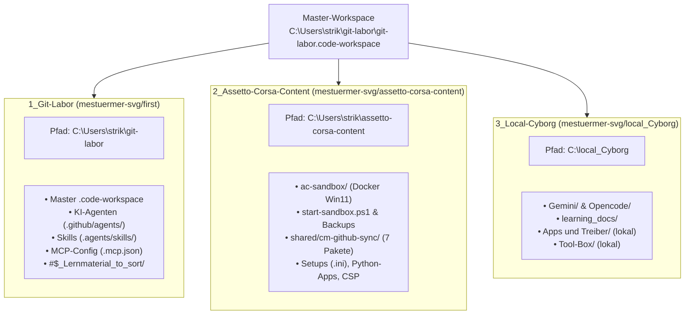
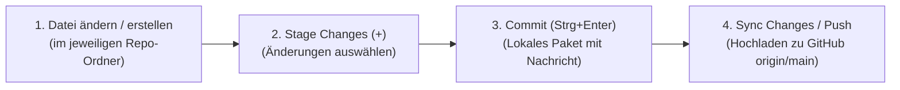

# Lehrmaterial, Workspace-Handbuch & Architektur-Dokumentation (`#$_Lernmaterial_to_sort`)

Dieses Verzeichnis bündelt das zentrale **Handbuch für unseren Multi-Root-Workspace**, alle Praxisanleitungen für **Git, GitHub, VS Code Workspaces & GitHub Codespaces** sowie die technischen Architektur-Dokumente für **VanstrikeCyborg (Laptop)**, **SimRacer (VR-Workstation)**, **KI-Agenten** und die **Docker-Windows-11-Sandbox**.

---

## 1. Übersicht der neuen Multi-Root-Workspace-Struktur

Unser gesamtes System wird über **eine einzige zentrale Master-Workspace-Datei** gesteuert:
👉 **`C:\Users\strik\git-labor\git-labor.code-workspace`**



### Die 3 eingebundenen GitHub-Repositories im Überblick

| # | Name im VS Code Explorer | Lokaler Speicherort | GitHub Remote (`origin`) | Was gehört hier hinein? |
| :--- | :--- | :--- | :--- | :--- |
| **1** | **`1_Git-Labor (mestuermer-svg/first)`** | `C:\Users\strik\git-labor` | `https://github.com/mestuermer-svg/first.git` | **Zentrale Steuerung, KI-Agenten & Dokumentation:** Die Master-Datei `git-labor.code-workspace`, Agenten-Definitionen (`light.agent.md`), Skills, MCP-Server und dieser Lernmaterial-Ordner. |
| **2** | **`2_Assetto-Corsa-Content (mestuermer-svg/assetto-corsa-content)`** | `C:\Users\strik\assetto-corsa-content` | `https://github.com/mestuermer-svg/assetto-corsa-content.git` | **SimRacing, Content Manager & Sandbox (`ac-sandbox`):** Alle 7 AC/CM-Sync-Pakete (`cm-github-sync`), Fahrzeug-Setups/Pitfiles (`.ini`), Telemetrie, Docker-Sandbox-Dateien und SimRacer-Backupskripte. |
| **3** | **`3_Local-Cyborg (mestuermer-svg/local_Cyborg)`** | `C:\local_Cyborg` | `https://github.com/mestuermer-svg/local_Cyborg.git` | **Lokale Laptop-Umgebung (VanstrikeCyborg):** `Gemini`, `Opencode`, `learning_docs` sowie große lokale Sammlungen (`Apps und Treiber`, `Tool-Box` – per `.gitignore` von GitHub ausgeschlossen). |

---

## 2. Arbeiten mit Git, GitHub, Workspaces & Codespaces in VS Code

### 2.1 Committen & Synchronisieren im Multi-Root-Workspace (`Strg + Shift + G`)

Da in unserem Workspace **3 eigenständige Git-Repositories** nebeneinander liegen, zeigt die Quellcodeverwaltung (**Source Control**, `Strg + Shift + G`) in VS Code jedes Repository als eigenen Bereich an:



1. **Prüfen, in welchem Repo die Änderung liegt:**
   * Dokumentations- oder Agenten-Änderungen $\rightarrow$ erscheinen unter **`git-labor` (`first`)**.
   * Setups (`.ini`), Content Manager oder Sandbox-Skripte $\rightarrow$ erscheinen unter **`assetto-corsa-content`**.
   * Lokale Cyborg-/Gemini-Dateien $\rightarrow$ erscheinen unter **`local_Cyborg`**.
2. **Vormerken (Stage):** Klicke neben den gewünschten Dateien (oder auf dem Repo-Header) auf **`+`**.
3. **Commit erstellen:** Gib im Nachrichtenfeld des jeweiligen Repos eine klare Commit-Message ein, z. B.:
   * `docs: Neue Anleitung im Lernmaterial ergänzt`
   * `sync(cm): GT3 Setup für Spa aktualisiert`
   * `feat(sandbox): Startskript erweitert`
   und drücke **`Strg + Enter`** (oder klicke auf **Commit**).
4. **Synchronisieren (Push/Pull):** Klicke auf **Sync Changes** (oder im Terminal `git pull` / `git push`).

---

### 2.2 Neues GitHub-Repository erstellen und in den Workspace einbinden

Wenn künftig ein **4. Projekt / Repository** (z. B. ein neues Tool oder ein eigenes KI-Projekt) hinzukommt, gehst du so vor:

#### Variante A: Direkt über VS Code Oberfläche (Schnellster Weg)
1. Lege lokal einen neuen Ordner an, z. B. `C:\Users\strik\mein-neues-projekt`.
2. Binde ihn in VS Code ein: **Datei $\rightarrow$ Ordner zum Arbeitsbereich hinzufügen...** (*Add Folder to Workspace*).
3. Öffne die Quellcodeverwaltung (`Strg + Shift + G`), klicke bei dem neuen Ordner auf **Repository initialisieren** und danach auf **Publish to GitHub** (wähle *Private* oder *Public* unter `mestuermer-svg`).

#### Variante B: Über das PowerShell-Terminal in VS Code
```powershell
# 1. Neuen Ordner neben git-labor anlegen und initialisieren
New-Item -ItemType Directory -Path "C:\Users\strik\neues-repo"
Set-Location "C:\Users\strik\neues-repo"
git init
"# Neues Projekt" | Out-File -FilePath README.md -Encoding utf8

# 2. Ersten Commit erstellen
git add .
git commit -m "Initial commit"
git branch -M main

# 3. Mit dem auf GitHub angelegten Repository verknüpfen & hochladen
git remote add origin https://github.com/mestuermer-svg/neues-repo.git
git push -u origin main
```

#### Einbindung in die zentrale `git-labor.code-workspace`
Damit das neue Repository dauerhaft Teil unseres Multi-Root-Workspaces bleibt, wird es einfach in `C:\Users\strik\git-labor\git-labor.code-workspace` unter `"folders"` eingetragen:
```json
{
	"name": "4_Neues-Repo (mestuermer-svg/neues-repo)",
	"path": "../neues-repo"
}
```

---

### 2.3 Unterschied: Lokaler VS Code Workspace vs. GitHub Codespaces

| Merkmal | Lokaler Multi-Root-Workspace (`git-labor.code-workspace`) | GitHub Codespaces (Cloud-Entwicklungsumgebung) |
| :--- | :--- | :--- |
| **Wo läuft VS Code?** | Direkt auf deinem PC (**VanstrikeCyborg** oder **SimRacer**). | Auf einer virtuellen Cloud-Maschine (Linux-Container) bei GitHub. |
| **Zugriff auf lokale Hardware & LAN** | **Vollständig:** Direkter Zugriff auf `C:\`, `D:\`, SimRacer (`192.168.178.68`), lokale Docker-Sandbox & Fanatec/VR. | **Isoliert in der Cloud:** Kein direkter Zugriff auf dein Heimnetzwerk (`192.168.178.68`) oder lokale USB-/VR-Hardware. |
| **Wie wird gestartet?** | Datei `C:\Users\strik\git-labor\git-labor.code-workspace` in VS Code öffnen. | Auf GitHub.com im Repo auf den grünen Button **`<> Code` $\rightarrow$ `Codespaces` $\rightarrow$ `Create codespace on main`** klicken (oder in VS Code über die *GitHub Codespaces* Extension). |
| **Wann nutzen?** | **Standard-Arbeitsweise (95 %):** Für SimRacer-Steuerung, Docker-Sandbox, lokale Tools und alle 3 Repos gleichzeitig. | **Unterwegs / Mobil:** Wenn du von einem fremden Gerät (oder im Browser) schnell Dokumentationen, Python-/Lua-Skripte oder Setups in einem einzelnen GitHub-Repo bearbeiten willst. |

> [!TIP]
> **So arbeitest du nahtlos zwischen Codespaces und lokalem Workspace:**
> 1. Wenn du unterwegs in einem **GitHub Codespace** Dateien änderst, führe dort am Ende immer **Commit & Sync Changes (Push)** aus.
> 2. Sobald du wieder am **VanstrikeCyborg** in deinem lokalen Workspace sitzt, klickst du in der Quellcodeverwaltung (`Strg + Shift + G`) auf **Sync Changes / Pull** – und hast sofort alle Cloud-Änderungen auf deiner lokalen SSD.

---

## 3. Inhaltsverzeichnis aller Dokumente in `#$_Lernmaterial_to_sort`

<details open>
<summary><h3>3.1 Git, GitHub & Visual Studio Code Grundlagen</h3></summary>

* **[Git & Source Control in VS Code: Einsteiger-Anleitung zur Synchronisation](./git-source-control-anleitung-fuer-einsteiger.md)**
  * Der 4-Stationen-Workflow (Working Directory $\rightarrow$ Stage $\rightarrow$ Commit $\rightarrow$ Sync/Push), `.gitignore`-Regeln und Konfliktlösung.
* **[VS Code & GitHub: Einrichtung, Verbindung und Shell-Befehle](./vsc+git.md)**
  * Grundlagen zu `git init`, `git config`, `git pull/push` und Vergleich zwischen lokalem `.git`-Ordner und GitHub Remote.
* **[Diagnose & Einrichtung: Git, GitHub & MCP in VS Code](./diagnose-und-einrichtung-mcp-git-vscode.md)**
  * Einrichtung und Fehlerbehebung der GitHub- und MCP-Integration in VS Code.
* **[Visual Studio Code Dokumentation](./visual_studio_code_doku.md)** & **[VS Code Kurzreferenz](./vsc.md)**
  * Bedienung, Tastenkürzel und Arbeitsbereiche in VS Code.

</details>

<details open>
<summary><h3>3.2 KI-Agenten, Localhost-Proxy, Gemini & MCP</h3></summary>

* **[Architektur-Übersicht: VS Code Agent, Localhost-Proxy, Gemini & Antigravity](./uebersicht-vscode-agent-localhost-gemini-antigravity.md)**
  * Zusammenspiel zwischen lokalem VS Code, `cli-proxy-api.exe` (Port `8317`), lokalen MCP-Servern und Cloud-Modellen.
* **[VS Code KI-Agent, MCP & Gemini Anleitung](./VS_Code_KI_Agent_MCP_Gemini_Anleitung.md)**
  * Konfiguration von KI-Agenten, Model Context Protocol (MCP) und Gemini-Tools.
* **[Agent Setup](./Agent_setup.md)**, **[Agent Guideline](./Agent-guidline.md)**, **[Agent Ruler](./agent_ruler.md)** & **[Skill-Vorlage](./SKILL.md)**
  * Richtlinien, Rollenverteilung und Erstellung eigener Agenten-Skills.
* **[Gemini Ökosystem Übersicht](./gemini_kosystem_bersicht.md)**, **[Lernmaterial Google Antigravity](./lernmaterial-google-antigravity.md)** & **[API Keys Übersicht](./API_Keys.md)**
  * Überblick über die genutzten KI-Plattformen und Schnittstellen.
* **[Diagnose & Lösung: Antigravity Server Port 8000 / 8317](./diagnose-und-loesung-antigravity-server-port8000-8317.md)** & **[Verbindungsbericht VS Code – GitHub – Gemini](./verbindungsbericht-vscode-github-gemini.md)**
  * Port-Konfliktlösung und Verbindungsdiagnosen.

</details>

<details open>
<summary><h3>3.3 Docker-Windows-11-Sandbox & Assetto Corsa (SimRacer)</h3></summary>

* **[Handbuch: Light Agent & Assetto Corsa 7-Pakete-Struktur](../../assetto-corsa-content/ac-sandbox/LIGHT-AGENT-UND-AC-STRUKTUR.md)** *(im Repo `assetto-corsa-content`)*
  * Komplette Dokumentation des Light Agenten und der 7 `cm-github-sync`-Pakete.
* **[Docker Windows-11 Sandbox: Anleitung & Betrieb](./SANDBOX_ANLEITUNG.md)**
  * Aufbau, Start (`start-sandbox.ps1`), Web-VNC (`8006`), RDP (`3390`) und SSH-Bridge (`2222`).
* **[Sandbox-Umzug & Skalierung auf den SimRacer](./sandbox-umzug-skalierung-simracer.md)**
  * Migration der 64-GB/160-GB Sandbox vom Laptop auf die SimRacer-Workstation (`192.168.178.68`).
* **[Docker Windows-11 Sandbox: Steam & KI-Agenten-Architektur](./docker-windows-steam-ki-agent-architektur.md)**, **[Docker SBX Anleitung](./docker-sbx-anleitung.md)**, **[Docker Grundlagen](./docker.md)** & **[Diagnose & Reparatur Docker / Antigravity](./diagnose-und-reparatur-docker-antigravity.md)**
  * Container-Virtualisierung mit QEMU/KVM und Fehlerbehebung.
* **[Projektplanung, Umsetzungs-Logbuch & Master-Checkliste](./planing.md)** & **[Prozess-Log](./prozess-log.md)**
  * Spezifikation für **Sarah Coach**, **Light Agent** und die Betriebsmodi (`ENGINEERING`, `LIVE_RACE`, `PITBOX_SETUP`).

</details>

<details open>
<summary><h3>3.4 Multi-PC-Hardware, NVIDIA MCP & System-Backup (Veeam)</h3></summary>

* **[Multi-PC-Architektur & Einsatzkonzept: KI-Agents, Simulation & Entwicklung](./multi-pc-architektur-ki-agents-simracing.md)**
  * Aufgabenteilung zwischen *VanstrikeCyborg* (Engineering-Laptop) und *SimRacer* (Ryzen 9 3900X, 32 GB RAM, RTX 5070 Ti).
* **[Technische Hardware- und Stabilitätsanalyse: Docker-Sandbox, KI-Agenten & Sim-Setup](./hardware-analyse-system-stabilitaet-docker-ki.md)** & **[Diagnose NVIDIA App Agent MCP-Zugriff](./diagnose-und-loesung-nvidia-app-agent-mcp-zugriff.md)**
  * Hardware-Dimensionierung, RAM-/SSD-Management und GPU-Konfiguration.
* **[Praxisanleitung: System-Image & Wiederherstellung (Veeam Agent Free) für SimRacer](./simracer-system-backup-wiederherstellung-veeam.md)**
  * 2-Stufen-Backup-Strategie: Bootfähiges Windows-Image + Sekunden-Backup (`backup-simracer-configs.ps1`) für Setups, Content Manager, Fanatec und SteamVR.

</details>

