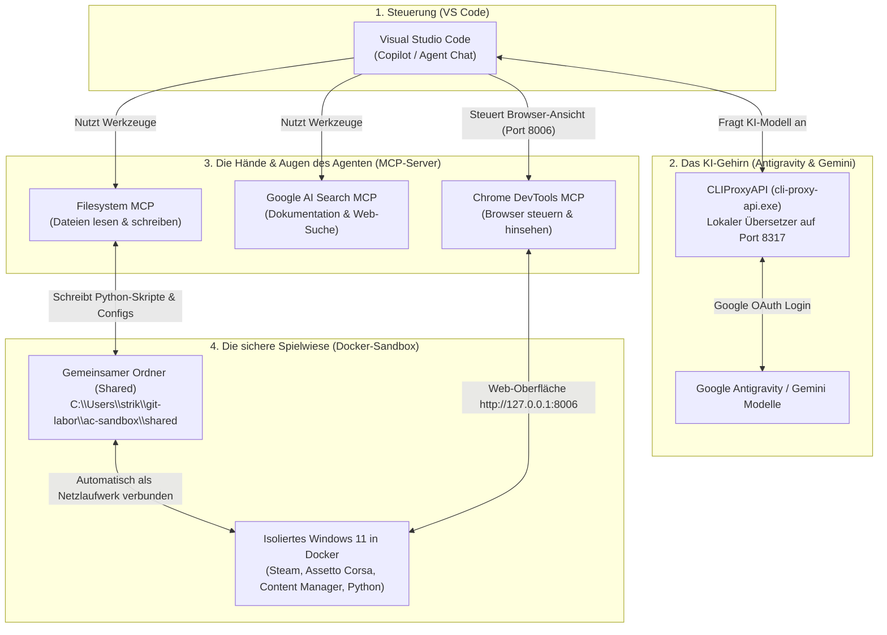

# Handbuch & Dokumentation: KI-Agent, MCP-Server & Windows-11-Docker-Sandbox in VS Code

Dieses Dokument erklärt Schritt für Schritt und leicht verständlich (auch für Einsteiger), **welche Probleme ursprünglich vorlagen**, **welche Dateien warum angepasst wurden** und **wie das Gesamtsystem aus KI-Agent, Antigravity, MCP-Servern und der Docker-Sandbox für Assetto Corsa zusammenarbeitet**.

---

## 1. Überblick: Wie das System aufgebaut ist (Das große Ganze)

Wenn man in Visual Studio Code mit einem KI-Agenten arbeitet, spielen vier verschiedene Ebenen zusammen. Wenn eine davon blockiert wird, funktioniert die Kette nicht mehr:



### Kurz erklärt für Einsteiger:
* **Antigravity / `cli-proxy-api.exe` (Das Gehirn):** Ein kleines Hilfsprogramm auf Ihrem PC, das im Hintergrund auf `127.0.0.1:8317` lauscht. Es nimmt Anfragen aus VS Code entgegen und leitet sie über Ihr Google-Konto an die Gemini-/Antigravity-Modelle weiter.
* **MCP-Server (Die Werkzeuge):** *Model Context Protocol (MCP)* ist ein Standard, über den ein KI-Agent Werkzeuge bekommt. Ohne MCP kann eine KI nur Text schreiben. Mit MCP bekommt sie „Hände“ (Dateien bearbeiten via *Filesystem MCP*, Webseiten anschauen via *Chrome DevTools MCP*, Wissen nachschlagen via *Google AI Search MCP*).
* **Docker-Sandbox (Die Werkbank):** Ein komplett eigener, abgeschotteter Windows-11-Computer, der in einem Container (Docker) läuft. Wenn der Agent dort drin Programme installiert oder Einstellungen für Assetto Corsa testet, bleibt Ihr echter Windows-PC zu 100 % sauber und unangetastet.

---

## 2. Was ursprünglich kaputt war – und wie es repariert wurde

Hier sind die **fünf konkreten Ursachen**, warum zuvor Fehlermeldungen auftraten, und was wir geändert haben:

### Problem 1: Windows „Intelligente App-Steuerung“ blockierte `cli-proxy-api.exe`
* **Der Fehler:** `Eine Anwendungssteuerungsrichtlinie hat diese Datei blockiert`
* **Warum passierte das?** Windows 11 besitzt eine Sicherheitsfunktion namens *Smart App Control (Intelligente App-Steuerung)*. Wenn diese aktiv ist, verbietet Windows den Start aller Programme, die kein teures Firmen-Zertifikat von Microsoft besitzen. Da `cli-proxy-api.exe` ein Open-Source-Entwicklerwerkzeug ohne solche Signatur ist, hat Windows den Start verweigert.
* **Folge:** Ohne laufende `cli-proxy-api.exe` konnte VS Code keine Verbindung zu Antigravity aufbauen.
* **Lösung:** Nach dem Deaktivieren der App-Steuerung in der Windows-Sicherheit darf `cli-proxy-api.exe` nun normal starten.

---

### Problem 2: Rotes `(x)` bei den MCP-Servern (`npx` vs. `npx.cmd`)
* **Der Fehler:** Im VS-Code-Menü *Agent Customizations → MCP Servers* zeigten `local-workspace-filesystem` und `chrome-devtools-mcp` ein rotes `(x)` (`PSSecurityException / UnauthorizedAccess`).
* **Warum passierte das?**
  Node.js installiert unter Windows zwei Startdateien für `npx`:
  1. `npx.ps1` (ein PowerShell-Skript)
  2. `npx.cmd` (eine klassische Windows-Batchdatei)
  Wenn in der MCP-Konfiguration nur `"command": "npx"` steht, versucht VS Code automatisch `npx.ps1` zu starten. Da VS Code seine Hintergrundprozesse ohne Ihr persönliches PowerShell-Profil startet, greift die Windows-Standardsperre für `.ps1`-Skripte (`ExecutionPolicy: Restricted`) und bricht den Start sofort ab.
* **Lösung:**
  In allen MCP-Dateien wurde `"command": "npx"` auf **`"command": "npx.cmd"`** umgestellt (und das Flag `"-y"` ergänzt, damit `npx` nicht unsichtbar im Hintergrund auf eine `[y/n]`-Tastatureingabe wartet).

---

### Problem 3: `Google AI Search MCP` meldete `Unsupported. See Migrations for details.`
* **Der Fehler:** Der Server startete im Copilot-Agenten nicht und zeigte in Rot `Unsupported`.
* **Warum passierte das?**
  In der Datei [.vscode/mcp.json](file:///C:/Users/strik/git-labor/.vscode/mcp.json) standen Platzhalter wie `"${input:GEMINI_API_KEY}"`. Solche `${input:...}`-Variablen öffnen in VS Code normalerweise ein kleines Eingabefenster für den Benutzer. Der neue **Copilot Background/CLI Agent** kann solche Pop-up-Fenster technisch nicht anzeigen und lehnt jeden MCP-Server ab, der `${input:...}` verwendet.
* **Lösung:**
  Die `${input:...}`-Abfragen wurden aus [.vscode/mcp.json](file:///C:/Users/strik/git-labor/.vscode/mcp.json) und Ihrer globalen [User/mcp.json](file:///C:/Users/strik/AppData/Roaming/Code/User/mcp.json) entfernt und durch feste, direkt funktionierende Werte (`"AI_PROVIDER": "vertex"`, `"GOOGLE_CLOUD_PROJECT": "aicode-consumers"`, `"GOOGLE_CLOUD_LOCATION": "us-central1"`) ersetzt.

---

### Problem 4: Gemini CLI in der PowerShell brach mit `402 Payment Required` ab
* **Der Fehler:** `Your prepayment credits are depleted (code: 402)` beim Aufruf von `gemini`.
* **Warum passierte das?**
  In Ihrer Datei [.gemini/settings.json](file:///C:/Users/strik/.gemini/settings.json) war eingestellt, dass die Gemini CLI einen **API-Key** (`"selectedType": "gemini-api-key"`) verwenden soll. Auf dem zugehörigen Google-AI-Studio-Konto war das Prepaid-Guthaben leer. Gleichzeitig hatten Sie sich aber bereits erfolgreich per Google-Konto (OAuth) angemeldet (`oauth_creds.json`).
* **Lösung:**
  In [.gemini/settings.json](file:///C:/Users/strik/.gemini/settings.json) wurde `"selectedType"` auf **`"oauth-personal"`** umgestellt. Damit nutzt die Gemini CLI wieder Ihr reguläres Google-Login statt des leeren API-Keys.

---

### Problem 5: Das Missverständnis um die „Sandbox“-Einstellung in VS Code
* **Das Problem:** In den VS-Code-Einstellungen war `"chat.agent.sandbox.enabled": "on"` aktiviert.
* **Warum ist das wichtig zu verstehen?**
  Es gibt zwei völlig unterschiedliche Dinge, die beide „Sandbox“ heißen:
  1. **Die VS-Code-Einstellung (`chat.agent.sandbox.enabled`):** Das ist **kein** virtueller PC, sondern eine **Fußfessel für den Agenten**. Wenn diese auf `"on"` steht, dürfen MCP-Server nicht mehr ins Internet telefonieren (kein Google AI, kein npm), nicht auf andere Ordner zugreifen und kein Docker bedienen.
  2. **Eine echte Docker-Sandbox (Container):** Das ist ein **eigener, isolierter Computer im Container**, in dem Programme wie Steam, Assetto Corsa und Python installiert werden können, ohne Ihr echtes System zu verändern.
* **Lösung:**
  Wir haben die Fußfessel in VS Code gelöst (`"chat.agent.sandbox.enabled": "off"`), damit der Agent und seine MCP-Server frei arbeiten können, und stattdessen eine **echte Windows-11-Sandbox in Docker** eingerichtet.

---

## 3. Übersicht aller angepassten & neu erstellten Dateien

| Datei | Zweck | Was wurde gemacht? |
| :--- | :--- | :--- |
| [.mcp.json](file:///C:/Users/strik/git-labor/.mcp.json) | Workspace-MCP für Dateizugriffe | `"command"` von `"npx"` auf `"npx.cmd"` geändert, damit der Filesystem-Server ohne PowerShell-Fehler startet. |
| [.vscode/mcp.json](file:///C:/Users/strik/git-labor/.vscode/mcp.json) | Workspace-MCP für Google AI Search | `${input:...}`-Variablen entfernt, `"npx.cmd"` mit `"-y"` und feste Projektwerte eingetragen. |
| [mcp-config.json](file:///C:/Users/strik/.copilot/mcp-config.json) | Globale Copilot-MCP-Konfiguration | Bei `chrome-devtools-mcp` auf `"npx.cmd"` umgestellt und `"-y"` ergänzt. |
| [User/mcp.json](file:///C:/Users/strik/AppData/Roaming/Code/User/mcp.json) | Globale VS-Code-MCP-Konfiguration | Ebenfalls von `${input:...}` bereinigt und auf `"npx.cmd"` umgestellt. |
| [.gemini/settings.json](file:///C:/Users/strik/.gemini/settings.json) | Konfiguration der Gemini CLI | Authentifizierung von `"gemini-api-key"` auf `"oauth-personal"` umgestellt. |
| [User/settings.json](file:///C:/Users/strik/AppData/Roaming/Code/User/settings.json) | Globale VS-Code-Einstellungen | `"chat.agent.sandbox.enabled": "off"` und `"task.allowAutomaticTasks": "on"` gesetzt. |
| [.vscode/settings.json](file:///C:/Users/strik/git-labor/.vscode/settings.json) | Workspace-Einstellungen für `git-labor` | Automatische Tasks beim Öffnen des Ordners erlaubt (`"task.allowAutomaticTasks": "on"`). |
| [.vscode/tasks.json](file:///C:/Users/strik/git-labor/.vscode/tasks.json) | Automatische Start-Aufgabe in VS Code | Führt beim Öffnen des Workspaces (`runOn: "folderOpen"`) automatisch das Start-Skript aus. |
| [.wslconfig](file:///C:/Users/strik/.wslconfig) | WSL2-Konfiguration von Windows | `nestedVirtualization=true` aktiviert, damit Windows 11 in Docker die volle CPU-Beschleunigung (KVM) nutzen kann. |
| [docker-compose.yml](file:///C:/Users/strik/git-labor/ac-sandbox/docker-compose.yml) | Bauplan der Windows-11-Sandbox | Definiert den `dockurr/windows`-Container (Windows 11, 6 GB RAM, 4 Kerne, 64 GB Disk, Deutsch, Ports `8006` & `3389`). |
| [start-sandbox.ps1](file:///C:/Users/strik/git-labor/ac-sandbox/start-sandbox.ps1) | Start-Skript für den gesamten Stack | Prüft und startet automatisch `cli-proxy-api.exe`, Docker Desktop und den Windows-11-Container. |
| [setup-guest-win11.ps1](file:///C:/Users/strik/git-labor/ac-sandbox/shared/scripts/setup-guest-win11.ps1) | Installations-Skript für das Gast-Win11 | Liegt im geteilten Ordner bereit, um innerhalb der Sandbox Steam & Python automatisch per `winget` zu installieren. |

---

## 4. Praxisleitfaden: Worauf Sie im Betrieb mit Agent & Docker achten müssen

### A. Was passiert beim Öffnen von VS Code?
Sobald Sie den Ordner `C:\Users\strik\git-labor` in VS Code öffnen, startet im Hintergrund automatisch die Aufgabe **`Auto-Start: Antigravity + Docker AC-Sandbox (Win11)`**:
1. Sie prüft, ob `cli-proxy-api.exe` auf Port `8317` läuft (und startet ihn bei Bedarf).
2. Sie prüft, ob **Docker Desktop** läuft (und startet es bei Bedarf).
3. Sie startet den Container `ac-win11-sandbox` über Docker Compose.

> [!NOTE]
> **Beim allerersten Start des Windows-11-Containers:**
> Beim ersten Mal lädt der Container einmalig das offizielle deutsche Windows-11-Image von Microsoft herunter und installiert sich vollautomatisch. Sie können dabei live im Browser unter **`http://127.0.0.1:8006`** zuschauen! Alle späteren Starts dauern nur noch wenige Sekunden, weil die virtuelle Festplatte im Ordner `C:\Users\strik\git-labor\ac-sandbox\storage` dauerhaft gespeichert bleibt.

### B. Wie Sie (und der Agent) in die Windows-11-Sandbox hineinschauen
Sie haben zwei Wege, um den Desktop des Windows 11 im Docker-Container zu sehen und zu bedienen:
1. **Im Webbrowser (und für den Agenten):**
   Öffnen Sie **`http://127.0.0.1:8006`**.
   *Vorteil:* Auch Ihr KI-Agent kann über den **`chrome-devtools-mcp`** diese Adresse öffnen, Screenshots vom Windows-11-Desktop machen und sehen, was im Content Manager passiert!
2. **Über die Windows-Remotedesktopverbindung (`mstsc.exe`):**
   Drücken Sie `Win + R`, tippen Sie `mstsc` ein und verbinden Sie sich mit **`127.0.0.1:3389`** (Benutzername: `Docker`, Passwort: `admin` bzw. leer). Das ist besonders flüssig und unterstützt Audio sowie Copy & Paste.

### C. Wie der Agent Dateien in die Sandbox schickt (Der `Shared`-Ordner)
Damit der Agent Python-Skripte für Assetto Corsa oder Konfigurationsdateien (`.ini`, `.json`, `.lua`) für den Content Manager schreiben kann, ohne umständlich über das Netzwerk kopieren zu müssen, gibt es eine direkte Brücke:
* **Auf Ihrem echten PC (für VS Code & den Agenten):**
  `C:\Users\strik\git-labor\ac-sandbox\shared`
* **Innerhalb der Windows-11-Sandbox:**
  Auf dem Desktop des Docker-Windows liegt ein Ordner namens **`Shared`** (Netzwerkpfad `\\host.lan\Data`).
* **Wie man damit arbeitet:**
  Jede Datei, die der Agent in `C:\Users\strik\git-labor\ac-sandbox\shared\apps_python` oder `cfg_content_manager` speichert, ist **in derselben Sekunde** im Windows-11-Container sichtbar. Innerhalb der Sandbox können Sie (oder das Skript) diese Ordner direkt mit dem Assetto-Corsa-Ordner verknüpfen.

### D. Nützliche Befehle für den Alltag (im VS-Code-Terminal)
Falls Sie den Zustand der Sandbox manuell prüfen oder steuern möchten:

```powershell
# 1. Status des Windows-11-Containers prüfen
docker ps

# 2. Container sauber herunterfahren (Daten bleiben im Ordner 'storage' erhalten!)
cd C:\Users\strik\git-labor\ac-sandbox
docker compose stop

# 3. Container wieder starten
cd C:\Users\strik\git-labor\ac-sandbox
docker compose start
```
