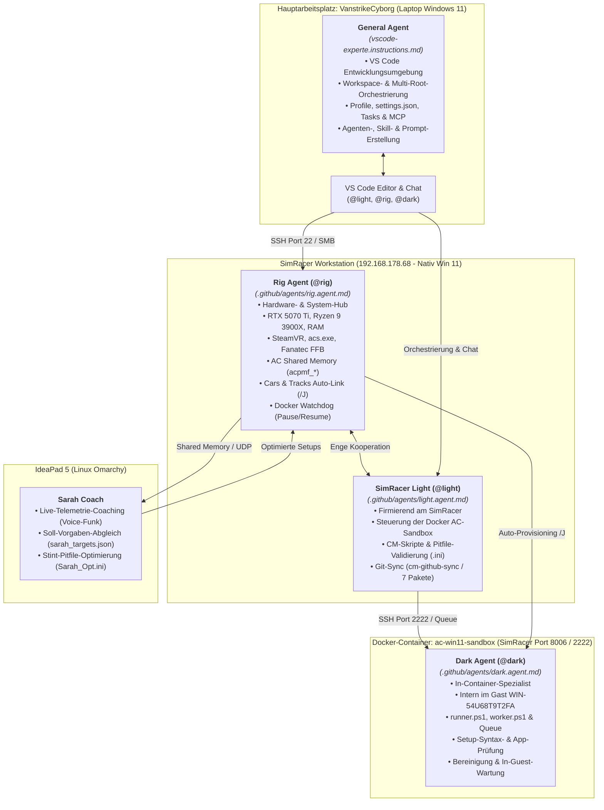
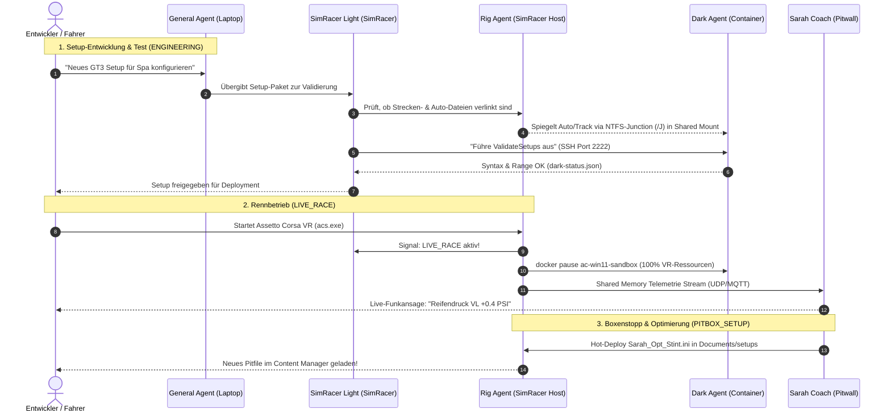
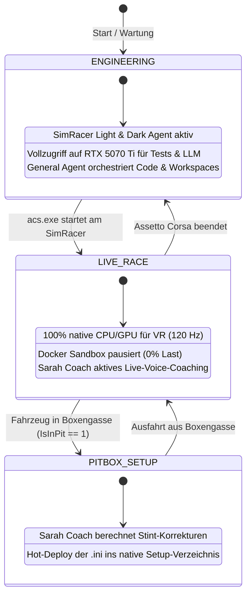
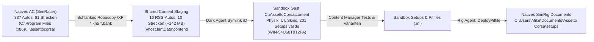

# KI-Agenten-Systemarchitektur & Rollen-Handbuch

> **Status:** Aktiv & Geprimt (Stand: November 2026)  
> **Hauptarbeitsplatz:** MSI Cyborg 15 (`VanstrikeCyborg`) & SimRacer Workstation (`192.168.178.68`)  
> **Architektur-Modell:** 5-Rollen-Agentenverbund (General Agent, SimRacer Light, Rig Agent, Dark Agent, Sarah Coach)

---

## 1. Grafische Übersicht: Topologie & Standorte

Das folgende Architektur-Diagramm veranschaulicht, auf welchen physikalischen und virtuellen Systemen die einzelnen Agenten angesiedelt sind und wie sie zusammenarbeiten:



---

## 2. Die 5 Agenten im Detail

| Agent | Aufruf / Datei | Standort & Umgebung | Kern-Zuständigkeiten |
| :--- | :--- | :--- | :--- |
| **General Agent** | Automatisch aktiv / global<br/>`vscode-experte.instructions.md` | **Laptop (`VanstrikeCyborg`)**<br/>VS Code Hauptinstanz | **Entwicklung & Master-Konfiguration:**<br/>• Verwaltung der Workspaces (`.code-workspace`)<br/>• Konfiguration von Profilen, `settings.json`, `tasks.json`<br/>• Erstellung und Pflege aller Custom Agents, Skills und Prompts<br/>• Abstimmung von KI-Modellen (Copilot, Gemini, Antigravity, MCP) |
| **SimRacer Light** | `@light`<br/>`.github/agents/light.agent.md` | **SimRacer (`192.168.178.68`)**<br/>Arbeitet Hand in Hand mit Rig Agent | **Sandbox- & Content-Orchestrierung:**<br/>• Steuerung der Docker-Windows-11-Sandbox (`ac-win11-sandbox`)<br/>• Validierung von Content-Manager-Skripten und Pitfiles (`.ini`)<br/>• Synchronisation der 7 Assetto-Corsa-Pakete (`cm-github-sync`)<br/>• Erteilung von Testaufträgen an den Dark Agent |
| **Rig Agent** | `@rig`<br/>`.github/agents/rig.agent.md` | **SimRacer Host Nativ**<br/>Windows 11 (SSH Port `22`) | **Hardware-Hub & VR-Schutz:**<br/>• Überwachung von RTX 5070 Ti, Ryzen 9 3900X, SteamVR & `acs.exe`<br/>• Telemetrie-Snapshotting aus AC Shared Memory<br/>• Content-Staging (Junctions `/J` für Autos & Strecken in Sandbox)<br/>• Lifecycle-Watchdog: Pausiert Docker bei `LIVE_RACE` zugunsten von 120 FPS |
| **Dark Agent** | `@dark`<br/>`.github/agents/dark.agent.md` | **Docker-Gast Windows 11**<br/>`ac-win11-sandbox` (SSH Port `2222`) | **In-Container-Ausführung:**<br/>• Lokale Skriptausführung via `runner.ps1`<br/>• Trockentests von Setups und Python-HUD-Apps im Gast<br/>• Content-Manager-Prozessüberwachung im Container<br/>• Cache-Bereinigung & Hygiene im Gast-System |
| **Sarah Coach** | Service / Voice<br/>`sarah_targets.json` | **IdeaPad 5 (Linux Omarchy)**<br/>Rig-Pitwall & HMI | **Rennstrategie & Live-Coaching:**<br/>• Live-Sprachcoaching über Funk auf Geraden<br/>• Soll-Ist-Vergleich der Reifentemperaturen und Deltas<br/>• Automatische Berechnung korrigierter Boxenstopp-Pitfiles (`.ini`) |

---

## 3. Datenflüsse & Schnittstellen-Matrix



---

## 4. Die drei Betriebsmodi im Überblick



---

## 5. Leitfaden: Wie werden die Agents „geprimt“ und aufgerufen?

### 5.1 General Agent (Laptop `VanstrikeCyborg`)
* **Wie er aktiv ist:** Automatisch bei jeder Anfrage im VS Code Chat auf dem Laptop geladen über:
  `c:\Users\strik\AppData\Roaming\Code\User\prompts\vscode-experte.instructions.md`
* **Typische Aufgaben:**
  - *"Prüfe meine Workspace-Dateien auf fehlerhafte Pfade."*
  - *"Passe die globale settings.json mit Vorschau an."*
  - *"Erstelle einen neuen Subagenten oder Skill."*

### 5.2 SimRacer Light (`@light`)
* **Aufruf im Chat:** Tippe `@light` gefolgt von der Aufgabe.
* **Typische Aufgaben:**
  - `@light Status der Docker-Sandbox prüfen`
  - `@light Synchronisiere die 7 AC-Pakete mit dem cm-github-sync`
  - `@light Überprüfe das Pitfile Spa_GT3.ini in der Sandbox`

### 5.3 Rig Agent (`@rig`)
* **Aufruf im Chat:** Tippe `@rig` gefolgt von der Aufgabe (oder Skript `Invoke-RigAgent.ps1`).
* **Typische Aufgaben:**
  - `@rig Prüfe GPU-Temperatur, VRAM und SteamVR-Prozesse`
  - `@rig Verlinke Porsche 911 GT3 R in das Sandbox-Content-Verzeichnis`
  - `@rig Kopiere das optimierte Setup Sarah_Opt.ini nach Documents\Assetto Corsa\setups`

### 5.4 Dark Agent (`@dark`)
* **Aufruf im Chat:** Tippe `@dark` (oder via SSH-Bridge Port 2222 / `Invoke-DarkAgent.ps1`).
* **Typische Aufgaben:**
  - `@dark Führe runner.ps1 -Action ValidateSetups aus`
  - `@dark Teste Python-App im Gast-System C:\AssettoCorsa\apps\python`
  - `@dark Bereinige Shader-Caches und temporäre Dumps im Gast`

---

## 6. Verifizierte Content-Staging- & Hot-Deploy-Pipeline



### 6.1 Samba-NTFS-Junction Fix

* **Herausforderung:** Ursprüngliche Windows-Junctions (`mklink /J`) verweisen auf absolute Windows-Pfade, die Linux-Samba (`dockurr/windows`) nicht auflösen kann (`Test-Path` = `False`).
* **Lösung:** Staging via Robocopy mit Ausschluss riesiger 3D-Geometrien (`*.kn5`) und Soundbänke (`*.bank`). Dadurch werden nur Physik-, Setup-, UI- und Skin-Dateien übertragen (nur ~142 MB für 16 RSS-Fahrzeuge und 10 Strecken).
* **Ergebnis:** Dark Agent und Content Manager in der Sandbox haben 100 % Lese- und Schreibzugriff auf alle Fahrzeugdaten, Setup-Menüs und Skins bei minimalem Speicherverbrauch.

### 6.2 Getesteter Setup-Transfer (Hot-Deploy)

```powershell
# Vollständiger Setup-Sync vom Staging-Verzeichnis auf das native SimRig:
.\ac-sandbox\Invoke-RigAgent.ps1 -Action DeployPitfile

# Gezieltes Deployen einer einzelnen Setup-Datei:
.\ac-sandbox\Invoke-RigAgent.ps1 -Action DeployPitfile -PitfileSource "C:\ac-sandbox\shared\cm-github-sync\01_Documents_AC_Setups\rss_formula_hybrid_x_2026\acu_cota_2021\Quali_Opt.ini" -PitfileTarget "C:\Users\Mike\Documents\Assetto Corsa\setups\rss_formula_hybrid_x_2026\acu_cota_2021\Quali_Opt.ini"
```
