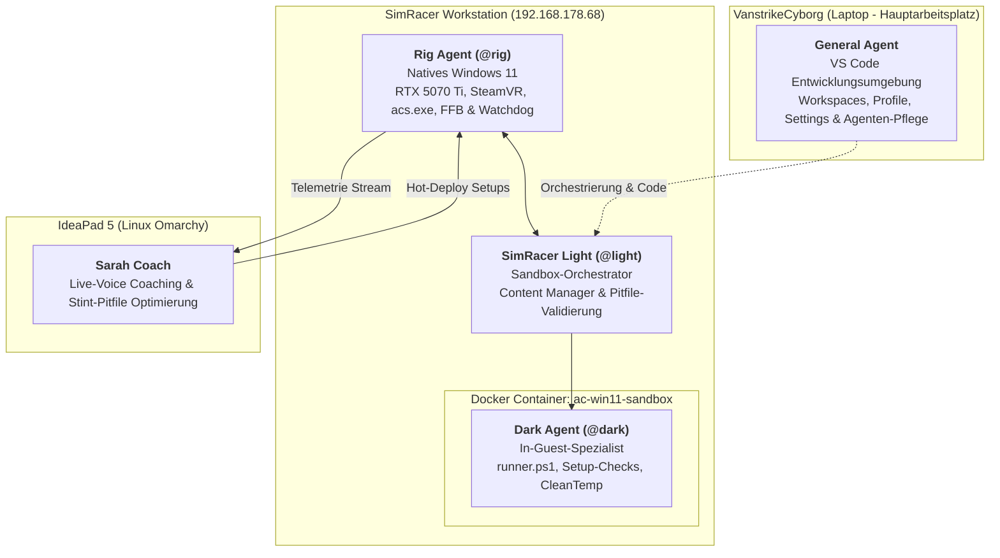

> **Thema:** Übersicht und Dokumentation der 5 KI-Agenten (General Agent, SimRacer Light, Rig Agent, Dark Agent & Sarah Coach)
> **Autor:** Michael Stürmer
> **Datum:** 06.11.2026

<b>1. Lernziele</b>

* Das Zusammenspiel und die klare Rollentrennung zwischen Laptop (`VanstrikeCyborg`), SimRacer Host, Docker-Sandbox und Pitwall verstehen.
* Die genaue Funktionsweise und Aufrufpraxis jedes Agenten (`@light`, `@rig`, `@dark`, General Agent) beherrschen.
* Wissen, wie Agenten-Dateien (`*.agent.md`, `*.instructions.md`) geprimt und in VS Code sowie der Dokumentation gepflegt werden.

<b>2. Kernkonzepte & Agenten-Übersicht</b>

2.1 Grafische Architektur-Topologie

2.2 Die 5 Agenten-Spezifikationen im Dokumentations-Verzeichnis

Jeder Agent ist mit seiner vollständigen Konfiguration in diesem Verzeichnis als Referenz hinterlegt:

| Agent | Datei | Standort & Modus | Hauptverantwortung |
| :--- | :--- | :--- | :--- |
| **General Agent** | [general.agent.md](./general.agent.md) | Laptop `VanstrikeCyborg` | VS Code Umgebung, Multi-Root-Workspaces, Profile, `settings.json`, Tasks, Agent- & Skill-Erstellung |
| **SimRacer Light** | [light.agent.md](./light.agent.md) | SimRacer (`192.168.178.68`) | Docker-Sandbox-Steuerung, Content-Manager-Skripte, Pitfile-Validierung (`.ini`), Git-Sync |
| **Rig Agent** | [rig.agent.md](./rig.agent.md) | SimRacer Nativ (Port 22) | RTX 5070 Ti, Ryzen 9 3900X, SteamVR, AC Shared Memory, Content-Staging via Junctions (`/J`), VR-Watchdog |
| **Dark Agent** | [dark.agent.md](./dark.agent.md) | Docker-Gast (Port 2222) | In-Container-Ausführung (`runner.ps1`), Setup-Syntaxprüfung, Python-Apps, lokale Hygiene |
| **Sarah Coach** | [sarah-coach.md](./sarah-coach.md) | IdeaPad 5 (Linux Omarchy) | Live-Telemetrie-Coaching (Voice-Funk) & Stint-Pitfile-Kalkulation (`Sarah_Opt_Stint.ini`) |

2.3 Betriebsmodi & Ressourcen-Steuerung

1. **`ENGINEERING`:** Volle Lastfreigabe für Docker-Sandbox und lokale KI-Modelle. SimRacer Light und Dark Agent testen Content-Manager-Skripte und Setups trocken in der Sandbox.
2. **`LIVE_RACE`:** Sobald `acs.exe` am SimRacer läuft, pausiert der Rig Agent die Sandbox (`docker pause`). 100 % CPU- und GPU-Leistung stehen für 120 FPS VR bereit. Sarah Coach übernimmt das Live-Coaching.
3. **`PITBOX_SETUP`:** Sobald das Fahrzeug in der Box steht (`IsInPit == 1`), generiert Sarah Coach das optimierte Boxenstopp-Pitfile und Rig Agent spielt es per Hot-Deploy ein.

<b>3. Übungsaufgaben</b>

1. **Aufgabe 1:** Erkläre, warum der **General Agent** auf dem Laptop verbleibt, während **SimRacer Light** und **Rig Agent** auf der SimRacer-Workstation operieren.
2. **Aufgabe 2:** Welcher Agent führt die syntaktische Prüfung eines `.ini`-Setups innerhalb der Docker-Windows-11-Sandbox durch und über welchen Port wird er angesprochen?
3. **Aufgabe 3:** Was passiert mit der Docker-Sandbox, sobald der Fahrer am SimRacer `acs.exe` im VR-Modus startet?

<b>4. Weiterführende Links & Quellen</b>

* [Master-Architekturübersicht: 4-Knoten-Verbund](../multi-pc-architektur-ki-agents-simracing.md)
* [Gesamt-Architektur & Flussdiagramme](../agenten-system-architektur-uebersicht.md)
* [Sandbox-Anleitung & 7 AC-Sync-Pakete](../SANDBOX_ANLEITUNG.md)
* [Hardware-Analyse: MSI Cyborg 15 & SimRacer Stabilität](../hardware-analyse-system-stabilitaet-docker-ki.md)

<b>5. Chips & Kernaussagen</b>

* **General Agent = Leitstand für Entwicklung:** Laptop-Zentrale für VS Code, Workspaces (`.code-workspace`), Profile und KI-Modelle.
* **SimRacer Light = Sandbox-Orchestrator:** Kooperiert am SimRacer mit Rig Agent für isolierte Trockentests und Pitfiles.
* **Rig Agent = Hardware-Wächter:** Schützt VR-Frametimes (120 Hz) durch automatisches Pausieren der Sandbox bei Spielstart.
* **Dark Agent = In-Container-Executor:** Agiert rein im Gast-Windows-11 über SSH Port 2222.
* **Sarah Coach = Renningenieurin:** Analysiert Live-Telemetrie und liefert optimierte Stint-Setups für den Boxenstopp.

---
*Hinweis zur Organisation:* Die erstellte Dokumentation ist am Drehlaufwerk abgelegt und mit einer kurzen Zusammenfassung von den Chips auch in den Notebooks verlinkt.
