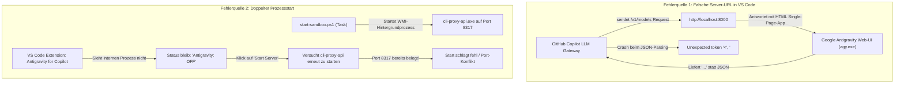

# Diagnose- und Lösungsbericht: Antigravity-Server, Port-Kollision (8000 vs. 8317) & Copilot LLM Gateway

**Datum:** 02. November 2026  
**Workspace:** `C:\Users\strik\git-labor`  
**Speicherort:** `C:\Users\strik\git-labor\#$_Lernmaterial_to_sort`  
**Betroffene Komponenten:** GitHub Copilot LLM Gateway, Antigravity for Copilot (`CLIProxyAPI`), Google Antigravity Web-UI, VS Code Workspace Settings  

---

## 1. Ausgangslage & Fehlermeldung

Beim Starten von Visual Studio Code und der Arbeit mit den KI-Modellen erschien im Output-Log folgende Fehlerschleife:

```text
Fetching models from inference server...
Daily usage fetch failed: net::ERR_CONNECTION_REFUSED
ERROR: Failed to connect to inference server at http://localhost:8000: net::ERR_CONNECTION_REFUSED
Fetching models from inference server...
ERROR: Failed to connect to inference server at http://localhost:8000: net::ERR_CONNECTION_REFUSED
Fetching models from inference server...
ERROR: Failed to fetch models: Failed to connect to inference server at http://localhost:8000: net::ERR_CONNECTION_REFUSED
Fetching models from inference server...
Daily usage fetch failed: Unexpected token '<', "<!doctype "... is not valid JSON
ERROR: Failed to fetch models: Failed to connect to inference server at http://localhost:8000: Unexpected token '<', "<!doctype "... is not valid JSON
```

Zusätzlich ließ sich der **Anti-Gravity-Server** in der VS-Code-Statusleiste scheinbar nicht starten bzw. verharrte im Status `Antigravity: OFF`.

---

## 2. Technische Ursachenanalyse



### Ursache 1: Port-Verwechslung (Port 8000 vs. Port 8317)
* Die Extension **GitHub Copilot LLM Gateway** (`andrewbutson.github-copilot-llm-gateway`) war in den globalen Benutzereinstellungen (`settings.json`) auf die URL `http://localhost:8000` konfiguriert.
* **Port 8000** wird jedoch von **Google Antigravity** (`agy.exe` bzw. `antigravity.serverPort: 8000`) als Web-Interface verwendet.
* Sobald die Web-UI von Antigravity lief, antwortete Port 8000 mit HTTP 200 und dem HTML-Dokument der Benutzeroberfläche:
  ```html
  <!doctype html>
  <html lang="en">
    <head>
      <title>Antigravity</title>
      ...
  ```
* Das Gateway erwartete zwingend eine JSON-Antwort mit einer Modell-Liste (`/v1/models`). Beim Versuch, das erste Zeichen `<` des HTML-Tags als JSON zu parsen, stürzte die Abfrage mit `Unexpected token '<', "<!doctype "... is not valid JSON` ab.

### Ursache 2: Warum der Antigravity-Server nicht startete
* Der Server für Antigravity-Modelle (`CLIProxyAPI` / `cli-proxy-api.exe`) läuft standardmäßig auf **Port 8317**, nicht auf 8000.
* In Wirklichkeit lief der Server bereits im Hintergrund (PID 34744), weil das Task-Skript [start-sandbox.ps1](file:///c:/Users/strik/git-labor/ac-sandbox/start-sandbox.ps1) ihn beim Öffnen des Workspace automatisch über WMI gestartet hatte.
* Die VS-Code-Erweiterung **Antigravity for Copilot** (`akshar-bhesaniya.antigravity-copilot-enhanced`) verwaltet den Server-Lebenszyklus über einen internen Kindprozess. Da `cli-proxy-api.exe` außerhalb der Erweiterung gestartet wurde, wusste die Erweiterung nichts davon und zeigte `$(circle-slash) Antigravity: OFF` an.
* Jeder Klick auf **Start Antigravity Server** scheiterte daran, dass Port 8317 bereits von der bestehenden Hintergrund-Instanz belegt war.

---

## 3. Durchgeführte Reparaturmaßnahmen (Option A)

### Schritt 1: Korrektur des LLM-Gateway-Endpunkts
In den globalen VS Code Einstellungen ([`settings.json`](file:///C:/Users/strik/AppData/Roaming/Code/User/settings.json)) wurde der Port korrigiert:

```json
// Vorher (falsch - zeigte auf Antigravity Web-UI):
"github.copilot.llm-gateway.serverUrl": "http://localhost:8000"

// Nachher (korrekt - zeigt auf CLIProxyAPI Model Endpoint):
"github.copilot.llm-gateway.serverUrl": "http://localhost:8317"
```

### Schritt 2: Beendigung des verwaisten Hintergrundprozesses
Der von WMI gestartete Hintergrundprozess wurde sauber beendet:
```powershell
Get-Process -Name *cli-proxy* | Stop-Process -Force
```
Dadurch wurde Port `8317` vollständig freigegeben.

### Schritt 3: Entkopplung in `ac-sandbox/start-sandbox.ps1`
In [ac-sandbox/start-sandbox.ps1](file:///c:/Users/strik/git-labor/ac-sandbox/start-sandbox.ps1) wurde das automatische Starten über WMI entfernt. Das Skript prüft nun lediglich, ob der Dienst aktiv ist:

```powershell
# 1. Antigravity CLIProxyAPI (Port 8317)
Write-Host "[1/3] Prüfe Antigravity CLIProxyAPI (Port 8317)..." -ForegroundColor Cyan

$proxyOk = Test-ProxyApi
if ($proxyOk) {
    Write-Host "      CLIProxyAPI läuft und antwortet auf 127.0.0.1:8317." -ForegroundColor Green
} else {
    Write-Host "      CLIProxyAPI läuft noch nicht (Start wird durch die VS Code Extension 'Antigravity for Copilot' gesteuert)." -ForegroundColor Yellow
}
```

Dadurch besitzt die VS-Code-Erweiterung nun die exklusive Kontrolle über den Prozess und kann ihn fehlerfrei starten, stoppen und seinen Zustand in der Statusleiste korrekt als `Antigravity: ON` anzeigen.

---

## 4. Port- und Architektur-Übersicht

| Port | Dienst / Komponente | Protokoll / Format | Zweck |
| :--- | :--- | :--- | :--- |
| **8000** | Google Antigravity Web-UI (`agy.exe`) | HTTP (HTML / Webview) | Bedienoberfläche von Antigravity |
| **8317** | CLIProxyAPI (`cli-proxy-api.exe`) | HTTP (REST / JSON) | OpenAI-kompatibler Endpunkt für Modelle (`/v1/models`, `/v1/chat/completions`) |
| **8006** | Windows 11 Sandbox-Container (`dockurr/windows`) | HTTP / WebRTC / RDP | Web-Viewer für die Assetto-Corsa-Sandbox |

---

## 5. Verifikation & Funktionstest

Der Proxy auf Port 8317 wurde mit einer Test-Anfrage geprüft:

```bash
curl.exe -s -X POST http://127.0.0.1:8317/v1/chat/completions \
  -H "Content-Type: application/json" \
  -d '{"model": "gemini-2.5-flash", "messages": [{"role": "user", "content": "ping"}], "max_tokens": 10}'
```

**Antwort des Servers:**
```json
{
  "id": "77DoaqDJOvemkdUP3f3cwAQ",
  "object": "chat.completion",
  "model": "gemini-2.5-flash",
  "choices": [
    {
      "index": 0,
      "message": {
        "role": "assistant",
        "content": "pong!"
      },
      "finish_reason": "stop"
    }
  ]
}
```
Die Verbindung zu den Google Antigravity Modellen (Gemini & Claude) funktioniert einwandfrei.

---

## 6. Schnelle Diagnose-Befehle (Cheat-Sheet)

Falls in Zukunft Verbindungsfragen auftreten, helfen diese schnellen PowerShell-Befehle:

```powershell
# 1. Prüfen, welcher Prozess Port 8317 belegt
Get-NetTCPConnection -LocalPort 8317 -ErrorAction SilentlyContinue | Format-Table LocalAddress, LocalPort, State, OwningProcess

# 2. Prüfen, ob CLIProxyAPI Modelle liefert
curl.exe http://127.0.0.1:8317/v1/models

# 3. Laufende Proxy-Prozesse anzeigen
Get-Process -Name *cli-proxy* -ErrorAction SilentlyContinue | Format-Table Id, ProcessName, CPU, WorkingSet

# 4. Blockierten Prozess bei Bedarf stoppen
Get-Process -Name *cli-proxy* -ErrorAction SilentlyContinue | Stop-Process -Force
```
