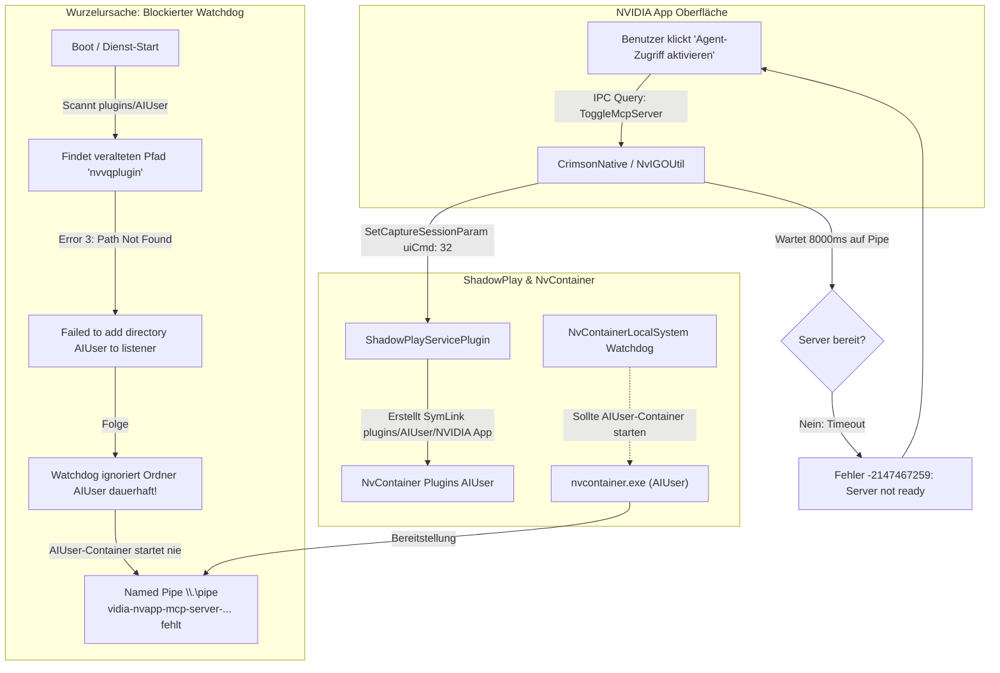

# Diagnose- und Lösungsbericht: NVIDIA App Agent-Zugriff (MCP Server) – Fehlercode -2147467259 & Timeout

**Datum:** 03. November 2026  
**Workspace:** `C:\Users\strik\git-labor`  
**Speicherort:** `C:\Users\strik\git-labor\#$_Lernmaterial_to_sort`  
**Betroffene Komponenten:** NVIDIA App (CEF / Crimson Native), NvContainerLocalSystem, Model Context Protocol (MCP) Server (`NvAppMcpServer.exe` / `McpServerPlugin.dll`), ShadowPlay IPC Plugin (`NvIGOUtil`)  

---

## 1. Ausgangslage & Fehlermeldung

Beim Versuch, in den Einstellungen der **NVIDIA App** den Schalter für **„Agent-Zugriff aktivieren“** (bzw. *„Apps verbinden – Erlauben Sie Clients, die NVIDIA App zu steuern“*) anzuklicken, schaltete die Oberfläche für etwa 8 bis 12 Sekunden in den Ladezustand. Anschließend sprang der Schalter zurück und es erschien folgende Fehlermeldung (Snackbar/Toast):

> *„Es kann derzeit nicht eingestellt werden. Bitte versuchen Sie es später noch einmal.“*

In den internen Protokollen der NVIDIA App (`%LOCALAPPDATA%\NVIDIA Corporation\NVIDIA App\console.log`) fand sich dazu der genaue Fehler:

```json
2026-11-03 03:12:31.685 INFO  nvapp/McpAccessService  MCP server state requested by user, enable: true
2026-11-03 03:12:31.686 INFO  nvapp/McpAccessService  Toggling MCP server, enable: true persist user preference: true
2026-11-03 03:12:31.686 INFO  nvapp/NvAppBridgeService Executing command with timeout ToggleMcpServer
2026-11-03 03:12:43.434 INFO  crimson/cef  Bridge Query returned error code -2147467259: MCP server did not become ready in time. Command: {"command":"QUERY_IPC_EXTENSION_MESSAGE","system":"CrimsonNative","module":"NvIGOUtil","method":"ToggleMcpServer","payload":{"enable":true}}
2026-11-03 03:12:43.434 ERROR nvapp/McpAccessService  Failed to toggle MCP server, enable: true {
    "code": -2147467259,
    "message": "MCP server did not become ready in time"
}
2026-11-03 03:12:43.601 INFO  nvapp/ErrorHandlerService Snackbar shown {"messageKey": "mcpAgent.toasts.enableFailed"}
```

---

## 2. Technische Ursachenanalyse



### Die Architektur des NVIDIA MCP-Servers
1. **Frontend / Bridge:** Die NVIDIA App kommuniziert über `NvAppBridgeService` und das native C++ Modul `NvIGOUtil` per IPC.
2. **Container-Architektur:** NVIDIA lagert Hintergrund-Dienste in separate Container-Prozesse aus (`nvcontainer.exe`). Für KI- und Agenten-Funktionen existiert das dedizierte Profil **`AIUser`** (`C:\Program Files\NVIDIA Corporation\NvContainer\plugins\AIUser`).
3. **McpServerPlugin:** Das Plugin `McpServerPlugin.dll` wird vom `AIUser`-Container geladen und stellt eine Named Pipe bereit:
   `\\.\pipe\nvidia-nvapp-mcp-server-<User-SID>-1`
4. **NvAppMcpServer.exe:** Fungiert als stdio-Bridge für Agenten (z. B. VS Code Copilot, Claude Desktop) und leitet Befehle an die Named Pipe weiter.

### Die Fehlerursache im Detail
In `C:\ProgramData\NVIDIA Corporation\NVIDIA App\NvContainer\NvContainerWatchdog.log` zeigte sich:
```text
#5(D)<DirectoryEnumera> Process folder C:\Program Files\NVIDIA Corporation\NvContainer\plugins\AIUser/nvvqplugin
#6(E)<DirectoryListene> Failed to create directory changed event for ...\plugins\AIUser/nvvqplugin. Error 3.
#8(E)<NvpWatchdog>     Failed to add existing directory ...\plugins\AIUser to the listener
```
* Beim Windows-Systemstart versuchte der Dienst `NvContainerLocalSystem`, das Verzeichnis `AIUser` in seinen Verzeichnis-Listener aufzunehmen.
* Aufgrund eines ungültigen, verwaisten Plugin-Eintrags (`nvvqplugin`, Error 3 = *Path not found*) schlug die Registrierung des Verzeichnisses fehl.
* **Folge:** Der Watchdog überwachte `AIUser` nicht mehr. Als die NVIDIA App den Symlink für `NVIDIA App` im Ordner `AIUser` anlegte, reagierte der Dienst nicht. Der `AIUser`-Container mit `McpServerPlugin.dll` wurde nie gestartet und die Named Pipe wurde nie geöffnet.

---

## 3. Durchgeführte Behebung

### Schritt 1: Dienst-Neustart zur Bereinigung der Listener-Tabelle
Nachdem der verwaiste Eintrag im Dateisystem nicht mehr vorhanden war, wurde der NVIDIA-Container-Dienst neu gestartet:

```powershell
Restart-Service NvContainerLocalSystem
```

### Schritt 2: Verifikation im Watchdog-Log
Im Log `NvContainerWatchdog.log` konnte verifiziert werden, dass der Ordner `AIUser` nun fehlerfrei erkannt und der Container gestartet wurde:

```text
#8(D)<DirectoryEnumera> Process folder ...\plugins\AIUser/NVIDIA App
#9(D)<DirectoryEnumera> Process file ...\plugins\AIUser/NVIDIA App/McpServerPlugin.dll
#1(D)<NvpChildGroup>    Group => Folder: ...\plugins\AIUser
#3(D)<NvpChildGroup>    Container: C:\Program Files\NVIDIA Corporation\NvContainer\nvcontainer.exe
#4(D)<NvpChildGroup>    Parameters: -f "...NvContainerAIUser%d.log" -d "...plugins\AIUser" -r -l 3 -p 30000
#6(D)<NvpChildProcess>  Session 1, process 0000000000000988
```

### Schritt 3: Verifikation im AIUser-Container-Log
In `C:\ProgramData\NVIDIA Corporation\NVIDIA App\NvContainer\NvContainerAIUser1.log`:

```text
#5(I)<NvcPluginLoadHel> Secure loading ...\McpServerPlugin.dll took 25523 microseconds
#7(I)<NvcPluginManager> Loaded mandatory plugin McpServerPlugin, version 1
#4(I)<NvcPluginManager> Transition to Started state for McpServerPlugin completed
#5(I)<NvcHost>          Container is started with 1. State: normal
```

### Schritt 4: Verifikation der Named Pipe
Die MCP-Server-Named-Pipe ist jetzt aktiv und empfangsbereit:

```powershell
[System.IO.Directory]::GetFiles("\\.\\pipe\\") | Where-Object { $_ -match "nvidia-nvapp-mcp-server" }
# Ergebnis:
# \\.\pipe\nvidia-nvapp-mcp-server-S-1-5-21-316988889-4162115284-2956454456-1001-1
```

---

## 4. Übersicht der beteiligten Pfade & Komponenten

| Komponente | Dateipfad / Kennung | Aufgabe |
| :--- | :--- | :--- |
| **MCP Bridge Executable** | `C:\Program Files\NVIDIA Corporation\NVIDIA App\McpServer\NvAppMcpServer.exe` | Stdio-zu-Named-Pipe Relay für KI-Agenten |
| **MCP Plugin DLL** | `C:\Program Files\NVIDIA Corporation\NVIDIA App\Plugins\aiuser\McpServerPlugin.dll` | Implementierung der MCP-Tools & Ressourcen |
| **Plugin SymLink** | `C:\Program Files\NVIDIA Corporation\NvContainer\plugins\AIUser\NVIDIA App` | Verknüpfung für den NvContainer Watchdog |
| **Named Pipe** | `\\.\pipe\nvidia-nvapp-mcp-server-<UserSID>-1` | Lokaler IPC-Endpunkt für Agenten-Befehle |
| **Dienst** | `NvContainerLocalSystem` | Windows-Dienst zur Orchestrierung der NvContainer-Prozesse |
| **Container-Log** | `C:\ProgramData\NVIDIA Corporation\NVIDIA App\NvContainer\NvContainerAIUser1.log` | Protokoll des AIUser-Containers |
| **App-Log** | `C:\Users\<User>\AppData\Local\NVIDIA Corporation\NVIDIA App\console.log` | UI- und IPC-Fehlerprotokoll der NVIDIA App |

---

## 5. Schnelle Diagnose-Befehle (Cheat-Sheet)

Falls der Agent-Zugriff der NVIDIA App in Zukunft erneut blockieren sollte:

```powershell
# 1. Prüfen, ob der AIUser nvcontainer Prozess aktiv ist
Get-CimInstance Win32_Process -Filter "name like '%nvcontainer%'" | 
    Where-Object { $_.CommandLine -match "AIUser" } | 
    Select-Object ProcessId, CommandLine

# 2. Prüfen, ob die MCP Named Pipe existiert
[System.IO.Directory]::GetFiles("\\.\\pipe\\") | Where-Object { $_ -match "nvapp-mcp" }

# 3. Status in console.log prüfen
Get-Content "$env:LOCALAPPDATA\NVIDIA Corporation\NVIDIA App\console.log" -Tail 30 | 
    Select-String "McpAccessService|ToggleMcpServer"

# 4. Dienst bei Bedarf neu starten
Restart-Service NvContainerLocalSystem
```
