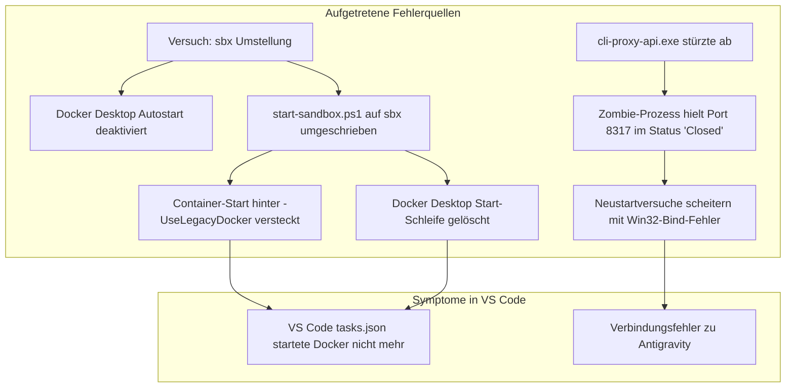

# Diagnose- und Reparaturbericht: Wiederherstellung der Docker-Sandbox & Antigravity in VS Code

**Datum:** 02. November 2026  
**Workspace:** `C:\Users\strik\git-labor`  
**Betroffene Systeme:** Antigravity Proxy (`CLIProxyAPI`), Docker Desktop Engine, Windows 11 Sandbox-Container (`dockurr/windows`), VS Code Auto-Start Tasks  

---

## 1. Ausgangslage & Ziel

Nach dem Versuch, die containerbasierte Sandbox-Umgebung mit laufendem Docker-Desktop im Hintergrund auf eine Docker-freie Variante (`sbx` / Docker Sandboxes CLI) umzustellen, traten in Visual Studio Code zwei zentrale Probleme auf:
1. **Docker-Umgebung startet nicht:** Beim Öffnen von VS Code wurde weder Docker Desktop noch der Windows-11-Sandbox-Container gestartet.
2. **Antigravity-Verbindung schlägt fehl:** Der Copilot-Agent bzw. Antigravity-Dienst („Entity Gravity“) konnte keine Verbindung mehr zu seinem lokalen Backend herstellen.

---

## 2. Technische Ursachenanalyse



### Problem A: Warum die Docker-Umgebung nicht mehr startete
1. **Entfernter Desktop-Start:** Der automatische Aufruf von `Docker Desktop.exe` wurde vollständig aus dem Startskript gelöscht. Da auch der Windows-Autostart-Eintrag für Docker Desktop entfernt worden war, lief die Engine nach einem Neustart nicht mehr.
2. **Konditionales Flag `-UseLegacyDocker`:** Der Befehl `docker compose up -d` wurde in eine Bedingung `if ($UseLegacyDocker)` gepackt. Weder [.vscode/tasks.json](file:///c:/Users/strik/git-labor/.vscode/tasks.json) noch ein anderer Aufruf übergab dieses Flag.
3. **Umbenannter Task:** In VS Code wurde der Task auf `Auto-Start: Antigravity + Sandbox Check (ohne Docker Desktop)` umbenannt, wodurch lediglich eine leere Prüfung auf `sbx` stattfand.

### Problem B: Warum die Antigravity-Verbindung fehlschlug
1. **Zombie-Prozess mit Port-Kollision:** Ein veralteter Prozess der `cli-proxy-api.exe` (PID 33900) hing im System fest. Der TCP-Socket auf Port `8317` befand sich im Status `Closed`, blockierte den Port aber weiterhin im Windows-Netzwerkstapel.
2. **Bind-Error bei Neustartversuchen:** Jeder Versuch, den Proxy neu zu starten, scheiterte sofort mit der Fehlermeldung:
   ```text
   failed to start HTTP server: listen tcp :8317: bind: Only one usage of each socket address (protocol/network address/port) is normally permitted.
   ```
3. **Fehlendes Arbeitsverzeichnis:** Im früheren Aufruf von `Start-Process` fehlte die Angabe von `-WorkingDirectory "C:\Users\strik\CLIProxyAPI"`, wodurch der Dienst im falschen Verzeichnis nach seiner `config.yaml` suchte.

---

## 3. Durchgeführte Reparaturmaßnahmen

### Schritt 1: Bereinigung des Zombie-Prozesses
Da der hängende Prozess durch administrative Privilegien geschützt war, konnte er nicht mit herkömmlichen Methoden beendet werden. Über das Windows Management Instrumentation (WMI) Interface wurde der verwaiste Prozess gezielt terminiert:
```powershell
(Get-WmiObject Win32_Process -Filter "Name = 'cli-proxy-api.exe'").Terminate()
```
Dadurch wurde Port `8317` wieder vollständig freigegeben.

### Schritt 2: Reparatur & Härtung des Startskripts `ac-sandbox/start-sandbox.ps1`
Die Datei [ac-sandbox/start-sandbox.ps1](file:///c:/Users/strik/git-labor/ac-sandbox/start-sandbox.ps1) wurde vollständig überarbeitet und mit robuster Ausfallsicherheit ausgestattet:

1. **Stufe 1 – Antigravity Health-Check:**
   * Fragt `http://127.0.0.1:8317/v1/models` direkt per REST-Abfrage ab.
   * Wenn der Port nicht antwortet, werden etwaige hängende Prozesse automatisch beendet.
   * Startet die `cli-proxy-api.exe` mit expliziter `--config`-Datei und festem Arbeitsverzeichnis.
2. **Stufe 2 – Docker Desktop Engine Bereitschaft:**
   * Prüft mit `docker info`, ob die Docker Engine läuft.
   * Falls nicht, sucht das Skript die `Docker Desktop.exe`, startet sie im Hintergrund und wartet in einer Schleife (bis zu 90 Sekunden), bis die Engine betriebsbereit ist.
3. **Stufe 3 – Intelligenter Sandbox-Start:**
   * Prüft vorab, ob der Container `ac-win11-sandbox` bereits aktiv ist (`docker ps --filter`).
   * Ist er bereits aktiv, erfolgt der Durchlauf in unter 2 Sekunden.
   * Ist er inaktiv, wird `docker compose up -d` ausgeführt.

### Schritt 3: VS Code Auto-Task wiederhergestellt
In [.vscode/tasks.json](file:///c:/Users/strik/git-labor/.vscode/tasks.json) wurde der Task wieder auf die kombinierte Auto-Start-Funktion gesetzt:
```json
{
    "version": "2.0.0",
    "tasks": [
        {
            "label": "Auto-Start: Antigravity + Docker AC-Sandbox (Win11)",
            "type": "shell",
            "command": "powershell.exe",
            "args": [
                "-NoProfile",
                "-ExecutionPolicy",
                "Bypass",
                "-File",
                "${workspaceFolder}\\ac-sandbox\\start-sandbox.ps1"
            ],
            "runOptions": {
                "runOn": "folderOpen"
            },
            "presentation": {
                "reveal": "silent",
                "panel": "dedicated",
                "clear": true
            },
            "problemMatcher": []
        }
    ]
}
```

---

## 4. Aktueller Status & Verifikation

Alle Komponenten wurden nach der Reparatur automatisiert getestet:

| Dienst | Port / URL | Verbindungstest | Status |
| :--- | :--- | :--- | :--- |
| **Antigravity Proxy** | `http://127.0.0.1:8317` | `TcpTestSucceeded: True` | **200 OK** (Modell-Routing aktiv) |
| **Docker Engine** | WSL2 `desktop-linux` | `docker info` | **Ready** (Version 29.8.2) |
| **Container (Win11)** | `ac-win11-sandbox` | `docker compose ps` | **Up / Running** |
| **noVNC Web-Zugang** | `http://127.0.0.1:8006` | `TcpTestSucceeded: True` | **200 OK** (HTML/UI erreichbar) |
| **Remotedesktop (RDP)** | `127.0.0.1:3389` | Standard-RDP-Port | **Bereit** |

---

## 5. Schnellbefehle für Notfälle

Falls in Zukunft ein Prozess hängt oder manuell gestartet werden soll:

```powershell
# 1. Den gesamten Startservice manuell im Terminal ausführen:
powershell.exe -ExecutionPolicy Bypass -File .\ac-sandbox\start-sandbox.ps1

# 2. Status der Container prüfen:
docker ps

# 3. Antigravity-Endpunkte testen:
Invoke-RestMethod -Uri "http://127.0.0.1:8317/v1/models"

# 4. Hängenden Proxy-Prozess bei Bedarf zwangsweise beenden:
(Get-WmiObject Win32_Process -Filter "Name = 'cli-proxy-api.exe'").Terminate()
```
