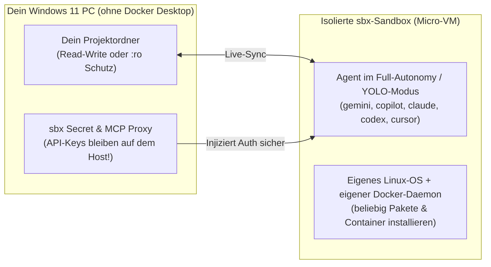

Diese Dokumentation fasst zusammen, wie die neue **Docker Sandboxes CLI (`sbx`)** funktioniert, wie sie auf deinem Windows-11-System eingerichtet wurde und welche Möglichkeiten sie für autonome KI-Agenten bietet – **komplett ohne laufendes Docker Desktop oder Docker Engine auf dem Host**.

---

## 1. Was wurde am System geändert?

1. **Docker Desktop Auto-Start deaktiviert:**
   * Der Windows-Autostart-Eintrag (`HKCU:\Software\Microsoft\Windows\CurrentVersion\Run\Docker Desktop`) wurde entfernt.
   * Laufende Docker-Hintergrundprozesse wurden beendet.
   * Das Workspace-Startskript (`ac-sandbox/start-sandbox.ps1`) und `.vscode/tasks.json` starten beim Öffnen von VS Code **kein** Docker Desktop mehr, sondern nur noch den Antigravity-Proxy (`CLIProxyAPI` auf Port `8317`) und prüfen die Bereitschaft von `sbx`.
2. **Eigenständiges `sbx` CLI installiert:**
   * Paket: `Docker.sbx` (Version `v0.50.1`)
   * Pfad: `%LOCALAPPDATA%\DockerSandboxes\bin\sbx.exe`

---

## 2. Architektur: Wie `sbx` ohne Docker Desktop funktioniert

Mit `sbx` läuft dein KI-Agent nicht direkt auf deinem Windows-System, sondern in einer **eigenen, isolierten Micro-VM** (über die Windows Hypervisor Platform) oder wahlweise in der **Docker Cloud** (`--cloud`).



### Die 4 wichtigsten Vorteile

1. **Kein Docker Desktop / Engine auf dem PC nötig:** `sbx` nutzt seinen eigenen schlanken Dienst (`sandboxd`), der nur bei Bedarf aktiv ist.
2. **Full-Autonomy („YOLO-Modus“) ohne Risiko:** `sbx` startet Agenten automatisch im vollautonomen Modus (ohne ständige Bestätigungsabfragen). Systemänderungen, Paketinstallationen oder Fehlbedienungen bleiben komplett in der Sandbox isoliert und können mit `sbx rm` jederzeit verworfen werden.
3. **Sichere API-Keys (Kein Key-Leak):** Über `sbx secret` gespeicherte Schlüssel bleiben auf deinem Host und werden nur über den Sandbox-Proxy injiziert – der Agent in der Sandbox kann deine API-Keys nicht im Klartext auslesen.
4. **Eigener Docker-Daemon *in* der Sandbox:** Obwohl auf deinem Windows-Host kein Docker Desktop läuft, hat der Agent *innerhalb* der Sandbox einen vollwertigen eigenen Docker-Daemon, um Datenbanken, Container oder Testumgebungen zu starten.

---

## 3. Direkt unterstützte Agenten

Beim Aufruf von `sbx run` kannst du direkt einen dieser integrierten Agenten angeben:

| Agent-Kennung | Beschreibung |
| :--- | :--- |
| `gemini` | Google Gemini CLI |
| `copilot` | GitHub Copilot CLI |
| `claude` | Anthropic Claude Code |
| `codex` | OpenAI Codex CLI |
| `cursor` | Cursor Agent |
| `opencode` | OpenCode Agent |
| `kiro` / `devin` / `droid` / `docker-agent` | Weitere unterstützte Coding-Agenten |
| `shell` | Öffnet direkt eine interaktive Shell in der Sandbox (ohne KI-Agent) |

---

## 4. Schritt-für-Schritt: Einrichtung & Grundbefehle

### A. Einmalige Vorbereitung

Falls die *Windows Hypervisor Platform* für lokale Sandboxes noch nicht aktiviert ist, einmalig in einer **PowerShell als Administrator** ausführen:

```powershell
Enable-WindowsOptionalFeature -Online -FeatureName HypervisorPlatform -All
```

Danach im normalen Terminal:

```powershell
# 1. System-Diagnose & automatische Vorbereitung prüfen
sbx diagnose
sbx setup

# 2. Einmalig bei Docker anmelden (öffnet Browser für OAuth)
sbx login

# 3. Vorhandene API-Keys aus der Umgebung prüfen & importieren
sbx secret import --dry-run
sbx secret import

# Alternativ gezielt einzelne API-Keys hinterlegen:
sbx secret set google
sbx secret set openai
sbx secret set anthropic

# 4. Optional: Lokale Agent-Skills in die Sandbox-Umgebung importieren
sbx skills import --dry-run
sbx skills import
```

### B. Täglicher Einsatz

```powershell
# Agent im aktuellen Projektordner starten (erstellt die Sandbox beim ersten Mal)
sbx run --name git-labor gemini

# Oder mit GitHub Copilot / Claude:
sbx run --name git-labor copilot
sbx run --name git-labor claude

# Später wieder mit derselben Sandbox verbinden (installierte Pakete bleiben erhalten)
sbx run --name git-labor

# Interaktives Terminal-Dashboard (TUI) öffnen
sbx tui

# Alle Sandboxes auflisten
sbx ls

# Sandbox pausieren / stoppen (ohne Datenverlust)
sbx stop git-labor

# Sandbox komplett löschen (Projektdateien auf dem Windows-PC bleiben erhalten!)
sbx rm git-labor
```

---

## 5. Profi-Möglichkeiten & Anweisungen für Agenten-Workflows

### 1. Schreibschutz (`:ro`) für sensible Dateien oder Referenz-Ordner

Standardmäßig darf der Agent im Projektordner lesen und schreiben. Du kannst aber einzelne Konfigurationsdateien vor Änderungen durch den Agenten schützen oder zusätzliche Wissensordner schreibgeschützt (`:ro` = read-only) einbinden:

```powershell
# Der Agent darf im Projekt arbeiten, aber .vscode/mcp.json NICHT verändern
# und den Lernmaterial-Ordner nur lesen:
sbx run --name git-labor gemini . "./#$_Lernmaterial_to_sort:ro" "./.vscode/mcp.json:ro"
```

### 2. Ports aus der Sandbox auf den Windows-Host freigeben (`-p` / `sbx ports`)

Wenn der Agent in der Sandbox einen Webserver, eine API oder ein Dashboard startet (z. B. auf Port `3000` oder `8080`), kannst du diesen Port direkt im Windows-Browser unter `http://localhost:3000` öffnen:

```powershell
# Direkt beim Erstellen der Sandbox Port 3000 veröffentlichen:
sbx run -p 3000:3000 --name webapp gemini

# Oder nachträglich im laufenden Betrieb einen Port freigeben:
sbx ports publish git-labor 8080:8080
```

### 3. Hintergrund-Sandboxes & Befehle von außen senden (`-d` & `sbx exec`)

Du kannst eine oder mehrere Sandboxes im Hintergrund laufen lassen und Befehle gezielt von außen hineinschicken:

```powershell
# Sandbox im Hintergrund starten
sbx run -d --name test-worker gemini

# Befehl direkt in der Sandbox ausführen (z. B. Tests oder Build)
sbx exec test-worker pytest

# Dateien gezielt zwischen Host und Sandbox kopieren
sbx cp ./lokale-datei.txt test-worker:/workspace/
```

### 4. MCP-Server für die Sandbox verwalten (`sbx mcp`)

`sbx` bringt eine eigene MCP-Steuerung mit, um Agenten innerhalb der Sandbox feste MCP-Server bereitzustellen:

```powershell
# Verfügbare / registrierte MCP-Server anzeigen
sbx mcp ls

# Sandbox mit definierten MCP-Servern starten
sbx run --name git-labor --static-mcp filesystem,github gemini
```

### 5. Cloud-Sandboxes & Umzug zwischen Lokal und Cloud (`--cloud` & `sbx move`)

Wenn dein PC entlastet werden soll, kannst du Sandboxes direkt in der Docker Cloud starten oder eine lokale Sandbox in die Cloud verschieben:

```powershell
# Direkt in der Cloud starten (Standard: 2 CPUs, 4 GiB RAM)
sbx --cloud run --name cloud-worker gemini

# Eine bestehende Sandbox zwischen lokalem PC und Cloud verschieben
sbx move git-labor
```

### 6. Deklarative Sandbox-Umgebungen (`sbx env`)

Mit dem experimentellen Befehl `sbx env` lassen sich komplette Multi-Agent- oder Projekt-Sandboxes in einer `sbxenv.yaml`-Datei definieren und reproduzierbar starten.

### 7. Netzwerk-Regeln & Firewall (`sbx policy`)

Beim ersten Start fragt `sbx` nach der Netzwerk-Richtlinie:

* **Balanced (Empfohlen):** Erlaubt gängige Entwickler-Dienste (GitHub, npm, PyPI, Modell-APIs) und blockiert unbekannte Ziele.
* Über `sbx policy` kannst du jederzeit anpassen, auf welche externen Server der Agent zugreifen darf.
