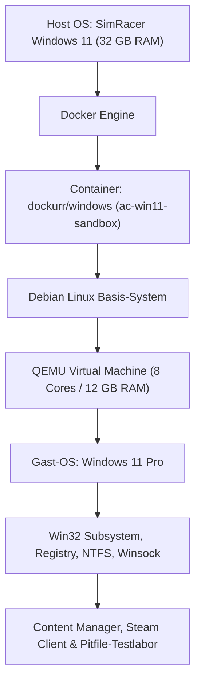
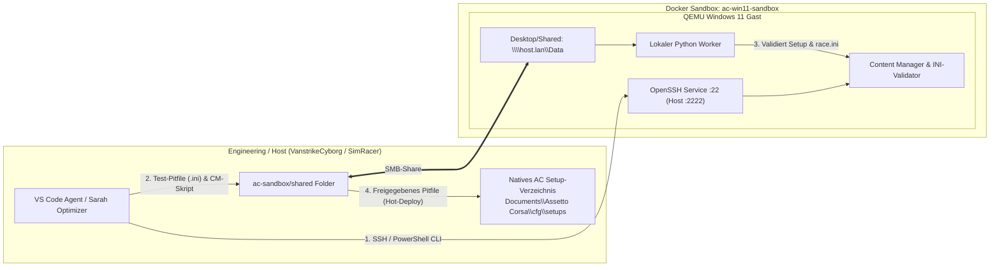

# Docker Windows-11 Sandbox: Prüflabor für Content Manager, Pitfiles (.ini) & KI-Agenten

> **Thema:** Technische Virtualisierungsarchitektur (`dockurr/windows`), Content-Manager-Skript-Automatisierung und Zusammenspiel zwischen Docker-Prüflabor und nativem VR-SimRacer
> **Autor:** Michael Stürmer
> **Datum:** 04.11.2026

<details>
<summary><h2>1. Zweck der Docker-Sandbox im 4-PC-SimRacing-Verbund</h2></summary>

<details>
<summary><h3>1.1 Klare Abgrenzung: Prüflabor (Docker) vs. Echtes VR-Rennen (Nativ)</h3></summary>

In unserer 4-PC-Architektur gilt eine strikte Aufgabenteilung:
* **Gefahren wird zu 100 % nativ auf dem SimRacer (Windows 11 Host):** Mit dem **Fanatec ClubSport V2.5 Lenkrad** und der **HTC VIVE Focus Vision VR-Brille (120 Hz DisplayPort)**.
* **Die Docker-Sandbox (`ac-win11-sandbox`) ist das geschützte Prüflabor („Virtuelle Inbetriebnahme“):**
  * Hier testen und optimieren die lokalen KI-Agenten neue **Content-Manager-Skripte**, **Setup-/Pitfile-Generatoren (`.ini`)**, Custom-Shaders-Patch-Konfigurationen und Python-Telemetrie-Apps, **ohne** die empfindliche VR- und Fanatec-Konfiguration des echten Sim-Rigs zu gefährden.
  * Sobald ein Pitfile oder Skript in der Sandbox validiert wurde, wird es über denShared-Ordner / Raspberry Pi 4 direkt in das native Assetto-Corsa-Verzeichnis (`Documents\Assetto Corsa\cfg\setups\`) des SimRacer übertragen.

</details>

<details>
<summary><h3>1.2 Warum laufen Steam & Content Manager in der Docker-Windows-Instanz?</h3></summary>

Die Container-Instanz (`dockurr/windows`) basiert nicht auf einfachen Linux-Containern, sondern kapselt eine **vollständige QEMU/KVM-Virtualisierung** innerhalb des Containers:



1. **Vollständiger Windows NT-Kernel:** Echtes Windows 11 mit allen Standard-Bibliotheken (`kernel32.dll`, `user32.dll`, `shell32.dll`) und NTFS-Dateisystem.
2. **Netzwerk- & Socket-Stack:** Virtuelle Netzwerkkarte (`virtio-net`) für uneingeschränkte Socket-, SMB- und SSH-Kommunikation.
3. **2D/3D-Rendering für Content Manager UI:** Der Content Manager benötigt zum Verwalten von Presets, `race.ini` und `.ini`-Setups keine 3D-Renn-Engine, sondern läuft flüssig über das virtuelle Display (`http://192.168.178.68:8006` / RDP `192.168.178.68:3390`).

</details>

<details>
<summary><h3>1.3 Aktive Live-Konfiguration auf dem SimRacer (<code>192.168.178.68</code>)</h3></summary>

Die Sandbox ist produktiv auf dem **SimRacer** unter `C:\ac-sandbox` eingerichtet und mit der `D:`-Festplatte verknüpft:

* **KVM-Hardwarebeschleunigung (`kvm_amd`):** Aktiviert über `C:\Users\Mike\.wslconfig` (`nestedVirtualization=true`, `kernelCommandLine=kvm_amd.nested=1`) und `/dev/kvm` (`KVM: "Y"`).
* **Ressourcen:** **8 CPU-Kerne** (Ryzen 9 3900X), **12 GB DDR4 RAM**, **160 GB virtuelles Laufwerk** (`data.img`, Gast-Partition `C:` per diskpart auf volle **159,86 GB** erweitert mit **125 GB freiem Speicher**).
* **Gast-Status:**
  * **OpenSSH Server (`sshd`):** Aktiv und gestartet (`Automatic`, Status `Running`). Ed25519-Keys für `strik@VanstrikeCyborg` eingerichtet.
  * **Content Manager:** Einsatzbereit auf dem Desktop und unter `C:\AssettoCorsa\`.
  * **Assetto Corsa Profile & Setups:** Alle 7 GitHub-Ordnerpakete per Robocopy ins Gastsystem synchronisiert.
* **Netzwerk-Ports auf `192.168.178.68`:**
  * **Web-VNC (NoVNC):** `http://192.168.178.68:8006`
  * **Sandbox-RDP:** `192.168.178.68:3390` *(auf Port `3390` gemappt, damit der native Windows-Remotedesktop des SimRacer-Hosts auf Port `3389` frei bleibt)*
  * **OpenSSH-Bridge:** `192.168.178.68:2222` (`ssh ac-sandbox`)
* **Verknüpfung der `D:`-Festplatte & Native Configs:**
  * **Host-Junction:** `D:\ac-sandbox` $\rightarrow$ `C:\ac-sandbox`
  * **Container-Volumes (`\\host.lan\Data` / `Desktop\Shared`):**
    * `D:/Backups:/shared/D_Backups`
    * `D:/SteamLibrary:/shared/D_SteamLibrary`
    * `C:/Users/Mike/Documents/Assetto Corsa/cfg:/shared/Native_AC_cfg`

</details>

</details>

<details>
<summary><h2>2. Architekturübersicht: Agent-Zugriff & Pitfile-Pipeline</h2></summary>



</details>

<details>
<summary><h2>3. Drei Integrationsmuster für lokale KI-Agenten</h2></summary>

<details>
<summary><h3>3.1 Option A: Remote-Bridge via OpenSSH (Empfohlen für CM-Skripte)</h3></summary>

* **Prinzip:** Der native Windows OpenSSH-Server wird im Windows-Gast aktiviert und Port 22 über Docker an den Host weitergeleitet (Host-Port `2222`).
* **Funktionsweise:** Der Host-Agent (VS Code auf dem VanstrikeCyborg) führt Befehle headless per SSH im Gast aus:
  ```bash
  ssh -p 2222 Docker@simracer "powershell.exe -File C:\Users\Docker\Desktop\Shared\validate-pitfile.ps1"
  ```
* **Vorteile:** Keine GUI-Klicks nötig, volle PowerShell-Kontrolle über Content-Manager-Konfigurationsdateien, Presets und Setups.

</details>

<details>
<summary><h3>3.2 Option B: Lokaler Agent-Worker / MCP-Server im Gast</h3></summary>

* **Prinzip:** Ein Python-basierter Dienst (FastAPI oder MCP-Server) läuft im Windows-Gast als Autostart-Dienst.
* **Fähigkeiten:**
  * Direkte Steuerung der Content-Manager-Oberfläche über `pywinauto`, falls UI-Aktionen getestet werden sollen.
  * Parsen und Prüfen von `.ini`-Pitfiles (`setups\<car>\<track>\*.ini`), `race.ini` und `assists.ini` auf gültige Zahlenbereiche (z. B. Klick-Grenzen für Flügel, Reifendruck, Federwege).

</details>

<details>
<summary><h3>3.3 Option C: File-Queue & Watchdog über Shared Folder</h3></summary>

* **Prinzip:** Nutzung des gemappten Verzeichnisses `ac-sandbox/shared/` (`C:\Users\Docker\Desktop\Shared`).
* **Ablauf:**
  1. Der Host oder **Sarah Coach** legt ein neu berechnetes Setup oder Test-Skript in `shared/inbox/` ab.
  2. Ein PowerShell-Watchdog prüft die Datei:
     ```powershell
     Get-ChildItem "C:\Users\Docker\Desktop\Shared\inbox\*.ps1" | ForEach-Object {
         & $_.FullName *>&1 > "C:\Users\Docker\Desktop\Shared\outbox\$($_.BaseName).log"
         Remove-Item $_.FullName
     }
     ```
  3. Validierte `.ini`-Setups landen in `shared/validated_setups/` und werden automatisch mit dem echten SimRacer synchronisiert.

</details>

</details>

<details>
<summary><h2>4. Schritt-für-Schritt-Automatisierung der Sandbox</h2></summary>

<details>
<summary><h3>4.1 Schritt 1: Steam & Content Manager im Gast bereitstellen</h3></summary>

Der Installer liegt bereits im Shared Folder (`SteamSetup.exe`) und kann geräuschlos installiert werden:

```powershell
# Im Windows 11 Gast:
Start-Process -FilePath "C:\Users\Docker\Desktop\Shared\SteamSetup.exe" -ArgumentList "/S" -Wait
```

</details>

<details>
<summary><h3>4.2 Schritt 2: OpenSSH-Server im Gast aktivieren</h3></summary>

Einmalige Ausführung im Windows-Gast (über noVNC-PowerShell auf Port `8006`):

```powershell
# OpenSSH Feature installieren
Add-WindowsCapability -Online -Name OpenSSH.Server~~~~0.0.1.0

# Dienst konfigurieren und starten
Set-Service -Name sshd -StartupType 'Automatic'
Start-Service sshd

# Firewall-Regel sicherstellen
New-NetFirewallRule -Name 'OpenSSH-Server-In-TCP' -DisplayName 'OpenSSH Server (sshd)' -Enabled True -Direction Inbound -Protocol TCP -Action Allow -LocalPort 22
```

</details>

<details>
<summary><h3>4.3 Schritt 3: Python & Pitfile-Tools im Shared Folder verknüpfen</h3></summary>

1. **Python im Gast installieren:**
   ```powershell
   winget install Python.Python.3.11 --silent --accept-package-agreements --accept-source-agreements
   ```
2. **Telemetrie-, Pitfile- & Steuerungs-Skripte verknüpfen:**
   Skripte unter `ac-sandbox/shared/apps_python/` ablegen, damit sie sowohl im Gast (`C:\Users\Docker\Desktop\Shared\apps_python\`) als auch nativ auf dem **SimRacer** sofort einsatzbereit sind.

</details>

</details>

<details>
<summary><h2>5. Weiterführende Dokumente & Verknüpfungen</h2></summary>

* [4-Knoten-Architektur & Einsatzkonzept (SimRacer, Cyborg, IdeaPad Omarchy, RPi 4)](./multi-pc-architektur-ki-agents-simracing.md)
* [Sarah Coach, Agent-Fokus & Pitfile-Automatisierung (Detailkonzept)](./planing.md)
* [Architektur & VS Code Multi-PC-Anleitung (Localhost, Remote-SSH & Workspaces)](./uebersicht-vscode-agent-localhost-gemini-antigravity.md)
* [Praxisanleitung: System-Image (Veeam) & Pitfile-Schnellbackup für SimRacer](./simracer-system-backup-wiederherstellung-veeam.md)

</details>

---
*Hinweis zur Organisation:* Die erstellte Dokumentation ist am Drehlaufwerk abgelegt und mit einer kurzen Zusammenfassung von den Chips auch in den Notebooks verlinkt.
