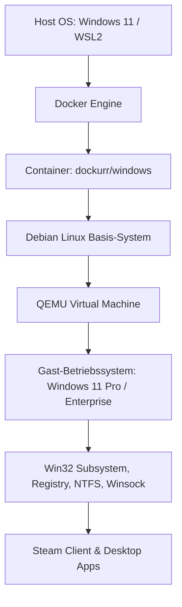
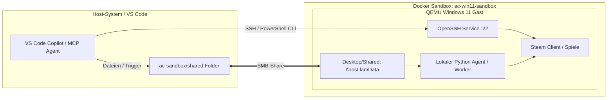

# Docker Windows-11 Sandbox: Steam & KI-Agenten-Architektur

Dieses Lehrmaterial dokumentiert die technischen Hintergründe, die Virtualisierungsarchitektur sowie konkrete Integrationsmuster, um Steam und KI-Agenten in einer virtualisierten Docker-Windows-11-Instanz zu betreiben und automatisiert anzusteuern.

---

## Inhaltsverzeichnis

1. [Warum funktioniert Steam in der Docker-Windows-Instanz?](#1-warum-funktioniert-steam-in-der-docker-windows-instanz)
2. [Architekturübersicht](#2-architekturübersicht)
3. [Wie bringen wir einen KI-Agenten in die Windows-Umgebung?](#3-wie-bringen-wir-einen-ki-agenten-in-die-windows-umgebung)
   - [Option A: Remote-Bridge via OpenSSH (Empfohlen)](#option-a-remote-bridge-via-openssh-empfohlen)
   - [Option B: Lokaler Agent-Worker / MCP-Server im Gast](#option-b-lokaler-agent-worker--mcp-server-im-gast)
   - [Option C: File-Queue & Watchdog über Shared Folder](#option-c-file-queue--watchdog-über-shared-folder)
4. [Schritt-für-Schritt-Automatisierung](#4-schritt-für-schritt-automatisierung)
   - [Schritt 1: Steam Silent-Installation](#schritt-1-steam-silent-installation)
   - [Schritt 2: OpenSSH-Server im Gast aktivieren](#schritt-2-openssh-server-im-gast-aktivieren)
   - [Schritt 3: Agent-Bridge bereitstellen](#schritt-3-agent-bridge-bereitstellen)

---

## 1. Warum funktioniert Steam in der Docker-Windows-Instanz?

Die Container-Instanz (`dockurr/windows`) basiert nicht auf einfachen Linux-Containern, sondern kapselt eine **vollständige QEMU-Virtualisierung** innerhalb des Containers:



### Die Kernfaktoren für die Lauffähigkeit

1. **Vollständiger Windows NT-Kernel:**
   - Es läuft ein echtes Windows 11 mit allen Standard-Bibliotheken (`kernel32.dll`, `user32.dll`, `shell32.dll`, `ntdll.dll`).
   - Registry-Zweige (`HKLM`, `HKCU`) und das NTFS-Dateisystem verhalten sich exakt wie auf einer physischen Windows-Maschine.

2. **Netzwerk- & Socket-Stack:**
   - QEMU erzeugt eine virtuelle Netzwerkkarte (`virtio-net` bzw. `e1000e`), über die Windows uneingeschränkten Internetzugriff über Standard-Winsock hat.
   - Steam kann seine Content-Server, Authentifizierungsserver und Web-Sockets ohne Einschränkungen erreichen.

3. **Software-Grafikrendering (Fallback):**
   - Selbst ohne direkte GPU-Passthrough-Beschleunigung nutzt Windows den Windows Basic Display Driver in Verbindung mit Software-DirectX (Direct3D WARP).
   - Der Steam-Client benötigt für die Benutzeroberfläche lediglich CEF (Chromium Embedded Framework) und grundlegendes 2D/3D-Rendering.

---

## 2. Architekturübersicht



---

## 3. Wie bringen wir einen KI-Agenten in die Windows-Umgebung?

Um einen KI-Agenten im Windows-Gast agieren zu lassen, gibt es drei zentrale Integrationsmuster:

### Option A: Remote-Bridge via OpenSSH (Empfohlen)

- **Prinzip:** Der native Windows OpenSSH-Server wird im Windows-Gast aktiviert und Port 22 über Docker an den Host weitergeleitet (z.B. Host-Port `2222`).
- **Funktionsweise:**
  - Der Host-Agent (VS Code Copilot, Skripte, CLI) verbindet sich per SSH direkt auf den Gast:

    ```bash
    ssh -p 2222 Docker@127.0.0.1 "powershell.exe -Command Start-Process steam.exe"
    ```

- **Vorteile:**
  - Headless-Bedienung: Keine GUI-Klicks nötig.
  - Volle PowerShell-Kontrolle über Systemprozesse, Dienste, Dateisystem und Registry.
  - Keine zusätzlichen Abhängigkeiten im Gast außer dem Windows-Bordmittel OpenSSH.

### Option B: Lokaler Agent-Worker / MCP-Server im Gast

- **Prinzip:** Ein Python-basierter Dienst (z.B. FastAPI oder ein lokaler MCP-Server) läuft dauerhaft im Windows-Gast als Autostart-Dienst.
- **Fähigkeiten:**
  - Direkte Steuerung der Benutzeroberfläche über `pywinauto` oder `pyautogui`.
  - Auslesen von Game-Dateien, Logs und SimRacing-Telemetriedaten (z.B. Assetto Corsa Shared Memory Pipes).
  - Bereitstellung von dedizierten REST- oder MCP-Tools an den übergeordneten Agenten.

### Option C: File-Queue & Watchdog über Shared Folder

- **Prinzip:** Nutzung des gemappten Verzeichnisses `ac-sandbox/shared/` (`C:\Users\Docker\Desktop\Shared`).
- **Ablauf:**
  1. Der Host legt eine Aufgabendatei ab: `shared/inbox/task_001.json`.
  2. Ein einfacher PowerShell-Watchdog im Gast erkennt die neue Datei:

     ```powershell
     # Watchdog prüft minütlich neue Skripte
     Get-ChildItem "C:\Users\Docker\Desktop\Shared\inbox\*.ps1" | ForEach-Object {
         & $_.FullName *>&1 > "C:\Users\Docker\Desktop\Shared\outbox\$($_.BaseName).log"
         Remove-Item $_.FullName
     }
     ```

  3. Ergebnisse werden in `shared/outbox/` zurückgeschrieben.

---

## 4. Schritt-für-Schritt-Automatisierung

### Schritt 1: Steam Silent-Installation

Der Installer liegt bereits im Shared Folder (`SteamSetup.exe`). Die Installation kann geräuschlos ohne Nutzerinteraktion erfolgen:

```powershell
# Im Windows 11 Gast:
Start-Process -FilePath "C:\Users\Docker\Desktop\Shared\SteamSetup.exe" -ArgumentList "/S" -Wait
```

### Schritt 2: OpenSSH-Server im Gast aktivieren

Einmalige Ausführung im Windows-Gast (über noVNC-PowerShell oder Boot-Skript):

```powershell
# OpenSSH Feature installieren
Add-WindowsCapability -Online -Name OpenSSH.Server~~~~0.0.1.0

# Dienst konfigurieren und starten
Set-Service -Name sshd -StartupType 'Automatic'
Start-Service sshd

# Firewall-Regel sicherstellen
New-NetFirewallRule -Name 'OpenSSH-Server-In-TCP' -DisplayName 'OpenSSH Server (sshd)' -Enabled True -Direction Inbound -Protocol TCP -Action Allow -LocalPort 22
```

### Schritt 3: Agent-Bridge bereitstellen

1. **Python im Gast installieren:**

   ```powershell
   winget install Python.Python.3.11 --silent --accept-package-agreements --accept-source-agreements
   ```

2. **Telemetrie- & Steuerungs-Skripte verknüpfen:**
   Skripte unter `ac-sandbox/shared/apps_python/` ablegen, damit sie sofort synchron im Gast unter `C:\Users\Docker\Desktop\Shared\apps_python\` zur Verfügung stehen und von dort ausgeführt werden können.
