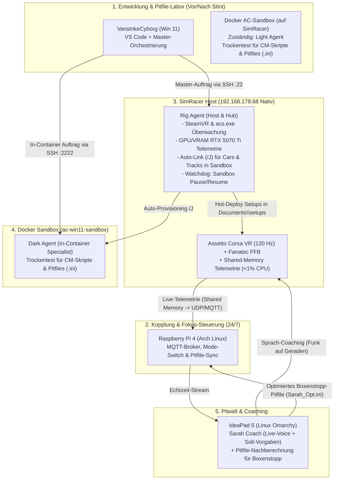

# 4-Knoten-Architektur & Einsatzkonzept: SimRacer (VR), VanstrikeCyborg, IdeaPad 5 (Omarchy) & Raspberry Pi 4 (Arch)

> **Thema:** Verteilte 4-PC-Leitstand-Architektur für natives VR-SimRacing, Pitfile-Optimierung, Content-Manager-Automatisierung und Sarah Coach
> **Autor:** Michael Stürmer
> **Datum:** 04.11.2026

<h2>1. Ausgangslage & Hardware der 4 Systemknoten</h2>

Zur optimalen Verteilung von Echtzeit-Simulationslasten (VR + Force Feedback), KI-Agenten-Entwicklung, Live-Telemetrie/Coaching (**Sarah Coach**) und 24/7-Datensynchronisation wird ein **4-Knoten-Verbund** nach dem Vorbild der industriellen Automatisierungstechnik (**Prozessstation, Programmiergerät, Leitstand/HMI und Feldbus-Koppler**) eingesetzt:

<h3>1.1 Knoten 1: SimRacer (Prozess- & Heavy-Compute-Station / Windows 11)</h3>

* **CPU:** AMD Ryzen 9 3900X (12 Kerne / 24 Threads, 3.80 – 4.20 GHz)
* **RAM:** 32 GB DDR4
* **GPU:** NVIDIA GeForce RTX 5070 Ti (16 GB GDDR7 VRAM, 256-Bit Bus, 8960 CUDA-Kerne)
* **Speicher:** 2.8 TB SSDs (`C:` 1 TB NVMe System & Docker-Sandbox + `D:` 1.8 TB Daten-SSD für Steam & Backups)
* **Sim-Peripherie:** HTC VIVE Focus Vision VR-Headset (DisplayPort-Modus, Dual 2.5K @ 120 Hz), Fanatec ClubSport V2.5 Wheel Base + Formula V2.0 Lenkrad, 4K-Display (Hisense)
* **Doppelrolle (strikte Zeitmultiplex-Trennung):**
  1. **Im Fahrbetrieb (`LIVE_RACE`):** 100 % native Ausführung von Assetto Corsa + Content Manager mit maximalen VR-Frametimes (120 FPS) und direktem Hardware-Zugriff auf Fanatec & Shared Memory.
  2. **Im Setup-/Testbetrieb (`ENGINEERING` / `PITBOX_SETUP`):** Host für die isolierte **Docker-Windows-11-Sandbox (`ac-win11-sandbox`)** zum trockenen Testen von Content-Manager-Skripten und Pitfiles sowie optionaler lokaler LLM-Inferenz-Server (Ollama/vLLM auf 16 GB VRAM).

<h3>1.2 Knoten 2: VanstrikeCyborg (Engineering Station / PG / Windows 11)</h3>

* **Modell:** MSI Cyborg 15 B2RWFKG
* **CPU:** Intel Core 7 240H (10 Kerne / 16 Threads)
* **RAM:** 16 GB DDR5-5600 Dual-Channel
* **GPU:** NVIDIA GeForce RTX 5060 Laptop (8 GB GDDR7 VRAM, 55 W TGP)
* **Speicher:** 1 TB NVMe SSD (~160 GB frei) + externe HDD
* **Hauptrolle:** Mobiles Programmiergerät (PG) und Master-Agent-Zentrale. Hier laufen Visual Studio Code, die KI-Orchestrierung (`cli-proxy-api.exe` auf Port `8317`, Antigravity, Copilot), MCP-Server und die Entwicklung der Python-Skripte für Content Manager und Pitfile-Berechnung. Kein lokaler Docker-Zwang mehr – die 16 GB RAM bleiben frei für flüssiges Engineering.

<h3>1.3 Knoten 3: IdeaPad 5 mit Linux Omarchy (Leitstand / Pitwall & Sarah Coach Host)</h3>

* **Betriebssystem:** **Linux Omarchy** (Arch-Linux-Basis mit ultraschlankem Hyprland Tiling Window Manager)
* **Charakteristik:** Minimaler OS-Overhead, sofortiges Tastatur-gesteuertes Fenster-Tiling ohne Desktop-Ballast, native Linux-Container-Unterstützung (ohne WSL2-Virtualisierungsverlust).
* **Hauptrolle am Sim-Rig:**
  1. **Sarah Coach Runtime (Echtzeit-Renningenieurin):** Empfängt während der Fahrt die Live-Telemetrie vom SimRacer, gleicht sie mit den **Soll-Vorgaben (`sarah_targets.json`)** ab und erzeugt das Live-Sprach-Coaching (TTS/Audio-Funk) sowie die korrigierten **Pitfiles (`.ini`)** für den nächsten Boxenstopp.
  2. **Pitwall-Cockpit (HMI):** Zeigt neben dem Rig auf getrennten Hyprland-Workspaces Live-Telemetrie (Grafana), Sektor-Deltas, Reifentemperatur-Fenster und den Status der lokalen KI-Agenten an.

<h3>1.4 Knoten 4: Raspberry Pi 4 mit Arch Linux (24/7 Edge-Broker, Sync & Watchdog)</h3>

* **Betriebssystem:** **Arch Linux ARM** (Headless, minimaler RAM-/Stromverbrauch, 24/7-Dauerläufer)
* **Hauptrolle (SPS-Koppler & Datendrehscheibe):**
  1. **Echtzeit-Telemetrie-Broker (Mosquitto MQTT / UDP-Relay):** Nimmt die Shared-Memory-Pakete vom SimRacer entgegen und verteilt sie verzögerungsfrei an das IdeaPad 5 (Sarah Coach) und den VanstrikeCyborg.
  2. **Globaler Fokus- & Mode-Controller:** Überwacht den Systemstatus (`LIVE_RACE` vs. `PITBOX_SETUP` vs. `ENGINEERING`) und steuert, welcher Agent wann aktiv sein darf.
  3. **Git-Mirror & Pitfile-Synchronizer:** Dient als zentraler lokaler Git-/Syncthing-Knoten, der geprüfte Pitfiles (`.ini`) automatisch in das native Assetto-Corsa-Setup-Verzeichnis auf dem SimRacer spiegelt, sowie für Wake-on-LAN (WoL) des SimRacer.

<h2>2. Architektur-Topologie: Virtuelle Inbetriebnahme vs. Echtes VR-Rennen</h2>

<h3>2.1 Warum wir NICHT in Docker fahren, sondern Docker als Pitfile-Labor nutzen</h3>

Ein zentraler Architektur-Grundsatz dieses Setups lautet:
* **Gefahren wird zu 100 % nativ auf dem SimRacer** mit dem Fanatec-Direct-Drive/ClubSport-Lenkrad und der HTC VIVE Focus Vision VR-Brille. Nur nativ unter Windows 11 stehen die 120 Hz DisplayPort-Anbindung, verzögerungsfreies Force Feedback und das echte **Assetto Corsa Shared Memory (`acpmf_physics`)** zur Verfügung.
* **Die Docker-Umgebung (`ac-win11-sandbox`) ist das geschützte Prüflabor („Virtuelle Inbetriebnahme“):**
  * Lokale KI-Agents testen dort neue Content-Manager-Skripte, Setup-Generatoren, `race.ini`-Vorlagen und Python-Apps zuerst trocken gegen eine isolierte Content-Manager-Instanz.
  * Erst wenn ein **Pitfile (`.ini`-Setup)** oder Skript in der Sandbox fehlerfrei validiert wurde, wird es für das echte Sim-Rig freigegeben („Hot-Deploy“ in `Documents\Assetto Corsa\cfg\setups\`).

<h3>2.2 Das 4-Agenten-Gespann (Light, Rig, Dark, Sarah)</h3>

| Agent | Standort | Rolle & Aufgaben |
| :--- | :--- | :--- |
| **Light Agent** | **VanstrikeCyborg (Laptop VS Code)** | Master-Orchestrator, Entwicklung, Git-Sync, Schnittstellensteuerung |
| **Rig Agent** | **SimRacer Nativ (`192.168.178.68`)** | Host-Hub, SteamVR-/GPU-Überwachung, Auto-Junction (/J) für Cars/Tracks in Sandbox, Docker-Watchdog |
| **Dark Agent** | **Docker Sandbox Gast (`ac-win11-sandbox`)** | In-Container-Executor (`runner.ps1`), Setup-Syntaxchecks, Python-Apps Validierung, CM-Tests |
| **Sarah Coach** | **IdeaPad 5 (Linux Omarchy / Rig-Pitwall)** | Live-Telemetrie-Coaching (Voice) & Stint-Pitfile-Kalkulation im `LIVE_RACE` |

<h3>2.3 Die drei Betriebsmodi (Fokus-Steuerung der lokalen Agents)</h3>

Damit sich die lokalen Agents nicht gegenseitig Ressourcen wegnehmen oder gleichzeitig Setup-Dateien überschreiben, schaltet das System automatisch zwischen drei Modi um:

1. **Modus 1: `ENGINEERING` (Kein Rennen aktiv – Fokus auf Code, CM-Skripte & Sandbox)**
   * **Aktive Knoten:** VanstrikeCyborg + SimRacer (als Docker-Sandbox- & Ollama-Host) + RPi 4.
   * **Was passiert:** Die Agents entwickeln und testen Content-Manager-Automatisierungen in der Docker-Sandbox (`ac-win11-sandbox` mit 12 GB RAM). Die RTX 5070 Ti darf für lokale Sprachmodelle voll ausgelastet werden.
2. **Modus 2: `LIVE_RACE` (`acs.exe` läuft am SimRacer mit VR & Fanatec)**
   * **Aktive Knoten:** SimRacer (100 % nativ) + RPi 4 (Broker) + IdeaPad 5 (Sarah Coach & Pitwall).
   * **Automatischer VR-Schutz:** Sobald `acs.exe` startet, pausiert der Fokus-Wächter die Docker-Sandbox und alle schweren Hintergrund-Agents auf dem SimRacer. Auf dem SimRacer läuft nur noch der winzige Python-Telemetrie-Abgriff (< 1 % CPU-Last).
   * **Aktiver Agent:** Exklusiv **Sarah Coach** auf dem IdeaPad 5 (Linux Omarchy). Sie überwacht deine Fahrt gegen die Soll-Vorgaben und gibt auf definierten Geraden kurzes Audio-Feedback.
3. **Modus 3: `PITBOX_SETUP` (Fahrzeug steht in der Boxengasse `IsInPit == 1` oder zwischen Sessions)**
   * **Aktiver Fokus:** **Sarah Coach (als Setup-Ingenieurin)** + **CM-Pitfile-Synchronizer**.
   * **Was passiert:** Sarah wertet die gefahrenen Runden aus (z. B. Reifendruck-Abweichung vom Zielwert, Überhitzen der Hinterachse, Untersteuern am Eingang), berechnet die exakten Klick-Änderungen (PSI, Flügel, Sturz, Dämpfer, Bremsbalance, Spritmenge) und legt das neue Pitfile direkt als `Sarah_Opt_Stint.ini` im echten Assetto-Corsa-Setup-Ordner ab.

<h3>2.4 Container-Lebenszyklus, Boot-Phasen & Pause-Resilienz</h3>

Für den stabilen Betrieb der Docker-Windows-11-Sandbox (`dockurr/windows`) auf dem SimRacer gelten feste technische Gesetzmäßigkeiten:

1. **Boot-Dauer bei Kaltstart (60 bis 90 Sekunden):**
   * Beim Start (`docker compose up -d` oder Systemneustart) durchläuft die VM unter QEMU/KVM den UEFI-Bootloader (`BdsDxe: loading Boot0005 Windows Boot Manager`), lädt den Windows-Kernel und initialisiert virtuelle Geräte.
   * Während dieser Phase lastet QEMU die zugewiesenen 8 Kerne temporär voll aus. Weder SSH (Port 2222) noch Netzwerkbefehle antworten, bis Windows 11 eine DHCP-Lease von `dnsmasq` (`172.30.0.2`) empfängt.
   * **Goldene Regel:** Kein verfrühtes Eingreifen oder Neustarten in den ersten 90 Sekunden! Der Boot läuft selbstständig durch.
2. **`docker pause` vs. `docker stop` im Rennbetrieb:**
   * **Modus `LIVE_RACE`:** Sobald `acs.exe` startet, pausiert der Rig Agent die Sandbox mit `docker pause ac-win11-sandbox`. Dadurch friert QEMU die CPU-Zyklen komplett ein (0 % Host-CPU-Last, 0 % GPU-Last), behält aber den RAM-Zustand (12 GB) im Arbeitsspeicher.
   * **Modus `ENGINEERING`:** Nach Beendigung von Assetto Corsa führt `docker unpause ac-win11-sandbox` die Sandbox innerhalb von Millisekunden nahtlos fort – ohne erneuten 90-Sekunden-Windows-Boot.
3. **Diagnose ohne VNC:**
   * **Screendump:** Über `python3 /shared/take_screen.py` im Container wird sekundenschnell ein Screenshot aus dem QEMU-Monitor (`/run/shm/monitor.sock`) als PNG (`screen_now.png`) erzeugt.
   * **DHCP-Kontrolle:** `docker exec ac-win11-sandbox tail -n 10 /var/log/dnsmasq.log` zeigt, ob der Gast bereits eine IP hat.
4. **Gast-Laufzeitumgebung:**
   * Python 3.11.9 ist fest unter `C:\Program Files\Python311` verankert und über `C:\Windows\python.exe` / `pip.exe` global registriert, sodass Dark Agent Skripte ohne Microsoft-Store-Umleitung direkt ausführen kann.

<h2>3. Konkrete Aufgabenverteilung: Welches Gerät macht was?</h2>

| Komponente / Aufgabe | Ziel-Knoten | Technische Begründung |
| :--- | :---: | :--- |
| **Assetto Corsa VR (120 Hz) + Fanatec FFB** | **1. SimRacer (Nativ)** | Benötigt direkten USB-/DisplayPort-Hardwarezugriff und 100 % der RTX 5070 Ti ohne Virtualisierungslatenz. |
| **AC Shared-Memory Telemetrie-Sender** | **1. SimRacer (Nativ)** | Liest `acpmf_physics`, `acpmf_graphics` & `acpmf_static` direkt aus dem Windows-RAM und schickt Pakete ans LAN. |
| **Docker-Sandbox (`ac-win11-sandbox` – Light Agent)** | **1. SimRacer (Nur im Setup-Modus)** | **Light Agent** testet mit 12 GB RAM und 8 Kernen Content-Manager-Skripte und Pitfiles mühelos, solange kein VR-Rennen läuft. |
| **VS Code Haupt-IDE & Agent-Entwicklung** | **2. VanstrikeCyborg** | Mobiles Programmiergerät; entwickelt Python-Tools, CM-Skripte und pflegt die Dokumentation. |
| **Sarah Coach (Regel-Engine & Voice-Funk)** | **3. IdeaPad 5 (Omarchy)** | Läuft komplett entkoppelt vom Gaming-PC unter Linux; null Einfluss auf VR-Frametimes am SimRacer. |
| **Live-Pitwall Dashboard (Grafana + TimescaleDB)** | **3. IdeaPad 5 (Omarchy)** | Hyprland Tiling WM zeigt Telemetriekurven, Reifenfenster und Sektorzeiten im Vollbild direkt neben dem Rig. |
| **MQTT-Broker, Mode-Switch & Pitfile-Sync** | **4. Raspberry Pi 4 (Arch)** | Läuft 24/7 lautlos durch; hält das Netzwerk, die Git-Repos und die `.ini`-Setups zwischen allen PCs synchron. |

<h2>4. Zusammenspiel: Sarah Coach, Soll-Vorgaben & Pitfile-Optimierung</h2>

<h3>4.1 Zweiteilung: Fahrer-Coaching vs. Fahrzeug-Pitfile</h3>

Sarah Coach unterscheidet anhand der Telemetrie strikt zwischen **Fahrer-Korrektur** und **Fahrzeug-Setup (Pitfile)**:
1. **Fahrer-Korrektur (Live über Sprachfunk):**
   * *Auslöser:* Bremspunkt in Kurve 1 streut um > 5 Meter, zu frühes Gasgeben mit Traktionsverlust (`WheelSlip`) oder zu starkes Einlenken (Scrubbing).
   * *Aktion:* Kurze, direkte Ansage auf der darauffolgenden Geraden anhand der hinterlegten Soll-Vorgaben.
2. **Fahrzeug-Korrektur (Automatische Pitfile-Generierung `.ini`):**
   * *Auslöser:* Heißdruck nach 4 Runden bei `27.6 PSI` statt Soll `26.5 PSI`; Innenschulter zu heiß; Höchstgeschwindigkeit auf der Kemmel-Geraden zu niedrig.
   * *Aktion:* Sarah passt die Parameter (`PRESSURE_LF/RF/LR/RR`, `WING`, `CAMBER`, `DAMPERS`, `FRONT_BIAS`, `FUEL`) direkt in einer neuen `.ini`-Datei an, die sofort in deinen nativen Content-Manager-/AC-Setup-Ordner synchronisiert wird.

<h3>4.2 Inbetriebnahme-Checkliste für den 4-PC-Verbund (Status: 04.11.2026)</h3>

1. **SimRacer (Windows 11 – `192.168.178.68`):**
   * [x] OpenSSH-Server (`sshd`) aktiviert und passwortlosen SSH-Key-Login (`ssh simracer` $\rightarrow$ `Mike@192.168.178.68`) eingerichtet.
   * [x] 64-GB-Sandbox nach `C:\ac-sandbox` migriert, Docker Desktop `v4.98.0` installiert, KVM (`kvm_amd`) aktiviert und Container `ac-win11-sandbox` (8 Kerne, 12 GB RAM, 160 GB Disk, Web `:8006`, RDP `:3390`, SSH `:2222`) gestartet.
   * [x] `D:`-Festplatte verknüpft: Host-Junction `D:\ac-sandbox` $\rightarrow$ `C:\ac-sandbox` sowie Container-Mounts für `D:\Backups`, `D:\SteamLibrary` und `Documents\Assetto Corsa\cfg`.
   * [x] Erstes Pitfile- & Config-Backup (`D:\Backups\SimRacer_Configs\2026-11-04_17-37`) sowie `D:\Backups\Veeam_Exclusions.txt` erstellt.
   * [ ] Fokus-Wächter (`C:\ac-sandbox\watch-sim-focus.ps1`) als geplante Autostart-Aufgabe registrieren und erstes Veeam OS-Image nach `D:\Backups\Veeam_OS` sichern.
2. **VanstrikeCyborg (Windows 11):**
   * [x] Über VS Code, `~/.ssh/config` (`simracer`, `ac-sandbox`) und `start-sandbox.ps1 -RemoteHost 192.168.178.68` mit dem SimRacer gekoppelt.
   * [ ] Nach Abschluss der Gast-Prüfungen die lokale 64-GB-Altkopie (`storage\data.img`) auf dem Laptop archivieren/freigeben.
3. **Raspberry Pi 4 (Arch Linux):**
   * [ ] Mosquitto MQTT-Broker (`simrig/mode`, `simrig/telemetry`) und zentrales Bare-Git-Repository (`/srv/git/simrig.git`) für Setups & Skripte aktivieren.
4. **IdeaPad 5 (Linux Omarchy):**
   * [ ] Sarah Coach Service (`sarah_targets.json`, `sarah_pitfile_optimizer.py`) und Telemetrie-Dashboard starten, verbunden mit dem MQTT-Broker auf dem RPi 4.

*(Die detaillierte Schritt-für-Schritt-Aufgabenliste befindet sich in [planing.md](./planing.md) unter Abschnitt 5.)*

<h2>5. Weiterführende Dokumente & Verknüpfungen</h2>

* [Architektur & VS Code Multi-PC-Anleitung (Localhost, Remote-SSH & Workspaces)](./uebersicht-vscode-agent-localhost-gemini-antigravity.md)
* [Praxisanleitung: System-Image (Veeam) & Pitfile-Schnellbackup für SimRacer](./simracer-system-backup-wiederherstellung-veeam.md)
* [Sarah Coach, Agent-Fokus & Pitfile-Automatisierung (Detailkonzept)](./planing.md)
* [Docker Windows-11 Sandbox: Prüflabor für Content Manager & KI-Agenten](./docker-windows-steam-ki-agent-architektur.md)
* [Technische Hardware- und Stabilitätsanalyse (MSI Cyborg 15 & Docker)](./hardware-analyse-system-stabilitaet-docker-ki.md)

---
*Hinweis zur Organisation:* Die erstellte Dokumentation ist am Drehlaufwerk abgelegt und mit einer kurzen Zusammenfassung von den Chips auch in den Notebooks verlinkt.
