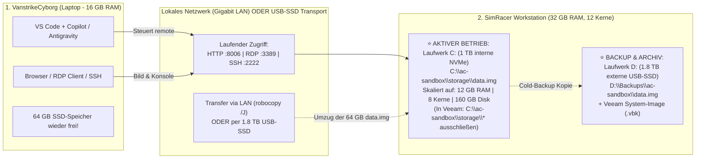

# Praxisanleitung: 64-GB Docker-Sandbox (`ac-sandbox`) auf den SimRacer übertragen, vergrößern & remote nutzen

<details>
<summary><h2>1. Ausgangslage & Hardware-Realität am SimRacer</h2></summary>

Auf dem **VanstrikeCyborg (Laptop, 16 GB RAM, 1 TB NVMe)** läuft die Windows-11-Docker-Sandbox (`dockurr/windows` im Ordner `ac-sandbox`) aus Platz- und Speicherschutzgründen mit stark gedrosselten Werten:
* **`RAM_SIZE: "4G"`** und **`CPU_CORES: "4"`** (Notlösung, damit die 16 GB RAM des Laptops nicht überlaufen).
* **`DISK_SIZE: "64G"`** (`ac-sandbox/storage/data.img` belegt exakt **64 GB** auf der Laptop-SSD).

Für Windows 11 + Steam + Assetto Corsa + Content Manager + Python/KI-Agenten-Tools sind **4 GB RAM und 64 GB Festplattenplatz zu knapp**.

Auf der **SimRacer-Workstation** (AMD Ryzen 9 3900X mit 12 Kernen / 24 Threads, **32 GB RAM**, RTX 5070 Ti) stehen folgende zwei Laufwerke zur Verfügung:
1. **Laufwerk `C:` (1 TB interne NVMe System-SSD) – ⭐ EMPFOHLEN FÜR DEN AKTIVEN LIVE-BETRIEB (`C:\ac-sandbox`):**
   Direkt über PCIe/M.2 angebunden (ca. 3.500–5.000 MB/s, minimale Latenz, 100 % immun gegen USB-Wackelkontakte).
2. **Laufwerk `D:` (1.8 TB per USB angeschlossene externe SSD) – ⭐ EMPFOHLEN FÜR TRANSPORT & BACKUPS (`D:\Backups\ac-sandbox`):**
   Schneller Flash-Speicher über USB 3.2 (ca. 450–1.000 MB/s), ideal für das Veeam-System-Backup und für Sicherheitskopien der `data.img`.



</details>

---

<details>
<summary><h2>2. Architektur-Entscheidung: Warum `C:` (interne NVMe) für den Live-Betrieb besser ist als `D:` (externe USB-SSD)</h2></summary>

Da es sich bei Laufwerk `D:` am SimRacer um eine **per USB angeschlossene externe SSD** handelt, gilt der **Gold-Standard**: **Aktiver Live-Betrieb auf `C:\ac-sandbox` (interne NVMe) + Backups auf `D:` (externe USB-SSD)**.

### Warum `C:\ac-sandbox` (interne NVMe) im Live-Betrieb gewinnt:

1. **100 % Schutz vor USB-Verbindungsabbrüchen am Rig:**
   Die bis zu 160 GB große Datei `data.img` ist eine komplette virtuelle Festplatte, in die das Gast-Windows-11 permanent schreibt. Wenn am SimRacer (z. B. durch Direct-Drive-Lenkrad-Vibrationen, Ein-/Ausstecken des VR-Headsets oder einen kurzen USB-Controller-Reset) die externe USB-SSD auch nur für **0,5 Sekunden** die Verbindung verliert, stürzt das Windows in der Sandbox sofort mit einem Dateisystemfehler ab. Auf der **internen NVMe (`C:`)** ist ein solcher Abbruch physisch ausgeschlossen.
2. **Bis zu 7× höhere Geschwindigkeit (PCIe/NVMe vs. USB-Protokoll):**
   * **Interne NVMe (`C:`):** ~3.500 bis 5.000 MB/s und extrem niedrige 4K-Latenzen – die Windows-11-Sandbox bootet in wenigen Sekunden und Steam-Installationen laufen ohne Stottern.
   * **Externe USB-SSD (`D:`):** Durch die USB-Brücke auf ca. 450–1.000 MB/s begrenzt und bei parallelen Zugriffen (Docker WSL2 + QEMU) spürbar höherer Overhead.
3. **Maximale Stabilität für Docker Desktop & WSL2:**
   Docker unter Windows bindet Volume-Mounts (`./storage:/storage`) über das Linux-Subsystem ein. Auf dem internen Systemlaufwerk `C:\ac-sandbox` arbeitet diese Treiberbrücke am zuverlässigsten.

### Gegenüberstellung im Überblick

| Kriterium | ⭐ **Empfehlung (Gold-Standard):** Live-Betrieb auf **`C:\ac-sandbox` (interne 1 TB NVMe)** | Alternativ-Option: Live-Betrieb auf **`D:\ac-sandbox` (externe 1.8 TB USB-SSD)** |
| :--- | :--- | :--- |
| **Geschwindigkeit (Ladezeiten & IOPS)** | **Maximal (3.500–5.000 MB/s)** – Direkte PCIe/M.2-Anbindung ohne USB-Flaschenhals. | **Gut (450–1.000 MB/s)** – Schnell genug dank Flash-Speicher, aber durch USB gebremst. |
| **Ausfallsicherheit für `data.img`** | **100 % betriebssicher** (fest auf dem Mainboard verschraubt, kein Wackelkontakt möglich). | **Empfindlich:** Kurzer USB-Reset oder USB-Standby im laufenden Betrieb kann `data.img` beschädigen. |
| **Veeam-System-Backup (`C:`)** | **1 Zeile in Veeam eintragen:** `C:\ac-sandbox\storage\*` unter *Exclusions* ausschließen – dann bleibt das Veeam-Backup von `C:` genauso klein (25–40 GB) und schnell (10 Min.)! | Beeinflusst `C:` nicht automatisch, erfordert aber zwingend das Abschalten des USB-Energiesparmodus. |
| **Optimale Rolle im Gesamtsystem** | **Aktives Arbeitsverzeichnis für den Docker-Container (`C:\ac-sandbox`)** | **Schnelles Transportmedium & Backup-Tresor (`D:\Backups\ac-sandbox`)** |

### Der einzige Pflichtschritt bei Betrieb auf `C:\ac-sandbox`: Veeam-Ausschlussregel setzen!
Damit Ihr **Veeam-System-Backup** ([simracer-system-backup-wiederherstellung-veeam.md](./simracer-system-backup-wiederherstellung-veeam.md)) nicht jedes Mal die 160 GB große `data.img` von Laufwerk `C:` mitsichert, tragen Sie im Veeam-Backup-Job unter **Exclusions (Ausschlüsse)** einfach diesen Pfad zusätzlich zu den Steam-Spielen ein:

```text
C:\ac-sandbox\storage\*
```
*(Der kleine Ordner `C:\ac-sandbox\shared` und die `docker-compose.yml` werden dann sogar automatisch von Veeam mitgesichert, während die riesige `data.img` übersprungen wird!).*

</details>

---

<details>
<summary><h2>3. Schritt-für-Schritt: Die 64-GB-Sandbox nach `C:\ac-sandbox` auf den SimRacer übertragen</h2></summary>

### Schritt 3.1: Sandbox auf dem VanstrikeCyborg sauber stoppen
Bevor `data.img` kopiert wird, **muss** der Container auf dem Laptop gestoppt sein, damit alle Schreibvorgänge abgeschlossen sind:

```powershell
cd C:\Users\strik\git-labor\ac-sandbox
docker compose stop
```

### Schritt 3.2: Zielordner `C:\ac-sandbox` auf dem SimRacer anlegen & übertragen (LAN oder USB-SSD)

#### Weg A (Direkt über das lokale Netzwerk / LAN nach `C:\ac-sandbox`):

1. **Auf dem SimRacer (Admin-PowerShell) Zielordner auf `C:` anlegen und im LAN freigeben:**
   ```powershell
   # Auf dem SimRacer (Admin-PowerShell):
   New-Item -ItemType Directory -Path "C:\ac-sandbox" -Force
   New-SmbShare -Name "ac-sandbox" -Path "C:\ac-sandbox" -FullAccess "Jeder" -ErrorAction SilentlyContinue

   # IP-Adresse des SimRacers im lokalen Netzwerk anzeigen:
   Get-NetIPAddress -AddressFamily IPv4 | Where-Object { $_.InterfaceAlias -notmatch "Loopback|vEthernet|WSL" } | Select-Object InterfaceAlias, IPAddress
   ```

2. **Auf dem VanstrikeCyborg Transfer über LAN starten:**
   ```powershell
   powershell -ExecutionPolicy Bypass -File "C:\Users\strik\git-labor\ac-sandbox\shared\scripts\migrate-sandbox-to-simracer.ps1" -TargetPath "\\SimRacer\ac-sandbox"
   ```
   *(Alternativ mit der IP-Adresse des SimRacers, z. B. `-TargetPath "\\192.168.178.50\ac-sandbox"`).*

#### Weg B (Noch schneller über die externe 1.8-TB-USB-SSD als Transportbrücke):
Da Sie bereits die schnelle 1.8-TB-USB-SSD besitzen, können Sie diese auch als **Transportmedium** nutzen (und haben damit gleichzeitig sofort Ihr erstes Backup auf `D:`!):

1. **Externe 1.8-TB-USB-SSD an den VanstrikeCyborg stecken** und die Sandbox darauf kopieren (dauert über USB 3.2 nur ca. 2 Minuten):
   ```powershell
   # Auf dem VanstrikeCyborg (falls die USB-SSD dort Laufwerk D: ist):
   powershell -ExecutionPolicy Bypass -File "C:\Users\strik\git-labor\ac-sandbox\shared\scripts\migrate-sandbox-to-simracer.ps1" -TargetPath "D:\Backups\ac-sandbox"
   ```
2. **USB-SSD wieder an den SimRacer stecken** und dort mit maximaler SSD-zu-NVMe-Geschwindigkeit nach `C:\ac-sandbox` kopieren:
   ```powershell
   # Auf dem SimRacer:
   robocopy "D:\Backups\ac-sandbox" "C:\ac-sandbox" /E /J /MT:8
   ```
   *Vorteil:* Sie haben die Sandbox in Rekordzeit auf `C:\ac-sandbox` und behalten gleichzeitig auf `D:\Backups\ac-sandbox` eine vollständige Sicherheitskopie!

### Schritt 3.3 (Optional): Falls Sie die Sandbox doch einmal direkt von der USB-SSD (`D:`) starten möchten
Falls auf `C:` irgendwann der Platz knapp wird und Sie die Sandbox direkt von `D:` betreiben möchten, schalten Sie zuvor auf dem SimRacer zwingend das **USB-Energiesparen** ab:

```powershell
# Nur nötig, falls die Sandbox direkt von der USB-SSD (D:) betrieben wird:
powercfg /SETACVALUEINDEX SCHEME_CURRENT 2a737441-1930-4402-8d77-b2bebba308a3 48e6b7a6-50f5-4782-a5d4-53bb8f07e226 0
powercfg /Change disk-timeout-ac 0
powercfg /S SCHEME_CURRENT
```

</details>

---

<details>
<summary><h2>4. Docker-Sandbox auf dem SimRacer vergrößern (RAM, CPU & Festplatte > 64 GB)</h2></summary>

Warum reichten die bisherigen Einstellungen nicht aus?
* Auf dem Laptop waren in `docker-compose.yml` nur **`RAM_SIZE: "4G"`**, **`CPU_CORES: "4"`** und **`DISK_SIZE: "64G"`** eingestellt.
* Auf dem SimRacer (32 GB RAM, 12 Kerne / 24 Threads) können wir der Sandbox problemlos **12 GB bis 16 GB RAM**, **8 CPU-Kerne** und **160 GB bis 256 GB Festplattenspeicher** geben – **ohne dass Sie Windows 11 in der Sandbox neu installieren müssen!**

### Schritt 4.1: Die vorbereitete SimRacer-Konfiguration (`docker-compose.simracer.yml`) aktivieren

Im Ordner `ac-sandbox` befindet sich bereits die fertige Datei **`docker-compose.simracer.yml`** mit folgenden Leistungsdaten:

```yaml
services:
  ac-windows-sandbox:
    image: dockurr/windows:latest
    container_name: ac-win11-sandbox
    environment:
      VERSION: "11"
      KVM: "N"
      # --- SKALIERUNG AUF DEM SIMRACER (32 GB Host-RAM / Ryzen 9 3900X) ---
      RAM_SIZE: "12G"      # Erhöht von 4G auf 12G (bei Bedarf "16G" möglich)
      CPU_CORES: "8"       # Erhöht von 4 auf 8 Threads (von 24 verfügbaren)
      DISK_SIZE: "160G"    # Vergrößert data.img automatisch von 64G auf 160G!
      LANGUAGE: "German"
      REGION: "de-DE"
      KEYBOARD: "de-de"
    devices:
      - /dev/net/tun
    cap_add:
      - NET_ADMIN
    ports:
      # Auf 0.0.0.0 gebunden, damit der VanstrikeCyborg über das LAN zugreifen kann:
      - "0.0.0.0:8006:8006"       # Web-Viewer (noVNC) & Chrome DevTools MCP
      - "0.0.0.0:3389:3389/tcp"   # Windows Remotedesktop (RDP)
      - "0.0.0.0:3389:3389/udp"   # Windows Remotedesktop (RDP UDP-Beschleunigung)
      - "0.0.0.0:2222:22/tcp"     # OpenSSH-Bridge für KI-Agenten
    volumes:
      - ./storage:/storage
      - ./shared:/shared
    stop_grace_period: 2m
    restart: unless-stopped
```

**Auf dem SimRacer ausführen:**
```powershell
cd C:\ac-sandbox   # (Empfohlener Speicherort auf der internen 1 TB NVMe-SSD)

# Die SimRacer-Konfiguration als aktive docker-compose.yml übernehmen (macht das Migrationsskript bereits automatisch):
Copy-Item .\docker-compose.simracer.yml .\docker-compose.yml -Force

# Windows-Firewall auf dem SimRacer für den LAN-Zugriff vom Laptop öffnen:
New-NetFirewallRule -DisplayName "AC-Sandbox Remote Access (LAN)" -Direction Inbound -LocalPort 8006,3389,2222 -Protocol TCP -Action Allow -Profile Private
New-NetFirewallRule -DisplayName "AC-Sandbox Remote RDP-UDP (LAN)" -Direction Inbound -LocalPort 3389 -Protocol UDP -Action Allow -Profile Private

# Container mit 12 GB RAM, 8 Kernen und 160 GB Disk starten:
docker compose up -d
```

### Schritt 4.2: Partition `C:` innerhalb der Windows-11-Sandbox auf die neue Größe (160 GB) erweitern

Beim Start von `docker compose up -d` erkennt `dockurr/windows`, dass `DISK_SIZE` von `64G` auf `160G` erhöht wurde, und vergrößert die virtuelle Festplattendatei `storage\data.img` automatisch im Hintergrund.

Damit Windows **innerhalb** der Sandbox den neuen unzugeordneten Speicherplatz auch für das Laufwerk `C:` nutzt, führen Sie **innerhalb der Windows-11-Sandbox** (über `http://<SimRacer-IP>:8006` oder RDP) einmalig das mitgelieferte Skript aus:

1. Öffnen Sie in der Windows-11-Sandbox den Ordner **`Shared\scripts`** auf dem Desktop.
2. Rechtsklick auf **`expand-guest-disk.ps1`** → *Mit PowerShell ausführen* (oder in einer Admin-PowerShell im Gast):

```powershell
# Direkt-Befehl in der PowerShell innerhalb der Windows-11-Sandbox:
Update-Disk -Number 0
$MaxSize = (Get-PartitionSupportedSize -DriveLetter C).SizeMax
Resize-Partition -DriveLetter C -Size $MaxSize
Get-Volume -DriveLetter C
```
Sofort danach zeigt Laufwerk `C:` im Explorer der Sandbox die vollen **160 GB** (bzw. jeden Wert, den Sie bei `DISK_SIZE` eingetragen haben) ohne Neustart und ohne Datenverlust an!

> **Wichtiger Hinweis:** `DISK_SIZE` kann jederzeit weiter **vergrößert** werden (z. B. später von `160G` auf `250G`), aber niemals verkleinert.

</details>

---

<details>
<summary><h2>5. Sandbox vom VanstrikeCyborg (Laptop) aus fernsteuern</h2></summary>

Sobald der Container auf dem SimRacer läuft, arbeiten Sie am **VanstrikeCyborg** genauso komfortabel wie zuvor lokal – nur dass Ihr Laptop **0 MB RAM für Docker** verbraucht und kühl/leise bleibt:

### 1. Start-Skript auf dem Laptop im Remote-Modus nutzen (inkl. Session-1-Autostart & KVM-Check)
Das aktualisierte Skript `ac-sandbox/start-sandbox.ps1` auf dem VanstrikeCyborg verwendet standardmäßig `-RemoteHost "192.168.178.68"` und erledigt beim Start von VS Code automatisch folgende Schritte:
1. **Lokaler Docker-Kontext (`simracer`):** Richtet `ssh://Mike@192.168.178.68` als aktiven Docker-Kontext ein, sodass die **VS Code Containers-Erweiterung** und `docker ps` auf dem Laptop direkt die Container des SimRacers anzeigen.
2. **Session-1-Autostart von Docker Desktop:** Falls Docker auf dem SimRacer noch nicht läuft, wird zuerst der Dienst `com.docker.service` gestartet und `Docker Desktop.exe` über den Windows Taskplaner (`StartDockerDesktopInteractive` mit `-LogonType Interactive`) in der aktiven Benutzer-Sitzung (**Session 1**) gestartet (umgeht die SSH-Session-0-Isolation).
3. **KVM-Kernelmodul (`kvm_amd`) & Container-Start:** Lädt in der `docker-desktop`-WSL2-Distro automatisch `modprobe kvm_amd` (`chmod 666 /dev/kvm`) und startet `docker compose up -d` in `C:\ac-sandbox`.

```powershell
# Prüft auf dem Laptop den Antigravity-Proxy UND startet/verbindet die Sandbox auf dem SimRacer:
.\ac-sandbox\start-sandbox.ps1 -RemoteHost "192.168.178.68"
```

### 2. Die 5 Zugriffswege vom Laptop auf die SimRacer-Sandbox

| Zugriffsart vom VanstrikeCyborg | Adresse / Befehl am Laptop | Zweck |
| :--- | :--- | :--- |
| **1. Web-Oberfläche & Chrome DevTools MCP** | `http://192.168.178.68:8006` | Schneller Blick in den Windows-11-Gast im Browser; der KI-Agent kann über Chrome DevTools MCP direkt Screenshots machen und klicken. |
| **2. Windows Remotedesktop (`mstsc.exe`)** | `Win + R` → `mstsc /v:192.168.178.68:3390`<br/>*(User: `Docker`, Passwort: `admin` oder leer)* | Flüssigste Vollbild-Ansicht mit Ton, Zwischenablage (Copy & Paste) und direkter Tastatur-/Maussteuerung (Port `3390`, damit Host-RDP `3389` frei bleibt). |
| **3. Gemeinsamer `Shared`-Ordner (Dateiaustausch)** | `\\192.168.178.68\ac-sandbox\shared` | Skripte, `.ini`-Configs und Python-Apps vom Laptop direkt in die Sandbox speichern. |
| **4. OpenSSH für KI-Agenten-Befehle** | `ssh -p 2222 Docker@192.168.178.68` | Direkte PowerShell-Kommandos vom Laptop-Agenten in die Sandbox senden (siehe [Steam & KI-Agenten-Architektur](./docker-windows-steam-ki-agent-architektur.md)). |
| **5. VS Code Containers-Erweiterung & Docker CLI** | Docker Context `simracer` (`ssh://Mike@192.168.178.68`) | Container direkt in der VS Code Seitenleiste (*Containers*) sehen, starten, stoppen und Logs einsehen. |

</details>

---

<details>
<summary><h2>6. Speicherplatz (64 GB) auf dem VanstrikeCyborg freigeben</h2></summary>

Nachdem Sie überprüft haben, dass die Sandbox auf dem SimRacer sauber startet und das Laufwerk `C:` in der Sandbox vergrößert wurde, können Sie die **64 GB große `data.img`** auf dem Laptop löschen:

```powershell
# AUF DEM VANSTRIKECYBORG (LAPTOP) AUSFÜHREN – ERST NACH ERFOLGREICHEM TEST AUF DEM SIMRACER!

# 1. Lokalen Container aus Docker entfernen (falls noch registriert)
cd C:\Users\strik\git-labor\ac-sandbox
docker compose down

# 2. Die 64 GB große virtuelle Festplatte auf dem Laptop löschen (Konfigurationsdateien & Skripte bleiben erhalten!)
Remove-Item "C:\Users\strik\git-labor\ac-sandbox\storage\data.img" -Force
```

Damit gewinnen Sie auf der 1-TB-SSD des **VanstrikeCyborg** sofort **64 GB freien Speicherplatz** zurück, während die Sandbox mit dreifacher Leistung (12 GB RAM, 8 Kerne, 160 GB Speicher) auf dem **SimRacer** läuft.

</details>

---

<details>
<summary><h2>7. Weiterführende Dokumente</h2></summary>

* [Multi-PC-Architektur & Einsatzkonzept (VanstrikeCyborg & SimRacer)](./multi-pc-architektur-ki-agents-simracing.md)
* [Handbuch: KI-Agent, MCP-Server & Windows-11-Docker-Sandbox](./SANDBOX_ANLEITUNG.md)
* [Docker Windows-11 Sandbox: Steam & KI-Agenten-Architektur](./docker-windows-steam-ki-agent-architektur.md)
* [Praxisanleitung: System-Image & Wiederherstellung (Veeam Agent Free) für SimRacer](./simracer-system-backup-wiederherstellung-veeam.md)
* [Technische Hardware- und Stabilitätsanalyse (MSI Cyborg 15 & Docker)](./hardware-analyse-system-stabilitaet-docker-ki.md)

</details>
