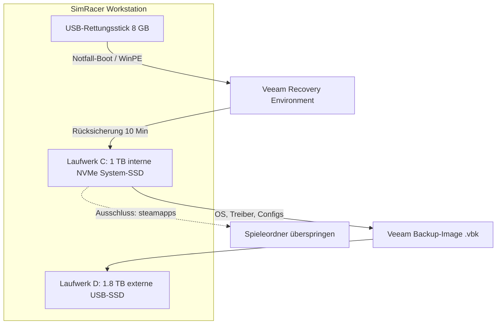

# Praxisanleitung: System-Image & Wiederherstellung (Veeam Agent Free) für SimRacer

<details>
<summary><h2>1. Zielsetzung & Architektur</h2></summary>

Diese Anleitung dokumentiert die schlüsselfertige Einrichtung eines bootfähigen Wiederherstellungs-Images für die **SimRacer-Workstation** (AMD Ryzen 9 3900X, NVIDIA RTX 5070 Ti, Fanatec ClubSport, HTC VIVE Focus Vision).

### Kernziel:
* **Vollständige Sicherung des Betriebssystems (C:):** Windows 11, Treiber, VR-Software, Content Manager und Konfigurationen.
* **Ausschluss von Steam-Spielen (`steamapps\common`):** Reduziert das Backup-Volumen von mehreren hundert Gigabyte auf ca. **25–40 GB**.
* **Wiederherstellungszeit im Ernstfall:** 10–15 Minuten (Bare-Metal Restore via USB-Stick).



</details>

<details>
<summary><h2>2. Vorbereitung & Installation</h2></summary>

1. **Software:** Lade die **Veeam Agent for Microsoft Windows (Community Edition / Free)** von der Herstellerseite herunter.
2. **Installation:** Führe den Installer mit Administratorrechten auf dem SimRacer aus.
3. **Lizenzierung:** Wähle bei der Lizenzabfrage **Free Edition** (erfordert keinen Lizenzschlüssel).

</details>

<details>
<summary><h2>3. Bootfähiges USB-Rettungsmedium erstellen</h2></summary>

Das Rettungsmedium ist die Voraussetzung, um das System auch dann wiederherzustellen, wenn Windows 11 nicht mehr hochfährt.

1. Stecke einen leeren USB-Stick (mind. 4 bis 8 GB) an den SimRacer an.
2. Öffne das Startmenü und starte den **Veeam Recovery Media Creator**.
3. **Wichtige Optionen aktivieren:**
   * `[x] Include network connection settings from this computer`
   * `[x] Include hardware drivers from this computer` *(Bindet automatisch die NVMe-Controller-, RTX-5070-Ti- und Netzwerktreiber ein)*.
4. Wähle den USB-Stick als Ziel aus und starte die Erstellung.
5. Nach Abschluss den Stick beschriften (z. B. *„SimRacer Recovery“*) und sicher aufbewahren.

</details>

<details>
<summary><h2>4. Konfiguration des Backup-Jobs (Ausschluss der Spiele)</h2></summary>

Öffne den Veeam Agent und klicke auf **Add New Job**:

<details>
<summary><h3>Option A: Saubere Laufwerkstrennung (Best Practice)</h3></summary>

Falls die Steam-Bibliothek auf der **1.8 TB externen USB-SSD (Laufwerk D:)** liegt:
1. **Backup Mode:** Wähle **Volume level backup**.
2. **Volumes:** Markiere ausschließlich **Laufwerk C:** (System & EFI-Boot-Partition).
3. **Vorteil:** Alle Spiele liegen unberührt auf D:, Laufwerk C: wird schlank und blitzschnell gesichert.

</details>

<details>
<summary><h3>Option B: Spiele liegen auf C: (Manuelle Ausschlussliste)</h3></summary>

Falls Steam und die Spiele aktuell auf Laufwerk C: installiert sind:
1. **Backup Mode:** Wähle **File level backup**.
2. **Items:** Wähle `Operating system` und Laufwerk `C:`.
3. Klicke auf **Filters / Advanced Options** und trage unter **Exclusions** folgende Pfade ein (Spiele sowie die virtuelle Festplatte der Docker-Sandbox, falls diese auf `C:\ac-sandbox` läuft):
   ```text
   C:\Program Files (x86)\Steam\steamapps\common\*
   C:\SteamLibrary\*
   C:\ac-sandbox\storage\*
   ```
4. Temporäre Ordner und Caches werden von Veeam automatisch gefiltert.

</details>

<details>
<summary><h3>Speicherziel & Aufbewahrung</h3></summary>

* **Destination:** Wähle **Local storage**.
* **Folder:** Wähle einen Backup-Ordner auf der 1.8 TB SSD (z. B. `D:\Backups\Veeam_OS`).
* **Restore points to keep:** Empfohlen sind **3 bis 5 Punkte** (inkrementelle Speicherung; belegt ca. 40–70 GB Gesamtspeicher).
* **Schedule:** Optional wöchentlich oder manuell vor größeren Treiber- oder Mod-Updates.

</details>

</details>

<details>
<summary><h2>5. Durchführung der ersten Vollsicherung</h2></summary>

1. Klicke im Hauptfenster von Veeam mit der rechten Maustaste auf den Job `SimRacer-System-Backup` und wähle **Backup Now**.
2. **Geschwindigkeit:** Dank der internen Sandisk/NVMe-SSDs dauert der Vorgang für ca. 60–80 GB Systemdaten i. d. R. nur **5 bis 10 Minuten**.
3. **Ergebnis:** Eine komprimierte `.vbk`-Datei auf Laufwerk D: mit ca. 25–40 GB Größe.

</details>

<details>
<summary><h2>6. Der Ernstfall: Schritt-für-Schritt Bare-Metal Recovery</h2></summary>

Falls Windows nach einem fehlgeschlagenen Update, Mod-Konflikt oder Absturz nicht mehr startet:

1. **PC ausschalten.**
2. Den **Veeam-USB-Stick** an den SimRacer anschließen.
3. PC einschalten und sofort die Bootmenü-Taste drücken (je nach Mainboard `F11`, `F12` oder `F8`).
4. Den USB-Stick als Boot-Laufwerk auswählen.
5. In der blauen **Veeam Recovery Environment** auf **Bare Metal Recovery** klicken.
6. Die Backup-Datei auf Laufwerk `D:\Backups\Veeam_OS\` auswählen.
7. Als Wiederherstellungsziel **Laufwerk C:** bestätigen und den Restore starten.
8. Nach ca. 10 Minuten den USB-Stick entfernen und neu starten – das System befindet sich wieder im exakt funktionierenden Zustand.

</details>

<details>
<summary><h2>7. Weiterführende Dokumente & Verknüpfungen</h2></summary>

* [Praxisanleitung: 64-GB Docker-Sandbox auf den SimRacer übertragen, vergrößern & remote nutzen](./sandbox-umzug-skalierung-simracer.md)
* [Architektur-Übersicht: VS Code Agent, Localhost-Proxy, Gemini & Antigravity](./uebersicht-vscode-agent-localhost-gemini-antigravity.md)
* [Multi-PC-Architektur & Einsatzkonzept (VanstrikeCyborg & SimRacer)](./multi-pc-architektur-ki-agents-simracing.md)
* [Technische Hardware- und Stabilitätsanalyse (MSI Cyborg 15 & Docker)](./hardware-analyse-system-stabilitaet-docker-ki.md)
* [Docker Windows-11 Sandbox: Steam & KI-Agenten-Architektur](./docker-windows-steam-ki-agent-architektur.md)

</details>
