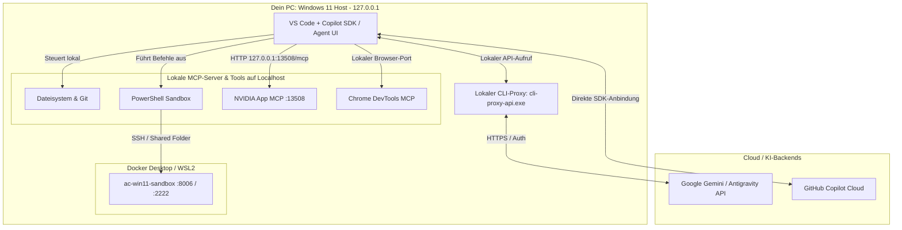
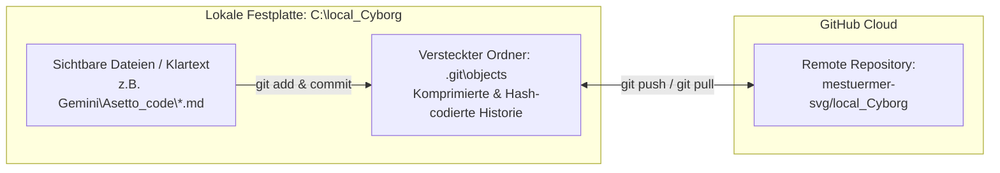

# Architektur-Übersicht: VS Code Agent, Localhost-Proxy, Gemini & Antigravity

<h2>1. Kurzantwort: Läuft der Agent lokal oder in der Cloud?</h2>

Es handelt sich um eine **hybride Localhost-Bridge-Architektur**:

1. **Die Steuerung, Werkzeuge (MCP) und Ausführung laufen zu 100 % lokal (`127.0.0.1` / Localhost)** auf deinem Windows-PC.
2. **Das Sprachmodell (Gehirn / LLM)** – also Gemini bzw. Antigravity oder GitHub Copilot – wird über einen lokalen Proxy (`cli-proxy-api.exe`) oder direkt per API angesprochen, während die **Aktionen** (Dateien lesen/schreiben, PowerShell, Browser-Steuerung, NVIDIA App, Docker-Sandbox) direkt lokal auf deiner Maschine ausgeführt werden.

<h2>2. Gesamtbild der Komponenten (Architektur-Diagramm)</h2>

<h2>3. Wie sind die einzelnen Bausteine verbunden?</h2>

| Baustein | Wo läuft er? | Wie ist er verbunden? | Aufgabe |
| :--- | :--- | :--- | :--- |
| **VS Code (Copilot SDK Agent)** | **Lokal** (Windows Host) | Haupt-Oberfläche & Orchestrator | Nimmt deine Prompts entgegen, plant Schritte und ruft lokale Werkzeuge (Tools) auf. |
| **`cli-proxy-api.exe`** | **Localhost** (Hintergrundprozess) | Lokaler HTTP-Endpunkt (`127.0.0.1`) | Übersetzt Anfragen aus VS Code für **Antigravity / Gemini-Modelle** und leitet sie authentifiziert an die Google-Server weiter. |
| **Gemini / Antigravity** | **Cloud** (via Localhost-Proxy) | Über `cli-proxy-api.exe` oder Google AI MCP | Liefert die KI-Intelligenz (Denken, Code-Generierung, Planung), hat aber **keinen** direkten Zugriff auf deinen PC ohne VS Code. |
| **MCP-Server (NVIDIA, Chrome, Docs)** | **Localhost** (`127.0.0.1`) | Konfiguriert in `mcp.json` / `mcp-config.json` | Stellen dem Agenten lokale Schnittstellen bereit (z. B. NVIDIA App unter `http://127.0.0.1:13508/mcp`). |
| **Docker Windows Sandbox** | **Lokal** (in WSL2 / QEMU) | Ports `8006` (Web-VNC), `3389` (RDP) & Shared Folder | Isolierte Windows-11-Testumgebung für Steam / Assetto Corsa, gesteuert vom Host-Agenten. |

<h2>4. Wo liegen die zentralen Konfigurationsdateien auf deinem PC?</h2>

Damit VS Code, Copilot, Gemini und Antigravity dieselben lokalen Werkzeuge kennen, greifen sie auf folgende lokale Konfigurationsdateien zu:

1. **VS Code MCP-Konfiguration:**
   `C:\Users\strik\AppData\Roaming\Code\User\mcp.json`
2. **GitHub Copilot Agent Konfiguration:**
   `C:\Users\strik\.copilot\mcp-config.json`
3. **Google Antigravity / Gemini Konfiguration:**
   `C:\Users\strik\.gemini\config\mcp_config.json`

<h2>5. Wie ist das GitHub-Repository lokal auf der Festplatte gespeichert?</h2>

Dein Ordner `C:\local_Cyborg` (bzw. der Unterordner `Gemini\Asetto_code`) ist ein **vollwertiger lokaler Klon** des GitHub-Repositorys `mestuermer-svg/local_Cyborg`. Er besteht aus zwei Ebenen auf deiner SSD:

<h3>5.1 Der Arbeitsbereich (Working Tree) – Klartext & normale Dateien</h3>

* Alle Dateien, die du im Explorer oder in VS Code siehst (z. B. `.md`, `.ps1`, `.yml`), liegen **ganz normal und unverschlüsselt als echte Dateien** auf deiner Festplatte (`C:\local_Cyborg\...`).
* Du (und der KI-Agent) bearbeitest diese Dateien direkt lokal ohne Zeitverzögerung.

<h3>5.2 Die Git-Datenbank (<code>C:\local_Cyborg\.git</code>) – Komprimiert & Hash-codiert</h3>

* Im versteckten Unterordner `.git` liegt das eigentliche **Mirror-/Versions-Gedächtnis** von Git.
* Dort speichert Git jede Version, jeden Commit und die komplette Historie **komprimiert und mit SHA-1/SHA-256-Prüfsummen codiert** (als sogenannte *Blobs*, *Trees* und *Packfiles* unter `.git\objects`).
* **Synchronisation mit GitHub:**
  * Änderungen passieren **zuerst nur lokal** auf deiner Festplatte.
  * Erst mit `git commit` wandert der Stand in deine lokale `.git`-Datenbank.
  * Erst mit `git push` bzw. `git pull` wird deine lokale `.git`-Datenbank mit dem Cloud-Mirror auf GitHub (`mestuermer-svg/local_Cyborg`) abgeglichen.

<h2>6. Kann das KI-Modell auch zu 100 % offline auf Localhost laufen?</h2>

* **Aktueller Stand:** Die **Werkzeuge und der Proxy** laufen auf `localhost`, aber die **Sprachmodelle** (Gemini / Antigravity) rechnen in der Google-Cloud.
* **Optionaler 100 %-Localhost-Betrieb (auf dem SimRacer):**
  Wenn du auf dem **SimRacer** (mit der RTX 5070 Ti und 16 GB VRAM) ein Tool wie **Ollama** oder **LM Studio** auf Port `11434` (`http://localhost:11434`) startest, läuft sogar das KI-Sprachmodell selbst komplett lokal auf deiner eigenen Grafikkarte – ohne Internetverbindung.

<h2>7. Weiterführende Dokumente & Verknüpfungen</h2>

* [Multi-PC-Architektur & Einsatzkonzept (VanstrikeCyborg & SimRacer)](./multi-pc-architektur-ki-agents-simracing.md)
* [Technische Hardware- und Stabilitätsanalyse (MSI Cyborg 15 & Docker)](./hardware-analyse-system-stabilitaet-docker-ki.md)
* [Docker Windows-11 Sandbox: Steam & KI-Agenten-Architektur](./docker-windows-steam-ki-agent-architektur.md)
* [Praxisanleitung: System-Image & Wiederherstellung (Veeam Agent Free) für SimRacer](./simracer-system-backup-wiederherstellung-veeam.md)

