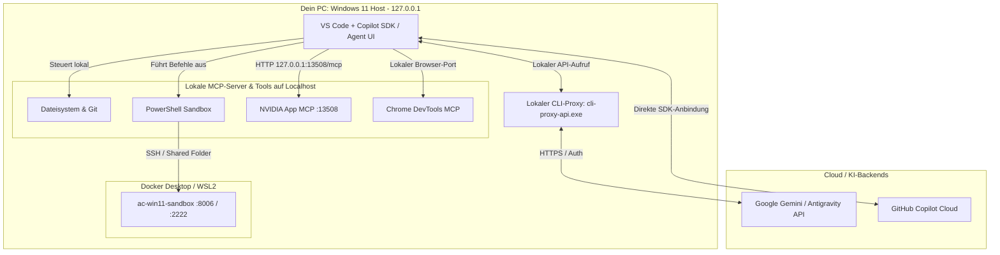
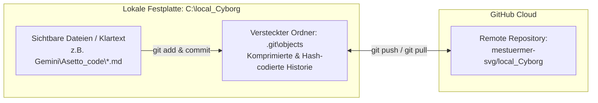
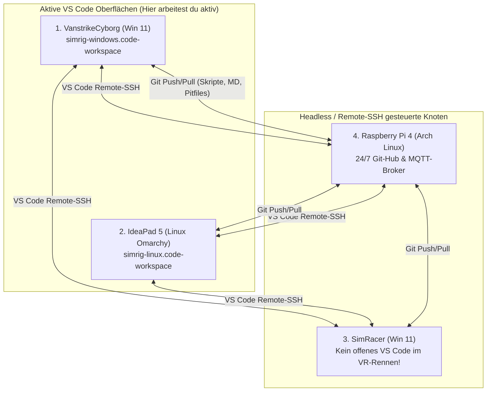

# Architektur-Übersicht: VS Code Agent, Localhost-Proxy, Gemini & Antigravity

<details>
<summary><h2>1. Kurzantwort: Läuft der Agent lokal oder in der Cloud?</h2></summary>

Es handelt sich um eine **hybride Localhost-Bridge-Architektur**:

1. **Die Steuerung, Werkzeuge (MCP) und Ausführung laufen zu 100 % lokal (`127.0.0.1` / Localhost)** auf deinem Windows-PC.
2. **Das Sprachmodell (Gehirn / LLM)** – also Gemini bzw. Antigravity oder GitHub Copilot – wird über einen lokalen Proxy (`cli-proxy-api.exe`) oder direkt per API angesprochen, während die **Aktionen** (Dateien lesen/schreiben, PowerShell, Browser-Steuerung, NVIDIA App, Docker-Sandbox) direkt lokal auf deiner Maschine ausgeführt werden.

</details>

<details>
<summary><h2>2. Gesamtbild der Komponenten (Architektur-Diagramm)</h2></summary>



</details>

<details>
<summary><h2>3. Wie sind die einzelnen Bausteine verbunden?</h2></summary>

| Baustein | Wo läuft er? | Wie ist er verbunden? | Aufgabe |
| :--- | :--- | :--- | :--- |
| **VS Code (Copilot SDK Agent)** | **Lokal** (Windows Host) | Haupt-Oberfläche & Orchestrator | Nimmt deine Prompts entgegen, plant Schritte und ruft lokale Werkzeuge (Tools) auf. |
| **`cli-proxy-api.exe`** | **Localhost** (Hintergrundprozess) | Lokaler HTTP-Endpunkt (`127.0.0.1`) | Übersetzt Anfragen aus VS Code für **Antigravity / Gemini-Modelle** und leitet sie authentifiziert an die Google-Server weiter. |
| **Gemini / Antigravity** | **Cloud** (via Localhost-Proxy) | Über `cli-proxy-api.exe` oder Google AI MCP | Liefert die KI-Intelligenz (Denken, Code-Generierung, Planung), hat aber **keinen** direkten Zugriff auf deinen PC ohne VS Code. |
| **MCP-Server (NVIDIA, Chrome, Docs)** | **Localhost** (`127.0.0.1`) | Konfiguriert in `mcp.json` / `mcp-config.json` | Stellen dem Agenten lokale Schnittstellen bereit (z. B. NVIDIA App unter `http://127.0.0.1:13508/mcp`). |
| **Docker Windows Sandbox** | **Lokal** (in WSL2 / QEMU) | Ports `8006` (Web-VNC), `3389` (RDP) & Shared Folder | Isolierte Windows-11-Testumgebung für Steam / Assetto Corsa, gesteuert vom Host-Agenten. |

</details>

<details>
<summary><h2>4. Wo liegen die zentralen Konfigurationsdateien auf deinem PC?</h2></summary>

Damit VS Code, Copilot, Gemini und Antigravity dieselben lokalen Werkzeuge kennen, greifen sie auf folgende lokale Konfigurationsdateien zu:

1. **VS Code MCP-Konfiguration:**
   `C:\Users\strik\AppData\Roaming\Code\User\mcp.json`
2. **GitHub Copilot Agent Konfiguration:**
   `C:\Users\strik\.copilot\mcp-config.json`
3. **Google Antigravity / Gemini Konfiguration:**
   `C:\Users\strik\.gemini\config\mcp_config.json`

</details>

<details>
<summary><h2>5. Wie ist das GitHub-Repository lokal auf der Festplatte gespeichert?</h2></summary>

Dein Ordner `C:\local_Cyborg` (bzw. der Unterordner `Gemini\Asetto_code`) ist ein **vollwertiger lokaler Klon** des GitHub-Repositorys `mestuermer-svg/local_Cyborg`. Er besteht aus zwei Ebenen auf deiner SSD:

<details>
<summary><h3>5.1 Der Arbeitsbereich (Working Tree) – Klartext & normale Dateien</h3></summary>

* Alle Dateien, die du im Explorer oder in VS Code siehst (z. B. `.md`, `.ps1`, `.yml`), liegen **ganz normal und unverschlüsselt als echte Dateien** auf deiner Festplatte (`C:\local_Cyborg\...`).
* Du (und der KI-Agent) bearbeitest diese Dateien direkt lokal ohne Zeitverzögerung.

</details>

<details>
<summary><h3>5.2 Die Git-Datenbank (<code>C:\local_Cyborg\.git</code>) – Komprimiert & Hash-codiert</h3></summary>

* Im versteckten Unterordner `.git` liegt das eigentliche **Mirror-/Versions-Gedächtnis** von Git.
* Dort speichert Git jede Version, jeden Commit und die komplette Historie **komprimiert und mit SHA-1/SHA-256-Prüfsummen codiert** (als sogenannte *Blobs*, *Trees* und *Packfiles* unter `.git\objects`).
* **Synchronisation mit GitHub:**
  * Änderungen passieren **zuerst nur lokal** auf deiner Festplatte.
  * Erst mit `git commit` wandert der Stand in deine lokale `.git`-Datenbank.
  * Erst mit `git push` bzw. `git pull` wird deine lokale `.git`-Datenbank mit dem Cloud-Mirror auf GitHub (`mestuermer-svg/local_Cyborg`) abgeglichen.



</details>

</details>

<details>
<summary><h2>6. Kann das KI-Modell auch zu 100 % offline auf Localhost laufen?</h2></summary>

* **Aktueller Stand:** Die **Werkzeuge und der Proxy** laufen auf `localhost`, aber die **Sprachmodelle** (Gemini / Antigravity) rechnen in der Google-Cloud.
* **Optionaler 100 %-Localhost-Betrieb (auf dem SimRacer):**
  Wenn du auf dem **SimRacer** (mit der RTX 5070 Ti und 16 GB VRAM) ein Tool wie **Ollama** oder **LM Studio** auf Port `11434` (`http://localhost:11434`) startest, läuft sogar das KI-Sprachmodell selbst komplett lokal auf deiner eigenen Grafikkarte – ohne Internetverbindung.

</details>

<details>
<summary><h2>7. Praxisanleitung: VS Code & Workspaces auf allen 4 Systemen sinnvoll nutzen</h2></summary>

<details>
<summary><h3>7.1 Warum einfaches Kopieren der Workspace-Datei / Session auf alle 4 Geräte scheitert</h3></summary>

Wenn man versucht, eine einzelne `.code-workspace`-Datei (wie `git-labor_newest.code-workspace`) 1:1 auf alle 4 Geräte zu kopieren, treten drei technische Probleme auf:
1. **Inkompatible Betriebssystem-Pfade (Windows vs. Linux):**
   * Auf **VanstrikeCyborg (Win 11)** und **SimRacer (Win 11)** lauten Pfade `C:\Users\strik\...` und automatische Tasks rufen `powershell.exe -File ...\start-sandbox.ps1` auf.
   * Auf dem **IdeaPad 5 (Linux Omarchy)** und dem **Raspberry Pi 4 (Arch Linux)** gibt es weder Laufwerksbuchstaben (`C:\`) noch `powershell.exe`. Ein kopierter Windows-Workspace erzeugt beim Öffnen unter Linux sofort Pfad- und Task-Fehler.
2. **RAM- und CPU-Belastung auf SimRacer & Raspberry Pi 4:**
   * Auf dem **Raspberry Pi 4** würde eine volle grafische VS-Code-Oberfläche (Electron + Sprachserver + KI-Extensions) den Arbeitsspeicher unnötig blockieren.
   * Auf dem **SimRacer** darf während des VR-Rennbetriebs (`acs.exe` mit 120 Hz VIVE Focus Vision & Fanatec) kein schweres VS-Code-Fenster im Hintergrund CPU-Interrupts auslösen.
3. **Lokale Ports (`127.0.0.1`):**
   * Dienste wie `cli-proxy-api.exe` (`:8317`) oder der NVIDIA App MCP-Server (`:13508`) laufen lokal auf dem jeweiligen Windows-Host und müssen im Netzwerk gezielt per IP oder SSH-Tunnel angesprochen werden.

</details>

<details>
<summary><h3>7.2 Die Best-Practice-Lösung: „2 Bedien-Stationen + Remote-SSH + 2 Workspace-Profile“</h3></summary>

Nach dem **PG-/Leitstand-Prinzip** öffnest du die grafische VS-Code-Oberfläche nur auf deinen **zwei Laptops** und steuerst die anderen beiden Knoten direkt aus deinem gewohnten Fenster heraus:



1. **Settings Sync aktivieren (Oberfläche & Extensions synchron halten):**
   * Melde dich in VS Code auf dem **VanstrikeCyborg** und dem **IdeaPad 5 (Omarchy)** mit demselben GitHub-Account bei **Settings Sync** an.
   * Dadurch sind deine Extensions, Keybindings, Themes und User-Prompts automatisch auf beiden Geräten identisch.
2. **VS Code Remote-SSH nutzen (für SimRacer & Raspberry Pi 4):**
   * Installiere die offizielle Extension `ms-vscode-remote.remote-ssh`.
   * Verbinde dich vom Cyborg oder IdeaPad mit einem Klick (`Strg+Shift+P` -> *Remote-SSH: Connect to Host...*) auf `ssh user@rpi4` oder `ssh strik@simracer`.
   * Du nutzt dabei deine komplette lokale KI-Agenten-Session, bearbeitest aber direkt die Dateien auf dem Zielrechner!

</details>

<details>
<summary><h3>7.3 Die 2 fertigen Workspace-Profile im Git-Repository</h3></summary>

Lege im Hauptordner `git-labor` genau **zwei** getrennte `.code-workspace`-Dateien ab, die über Git auf allen Systemen synchron sind:

<details>
<summary><h4>Profil A: <code>simrig-windows.code-workspace</code> (Für VanstrikeCyborg & SimRacer)</h4></summary>

```json
{
	"folders": [
		{
			"name": "1_Git-Labor (Sandbox & Scripts)",
			"path": "."
		},
		{
			"name": "2_Local-Cyborg (Doku & Architektur)",
			"path": "../../../local_Cyborg"
		}
	],
	"settings": {
		"antigravityCopilot.server.autoStart": true,
		"antigravityCopilot.server.enabled": true,
		"chat.agent.sandbox.enabled": "off",
		"chat.agent.sandbox.network.allowLocalNetwork": true,
		"containers.containerClient": "com.microsoft.visualstudio.containers.docker"
	}
}
```

</details>

<details>
<summary><h4>Profil B: <code>simrig-linux.code-workspace</code> (Für IdeaPad 5 Omarchy & RPi 4 Arch Linux)</h4></summary>

```json
{
	"folders": [
		{
			"name": "1_Git-Labor (Linux Telemetry & Sarah Coach)",
			"path": "."
		},
		{
			"name": "2_Local-Cyborg (Doku & Architektur)",
			"path": "../local_Cyborg"
		}
	],
	"settings": {
		"terminal.integrated.defaultProfile.linux": "bash",
		"chat.agent.sandbox.enabled": "off",
		"chat.agent.sandbox.network.allowLocalNetwork": true,
		"files.eol": "\n"
	}
}
```

</details>

</details>

<details>
<summary><h3>7.4 Schritt-für-Schritt: SSH-Config für nahtlosen Zugriff auf alle 4 Knoten</h3></summary>

Trage in deiner Datei `C:\Users\strik\.ssh\config` (auf dem VanstrikeCyborg) bzw. `~/.ssh/config` (auf dem IdeaPad 5 unter Omarchy) folgende Host-Blöcke ein:

```sshconfig
# 1. SimRacer Workstation (Windows 11 Host)
Host simracer
    HostName 192.168.1.50
    User strik
    Port 22

# 2. Docker AC-Sandbox direkt auf dem SimRacer (Windows 11 Gast)
Host ac-sandbox
    HostName 192.168.1.50
    User Docker
    Port 2222

# 3. IdeaPad 5 (Linux Omarchy - Sarah Coach & Pitwall)
Host ideapad-omarchy
    HostName 192.168.1.60
    User strik
    Port 22

# 4. Raspberry Pi 4 (Arch Linux - 24/7 Broker & Git)
Host rpi4-broker
    HostName 192.168.1.70
    User alarm
    Port 22
```
*(Hinweis: IP-Adressen `192.168.1.x` einmalig an dein lokales Heimnetz/LAN anpassen.)*

</details>

</details>

<details>
<summary><h2>8. Weiterführende Dokumente & Verknüpfungen</h2></summary>

* [4-Knoten-Architektur & Einsatzkonzept (SimRacer, Cyborg, IdeaPad Omarchy, RPi 4)](./multi-pc-architektur-ki-agents-simracing.md)
* [Technische Hardware- und Stabilitätsanalyse (MSI Cyborg 15 & Docker)](./hardware-analyse-system-stabilitaet-docker-ki.md)
* [Docker Windows-11 Sandbox: Steam, Content Manager & KI-Agenten-Architektur](./docker-windows-steam-ki-agent-architektur.md)
* [Praxisanleitung: System-Image (Veeam) & Pitfile-Schnellbackup für SimRacer](./simracer-system-backup-wiederherstellung-veeam.md)
* [Sarah Coach, Agent-Fokus & Pitfile-Automatisierung (Detailkonzept)](./planing.md)

</details>

---
*Hinweis zur Organisation:* Die erstellte Dokumentation ist am Drehlaufwerk abgelegt und mit einer kurzen Zusammenfassung von den Chips auch in den Notebooks verlinkt.
