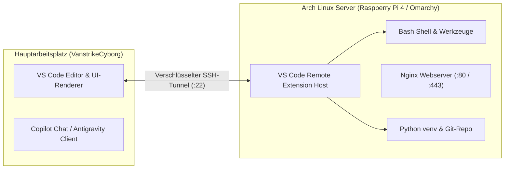

> **Thema:** Arch Linux, Omarchy (Hyprland), systemd-Dienste, Remote-SSH & Nginx-Webserver
> **Autor:** Michael Stürmer
> **Datum:** 08.11.2026

# 03 – Arch Linux, Omarchy, Remote-SSH & Webserver-Deployment

<!-- DOKU-SUBNAV-START -->
<details>
<summary><b>🧭 Rubrik-Navigation &amp; Modul-Übersicht (01 Linux & Bash)</b></summary>

**Zentrale:** [📚 Doku-Index](../README.md) · [📂 Rubrik 01 Linux & Bash](./README.md) · **Vorheriges:** [⬅️ 02 • Inodes, LVM, Prozesse, Boot-Prozess & systemd](./02_linux-systemadministration-und-interna.md) · **Nächstes:** [04 • Advanced Bash: Arrays, getopts & Backups ➡️](./04_fortgeschrittenes-bash-skripting-und-automatisierung.md)

**Alle Module in `01_Linux_Bash/`:**
- [01 • Bash CLI, Text-Tools, Streams & Expansions](./01_bash-grundlagen-und-skripting.md) · `check-env.sh`
- [02 • Inodes, LVM, Prozesse, Boot-Prozess & systemd](./02_linux-systemadministration-und-interna.md)
- 👉 **[03 • Arch Linux, Omarchy, Remote-SSH & Nginx](./03_arch-linux-omarchy-und-remote-ssh.md)** *(aktuell)*
- [04 • Advanced Bash: Arrays, getopts & Backups](./04_fortgeschrittenes-bash-skripting-und-automatisierung.md)
- [05 • Docker Grundlagen & Sandbox Micro-VMs (sbx)](./05_docker-und-sbx-micro-vms.md)

**Weitere Rubriken:** [🧩 02 VS Code & MCP](../02_VSCode_Env/README.md) · [🐍 03 Python](../03_Python_Coding/README.md) · [🌐 04 JS/TS Web](../04_JS_TS_Web/README.md) · [🤖 05 Agents](../05_Agents/README.md)

</details>
<!-- DOKU-SUBNAV-END -->

<details>
<summary><b>Lernziele</b></summary>

* Paketverwaltung unter **Arch Linux (`pacman`)** und Rolling-Release-Wartung fehlerfrei beherrschen.
* Die Vorzüge von **Linux Omarchy (Hyprland Wayland Compositor)** (inkl. `idle_inhibit` für Kiosk-Displays) und **Arch Linux ARM auf dem Raspberry Pi 4** als hochperformante Entwickler- und Server-Umgebungen verstehen.
* Sichere **SSH-Schlüssel (`ed25519`)**, `~/.ssh/config` und den **VS Code Remote-SSH Workflow** einrichten.
* Produktive Webserver (**Nginx** und **Caddy** als Reverse Proxy) sowie gehärtete **Node.js `systemd`-Livedienste** auf Arch Linux / Raspberry Pi 4 bereitstellen und verifizieren.

</details>

<details>
<summary><b>Kernkonzepte</b></summary>

<details>
<summary>1.1 Paketverwaltung unter Arch Linux (<code>pacman</code>)</summary>

Arch Linux (sowie darauf basierende Umgebungen wie **Omarchy** oder **Arch Linux ARM auf dem Raspberry Pi 4**) folgt dem **Rolling-Release-Prinzip** und nutzt den blitzschnellen C-basierten Paketmanager **`pacman`**:

| Befehl | Funktion | Beschreibung |
| :--- | :--- | :--- |
| `sudo pacman -Syu` | **System-Update** | Synchronisiert Paketdatenbanken und aktualisiert alle Systempakete in einem konsistenten Schritt. |
| `sudo pacman -S <paket>` | **Installieren** | Installiert Pakete (z. B. `sudo pacman -S git nginx python nodejs`). |
| `pacman -Ss <suchbegriff>` | **Suchen** | Durchsucht Paket-Repositories nach Namen und Beschreibungen. |
| `pacman -Qi <paket>` | **Paket-Info** | Zeigt Version, Abhängigkeiten, Lizenz und Installationsgröße an. |
| `sudo pacman -Rns <paket>` | **Sauber entfernen** | Deinstalliert das Paket inklusive verwaister Abhängigkeiten (`-s`) und Konfigurationsdateien (`-n`). |
| `sudo pacman -Sc` | **Cache bereinigen** | Entfernt alte Paket-Tarballs aus `/var/cache/pacman/pkg/`. |

</details>

<details>
<summary>1.2 Hintergrunddienste steuern mit <code>systemd</code> & <code>journalctl</code></summary>

Server-Dienste (wie `sshd`, `nginx`, `docker` oder eigene KI-Worker) werden unter Linux über **`systemd`** als Units verwaltet:

```bash
# Status eines Dienstes prüfen (Aktivität, PID, RAM-Verbrauch, letzte Logs)
sudo systemctl status sshd

# Dienst sofort starten / neu starten / stoppen
sudo systemctl start nginx
sudo systemctl restart nginx
sudo systemctl stop nginx

# Dienst im Systemstart verankern und sofort ausführen (--now)
sudo systemctl enable --now nginx

# Konfiguration ohne Verbindungsabbruch neu einlesen (Hot-Reload)
sudo systemctl reload nginx

# Live-Protokolle (Logs) eines bestimmten Dienstes auslesen
journalctl -u nginx -n 50 -f
```

</details>

<details>
<summary>1.3 Linux Omarchy & Hyprland (Tastatur-zentrierter Entwickler-Workflow)</summary>

**Omarchy** kombiniert Arch Linux mit dem modernen Wayland-Tiling-Window-Manager **Hyprland**:
* **Minimaler Overhead:** Kein schwerer Desktop-Unterbau (wie GNOME oder KDE) – ideal für Arbeitsplatz-Laptops, damit maximal viel Arbeitsspeicher für Sprachmodelle, Container und Compiler frei bleibt.
* **Tiling-Prinzip:** Fenster ordnen sich automatisch kachelförmig auf virtuellen Desktops (*Workspaces 1–9*) an.
* **Kiosk- & Dauerbetrieb (`idle_inhibit` / Screensaver-Schutz & `Pitwall.desktop`):** Für dauerhaft laufende Monitore (z. B. das Pitwall-Dashboard auf **Archibald** `192.168.178.98`) verhindert Hyprland über Fensterregeln in `~/.config/hypr/hyprland.lua` (`idle_inhibit = "always"`) sowie `omarchy-toggle-idle stay-awake` und `omarchy-toggle screensaver-off on` zuverlässig das Abdunkeln durch `hypridle` oder den Screensaver. Zusätzlich stellt `~/ac-pitwall/launch_pitwall.sh` samt `~/.local/share/applications/Pitwall.desktop` (mit eigenem Icon `pitwall.png`/`pitwall.svg`) sicher, dass die Pitwall jederzeit über den Omarchy App-Launcher (`SUPER + SPACE` $\rightarrow$ *Pitwall*) oder automatisch nach dem Aufwecken via `wake_archibald.ps1` im Vollbild auf Workspace 1 eingeblendet wird.
* **Linux-Workspace-Einstellungen in VS Code:**
  Unter Linux ist darauf zu achten, dass Zeilenenden auf **`LF` (`\n`)** statt `CRLF` (`\r\n`) stehen, damit Bash-Skripte nicht mit `bad interpreter: ^M` abbrechen:
  ```json
  {
    "terminal.integrated.defaultProfile.linux": "bash",
    "files.eol": "\n"
  }
  ```

</details>

<details>
<summary>1.4 SSH-Schlüssel (<code>ed25519</code>) & <code>~/.ssh/config</code></summary>

Für die sichere, passwortlose Verbindung zwischen deinem Windows-11-Hauptarbeitsplatz (`VanstrikeCyborg`), Linux-Laptops und Headless-Servern (Raspberry Pi 4) wird das moderne **Ed25519-Verfahren** eingesetzt:

```bash
# 1. Schlüsselpaar auf dem Arbeitsplatz erzeugen (falls noch nicht vorhanden)
ssh-keygen -t ed25519 -C "strik@VanstrikeCyborg"

# 2. Öffentlichen Schlüssel auf das Linux-Zielsystem übertragen
ssh-copy-id -i ~/.ssh/id_ed25519.pub alarm@192.168.178.50
```

Über die Datei **`~/.ssh/config`** (unter Windows `C:\Users\strik\.ssh\config`) definierst du sprechende Aliase:

```sshconfig
# Linux Edge-Server / Raspberry Pi 4 (Arch Linux ARM)
Host pi4
    HostName 192.168.178.50
    User alarm
    Port 22
    IdentityFile ~/.ssh/id_ed25519
    ServerAliveInterval 60
    ServerAliveCountMax 3

# Linux Laptop (Omarchy)
Host omarchy
    HostName 192.168.178.55
    User strik
    Port 22
    IdentityFile ~/.ssh/id_ed25519
```

</details>

<details>
<summary>1.5 VS Code Remote-SSH: Lokale UI, Remote-Ausführung</summary>

Mit der Erweiterung **VS Code Remote - SSH (`ms-vscode-remote.remote-ssh`)** bleibt die grafische Benutzeroberfläche auf deinem Hauptgerät, während der **VS Code Remote Server**, das Terminal und alle Sprachserver direkt auf dem entfernten Linux-Host laufen:



1. In VS Code `Strg + Shift + P` $\rightarrow$ **`Remote-SSH: Connect to Host...`**
2. Wähle den Host aus deiner Konfiguration (z. B. `pi4`).
3. Öffne den Projektordner direkt auf dem Remote-System – ohne langsame Dateisynchronisation oder Pfadkonflikte.

</details>

<details>
<summary>1.6 Nginx Webserver auf Arch Linux / Raspberry Pi 4 einrichten</summary>

Der Leichtbau-Webserver **Nginx** eignet sich optimal für ressourcenschonende Serverumgebungen:

```bash
# 1. Nginx installieren
sudo pacman -S nginx

# 2. Standard-Webroot anlegen und Testseite erstellen
sudo mkdir -p /srv/http/git-labor
sudo chown -R alarm:alarm /srv/http/git-labor

cat << 'EOF' > /srv/http/git-labor/index.html
<!DOCTYPE html>
<html lang="de">
<head><meta charset="utf-8"><title>git-labor Server</title></head>
<body style="font-family: sans-serif; background: #0f172a; color: #f8fafc; padding: 40px;">
  <h1>🚀 git-labor Webserver auf Arch Linux (Pi 4)</h1>
  <p>Bereitgestellt via Nginx &amp; systemd.</p>
</body>
</html>
EOF

# 3. Nginx Serverblock (/etc/nginx/nginx.conf bzw. /etc/nginx/sites-available/)
# Minimaler Serverblock in der http-Sektion von /etc/nginx/nginx.conf:
# server {
#     listen 80;
#     server_name pi4.local;
#     root /srv/http/git-labor;
#     index index.html;
#     location / {
#         try_files $uri $uri/ =404;
#     }
# }

# 4. Konfiguration auf Syntaxfehler prüfen (lebensrettend vor jedem Reload!)
sudo nginx -t

# 5. Dienst aktivieren und starten
sudo systemctl enable --now nginx
```

</details>

<details>
<summary>1.7 Praxis-Setup: Caddy-Webserver, Reverse Proxy &amp; gehärtete Node.js systemd-Dienste (StrikerPi)</summary>

Auf unserem produktiven Edge-Hub **StrikerPi (`192.168.178.86`, Arch Linux ARM)** läuft statt Nginx der moderne Go-Webserver **Caddy (`:80`)** zusammen mit einem eigenen Node.js-Systemd-Livedienst (`gitlabor-api.service` auf `127.0.0.1:8085`). Die vollständigen Konfigurations- und Quell-Dateien liegen im Workspace unter [`labs/01_linux_bash/strikerpi-services/`](../../labs/01_linux_bash/strikerpi-services/).

#### 1. Warum Caddy als Edge-Webserver & Reverse Proxy?
* **Modulare Konfiguration:** `/etc/caddy/Caddyfile` bindet über `import /etc/caddy/conf.d/*.caddy` gezielt Teilkonfigurationen (z. B. `git-labor.caddy`) ein und nutzt den Admin-Socket `unix//run/caddy/admin.socket`.
* **Eingebauter Reverse Proxy & WebSockets:** Anfragen an `/api/linux/*` gehen intern an `127.0.0.1:8085` (Node.js-API) und `/mqtt*` an `127.0.0.1:9001` (Mosquitto WebSockets), während statische Webseiten aus `/srv/git-labor/web` mit `gzip`/`zstd` ausgeliefert werden.
* **Strukturierte Access-Logs:** Caddy schreibt jeden HTTP-Request im JSON-Format nach `/var/log/caddy/gitlabor-access.log` (mit automatischer Log-Rotation: `roll_size 5MiB`, `roll_keep 3`).

```caddyfile
:80 {
    root * /srv/git-labor/web
    encode gzip zstd

    log {
        output file /var/log/caddy/gitlabor-access.log {
            roll_size 5MiB
            roll_keep 3
        }
        format json
    }

    handle /api/linux/* {
        reverse_proxy 127.0.0.1:8085
    }

    handle /mqtt* {
        reverse_proxy 127.0.0.1:9001
    }

    handle {
        file_server {
            browse
        }
    }
}
```

```bash
# Caddy-Konfiguration formatieren, prüfen und ohne Verbindungsabbruch neu laden
sudo caddy fmt --overwrite /etc/caddy/Caddyfile
sudo caddy validate --config /etc/caddy/Caddyfile
sudo systemctl reload caddy.service
```

#### 2. Gehärteter Node.js-Livedienst (`gitlabor-api.service`)
Das Backend [`gitlabor-api.mjs`](../../labs/01_linux_bash/strikerpi-services/gitlabor-api.mjs) läuft ausschließlich auf Loopback (`127.0.0.1:8085`) und ist von außen nur über den Caddy Reverse Proxy erreichbar. Die zugehörige Unit [`gitlabor-api.service`](../../labs/01_linux_bash/strikerpi-services/gitlabor-api.service) demonstriert zentrale **Systemd-Sandboxing-Direktiven**:

```ini
[Service]
Type=simple
ExecStart=/usr/bin/node /srv/git-labor/apps/linux-monitor-api/server.mjs
WorkingDirectory=/srv/git-labor/apps/linux-monitor-api
Restart=always
RestartSec=3

# Linux-Service-Isolation (minimale Rechte)
NoNewPrivileges=true
PrivateTmp=true
ProtectHome=true
ProtectSystem=strict
ReadOnlyPaths=/var/log/caddy /sys/class/thermal
```

| Direktive | Sicherheitswirkung |
| :--- | :--- |
| **`NoNewPrivileges=true`** | Verhindert Privilege Escalation durch Kindprozesse. |
| **`PrivateTmp=true`** | Isoliert `/tmp` und `/var/tmp` pro Dienst. |
| **`ProtectHome=true`** | Sperrt jeglichen Zugriff auf `/home` und `/root`. |
| **`ProtectSystem=strict`** | Setzt das gesamte Dateisystem auf Read-Only (außer explizite Ausnahmen). |
| **`ReadOnlyPaths=...`** | Erlaubt gezielten Lesezugriff auf Caddy-Logs und CPU-Temperatursensor (`/sys/class/thermal`). |

* **Bereitgestellte Live-Endpunkte (via `http://192.168.178.86/api/linux/...`):** `GET /health`, `GET /status` (Systemd-Units, RAM, CPU-Temp, Load), `GET /ports` (`ss -tulpnH`), `GET /logs?unit=...` (`journalctl` + Caddy Access-Log) und `POST /echo` (Proxy-Header-Roundtrip).
* **Automatisierung über `@rick`:** Der Worker [`rick_worker.py`](../../labs/01_linux_bash/strikerpi-services/rick_worker.py) verwaltet Caddy & Dienst-Neustarts über die Inbox-Actions `setup_caddy_gitlabor`, `caddy_validate`, `caddy_reload`, `caddy_status`, `build_ts_labs` und `restart_gitlabor_api`.

</details>

</details>

<details>
<summary><b>Übungsaufgaben</b></summary>

1. **Pacman-Diagnose:** Führe auf einem Arch-System `pacman -Qi nginx` oder `pacman -Qi caddy` aus und identifiziere Konfigurationsdateien sowie Abhängigkeiten.
2. **Konfigurations-Syntaxcheck:** Prüfe die Webserver-Konfiguration vor einem Reload mit `sudo nginx -t` bzw. `sudo caddy validate --config /etc/caddy/Caddyfile`. Welchen Exit-Code liefert ein absichtlicher Syntaxfehler?
3. **SSH Keep-Alive:** Warum bricht eine SSH-Sitzung ab, wenn der Laptop für 15 Minuten zugeklappt wird, und wie verhindert der Parameter `ServerAliveInterval 60` in `~/.ssh/config` diesen Abbruch?
4. **Systemd-Härtung prüfen:** Vergleiche die Direktiven in [`gitlabor-api.service`](../../labs/01_linux_bash/strikerpi-services/gitlabor-api.service) und prüfe auf StrikerPi mit `systemd-analyze security gitlabor-api.service`, wie die Isolation bewertet wird.

</details>

<details>
<summary><b>Weiterführende Links & Quellen</b></summary>

* [ArchWiki – Pacman Paketmanager](https://wiki.archlinux.org/title/Pacman)
* [ArchWiki – Nginx Webserver Setup & Tuning](https://wiki.archlinux.org/title/Nginx)
* [Offizielle Caddy Dokumentation – Caddyfile & Reverse Proxy](https://caddyserver.com/docs/caddyfile)
* [Systemd Exec Sandboxing (ProtectSystem, ProtectHome)](https://www.freedesktop.org/software/systemd/man/latest/systemd.exec.html)
* [VS Code Remote Development via SSH](https://code.visualstudio.com/docs/remote/ssh)
* [Hyprland Wayland Compositor Wiki](https://wiki.hyprland.org/)

</details>

<details>
<summary><b>Chips & Kernaussagen</b></summary>

* **`pacman -Syu` vor Neuinstallationen:** Halte Rolling-Release-Systeme stets synchron, um Bibliotheksinkonsistenzen zu vermeiden.
* **Syntaxcheck vor Reload:** Lade Webserver niemals blind neu – nutze `nginx -t` bzw. `caddy validate --config /etc/caddy/Caddyfile`.
* **Reverse Proxy + Loopback-API:** Binde interne Backend-Dienste (wie `gitlabor-api.service` auf `127.0.0.1:8085`) nur an `127.0.0.1` und veröffentliche sie kontrolliert über Caddy (`:80`) inkl. `ProtectSystem=strict` und `ProtectHome=true`.
* **Entkoppelte Entwicklung:** Mit VS Code Remote-SSH programmierst du mit gewohntem Komfort auf dem Laptop, während Build, Tests und Webserver direkt auf dem Linux-Host (Pi 4 / Omarchy) laufen.
* **Keep-Alive im SSH-Tunnel:** `ServerAliveInterval 60` in `~/.ssh/config` schützt langlebige Remote-Sitzungen vor NAT-Timeouts im Heimnetzwerk.

</details>

---
*Hinweis zur Organisation:* Die erstellte Dokumentation ist am Drehlaufwerk abgelegt und mit einer kurzen Zusammenfassung von den Chips auch in den Notebooks verlinkt.

<!-- DOKU-MINIMAP-START -->
<style>
.doku-arch-flow { font-family: var(--vscode-editor-font-family, Consolas, monospace); background: linear-gradient(160deg, rgba(15, 23, 42, 0.96), rgba(17, 24, 39, 0.94)); border: 1px solid rgba(96, 165, 250, 0.35); border-radius: 12px; padding: 14px 16px; margin: 8px 0 0 0; color: #e2e8f0; }
.doku-arch-root { display: flex; flex-wrap: wrap; align-items: center; justify-content: center; gap: 10px; font-weight: 700; font-size: 0.98em; padding: 9px 14px; margin-bottom: 12px; background: linear-gradient(135deg, rgba(37, 99, 235, 0.28), rgba(30, 41, 59, 0.92)); border: 1px solid rgba(96, 165, 250, 0.48); border-radius: 10px; }
.doku-arch-root a { color: #93c5fd !important; text-decoration: none !important; }
.doku-arch-root a:hover { color: #dbeafe !important; text-decoration: underline !important; }
.doku-arch-grid { display: grid; grid-template-columns: repeat(auto-fit, minmax(268px, 1fr)); gap: 11px; }
.doku-arch-card { background: rgba(30, 41, 59, 0.72); border: 1px solid rgba(148, 163, 184, 0.24); border-top: 3px solid #3b82f6; border-left: 4px solid #3b82f6; border-radius: 10px; padding: 10px 12px; transition: transform 0.14s ease, border-color 0.14s ease, box-shadow 0.14s ease; }
.doku-arch-card:hover { border-color: #93c5fd; transform: translateY(-2px); box-shadow: 0 6px 18px rgba(0, 0, 0, 0.35); }
.doku-arch-card.r1 { border-left-color: #22c55e; border-top-color: #22c55e; }
.doku-arch-card.r2 { border-left-color: #3b82f6; border-top-color: #3b82f6; }
.doku-arch-card.r3 { border-left-color: #eab308; border-top-color: #eab308; }
.doku-arch-card.r4 { border-left-color: #ec4899; border-top-color: #ec4899; }
.doku-arch-card.r5 { border-left-color: #a855f7; border-top-color: #a855f7; }
.doku-arch-card-title { font-weight: 700; font-size: 0.93em; margin-bottom: 7px; padding-bottom: 5px; border-bottom: 1px dashed rgba(148, 163, 184, 0.26); }
.doku-arch-card-title a { color: #f8fafc !important; text-decoration: none !important; display: block; }
.doku-arch-card-title a:hover { color: #93c5fd !important; }
.doku-arch-lines { list-style: none; margin: 0; padding: 0; font-size: 0.84em; line-height: 1.5; }
.doku-arch-lines li { margin: 3px 0; padding: 2px 6px; border-radius: 5px; white-space: normal; }
.doku-arch-lines li:hover { background: rgba(59, 130, 246, 0.16); }
.doku-arch-lines a { color: #cbd5e1 !important; text-decoration: none !important; display: inline; }
.doku-arch-lines a:hover { color: #93c5fd !important; text-decoration: underline !important; }
.doku-arch-badge { display: inline-block; font-size: 0.74em; padding: 0 6px; margin-left: 5px; border-radius: 999px; background: rgba(59, 130, 246, 0.22); color: #bfdbfe !important; border: 1px solid rgba(96, 165, 250, 0.4); }
details.doku-minimap { position: fixed; bottom: 18px; right: 18px; z-index: 9999; width: 292px; max-height: 76px; overflow: hidden; background: rgba(15, 23, 42, 0.93); border: 1px solid rgba(96, 165, 250, 0.62); border-radius: 14px; box-shadow: 0 10px 30px rgba(0, 0, 0, 0.65); backdrop-filter: blur(10px); transition: width 0.18s ease, max-height 0.18s ease, border-color 0.18s ease; font-family: var(--vscode-font-family, sans-serif); }
details.doku-minimap:hover { border-color: #93c5fd; }
details.doku-minimap[open] { width: min(920px, 94vw); max-height: 84vh; overflow-y: auto; padding-bottom: 10px; border-radius: 14px; }
details.doku-minimap > summary { cursor: pointer; list-style: none; padding: 8px 13px; font-weight: 700; font-size: 0.84em; color: #f8fafc; background: linear-gradient(90deg, rgba(37, 99, 235, 0.45), rgba(30, 41, 59, 0.92)); border-bottom: 1px solid rgba(148, 163, 184, 0.24); display: flex; align-items: center; justify-content: space-between; user-select: none; }
details.doku-minimap > summary::-webkit-details-marker { display: none; }
details.doku-minimap > summary .minimap-toggle::after { content: "+"; font-size: 1.05em; opacity: 0.85; padding: 0 4px; }
details.doku-minimap[open] > summary .minimap-toggle::after { content: "−"; }
details.doku-minimap .minimap-preview-strip { display: flex; gap: 5px; padding: 6px 10px 8px 10px; font-size: 0.71em; color: #cbd5e1; justify-content: space-between; }
details.doku-minimap[open] .minimap-preview-strip { display: none; }
details.doku-minimap .minimap-preview-strip span { display: inline-flex; align-items: center; gap: 4px; background: rgba(30, 41, 59, 0.92); padding: 2px 7px; border-radius: 999px; border: 1px solid rgba(148, 163, 184, 0.26); }
details.doku-minimap .dot { width: 6px; height: 6px; border-radius: 50%; display: inline-block; }
details.doku-minimap .dot.r1 { background: #22c55e; }
details.doku-minimap .dot.r2 { background: #3b82f6; }
details.doku-minimap .dot.r3 { background: #eab308; }
details.doku-minimap .dot.r4 { background: #ec4899; }
details.doku-minimap .dot.r5 { background: #a855f7; }
details.doku-minimap .minimap-body { padding: 4px 12px 6px 12px; }
</style>
<details class="doku-minimap">
<summary><span>🗺️ Doku-Minimap (5 Rubriken &amp; Labs)</span><span class="minimap-toggle" title="Klicken zum Vergrößern / Einklappen"></span></summary>
<div class="minimap-preview-strip"><span><i class="dot r1"></i>Linux</span><span><i class="dot r2"></i>VSCode</span><span><i class="dot r3"></i>Python</span><span><i class="dot r4"></i>JS/TS</span><span><i class="dot r5"></i>Agents</span></div>
<div class="minimap-body">
<div class="doku-arch-flow">
<div class="doku-arch-root"><span>🏛️ <a href="../README.md">VanstrikeCyborg — git-labor Doku-Index</a></span> · <a href="../../README.md">Repo-README</a> · <a href="../../AGENTS.md">AGENTS.md</a> · <a href="../../notebook-agent-environments/README.md">Notebooks</a> · <a href="../05_Agents/SYSTEM_ARCHITEKTUR_AENDERUNGEN_2026-11-25.md">Letztstand 25.11. (v5)</a></div>
<div class="doku-arch-grid">
<div class="doku-arch-card r1">
<div class="doku-arch-card-title">🐧 <a href="../01_Linux_Bash/README.md">01_Linux_Bash (Linux, Shell & Container)</a></div>
<ul class="doku-arch-lines">
<li>├─ <a href="../01_Linux_Bash/01_bash-grundlagen-und-skripting.md">01 • Bash CLI, Text-Tools, Streams & Expansions</a> <a class="doku-arch-badge" href="../../labs/01_linux_bash/check-env.sh">check-env.sh</a></li>
<li>├─ <a href="../01_Linux_Bash/02_linux-systemadministration-und-interna.md">02 • Inodes, LVM, Prozesse, Boot-Prozess & systemd</a></li>
<li>├─ <a href="../01_Linux_Bash/03_arch-linux-omarchy-und-remote-ssh.md">03 • Arch Linux, Omarchy, Remote-SSH & Nginx</a></li>
<li>├─ <a href="../01_Linux_Bash/04_fortgeschrittenes-bash-skripting-und-automatisierung.md">04 • Advanced Bash: Arrays, getopts & Backups</a></li>
<li>└─ <a href="../01_Linux_Bash/05_docker-und-sbx-micro-vms.md">05 • Docker Grundlagen & Sandbox Micro-VMs (sbx)</a></li>
</ul>
</div>
<div class="doku-arch-card r2">
<div class="doku-arch-card-title">🧩 <a href="../02_VSCode_Env/README.md">02_VSCode_Env (IDE, Git, MCP & Gemini)</a></div>
<ul class="doku-arch-lines">
<li>├─ <a href="../02_VSCode_Env/01_vscode-architektur-lsp-und-remote.md">01 • VS Code Architektur, Sprachserver (LSP) & Remote</a></li>
<li>├─ <a href="../02_VSCode_Env/02_git-github-und-multi-root-workspaces.md">02 • Git, GitHub Workflow & Multi-Root Workspaces</a> <a class="doku-arch-badge" href="../../git-labor.code-workspace">Workspace</a></li>
<li>├─ <a href="../02_VSCode_Env/03_mcp-server-localhost-proxy-und-ports.md">03 • MCP-Server, Ollama (:11434) & Ports (Archiv: Proxy)</a> <a class="doku-arch-badge" href="../../.vscode/mcp.json">mcp.json</a></li>
<li>├─ <a href="../02_VSCode_Env/04_gemini-oekosystem-ai-studio-und-api-keys.md">04 • Gemini Ökosystem, Google AI Studio & API-Keys</a></li>
<li>└─ <a href="../02_VSCode_Env/05_multi-workspace-netzwerk-mcp-und-agenten-verbund.md">05 • 5-Knoten-Verbund, Parity & Parallel-Limits</a></li>
</ul>
</div>
<div class="doku-arch-card r3">
<div class="doku-arch-card-title">🐍 <a href="../03_Python_Coding/README.md">03_Python_Coding (Python, uv & GenAI SDK)</a></div>
<ul class="doku-arch-lines">
<li>├─ <a href="../03_Python_Coding/01_python-setup-uv-venv-und-notebooks.md">01 • Python Setup: uv, .venv, Pylance & Notebooks</a> <a class="doku-arch-badge" href="../../notebook-agent-environments/agent_demo.ipynb">.ipynb</a></li>
<li>├─ <a href="../03_Python_Coding/02_gemini-api-python-sdk-und-interactions.md">02 • Google GenAI SDK (google-genai) & Interactions API</a></li>
<li>└─ <a href="../03_Python_Coding/03_python-automatisierung-datenanalyse-und-tests.md">03 • Automatisierung, Datenanalyse & pytest</a> <a class="doku-arch-badge" href="../../labs/03_python/sensor_demo.py">sensor_demo.py</a></li>
</ul>
</div>
<div class="doku-arch-card r4">
<div class="doku-arch-card-title">🌐 <a href="../04_JS_TS_Web/README.md">04_JS_TS_Web (HTML/CSS, JS/TS & Web-SDK)</a></div>
<ul class="doku-arch-lines">
<li>├─ <a href="../04_JS_TS_Web/01_html-css-und-dom-grundlagen.md">01 • HTML5, CSS3 & DOM-Manipulation Grundlagen</a> <a class="doku-arch-badge" href="../../labs/04_js_ts_web/rechner.html">rechner.html</a></li>
<li>├─ <a href="../04_JS_TS_Web/02_modernes-javascript-und-typescript.md">02 • Modernes JavaScript (ES6+) & TypeScript</a></li>
<li>└─ <a href="../04_JS_TS_Web/03_gemini-sdk-typescript-und-web-apps.md">03 • Google GenAI SDK (@google/genai) für Web-Apps</a></li>
</ul>
</div>
<div class="doku-arch-card r5">
<div class="doku-arch-card-title">🤖 <a href="../05_Agents/README.md">05_Agents (KI-Agenten, Skills & Orchestrierung)</a></div>
<ul class="doku-arch-lines">
<li>├─ <a href="../05_Agents/01_agent-stilfibel-und-didaktik-ruler.md">01 • Agent-Stilfibel, Didaktik-Ruler & 7-Stufen-Aufbau</a></li>
<li>├─ <a href="../05_Agents/02_agenten-erstellen-instructions-rules-und-prompts.md">02 • Agenten erstellen: Instructions, Rules & Prompts</a> <a class="doku-arch-badge" href="../../.github/instructions/gemini-api.instructions.md">gemini.instructions</a></li>
<li>├─ <a href="../05_Agents/03_agenten-ausruesten-skills-und-mcp-tools.md">03 • Agenten ausrüsten: Skills & MCP-Tools</a> <a class="doku-arch-badge" href="../../.agents/skills/live-transfer-status-monitor/SKILL.md">SKILL.md</a></li>
<li>├─ <a href="../05_Agents/04_agenten-trainieren-primen-und-orchestrieren.md">04 • Priming, Memory & Multi-Agent-Orchestrierung</a> <a class="doku-arch-badge" href="../../.github/agents/light.agent.md">@light</a></li>
<li>├─ <a href="../05_Agents/05_workspace-schnittstelle-simracer-und-agenten-terminals.md">05 • Schnittstelle, Terminals & XOR-Mutex</a> <a class="doku-arch-badge" href="../../labs/03_python/sim_agent_bridge.py">Bridge</a></li>
<li>├─ <a href="../05_Agents/05_multi-workspace-netzwerk-mcp-und-agenten-verbund.md">06 • Multi-Workspace Netzwerk & 6-Rollen-Verbund</a></li>
<li>├─ <a href="../05_Agents/SYSTEM_ARCHITEKTUR_AENDERUNGEN_2026-11-25.md">Letztstand 25.11. (Architektur v5, Toolbox & Pitwall v2.1)</a></li>
<li>├─ <a href="../05_Agents/HISENSE_TV_DISPLAY_OPTIMIERUNG_2026-11-25.md">Praxis-Referenz 25.11. (Hisense 4K-TV & ClearType)</a></li>
<li>├─ <a href="../05_Agents/SYSTEM_ARCHITEKTUR_AENDERUNGEN_2026-11-24.md">Stand 24.11. (Parity, Qwen 3.5 & Nacharbeiten)</a></li>
<li>├─ <a href="../05_Agents/SYSTEM_ARCHITEKTUR_AENDERUNGEN_2026-11-23.md">Stand 23.11. (ToS-Bereinigung, Ollama & Pitwall v1.5)</a></li>
<li>├─ <a href="../05_Agents/SYSTEM_ARCHITEKTUR_AENDERUNGEN_2026-11-11.md">Änderungsprotokoll 11.11. (MQTT, Gatekeeper & Caddy)</a></li>
<li>├─ <a href="../05_Agents/PITWALL_STEUERUNG_UND_FUNKTIONSREFERENZ_NOTEBOOKLM.md">Pitwall & Systemreferenz (NotebookLM-Quelle)</a></li>
<li>└─ <a href="../05_Agents/PITWALL_BOXENCREW_TEAMCHEF_KONZEPT_NOTEBOOKLM.md">Boxencrew & Teamchef Konzept (NotebookLM)</a></li>
</ul>
</div>
</div>
</div>
</div>
</details>
<!-- DOKU-MINIMAP-END -->
