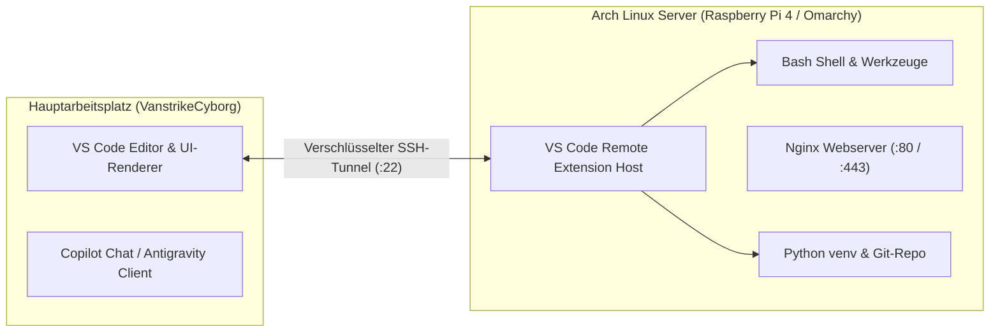

> **Thema:** Arch Linux, Omarchy (Hyprland), systemd-Dienste, Remote-SSH & Nginx-Webserver
> **Autor:** Michael Stürmer
> **Datum:** 08.11.2026

# 03 – Arch Linux, Omarchy, Remote-SSH & Webserver-Deployment

<details>
<summary><b>Lernziele</b></summary>

* Paketverwaltung unter **Arch Linux (`pacman`)** und Rolling-Release-Wartung fehlerfrei beherrschen.
* Die Vorzüge von **Linux Omarchy (Hyprland Wayland Compositor)** und **Arch Linux ARM auf dem Raspberry Pi 4** als hochperformante Entwickler- und Server-Umgebungen verstehen.
* Sichere **SSH-Schlüssel (`ed25519`)**, `~/.ssh/config` und den **VS Code Remote-SSH Workflow** einrichten.
* Einen produktionsreifen **Nginx-Webserver** auf Arch Linux / Raspberry Pi 4 bereitstellen, als systemd-Dienst aktivieren und für Web-Apps und Reverse-Proxy-Aufgaben konfigurieren.

</details>

<details>
<summary><b>Kernkonzepte</b></summary>

<details>
<summary>1.1 Paketverwaltung unter Arch Linux (<code>pacman</code>)</summary>

Arch Linux (sowie darauf basierende Umgebungen wie **Omarchy** oder **Arch Linux ARM auf dem Raspberry Pi 4**) folgt dem **Rolling-Release-Prinzip** und nutzt den blitzschnellen C-basierten Paketmanager **`pacman`**:

| Befehl | Funktion | Beschreibung |
| :--- | :--- | :--- |
| `sudo pacman -Syu` | **System-Update** | Synchronisiert Paketdatenbanken und aktualisiert alle Systempakete in einem konsistenten Schritt. |
| `sudo pacman -S <paket>` | **Installieren** | Installiert Pakete (z. B. `sudo pacman -S git nginx python nodejs`). |
| `pacman -Ss <suchbegriff>` | **Suchen** | Durchsucht Paket-Repositories nach Namen und Beschreibungen. |
| `pacman -Qi <paket>` | **Paket-Info** | Zeigt Version, Abhängigkeiten, Lizenz und Installationsgröße an. |
| `sudo pacman -Rns <paket>` | **Sauber entfernen** | Deinstalliert das Paket inklusive verwaister Abhängigkeiten (`-s`) und Konfigurationsdateien (`-n`). |
| `sudo pacman -Sc` | **Cache bereinigen** | Entfernt alte Paket-Tarballs aus `/var/cache/pacman/pkg/`. |

</details>

<details>
<summary>1.2 Hintergrunddienste steuern mit <code>systemd</code> & <code>journalctl</code></summary>

Server-Dienste (wie `sshd`, `nginx`, `docker` oder eigene KI-Worker) werden unter Linux über **`systemd`** als Units verwaltet:

```bash
# Status eines Dienstes prüfen (Aktivität, PID, RAM-Verbrauch, letzte Logs)
sudo systemctl status sshd

# Dienst sofort starten / neu starten / stoppen
sudo systemctl start nginx
sudo systemctl restart nginx
sudo systemctl stop nginx

# Dienst im Systemstart verankern und sofort ausführen (--now)
sudo systemctl enable --now nginx

# Konfiguration ohne Verbindungsabbruch neu einlesen (Hot-Reload)
sudo systemctl reload nginx

# Live-Protokolle (Logs) eines bestimmten Dienstes auslesen
journalctl -u nginx -n 50 -f
```

</details>

<details>
<summary>1.3 Linux Omarchy & Hyprland (Tastatur-zentrierter Entwickler-Workflow)</summary>

**Omarchy** kombiniert Arch Linux mit dem modernen Wayland-Tiling-Window-Manager **Hyprland**:
* **Minimaler Overhead:** Kein schwerer Desktop-Unterbau (wie GNOME oder KDE) – ideal für Arbeitsplatz-Laptops, damit maximal viel Arbeitsspeicher für Sprachmodelle, Container und Compiler frei bleibt.
* **Tiling-Prinzip:** Fenster ordnen sich automatisch kachelförmig auf virtuellen Desktops (*Workspaces 1–9*) an.
* **Linux-Workspace-Einstellungen in VS Code:**
  Unter Linux ist darauf zu achten, dass Zeilenenden auf **`LF` (`\n`)** statt `CRLF` (`\r\n`) stehen, damit Bash-Skripte nicht mit `bad interpreter: ^M` abbrechen:
  ```json
  {
    "terminal.integrated.defaultProfile.linux": "bash",
    "files.eol": "\n"
  }
  ```

</details>

<details>
<summary>1.4 SSH-Schlüssel (<code>ed25519</code>) & <code>~/.ssh/config</code></summary>

Für die sichere, passwortlose Verbindung zwischen deinem Windows-11-Hauptarbeitsplatz (`VanstrikeCyborg`), Linux-Laptops und Headless-Servern (Raspberry Pi 4) wird das moderne **Ed25519-Verfahren** eingesetzt:

```bash
# 1. Schlüsselpaar auf dem Arbeitsplatz erzeugen (falls noch nicht vorhanden)
ssh-keygen -t ed25519 -C "strik@VanstrikeCyborg"

# 2. Öffentlichen Schlüssel auf das Linux-Zielsystem übertragen
ssh-copy-id -i ~/.ssh/id_ed25519.pub alarm@192.168.178.50
```

Über die Datei **`~/.ssh/config`** (unter Windows `C:\Users\strik\.ssh\config`) definierst du sprechende Aliase:

```sshconfig
# Linux Edge-Server / Raspberry Pi 4 (Arch Linux ARM)
Host pi4
    HostName 192.168.178.50
    User alarm
    Port 22
    IdentityFile ~/.ssh/id_ed25519
    ServerAliveInterval 60
    ServerAliveCountMax 3

# Linux Laptop (Omarchy)
Host omarchy
    HostName 192.168.178.55
    User strik
    Port 22
    IdentityFile ~/.ssh/id_ed25519
```

</details>

<details>
<summary>1.5 VS Code Remote-SSH: Lokale UI, Remote-Ausführung</summary>

Mit der Erweiterung **VS Code Remote - SSH (`ms-vscode-remote.remote-ssh`)** bleibt die grafische Benutzeroberfläche auf deinem Hauptgerät, während der **VS Code Remote Server**, das Terminal und alle Sprachserver direkt auf dem entfernten Linux-Host laufen:



1. In VS Code `Strg + Shift + P` $\rightarrow$ **`Remote-SSH: Connect to Host...`**
2. Wähle den Host aus deiner Konfiguration (z. B. `pi4`).
3. Öffne den Projektordner direkt auf dem Remote-System – ohne langsame Dateisynchronisation oder Pfadkonflikte.

</details>

<details>
<summary>1.6 Nginx Webserver auf Arch Linux / Raspberry Pi 4 einrichten</summary>

Der Leichtbau-Webserver **Nginx** eignet sich optimal für ressourcenschonende Serverumgebungen:

```bash
# 1. Nginx installieren
sudo pacman -S nginx

# 2. Standard-Webroot anlegen und Testseite erstellen
sudo mkdir -p /srv/http/git-labor
sudo chown -R alarm:alarm /srv/http/git-labor

cat << 'EOF' > /srv/http/git-labor/index.html
<!DOCTYPE html>
<html lang="de">
<head><meta charset="utf-8"><title>git-labor Server</title></head>
<body style="font-family: sans-serif; background: #0f172a; color: #f8fafc; padding: 40px;">
  <h1>🚀 git-labor Webserver auf Arch Linux (Pi 4)</h1>
  <p>Bereitgestellt via Nginx &amp; systemd.</p>
</body>
</html>
EOF

# 3. Nginx Serverblock (/etc/nginx/nginx.conf bzw. /etc/nginx/sites-available/)
# Minimaler Serverblock in der http-Sektion von /etc/nginx/nginx.conf:
# server {
#     listen 80;
#     server_name pi4.local;
#     root /srv/http/git-labor;
#     index index.html;
#     location / {
#         try_files $uri $uri/ =404;
#     }
# }

# 4. Konfiguration auf Syntaxfehler prüfen (lebensrettend vor jedem Reload!)
sudo nginx -t

# 5. Dienst aktivieren und starten
sudo systemctl enable --now nginx
```

</details>

</details>

<details>
<summary><b>Übungsaufgaben</b></summary>

1. **Pacman-Diagnose:** Führe auf einem Arch-System `pacman -Qi nginx` aus und identifiziere die Konfigurationsdatei sowie die Abhängigkeiten des Webservers.
2. **Nginx Syntax-Check:** Ändere absichtlich ein Zeichen in einer Nginx-Konfiguration und führe `sudo nginx -t` aus. Welchen Fehlercode meldet der Parser?
3. **SSH Keep-Alive:** Warum bricht eine SSH-Sitzung ab, wenn der Laptop für 15 Minuten zugeklappt wird, und wie verhindert der Parameter `ServerAliveInterval 60` in `~/.ssh/config` diesen Abbruch?
4. **Remote-Entwicklung einrichten:** Verbinde dich über VS Code Remote-SSH mit einem Zielsystem und öffne dort ein Terminal. Prüfe mit `uname -a`, ob die Shell wirklich auf dem Remote-Kernel läuft.

</details>

<details>
<summary><b>Weiterführende Links & Quellen</b></summary>

* [ArchWiki – Pacman Paketmanager](https://wiki.archlinux.org/title/Pacman)
* [ArchWiki – Nginx Webserver Setup & Tuning](https://wiki.archlinux.org/title/Nginx)
* [VS Code Remote Development via SSH](https://code.visualstudio.com/docs/remote/ssh)
* [Hyprland Wayland Compositor Wiki](https://wiki.hyprland.org/)

</details>

<details>
<summary><b>Chips & Kernaussagen</b></summary>

* **`pacman -Syu` vor Neuinstallationen:** Halte Rolling-Release-Systeme stets synchron, um Bibliotheksinkonsistenzen zu vermeiden.
* **Syntaxcheck mit `nginx -t`:** Lade Webserver-Dienste niemals blind mit `systemctl reload`, sondern prüfe die Konfiguration immer zuerst mit `nginx -t`.
* **Entkoppelte Entwicklung:** Mit VS Code Remote-SSH programmierst du mit gewohntem Komfort auf dem Laptop, während Build, Tests und Webserver direkt auf dem Linux-Host (Pi 4 / Omarchy) laufen.
* **Keep-Alive im SSH-Tunnel:** `ServerAliveInterval 60` in `~/.ssh/config` schützt langlebige Remote-Sitzungen vor NAT-Timeouts im Heimnetzwerk.

</details>

---
*Hinweis zur Organisation:* Die erstellte Dokumentation ist am Drehlaufwerk abgelegt und mit einer kurzen Zusammenfassung von den Chips auch in den Notebooks verlinkt.
