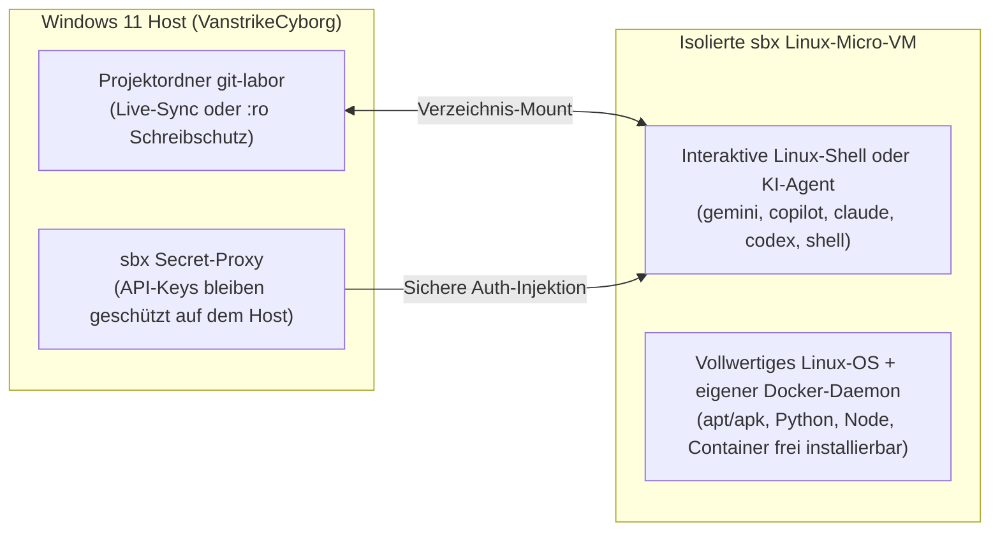

> **Thema:** Docker Grundlagen & Docker Sandboxes CLI (`sbx`) – Isolierte Linux-Umgebungen ohne Risiko
> **Autor:** Michael Stürmer
> **Datum:** 08.11.2026

# 05 – Docker Container & Sandbox Micro-VMs (sbx)

<!-- DOKU-SUBNAV-START -->
<details>
<summary><b>🧭 Rubrik-Navigation &amp; Modul-Übersicht (01 Linux & Bash)</b></summary>

**Zentrale:** [📚 Doku-Index](../README.md) · [📂 Rubrik 01 Linux & Bash](./README.md) · **Vorheriges:** [⬅️ 04 • Advanced Bash: Arrays, getopts & Backups](./04_fortgeschrittenes-bash-skripting-und-automatisierung.md) · **Nächstes:** *(Letztes Modul)*

**Alle Module in `01_Linux_Bash/`:**
- [01 • Bash CLI, Text-Tools, Streams & Expansions](./01_bash-grundlagen-und-skripting.md) · `check-env.sh`
- [02 • Inodes, LVM, Prozesse, Boot-Prozess & systemd](./02_linux-systemadministration-und-interna.md)
- [03 • Arch Linux, Omarchy, Remote-SSH & Nginx](./03_arch-linux-omarchy-und-remote-ssh.md)
- [04 • Advanced Bash: Arrays, getopts & Backups](./04_fortgeschrittenes-bash-skripting-und-automatisierung.md)
- 👉 **[05 • Docker Grundlagen & Sandbox Micro-VMs (sbx)](./05_docker-und-sbx-micro-vms.md)** *(aktuell)*

**Weitere Rubriken:** [🧩 02 VS Code & MCP](../02_VSCode_Env/README.md) · [🐍 03 Python](../03_Python_Coding/README.md) · [🌐 04 JS/TS Web](../04_JS_TS_Web/README.md) · [🤖 05 Agents](../05_Agents/README.md)

</details>
<!-- DOKU-SUBNAV-END -->

<details>
<summary><b>Lernziele</b></summary>

* Den Unterschied zwischen klassischen **Docker-Containern** (`Dockerfile`, `compose.yaml`) und isolierten **Micro-VMs der Docker Sandboxes CLI (`sbx`)** verstehen.
* Mit **`sbx`** eine sichere, wegwerfbare Linux-Testumgebung (inklusive eigenem Docker-Daemon) für Coding-Experimente und autonome KI-Agenten starten – komplett ohne laufendes Docker Desktop auf dem Host.
* Gezielte Sicherheitsmechanismen wie **Read-Only-Mounts (`:ro`)**, **Port-Forwarding (`-p`)** und den **Secret-Proxy (`sbx secret`)** praktisch anwenden.

</details>

<details>
<summary><b>Kernkonzepte</b></summary>

<details>
<summary>1.1 Klassische Docker-Container vs. Docker Sandboxes (<code>sbx</code>)</summary>

| Merkmal | Klassisches Docker (`docker compose`) | Docker Sandboxes CLI (`sbx`) |
| :--- | :--- | :--- |
| **Technisches Prinzip** | Container teilen sich den Kernel der Host-/WSL2-Maschine. | Eigene isolierte **Micro-VM** (über Windows Hypervisor Platform oder Cloud) mit eigenem Linux-OS. |
| **Docker Desktop nötig?** | Ja (Docker Engine / WSL2 muss im Hintergrund laufen). | **Nein!** Nutzt den schlanken Dienst `sandboxd` nur bei Bedarf. |
| **Eigener Docker-Daemon innen?** | Nur über komplexes *Docker-in-Docker (DinD)*. | **Ja, standardmäßig integriert:** In der Sandbox können beliebig eigene Container und Datenbanken gestartet werden. |
| **Haupteinsatz im `git-labor`** | Feste Server-Stacks (z. B. Datenbanken, Web-Services). | **Sicheres Test- & Lern-Labor:** Autonome KI-Agenten (`gemini`, `copilot`, `claude`) oder Linux-Shell-Experimente (`sbx run shell`). |

</details>

<details>
<summary>1.2 Architektur der <code>sbx</code>-Micro-VM</summary>



</details>

<details>
<summary>1.3 Einmalige Vorbereitung & Authentifizierung</summary>

Falls die *Windows Hypervisor Platform* noch nicht aktiv ist, einmalig in einer administrativen PowerShell aktivieren:
```powershell
Enable-WindowsOptionalFeature -Online -FeatureName HypervisorPlatform -All
```

Anschließend im normalen Terminal einrichten:
```powershell
# 1. System-Diagnose & Setup prüfen
sbx diagnose
sbx setup

# 2. Bei Docker anmelden
sbx login

# 3. API-Schlüssel sicher im Host-Secret-Store hinterlegen (kein Klartext in der VM!)
sbx secret import --dry-run
sbx secret set google
sbx secret set openai
sbx secret set anthropic

# 4. Vorhandene Agent-Skills optional importieren
sbx skills import --dry-run
sbx skills import
```

</details>

<details>
<summary>1.4 Wichtige <code>sbx</code>-Befehle für Linux-Tests & Agenten</summary>

```powershell
# 1. Reine interaktive Linux-Shell zum Üben von Bash & Linux-Tools öffnen
sbx run --name linux-labor shell

# 2. Autonomen Coding-Agenten in der Sandbox starten
sbx run --name git-labor gemini
sbx run --name git-labor copilot

# 3. Später wieder mit derselben Sandbox verbinden (installierte Linux-Pakete bleiben erhalten)
sbx run --name linux-labor

# 4. Interaktives Terminal-Dashboard (TUI) & Status
sbx tui
sbx ls

# 5. Befehle von außen in einer laufenden Hintergrund-Sandbox ausführen
sbx run -d --name test-worker shell
sbx exec test-worker pytest

# 6. Sandbox stoppen oder komplett zurücksetzen (Host-Dateien bleiben erhalten!)
sbx stop linux-labor
sbx rm linux-labor
```

</details>

<details>
<summary>1.5 Profi-Funktionen: Schreibschutz (<code>:ro</code>) & Port-Freigaben</summary>

Damit ein Experiment oder ein autonomer Agent wichtige Konfigurationsdateien oder Dokumentationen garantiert **nicht** verändern kann, lassen sich Pfade schreibgeschützt (`:ro` = *read-only*) einbinden:

```powershell
# Arbeitsordner les-/schreibbar, aber Doku und .vscode/mcp.json schreibgeschützt (:ro)
sbx run --name git-labor gemini . "./Doku:ro" "./.vscode/mcp.json:ro"

# Webserver-Port (z. B. Port 3000 für JS/TS oder Python FastAPI) auf den Windows-Browser durchreichen
sbx run -p 3000:3000 --name webapp-test shell
# Oder im laufenden Betrieb freischalten:
sbx ports publish webapp-test 8080:8080
```

</details>

</details>

<details>
<summary><b>Übungsaufgaben</b></summary>

1. **Linux-Experimentierkasten:** Mit welchem Befehl startest du über `sbx` eine reine Linux-Bash-Umgebung namens `bash-training`, ohne dass ein KI-Agent gestartet wird, und wie löschst du diese Umgebung nach deinem Test wieder spurlos?
2. **Schreibschutz-Szenario:** Du möchtest, dass ein Agent in `C:\Users\strik\git-labor` ein neues Python-Skript schreibt, aber den Ordner `Doku` auf keinen Fall verändert. Wie lautet der exakte `sbx run`-Befehl?
3. **Geheimnisschutz:** Warum ist `sbx secret set google` sicherer, als eine `.env`-Datei mit deinem `GEMINI_API_KEY` direkt in den gemounteten Projektordner zu legen?

</details>

<details>
<summary><b>Weiterführende Links & Quellen</b></summary>

* [Docker Sandboxes Offizielle Dokumentation](https://docs.docker.com/ai/sandboxes/)
* [Docker Get Started Guide](https://docs.docker.com/get-started/)
* [Docker Compose Spezifikation](https://docs.docker.com/compose/)

</details>

<details>
<summary><b>Chips & Kernaussagen</b></summary>

* **Volle Linux-Umgebung ohne Docker Desktop:** `sbx` startet isolierte Linux-Micro-VMs direkt über die Windows Hypervisor Platform.
* **`sbx run --name <name> shell` = Dein Linux-Labor:** Ideal, um Linux-Pakete, Bash-Skripte oder eigene Docker-Container risikofrei unter Windows 11 zu testen.
* **Kein Key-Leak durch Secret-Proxy:** Mit `sbx secret` bleiben API-Schlüssel auf dem Host und werden nur authentifiziert durchgereicht.
* **Gezielter Schreibschutz mit `:ro`:** Sensible Ordner wie `./Doku:ro` oder `./.vscode:ro` können vor Schreibzugriffen aus der Sandbox geschützt werden.
* **Wegwerfbare Testumgebung:** `sbx rm <name>` setzt das komplette Gast-Betriebssystem zurück, während dein lokaler Projektcode erhalten bleibt.

</details>

---
*Hinweis zur Organisation:* Die erstellte Dokumentation ist am Drehlaufwerk abgelegt und mit einer kurzen Zusammenfassung von den Chips auch in den Notebooks verlinkt.

<!-- DOKU-MINIMAP-START -->
<style>
.doku-arch-flow { font-family: var(--vscode-editor-font-family, Consolas, monospace); background: linear-gradient(160deg, rgba(15, 23, 42, 0.96), rgba(17, 24, 39, 0.94)); border: 1px solid rgba(96, 165, 250, 0.35); border-radius: 12px; padding: 14px 16px; margin: 8px 0 0 0; color: #e2e8f0; }
.doku-arch-root { display: flex; flex-wrap: wrap; align-items: center; justify-content: center; gap: 10px; font-weight: 700; font-size: 0.98em; padding: 9px 14px; margin-bottom: 12px; background: linear-gradient(135deg, rgba(37, 99, 235, 0.28), rgba(30, 41, 59, 0.92)); border: 1px solid rgba(96, 165, 250, 0.48); border-radius: 10px; }
.doku-arch-root a { color: #93c5fd !important; text-decoration: none !important; }
.doku-arch-root a:hover { color: #dbeafe !important; text-decoration: underline !important; }
.doku-arch-grid { display: grid; grid-template-columns: repeat(auto-fit, minmax(268px, 1fr)); gap: 11px; }
.doku-arch-card { background: rgba(30, 41, 59, 0.72); border: 1px solid rgba(148, 163, 184, 0.24); border-top: 3px solid #3b82f6; border-left: 4px solid #3b82f6; border-radius: 10px; padding: 10px 12px; transition: transform 0.14s ease, border-color 0.14s ease, box-shadow 0.14s ease; }
.doku-arch-card:hover { border-color: #93c5fd; transform: translateY(-2px); box-shadow: 0 6px 18px rgba(0, 0, 0, 0.35); }
.doku-arch-card.r1 { border-left-color: #22c55e; border-top-color: #22c55e; }
.doku-arch-card.r2 { border-left-color: #3b82f6; border-top-color: #3b82f6; }
.doku-arch-card.r3 { border-left-color: #eab308; border-top-color: #eab308; }
.doku-arch-card.r4 { border-left-color: #ec4899; border-top-color: #ec4899; }
.doku-arch-card.r5 { border-left-color: #a855f7; border-top-color: #a855f7; }
.doku-arch-card-title { font-weight: 700; font-size: 0.93em; margin-bottom: 7px; padding-bottom: 5px; border-bottom: 1px dashed rgba(148, 163, 184, 0.26); }
.doku-arch-card-title a { color: #f8fafc !important; text-decoration: none !important; display: block; }
.doku-arch-card-title a:hover { color: #93c5fd !important; }
.doku-arch-lines { list-style: none; margin: 0; padding: 0; font-size: 0.84em; line-height: 1.5; }
.doku-arch-lines li { margin: 3px 0; padding: 2px 6px; border-radius: 5px; white-space: normal; }
.doku-arch-lines li:hover { background: rgba(59, 130, 246, 0.16); }
.doku-arch-lines a { color: #cbd5e1 !important; text-decoration: none !important; display: inline; }
.doku-arch-lines a:hover { color: #93c5fd !important; text-decoration: underline !important; }
.doku-arch-badge { display: inline-block; font-size: 0.74em; padding: 0 6px; margin-left: 5px; border-radius: 999px; background: rgba(59, 130, 246, 0.22); color: #bfdbfe !important; border: 1px solid rgba(96, 165, 250, 0.4); }
details.doku-minimap { position: fixed; bottom: 18px; right: 18px; z-index: 9999; width: 292px; max-height: 76px; overflow: hidden; background: rgba(15, 23, 42, 0.93); border: 1px solid rgba(96, 165, 250, 0.62); border-radius: 14px; box-shadow: 0 10px 30px rgba(0, 0, 0, 0.65); backdrop-filter: blur(10px); transition: width 0.18s ease, max-height 0.18s ease, border-color 0.18s ease; font-family: var(--vscode-font-family, sans-serif); }
details.doku-minimap:hover { border-color: #93c5fd; }
details.doku-minimap[open] { width: min(920px, 94vw); max-height: 84vh; overflow-y: auto; padding-bottom: 10px; border-radius: 14px; }
details.doku-minimap > summary { cursor: pointer; list-style: none; padding: 8px 13px; font-weight: 700; font-size: 0.84em; color: #f8fafc; background: linear-gradient(90deg, rgba(37, 99, 235, 0.45), rgba(30, 41, 59, 0.92)); border-bottom: 1px solid rgba(148, 163, 184, 0.24); display: flex; align-items: center; justify-content: space-between; user-select: none; }
details.doku-minimap > summary::-webkit-details-marker { display: none; }
details.doku-minimap > summary .minimap-toggle::after { content: "+"; font-size: 1.05em; opacity: 0.85; padding: 0 4px; }
details.doku-minimap[open] > summary .minimap-toggle::after { content: "−"; }
details.doku-minimap .minimap-preview-strip { display: flex; gap: 5px; padding: 6px 10px 8px 10px; font-size: 0.71em; color: #cbd5e1; justify-content: space-between; }
details.doku-minimap[open] .minimap-preview-strip { display: none; }
details.doku-minimap .minimap-preview-strip span { display: inline-flex; align-items: center; gap: 4px; background: rgba(30, 41, 59, 0.92); padding: 2px 7px; border-radius: 999px; border: 1px solid rgba(148, 163, 184, 0.26); }
details.doku-minimap .dot { width: 6px; height: 6px; border-radius: 50%; display: inline-block; }
details.doku-minimap .dot.r1 { background: #22c55e; }
details.doku-minimap .dot.r2 { background: #3b82f6; }
details.doku-minimap .dot.r3 { background: #eab308; }
details.doku-minimap .dot.r4 { background: #ec4899; }
details.doku-minimap .dot.r5 { background: #a855f7; }
details.doku-minimap .minimap-body { padding: 4px 12px 6px 12px; }
</style>
<details class="doku-minimap">
<summary><span>🗺️ Doku-Minimap (5 Rubriken &amp; Labs)</span><span class="minimap-toggle" title="Klicken zum Vergrößern / Einklappen"></span></summary>
<div class="minimap-preview-strip"><span><i class="dot r1"></i>Linux</span><span><i class="dot r2"></i>VSCode</span><span><i class="dot r3"></i>Python</span><span><i class="dot r4"></i>JS/TS</span><span><i class="dot r5"></i>Agents</span></div>
<div class="minimap-body">
<div class="doku-arch-flow">
<div class="doku-arch-root"><span>🏛️ <a href="../README.md">VanstrikeCyborg — git-labor Doku-Index</a></span> · <a href="../../README.md">Repo-README</a> · <a href="../../AGENTS.md">AGENTS.md</a> · <a href="../../notebook-agent-environments/README.md">Notebooks</a> · <a href="../05_Agents/SYSTEM_ARCHITEKTUR_AENDERUNGEN_2026-11-25.md">Letztstand 25.11. (v5)</a></div>
<div class="doku-arch-grid">
<div class="doku-arch-card r1">
<div class="doku-arch-card-title">🐧 <a href="../01_Linux_Bash/README.md">01_Linux_Bash (Linux, Shell & Container)</a></div>
<ul class="doku-arch-lines">
<li>├─ <a href="../01_Linux_Bash/01_bash-grundlagen-und-skripting.md">01 • Bash CLI, Text-Tools, Streams & Expansions</a> <a class="doku-arch-badge" href="../../labs/01_linux_bash/check-env.sh">check-env.sh</a></li>
<li>├─ <a href="../01_Linux_Bash/02_linux-systemadministration-und-interna.md">02 • Inodes, LVM, Prozesse, Boot-Prozess & systemd</a></li>
<li>├─ <a href="../01_Linux_Bash/03_arch-linux-omarchy-und-remote-ssh.md">03 • Arch Linux, Omarchy, Remote-SSH & Nginx</a></li>
<li>├─ <a href="../01_Linux_Bash/04_fortgeschrittenes-bash-skripting-und-automatisierung.md">04 • Advanced Bash: Arrays, getopts & Backups</a></li>
<li>└─ <a href="../01_Linux_Bash/05_docker-und-sbx-micro-vms.md">05 • Docker Grundlagen & Sandbox Micro-VMs (sbx)</a></li>
</ul>
</div>
<div class="doku-arch-card r2">
<div class="doku-arch-card-title">🧩 <a href="../02_VSCode_Env/README.md">02_VSCode_Env (IDE, Git, MCP & Gemini)</a></div>
<ul class="doku-arch-lines">
<li>├─ <a href="../02_VSCode_Env/01_vscode-architektur-lsp-und-remote.md">01 • VS Code Architektur, Sprachserver (LSP) & Remote</a></li>
<li>├─ <a href="../02_VSCode_Env/02_git-github-und-multi-root-workspaces.md">02 • Git, GitHub Workflow & Multi-Root Workspaces</a> <a class="doku-arch-badge" href="../../git-labor.code-workspace">Workspace</a></li>
<li>├─ <a href="../02_VSCode_Env/03_mcp-server-localhost-proxy-und-ports.md">03 • MCP-Server, Ollama (:11434) & Ports (Archiv: Proxy)</a> <a class="doku-arch-badge" href="../../.vscode/mcp.json">mcp.json</a></li>
<li>├─ <a href="../02_VSCode_Env/04_gemini-oekosystem-ai-studio-und-api-keys.md">04 • Gemini Ökosystem, Google AI Studio & API-Keys</a></li>
<li>└─ <a href="../02_VSCode_Env/05_multi-workspace-netzwerk-mcp-und-agenten-verbund.md">05 • 5-Knoten-Verbund, Parity & Parallel-Limits</a></li>
</ul>
</div>
<div class="doku-arch-card r3">
<div class="doku-arch-card-title">🐍 <a href="../03_Python_Coding/README.md">03_Python_Coding (Python, uv & GenAI SDK)</a></div>
<ul class="doku-arch-lines">
<li>├─ <a href="../03_Python_Coding/01_python-setup-uv-venv-und-notebooks.md">01 • Python Setup: uv, .venv, Pylance & Notebooks</a> <a class="doku-arch-badge" href="../../notebook-agent-environments/agent_demo.ipynb">.ipynb</a></li>
<li>├─ <a href="../03_Python_Coding/02_gemini-api-python-sdk-und-interactions.md">02 • Google GenAI SDK (google-genai) & Interactions API</a></li>
<li>└─ <a href="../03_Python_Coding/03_python-automatisierung-datenanalyse-und-tests.md">03 • Automatisierung, Datenanalyse & pytest</a> <a class="doku-arch-badge" href="../../labs/03_python/sensor_demo.py">sensor_demo.py</a></li>
</ul>
</div>
<div class="doku-arch-card r4">
<div class="doku-arch-card-title">🌐 <a href="../04_JS_TS_Web/README.md">04_JS_TS_Web (HTML/CSS, JS/TS & Web-SDK)</a></div>
<ul class="doku-arch-lines">
<li>├─ <a href="../04_JS_TS_Web/01_html-css-und-dom-grundlagen.md">01 • HTML5, CSS3 & DOM-Manipulation Grundlagen</a> <a class="doku-arch-badge" href="../../labs/04_js_ts_web/rechner.html">rechner.html</a></li>
<li>├─ <a href="../04_JS_TS_Web/02_modernes-javascript-und-typescript.md">02 • Modernes JavaScript (ES6+) & TypeScript</a></li>
<li>└─ <a href="../04_JS_TS_Web/03_gemini-sdk-typescript-und-web-apps.md">03 • Google GenAI SDK (@google/genai) für Web-Apps</a></li>
</ul>
</div>
<div class="doku-arch-card r5">
<div class="doku-arch-card-title">🤖 <a href="../05_Agents/README.md">05_Agents (KI-Agenten, Skills & Orchestrierung)</a></div>
<ul class="doku-arch-lines">
<li>├─ <a href="../05_Agents/01_agent-stilfibel-und-didaktik-ruler.md">01 • Agent-Stilfibel, Didaktik-Ruler & 7-Stufen-Aufbau</a></li>
<li>├─ <a href="../05_Agents/02_agenten-erstellen-instructions-rules-und-prompts.md">02 • Agenten erstellen: Instructions, Rules & Prompts</a> <a class="doku-arch-badge" href="../../.github/instructions/gemini-api.instructions.md">gemini.instructions</a></li>
<li>├─ <a href="../05_Agents/03_agenten-ausruesten-skills-und-mcp-tools.md">03 • Agenten ausrüsten: Skills & MCP-Tools</a> <a class="doku-arch-badge" href="../../.agents/skills/live-transfer-status-monitor/SKILL.md">SKILL.md</a></li>
<li>├─ <a href="../05_Agents/04_agenten-trainieren-primen-und-orchestrieren.md">04 • Priming, Memory & Multi-Agent-Orchestrierung</a> <a class="doku-arch-badge" href="../../.github/agents/light.agent.md">@light</a></li>
<li>├─ <a href="../05_Agents/05_workspace-schnittstelle-simracer-und-agenten-terminals.md">05 • Schnittstelle, Terminals & XOR-Mutex</a> <a class="doku-arch-badge" href="../../labs/03_python/sim_agent_bridge.py">Bridge</a></li>
<li>├─ <a href="../05_Agents/05_multi-workspace-netzwerk-mcp-und-agenten-verbund.md">06 • Multi-Workspace Netzwerk & 6-Rollen-Verbund</a></li>
<li>├─ <a href="../05_Agents/SYSTEM_ARCHITEKTUR_AENDERUNGEN_2026-11-25.md">Letztstand 25.11. (Architektur v5, Toolbox & Pitwall v2.1)</a></li>
<li>├─ <a href="../05_Agents/HISENSE_TV_DISPLAY_OPTIMIERUNG_2026-11-25.md">Praxis-Referenz 25.11. (Hisense 4K-TV & ClearType)</a></li>
<li>├─ <a href="../05_Agents/SYSTEM_ARCHITEKTUR_AENDERUNGEN_2026-11-24.md">Stand 24.11. (Parity, Qwen 3.5 & Nacharbeiten)</a></li>
<li>├─ <a href="../05_Agents/SYSTEM_ARCHITEKTUR_AENDERUNGEN_2026-11-23.md">Stand 23.11. (ToS-Bereinigung, Ollama & Pitwall v1.5)</a></li>
<li>├─ <a href="../05_Agents/SYSTEM_ARCHITEKTUR_AENDERUNGEN_2026-11-11.md">Änderungsprotokoll 11.11. (MQTT, Gatekeeper & Caddy)</a></li>
<li>├─ <a href="../05_Agents/PITWALL_STEUERUNG_UND_FUNKTIONSREFERENZ_NOTEBOOKLM.md">Pitwall & Systemreferenz (NotebookLM-Quelle)</a></li>
<li>└─ <a href="../05_Agents/PITWALL_BOXENCREW_TEAMCHEF_KONZEPT_NOTEBOOKLM.md">Boxencrew & Teamchef Konzept (NotebookLM)</a></li>
</ul>
</div>
</div>
</div>
</div>
</details>
<!-- DOKU-MINIMAP-END -->
