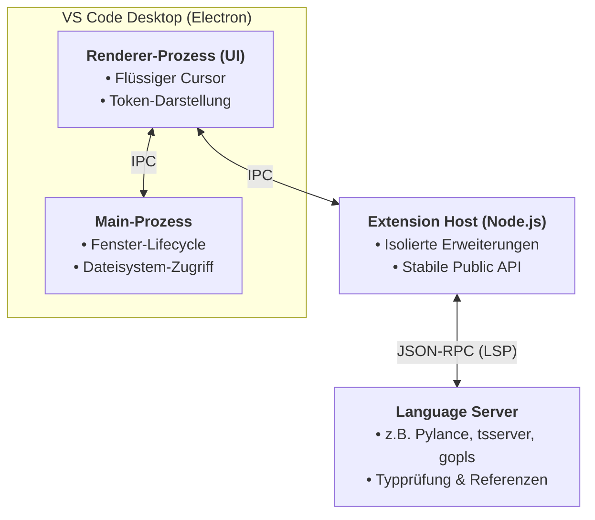

> **Thema:** Visual Studio Code – Entstehung, Multi-Prozess-Architektur, Protokolle (LSP) & KI-Evolution
> **Autor:** Michael Stürmer
> **Datum:** 07.11.2026

<details>
<summary><b>Lernziele</b></summary>

* Das architektonische Zusammenspiel zwischen **Renderer-Prozess**, **Extension Host** und dem **Language Server Protocol (LSP)** sowie dessen Einfluss auf Stabilität und Performance verstehen.
* Das Funktionsprinzip von **Remote Development** und **Dev Containern** zur Entkopplung lokaler Benutzeroberflächen von Server-, Container- und Cloud-Laufzeitumgebungen beherrschen.
* Die Evolution von Entwicklerwerkzeugen – von statischer Autovervollständigung über Multi-Datei-Edits hin zu agentischen Workflows (**Agent Mode**) – einordnen und steuern können.

</details>

<details>
<summary><b>Kernkonzepte</b></summary>

<details>
<summary>1.1 Ursprung, Philosophie & Projekt Monaco</summary>

Bis etwa 2010 konzentrierte sich Microsoft vorrangig auf Windows und C#/C++. Mit dem Aufstieg moderner Web-Applikationen wandelte sich das Leitmotiv zu **„Meet developers where they are“** – plattformübergreifend für Windows, Linux und macOS.

Unter der Leitung von **Erich Gamma** (Mitautor von *Design Patterns*) entstand in Zürich das Kernstück:
* **Monaco Editor:** Eine hochperformante, rein webbasierte Editor-Komponente (*„born of the web“*), die DOM-Interaktionen direkt steuert und selbst riesige Dateien verzögerungsfrei darstellt.
* **TypeScript-Symbiose:** Die parallele Entwicklung von **TypeScript** gab dem Projekt statische Typsicherheit für hunderttausende Zeilen Code.
* **Electron-Desktop-App:** Über **Electron** erhielt der Web-Editor vollen Zugriff auf das lokale Dateisystem und Betriebssystem-Prozesse.

</details>

<details>
<summary>1.2 Performance & Multi-Prozess-Architektur</summary>

Damit der Cursor beim Tippen niemals einfriert, trennt VS Code alle Aufgaben strikt in isolierte Betriebssystem-Prozesse:

| Komponente | Prozess / Laufzeit | Verantwortung | Fehlerfolge bei Absturz |
| :--- | :--- | :--- | :--- |
| **UI / Renderer** | Electron-Renderer (Chromium UI-Thread) | Cursor-Animation, Syntax-Highlighting, Layout & Eingabe. | Editor friert ein (wird verhindert, da hier keine Berechnungen stattfinden). |
| **Extension Host** | Separater Node.js-Hintergrundprozess | Ausführung aller installierten Erweiterungen (GitLens, Linter, KI-Plugins). | Nur Erweiterungen starten neu; der Editor bleibt voll bedien- und speicherbar. |
| **Language Server** | Eigenständiger externer Prozess | Semantische Code-Analyse, Typprüfung (z. B. Pylance), Refactoring. | Nur Code-Intelligenz fällt kurz aus; Textbearbeitung läuft ungestört weiter. |



</details>

<details>
<summary>1.3 Das Language Server Protocol (LSP)</summary>

Vor dem LSP musste jede Programmiersprache ($M$) für jeden Editor ($N$) ein eigenes Plugin entwickeln:

$$\text{Komplexität ohne LSP} = M \times N \quad \longrightarrow \quad \text{Komplexität mit LSP} = M + N$$

Über ein standardisiertes **JSON-RPC-Protokoll** fragt VS Code den jeweiligen Language Server z. B. nach einer Funktionsdefinition:

```json
// Anfrage (Client -> Language Server):
{
  "jsonrpc": "2.0",
  "id": 1,
  "method": "textDocument/definition",
  "params": {
    "textDocument": { "uri": "file:///workspace/src/app.ts" },
    "position": { "line": 42, "character": 12 }
  }
}
```

**Praxis-Merksatz:** Wenn in VS Code plötzlich keine Typ-Hinweise oder Autovervollständigungen mehr erscheinen, der Editor selbst aber flüssig tippt, ist lediglich der **Language Server** im Hintergrund neu zu starten (`Strg+Shift+P` $\rightarrow$ *Python: Restart Language Server* bzw. *TypeScript: Restart TS Server*).

</details>

<details>
<summary>1.4 Remote Development & Dev Containers</summary>

Da UI und Backend (Extension Host + Language Server) ohnehin über Protokolle getrennt sind, lässt sich das Backend problemlos auf andere Systeme verlagern:
* **Remote-SSH / WSL:** Die Oberfläche läuft lokal auf dem Laptop, während Terminal, Git und Sprachserver auf einem Linux-Server, Raspberry Pi oder in WSL2 arbeiten.
* **Dev Containers (`devcontainer.json`):** Definiert eine komplette Entwicklungsumgebung (Image, Extensions, Settings, Abhängigkeiten) deterministisch als Code:

```json
{
  "name": "KI-Agent & Python Labor",
  "image": "mcr.microsoft.com/devcontainers/universal:2",
  "customizations": {
    "vscode": {
      "extensions": [
        "ms-python.python",
        "GitHub.copilot",
        "GitHub.copilot-chat"
      ],
      "settings": {
        "editor.formatOnSave": true
      }
    }
  }
}
```

</details>

<details>
<summary>1.5 Die KI-Evolution: Von Ghost-Text zum Agent Mode</summary>

1. **Inline Completions (Ghost Text):** Schnelle Vorhersage einzelner Codezeilen direkt während des Tippens.
2. **Multi-File Edits:** Koordinierte Anpassung mehrerer zusammengehöriger Dateien über einen Arbeitsauftrag.
3. **Agent Mode & MCP:** Der Agent plant mehrstufige Aufgaben, liest Compiler-/Linter-Fehler, ruft über das **Model Context Protocol (MCP)** Werkzeuge auf und führt Terminal-Tests selbstständig durch.

</details>

</details>

<details>
<summary><b>Übungsaufgaben</b></summary>

1. **Fehlerdiagnose am Editor:** Dein VS Code lässt sich flüssig bedienen, aber bei Python-Dateien fehlen plötzlich alle Unterringelungen (Squiggles) und `Go to Definition` reagiert nicht mehr. Welcher Prozess aus der Multi-Prozess-Architektur hängt und wie behebst du das ohne kompletten PC-Neustart?
2. **LSP-Rechnung:** Wie viele Einzel-Integrationen wären für 8 Programmiersprachen und 6 Editoren ohne LSP nötig ($M \times N$) und wie viele mit LSP ($M + N$)?
3. **Dev Container:** Erkläre, welchen Vorteil eine `.devcontainer/devcontainer.json`-Datei bietet, wenn du ein Projekt sowohl auf dem Windows-Laptop als auch auf einem Linux-Gerät öffnest.

</details>

<details>
<summary><b>Weiterführende Links & Quellen</b></summary>

* [Offizielle VS Code Dokumentation](https://code.visualstudio.com/docs)
* [Language Server Protocol Spezifikation](https://microsoft.github.io/language-server-protocol/)
* [Development Containers (`containers.dev`)](https://containers.dev/)
* [Monaco Editor auf GitHub](https://github.com/microsoft/monaco-editor)

</details>

<details>
<summary><b>Chips & Kernaussagen</b></summary>

* **Born of the Web:** VS Code nutzt den schnellen *Monaco Editor* in einer *Electron*-Hülle.
* **Strikte Prozesstrennung:** Renderer (UI), Extension Host und Language Server laufen isoliert – ein abgestürztes Plugin friert niemals den Editor ein.
* **LSP reduziert Komplexität von $M \times N$ auf $M + N$:** Ein einziger Language Server pro Sprache versorgt alle kompatiblen Editoren über JSON-RPC.
* **Entkoppeltes Backend:** Remote-SSH, WSL2 und Dev Containers verlagern Rechenlast und Toolchains sauber in Container oder auf Server.
* **Vom Tipper zum Architekten:** Im *Agent Mode* steuert der Entwickler autonome KI-Werkzeuge über klare Vorgaben, Diffs und Tests.

</details>

---
*Hinweis zur Organisation:* Die erstellte Dokumentation ist am Drehlaufwerk abgelegt und mit einer kurzen Zusammenfassung von den Chips auch in den Notebooks verlinkt.

<!-- DOKU-MINIMAP-START -->
<style>
.doku-arch-flow { font-family: var(--vscode-editor-font-family, Consolas, monospace); background: rgba(20, 24, 33, 0.92); border: 1px solid rgba(100, 140, 220, 0.35); border-radius: 10px; padding: 14px 16px; margin: 10px 0; color: #e2e8f0; }
.doku-arch-root { text-align: center; font-weight: 700; font-size: 1.04em; padding: 8px 12px; margin-bottom: 12px; background: linear-gradient(135deg, rgba(37, 99, 235, 0.28), rgba(15, 23, 42, 0.9)); border: 1px solid rgba(96, 165, 250, 0.5); border-radius: 8px; }
.doku-arch-root a { color: #93c5fd !important; text-decoration: none !important; }
.doku-arch-root a:hover { text-decoration: underline !important; }
.doku-arch-grid { display: grid; grid-template-columns: repeat(auto-fit, minmax(275px, 1fr)); gap: 10px; }
.doku-arch-card { background: rgba(30, 41, 59, 0.78); border: 1px solid rgba(148, 163, 184, 0.28); border-left: 4px solid #3b82f6; border-radius: 8px; padding: 9px 11px; transition: transform 0.12s ease, border-color 0.12s ease; }
.doku-arch-card:hover { border-color: #60a5fa; transform: translateY(-1px); }
.doku-arch-card.r1 { border-left-color: #22c55e; }
.doku-arch-card.r2 { border-left-color: #3b82f6; }
.doku-arch-card.r3 { border-left-color: #eab308; }
.doku-arch-card.r4 { border-left-color: #ec4899; }
.doku-arch-card.r5 { border-left-color: #a855f7; }
.doku-arch-card-title { font-weight: 700; font-size: 0.95em; margin-bottom: 6px; padding-bottom: 4px; border-bottom: 1px dashed rgba(148, 163, 184, 0.25); }
.doku-arch-card-title a { color: #f8fafc !important; text-decoration: none !important; display: block; }
.doku-arch-card-title a:hover { color: #60a5fa !important; }
.doku-arch-lines { list-style: none; margin: 0; padding: 0; font-size: 0.85em; line-height: 1.5; }
.doku-arch-lines li { margin: 3px 0; padding: 2px 5px; border-radius: 4px; white-space: normal; }
.doku-arch-lines li:hover { background: rgba(59, 130, 246, 0.18); }
.doku-arch-lines a { color: #cbd5e1 !important; text-decoration: none !important; display: inline; }
.doku-arch-lines a:hover { color: #93c5fd !important; text-decoration: underline !important; }
.doku-arch-badge { display: inline-block; font-size: 0.75em; padding: 0 5px; margin-left: 4px; border-radius: 4px; background: rgba(59, 130, 246, 0.22); color: #93c5fd !important; border: 1px solid rgba(96, 165, 250, 0.35); }
details.doku-minimap { position: fixed; bottom: 18px; right: 18px; z-index: 9999; width: 250px; max-height: 76px; overflow: hidden; background: rgba(15, 23, 42, 0.94); border: 1px solid rgba(96, 165, 250, 0.65); border-radius: 10px; box-shadow: 0 8px 26px rgba(0, 0, 0, 0.65); backdrop-filter: blur(8px); transition: width 0.18s ease, max-height 0.18s ease; font-family: var(--vscode-font-family, sans-serif); }
details.doku-minimap:hover { border-color: #60a5fa; }
details.doku-minimap[open] { width: min(860px, 94vw); max-height: 84vh; overflow-y: auto; padding-bottom: 10px; }
details.doku-minimap > summary { cursor: pointer; list-style: none; padding: 8px 12px; font-weight: 700; font-size: 0.84em; color: #f8fafc; background: linear-gradient(90deg, rgba(37, 99, 235, 0.45), rgba(30, 41, 59, 0.9)); border-bottom: 1px solid rgba(148, 163, 184, 0.25); display: flex; align-items: center; justify-content: space-between; user-select: none; }
details.doku-minimap > summary::-webkit-details-marker { display: none; }
details.doku-minimap .minimap-preview-strip { display: flex; gap: 4px; padding: 5px 10px 7px 10px; font-size: 0.72em; color: #94a3b8; justify-content: space-between; }
details.doku-minimap[open] .minimap-preview-strip { display: none; }
details.doku-minimap .minimap-preview-strip span { background: rgba(30, 41, 59, 0.9); padding: 2px 6px; border-radius: 4px; border: 1px solid rgba(148, 163, 184, 0.25); }
details.doku-minimap .minimap-body { padding: 8px 12px 4px 12px; }
</style>
<details class="doku-minimap">
<summary><span>🗺️ Doku-Minimap (5 Rubriken &amp; Labs)</span><span title="Klicken zum Vergrößern / Einklappen">⛶</span></summary>
<div class="minimap-preview-strip"><span>01 Linux</span><span>02 VSCode</span><span>03 Python</span><span>04 JS/TS</span><span>05 Agents</span></div>
<div class="minimap-body">
<div class="doku-arch-flow">
<div class="doku-arch-root">🏛️ <a href="../README.md">VanstrikeCyborg — git-labor Lern- &amp; Test-Architektur (Doku-Index)</a>  |  <a href="../../README.md">Repo-README</a>  |  <a href="../../AGENTS.md">AGENTS.md</a>  |  <a href="../../notebook-agent-environments/README.md">Notebooks</a></div>
<div class="doku-arch-grid">
<div class="doku-arch-card r1">
<div class="doku-arch-card-title">🐧 <a href="../01_Linux_Bash/README.md">01_Linux_Bash (Linux, Shell &amp; Container)</a></div>
<ul class="doku-arch-lines">
<li>├─ <a href="../01_Linux_Bash/01_bash-grundlagen-und-skripting.md">01 • Bash-Grundlagen, Skripting, Pipes &amp; Exit-Codes</a> <a class="doku-arch-badge" href="../../labs/01_linux_bash/check-env.sh">check-env.sh</a></li>
<li>├─ <a href="../01_Linux_Bash/02_arch-linux-omarchy-und-remote-ssh.md">02 • Arch Linux, Omarchy, systemd &amp; Remote-SSH</a></li>
<li>└─ <a href="../01_Linux_Bash/03_docker-und-sbx-micro-vms.md">03 • Docker Grundlagen &amp; Sandbox Micro-VMs (sbx)</a></li>
</ul>
</div>
<div class="doku-arch-card r2">
<div class="doku-arch-card-title">🧩 <a href="README.md">02_VSCode_Env (IDE, Git, MCP &amp; Gemini)</a></div>
<ul class="doku-arch-lines">
<li>├─ <a href="01_vscode-architektur-lsp-und-remote.md">01 • VS Code Architektur, Sprachserver (LSP) &amp; Remote</a></li>
<li>├─ <a href="02_git-github-und-multi-root-workspaces.md">02 • Git, GitHub Workflow &amp; Multi-Root Workspaces</a> <a class="doku-arch-badge" href="../../git-labor.code-workspace">Workspace</a></li>
<li>├─ <a href="03_mcp-server-localhost-proxy-und-ports.md">03 • MCP-Server, Localhost-Proxy &amp; Port-Diagnose (8317)</a></li>
<li>└─ <a href="04_gemini-oekosystem-ai-studio-und-api-keys.md">04 • Gemini Ökosystem, Google AI Studio &amp; API-Keys</a></li>
</ul>
</div>
<div class="doku-arch-card r3">
<div class="doku-arch-card-title">🐍 <a href="../03_Python_Coding/README.md">03_Python_Coding (Python, uv &amp; GenAI SDK)</a></div>
<ul class="doku-arch-lines">
<li>├─ <a href="../03_Python_Coding/01_python-setup-uv-venv-und-notebooks.md">01 • Python Setup: uv, .venv, Pylance &amp; Notebooks</a></li>
<li>├─ <a href="../03_Python_Coding/02_gemini-api-python-sdk-und-interactions.md">02 • Google GenAI SDK (google-genai) &amp; Interactions API</a></li>
<li>└─ <a href="../03_Python_Coding/03_python-automatisierung-datenanalyse-und-tests.md">03 • Automatisierung, Datenanalyse &amp; pytest</a> <a class="doku-arch-badge" href="../../labs/03_python/sensor_demo.py">sensor_demo.py</a></li>
</ul>
</div>
<div class="doku-arch-card r4">
<div class="doku-arch-card-title">🌐 <a href="../04_JS_TS_Web/README.md">04_JS_TS_Web (HTML/CSS, JS/TS &amp; Web-SDK)</a></div>
<ul class="doku-arch-lines">
<li>├─ <a href="../04_JS_TS_Web/01_html-css-und-dom-grundlagen.md">01 • HTML5, CSS3 &amp; DOM-Manipulation Grundlagen</a> <a class="doku-arch-badge" href="../../labs/04_js_ts_web/rechner.html">rechner.html</a></li>
<li>├─ <a href="../04_JS_TS_Web/02_modernes-javascript-und-typescript.md">02 • Modernes JavaScript (ES6+) &amp; TypeScript</a></li>
<li>└─ <a href="../04_JS_TS_Web/03_gemini-sdk-typescript-und-web-apps.md">03 • Google GenAI SDK (@google/genai) für Web-Apps</a></li>
</ul>
</div>
<div class="doku-arch-card r5">
<div class="doku-arch-card-title">🤖 <a href="../05_Agents/README.md">05_Agents (KI-Agenten, Skills &amp; Orchestrierung)</a></div>
<ul class="doku-arch-lines">
<li>├─ <a href="../05_Agents/01_agent-stilfibel-und-didaktik-ruler.md">01 • Agent-Stilfibel, Didaktik-Ruler &amp; 7-Stufen-Aufbau</a></li>
<li>├─ <a href="../05_Agents/02_agenten-erstellen-instructions-rules-und-prompts.md">02 • Agenten erstellen: Instructions, Rules &amp; Prompts</a> <a class="doku-arch-badge" href="../../.github/instructions/gemini-api.instructions.md">gemini.instructions</a></li>
<li>├─ <a href="../05_Agents/03_agenten-ausruesten-skills-und-mcp-tools.md">03 • Agenten ausrüsten: Skills (SKILL.md) &amp; MCP-Tools</a> <a class="doku-arch-badge" href="../../.agents/skills/live-transfer-status-monitor/SKILL.md">SKILL.md</a></li>
<li>└─ <a href="../05_Agents/04_agenten-trainieren-primen-und-orchestrieren.md">04 • Agenten trainieren, primen &amp; Multi-Agent-Orchestrierung</a> <a class="doku-arch-badge" href="../../.github/agents/light.agent.md">@light</a> <a class="doku-arch-badge" href="../../.github/agents/rig.agent.md">@rig</a></li>
</ul>
</div>
</div>
</div>
</div>
</details>
<!-- DOKU-MINIMAP-END -->
