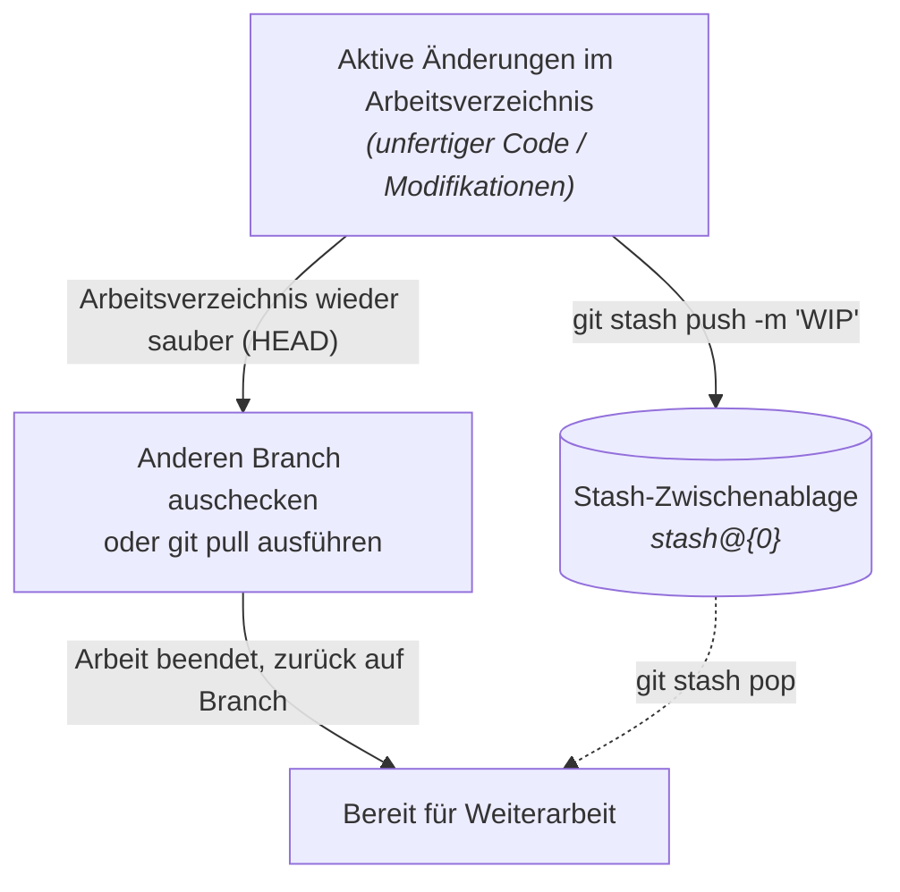
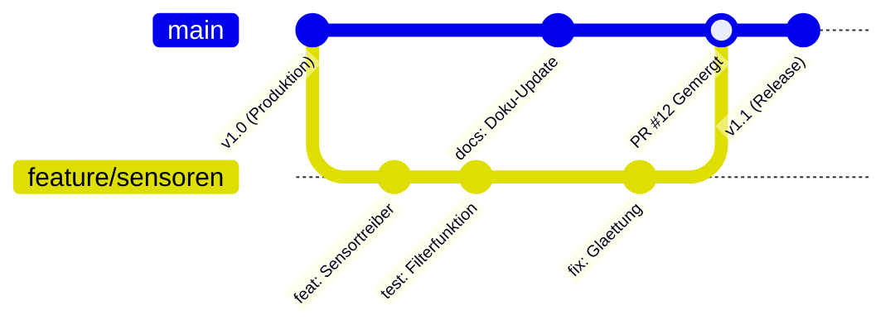

> **Thema:** Git, GitHub & Multi-Root-Workspaces in VS Code – Der 4-Stufen-Workflow & Best Practices
> **Autor:** Michael Stürmer
> **Datum:** 07.11.2026

<details>
<summary><b>Lernziele</b></summary>

* Den **4-Stufen-Workflow von Git** (Working Directory $\rightarrow$ Staging $\rightarrow$ Lokaler Commit $\rightarrow$ GitHub Remote Sync) sicher über die VS Code Oberfläche (`Strg + Shift + G`) und die Shell beherrschen.
* Die physische Speicherung im versteckten **`.git`-Ordner** verstehen und große Binärdateien oder Geheimnisse konsequent per **`.gitignore`** schützen.
* Einen **Multi-Root-Workspace (`.code-workspace`)** sauber konfigurieren und den Unterschied zu **GitHub Codespaces** kennen.
* Unfertige Arbeitsstände mit **`git stash`** verlustfrei zwischenspeichern, um unterbrechungsfrei Branches zu wechseln oder Pull-Konflikte zu vermeiden.
* Die **gängigsten Git-Funktionen** (Branching mit `switch`, Merging, Rebase, `diff`, `restore`, `reset` vs. `revert`) sicher und zielgerichtet einsetzen.
* Den industriellen **Feature-Branch-Workflow** (GitHub Flow) verstehen und **Merge-Konflikte** im visuellen 3-Way-Editor von VS Code souverän auflösen.

</details>

<details>
<summary><b>Kernkonzepte</b></summary>

<details>
<summary>1.1 Das Grundprinzip: Die 4 Stufen deiner Dateien in Git</summary>

Ähnlich wie in der Automatisierungstechnik (Offline-Projekt auf dem Programmiergerät vs. Online-Stand auf der Steuerung) trennt Git lokale Arbeitsschritte strikt vom Cloud-Server:

```mermaid
flowchart LR
    A["1. Arbeitsbereich<br/>(Working Directory)<br/><i>Normale Dateien (Strg+S)</i>"] -->|"+ Stage"<br/>(git add)| B["2. Warenkorb<br/>(Staged Changes)<br/><i>Auswahl für Paket</i>"]
    B -->|"Commit (Strg+Enter)"<br/>(git commit)| C["3. Lokales Archiv (.git)<br/><i>Versioniert auf deiner SSD</i>"]
    C -->|"Sync Changes"<br/>(git pull & push)| D["4. GitHub Cloud<br/>(Remote origin/main)<br/><i>Online gesichert</i>"]
```

1. **Stufe 1 – Arbeitsverzeichnis (*Working Directory*):** Du bearbeitest und speicherst Dateien mit `Strg + S`. Es existiert noch kein Git-Schnappschuss.
2. **Stufe 2 – Bereitstellungsbereich (*Staging Area*):** Mit Klick auf **`+`** (oder `git add`) wählst du aus, welche Änderungen in den nächsten Commit gehören.
3. **Stufe 3 – Lokales Repository (`.git`):** Mit einer klaren Nachricht (z. B. `docs: Linux-Kapitel ergänzt`) und **`Strg + Enter`** wird ein Prüfsummen-gesicherter Snapshot lokal auf deiner SSD gespeichert.
4. **Stufe 4 – Remote-Synchronisation (*Push / Pull*):** Erst **Sync Changes** überträgt die lokalen Commits zu GitHub (`origin/main`).

</details>

<details>
<summary>1.2 Physische Speicherorte: Klartext vs. <code>.git</code>-Datenbank</summary>

* **Sichtbarer Projektordner:** Alle Arbeitsdateien (`.md`, `.py`, `.ts`, `.json`) liegen unverschlüsselt im Klartext auf deiner Festplatte.
* **Versteckter Ordner `.git\objects`:** Hier speichert Git alle historischen Versionen komprimiert und mit SHA-Prüfsummen (*Blobs*, *Trees*, *Packfiles*).
* **Goldene Regel (100-MB-Limit & `.gitignore`):**
  GitHub lehnt Uploads ab, sobald eine einzelne Datei größer als **100 MB** ist (z. B. `.exe`-Installer, `.mp4`-Videos oder große Disk-Images). Zudem können riesige Binärdateien das lokale `.git/objects/pack`-Archiv aufblähen oder beschädigen.
  Solche Pfade gehören zwingend in die Datei **`.gitignore`**:
  ```gitignore
  # Geheimnisse & lokale Umgebungen niemals hochladen!
  .env
  .venv/
  node_modules/

  # Große Binärdateien & Installer ausschließen
  *.exe
  *.zip
  *.img
  Apps und Treiber/
  Tool-Box/
  ```

</details>

<details>
<summary>1.3 Multi-Root-Workspaces (<code>.code-workspace</code>) vs. Ordner-Settings</summary>

In unserem zentralen Workspace `C:\Users\strik\git-labor\git-labor.code-workspace` sind mehrere eigenständige Git-Repositories unter einem Dach vereint. Dabei gilt folgende Hierarchie für Einstellungen:

| Ebene | Datei / Speicherort | Wann verwenden? |
| :--- | :--- | :--- |
| **1. User / Global** | `%APPDATA%\Code\User\settings.json` | Einstellungen für **alle** Fenster und Profile auf dem Laptop (z. B. Theme, Font, `git.autofetch`, `applyToAllProfiles`). |
| **2. Multi-Root Workspace** | `git-labor.code-workspace` | Einstellungen, die für **alle eingebundenen Projektordner gemeinsam** gelten (Ordner-Liste `folders`, gemeinsame MCP-Server, Cloud-Projekt). |
| **3. Einzel-Ordner (Folder)** | `<repo>/.vscode/settings.json` | Einstellungen, die **nur ein einzelnes Repository** betreffen (z. B. ein spezieller Python-Interpreter nur für `git-labor`). |

</details>

<details>
<summary>1.4 Lokaler Workspace vs. GitHub Codespaces</summary>

| Merkmal | Lokaler Multi-Root-Workspace (`git-labor.code-workspace`) | GitHub Codespaces (Cloud-Container) |
| :--- | :--- | :--- |
| **Wo läuft VS Code?** | Direkt lokal auf deinem PC (`VanstrikeCyborg`). | Auf einer virtuellen Linux-Maschine in der GitHub-Cloud. |
| **Zugriff auf lokale Hardware & LAN** | **Vollständig:** Zugriff auf lokale Laufwerke (`C:\`), Localhost-Proxys (`:8317`) und Heimnetzwerk. | **Isoliert in der Cloud:** Kein Zugriff auf dein lokales LAN oder lokale Hardware. |
| **Typischer Einsatzzweck** | **Standard-Arbeitsplatz (95 %):** Volle Performance, alle Repos gleichzeitig geöffnet. | **Unterwegs / Mobil:** Schnelles Bearbeiten eines einzelnen Repos im Browser oder auf Fremdgeräten. |

</details>

<details>
<summary>1.5 Bewährte Git-Konfiguration & Spickzettel</summary>

Eine saubere globale `C:\Users\strik\.gitconfig` vermeidet Probleme mit Zeilenumbrüchen im Benutzernamen, veralteten Branch-Namen (`master` statt `main`) oder SSL-Backends unter Windows:

```ini
[user]
    name = mestuermer-svg
    email = m.e.stuermer@gmail.com
[init]
    defaultBranch = main
[push]
    autoSetupRemote = true
[http]
    sslBackend = schannel
```

| Aktion | Tastenkürzel / UI | Terminal-Befehl |
| :--- | :--- | :--- |
| **Source Control öffnen** | `Strg + Shift + G` | `git status -sb` |
| **Alle Änderungen vormerken** | `+` bei *Changes* | `git add .` |
| **Commit erstellen** | `Strg + Enter` im Nachrichtenfeld | `git commit -m "typ: Beschreibung"` |
| **Mit GitHub synchronisieren** | Blauer Button *Sync Changes* | `git pull ; git push` |
| **Letzte 10 Commits prüfen** | *Graph* in Source Control | `git log --oneline -n 10` |

</details>

<details>
<summary>1.6 <code>git stash</code> – Die temporäre Zwischenablage für unterbrechungsfreies Arbeiten</summary>

In der industriellen Praxis (vergleichbar mit einer Notfall-Störung an einer SPS-Anlage, während du gerade mitten im Entwurf eines neuen Funktionsbausteins steckst) musst du häufig sofort den Branch wechseln oder dringende Remote-Änderungen per `git pull` laden. Ohne Commit verweigert Git diesen Wechsel oder riskiert Konflikte mit unfertigem Code.

**`git stash`** dient als sichere „Schreibtisch-Schublade“: Der Befehl räumt das Arbeitsverzeichnis auf, sichert unfertige Änderungen (Modifikationen sowie optional neue, untracked Dateien) in einem temporären Stapel (*Stash Stack*) und setzt das Repository auf den Stand des letzten sauberen Commits (`HEAD`) zurück.



#### Die wichtigsten Stash-Befehle

| Befehl | Zweck | Typischer Anwendungsfall |
| :--- | :--- | :--- |
| `git stash` | Sichert alle modifizierten, getrackten Dateien. | Schneller Arbeitsplatz-Reset vor Branch-Wechsel. |
| `git stash push -m "WIP: Feature"` | Sichert mit präziser Notiz. | **Best Practice:** Eindeutiges Wiederfinden bei mehreren Stashes. |
| `git stash -u` *(oder `--include-untracked`)* | Sichert auch neue, noch nicht getrackte Dateien. | Wenn neue Skripte/Dateien im Projekt angelegt wurden. |
| `git stash list` | Listet alle abgelegten Stashes auf (`stash@{0}`, `stash@{1}`). | Schneller Überblick über alle geparkten Stände. |
| `git stash pop` | Stellt den neuesten Stash wieder her und **löscht** ihn aus der Liste. | Direkte Fortsetzung der unterbrochenen Arbeit. |
| `git stash apply` | Stellt den Stash wieder her, **behält** ihn aber in der Liste. | Wenn derselbe Stand auf mehreren Test-Branches geprüft werden soll. |
| `git stash drop stash@{0}` | Löscht einen bestimmten Stash-Eintrag gezielt. | Bereinigen nicht mehr benötigter Zwischenstände. |
| `git stash clear` | Löscht den gesamten Stash-Speicher restlos. | Kompletter Frühjahrsputz im lokalen Arbeitsverzeichnis. |

#### VS Code GUI-Bedienung
In VS Code lässt sich `git stash` vollständig ohne Shell bedienen:
1. Öffne die **Source Control** Ansicht (`Strg + Shift + G`).
2. Klicke oben rechts auf das Drei-Punkte-Menü (**`...`**).
3. Navigiere zu **Stash** $\rightarrow$ wähle z. B. **Stash (Include Untracked)** oder **Pop Latest Stash...**.

</details>

<details>
<summary>1.7 Die essenziellen Git-Funktionen im Entwickler-Alltag</summary>

Im professionellen Alltag genügen einfaches `add` und `commit` oft nicht. Git bietet präzise Werkzeuge, um Branches zu verwalten, Arbeitsstände zu vergleichen und Fehler sicher zu revidieren:

#### 1. Branching & Switching (Arbeiten in isolierten Zweigen)
Anstatt mit dem historisch überladenen `git checkout` zu arbeiten, trennt modernes Git (ab v2.23) Datei-Operationen (`restore`) und Branch-Operationen (`switch`):

* **Neuen Branch erstellen und sofort hineinwechseln:**
  ```bash
  git switch -c feature/neue-messlogik
  ```
* **Zu einem bestehenden Branch wechseln:**
  ```bash
  git switch main
  ```
* **Alle Branches auflisten (lokal und remote):**
  ```bash
  git branch -a
  ```
* **Einen Branch löschen:**
  ```bash
  # Sicher löschen (nur wenn Änderungen bereits gemergt wurden)
  git branch -d feature/altes-feature
  # Erzwingen (auch bei ungemergten Änderungen)
  git branch -D feature/abgebrochener-versuch
  ```

#### 2. Inspektion & Vergleich (`diff` & `status`)
Vor jedem Commit und Push solltest du genau wissen, was geändert wurde:

* **Schnelle Statusübersicht im Terminal:**
  ```bash
  git status -sb
  ```
* **Differenz im Arbeitsverzeichnis (noch nicht gestaged):**
  ```bash
  git diff
  ```
* **Differenz im Warenkorb (bereits gestaged vs. letzter Commit):**
  ```bash
  git diff --staged
  ```
* **Kompakter Commit-Baum über alle Branches:**
  ```bash
  git log --graph --oneline --all -n 15
  ```

#### 3. Remote-Abgleich: `git fetch` vs. `git pull`

| Befehl | Was passiert im Hintergrund? | Risiko für lokale Arbeit | Wann einsetzen? |
| :--- | :--- | :--- | :--- |
| **`git fetch origin`** | Lädt alle neuen Commits, Branches und Tags vom Server in deinen lokalen `.git`-Speicher, fasst aber dein Arbeitsverzeichnis **nicht** an. | **Kein Risiko** (0 % Konfliktpotenzial). | **Immer zuerst:** Um zu prüfen, was Kollegen gepusht haben, bevor man selbst weiterarbeitet. |
| **`git pull`** | Führt intern automatisch zwei Schritte aus: `git fetch` + `git merge origin/<branch>`. | **Möglich:** Kann zu unerwarteten Merge-Konflikten im Arbeitsverzeichnis führen. | Wenn du auf einem sauberen Stand bist und die Remote-Stände direkt einbinden willst. |

#### 4. Undo-Strategien: Änderungen sicher zurücknehmen

| Situation | Empfohlener Befehl | Auswirkung |
| :--- | :--- | :--- |
| **Datei ungestaged verwerfen** | `git restore <datei>` | Setzt die Datei auf den Stand des letzten Commits zurück. Nicht gespeicherte Änderungen gehen verloren! |
| **Datei aus dem Staging entfernen** | `git restore --staged <datei>` | Nimmt die Datei aus dem Staging-Bereich (`git add`), lässt deine geschriebenen Codezeilen aber intakt. |
| **Letzten Commit rückgängig machen (lokal)** | `git reset --soft HEAD~1` | Der Commit-Schnappschuss verschwindet, aber alle Änderungen bleiben sauber im Staging-Warenkorb erhalten. |
| **Letzten Commit & Staging verwerfen** | `git reset --mixed HEAD~1` | Default bei `git reset`. Änderungen bleiben im Arbeitsverzeichnis ungestaged erhalten. |
| **Kompletten Arbeitsstand zerstören** | `git reset --hard HEAD~1` | **Achtung Gefahr!** Setzt Commit, Staging und Arbeitsdateien unwiderruflich auf den vorherigen Stand zurück. |
| **Öffentlichen Commit zurückrollen** | `git revert <commit-hash>` | **Kollaborativer Standard:** Erstellt einen neuen Gegen-Commit, der die Änderungen exakt aufhebt, ohne die Git-Historie für andere Entwickler zu zerstören. |

</details>

<details>
<summary>1.8 Git-Workflows & Konfliktlösung in der Praxis</summary>

In professionellen Teams und anspruchsvollen Automatisierungsprojekten ist ein stabiler Workflow Pflicht: Der Branch `main` repräsentiert stets die lauffähige „Produktionsanlage“. Direkte Änderungen auf `main` sind tabu.

#### 1. Der Feature-Branch-Workflow (GitHub Flow)



Der standardisierte Lebenszyklus einer Funktionserweiterung:
1. **Ausgangspunkt aktualisieren:**
   ```bash
   git switch main
   git pull
   ```
2. **Eigenen Isolations-Branch anlegen:**
   ```bash
   git switch -c feature/sensorauswertung
   ```
3. **Schrittweise entwickeln & committen:**
   Kleine, logische Einheiten mit aussagekräftigen Nachrichten committen:
   ```bash
   git commit -m "feat: Mittelwertfilter fuer Analogeingaenge ergaenzt"
   ```
4. **Auf GitHub veröffentlichen:**
   ```bash
   git push -u origin feature/sensorauswertung
   ```
5. **Pull Request (PR) erstellen:**
   Auf GitHub.com einen PR gegen `main` öffnen, Code-Review durchführen und CI-Tests (z. B. `pytest`) abwarten.
6. **Merge & Aufräumen:**
   Nach erfolgreichem Merge wird der Feature-Branch auf GitHub gelöscht und lokal aufgeräumt:
   ```bash
   git switch main
   git pull
   git branch -d feature/sensorauswertung
   ```

#### 2. Zusammenführen: `merge` vs. `rebase`

* **`git merge <branch>`:** Führt zwei Historien zusammen und erzeugt einen expliziten **Merge-Commit**. Vorteil: Die exakte Zeithistorie bleibt nachvollziehbar. Nachteil: Bei vielen Branches entstehen unübersichtliche Verzweigungen.
* **`git rebase <ziel-branch>`:** Nimmt deine neuen Commits und verpflanzt sie virtuell an das aktuelle Ende des Ziel-Branches. Vorteil: Schnurgerade, lineare Historie ohne Merge-Bubbles.
* **Die Goldene Rebase-Regel:** *Rebase niemals einen Branch, den du bereits auf GitHub mit anderen geteilt hast!* (Da sich alle Commit-Hashes verändern).

#### 3. Merge-Konflikte im VS Code 3-Way Merge Editor lösen

Ein Merge-Konflikt entsteht, wenn in zwei Branches **dieselbe Datei in denselben Zeilen** unterschiedlich geändert wurde. Git kann nicht erraten, welcher Stand gültig ist, und markiert den Konflikt:

```text
<<<<<<< HEAD (Current Change - dein aktueller Stand)
messwert = sensor.read_fast()
=======
messwert = sensor.read_with_filter()
>>>>>>> feature/sensorauswertung (Incoming Change)
```

**Konfliktbehebung in VS Code (Der 3-Klick-Weg):**
1. Öffne die betroffene Datei. VS Code bietet direkt über dem Konflikt vier intuitive Schnellaktionen:
   * **Accept Current Change:** Behält deinen lokalen Stand.
   * **Accept Incoming Change:** Übernimmt den Stand aus dem Ziel-Branch.
   * **Accept Both Changes:** Behält beide Blöcke.
   * **Compare Changes:** Zeigt einen direkten Side-by-Side-Diff.
2. Für komplexe Konflikte klicke unten rechts auf **Resolve in Merge Editor** (3-Wege-Vergleich: *Current*, *Result*, *Incoming*).
3. Nach Auswahl des gewünschten Codes die Datei speichern (`Strg + S`), stagen (`+` bzw. `git add <datei>`) und den Merge-Commit abschließen:
   ```bash
   git commit -m "merge: Konflikt in Sensorauswertung behoben"
   ```

</details>

</details>

<details>
<summary><b>Übungsaufgaben</b></summary>

1. **Die 4 Stufen prüfen:** Du speicherst eine Datei mit `Strg + S` und schließt VS Code. Warum ist diese Änderung noch nicht auf GitHub.com sichtbar und welche drei Schritte fehlen noch?
2. **Große-Dateien-Schutz:** Du legst einen neuen Ordner `downloads/` mit einer 250 MB großen `.zip`-Datei im Projekt ab. Wie verhinderst du in VS Code mit zwei Klicks (oder per `.gitignore`), dass Git versucht, diese Datei hochzuladen?
3. **Multi-Root-Einbindung:** Wie sieht der JSON-Eintrag unter `"folders"` in `git-labor.code-workspace` aus, wenn du ein neues Nachbarverzeichnis `C:\Users\strik\mein-testprojekt` einbinden möchtest?
4. **Notfall-Branch-Wechsel mit Stash:** Du hast zwei bestehende Skripte bearbeitet und eine neue Hilfsdatei angelegt. Plötzlich musst du auf `main` wechseln, um einen dringenden Fix zu testen. Mit welchen Befehlen sicherst du deinen kompletten Stand (inkl. neuer Datei), wechselst den Branch und holst deine Arbeit danach wieder zurück?
5. **Reset vs. Revert:** Du hast versehentlich einen fehlerhaften Commit bereits auf GitHub gepusht. Welchen Befehl (`git reset` oder `git revert`) musst du wählen, um das Problem im Team sauber zu beheben, und was ist der technische Grund?
6. **Feature-Branch-Zyklus:** Nenne die 5 wichtigsten Terminal-Befehle, um von `main` ausgehend ein neues Feature zu entwickeln, hochzuladen und nach dem Merge den lokalen Branch zu bereinigen.
7. **Fetch vs. Pull:** Warum ist `git fetch origin` vor einem `git switch` oder `git merge` sicherer als ein blindes `git pull`?

</details>

<details>
<summary><b>Weiterführende Links & Quellen</b></summary>

* [VS Code Version Control (Git) Dokumentation](https://code.visualstudio.com/docs/sourcecontrol/overview)
* [VS Code 3-Way Merge Editor](https://code.visualstudio.com/docs/sourcecontrol/overview#_3way-merge-editor)
* [VS Code Multi-Root Workspaces Guide](https://code.visualstudio.com/docs/editor/multi-root-workspaces)
* [Git Stash Dokumentation (Offiziell)](https://git-scm.com/docs/git-stash)
* [Pro Git Book (Deutsch)](https://git-scm.com/book/de/v2)

</details>

<details>
<summary><b>Chips & Kernaussagen</b></summary>

* **`Strg + S` ist noch kein Commit:** Erst *Stage (`+`)* $\rightarrow$ *Commit (`Strg+Enter`)* $\rightarrow$ *Sync Changes* sichert deinen Stand auf GitHub.
* **Keine Binärriesen in Git:** Dateien über 50–100 MB (`.exe`, `.zip`, `.img`) und Geheimnisse (`.env`) gehören immer in die `.gitignore`.
* **Klare Einstellungs-Hierarchie:** Globale Vorlieben in User-`settings.json`, Repo-übergreifende Regeln in `.code-workspace`, Repo-spezifische Details in `.vscode/settings.json`.
* **`schannel` unter Windows:** Bei SSL-Fehlern mit Git for Windows sorgt `git config --global http.sslBackend schannel` für die Nutzung des nativen Windows-Zertifikatsspeichers.
* **`git stash` rettet unfertige Arbeit:** Mit `git stash -u` parkst du unfertigen Code (inkl. untracked files) verlustfrei in der Zwischenablage, um sofort sauber Branches zu wechseln oder ohne Konflikte zu pullen.
* **`main` ist Produktionslinie:** Entwickle Features isoliert mit `git switch -c feature/<name>`, teste sie und merge erst nach Review (GitHub Flow).
* **`git switch` & `git restore` nutzen:** Moderne Git-Befehle ersetzen das fehleranfällige, überladene `git checkout`.
* **`fetch` ist Sichtprüfung, `pull` greift ein:** `git fetch` holt gefahrlos Metadaten, `git pull` mutiert sofort deinen lokalen Arbeitsstand.
* **Revert für geteilte Commits:** Niemals `git reset --hard` auf bereits gepushten Remote-Branches anwenden; nutze `git revert <hash>` für einen sicheren Gegen-Commit.
* **VS Code 3-Way Merge Editor:** Konflikte müssen keinen Schrecken verbreiten – mit *Current*, *Incoming* und *Accept Both* lassen sich Überlappungen visuell lösen.

</details>

---
*Hinweis zur Organisation:* Die erstellte Dokumentation ist am Drehlaufwerk abgelegt und mit einer kurzen Zusammenfassung von den Chips auch in den Notebooks verlinkt.

<!-- DOKU-MINIMAP-START -->
<style>
.doku-arch-flow { font-family: var(--vscode-editor-font-family, Consolas, monospace); background: rgba(20, 24, 33, 0.92); border: 1px solid rgba(100, 140, 220, 0.35); border-radius: 10px; padding: 14px 16px; margin: 10px 0; color: #e2e8f0; }
.doku-arch-root { text-align: center; font-weight: 700; font-size: 1.04em; padding: 8px 12px; margin-bottom: 12px; background: linear-gradient(135deg, rgba(37, 99, 235, 0.28), rgba(15, 23, 42, 0.9)); border: 1px solid rgba(96, 165, 250, 0.5); border-radius: 8px; }
.doku-arch-root a { color: #93c5fd !important; text-decoration: none !important; }
.doku-arch-root a:hover { text-decoration: underline !important; }
.doku-arch-grid { display: grid; grid-template-columns: repeat(auto-fit, minmax(275px, 1fr)); gap: 10px; }
.doku-arch-card { background: rgba(30, 41, 59, 0.78); border: 1px solid rgba(148, 163, 184, 0.28); border-left: 4px solid #3b82f6; border-radius: 8px; padding: 9px 11px; transition: transform 0.12s ease, border-color 0.12s ease; }
.doku-arch-card:hover { border-color: #60a5fa; transform: translateY(-1px); }
.doku-arch-card.r1 { border-left-color: #22c55e; }
.doku-arch-card.r2 { border-left-color: #3b82f6; }
.doku-arch-card.r3 { border-left-color: #eab308; }
.doku-arch-card.r4 { border-left-color: #ec4899; }
.doku-arch-card.r5 { border-left-color: #a855f7; }
.doku-arch-card-title { font-weight: 700; font-size: 0.95em; margin-bottom: 6px; padding-bottom: 4px; border-bottom: 1px dashed rgba(148, 163, 184, 0.25); }
.doku-arch-card-title a { color: #f8fafc !important; text-decoration: none !important; display: block; }
.doku-arch-card-title a:hover { color: #60a5fa !important; }
.doku-arch-lines { list-style: none; margin: 0; padding: 0; font-size: 0.85em; line-height: 1.5; }
.doku-arch-lines li { margin: 3px 0; padding: 2px 5px; border-radius: 4px; white-space: normal; }
.doku-arch-lines li:hover { background: rgba(59, 130, 246, 0.18); }
.doku-arch-lines a { color: #cbd5e1 !important; text-decoration: none !important; display: inline; }
.doku-arch-lines a:hover { color: #93c5fd !important; text-decoration: underline !important; }
.doku-arch-badge { display: inline-block; font-size: 0.75em; padding: 0 5px; margin-left: 4px; border-radius: 4px; background: rgba(59, 130, 246, 0.22); color: #93c5fd !important; border: 1px solid rgba(96, 165, 250, 0.35); }
details.doku-minimap { position: fixed; bottom: 18px; right: 18px; z-index: 9999; width: 250px; max-height: 76px; overflow: hidden; background: rgba(15, 23, 42, 0.94); border: 1px solid rgba(96, 165, 250, 0.65); border-radius: 10px; box-shadow: 0 8px 26px rgba(0, 0, 0, 0.65); backdrop-filter: blur(8px); transition: width 0.18s ease, max-height 0.18s ease; font-family: var(--vscode-font-family, sans-serif); }
details.doku-minimap:hover { border-color: #60a5fa; }
details.doku-minimap[open] { width: min(860px, 94vw); max-height: 84vh; overflow-y: auto; padding-bottom: 10px; }
details.doku-minimap > summary { cursor: pointer; list-style: none; padding: 8px 12px; font-weight: 700; font-size: 0.84em; color: #f8fafc; background: linear-gradient(90deg, rgba(37, 99, 235, 0.45), rgba(30, 41, 59, 0.9)); border-bottom: 1px solid rgba(148, 163, 184, 0.25); display: flex; align-items: center; justify-content: space-between; user-select: none; }
details.doku-minimap > summary::-webkit-details-marker { display: none; }
details.doku-minimap .minimap-preview-strip { display: flex; gap: 4px; padding: 5px 10px 7px 10px; font-size: 0.72em; color: #94a3b8; justify-content: space-between; }
details.doku-minimap[open] .minimap-preview-strip { display: none; }
details.doku-minimap .minimap-preview-strip span { background: rgba(30, 41, 59, 0.9); padding: 2px 6px; border-radius: 4px; border: 1px solid rgba(148, 163, 184, 0.25); }
details.doku-minimap .minimap-body { padding: 8px 12px 4px 12px; }
</style>
<details class="doku-minimap">
<summary><span>🗺️ Doku-Minimap (5 Rubriken &amp; Labs)</span><span title="Klicken zum Vergrößern / Einklappen">⛶</span></summary>
<div class="minimap-preview-strip"><span>01 Linux</span><span>02 VSCode</span><span>03 Python</span><span>04 JS/TS</span><span>05 Agents</span></div>
<div class="minimap-body">
<div class="doku-arch-flow">
<div class="doku-arch-root">🏛️ <a href="../README.md">VanstrikeCyborg — git-labor Lern- &amp; Test-Architektur (Doku-Index)</a>  |  <a href="../../README.md">Repo-README</a>  |  <a href="../../AGENTS.md">AGENTS.md</a>  |  <a href="../../notebook-agent-environments/README.md">Notebooks</a></div>
<div class="doku-arch-grid">
<div class="doku-arch-card r1">
<div class="doku-arch-card-title">🐧 <a href="../01_Linux_Bash/README.md">01_Linux_Bash (Linux, Shell &amp; Container)</a></div>
<ul class="doku-arch-lines">
<li>├─ <a href="../01_Linux_Bash/01_bash-grundlagen-und-skripting.md">01 • Bash-Grundlagen, Skripting, Pipes &amp; Exit-Codes</a> <a class="doku-arch-badge" href="../../labs/01_linux_bash/check-env.sh">check-env.sh</a></li>
<li>├─ <a href="../01_Linux_Bash/02_arch-linux-omarchy-und-remote-ssh.md">02 • Arch Linux, Omarchy, systemd &amp; Remote-SSH</a></li>
<li>└─ <a href="../01_Linux_Bash/03_docker-und-sbx-micro-vms.md">03 • Docker Grundlagen &amp; Sandbox Micro-VMs (sbx)</a></li>
</ul>
</div>
<div class="doku-arch-card r2">
<div class="doku-arch-card-title">🧩 <a href="README.md">02_VSCode_Env (IDE, Git, MCP &amp; Gemini)</a></div>
<ul class="doku-arch-lines">
<li>├─ <a href="01_vscode-architektur-lsp-und-remote.md">01 • VS Code Architektur, Sprachserver (LSP) &amp; Remote</a></li>
<li>├─ <a href="02_git-github-und-multi-root-workspaces.md">02 • Git, GitHub Workflow &amp; Multi-Root Workspaces</a> <a class="doku-arch-badge" href="../../git-labor.code-workspace">Workspace</a></li>
<li>├─ <a href="03_mcp-server-localhost-proxy-und-ports.md">03 • MCP-Server, Localhost-Proxy &amp; Port-Diagnose (8317)</a></li>
<li>└─ <a href="04_gemini-oekosystem-ai-studio-und-api-keys.md">04 • Gemini Ökosystem, Google AI Studio &amp; API-Keys</a></li>
</ul>
</div>
<div class="doku-arch-card r3">
<div class="doku-arch-card-title">🐍 <a href="../03_Python_Coding/README.md">03_Python_Coding (Python, uv &amp; GenAI SDK)</a></div>
<ul class="doku-arch-lines">
<li>├─ <a href="../03_Python_Coding/01_python-setup-uv-venv-und-notebooks.md">01 • Python Setup: uv, .venv, Pylance &amp; Notebooks</a></li>
<li>├─ <a href="../03_Python_Coding/02_gemini-api-python-sdk-und-interactions.md">02 • Google GenAI SDK (google-genai) &amp; Interactions API</a></li>
<li>└─ <a href="../03_Python_Coding/03_python-automatisierung-datenanalyse-und-tests.md">03 • Automatisierung, Datenanalyse &amp; pytest</a> <a class="doku-arch-badge" href="../../labs/03_python/sensor_demo.py">sensor_demo.py</a></li>
</ul>
</div>
<div class="doku-arch-card r4">
<div class="doku-arch-card-title">🌐 <a href="../04_JS_TS_Web/README.md">04_JS_TS_Web (HTML/CSS, JS/TS &amp; Web-SDK)</a></div>
<ul class="doku-arch-lines">
<li>├─ <a href="../04_JS_TS_Web/01_html-css-und-dom-grundlagen.md">01 • HTML5, CSS3 &amp; DOM-Manipulation Grundlagen</a> <a class="doku-arch-badge" href="../../labs/04_js_ts_web/rechner.html">rechner.html</a></li>
<li>├─ <a href="../04_JS_TS_Web/02_modernes-javascript-und-typescript.md">02 • Modernes JavaScript (ES6+) &amp; TypeScript</a></li>
<li>└─ <a href="../04_JS_TS_Web/03_gemini-sdk-typescript-und-web-apps.md">03 • Google GenAI SDK (@google/genai) für Web-Apps</a></li>
</ul>
</div>
<div class="doku-arch-card r5">
<div class="doku-arch-card-title">🤖 <a href="../05_Agents/README.md">05_Agents (KI-Agenten, Skills &amp; Orchestrierung)</a></div>
<ul class="doku-arch-lines">
<li>├─ <a href="../05_Agents/01_agent-stilfibel-und-didaktik-ruler.md">01 • Agent-Stilfibel, Didaktik-Ruler &amp; 7-Stufen-Aufbau</a></li>
<li>├─ <a href="../05_Agents/02_agenten-erstellen-instructions-rules-und-prompts.md">02 • Agenten erstellen: Instructions, Rules &amp; Prompts</a> <a class="doku-arch-badge" href="../../.github/instructions/gemini-api.instructions.md">gemini.instructions</a></li>
<li>├─ <a href="../05_Agents/03_agenten-ausruesten-skills-und-mcp-tools.md">03 • Agenten ausrüsten: Skills (SKILL.md) &amp; MCP-Tools</a> <a class="doku-arch-badge" href="../../.agents/skills/live-transfer-status-monitor/SKILL.md">SKILL.md</a></li>
<li>└─ <a href="../05_Agents/04_agenten-trainieren-primen-und-orchestrieren.md">04 • Agenten trainieren, primen &amp; Multi-Agent-Orchestrierung</a> <a class="doku-arch-badge" href="../../.github/agents/light.agent.md">@light</a> <a class="doku-arch-badge" href="../../.github/agents/rig.agent.md">@rig</a></li>
</ul>
</div>
</div>
</div>
</div>
</details>
<!-- DOKU-MINIMAP-END -->
