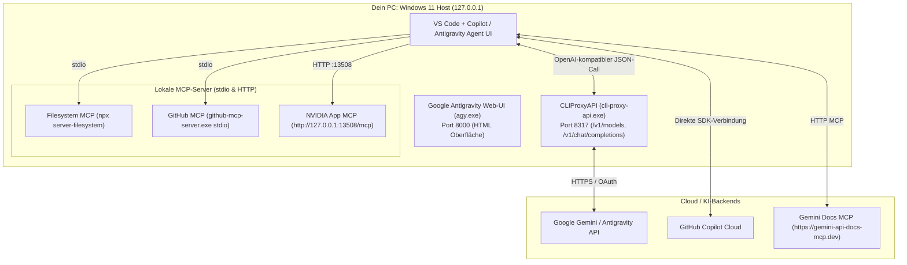

> **Thema:** MCP-Server, Localhost-Proxy (`CLIProxyAPI`) & Port-Architektur in VS Code
> **Autor:** Michael Stürmer
> **Datum:** 07.11.2026

<details>
<summary><b>Lernziele</b></summary>

* Die **hybride Localhost-Bridge-Architektur** verstehen: Warum das Sprachmodell (LLM) in der Cloud rechnet, während alle Werkzeuge (**MCP-Server**) lokal auf `127.0.0.1` ausgeführt werden.
* Die **Port-Zuordnung** auf dem System beherrschen (insbesondere **Port `8317`** für `CLIProxyAPI` vs. **Port `8000`** für die Antigravity Web-UI und **Port `13508`** für den NVIDIA App MCP-Server).
* Typische Fehlerbilder bei MCP-Servern (`github-mcp-server`, `geminiDocs`, NVIDIA Watchdog) diagnostizieren und im Handumdrehen beheben können.

</details>

<details>
<summary><b>Kernkonzepte</b></summary>

<details>
<summary>1.1 Hybride Localhost-Bridge: Zusammenspiel von VS Code, Proxy & MCP</summary>

In unserer Entwicklungsumgebung auf dem `VanstrikeCyborg` greifen lokale Werkzeuge und Cloud-Sprachmodelle nahtlos ineinander:



</details>

<details>
<summary>1.2 Die wichtigsten Ports & Konfigurationsdateien im Überblick</summary>

| Port / Typ | Dienst / Komponente | Protokoll / Format | Zweck & Wichtiger Hinweis |
| :--- | :--- | :--- | :--- |
| **Port `8317`** | **`CLIProxyAPI` (`cli-proxy-api.exe`)** | HTTP (REST / JSON) | **Modell-Endpunkt** (`/v1/models`, `/v1/chat/completions`) für `github.copilot.llm-gateway.serverUrl`. |
| **Port `8000`** | **Google Antigravity Web-UI (`agy.exe`)** | HTTP (HTML SPA) | Reine **Web-Oberfläche** von Antigravity. Darf **nicht** als LLM-Gateway-URL eingetragen werden (liefert `<!doctype html>` statt JSON)! |
| **Port `13508`** | **NVIDIA App MCP (`NvAppMcpServer.exe`)** | HTTP (`/mcp`) & Named Pipe | Lokaler MCP-Server zur Abfrage und Steuerung der NVIDIA GPU/App (`http://127.0.0.1:13508/mcp`). |
| **HTTPS Remote** | **Gemini Docs MCP (`geminiDocs`)** | Streamable HTTP | Offizieller Live-Dokumentationsserver (`https://gemini-api-docs-mcp.dev`) mit `gemini_search_docs` und `gemini_get_doc`. |
| **`stdio` Lokal** | **GitHub MCP (`github-mcp-server.exe`)** | Standard I/O | Natives Go-Binary unter `C:\Users\strik\.local\bin\github-mcp-server.exe` (< 50 ms Startzeit, kein Docker nötig). |

### Zentrale Speicherorte der MCP-Konfigurationen:
1. **Multi-Root Workspace:** `C:\Users\strik\git-labor\git-labor.code-workspace` (Sektion `"mcp": { "servers": { ... } }`)
2. **VS Code Projekt-MCP:** `C:\Users\strik\git-labor\.vscode\mcp.json`
3. **Projekt-MCP (`.mcp.json`):** `C:\Users\strik\git-labor\.mcp.json`
4. **VS Code Global User-MCP:** `C:\Users\strik\AppData\Roaming\Code\User\mcp.json`
5. **Copilot / Gemini Global:** `C:\Users\strik\.copilot\mcp-config.json` & `C:\Users\strik\.gemini\config\mcp_config.json`

</details>

<details>
<summary>1.3 Fallstudie 1: Port-Kollision 8000 vs. 8317 (<code>Unexpected token '&lt;'</code>)</summary>

* **Symptom:** Im Output-Log erscheint `Failed to fetch models: Unexpected token '<', "<!doctype "... is not valid JSON` oder `Antigravity: OFF`.
* **Ursache:**
  1. Das LLM-Gateway fragte fälschlicherweise `http://localhost:8000` (HTML-Web-UI) statt `http://localhost:8317` (`CLIProxyAPI` JSON-API) ab.
  2. Ein extern gestarteter Hintergrundprozess von `cli-proxy-api.exe` belegte bereits Port `8317`, sodass die VS-Code-Extension den Server nicht selbst starten konnte.
* **Lösung & Diagnose-Befehle:**
  ```powershell
  # 1. Prüfen, welcher Prozess Port 8317 belegt
  Get-NetTCPConnection -LocalPort 8317 -ErrorAction SilentlyContinue | Format-Table LocalAddress, LocalPort, State, OwningProcess

  # 2. Hängende Proxy-Instanz sauber beenden
  Get-Process -Name *cli-proxy* -ErrorAction SilentlyContinue | Stop-Process -Force

  # 3. Funktionstest gegen Port 8317 ausführen
  Invoke-RestMethod -Uri "http://127.0.0.1:8317/v1/models"
  ```

</details>

<details>
<summary>1.4 Fallstudie 2: <code>github-mcp-server</code> nativ statt über Docker betreiben</summary>

* **Symptom:** `open //./pipe/dockerDesktopLinuxEngine: The system cannot find the file specified.`
* **Ursache:** Der `github-mcp-server` war als Docker-Container (`docker run ... ghcr.io/github/github-mcp-server`) konfiguriert. Wenn Docker Desktop nicht läuft, schlägt der Start sofort fehl.
* **Best Practice (Natives Binary):**
  Das statische Windows-Binary `C:\Users\strik\.local\bin\github-mcp-server.exe` benötigt nur ~25 MB RAM (statt 2–4 GB für WSL2/Docker) und startet in unter 50 Millisekunden über `stdio`:
  ```json
  "github-mcp-server": {
    "command": "C:\\Users\\strik\\.local\\bin\\github-mcp-server.exe",
    "args": ["stdio"],
    "env": {
      "GITHUB_PERSONAL_ACCESS_TOKEN": "<DEIN_GITHUB_PAT>"
    }
  }
  ```

</details>

<details>
<summary>1.5 Fallstudie 3: NVIDIA App MCP-Server Timeout (Fehlercode <code>-2147467259</code>)</summary>

* **Symptom:** Beim Aktivieren von *„Agent-Zugriff“* in der NVIDIA App springt der Schalter nach ~10 Sekunden mit `MCP server did not become ready in time` zurück.
* **Ursache:** Der Dienst `NvContainerLocalSystem` hatte wegen eines verwaisten Plugin-Ordners aufgehört, das Verzeichnis `C:\Program Files\NVIDIA Corporation\NvContainer\plugins\AIUser` zu überwachen. Dadurch wurde `McpServerPlugin.dll` nicht geladen und die Named Pipe `\\.\pipe\nvidia-nvapp-mcp-server-...` fehlte.
* **Schnellbehebung & Prüfung:**
  ```powershell
  # 1. NVIDIA Container-Dienst neu starten
  Restart-Service NvContainerLocalSystem

  # 2. Prüfen, ob die Named Pipe aktiv ist
  [System.IO.Directory]::GetFiles("\\.\\pipe\\") | Where-Object { $_ -match "nvapp-mcp" }
  ```

</details>

</details>

<details>
<summary><b>Übungsaufgaben</b></summary>

1. **JSON-Fehler verstehen:** Warum führt die Fehlermeldung `Unexpected token '<', "<!doctype "... is not valid JSON` sofort zu dem Schluss, dass eine REST-API versehentlich mit einem Webserver-Frontend-Port verbunden wurde?
2. **Ressourcen-Vergleich:** Nenne drei technische Gründe, warum für lokale MCP-Server wie `github-mcp-server` ein natives Binary (`stdio`) oder ein direkter HTTP-Endpunkt (`geminiDocs`) einem schweren Docker-Container auf einem 16-GB-Laptop vorzuziehen ist.
3. **MCP-Neustart:** Über welchen Befehl in der VS Code Befehlspalette (`Strg + Shift + P`) kannst du alle aktiven MCP-Server auflisten, deren Logs einsehen und einen Server gezielt neu starten?

</details>

<details>
<summary><b>Weiterführende Links & Quellen</b></summary>

* [Model Context Protocol (MCP) Offizielle Spezifikation](https://modelcontextprotocol.io/)
* [VS Code Copilot MCP Server Dokumentation](https://code.visualstudio.com/docs/copilot/chat/mcp-servers)
* [Gemini Docs MCP Server (`gemini-api-docs-mcp.dev`)](https://aistudio.google.com/docs/coding-agents#mcp-setup)

</details>

<details>
<summary><b>Chips & Kernaussagen</b></summary>

* **Port `8317` = Modell-JSON-API (`CLIProxyAPI`):** Niemals mit Port `8000` (Antigravity HTML-UI) verwechseln.
* **`geminiDocs` liefert Live-Wissen:** Über `https://gemini-api-docs-mcp.dev` prüft der Agent aktuelle Gemini-SDKs und Schemata direkt zur Laufzeit.
* **Natives Binary schlägt Docker-Container für MCP:** `github-mcp-server.exe` spart mehrere Gigabyte RAM und funktioniert auch ohne gestartetes Docker Desktop.
* **NVIDIA MCP läuft über `AIUser`-Container:** Fehlt die Named Pipe oder Port `13508`, behebt `Restart-Service NvContainerLocalSystem` den blockierten Watchdog.

</details>

---
*Hinweis zur Organisation:* Die erstellte Dokumentation ist am Drehlaufwerk abgelegt und mit einer kurzen Zusammenfassung von den Chips auch in den Notebooks verlinkt.

<!-- DOKU-MINIMAP-START -->
<style>
.doku-arch-flow { font-family: var(--vscode-editor-font-family, Consolas, monospace); background: rgba(20, 24, 33, 0.92); border: 1px solid rgba(100, 140, 220, 0.35); border-radius: 10px; padding: 14px 16px; margin: 10px 0; color: #e2e8f0; }
.doku-arch-root { text-align: center; font-weight: 700; font-size: 1.04em; padding: 8px 12px; margin-bottom: 12px; background: linear-gradient(135deg, rgba(37, 99, 235, 0.28), rgba(15, 23, 42, 0.9)); border: 1px solid rgba(96, 165, 250, 0.5); border-radius: 8px; }
.doku-arch-root a { color: #93c5fd !important; text-decoration: none !important; }
.doku-arch-root a:hover { text-decoration: underline !important; }
.doku-arch-grid { display: grid; grid-template-columns: repeat(auto-fit, minmax(275px, 1fr)); gap: 10px; }
.doku-arch-card { background: rgba(30, 41, 59, 0.78); border: 1px solid rgba(148, 163, 184, 0.28); border-left: 4px solid #3b82f6; border-radius: 8px; padding: 9px 11px; transition: transform 0.12s ease, border-color 0.12s ease; }
.doku-arch-card:hover { border-color: #60a5fa; transform: translateY(-1px); }
.doku-arch-card.r1 { border-left-color: #22c55e; }
.doku-arch-card.r2 { border-left-color: #3b82f6; }
.doku-arch-card.r3 { border-left-color: #eab308; }
.doku-arch-card.r4 { border-left-color: #ec4899; }
.doku-arch-card.r5 { border-left-color: #a855f7; }
.doku-arch-card-title { font-weight: 700; font-size: 0.95em; margin-bottom: 6px; padding-bottom: 4px; border-bottom: 1px dashed rgba(148, 163, 184, 0.25); }
.doku-arch-card-title a { color: #f8fafc !important; text-decoration: none !important; display: block; }
.doku-arch-card-title a:hover { color: #60a5fa !important; }
.doku-arch-lines { list-style: none; margin: 0; padding: 0; font-size: 0.85em; line-height: 1.5; }
.doku-arch-lines li { margin: 3px 0; padding: 2px 5px; border-radius: 4px; white-space: normal; }
.doku-arch-lines li:hover { background: rgba(59, 130, 246, 0.18); }
.doku-arch-lines a { color: #cbd5e1 !important; text-decoration: none !important; display: inline; }
.doku-arch-lines a:hover { color: #93c5fd !important; text-decoration: underline !important; }
.doku-arch-badge { display: inline-block; font-size: 0.75em; padding: 0 5px; margin-left: 4px; border-radius: 4px; background: rgba(59, 130, 246, 0.22); color: #93c5fd !important; border: 1px solid rgba(96, 165, 250, 0.35); }
details.doku-minimap { position: fixed; bottom: 18px; right: 18px; z-index: 9999; width: 250px; max-height: 76px; overflow: hidden; background: rgba(15, 23, 42, 0.94); border: 1px solid rgba(96, 165, 250, 0.65); border-radius: 10px; box-shadow: 0 8px 26px rgba(0, 0, 0, 0.65); backdrop-filter: blur(8px); transition: width 0.18s ease, max-height 0.18s ease; font-family: var(--vscode-font-family, sans-serif); }
details.doku-minimap:hover { border-color: #60a5fa; }
details.doku-minimap[open] { width: min(860px, 94vw); max-height: 84vh; overflow-y: auto; padding-bottom: 10px; }
details.doku-minimap > summary { cursor: pointer; list-style: none; padding: 8px 12px; font-weight: 700; font-size: 0.84em; color: #f8fafc; background: linear-gradient(90deg, rgba(37, 99, 235, 0.45), rgba(30, 41, 59, 0.9)); border-bottom: 1px solid rgba(148, 163, 184, 0.25); display: flex; align-items: center; justify-content: space-between; user-select: none; }
details.doku-minimap > summary::-webkit-details-marker { display: none; }
details.doku-minimap .minimap-preview-strip { display: flex; gap: 4px; padding: 5px 10px 7px 10px; font-size: 0.72em; color: #94a3b8; justify-content: space-between; }
details.doku-minimap[open] .minimap-preview-strip { display: none; }
details.doku-minimap .minimap-preview-strip span { background: rgba(30, 41, 59, 0.9); padding: 2px 6px; border-radius: 4px; border: 1px solid rgba(148, 163, 184, 0.25); }
details.doku-minimap .minimap-body { padding: 8px 12px 4px 12px; }
</style>
<details class="doku-minimap">
<summary><span>🗺️ Doku-Minimap (5 Rubriken &amp; Labs)</span><span title="Klicken zum Vergrößern / Einklappen">⛶</span></summary>
<div class="minimap-preview-strip"><span>01 Linux</span><span>02 VSCode</span><span>03 Python</span><span>04 JS/TS</span><span>05 Agents</span></div>
<div class="minimap-body">
<div class="doku-arch-flow">
<div class="doku-arch-root">🏛️ <a href="../README.md">VanstrikeCyborg — git-labor Lern- &amp; Test-Architektur (Doku-Index)</a>  |  <a href="../../README.md">Repo-README</a>  |  <a href="../../AGENTS.md">AGENTS.md</a>  |  <a href="../../notebook-agent-environments/README.md">Notebooks</a></div>
<div class="doku-arch-grid">
<div class="doku-arch-card r1">
<div class="doku-arch-card-title">🐧 <a href="../01_Linux_Bash/README.md">01_Linux_Bash (Linux, Shell &amp; Container)</a></div>
<ul class="doku-arch-lines">
<li>├─ <a href="../01_Linux_Bash/01_bash-grundlagen-und-skripting.md">01 • Bash-Grundlagen, Skripting, Pipes &amp; Exit-Codes</a> <a class="doku-arch-badge" href="../../labs/01_linux_bash/check-env.sh">check-env.sh</a></li>
<li>├─ <a href="../01_Linux_Bash/02_arch-linux-omarchy-und-remote-ssh.md">02 • Arch Linux, Omarchy, systemd &amp; Remote-SSH</a></li>
<li>└─ <a href="../01_Linux_Bash/03_docker-und-sbx-micro-vms.md">03 • Docker Grundlagen &amp; Sandbox Micro-VMs (sbx)</a></li>
</ul>
</div>
<div class="doku-arch-card r2">
<div class="doku-arch-card-title">🧩 <a href="README.md">02_VSCode_Env (IDE, Git, MCP &amp; Gemini)</a></div>
<ul class="doku-arch-lines">
<li>├─ <a href="01_vscode-architektur-lsp-und-remote.md">01 • VS Code Architektur, Sprachserver (LSP) &amp; Remote</a></li>
<li>├─ <a href="02_git-github-und-multi-root-workspaces.md">02 • Git, GitHub Workflow &amp; Multi-Root Workspaces</a> <a class="doku-arch-badge" href="../../git-labor.code-workspace">Workspace</a></li>
<li>├─ <a href="03_mcp-server-localhost-proxy-und-ports.md">03 • MCP-Server, Localhost-Proxy &amp; Port-Diagnose (8317)</a></li>
<li>└─ <a href="04_gemini-oekosystem-ai-studio-und-api-keys.md">04 • Gemini Ökosystem, Google AI Studio &amp; API-Keys</a></li>
</ul>
</div>
<div class="doku-arch-card r3">
<div class="doku-arch-card-title">🐍 <a href="../03_Python_Coding/README.md">03_Python_Coding (Python, uv &amp; GenAI SDK)</a></div>
<ul class="doku-arch-lines">
<li>├─ <a href="../03_Python_Coding/01_python-setup-uv-venv-und-notebooks.md">01 • Python Setup: uv, .venv, Pylance &amp; Notebooks</a></li>
<li>├─ <a href="../03_Python_Coding/02_gemini-api-python-sdk-und-interactions.md">02 • Google GenAI SDK (google-genai) &amp; Interactions API</a></li>
<li>└─ <a href="../03_Python_Coding/03_python-automatisierung-datenanalyse-und-tests.md">03 • Automatisierung, Datenanalyse &amp; pytest</a> <a class="doku-arch-badge" href="../../labs/03_python/sensor_demo.py">sensor_demo.py</a></li>
</ul>
</div>
<div class="doku-arch-card r4">
<div class="doku-arch-card-title">🌐 <a href="../04_JS_TS_Web/README.md">04_JS_TS_Web (HTML/CSS, JS/TS &amp; Web-SDK)</a></div>
<ul class="doku-arch-lines">
<li>├─ <a href="../04_JS_TS_Web/01_html-css-und-dom-grundlagen.md">01 • HTML5, CSS3 &amp; DOM-Manipulation Grundlagen</a> <a class="doku-arch-badge" href="../../labs/04_js_ts_web/rechner.html">rechner.html</a></li>
<li>├─ <a href="../04_JS_TS_Web/02_modernes-javascript-und-typescript.md">02 • Modernes JavaScript (ES6+) &amp; TypeScript</a></li>
<li>└─ <a href="../04_JS_TS_Web/03_gemini-sdk-typescript-und-web-apps.md">03 • Google GenAI SDK (@google/genai) für Web-Apps</a></li>
</ul>
</div>
<div class="doku-arch-card r5">
<div class="doku-arch-card-title">🤖 <a href="../05_Agents/README.md">05_Agents (KI-Agenten, Skills &amp; Orchestrierung)</a></div>
<ul class="doku-arch-lines">
<li>├─ <a href="../05_Agents/01_agent-stilfibel-und-didaktik-ruler.md">01 • Agent-Stilfibel, Didaktik-Ruler &amp; 7-Stufen-Aufbau</a></li>
<li>├─ <a href="../05_Agents/02_agenten-erstellen-instructions-rules-und-prompts.md">02 • Agenten erstellen: Instructions, Rules &amp; Prompts</a> <a class="doku-arch-badge" href="../../.github/instructions/gemini-api.instructions.md">gemini.instructions</a></li>
<li>├─ <a href="../05_Agents/03_agenten-ausruesten-skills-und-mcp-tools.md">03 • Agenten ausrüsten: Skills (SKILL.md) &amp; MCP-Tools</a> <a class="doku-arch-badge" href="../../.agents/skills/live-transfer-status-monitor/SKILL.md">SKILL.md</a></li>
<li>└─ <a href="../05_Agents/04_agenten-trainieren-primen-und-orchestrieren.md">04 • Agenten trainieren, primen &amp; Multi-Agent-Orchestrierung</a> <a class="doku-arch-badge" href="../../.github/agents/light.agent.md">@light</a> <a class="doku-arch-badge" href="../../.github/agents/rig.agent.md">@rig</a></li>
</ul>
</div>
</div>
</div>
</div>
</details>
<!-- DOKU-MINIMAP-END -->
