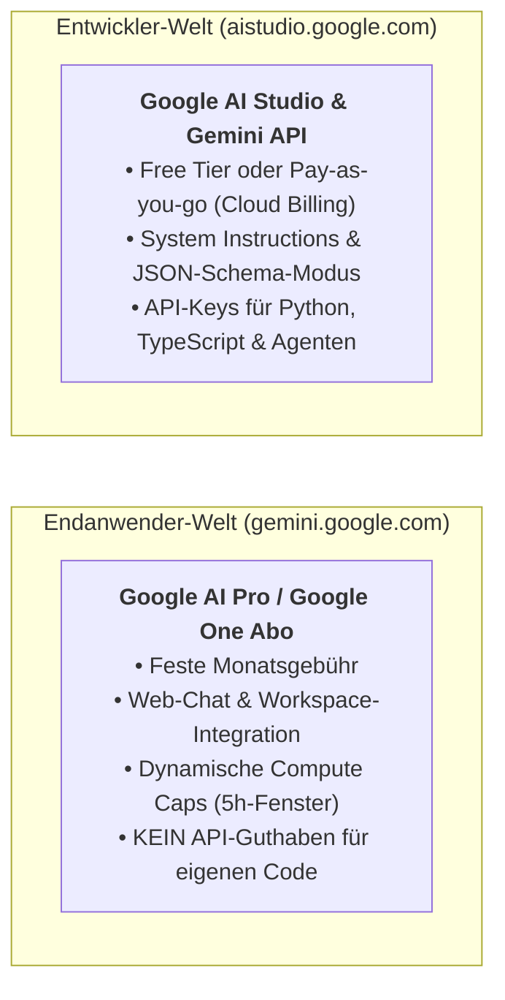

> **Thema:** Gemini Ökosystem, Google AI Studio, API-Keys & Hardware-Stabilität (MSI Cyborg 15)
> **Autor:** Michael Stürmer
> **Datum:** 07.11.2026

<!-- DOKU-SUBNAV-START -->
<details>
<summary><b>🧭 Rubrik-Navigation &amp; Modul-Übersicht (02 VS Code & MCP)</b></summary>

**Zentrale:** [📚 Doku-Index](../README.md) · [📂 Rubrik 02 VS Code & MCP](./README.md) · **Vorheriges:** [⬅️ 03 • MCP-Server, Ollama (:11434) & Ports (Archiv: Proxy)](./03_mcp-server-localhost-proxy-und-ports.md) · **Nächstes:** [05 • 5-Knoten-Verbund, Parity & Parallel-Limits ➡️](./05_multi-workspace-netzwerk-mcp-und-agenten-verbund.md)

**Alle Module in `02_VSCode_Env/`:**
- [01 • VS Code Architektur, Sprachserver (LSP) & Remote](./01_vscode-architektur-lsp-und-remote.md)
- [02 • Git, GitHub Workflow & Multi-Root Workspaces](./02_git-github-und-multi-root-workspaces.md) · `Workspace`
- [03 • MCP-Server, Ollama (:11434) & Ports (Archiv: Proxy)](./03_mcp-server-localhost-proxy-und-ports.md) · `mcp.json`
- 👉 **[04 • Gemini Ökosystem, Google AI Studio & API-Keys](./04_gemini-oekosystem-ai-studio-und-api-keys.md)** *(aktuell)*
- [05 • 5-Knoten-Verbund, Parity & Parallel-Limits](./05_multi-workspace-netzwerk-mcp-und-agenten-verbund.md)

**Weitere Rubriken:** [🐧 01 Linux & Bash](../01_Linux_Bash/README.md) · [🐍 03 Python](../03_Python_Coding/README.md) · [🌐 04 JS/TS Web](../04_JS_TS_Web/README.md) · [🤖 05 Agents](../05_Agents/README.md)

</details>
<!-- DOKU-SUBNAV-END -->

<details>
<summary><b>Lernziele</b></summary>

* Den fundamentalen Unterschied zwischen dem **Endanwender-Abo (Google AI Pro)** und der **Entwickler-Plattform (Google AI Studio & Gemini API)** verstehen.
* Den Sicherheitswechsel von klassischen **Standard API Keys** zu dienstkontogebundenen **Authorization (Auth) Keys** sowie deren sichere Einbindung über Umgebungsvariablen (`GEMINI_API_KEY`) beherrschen.
* Die **Hardware-Ressourcen des MSI Cyborg 15** (16 GB DDR5, Core 7 240H, RTX 5060) optimal für VS Code, KI-Agenten und lokale Tools einteilen.

</details>

<details>
<summary><b>Kernkonzepte</b></summary>

<details>
<summary>1.1 Zwei getrennte Welten: Google AI Pro Abo vs. Gemini API</summary>



* **Compute Caps im AI Pro Abo:** Im Web-Chat steuert Google das Kontingent über rollierende Zeitfenster:
  * **Gemini Pro:** Hohes Prioritätskontingent für komplexes Coding und große Kontexte (automatischer Fallback auf Flash ohne harten Abbruch).
  * **Gemini Flash:** Nahezu unbegrenzter Schnellkanal für Routineaufgaben.
  * **Deep Think / Deep Research:** Tägliches Spezialbudget für tiefe Logik- und Rechercheläufe.
* **Google AI Studio (`aistudio.google.com`):** Der Entwickler-Playground zum Testen von System-Prompts, Temperatur (`0.0` für deterministischen Code/JSON), Structured Outputs und direktem Code-Export (*Get Code*).

</details>

<details>
<summary>1.2 API-Key-Architektur: Standard Keys vs. Authorization Keys</summary>

Ab Mai 2026 stellt die Gemini API aus Sicherheitsgründen von unbeschränkten Standard-Keys auf **Authorization (Auth) Keys** um:

| Eigenschaft | Standard API Key | Authorization (Auth) Key (Aktueller Standard) |
| :--- | :--- | :--- |
| **Identität & Bindung** | Nur mit einem Google Cloud Projekt für Billing/Quota verknüpft. | Direkt an ein **Google Cloud Service Account** gebunden (feingranulare IAM-Rechte). |
| **API-Einschränkung** | Unbeschränkte Standard-Keys werden von der Gemini API abgelehnt! | Standardmäßig strikt auf die *Generative Language API* beschränkt + automatischer Schutz bei geleakten Keys. |
| **Abrechnungsprüfung** | Ein erfolgreicher Modell-Abruf (`/v1/models`) prüft nur die Leseberechtigung – für echte Text-/Codegenerierung muss im verknüpften AI-Studio-Projekt Kontingent (Free Tier oder aktives Cloud Billing, sonst HTTP `402`) verfügbar sein. |

</details>

<details>
<summary>1.3 Sichere Konfiguration von <code>GEMINI_API_KEY</code></summary>

API-Schlüssel dürfen **niemals** im Klartext in Markdown-Dokumente oder Git-Commits geschrieben werden. Das offizielle `google-genai` SDK erkennt automatisch die Umgebungsvariablen `GEMINI_API_KEY` oder `GOOGLE_API_KEY`:

* **Unter Windows (PowerShell – dauerhaft für deinen Benutzer setzen):**
  ```powershell
  [Environment]::SetEnvironmentVariable("GEMINI_API_KEY", "DEIN_ECHTER_API_KEY", "User")
  ```
* **Unter Linux / macOS (in `~/.bashrc` oder `~/.zshrc`):**
  ```bash
  export GEMINI_API_KEY="DEIN_ECHTER_API_KEY"
  source ~/.bashrc
  ```

</details>

<details>
<summary>1.4 Hardware-Analyse, Systemprofile &amp; Schnittstellen auf dem MSI Cyborg 15 (<code>VanstrikeCyborg</code>)</summary>

| Komponente | Verifizierte Spezifikation (`VanstrikeCyborg` / `MS-15Q3`) | Relevanz für KI-, Dev- &amp; VR-Workflows |
| :--- | :--- | :--- |
| **Modell &amp; Firmware** | MSI Cyborg 15 B2RWFKG (`MS-15Q3`), BIOS `E15Q3IMS.110`, EC `15Q3EMS1.108`, Windows 11 Home 26H2 (`26300.9711`) | TPM 2.0 aktiv; Recovery über `F3`-Hotkey (HDI / WinPE Rescue USB). |
| **CPU** | Intel Core 7 240H (2.50 GHz, 16 Threads) | **Hohe Reserve:** Ideal für parallele Sprachserver (LSP), Python/TS-Builds &amp; Proxys. |
| **Dual-GPU (Optimus)** | NVIDIA GeForce RTX 5060 Laptop (8 GB GDDR7, 3328 CUDA, 55 W Max-Q Gen-5, Treiber `617.42`) + Intel Graphics (`32.0.101.5972`) | **MSHybrid ohne Hardware-MUX-Switch** (`Graphic Switch` / `Win32 SHIFT mode` = *Unsupportive*). |
| **RAM** | **16 GB DDR5-5600** (2× 8 GB Kingston SO-DIMM) | **Engpass bei schweren VMs:** Ausbau bis max. **96 GB DDR5** über 2× SO-DIMM möglich. |
| **Speicher &amp; I/O** | `1 × M.2 2280 NVMe` (SanDisk SN5000S 1 TB) + ext. `WD My Passport 0741`; Wi-Fi 6E AX211, Realtek GbE, `2× USB-A 10 Gbit/s`, `1× USB-C 10 Gbit/s` (DP Alt Mode + PD-In 45–100 W, optimal 65–100 W), `1× HDMI` | Stets **&gt; 100 GB frei** auf NVMe halten; für USB-C-Laden min. **65–100 W PD** nutzen. |
| **Display- &amp; VR-Setup** | 3 aktive Displays: Intern (1080p@144 Hz) + `Samsung C27F398` (DP@72 Hz) + `Samsung U28E590` (4K via USB-C-DP) | **Achtung VIVE Hub:** Fehlercode `337` tritt auf, wenn 3 Monitore aktiv sind (Max-Monitor-Limit). |
| **Steuerung &amp; MCP** | `MSI Center` (`Extreme Performance` / `MSI AI Engine` / `Battery Master`), `NVIDIA App` MCP auf `http://127.0.0.1:13508/mcp` (`NvAppMcpServer.exe`) | Betreut durch den globalen **`General Cyborg`** Agenten (`~/.copilot/agents/general.agent.md`). |

**Best Practices für maximale Stabilität auf dem Laptop:**
1. **Kein schweres Dauer-Docker-Desktop im Hintergrund**, wenn es nicht aktiv für ein Container-Projekt gebraucht wird (spart 2.5–4 GB RAM durch Wegfall von `vmmemWSL`; Container-Workloads laufen auf dem `SimRacer`).
2. **Nutzung von `sbx` oder nativen Binaries** (`github-mcp-server.exe`) für Agenten-Tools.
3. **VIVE Hub / Multi-Monitor:** Vor VR-Betrieb am Laptop (`VIVE Focus Vision` / `XR Elite`) ggf. einen externen Monitor trennen, um Fehler `337` zu vermeiden (USB/ADB-Fallback Port `5037`, Fehler `3105`).
4. **Ausblick RAM-Upgrade:** Durch Tausch der 2× 8 GB SO-DIMMs auf **32–96 GB DDR5-5600** verschwindet auch bei parallelen lokalen Containern jedes Pagefile-Swapping.

</details>

</details>

<details>
<summary><b>Übungsaufgaben</b></summary>

1. **Fehlercode HTTP 402:** Dein Skript kann erfolgreich alle 50 Gemini-Modelle auflisten, bricht aber beim ersten Generierungs-Request mit `HTTP 402` ab. Woran liegt das und wo prüfst du den Status?
2. **Key-Sicherheit:** Warum funktioniert `export GEMINI_API_KEY="..."` aus einer Linux-Anleitung nicht dauerhaft für ein Windows-PowerShell-Terminal in VS Code, und wie trägst du die Variable unter Windows richtig ein?
3. **RAM-Budget:** Berechne den RAM-Bedarf auf deinem 16-GB-Laptop, wenn Windows 11 (5.5 GB), VS Code mit Pylance (2.5 GB), Browser (2 GB) und zusätzlich eine 6-GB-VM zusammen mit WSL2 (3 GB) laufen würden. Was passiert technisch ab 16 GB?

</details>

<details>
<summary><b>Weiterführende Links & Quellen</b></summary>

* [Google AI Studio – API Keys verwalten](https://aistudio.google.com/apikey)
* [Gemini API Dokumentation: API Keys & Auth Keys](https://aistudio.google.com/docs/api-keys)
* [Gemini API Rate Limits & Billing Tiers](https://aistudio.google.com/docs/rate-limits)

</details>

<details>
<summary><b>Chips & Kernaussagen</b></summary>

* **AI Pro Abo $\neq$ API-Billing:** Das Web-Abo gilt für `gemini.google.com`; eigener Code in VS Code nutzt API-Keys aus dem Google AI Studio (`aistudio.google.com`).
* **Auth Keys sind der neue Sicherheitsstandard:** Neue Gemini-Keys sind an Service Accounts gebunden und auf die Generative Language API beschränkt.
* **Umgebungsvariable statt Hardcoding:** Das SDK liest `GEMINI_API_KEY` automatisch aus der Systemumgebung – Keys gehören niemals in Git!
* **16 GB RAM smart einteilen:** Durch den Verzicht auf unnötige Dauer-VMs auf dem `VanstrikeCyborg` läuft VS Code inklusive Pylance, MCP-Servern und Antigravity absolut verzögerungsfrei.

</details>

---
*Hinweis zur Organisation:* Die erstellte Dokumentation ist am Drehlaufwerk abgelegt und mit einer kurzen Zusammenfassung von den Chips auch in den Notebooks verlinkt.

<!-- DOKU-MINIMAP-START -->
<style>
.doku-arch-flow { font-family: var(--vscode-editor-font-family, Consolas, monospace); background: linear-gradient(160deg, rgba(15, 23, 42, 0.96), rgba(17, 24, 39, 0.94)); border: 1px solid rgba(96, 165, 250, 0.35); border-radius: 12px; padding: 14px 16px; margin: 8px 0 0 0; color: #e2e8f0; }
.doku-arch-root { display: flex; flex-wrap: wrap; align-items: center; justify-content: center; gap: 10px; font-weight: 700; font-size: 0.98em; padding: 9px 14px; margin-bottom: 12px; background: linear-gradient(135deg, rgba(37, 99, 235, 0.28), rgba(30, 41, 59, 0.92)); border: 1px solid rgba(96, 165, 250, 0.48); border-radius: 10px; }
.doku-arch-root a { color: #93c5fd !important; text-decoration: none !important; }
.doku-arch-root a:hover { color: #dbeafe !important; text-decoration: underline !important; }
.doku-arch-grid { display: grid; grid-template-columns: repeat(auto-fit, minmax(268px, 1fr)); gap: 11px; }
.doku-arch-card { background: rgba(30, 41, 59, 0.72); border: 1px solid rgba(148, 163, 184, 0.24); border-top: 3px solid #3b82f6; border-left: 4px solid #3b82f6; border-radius: 10px; padding: 10px 12px; transition: transform 0.14s ease, border-color 0.14s ease, box-shadow 0.14s ease; }
.doku-arch-card:hover { border-color: #93c5fd; transform: translateY(-2px); box-shadow: 0 6px 18px rgba(0, 0, 0, 0.35); }
.doku-arch-card.r1 { border-left-color: #22c55e; border-top-color: #22c55e; }
.doku-arch-card.r2 { border-left-color: #3b82f6; border-top-color: #3b82f6; }
.doku-arch-card.r3 { border-left-color: #eab308; border-top-color: #eab308; }
.doku-arch-card.r4 { border-left-color: #ec4899; border-top-color: #ec4899; }
.doku-arch-card.r5 { border-left-color: #a855f7; border-top-color: #a855f7; }
.doku-arch-card-title { font-weight: 700; font-size: 0.93em; margin-bottom: 7px; padding-bottom: 5px; border-bottom: 1px dashed rgba(148, 163, 184, 0.26); }
.doku-arch-card-title a { color: #f8fafc !important; text-decoration: none !important; display: block; }
.doku-arch-card-title a:hover { color: #93c5fd !important; }
.doku-arch-lines { list-style: none; margin: 0; padding: 0; font-size: 0.84em; line-height: 1.5; }
.doku-arch-lines li { margin: 3px 0; padding: 2px 6px; border-radius: 5px; white-space: normal; }
.doku-arch-lines li:hover { background: rgba(59, 130, 246, 0.16); }
.doku-arch-lines a { color: #cbd5e1 !important; text-decoration: none !important; display: inline; }
.doku-arch-lines a:hover { color: #93c5fd !important; text-decoration: underline !important; }
.doku-arch-badge { display: inline-block; font-size: 0.74em; padding: 0 6px; margin-left: 5px; border-radius: 999px; background: rgba(59, 130, 246, 0.22); color: #bfdbfe !important; border: 1px solid rgba(96, 165, 250, 0.4); }
details.doku-minimap { position: fixed; bottom: 18px; right: 18px; z-index: 9999; width: 292px; max-height: 76px; overflow: hidden; background: rgba(15, 23, 42, 0.93); border: 1px solid rgba(96, 165, 250, 0.62); border-radius: 14px; box-shadow: 0 10px 30px rgba(0, 0, 0, 0.65); backdrop-filter: blur(10px); transition: width 0.18s ease, max-height 0.18s ease, border-color 0.18s ease; font-family: var(--vscode-font-family, sans-serif); }
details.doku-minimap:hover { border-color: #93c5fd; }
details.doku-minimap[open] { width: min(920px, 94vw); max-height: 84vh; overflow-y: auto; padding-bottom: 10px; border-radius: 14px; }
details.doku-minimap > summary { cursor: pointer; list-style: none; padding: 8px 13px; font-weight: 700; font-size: 0.84em; color: #f8fafc; background: linear-gradient(90deg, rgba(37, 99, 235, 0.45), rgba(30, 41, 59, 0.92)); border-bottom: 1px solid rgba(148, 163, 184, 0.24); display: flex; align-items: center; justify-content: space-between; user-select: none; }
details.doku-minimap > summary::-webkit-details-marker { display: none; }
details.doku-minimap > summary .minimap-toggle::after { content: "+"; font-size: 1.05em; opacity: 0.85; padding: 0 4px; }
details.doku-minimap[open] > summary .minimap-toggle::after { content: "−"; }
details.doku-minimap .minimap-preview-strip { display: flex; gap: 5px; padding: 6px 10px 8px 10px; font-size: 0.71em; color: #cbd5e1; justify-content: space-between; }
details.doku-minimap[open] .minimap-preview-strip { display: none; }
details.doku-minimap .minimap-preview-strip span { display: inline-flex; align-items: center; gap: 4px; background: rgba(30, 41, 59, 0.92); padding: 2px 7px; border-radius: 999px; border: 1px solid rgba(148, 163, 184, 0.26); }
details.doku-minimap .dot { width: 6px; height: 6px; border-radius: 50%; display: inline-block; }
details.doku-minimap .dot.r1 { background: #22c55e; }
details.doku-minimap .dot.r2 { background: #3b82f6; }
details.doku-minimap .dot.r3 { background: #eab308; }
details.doku-minimap .dot.r4 { background: #ec4899; }
details.doku-minimap .dot.r5 { background: #a855f7; }
details.doku-minimap .minimap-body { padding: 4px 12px 6px 12px; }
</style>
<details class="doku-minimap">
<summary><span>🗺️ Doku-Minimap (5 Rubriken &amp; Labs)</span><span class="minimap-toggle" title="Klicken zum Vergrößern / Einklappen"></span></summary>
<div class="minimap-preview-strip"><span><i class="dot r1"></i>Linux</span><span><i class="dot r2"></i>VSCode</span><span><i class="dot r3"></i>Python</span><span><i class="dot r4"></i>JS/TS</span><span><i class="dot r5"></i>Agents</span></div>
<div class="minimap-body">
<div class="doku-arch-flow">
<div class="doku-arch-root"><span>🏛️ <a href="../README.md">VanstrikeCyborg — git-labor Doku-Index</a></span> · <a href="../../README.md">Repo-README</a> · <a href="../../AGENTS.md">AGENTS.md</a> · <a href="../../notebook-agent-environments/README.md">Notebooks</a> · <a href="../05_Agents/SYSTEM_ARCHITEKTUR_AENDERUNGEN_2026-11-25.md">Letztstand 25.11. (v5)</a></div>
<div class="doku-arch-grid">
<div class="doku-arch-card r1">
<div class="doku-arch-card-title">🐧 <a href="../01_Linux_Bash/README.md">01_Linux_Bash (Linux, Shell & Container)</a></div>
<ul class="doku-arch-lines">
<li>├─ <a href="../01_Linux_Bash/01_bash-grundlagen-und-skripting.md">01 • Bash CLI, Text-Tools, Streams & Expansions</a> <a class="doku-arch-badge" href="../../labs/01_linux_bash/check-env.sh">check-env.sh</a></li>
<li>├─ <a href="../01_Linux_Bash/02_linux-systemadministration-und-interna.md">02 • Inodes, LVM, Prozesse, Boot-Prozess & systemd</a></li>
<li>├─ <a href="../01_Linux_Bash/03_arch-linux-omarchy-und-remote-ssh.md">03 • Arch Linux, Omarchy, Remote-SSH & Nginx</a></li>
<li>├─ <a href="../01_Linux_Bash/04_fortgeschrittenes-bash-skripting-und-automatisierung.md">04 • Advanced Bash: Arrays, getopts & Backups</a></li>
<li>└─ <a href="../01_Linux_Bash/05_docker-und-sbx-micro-vms.md">05 • Docker Grundlagen & Sandbox Micro-VMs (sbx)</a></li>
</ul>
</div>
<div class="doku-arch-card r2">
<div class="doku-arch-card-title">🧩 <a href="../02_VSCode_Env/README.md">02_VSCode_Env (IDE, Git, MCP & Gemini)</a></div>
<ul class="doku-arch-lines">
<li>├─ <a href="../02_VSCode_Env/01_vscode-architektur-lsp-und-remote.md">01 • VS Code Architektur, Sprachserver (LSP) & Remote</a></li>
<li>├─ <a href="../02_VSCode_Env/02_git-github-und-multi-root-workspaces.md">02 • Git, GitHub Workflow & Multi-Root Workspaces</a> <a class="doku-arch-badge" href="../../git-labor.code-workspace">Workspace</a></li>
<li>├─ <a href="../02_VSCode_Env/03_mcp-server-localhost-proxy-und-ports.md">03 • MCP-Server, Ollama (:11434) & Ports (Archiv: Proxy)</a> <a class="doku-arch-badge" href="../../.vscode/mcp.json">mcp.json</a></li>
<li>├─ <a href="../02_VSCode_Env/04_gemini-oekosystem-ai-studio-und-api-keys.md">04 • Gemini Ökosystem, Google AI Studio & API-Keys</a></li>
<li>└─ <a href="../02_VSCode_Env/05_multi-workspace-netzwerk-mcp-und-agenten-verbund.md">05 • 5-Knoten-Verbund, Parity & Parallel-Limits</a></li>
</ul>
</div>
<div class="doku-arch-card r3">
<div class="doku-arch-card-title">🐍 <a href="../03_Python_Coding/README.md">03_Python_Coding (Python, uv & GenAI SDK)</a></div>
<ul class="doku-arch-lines">
<li>├─ <a href="../03_Python_Coding/01_python-setup-uv-venv-und-notebooks.md">01 • Python Setup: uv, .venv, Pylance & Notebooks</a> <a class="doku-arch-badge" href="../../notebook-agent-environments/agent_demo.ipynb">.ipynb</a></li>
<li>├─ <a href="../03_Python_Coding/02_gemini-api-python-sdk-und-interactions.md">02 • Google GenAI SDK (google-genai) & Interactions API</a></li>
<li>└─ <a href="../03_Python_Coding/03_python-automatisierung-datenanalyse-und-tests.md">03 • Automatisierung, Datenanalyse & pytest</a> <a class="doku-arch-badge" href="../../labs/03_python/sensor_demo.py">sensor_demo.py</a></li>
</ul>
</div>
<div class="doku-arch-card r4">
<div class="doku-arch-card-title">🌐 <a href="../04_JS_TS_Web/README.md">04_JS_TS_Web (HTML/CSS, JS/TS & Web-SDK)</a></div>
<ul class="doku-arch-lines">
<li>├─ <a href="../04_JS_TS_Web/01_html-css-und-dom-grundlagen.md">01 • HTML5, CSS3 & DOM-Manipulation Grundlagen</a> <a class="doku-arch-badge" href="../../labs/04_js_ts_web/rechner.html">rechner.html</a></li>
<li>├─ <a href="../04_JS_TS_Web/02_modernes-javascript-und-typescript.md">02 • Modernes JavaScript (ES6+) & TypeScript</a></li>
<li>└─ <a href="../04_JS_TS_Web/03_gemini-sdk-typescript-und-web-apps.md">03 • Google GenAI SDK (@google/genai) für Web-Apps</a></li>
</ul>
</div>
<div class="doku-arch-card r5">
<div class="doku-arch-card-title">🤖 <a href="../05_Agents/README.md">05_Agents (KI-Agenten, Skills & Orchestrierung)</a></div>
<ul class="doku-arch-lines">
<li>├─ <a href="../05_Agents/01_agent-stilfibel-und-didaktik-ruler.md">01 • Agent-Stilfibel, Didaktik-Ruler & 7-Stufen-Aufbau</a></li>
<li>├─ <a href="../05_Agents/02_agenten-erstellen-instructions-rules-und-prompts.md">02 • Agenten erstellen: Instructions, Rules & Prompts</a> <a class="doku-arch-badge" href="../../.github/instructions/gemini-api.instructions.md">gemini.instructions</a></li>
<li>├─ <a href="../05_Agents/03_agenten-ausruesten-skills-und-mcp-tools.md">03 • Agenten ausrüsten: Skills & MCP-Tools</a> <a class="doku-arch-badge" href="../../.agents/skills/live-transfer-status-monitor/SKILL.md">SKILL.md</a></li>
<li>├─ <a href="../05_Agents/04_agenten-trainieren-primen-und-orchestrieren.md">04 • Priming, Memory & Multi-Agent-Orchestrierung</a> <a class="doku-arch-badge" href="../../.github/agents/light.agent.md">@light</a></li>
<li>├─ <a href="../05_Agents/05_workspace-schnittstelle-simracer-und-agenten-terminals.md">05 • Schnittstelle, Terminals & XOR-Mutex</a> <a class="doku-arch-badge" href="../../labs/03_python/sim_agent_bridge.py">Bridge</a></li>
<li>├─ <a href="../05_Agents/05_multi-workspace-netzwerk-mcp-und-agenten-verbund.md">06 • Multi-Workspace Netzwerk & 6-Rollen-Verbund</a></li>
<li>├─ <a href="../05_Agents/SYSTEM_ARCHITEKTUR_AENDERUNGEN_2026-11-25.md">Letztstand 25.11. (Architektur v5, Toolbox & Pitwall v2.1)</a></li>
<li>├─ <a href="../05_Agents/HISENSE_TV_DISPLAY_OPTIMIERUNG_2026-11-25.md">Praxis-Referenz 25.11. (Hisense 4K-TV & ClearType)</a></li>
<li>├─ <a href="../05_Agents/SYSTEM_ARCHITEKTUR_AENDERUNGEN_2026-11-24.md">Stand 24.11. (Parity, Qwen 3.5 & Nacharbeiten)</a></li>
<li>├─ <a href="../05_Agents/SYSTEM_ARCHITEKTUR_AENDERUNGEN_2026-11-23.md">Stand 23.11. (ToS-Bereinigung, Ollama & Pitwall v1.5)</a></li>
<li>├─ <a href="../05_Agents/SYSTEM_ARCHITEKTUR_AENDERUNGEN_2026-11-11.md">Änderungsprotokoll 11.11. (MQTT, Gatekeeper & Caddy)</a></li>
<li>├─ <a href="../05_Agents/PITWALL_STEUERUNG_UND_FUNKTIONSREFERENZ_NOTEBOOKLM.md">Pitwall & Systemreferenz (NotebookLM-Quelle)</a></li>
<li>└─ <a href="../05_Agents/PITWALL_BOXENCREW_TEAMCHEF_KONZEPT_NOTEBOOKLM.md">Boxencrew & Teamchef Konzept (NotebookLM)</a></li>
</ul>
</div>
</div>
</div>
</div>
</details>
<!-- DOKU-MINIMAP-END -->
