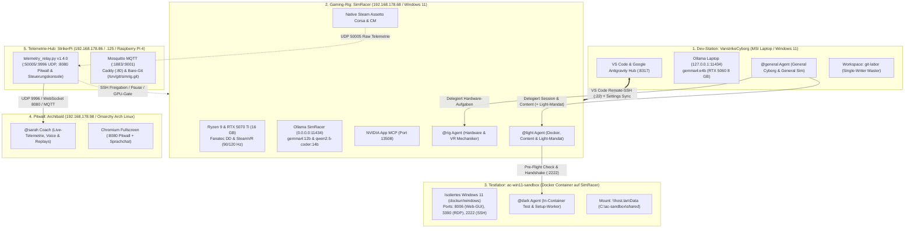
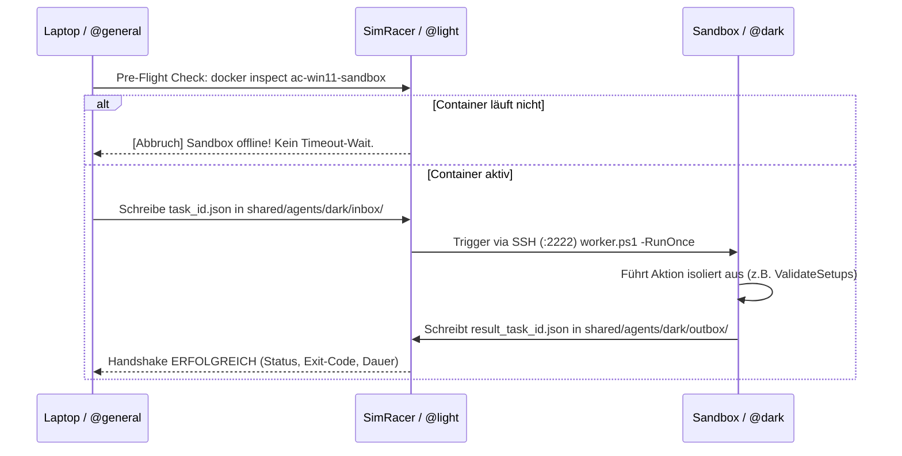
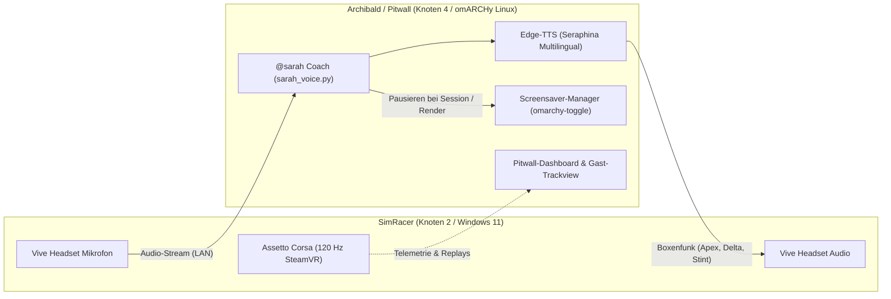

> **Thema:** Multi-Workspace &amp; Multi-PC-Verbund: Standorte, MCP-Server, Ports, Ollama, Pitwall-Steuerung &amp; Agenten-Rollen
> **Autor:** Michael Stürmer
> **Datum:** 23.11.2026 *(ToS-, Ollama- &amp; 1-zu-1-Sync-Abgleich)*

<details>
<summary><b>Lernziele</b></summary>

* Die **verteilte Multi-PC- &amp; Multi-Workspace-Architektur** zwischen dem Entwicklungs-Laptop (`VanstrikeCyborg`), der SimRacing-Workstation (`SimRacer`), der Windows-11-Sandbox (`ac-win11-sandbox`), dem Pitwall-Node (`Archibald` / Omarchy Linux) und dem 24/7-Edge-Hub (`StrikerPi` / Arch Linux ARM) im Detail verstehen.
* Die zentrale Konfigurationsdatei **`git-labor.code-workspace`**, ihr SimRacer-Gegenstück **`simracer.code-workspace`** und deren **Single-Writer-1-zu-1-Synchronisation** (VS Code Settings Sync mit 26er-Extensions-Sperrliste &amp; GitHub-Sync) sicher administrieren.
* Die **aktuelle Netzwerk- und Port-Matrix** aller beteiligten Dienste beherrschen (`11434` Ollama Dual-Node, `8317` legitimer Antigravity Hub `agy.exe`, `13508` NVIDIA App MCP, `8006` VNC/Kasm, `8090` Lobby-Stream, `8080` StrikerPi Pitwall Hub + Steuerungskonsole, `1883`/`9001` Mosquitto MQTT, `22` Host-SSH, `2222` Sandbox-SSH).
* Das **6-Rollen-Modell der KI-Agenten** (`@general`, `@rig`, `@light`, `@dark`, `@sarah`, `@rick`), die **delegierten Light-Freigaberechte (`pitwall_control_policy.json`)** sowie die **Trennung zwischen lokalem Host-Terminal und SSH-Client-Mode** (`Agent-Terminals.ps1`) souverän orchestrieren.
* Den **Handshake- &amp; Task-Queue-Mechanismus** (`inbox/` $\rightarrow$ Pre-Flight-Check $\rightarrow$ Execution $\rightarrow$ `outbox/`) über PowerShell und Python im laufenden Betrieb fehlerfrei einsetzen.

</details>

<details>
<summary><b>Kernkonzepte</b></summary>

<details>
<summary>1.1 Die 5-Knoten-Topologie: Standorte, Hardware &amp; Rollen</summary>

Um maximale Rechenleistung für Simulation und KI bereitzustellen und den Entwicklungsrechner frei von riesigen Mod- und Spieldaten zu halten, ist das Gesamtsystem auf fünf physische bzw. virtuelle Knoten verteilt:



| Knoten | Hostname / IP | Betriebssystem | Primäre Aufgabe | Verwendete Tools &amp; Ports |
| :--- | :--- | :--- | :--- | :--- |
| **Knoten 1** | `VanstrikeCyborg`<br/>`192.168.178.145` | Windows 11 Home | Master-Planung, Code-Entwicklung, Doku, Single-Writer-Lead | VS Code, Antigravity Hub (`8317`), Ollama (`11434`), `geminiDocs` MCP |
| **Knoten 2** | `SimRacer`<br/>`192.168.178.68` | Windows 11 Pro | Simulation, Content Manager, CSP-Shader, VR, LAN-Ollama-Compute | RTX 5070 Ti, Ollama (`11434`), NVIDIA MCP (`13508`), OpenSSH (`22`), Docker |
| **Knoten 3** | `ac-win11-sandbox`<br/>*(SimRacer Container)* | Windows 11 Ent. | Isoliertes Testlabor für fremde Mods, Setup-Validierung, CM-Tests | KasmVNC (`8006`), RDP (`3390`), Gast-SSH (`2222`) |
| **Knoten 4** | `Archibald`<br/>`192.168.178.98` | Omarchy Linux | Pitwall-Display (`:8080`), Telemetrie-Auswertung, Voice-Funk &amp; Videoschnitt | Python 3.14, FFmpeg, Chromium Kiosk, SSH (`22`), UDP (`9996`) |
| **Knoten 5** | `StrikerPi`<br/>`192.168.178.86` (WLAN)<br/>`192.168.178.125` (`end0`) | Arch Linux ARM | 24/7 Telemetrie-Relay, **Pitwall-Steuerungskonsole**, MQTT-Broker, Caddy &amp; Bare-Git | Python 3.14 (`uv`), FastAPI/Uvicorn (`8080`), Mosquitto (`1883`/`9001`), Caddy (`80`), `:8085` |

</details>

<details>
<summary>1.2 Die Multi-Root Workspace-Architektur (<code>git-labor.code-workspace</code>)</summary>

In VS Code und Antigravity werden alle Projekte über die zentrale Workspace-Datei `c:\Users\strik\git-labor\git-labor.code-workspace` in einem einzigen Fenster gebündelt (`4` globale MCP-Server in `User\mcp.json` + `2` exklusive in `.vscode\mcp.json`; keine `"mcp"`-Dubletten mehr im Workspace):

```json
{
  "folders": [
    { "name": "1_Git-Labor (mestuermer-svg/first)", "path": "." },
    { "name": "2_Local-Cyborg (mestuermer-svg/local_Cyborg)", "path": "../../../local_Cyborg" },
    { "name": "3_AC-CM-CSP-Lab (mestuermer-svg/ac-cm-csp-sandbox)", "path": "../ac-cm-csp-sandbox" },
    { "name": "4_Assetto-Corsa-Content (mestuermer-svg/assetto-corsa-content)", "path": "../assetto-corsa-content" },
    { "name": "5_StrikerPi-Hub (strikerpi/simrig.git)", "path": "../strikerpi-hub" }
  ],
  "settings": {
    "antigravity.serverPort": 8317,
    "inlineChat.defaultModel": "gemma4:e4b (ollama-models)",
    "python.defaultInterpreterPath": "C:\\Users\\strik\\AppData\\Roaming\\uv\\python\\cpython-3.12-windows-x86_64-none\\python.exe",
    "docker.context": "simracer",
    "task.allowAutomaticTasks": "off"
  }
}
```

> [!TIP]
> **Vorteil des Multi-Root- &amp; Single-Writer-Ansatzes:**
> - Du bearbeitest alle 5 Repositories in **einem** Editor ohne Fensterwechsel (`VanstrikeCyborg` als führender Schreib-Master).
> - Alle VS-Code-Chats auf `VanstrikeCyborg` starten direkt lokal mit **Ollama (`gemma4:e4b` auf `:11434`)** statt entfernter Proxy-Gateways; `task.allowAutomaticTasks` steht kontrolliert auf `"off"`.
> - Über den Task **`🧭 Agent-Terminals Menü (SSH-Launcher)`** (`labs/Agent-Terminals.ps1`) lassen sich alle 6 Agenten-Terminals vom Laptop aus übersichtlich per SSH aufrufen.

</details>

<details>
<summary>1.3 SimRacer-Gegenstück: Der Host-Workspace (<code>simracer.code-workspace</code>) &amp; 1-zu-1-Synchronisation</summary>

Auf der SimRacing-Workstation (`SimRacer` / `192.168.178.68`) wird das bereinigte Host-Workspace **`C:\ac-sandbox\simracer.code-workspace`** (via NTFS-Junction identisch unter `D:\ac-sandbox\simracer.code-workspace`) betrieben — als **1-zu-1-Parität zu `VanstrikeCyborg` ohne SQLite-Konflikte**:

#### 1. Warum Settings Sync + GitHub statt geteiltem SMB-Profil?
- VS Code schreibt laufend in lokale SQLite-Datenbanken (`globalStorage\state.vscdb`). Ein direkter SMB-Zugriff von zwei PCs auf dasselbe `AppData\Roaming\Code\User\` würde zu DB-Locks und Korruption führen.
- **Sauberes Single-Writer-Modell:**
  1. **IDE-Einstellungen &amp; Extensions:** Beide PCs nutzen eine **identische 26-ID-Sperrliste** (`settingsSync.ignoredExtensions`) und **17 geschützte Maschinen-Keys** (`settingsSync.ignoredSettings` für `python.defaultInterpreterPath`, `ollama.endpoint`, lokale `chat.*Model`-Defaults). Über **VS Code Settings Sync** bleiben UI, Themes und saubere Extensions automatisch 1-zu-1 synchron.
  2. **Code-Repositories (`D:\git-labor`):** `VanstrikeCyborg` ist führender Schreiber (`git push`); der `SimRacer` übernimmt Änderungen per **`git pull`** (bzw. Live-Zugriff vom Laptop über Remote-SSH `ssh simracer`).

#### 2. Bereinigter SimRacer-Stand (23.11.2026)
- **Extensions:** Alle `19` Proxy-/Wrapper-Altlasten deinstalliert (`0` verblieben); `6` fehlende offizielle Kern-Extensions (`google.geminicodeassist`, `google.google-antigravity`, `google.gemini-cli-vscode-ide-companion`, `openai.chatgpt`, `eamodio.gitlens`, `vscode-icons-team.vscode-icons`) neben `ollama.ollama` installiert (**27 saubere Extensions**).
- **Lokale RTX 5070 Ti Defaults:** `chatLanguageModels.json` definiert `"Ollama"` (`http://127.0.0.1:11434`), `chat.defaultModel` = `"gemma4:12b"`, `inlineChat.defaultModel` / Agent-Defaults = `"gemma4:12b (ollama-models)"`, `task.allowAutomaticTasks` = `"off"`, **`0` Klartext-API-Keys** in Settings.

#### 3. Verzeichnis-Bündelung auf dem SimRacer (5 Ordner)
```json
{
  "folders": [
    { "name": "AC Sandbox &amp; Docker Host", "path": "." },
    { "name": "Native Assetto Corsa (Steam)", "path": "C:/Program Files (x86)/Steam/steamapps/common/assettocorsa" },
    { "name": "Assetto Corsa User Documents", "path": "C:/Users/Mike/Documents/Assetto Corsa" },
    { "name": "Git-Labor (mestuermer-svg/first)", "path": "D:/git-labor" },
    { "name": "Local-Simracer (Doku &amp; Configs)", "path": "C:/local_Simracer" }
  ]
}
```

</details>

<details>
<summary>1.4 Die aktuelle Port- und Netzwerk-Architektur im Überblick</summary>

Zur reibungslosen Kommunikation ohne Portkonflikte gilt folgende aktive Portbelegung *(frühere Proxy-Ports `:8317` CLIProxyAPI &amp; `:8420` llm-gateway wurden am 23.11.2026 entfernt)*:

| Port | Protokoll | Host | Dienst / Komponente | Funktion |
| :--- | :--- | :--- | :--- | :--- |
| **`11434`** | HTTP / REST | `127.0.0.1` (Laptop) &amp; `0.0.0.0` (SimRacer) | **Ollama Server (`ollama.exe`)** | Lokale (`gemma4:e4b`) &amp; LAN-Inferenz (`gemma4:12b`, `qwen2.5-coder:14b`) |
| **`8317` / `0`** | TCP | `127.0.0.1` (Cyborg `8317`, SimRacer `0`) | **Google Antigravity Hub (`agy.exe`)** | Offizieller IDE-Extension-Hub (`antigravity.serverPort`) |
| **`13508`** | HTTP / MCP | `127.0.0.1` (SimRacer) | NVIDIA App MCP (`NvAppMcpServer.exe`) | GPU-Telemetrie &amp; App-Steuerung für den SimRacer |
| **`8006`** | HTTPS / Web | `192.168.178.68` | KasmVNC Web-Display | Browser-Zugriff auf die Windows-11-Sandbox-Oberfläche |
| **`8090`** | HTTP / MJPEG | `192.168.178.68` | `sim_stream_server.py` (`SimRacer-Lobby-Stream`) | On-Demand-Stream der aktiven Sim-Perspektive (`acs.exe` / VR View) |
| **`3390`** | RDP | `192.168.178.68` | Windows Remote Desktop | Direkte RDP-Verbindung in den virtuellen Windows-11-Gast |
| **`22`** | SSH | `192.168.178.68` | Windows OpenSSH Server (Host) | Nativer Shell-Zugriff auf den SimRacer (`Mike@192.168.178.68`) |
| **`2222`** | SSH | `192.168.178.68` | Gast OpenSSH Server (Sandbox) | Shell-Zugriff für den Dark Agent (`Docker@192.168.178.68`) |
| **`22`** | SSH | `192.168.178.98` | OpenSSH Server (`Archibald`) | LAN-Freigabe `192.168.178.0/24` für Laptop &amp; SimRacer |
| **`9996`** | UDP | `192.168.178.98` | `sarah_telemetry_listener.py` | Direkter 50 Hz-AC-Telemetrie-Stream (StrikerPi $\rightarrow$ Pitwall) |
| **`9` / `7`** | UDP (WoWLAN) | `192.168.178.98` | Intel AX201 (`14:18:c3:b4:3e:85`) | Magic-Packet-Broadcast zum Wecken aus `s2idle` |
| **`50005` / `9996`** | UDP | `192.168.178.86` / `.125` | StrikerPi Telemetrie-Relay | Empfang der AC-Telemetrie, Weiterleitung an `Archibald:9996` &amp; MQTT |
| **`1883` / `9001`** | TCP / WS | `192.168.178.86` / `.125` | Mosquitto MQTT-Broker | Topics `simrig/mode`, `simrig/agent_control` &amp; `simrig/telemetry` |
| **`8080`** | HTTP / WS | `192.168.178.86` / `.125` | StrikerPi Pitwall Hub &amp; Steuerungskonsole | Live-Telemetrie (`/`), Lobby-Streams, Sandbox-Steuerung, **Agenten &amp; Light Freigabe-Konsole (`/api/approvals/*`)** + **Antigravity Sprachchat-Button** |
| **`22`** | SSH / Git | `192.168.178.86` / `.125` | Arch Linux ARM SSH &amp; Bare-Git | Administration &amp; zentrales Repo `/srv/git/simrig.git` |

</details>

<details>
<summary>1.5 Das Agenten-Rollenmodell: Hardware-Standorte, <code>General Cyborg</code> &amp; <code>General Sim</code></summary>

Um Missverständnisse und Kompetenzüberschneidungen zu vermeiden, ist jeder Agent sowohl einer festen **Domäne** als auch einem klaren **Hardware-Knoten** zugewiesen:

```
[Nutzer am Laptop VanstrikeCyborg (Core 7 240H / RTX 5060 / 16 GB DDR5)]
   ├──> [General Cyborg]  (Global: Laptop-Hardware, MSI/VIVE-VR, NVIDIA-MCP, VS Code & Workspaces)
   └──> [General Sim]     (Workspace-Leitstand & @general-Terminal → steuert Verbund per LAN/SSH)
           ├──> [@rig]    (Nativ auf SimRacer 192.168.178.68: Ryzen 9, RTX 5070 Ti, SteamVR, Fanatec)
           ├──> [@light]  (Nativ auf SimRacer 192.168.178.68: Docker Desktop, Content, race.ini)
           │        └──> [@dark]   (Docker-Gast ac-win11-sandbox auf SimRacer: Isolierte Tests)
           ├──> [@sarah]  (Nativ auf IdeaPad 5 omARCHy: Telemetrie-Coaching & Videoschnitt)
           └──> [@rick]   (Nativ auf StrikerPi 192.168.178.86: 24/7 Relay :8080, MQTT :1883, Bare-Git)
```

1. **`General Cyborg` & `General Sim` (Ebene 1 – laufen physisch auf Laptop `VanstrikeCyborg`):**
   - Beide nutzen ausschließlich die **Hardware-Ressourcen von `VanstrikeCyborg`**, unterscheiden sich aber in ihrer Aufgabe:
     - **`General Cyborg`** (`C:\Users\strik\.copilot\agents\general.agent.md`): Globaler Experte für das lokale Laptop-System (`MSI Cyborg 15 B2RWFKG`), Treiber/BIOS/MSI Center, VIVE VR, lokalen NVIDIA App MCP (`127.0.0.1:13508`), VS Code Profile & Workspaces (Standard-General-Agent im `git-labor`).
     - **`General Sim`** (`assetto-corsa-content/.github/agents/general.agent.md`): Leitstand für den **SimRacer (`192.168.178.68`)**, pflegt die eigenständige AC-Doku, erteilt Aufträge per SSH/SMB und betreibt das Freigabe-Gate (`ok`/`nein`/`reply`). Aus `git-labor` erfolgt die Anbindung über **SSH & Bridge-Skripte** (`labs/Agent-Terminals.ps1`, `labs/Send-SimAgentTask.ps1`).
2. **`@rig` (Ebene 2 – läuft nativ auf der SimRacer-Hardware `192.168.178.68`):**
   - Überwacht RTX 5070 Ti (Taktraten, VRAM, Temperaturen via Port `13508` auf dem SimRacer).
   - Zuständig für SteamVR (120 Hz Frametimes), Fanatec Direct-Drive Force Feedback und Peripherie.
3. **`@light` (Ebene 2 – läuft nativ auf der SimRacer-Hardware `192.168.178.68`):**
   - **Auf dem Host:** Steuert die native `race.ini` (Fahrzeug- & Streckenauswahl), schaltet Content-Manager- & CSP-Presets um, verwaltet Backups (`backup-simracer-configs.ps1`) und Staging.
   - **An der Sandbox:** Startet/stoppt Docker Desktop und `ac-win11-sandbox` und delegiert Prüfaufträge an `@dark`.
4. **`@dark` (Ebene 3 – läuft in der Docker-VM `ac-win11-sandbox` auf der SimRacer-Hardware):**
   - Läuft gekapselt im Windows-11-Container mit den von Docker zugeteilten Ressourcen des SimRacers.
   - Validiert fremde Mods, testet `.ini`-Setups auf Syntaxfehler und prüft Python-Apps im isolierten Umfeld, ohne den Host zu gefährden.
5. **`@sarah` (Pitwall – läuft nativ auf IdeaPad 5 / `Archibald` `192.168.178.98`):**
   - Liest Telemetriedaten (`acs.exe` Shared Memory via `ac_telemetry_sender.py` bzw. StrikerPi-Relay).
   - Berechnet optimale Boxenstopp-Strategien (`Sarah_Opt_Stint.ini`) und steuert den automatisierten FFmpeg-Videoschnitt (`sarah_replay_cutter.py`).
6. **`@rick` (24/7 Edge Hub – läuft nativ auf `StrikerPi` `192.168.178.86`):**
   - Betreibt rund um die Uhr das Telemetrie-Relay (`telemetry-relay.service`, Port `8080`, UDP `50005`/`9996`), den Mosquitto-MQTT-Broker (`1883`/`9001`), den MJPEG-Lobby-Stream-Proxy (`/api/stream/mjpeg`) sowie den LAN-Watchdog (`rick-agent.service`) und das Bare-Git-Repository `/srv/git/simrig.git`.

</details>

<details>
<summary>1.6 Das Handshake-Prinzip mit Pre-Flight-Check</summary>

Die Kommunikation zwischen dem Laptop (`git-labor`), dem Host (`@light`/`@rig`) und der Sandbox (`@dark`) erfolgt über eine dateibasierte Queue mit synchroner Handshake-Garantie:



#### Wichtige Skripte für den Handshake:
- **Vom Laptop senden:** `.\labs\Send-SimAgentTask.ps1 -TargetAgent dark -Action ValidateSetups -Wait`
- **Status aller Inboxen prüfen:** `.\labs\Send-SimAgentTask.ps1 -QueryStatus`
- **Host-intern an Dark übergeben:** `.\ac-sandbox\Send-DarkAgentTask.ps1 -Action ValidateSetups`

</details>

<details>
<summary>1.7 Knoten 4 (Archibald / Omarchy Linux): Sarah Coach, Voice-Engine, Display &amp; Headset</summary>

Um den SimRacer während anspruchsvoller Rennsessions mit 120-Hz-SteamVR maximal zu entlasten (100% CPU/GPU für Assetto Corsa Simulation und Physik), übernimmt der autarke Pitwall-Knoten **Archibald** (`192.168.178.98`, omARCHy Linux / Hyprland) alle Sekundäraufgaben für `@sarah`.



#### 1. Die Dual-Modus-Architektur: VR-Fahrer vs. Pitwall-Gäste
Da der Fahrer im Renncockpit eine geschlossene VR-Brille trägt, kann er das physische Notebook-Display während des Fahrens nicht sehen. Daher teilt sich die Schnittstelle in zwei spezialisierte Kanäle:
- **Kanal A: Fahrer-Boxenfunk (Audio / Voice):**
  - **Inbound (Mikrofon):** Spracheingabe über das HTC Vive / VR-Headset-Mikrofon am SimRacer, gestreamt an Sarahs Audio-Listener an der Pitwall.
  - **Outbound (Sarahs Stimme):** Live-Feedback direkt auf die Kopfhörer des Fahrers (Sektor-Deltas, Reifentemperaturen, Boxenstopp-Aufrufe, Apex-Pace).
- **Kanal B: Pitwall-Dashboard &amp; Gast-Trackview (Display):**
  - Für Zuschauer, Gäste und Ingenieure an der Pitwall zeigt das IdeaPad-Display eine interaktive Streckenübersicht mit Fahrzeug-Beacon, Telemetrie-Widgets (Delta, Reifenhitze FL/FR/RL/RR, Tankverbrauch) und einer ressourcenschonenden Streckenkamera-Ansicht (Spectator-Stream).

#### 2. High-Quality Multilingual Voice-Engine (`edge-tts`)
- **Modell:** `de-DE-SeraphinaMultilingualNeural` (integriert in `sarah_voice.py`).
- **Phonetische Optimierung:** Mehrsprachige Aussprache für fehlerfreie Artikulation englischer SimRacing- und Ingenieurbegriffe (*Apex*, *Delta*, *Trail-Braking*, *Stint*, *Box-Box*, *Pit-Limiter*, *Throttle-Trace*).
- **Audio-Backend:** PipeWire / WirePlumber (`wpctl`, Sink: Speaker/Headphones, Source: Digital Mic).

#### 3. Basisbetrieb, Screensaver- &amp; WoWLAN-/Sleep-Steuerung
- **Basisbetrieb ohne Auto-Suspend:** `/etc/systemd/logind.conf.d/disable-sleep.conf` (`HandleLidSwitch=ignore`, `IdleAction=ignore`) und `~/.config/omarchy/shell.json` (`screensaver: 150`, `lock: 300`) aktivieren im Leerlauf den Bildschirmschoner ohne automatischen Standby.
- **Renneinsatz / Render-Betrieb:** Sobald eine Session oder ein FFmpeg-Replay-Schnitt gestartet wird, pausiert Sarah den Schoner automatisch via `omarchy-toggle screensaver-off on` und `pkill -f org.omarchy.screensaver`. Im Leerlauf wird er wieder scharfgeschaltet (`screensaver-off off`).
- **Remote-Suspend &amp; Wake-on-WLAN (`s2idle`):** `sleep.target`/`suspend.target` sind entmaskiert; über `/etc/sudoers.d/archibald-suspend` (`NOPASSWD: /usr/bin/systemctl suspend`) dürfen `VanstrikeCyborg` und `SimRacer` (`192.168.178.68`, eigener `ed25519`-Key) Archibald via `sleep_archibald.ps1` gezielt schlafen legen. Die Intel-AX201-Schnittstelle `wlp0s20f3` (`14:18:c3:b4:3e:85`, `nmcli wake-on-wlan=8`, `udev`-Regel `50-wowlan.rules`) wacht über `wake_archibald.ps1` (Dual-Broadcast `255.255.255.255` &amp; `192.168.178.255`, UDP `9`/`7`) wieder auf.
- **UFW-Firewall (`Archibald`):** LAN-Ausnahmen (`192.168.178.0/24`) für `22/tcp` (vor `omarchy-sshd LIMIT IN`) und `9996/udp` (`sarah_telemetry_listener.py`); *[ENTFERNT / ARCHIVIERT – 23.11.2026]* der frühere `cli-proxy-api.service` (`:8317`) ist deaktiviert (`inactive`).

</details>

<details>
<summary>1.8 Knoten 5 (StrikerPi / Arch Linux ARM): Agent <code>@rick</code>, Bare-Git, Pitwall <code>:8080</code> &amp; Terminal-Trennung</summary>

Der Raspberry Pi 4 (**`StrikerPi`**, WLAN `192.168.178.86`, LAN `end0` `.125`, Arch Linux ARM `aarch64`) bildet den dauerhaft laufenden **24/7-Infrastruktur-Anker** im Verbund:

1. **Dienste &amp; Infrastruktur auf StrikerPi:**
   - **`telemetry-relay.service` (`/opt/telemetry-relay/telemetry_relay.py`, `v1.4.0`):** Nimmt 50 Hz-UDP-Pakete von `SimRacer` (`SimRacer-Telemetry-Sender` $\rightarrow$ `192.168.178.86:50005`) entgegen, leitet sie an `Archibald:9996` weiter, liefert unter `http://192.168.178.86:8080/` das Pitwall-Web-UI inklusive der **Steuerungskonsole (`🛡️ Agenten & Light`)**, des **`🎙️ Antigravity Sprachchat`**-Buttons und der Live-GPU-/Ollama-Telemetrie (`GET/POST /api/approvals/*`) und proxyt den Lobby-Stream (`http://192.168.178.68:8090` $\rightarrow$ `/api/stream/mjpeg`).
   - **`mosquitto.service` (`:1883` / `:9001`):** Verwaltet Echtzeit-Status-Topics wie `simrig/mode` und `simrig/agent_control`.
   - **`rick-agent.service` (`/opt/rick-agent/rick_worker.py`):** Überwacht alle LAN-Endpunkte (`status.json` alle 15 s) und verarbeitet Aufgaben aus `/opt/rick-agent/inbox/` nach `outbox/`.
   - **Bare-Git-Hub (`/srv/git/simrig.git`):** Erreichbar per `git@192.168.178.86:/srv/git/simrig.git` (`git-shell`) und als 5. Workspace-Ordner **`5_StrikerPi-Hub`** (`C:\Users\strik\strikerpi-hub`) direkt in `git-labor.code-workspace` eingebunden.

2. **Saubere Terminal-Trennung: Host-Lokal vs. SSH-Client-Mode:**
   - **Auf den Hostsystemen (`SimRacer`, `ac-sandbox`, `Archibald`, `StrikerPi`):** Die Agenten-Konsolen und Hintergrund-Worker laufen **lokal** (`launch_simracer_host_terminals.ps1` bzw. `launch_guest_terminals.ps1` als Scheduled Tasks mit `ExecutionTimeLimit = 0` &amp; `AtLogOn`, auf Linux als `systemd`-Services).
   - **Vom Master-Laptop (`VanstrikeCyborg`) per SSH:** Alle `connect_*_terminal.ps1`-Skripte sowie das zentrale Auswahlmenü **`labs/Agent-Terminals.ps1`** öffnen eine **SSH-Client-Sitzung** (`-ClientMode` bei PowerShell-Agenten, `SSH-CLIENT`-Modus bei `@sarah` und `@rick`). Diese beendet **niemals** das auf dem Zielhost laufende Worker-Terminal, vermeidet doppelte Inbox-Abarbeitung und dient sicher als Live-Monitor und Prompt-Eingabe.

</details>

<details>
<summary>1.9 VS Code Parity Sync, Python-Umgebung &amp; bereinigte Workspace-Settings (Stand: 23.11.2026)</summary>

Um SQLite-Datenbankkorruption in `%APPDATA%\Code\User\globalStorage\state.vscdb` auszuschließen, teilen `VanstrikeCyborg` und `SimRacer` **keinen** gemeinsamen SMB-Profilordner. Stattdessen laufen beide Windows-Knoten im **1-zu-1-Parity-Sync** (identische offizielle **`27`** Extensions via VS Code Settings Sync + Single-Writer-Git-Hub: `VanstrikeCyborg` pusht, `SimRacer` pullt) mit symmetrischem Maschinenschutz:

- **Identische Sync-Sperrliste auf beiden PCs (`User\settings.json`):**
  - `settingsSync.ignoredExtensions` (**`26`** entfernte Proxy-/Gateway-/Wrapper-IDs, damit gelöschte Extensions nicht zurücksynchronisiert werden).
  - `settingsSync.ignoredSettings` (**`17`** maschinenlokale Keys inkl. `python.defaultInterpreterPath`, `whispering.pythonPath`, `ollama.endpoint`, `antigravity.serverPort`, `chat.agent.sandbox.fileSystem.userConfiguredPaths`, damit sich Windows-Pfade und lokale GPU-Endpoints nicht überschreiben).
- **Bereinigte LLM- &amp; MCP-Basis:** Lokaler Zugriff direkt auf **`Ollama`** (`http://127.0.0.1:11434`, `gemma4:e4b` auf Laptop; `gemma4:12b` &amp; `qwen2.5-coder:14b` auf `SimRacer`) sowie offizielles **Vertex ADC** (`gen-lang-client-0668043276` / `europe-west3`) und BYOK (`GEMINI_API_KEY`); globale `User\mcp.json` auf **`4`** eindeutige Server reduziert.

#### Python-Standardumgebung auf `VanstrikeCyborg`
- **Systemweiter User-`PATH` (Position 1):** `C:\Users\strik\.local\python-env\Scripts\` (`Python 3.14.7`, `pip 26.3`, eingerichtet via `uv venv --seed --python 3.14`), inkl. **`google-antigravity 0.1.23`**, **`google-genai 3.2.0`** und **`mcp 2.3.0`**.
- **Projekt-`.venv` (`uv 0.12.10`):** `notebook-agent-environments\.venv` enthält `google-genai 3.1.0`, `google-antigravity 0.1.23`, `ipykernel`, `ipywidgets`, `matplotlib`.

#### Aktuelle Workspace-Settings pro Knoten

| Workspace | Aktives Profil / Knoten | KI-Endpunkt &amp; Auth | Agent- &amp; Sandbox-Settings | MCP-Server &amp; Besonderheiten |
| :--- | :--- | :--- | :--- | :--- |
| **`git-labor.code-workspace`** *(Laptop)* | `VanstrikeCyborg` (`Default`) | Ollama lokal (`http://127.0.0.1:11434`) + Vertex ADC (`gen-lang-client-0668043276`) / BYOK; `ollama.ollama` empfohlen | `chat.agent.sandbox.enabled: "off"`, `docker.context: "simracer"`, `task.allowAutomaticTasks: "off"` | `4` globale MCP + `2` Workspace-MCP (`git-labor/.vscode/mcp.json`); `0` `mcp_proxy.js`; 5 SSH-Profile (`@rig`, `@light`, `@dark`, `@sarah`, `@rick`) |
| **`simracer.code-workspace`** *(SimRacer `192.168.178.68`)* | Host `Mike` (`27` offizielle Extensions) | `ollama.endpoint: "http://127.0.0.1:11434"` (`gemma4:12b`, `qwen2.5-coder:14b` unter `D:\OllamaModels`) | `chat.agent.sandbox.enabled: "off"`, `docker.context: "simracer"`, `task.allowAutomaticTasks: "off"`, `python.defaultInterpreterPath` ignoriert | `geminiDocs`, `microsoft-learn`, `chrome-devtools`, `nvidia-app` (`User\mcp.json`) + `local-workspace-filesystem` (`C:\ac-sandbox\.vscode\mcp.json`); `C:\local_Simracer\.vscode\settings.json` bereinigt (`{}`) |
| **`pitwall.code-workspace`** *(Archibald `192.168.178.98`)* | Linux `archibald` *(Sleep / ausstehender Abgleich)* | Legacy `:8317` bei nächster Aktivierung auf Ollama / Google SDK umzustellen | `~/ac-pitwall/.venv` für `@sarah` | AC-UDP `9996`, StrikerPi-Anbindung (`192.168.178.86`) |

</details>

<details>
<summary>1.10 End-to-End-Stabilisierung &amp; Pitwall-Steuerungskonsole (Stand: 23.11.2026)</summary>

| Komponente | Problem / Aufgabe | Lösung &amp; Verifizierter Live-Stand |
| :--- | :--- | :--- |
| **Dark Agent (`runner.ps1`, `worker.ps1`, `start_dark_terminal.ps1`)** | Generische Prompts terminierten mit Exit-Code `0` (`Success`); `prompt` übersteuerte `action`. | Intent-Parser (`LaunchCM`, `StopCM`, `Status`, `SetTimezone`, `SyncCoreAssets`), `action` vor `prompt`, Exit-Code `2` $\rightarrow$ `status: "Ignored"`. |
| **Light Agent (`start_light_terminal.ps1`) &amp; Delegations-Gate** | `action: "Status"` fehlte; zudem brauchte `@light` ein zentral vom Nutzer &amp; Pitwall steuerbares Mandat. | `Get-PitwallControlPolicy`, `Get-LightTaskCategory` &amp; `Test-LightDelegatedApproval` an **`pitwall_control_policy.json`** gekoppelt (`mode: "DELEGATED"`, 5 Kategorien, `agents_paused`- und `gpu_background_allowed`-Gate). |
| **General Sim (`start_general_terminal.ps1`) &amp; Pitwall-Konsole (`:8080`)** | `approval_policy.json` steht unter Change-Freeze; Freigaben, globale Pause &amp; GPU-Nutzung sollten im Web-UI steuerbar sein. | `pitwall_control_policy.json` (Laufzeit-Policy neben unberührter `approval_policy.json`), Pitwall-Seite `🛡️ Agenten & Light` (`GET/POST /api/approvals/*`), **`🎙️ Antigravity Sprachchat`**-Button, Not-Aus (`Emergency Revoke`) sowie Live-`nvidia-smi` (RTX 5070 Ti) &amp; Ollama-Telemetrie; `general-SIM` synchronisiert `pending_requests` automatisch. |
| **Sarah Coach &amp; VM SMB-Cache** | `telemetry\inbox` staute Tasks; SMB-Cache (`10s`/`5s`) verzögerte Dateien; `[Console]::KeyAvailable`-Crashes. | Polling + Outbox; `LanmanWorkstation\Parameters` (`DirectoryCacheLifetime`, `FileNotFoundCacheLifetime`, `FileInfoCacheLifetime`) in der VM auf **`0`**; atomares JSON-Retry. |

</details>

<details>
<summary>1.11 [ENTFERNT / ARCHIVIERT – 23.11.2026] Historische Proxy-Profile, Ports (<code>:8317</code> / <code>:8420</code>) &amp; Alt-Extensions</summary>

> [!NOTE]
> Die folgenden Komponenten aus dem Ausbaustand **12.11.2026** wurden am **23.11.2026** im Zuge der ToS-Bereinigung und 1-zu-1-Sync-Vereinheitlichung vollständig entfernt und dienen ausschließlich als historischer Rückblick.

- **Entfernte VS-Code-Extensions (`26` gesperrte IDs in `settingsSync.ignoredExtensions`):** U. a. alle inoffiziellen Proxy-/Gateway-/Custom-LLM-/Wrapper-Extensions (`19` Stück auf SimRacer am 23.11.2026 deinstalliert, `16` Stück auf Laptop bereits zuvor entfernt; `"printfn.gemini-improved"` aus `git-labor.code-workspace` entfernt und durch `"ollama.ollama"` ersetzt).
- **Entfernte Lokal-Proxys &amp; Plaintext-Secrets:**
  - `CLIProxyAPI` (`cli-proxy-api.exe` / Port `:8317` als externer LLM-Proxy), `llm-gateway.serverUrl` (`:8317` / `:8420`), `antigravityCopilot.server.*`, `acpHub.agents.google.authPreference: "oauth"`, `mcp_proxy.js`, `"Google 2"` in `chatLanguageModels.json`, Klartext-Keys in `settings.json` und `simracer.code-workspace`. *(Hinweis: Ein aktiver lokaler Port `127.0.0.1:8317` stammt ausschließlich regulär von `agy.exe`, nicht vom entfernten Wrapper-Proxy.)*
- **Archivierte Laptop-Mehrprofil-Aufteilung (Stand 12.11.2026):** Die getrennten Profile `General SIM` (`-4f926864`, gekoppelt an `assetto-corsa-content.code-workspace` mit `Abyss`-Theme) und `General Cyborg` (`-37467b98`, `Default High Contrast`) mit ehemals `55` Extensions und Proxy-Pfaden wurden in den bereinigten `27`-Extensions-Parity-Stand überführt.

</details>

</details>

<details>
<summary><b>Übungsaufgaben</b></summary>

1. **Workspace-Prüfung:** Öffne die Datei `git-labor.code-workspace` in VS Code. Verifiziere, dass alle vier Verzeichnisse sauber im Datei-Explorer angezeigt werden.
2. **Knoten-Konnektivität testen:** Führe in der PowerShell auf dem Laptop folgenden Befehl aus, um die Erreichbarkeit des SimRacers zu prüfen:
   ```powershell
   ssh -o BatchMode=yes -o ConnectTimeout=3 Mike@192.168.178.68 "echo SimRacer Host Online"
   ```
3. **Queue-Status abfragen:** Starte die Statusabfrage für alle Agenten-Terminals:
   ```powershell
   .\labs\Send-SimAgentTask.ps1 -QueryStatus
   ```
4. **Pre-Flight-Verhalten beobachten:** Führe `.\ac-sandbox\Send-DarkAgentTask.ps1` aus, wenn die Sandbox gestoppt ist, und überprüfe, ob das Skript sofort mit dem Pre-Flight-Hinweis abbricht, anstatt in ein 30-Sekunden-Timeout zu laufen.

</details>

<details>
<summary><b>Weiterführende Links & Quellen</b></summary>

* [02 – Git, GitHub & Multi-Root Workspaces](./02_git-github-und-multi-root-workspaces.md)
* [03 – MCP-Server, Localhost-Proxy & Port-Diagnose](./03_mcp-server-localhost-proxy-und-ports.md)
* [05 – Workspace-Schnittstelle SimRacer & Agenten-Terminals](../05_Agents/05_workspace-schnittstelle-simracer-und-agenten-terminals.md)
* [VS Code Multi-Root Workspaces Dokumentation](https://code.visualstudio.com/docs/editor/multi-root-workspaces)
* [Official Google Antigravity Documentation](https://antigravity.google)

</details>

<details>
<summary><b>Chips & Kernaussagen</b></summary>

* `Multi-Root Workspace`: Bündelt `git-labor`, `local_Cyborg`, `ac-cm-csp-sandbox` und `assetto-corsa-content` in einer zentralen VS-Code-Instanz.
* `Standort-Trennung`: Laptop (`VanstrikeCyborg`) für Code & Steuerung; SimRacer (`192.168.178.68`) für Simulation, GPU & Docker; Archibald (`192.168.178.98`) für Pitwall & Linux-Telemetrie.
* `Port 11434 vs. 8317 (Abgrenzung)`: **`11434`** ist der produktive Ollama-Endpunkt (Cyborg &amp; SimRacer), **`8317`** gehört auf Cyborg ausschließlich dem offiziellen Antigravity Hub (`agy.exe`); der frühere `CLIProxyAPI`-Proxy ist entfernt.
* `Pitwall &amp; Light-Mandat (:8080)`: Auf `http://192.168.178.86:8080/` verwaltet die Steuerungskonsole (`🛡️ Agenten &amp; Light`) globale Agenten-Pause, GPU-/Hintergrund-Freigabe, `pitwall_control_policy.json` sowie den Antigravity Sprachchat-Tab.
* `Aufgabenteilung @rig vs. @light`: `@rig` steuert ausschließlich physische Hardware, GPU und VR; `@light` steuert Content Manager, native Sessions (`race.ini`), Presets und Docker von außen.
* `Pre-Flight Check`: Verhindert hängende Skripte, indem vor jedem Dark-Agent-Task geprüft wird, ob `ac-win11-sandbox` läuft.
* `Sarah Voice & Pitwall`: `de-DE-SeraphinaMultilingualNeural` spricht englische Fachbegriffe (*Apex*, *Delta*, *Stint*, *Trail-Braking*) akzentfrei aus; der omARCHy-Bildschirmschoner wird bei aktiver Session/Render automatisch pausiert.
* `StrikerPi als 24/7 Edge Hub & @rick`: Raspberry Pi 4 (`192.168.178.86`) bündelt Telemetrie-Relay (`:8080`, UDP `50005`), Mosquitto MQTT (`:1883`), `rick-agent.service` und das Bare-Git-Repo `/srv/git/simrig.git` (`5_StrikerPi-Hub`).
* `Host-Lokal vs. SSH-Client-Mode`: Hostsysteme starten ihre Terminals lokal (`ExecutionTimeLimit = 0` / `systemd`); `VanstrikeCyborg` greift über `labs/Agent-Terminals.ps1` im SSH-Client-Mode zu, ohne Host-Worker abzuschießen.

</details>

---
*Hinweis zur Organisation:* Die erstellte Dokumentation ist am Drehlaufwerk abgelegt und mit einer kurzen Zusammenfassung von den Chips auch in den Notebooks verlinkt.

<!-- DOKU-MINIMAP-START -->
<style>
.doku-arch-flow { font-family: var(--vscode-editor-font-family, Consolas, monospace); background: rgba(20, 24, 33, 0.92); border: 1px solid rgba(100, 140, 220, 0.35); border-radius: 10px; padding: 14px 16px; margin: 10px 0; color: #e2e8f0; }
.doku-arch-root { text-align: center; font-weight: 700; font-size: 1.04em; padding: 8px 12px; margin-bottom: 12px; background: linear-gradient(135deg, rgba(37, 99, 235, 0.28), rgba(15, 23, 42, 0.9)); border: 1px solid rgba(96, 165, 250, 0.5); border-radius: 8px; }
.doku-arch-root a { color: #93c5fd !important; text-decoration: none !important; }
.doku-arch-root a:hover { text-decoration: underline !important; }
.doku-arch-grid { display: grid; grid-template-columns: repeat(auto-fit, minmax(275px, 1fr)); gap: 10px; }
.doku-arch-card { background: rgba(30, 41, 59, 0.78); border: 1px solid rgba(148, 163, 184, 0.28); border-left: 4px solid #3b82f6; border-radius: 8px; padding: 9px 11px; transition: transform 0.12s ease, border-color 0.12s ease; }
.doku-arch-card:hover { border-color: #60a5fa; transform: translateY(-1px); }
.doku-arch-card.r1 { border-left-color: #22c55e; }
.doku-arch-card.r2 { border-left-color: #3b82f6; }
.doku-arch-card.r3 { border-left-color: #eab308; }
.doku-arch-card.r4 { border-left-color: #ec4899; }
.doku-arch-card.r5 { border-left-color: #a855f7; }
.doku-arch-card-title { font-weight: 700; font-size: 0.95em; margin-bottom: 6px; padding-bottom: 4px; border-bottom: 1px dashed rgba(148, 163, 184, 0.25); }
.doku-arch-card-title a { color: #f8fafc !important; text-decoration: none !important; display: block; }
.doku-arch-card-title a:hover { color: #60a5fa !important; }
.doku-arch-lines { list-style: none; margin: 0; padding: 0; font-size: 0.85em; line-height: 1.5; }
.doku-arch-lines li { margin: 3px 0; padding: 2px 5px; border-radius: 4px; white-space: normal; }
.doku-arch-lines li:hover { background: rgba(59, 130, 246, 0.18); }
.doku-arch-lines a { color: #cbd5e1 !important; text-decoration: none !important; display: inline; }
.doku-arch-lines a:hover { color: #93c5fd !important; text-decoration: underline !important; }
.doku-arch-badge { display: inline-block; font-size: 0.75em; padding: 0 5px; margin-left: 4px; border-radius: 4px; background: rgba(59, 130, 246, 0.22); color: #93c5fd !important; border: 1px solid rgba(96, 165, 250, 0.35); }
details.doku-minimap { position: fixed; bottom: 18px; right: 18px; z-index: 9999; width: 250px; max-height: 76px; overflow: hidden; background: rgba(15, 23, 42, 0.94); border: 1px solid rgba(96, 165, 250, 0.65); border-radius: 10px; box-shadow: 0 8px 26px rgba(0, 0, 0, 0.65); backdrop-filter: blur(8px); transition: width 0.18s ease, max-height 0.18s ease; font-family: var(--vscode-font-family, sans-serif); }
details.doku-minimap:hover { border-color: #60a5fa; }
details.doku-minimap[open] { width: min(860px, 94vw); max-height: 84vh; overflow-y: auto; padding-bottom: 10px; }
details.doku-minimap > summary { cursor: pointer; list-style: none; padding: 8px 12px; font-weight: 700; font-size: 0.84em; color: #f8fafc; background: linear-gradient(90deg, rgba(37, 99, 235, 0.45), rgba(30, 41, 59, 0.9)); border-bottom: 1px solid rgba(148, 163, 184, 0.25); display: flex; align-items: center; justify-content: space-between; user-select: none; }
</style>

<details class="doku-minimap">
<summary><span>🗺️ Doku-Minimap (Rubrik 02: VS Code Env)</span></summary>
<div class="doku-arch-flow">
<div class="doku-arch-root">🏛️ <a href="../README.md">Doku-Index</a> | <a href="../../README.md">Repo-README</a> | <a href="../../AGENTS.md">AGENTS.md</a></div>
<div class="doku-arch-grid">
<div class="doku-arch-card r2">
<div class="doku-arch-card-title">🧩 <a href="README.md">02_VSCode_Env</a></div>
<ul class="doku-arch-lines">
<li>├─ <a href="01_vscode-architektur-lsp-und-remote.md">01 • VS Code Architektur & LSP</a></li>
<li>├─ <a href="02_git-github-und-multi-root-workspaces.md">02 • Git, GitHub Workflow & Workspaces</a></li>
<li>├─ <a href="03_mcp-server-localhost-proxy-und-ports.md">03 &bull; MCP-Server, Ollama (:11434) &amp; Ports (Archiv: Proxy)</a></li>
<li>├─ <a href="04_gemini-oekosystem-ai-studio-und-api-keys.md">04 • Gemini Ökosystem & AI Studio</a></li>
<li>└─ <a href="05_multi-workspace-netzwerk-mcp-und-agenten-verbund.md">05 • Multi-Workspace, Standorte & Verbund</a></li>
</ul>
</div>
</div>
</div>
</details>
<!-- DOKU-MINIMAP-END -->
