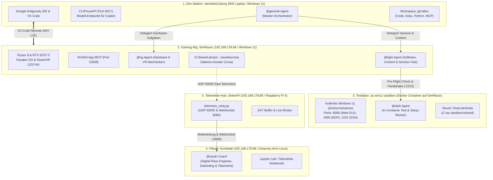
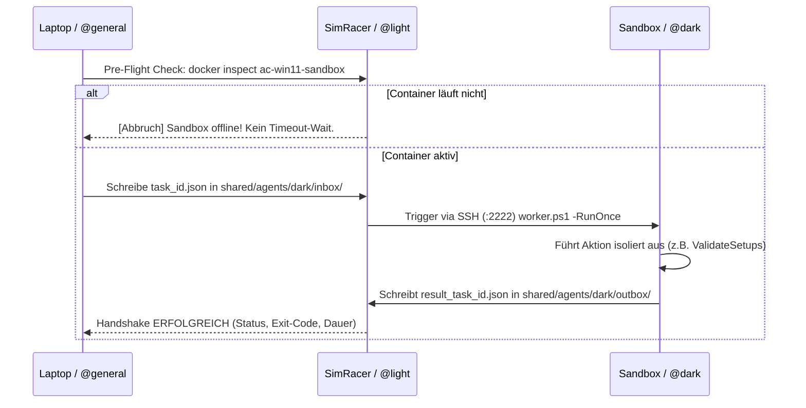
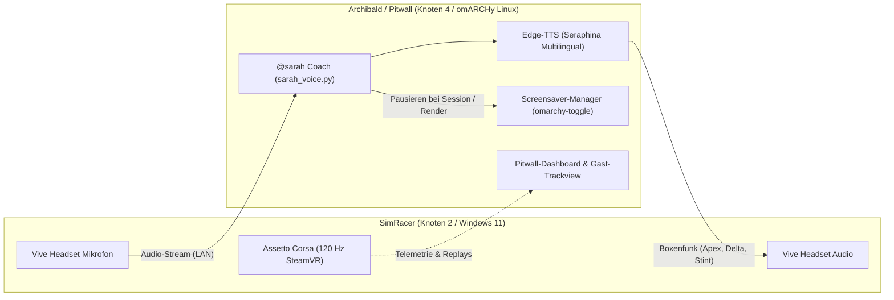

> **Thema:** Multi-Workspace & Multi-PC-Verbund: Standorte, MCP-Server, Ports & Agenten-Rollen
> **Autor:** Michael Stürmer
> **Datum:** 09.11.2026

<details>
<summary><b>Lernziele</b></summary>

* Die **verteilte Multi-PC- & Multi-Workspace-Architektur** zwischen dem Entwicklungs-Laptop (`VanstrikeCyborg`), der SimRacing-Workstation (`SimRacer`), der Windows-11-Sandbox (`ac-win11-sandbox`) und dem Pitwall-Node (`Archibald` / Omarchy Linux) im Detail verstehen.
* Die zentrale Konfigurationsdatei **`git-labor.code-workspace`** und deren 4 Repositories/Ordner (`Git-Labor`, `Local-Cyborg`, `AC-CM-CSP-Sandbox`, `Assetto-Corsa-Content`) sicher administrieren.
* Die **Netzwerk- und Port-Matrix** aller beteiligten Dienste beherrschen (Port `8317` CLIProxyAPI, Port `8000` Antigravity, Port `13508` NVIDIA App MCP, Port `8006` VNC/Kasm, Port `22` Host-SSH, Port `2222` Sandbox-SSH).
* Das **5-Rollen-Modell der KI-Agenten** (`@general`, `@rig`, `@light`, `@dark`, `@sarah`) mit der exakten Aufgabenteilung (Hardware-Hub vs. Software-/Session-Hub vs. In-Container-Worker) souverän orchestrieren.
* Den **Handshake- & Task-Queue-Mechanismus** (`inbox/` $\rightarrow$ Pre-Flight-Check $\rightarrow$ Execution $\rightarrow$ `outbox/`) über PowerShell und Python im laufenden Betrieb fehlerfrei einsetzen.

</details>

<details>
<summary><b>Kernkonzepte</b></summary>

<details>
<summary>1.1 Die 4-Knoten-Topologie: Standorte, Hardware & Rollen</summary>

Um maximale Rechenleistung für Simulation und KI bereitzustellen und den Entwicklungsrechner frei von riesigen Mod- und Spieldaten zu halten, ist das Gesamtsystem auf vier physische bzw. virtuelle Knoten verteilt:



| Knoten | Hostname / IP | Betriebssystem | Primäre Aufgabe | Verwendete Tools & Ports |
| :--- | :--- | :--- | :--- | :--- |
| **Knoten 1** | `VanstrikeCyborg`<br/>`192.168.178.172` | Windows 11 Home | Master-Planung, Code-Entwicklung, Doku, KI-Modell-Steuerung | Antigravity IDE, `CLIProxyAPI` (:8317), `geminiDocs` MCP |
| **Knoten 2** | `SimRacer`<br/>`192.168.178.68` | Windows 11 Pro | Simulation, Content Manager, CSP-Shader, High-FPS VR | RTX 5070 Ti, NVIDIA MCP (:13508), OpenSSH (:22), Docker Desktop |
| **Knoten 3** | `ac-win11-sandbox`<br/>*(SimRacer Container)* | Windows 11 Ent. | Isoliertes Testlabor für fremde Mods, Setup-Validierung, CM-Tests | KasmVNC (:8006), RDP (:3390), Gast-SSH (:2222) |
| **Knoten 4** | `Archibald`<br/>`192.168.178.98` | Omarchy Linux | Telemetrie-Auswertung, Fahrstilanalyse, automatisierter Videoschnitt | Python 3.14, FFmpeg, Jupyter Lab, SSH (:22), CLIProxyAPI (:8317) |
| **Knoten 5** | `StrikerPi`<br/>`192.168.178.86` | Arch Linux ARM | 24/7 Telemetrie-Relay, UDP-Forwarding & WebSocket-Broadcast | Python 3.14 (`uv`), FastAPI/Uvicorn (:8080), UDP (:50005) |

</details>

<details>
<summary>1.2 Die Multi-Root Workspace-Architektur (<code>git-labor.code-workspace</code>)</summary>

In VS Code und Antigravity werden alle Projekte über die zentrale Workspace-Datei `c:\Users\strik\git-labor\git-labor.code-workspace` in einem einzigen Fenster gebündelt:

```json
{
  "folders": [
    {
      "name": "1_Git-Labor (mestuermer-svg/first)",
      "path": "."
    },
    {
      "name": "2_Local-Cyborg (mestuermer-svg/local_Cyborg)",
      "path": "../../../local_Cyborg"
    },
    {
      "name": "3_AC-CM-CSP-Sandbox (mestuermer-svg/ac-cm-csp-sandbox)",
      "path": "../ac-cm-csp-sandbox"
    },
    {
      "name": "4_Assetto-Corsa-Content (mestuermer-svg/assetto-corsa-content)",
      "path": "../assetto-corsa-content"
    }
  ],
  "mcp": {
    "servers": {
      "geminiDocs": {
        "type": "http",
        "url": "https://gemini-api-docs-mcp.dev"
      }
    }
  },
  "settings": {
    "python.defaultInterpreterPath": "C:\\Users\\strik\\AppData\\Roaming\\uv\\python\\cpython-3.12-windows-x86_64-none\\python.exe",
    "docker.context": "simracer",
    "chat.tools.terminal.autoApprove": {
      "/^ssh -o BatchMode=yes -o ConnectTimeout=5 Mike@192\\.168\\.178\\.68 \".*\"$/": {
        "approve": true,
        "matchCommandLine": true
      }
    }
  }
}
```

> [!TIP]
> **Vorteil des Multi-Root-Ansatzes:**
> - Du bearbeitest Python-Skripte in `git-labor`, steuerst Sandbox-Compose-Dateien in `ac-cm-csp-sandbox` und pflegst Mod-Strukturen in `assetto-corsa-content` – alles in **einem** Editor ohne Fensterwechsel.
> - Agenten und MCP-Tools sehen den gesamten Projektkontext über Repository-Grenzen hinweg.

</details>

<details>
<summary>1.3 SimRacer-Gegenstück: Der Host-Workspace (<code>simracer.code-workspace</code>) &amp; Antigravity-Scharfschaltung</summary>

Um auch direkt auf der SimRacing-Workstation (`SimRacer` / `192.168.178.68`) unabhängig vom Laptop mit voller KI-Unterstützung arbeiten zu können, wird dort die Workspace-Datei **`D:\ac-sandbox\simracer.code-workspace`** betrieben.

#### 1. Verzeichnis-Bündelung auf dem SimRacer (4 Ordner)
```json
{
  "folders": [
    { "name": "AC Sandbox & Docker Host", "path": "." },
    { "name": "Native Assetto Corsa (Steam)", "path": "D:/SteamLibrary/steamapps/common/assettocorsa" },
    { "name": "Assetto Corsa User Documents", "path": "C:/Users/Mike/Documents/Assetto Corsa" },
    { "name": "Git-Labor (mestuermer-svg/first)", "path": "D:/git-labor" }
  ]
}
```
* Das zentrale Entwicklungsarchiv `mestuermer-svg/first` ist unter **`D:\git-labor`** geklont. Änderungen an Doku, Skripten oder Prompts werden über GitHub synchronisiert (`git push` am Laptop $\leftrightarrow$ `git pull` am SimRacer).

#### 2. Antigravity-Scharfschaltung in VS Code auf dem SimRacer
Damit die Erweiterung `google.google-antigravity` (v1.11.0) auf dem SimRacer reibungslos arbeitet, sind zwei Einstellungen in `%APPDATA%\Code\User\settings.json` zwingend:
1. **Sandbox-Modus deaktivieren (`"chat.agent.sandbox.enabled": "off"`):**  
   Im Windows-Standard blockiert die VS-Code-Sandbox Zugriffe auf Terminal-Tools und Skripte. Mit `"off"` arbeiten die Agenten direkt auf den Host-Dateien.
2. **Dynamischer Server-Port (`"antigravity.serverPort": 0`):**  
   Port `0` signalisiert der Extension, beim Start von `C:\Users\Mike\.gemini\bin\agy.exe` automatisch einen freien ephemeren Port zu wählen, wodurch Port-Kollisionen (z. B. mit Port 8317 oder 8000) ausgeschlossen werden.
3. **Erstanmeldung:** Einmalig über `Strg + Shift + P` $\rightarrow$ `Antigravity: Sign in` den Google-Account bestätigen.

#### 3. Dateizugriffsrechte (Windows NTFS-ACLs)
Falls Agenten im Sandbox-Modus laufen, benötigen die betroffenen Verzeichnisse rekursive Schreibrechte für die lokale Gruppe `CodexSandboxUsers`:
```powershell
# Auf dem Host ausführen:
icacls "C:\Users\strik\assetto-corsa-content" /grant "CodexSandboxUsers:(OI)(CI)M" /T
icacls "C:\Users\strik\ac-cm-csp-sandbox" /grant "CodexSandboxUsers:(OI)(CI)M" /T
```

</details>

<details>
<summary>1.4 Die Port- und Netzwerk-Architektur im Überblick</summary>

Zur reibungslosen Kommunikation ohne Portkonflikte gilt folgende feste Portbelegung:

| Port | Protokoll | Host | Dienst / Komponente | Funktion |
| :--- | :--- | :--- | :--- | :--- |
| **`8317`** | HTTP / REST | `127.0.0.1` (Laptop) | `CLIProxyAPI` (`cli-proxy-api.exe`) | Lokaler OpenAI-kompatibler Endpunkt (`/v1/chat/completions`) für Copilot |
| **`8000`** | HTTP / HTML | `127.0.0.1` (Laptop) | Google Antigravity Web-UI (`agy.exe`) | Grafische Web-Oberfläche für Agenten-Status & Sessions |
| **`13508`** | HTTP / MCP | `127.0.0.1` (SimRacer) | NVIDIA App MCP (`NvAppMcpServer.exe`) | GPU-Telemetrie (Temperatur, VRAM, Auslastung) für den Rig-Agenten |
| **`8006`** | HTTPS / Web | `192.168.178.68` | KasmVNC Web-Display | Browser-Zugriff auf die Windows-11-Sandbox-Oberfläche |
| **`3390`** | RDP | `192.168.178.68` | Windows Remote Desktop | Direkte RDP-Verbindung in den virtuellen Windows-11-Gast |
| **`22`** | SSH | `192.168.178.68` | Windows OpenSSH Server (Host) | Nativer Shell-Zugriff auf den SimRacer (`Mike@192.168.178.68`) |
| **`2222`** | SSH | `192.168.178.68` | Gast OpenSSH Server (Sandbox) | Shell-Zugriff für den Dark Agent (`Docker@192.168.178.68`) |
| **`50005`** | UDP | `192.168.178.86` | StrikerPi Telemetrie-Relay | Empfang der Roh-Telemetrie von Assetto Corsa & Weiterleitung |
| **`8080`** | HTTP / WS | `192.168.178.86` | StrikerPi WebSocket & REST API | Live-Stream für Pitwall-Dashboards, Gast-Anzeigen & Apps |
| **`22`** | SSH | `192.168.178.86` | Arch Linux ARM SSH | Administrationszugriff (`root@192.168.178.86`) |

</details>

<details>
<summary>1.5 Das Agenten-Rollenmodell: Hardware-Standorte, <code>General Cyborg</code> &amp; <code>General Sim</code></summary>

Um Missverständnisse und Kompetenzüberschneidungen zu vermeiden, ist jeder Agent sowohl einer festen **Domäne** als auch einem klaren **Hardware-Knoten** zugewiesen:

```
[Nutzer am Laptop VanstrikeCyborg (Core 7 240H / RTX 5060 / 16 GB DDR5)]
   ├──> [General Cyborg]  (Global: Laptop-Hardware, MSI/VIVE-VR, NVIDIA-MCP, VS Code & Workspaces)
   └──> [General Sim]     (Workspace-Leitstand & @general-Terminal → steuert SimRacer per LAN)
           ├──> [@rig]    (Nativ auf SimRacer 192.168.178.68: Ryzen 9, RTX 5070 Ti, SteamVR, Fanatec)
           ├──> [@light]  (Nativ auf SimRacer 192.168.178.68: Docker Desktop, Content, race.ini)
           │        └──> [@dark]   (Docker-Gast ac-win11-sandbox auf SimRacer: Isolierte Tests)
           └──> [@sarah]  (Nativ auf IdeaPad 5 omARCHy: Telemetrie-Coaching & Videoschnitt)
```

1. **`General Cyborg` & `General Sim` (Ebene 1 – laufen physisch auf Laptop `VanstrikeCyborg`):**
   - Beide nutzen ausschließlich die **Hardware-Ressourcen von `VanstrikeCyborg`**, unterscheiden sich aber in ihrer Aufgabe:
     - **`General Cyborg`** (`C:\Users\strik\.copilot\agents\general.agent.md`): Globaler Experte für das lokale Laptop-System (`MSI Cyborg 15 B2RWFKG`), Treiber/BIOS/MSI Center, VIVE VR, lokalen NVIDIA App MCP (`127.0.0.1:13508`), VS Code Profile & Workspaces.
     - **`General Sim`** (`git-labor\.github\agents\general.agent.md`): Leitstand für den **SimRacer (`192.168.178.68`)**, pflegt die Verbund-Doku, erteilt Aufträge per SSH/SMB und betreibt das Freigabe-Gate (`ok`/`nein`/`reply`).
2. **`@rig` (Ebene 2 – läuft nativ auf der SimRacer-Hardware `192.168.178.68`):**
   - Überwacht RTX 5070 Ti (Taktraten, VRAM, Temperaturen via Port `13508` auf dem SimRacer).
   - Zuständig für SteamVR (120 Hz Frametimes), Fanatec Direct-Drive Force Feedback und Peripherie.
3. **`@light` (Ebene 2 – läuft nativ auf der SimRacer-Hardware `192.168.178.68`):**
   - **Auf dem Host:** Steuert die native `race.ini` (Fahrzeug- & Streckenauswahl), schaltet Content-Manager- & CSP-Presets um, verwaltet Backups (`backup-simracer-configs.ps1`) und Staging.
   - **An der Sandbox:** Startet/stoppt Docker Desktop und `ac-win11-sandbox` und delegiert Prüfaufträge an `@dark`.
4. **`@dark` (Ebene 3 – läuft in der Docker-VM `ac-win11-sandbox` auf der SimRacer-Hardware):**
   - Läuft gekapselt im Windows-11-Container mit den von Docker zugeteilten Ressourcen des SimRacers.
   - Validiert fremde Mods, testet `.ini`-Setups auf Syntaxfehler und prüft Python-Apps im isolierten Umfeld, ohne den Host zu gefährden.
5. **`@sarah` (Pitwall – läuft nativ auf IdeaPad 5 / `Archibald` `192.168.178.98`):**
   - Liest Telemetriedaten (`acs.exe` Shared Memory via `ac_telemetry_sender.py`).
   - Berechnet optimale Boxenstopp-Strategien (`Sarah_Opt_Stint.ini`) und steuert den automatisierten FFmpeg-Videoschnitt (`sarah_replay_cutter.py`).

</details>

<details>
<summary>1.6 Das Handshake-Prinzip mit Pre-Flight-Check</summary>

Die Kommunikation zwischen dem Laptop (`git-labor`), dem Host (`@light`/`@rig`) und der Sandbox (`@dark`) erfolgt über eine dateibasierte Queue mit synchroner Handshake-Garantie:



#### Wichtige Skripte für den Handshake:
- **Vom Laptop senden:** `.\labs\Send-SimAgentTask.ps1 -TargetAgent dark -Action ValidateSetups -Wait`
- **Status aller Inboxen prüfen:** `.\labs\Send-SimAgentTask.ps1 -QueryStatus`
- **Host-intern an Dark übergeben:** `.\ac-sandbox\Send-DarkAgentTask.ps1 -Action ValidateSetups`

</details>

<details>
<summary>1.7 Knoten 4 (Archibald / Omarchy Linux): Sarah Coach, Voice-Engine, Display &amp; Headset</summary>

Um den SimRacer während anspruchsvoller Rennsessions mit 120-Hz-SteamVR maximal zu entlasten (100% CPU/GPU für Assetto Corsa Simulation und Physik), übernimmt der autarke Pitwall-Knoten **Archibald** (`192.168.178.98`, omARCHy Linux / Hyprland) alle Sekundäraufgaben für `@sarah`.



#### 1. Die Dual-Modus-Architektur: VR-Fahrer vs. Pitwall-Gäste
Da der Fahrer im Renncockpit eine geschlossene VR-Brille trägt, kann er das physische Notebook-Display während des Fahrens nicht sehen. Daher teilt sich die Schnittstelle in zwei spezialisierte Kanäle:
- **Kanal A: Fahrer-Boxenfunk (Audio / Voice):**
  - **Inbound (Mikrofon):** Spracheingabe über das HTC Vive / VR-Headset-Mikrofon am SimRacer, gestreamt an Sarahs Audio-Listener an der Pitwall.
  - **Outbound (Sarahs Stimme):** Live-Feedback direkt auf die Kopfhörer des Fahrers (Sektor-Deltas, Reifentemperaturen, Boxenstopp-Aufrufe, Apex-Pace).
- **Kanal B: Pitwall-Dashboard &amp; Gast-Trackview (Display):**
  - Für Zuschauer, Gäste und Ingenieure an der Pitwall zeigt das IdeaPad-Display eine interaktive Streckenübersicht mit Fahrzeug-Beacon, Telemetrie-Widgets (Delta, Reifenhitze FL/FR/RL/RR, Tankverbrauch) und einer ressourcenschonenden Streckenkamera-Ansicht (Spectator-Stream).

#### 2. High-Quality Multilingual Voice-Engine (`edge-tts`)
- **Modell:** `de-DE-SeraphinaMultilingualNeural` (integriert in `sarah_voice.py`).
- **Phonetische Optimierung:** Mehrsprachige Aussprache für fehlerfreie Artikulation englischer SimRacing- und Ingenieurbegriffe (*Apex*, *Delta*, *Trail-Braking*, *Stint*, *Box-Box*, *Pit-Limiter*, *Throttle-Trace*).
- **Audio-Backend:** PipeWire / WirePlumber (`wpctl`, Sink: Speaker/Headphones, Source: Digital Mic).

#### 3. Intelligente Screensaver- &amp; Standby-Steuerung
- **Screensaver (omARCHy / ttfx):** Im Ruhezustand läuft der Terminal-ASCII-Bildschirmschoner.
- **Renneinsatz / Render-Betrieb:** Sobald eine Session oder ein FFmpeg-Replay-Schnitt gestartet wird, pausiert Sarah den Schoner automatisch via `omarchy-toggle screensaver-off on` und `pkill -f org.omarchy.screensaver`. Im Leerlauf wird er wieder scharfgeschaltet (`screensaver-off off`).
- **Wake-on-WLAN:** Die Schnittstelle `wlp0s20f3` (`14:18:c3:b4:3e:85`) wacht per UDP Magic Packet auf Port 9 aus dem Standby auf.

</details>

</details>

<details>
<summary><b>Übungsaufgaben</b></summary>

1. **Workspace-Prüfung:** Öffne die Datei `git-labor.code-workspace` in VS Code. Verifiziere, dass alle vier Verzeichnisse sauber im Datei-Explorer angezeigt werden.
2. **Knoten-Konnektivität testen:** Führe in der PowerShell auf dem Laptop folgenden Befehl aus, um die Erreichbarkeit des SimRacers zu prüfen:
   ```powershell
   ssh -o BatchMode=yes -o ConnectTimeout=3 Mike@192.168.178.68 "echo SimRacer Host Online"
   ```
3. **Queue-Status abfragen:** Starte die Statusabfrage für alle Agenten-Terminals:
   ```powershell
   .\labs\Send-SimAgentTask.ps1 -QueryStatus
   ```
4. **Pre-Flight-Verhalten beobachten:** Führe `.\ac-sandbox\Send-DarkAgentTask.ps1` aus, wenn die Sandbox gestoppt ist, und überprüfe, ob das Skript sofort mit dem Pre-Flight-Hinweis abbricht, anstatt in ein 30-Sekunden-Timeout zu laufen.

</details>

<details>
<summary><b>Weiterführende Links & Quellen</b></summary>

* [02 – Git, GitHub & Multi-Root Workspaces](./02_git-github-und-multi-root-workspaces.md)
* [03 – MCP-Server, Localhost-Proxy & Port-Diagnose](./03_mcp-server-localhost-proxy-und-ports.md)
* [05 – Workspace-Schnittstelle SimRacer & Agenten-Terminals](../05_Agents/05_workspace-schnittstelle-simracer-und-agenten-terminals.md)
* [VS Code Multi-Root Workspaces Dokumentation](https://code.visualstudio.com/docs/editor/multi-root-workspaces)
* [Official Google Antigravity Documentation](https://antigravity.google)

</details>

<details>
<summary><b>Chips & Kernaussagen</b></summary>

* `Multi-Root Workspace`: Bündelt `git-labor`, `local_Cyborg`, `ac-cm-csp-sandbox` und `assetto-corsa-content` in einer zentralen VS-Code-Instanz.
* `Standort-Trennung`: Laptop (`VanstrikeCyborg`) für Code & Steuerung; SimRacer (`192.168.178.68`) für Simulation, GPU & Docker; Archibald (`192.168.178.98`) für Pitwall & Linux-Telemetrie.
* `Port 8317 vs. 8000`: Port `8317` ist der JSON-Endpunkt der `CLIProxyAPI`; Port `8000` ist die HTML-Weboberfläche von Antigravity.
* `Aufgabenteilung @rig vs. @light`: `@rig` steuert ausschließlich physische Hardware, GPU und VR; `@light` steuert Content Manager, native Sessions (`race.ini`), Presets und Docker von außen.
* `Pre-Flight Check`: Verhindert hängende Skripte, indem vor jedem Dark-Agent-Task geprüft wird, ob `ac-win11-sandbox` läuft.
* `Sarah Voice & Pitwall`: `de-DE-SeraphinaMultilingualNeural` spricht englische Fachbegriffe (*Apex*, *Delta*, *Stint*, *Trail-Braking*) akzentfrei aus; der omARCHy-Bildschirmschoner wird bei aktiver Session/Render automatisch pausiert.
* `StrikerPi als Telemetrie-Relay`: 24/7 Raspberry Pi 4 (`192.168.178.86`) puffert AC-Rohdaten auf UDP Port `50005` und liefert echtzeitfähige WebSocket- & REST-Streams auf Port `8080` für Pitwall-Dashboards und Apps.

</details>

---
*Hinweis zur Organisation:* Die erstellte Dokumentation ist am Drehlaufwerk abgelegt und mit einer kurzen Zusammenfassung von den Chips auch in den Notebooks verlinkt.

<!-- DOKU-MINIMAP-START -->
<style>
.doku-arch-flow { font-family: var(--vscode-editor-font-family, Consolas, monospace); background: rgba(20, 24, 33, 0.92); border: 1px solid rgba(100, 140, 220, 0.35); border-radius: 10px; padding: 14px 16px; margin: 10px 0; color: #e2e8f0; }
.doku-arch-root { text-align: center; font-weight: 700; font-size: 1.04em; padding: 8px 12px; margin-bottom: 12px; background: linear-gradient(135deg, rgba(37, 99, 235, 0.28), rgba(15, 23, 42, 0.9)); border: 1px solid rgba(96, 165, 250, 0.5); border-radius: 8px; }
.doku-arch-root a { color: #93c5fd !important; text-decoration: none !important; }
.doku-arch-root a:hover { text-decoration: underline !important; }
.doku-arch-grid { display: grid; grid-template-columns: repeat(auto-fit, minmax(275px, 1fr)); gap: 10px; }
.doku-arch-card { background: rgba(30, 41, 59, 0.78); border: 1px solid rgba(148, 163, 184, 0.28); border-left: 4px solid #3b82f6; border-radius: 8px; padding: 9px 11px; transition: transform 0.12s ease, border-color 0.12s ease; }
.doku-arch-card:hover { border-color: #60a5fa; transform: translateY(-1px); }
.doku-arch-card.r1 { border-left-color: #22c55e; }
.doku-arch-card.r2 { border-left-color: #3b82f6; }
.doku-arch-card.r3 { border-left-color: #eab308; }
.doku-arch-card.r4 { border-left-color: #ec4899; }
.doku-arch-card.r5 { border-left-color: #a855f7; }
.doku-arch-card-title { font-weight: 700; font-size: 0.95em; margin-bottom: 6px; padding-bottom: 4px; border-bottom: 1px dashed rgba(148, 163, 184, 0.25); }
.doku-arch-card-title a { color: #f8fafc !important; text-decoration: none !important; display: block; }
.doku-arch-card-title a:hover { color: #60a5fa !important; }
.doku-arch-lines { list-style: none; margin: 0; padding: 0; font-size: 0.85em; line-height: 1.5; }
.doku-arch-lines li { margin: 3px 0; padding: 2px 5px; border-radius: 4px; white-space: normal; }
.doku-arch-lines li:hover { background: rgba(59, 130, 246, 0.18); }
.doku-arch-lines a { color: #cbd5e1 !important; text-decoration: none !important; display: inline; }
.doku-arch-lines a:hover { color: #93c5fd !important; text-decoration: underline !important; }
.doku-arch-badge { display: inline-block; font-size: 0.75em; padding: 0 5px; margin-left: 4px; border-radius: 4px; background: rgba(59, 130, 246, 0.22); color: #93c5fd !important; border: 1px solid rgba(96, 165, 250, 0.35); }
details.doku-minimap { position: fixed; bottom: 18px; right: 18px; z-index: 9999; width: 250px; max-height: 76px; overflow: hidden; background: rgba(15, 23, 42, 0.94); border: 1px solid rgba(96, 165, 250, 0.65); border-radius: 10px; box-shadow: 0 8px 26px rgba(0, 0, 0, 0.65); backdrop-filter: blur(8px); transition: width 0.18s ease, max-height 0.18s ease; font-family: var(--vscode-font-family, sans-serif); }
details.doku-minimap:hover { border-color: #60a5fa; }
details.doku-minimap[open] { width: min(860px, 94vw); max-height: 84vh; overflow-y: auto; padding-bottom: 10px; }
details.doku-minimap > summary { cursor: pointer; list-style: none; padding: 8px 12px; font-weight: 700; font-size: 0.84em; color: #f8fafc; background: linear-gradient(90deg, rgba(37, 99, 235, 0.45), rgba(30, 41, 59, 0.9)); border-bottom: 1px solid rgba(148, 163, 184, 0.25); display: flex; align-items: center; justify-content: space-between; user-select: none; }
</style>

<details class="doku-minimap">
<summary><span>🗺️ Doku-Minimap (Rubrik 02: VS Code Env)</span></summary>
<div class="doku-arch-flow">
<div class="doku-arch-root">🏛️ <a href="../README.md">Doku-Index</a> | <a href="../../README.md">Repo-README</a> | <a href="../../AGENTS.md">AGENTS.md</a></div>
<div class="doku-arch-grid">
<div class="doku-arch-card r2">
<div class="doku-arch-card-title">🧩 <a href="README.md">02_VSCode_Env</a></div>
<ul class="doku-arch-lines">
<li>├─ <a href="01_vscode-architektur-lsp-und-remote.md">01 • VS Code Architektur & LSP</a></li>
<li>├─ <a href="02_git-github-und-multi-root-workspaces.md">02 • Git, GitHub Workflow & Workspaces</a></li>
<li>├─ <a href="03_mcp-server-localhost-proxy-und-ports.md">03 • MCP-Server, Ports (8317) & Localhost</a></li>
<li>├─ <a href="04_gemini-oekosystem-ai-studio-und-api-keys.md">04 • Gemini Ökosystem & AI Studio</a></li>
<li>└─ <a href="05_multi-workspace-netzwerk-mcp-und-agenten-verbund.md">05 • Multi-Workspace, Standorte & Verbund</a></li>
</ul>
</div>
</div>
</div>
</details>
<!-- DOKU-MINIMAP-END -->
