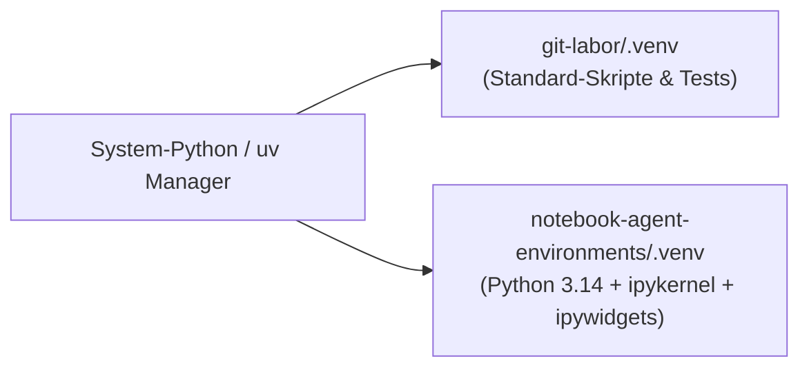

> **Thema:** Moderne Python-Umgebungen mit `uv`, `.venv`, `pyproject.toml` und Jupyter Notebooks
> **Autor:** Michael Stürmer
> **Datum:** 07.11.2026

<details>
<summary><b>Lernziele</b></summary>

* Verstehen, warum man Python-Pakete **niemals global** mit `pip install` in das Betriebssystem installiert, sondern isolierte **virtuelle Umgebungen (`.venv`)** verwendet.
* Den modernen Paket- und Projektmanager **`uv`** (`pyproject.toml`, `uv.lock`) sowie die im Workspace bereitgestellte Umgebung `notebook-agent-environments` sicher bedienen.
* Interaktive **Jupyter Notebooks (`.ipynb`)** in VS Code mit dem richtigen Kernel verknüpfen und ausführen.

</details>

<details>
<summary><b>Kernkonzepte</b></summary>

<details>
<summary>1.1 Warum virtuelle Umgebungen (<code>.venv</code>) Pflicht sind</summary>

Wenn unterschiedliche Projekte verschiedene Versionen einer Bibliothek benötigen (z. B. `pydantic` oder `google-genai`), führt eine globale Installation schnell zu Versionskonflikten. Eine **`.venv` (Virtual Environment)** kapselt daher den Python-Interpreter und alle installierten Pakete sauber direkt im jeweiligen Projektordner:



In unserem Workspace existieren bereits zwei vorkonfigurierte Umgebungen:
1. **`C:\Users\strik\git-labor\.venv`** (Haupt-Workspace-Umgebung)
2. **`C:\Users\strik\git-labor\notebook-agent-environments\.venv`** (Spezialisierte Python-3.14-Umgebung für Notebooks)

</details>

<details>
<summary>1.2 Arbeiten mit <code>uv</code> (Der moderne Standard statt <code>pip</code>)</summary>

**`uv`** ist ein in Rust geschriebener, extrem schneller Python-Paket- und Umgebungsmanager, der `pip`, `venv` und `pip-tools` in einem einzigen Werkzeug vereint:

| Aufgabe | Befehl mit `uv` | Was passiert im Hintergrund? |
| :--- | :--- | :--- |
| **Neues Projekt anlegen** | `uv init mein-projekt` | Erstellt `pyproject.toml`, `.python-version` und Beispielcode. |
| **Paket hinzufügen** | `uv add google-genai pydantic` | Installiert das Paket in `.venv` und trägt es sauber in `pyproject.toml` & `uv.lock` ein. |
| **Entwickler-Tool hinzufügen** | `uv add --dev pytest ruff` | Fügt Test- und Linting-Werkzeuge als Dev-Abhängigkeit hinzu. |
| **Skript ausführen** | `uv run python main.py` | Startet das Skript garantiert in der projektspezifischen `.venv`. |
| **Umgebung synchronisieren** | `uv sync` | Stellt exakt die in `uv.lock` gespeicherten Paketversionen wieder her. |

</details>

<details>
<summary>1.3 Aktivierung der <code>.venv</code> in der Windows PowerShell</summary>

Wenn du im VS Code Terminal direkt mit `python` arbeiten möchtest, aktivierst du die virtuelle Umgebung mit:

```powershell
# Falls die PowerShell ExecutionPolicy blockiert (nur für den aktuellen Prozess freigeben):
Set-ExecutionPolicy -Scope Process -ExecutionPolicy RemoteSigned

# Virtuelle Umgebung aktivieren:
& "C:\Users\strik\git-labor\.venv\Scripts\Activate.ps1"

# Prüfen, welcher Python-Interpreter aktiv ist:
(Get-Command python).Source
```

</details>

<details>
<summary>1.4 Jupyter Notebooks in <code>notebook-agent-environments</code> nutzen</summary>

Jupyter Notebooks (`.ipynb`) kombinieren formatierten **Markdown-Erklärtext** (inklusive KaTeX-Mathematik und Tabellen) mit ausführbaren **Python-Code-Zellen**:

```powershell
# Kernel einmalig für VS Code / Jupyter registrieren:
Set-Location "C:\Users\strik\git-labor\notebook-agent-environments"
uv run python -m ipykernel install --user --name notebook-agent-env --display-name "Python (Notebook Agent Env)"
```

**Best Practices für Notebooks in VS Code:**
1. Öffne `notebook-agent-environments/agent_demo.ipynb`.
2. Wähle oben rechts im Notebook-Editor über **Select Kernel** die Umgebung `Python (Notebook Agent Env)` bzw. `.venv`.
3. Führe Code-Zellen schrittweise von oben nach unten aus (`Shift + Enter`), damit Variablen und Imports im Kernel-Speicher aufgebaut werden.

</details>

</details>

<details>
<summary><b>Übungsaufgaben</b></summary>

1. **Abhängigkeiten sauber verwalten:** Warum solltest du in einem Projekt mit `pyproject.toml` den Befehl `uv add requests` statt `pip install requests` verwenden?
2. **Interpreter-Prüfung:** Woran erkennst du im VS Code Terminal und in der unteren Statusleiste, ob aktuell die globale Windows-Python-Installation oder die `.venv` aus `git-labor` aktiv ist?
3. **Notebook-Zellen:** Erkläre den Unterschied zwischen einer *Markdown-Zelle* und einer *Code-Zelle* in einem `.ipynb`-Notebook und warum Markdown-Zellen nicht vom Python-Kernel ausgeführt werden.

</details>

<details>
<summary><b>Weiterführende Links & Quellen</b></summary>

* [uv Dokumentation (Astral)](https://docs.astral.sh/uv/)
* [VS Code Python Environments Guide](https://code.visualstudio.com/docs/python/environments)
* [Jupyter Notebooks in VS Code](https://code.visualstudio.com/docs/datascience/jupyter-notebooks)

</details>

<details>
<summary><b>Chips & Kernaussagen</b></summary>

* **Niemals global `pip install` ausführen:** Jedes Python-Projekt nutzt seine eigene isolierte `.venv`.
* **`uv` + `pyproject.toml` + `uv.lock`:** Garantieren extrem schnelle Installationen und 100 % reproduzierbare Paketversionen.
* **`uv run` erspart manuelles Aktivieren:** Führt Befehle automatisch im richtigen virtuellen Environment aus.
* **`notebook-agent-environments/`:** Dein fertiges Python-3.14-Labor für interaktive Daten- und KI-Experimente in VS Code.

</details>

---
*Hinweis zur Organisation:* Die erstellte Dokumentation ist am Drehlaufwerk abgelegt und mit einer kurzen Zusammenfassung von den Chips auch in den Notebooks verlinkt.

<!-- DOKU-MINIMAP-START -->
<style>
.doku-arch-flow { font-family: var(--vscode-editor-font-family, Consolas, monospace); background: rgba(20, 24, 33, 0.92); border: 1px solid rgba(100, 140, 220, 0.35); border-radius: 10px; padding: 14px 16px; margin: 10px 0; color: #e2e8f0; }
.doku-arch-root { text-align: center; font-weight: 700; font-size: 1.04em; padding: 8px 12px; margin-bottom: 12px; background: linear-gradient(135deg, rgba(37, 99, 235, 0.28), rgba(15, 23, 42, 0.9)); border: 1px solid rgba(96, 165, 250, 0.5); border-radius: 8px; }
.doku-arch-root a { color: #93c5fd !important; text-decoration: none !important; }
.doku-arch-root a:hover { text-decoration: underline !important; }
.doku-arch-grid { display: grid; grid-template-columns: repeat(auto-fit, minmax(275px, 1fr)); gap: 10px; }
.doku-arch-card { background: rgba(30, 41, 59, 0.78); border: 1px solid rgba(148, 163, 184, 0.28); border-left: 4px solid #3b82f6; border-radius: 8px; padding: 9px 11px; transition: transform 0.12s ease, border-color 0.12s ease; }
.doku-arch-card:hover { border-color: #60a5fa; transform: translateY(-1px); }
.doku-arch-card.r1 { border-left-color: #22c55e; }
.doku-arch-card.r2 { border-left-color: #3b82f6; }
.doku-arch-card.r3 { border-left-color: #eab308; }
.doku-arch-card.r4 { border-left-color: #ec4899; }
.doku-arch-card.r5 { border-left-color: #a855f7; }
.doku-arch-card-title { font-weight: 700; font-size: 0.95em; margin-bottom: 6px; padding-bottom: 4px; border-bottom: 1px dashed rgba(148, 163, 184, 0.25); }
.doku-arch-card-title a { color: #f8fafc !important; text-decoration: none !important; display: block; }
.doku-arch-card-title a:hover { color: #60a5fa !important; }
.doku-arch-lines { list-style: none; margin: 0; padding: 0; font-size: 0.85em; line-height: 1.5; }
.doku-arch-lines li { margin: 3px 0; padding: 2px 5px; border-radius: 4px; white-space: normal; }
.doku-arch-lines li:hover { background: rgba(59, 130, 246, 0.18); }
.doku-arch-lines a { color: #cbd5e1 !important; text-decoration: none !important; display: inline; }
.doku-arch-lines a:hover { color: #93c5fd !important; text-decoration: underline !important; }
.doku-arch-badge { display: inline-block; font-size: 0.75em; padding: 0 5px; margin-left: 4px; border-radius: 4px; background: rgba(59, 130, 246, 0.22); color: #93c5fd !important; border: 1px solid rgba(96, 165, 250, 0.35); }
details.doku-minimap { position: fixed; bottom: 18px; right: 18px; z-index: 9999; width: 250px; max-height: 76px; overflow: hidden; background: rgba(15, 23, 42, 0.94); border: 1px solid rgba(96, 165, 250, 0.65); border-radius: 10px; box-shadow: 0 8px 26px rgba(0, 0, 0, 0.65); backdrop-filter: blur(8px); transition: width 0.18s ease, max-height 0.18s ease; font-family: var(--vscode-font-family, sans-serif); }
details.doku-minimap:hover { border-color: #60a5fa; }
details.doku-minimap[open] { width: min(860px, 94vw); max-height: 84vh; overflow-y: auto; padding-bottom: 10px; }
details.doku-minimap > summary { cursor: pointer; list-style: none; padding: 8px 12px; font-weight: 700; font-size: 0.84em; color: #f8fafc; background: linear-gradient(90deg, rgba(37, 99, 235, 0.45), rgba(30, 41, 59, 0.9)); border-bottom: 1px solid rgba(148, 163, 184, 0.25); display: flex; align-items: center; justify-content: space-between; user-select: none; }
details.doku-minimap > summary::-webkit-details-marker { display: none; }
details.doku-minimap .minimap-preview-strip { display: flex; gap: 4px; padding: 5px 10px 7px 10px; font-size: 0.72em; color: #94a3b8; justify-content: space-between; }
details.doku-minimap[open] .minimap-preview-strip { display: none; }
details.doku-minimap .minimap-preview-strip span { background: rgba(30, 41, 59, 0.9); padding: 2px 6px; border-radius: 4px; border: 1px solid rgba(148, 163, 184, 0.25); }
details.doku-minimap .minimap-body { padding: 8px 12px 4px 12px; }
</style>
<details class="doku-minimap">
<summary><span>🗺️ Doku-Minimap (5 Rubriken &amp; Labs)</span><span title="Klicken zum Vergrößern / Einklappen">⛶</span></summary>
<div class="minimap-preview-strip"><span>01 Linux</span><span>02 VSCode</span><span>03 Python</span><span>04 JS/TS</span><span>05 Agents</span></div>
<div class="minimap-body">
<div class="doku-arch-flow">
<div class="doku-arch-root">🏛️ <a href="../README.md">VanstrikeCyborg — git-labor Lern- &amp; Test-Architektur (Doku-Index)</a>  |  <a href="../../README.md">Repo-README</a>  |  <a href="../../AGENTS.md">AGENTS.md</a>  |  <a href="../../notebook-agent-environments/README.md">Notebooks</a></div>
<div class="doku-arch-grid">
<div class="doku-arch-card r1">
<div class="doku-arch-card-title">🐧 <a href="../01_Linux_Bash/README.md">01_Linux_Bash (Linux, Shell &amp; Container)</a></div>
<ul class="doku-arch-lines">
<li>├─ <a href="../01_Linux_Bash/01_bash-grundlagen-und-skripting.md">01 • Bash-Grundlagen, Skripting, Pipes &amp; Exit-Codes</a> <a class="doku-arch-badge" href="../../labs/01_linux_bash/check-env.sh">check-env.sh</a></li>
<li>├─ <a href="../01_Linux_Bash/02_arch-linux-omarchy-und-remote-ssh.md">02 • Arch Linux, Omarchy, systemd &amp; Remote-SSH</a></li>
<li>└─ <a href="../01_Linux_Bash/03_docker-und-sbx-micro-vms.md">03 • Docker Grundlagen &amp; Sandbox Micro-VMs (sbx)</a></li>
</ul>
</div>
<div class="doku-arch-card r2">
<div class="doku-arch-card-title">🧩 <a href="../02_VSCode_Env/README.md">02_VSCode_Env (IDE, Git, MCP &amp; Gemini)</a></div>
<ul class="doku-arch-lines">
<li>├─ <a href="../02_VSCode_Env/01_vscode-architektur-lsp-und-remote.md">01 • VS Code Architektur, Sprachserver (LSP) &amp; Remote</a></li>
<li>├─ <a href="../02_VSCode_Env/02_git-github-und-multi-root-workspaces.md">02 • Git, GitHub Workflow &amp; Multi-Root Workspaces</a> <a class="doku-arch-badge" href="../../git-labor.code-workspace">Workspace</a></li>
<li>├─ <a href="../02_VSCode_Env/03_mcp-server-localhost-proxy-und-ports.md">03 • MCP-Server, Localhost-Proxy &amp; Port-Diagnose (8317)</a></li>
<li>└─ <a href="../02_VSCode_Env/04_gemini-oekosystem-ai-studio-und-api-keys.md">04 • Gemini Ökosystem, Google AI Studio &amp; API-Keys</a></li>
</ul>
</div>
<div class="doku-arch-card r3">
<div class="doku-arch-card-title">🐍 <a href="README.md">03_Python_Coding (Python, uv &amp; GenAI SDK)</a></div>
<ul class="doku-arch-lines">
<li>├─ <a href="01_python-setup-uv-venv-und-notebooks.md">01 • Python Setup: uv, .venv, Pylance &amp; Notebooks</a></li>
<li>├─ <a href="02_gemini-api-python-sdk-und-interactions.md">02 • Google GenAI SDK (google-genai) &amp; Interactions API</a></li>
<li>└─ <a href="03_python-automatisierung-datenanalyse-und-tests.md">03 • Automatisierung, Datenanalyse &amp; pytest</a> <a class="doku-arch-badge" href="../../labs/03_python/sensor_demo.py">sensor_demo.py</a></li>
</ul>
</div>
<div class="doku-arch-card r4">
<div class="doku-arch-card-title">🌐 <a href="../04_JS_TS_Web/README.md">04_JS_TS_Web (HTML/CSS, JS/TS &amp; Web-SDK)</a></div>
<ul class="doku-arch-lines">
<li>├─ <a href="../04_JS_TS_Web/01_html-css-und-dom-grundlagen.md">01 • HTML5, CSS3 &amp; DOM-Manipulation Grundlagen</a> <a class="doku-arch-badge" href="../../labs/04_js_ts_web/rechner.html">rechner.html</a></li>
<li>├─ <a href="../04_JS_TS_Web/02_modernes-javascript-und-typescript.md">02 • Modernes JavaScript (ES6+) &amp; TypeScript</a></li>
<li>└─ <a href="../04_JS_TS_Web/03_gemini-sdk-typescript-und-web-apps.md">03 • Google GenAI SDK (@google/genai) für Web-Apps</a></li>
</ul>
</div>
<div class="doku-arch-card r5">
<div class="doku-arch-card-title">🤖 <a href="../05_Agents/README.md">05_Agents (KI-Agenten, Skills &amp; Orchestrierung)</a></div>
<ul class="doku-arch-lines">
<li>├─ <a href="../05_Agents/01_agent-stilfibel-und-didaktik-ruler.md">01 • Agent-Stilfibel, Didaktik-Ruler &amp; 7-Stufen-Aufbau</a></li>
<li>├─ <a href="../05_Agents/02_agenten-erstellen-instructions-rules-und-prompts.md">02 • Agenten erstellen: Instructions, Rules &amp; Prompts</a> <a class="doku-arch-badge" href="../../.github/instructions/gemini-api.instructions.md">gemini.instructions</a></li>
<li>├─ <a href="../05_Agents/03_agenten-ausruesten-skills-und-mcp-tools.md">03 • Agenten ausrüsten: Skills (SKILL.md) &amp; MCP-Tools</a> <a class="doku-arch-badge" href="../../.agents/skills/live-transfer-status-monitor/SKILL.md">SKILL.md</a></li>
<li>└─ <a href="../05_Agents/04_agenten-trainieren-primen-und-orchestrieren.md">04 • Agenten trainieren, primen &amp; Multi-Agent-Orchestrierung</a> <a class="doku-arch-badge" href="../../.github/agents/light.agent.md">@light</a> <a class="doku-arch-badge" href="../../.github/agents/rig.agent.md">@rig</a></li>
</ul>
</div>
</div>
</div>
</div>
</details>
<!-- DOKU-MINIMAP-END -->
