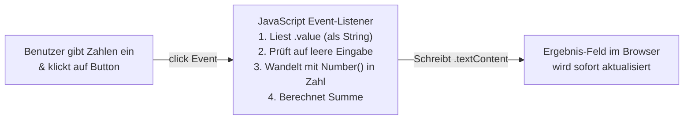

> **Thema:** HTML5, CSS3 & Browser-DOM – Wie Webseiten und interaktive Oberflächen im Browser funktionieren
> **Autor:** Michael Stürmer
> **Datum:** 07.11.2026

<!-- DOKU-SUBNAV-START -->
<details>
<summary><b>🧭 Rubrik-Navigation &amp; Modul-Übersicht (04 JS/TS Web)</b></summary>

**Zentrale:** [📚 Doku-Index](../README.md) · [📂 Rubrik 04 JS/TS Web](./README.md) · **Vorheriges:** *(Erstes Modul)* · **Nächstes:** [02 • Modernes JavaScript (ES6+) & TypeScript ➡️](./02_modernes-javascript-und-typescript.md)

**Alle Module in `04_JS_TS_Web/`:**
- 👉 **[01 • HTML5, CSS3 & DOM-Manipulation Grundlagen](./01_html-css-und-dom-grundlagen.md)** *(aktuell)* · `rechner.html`
- [02 • Modernes JavaScript (ES6+) & TypeScript](./02_modernes-javascript-und-typescript.md)
- [03 • Google GenAI SDK (@google/genai) für Web-Apps](./03_gemini-sdk-typescript-und-web-apps.md)

**Weitere Rubriken:** [🐧 01 Linux & Bash](../01_Linux_Bash/README.md) · [🧩 02 VS Code & MCP](../02_VSCode_Env/README.md) · [🐍 03 Python](../03_Python_Coding/README.md) · [🤖 05 Agents](../05_Agents/README.md) · [🏎️ 06 AC KN5 Modding](../06_AC_KN5_Modding/README.md) · [🥽 07 VR Engineering](../07_VR_Engineering/README.md)

</details>
<!-- DOKU-SUBNAV-END -->

<details>
<summary><b>Lernziele</b></summary>

* Die strikte Rollentrennung zwischen **HTML (Struktur & Inhalt)**, **CSS (Layout & Gestaltung)** und **JavaScript (Verhalten & Logik)** verstehen.
* Nachvollziehen, wie der **Browser** als Laufzeitumgebung eine `.html`-Datei in das **DOM (Document Object Model)** übersetzt und auf Benutzerklicks (**Events**) reagiert.
* Eine eigenständige, fehlerrobuste Web-Anwendung (`rechner.html`) ohne externe Bibliotheken aufbauen und systematisch testen.

</details>

<details>
<summary><b>Kernkonzepte</b></summary>

<details>
<summary>1.1 Die drei Bausteine jeder Web-Oberfläche</summary>

| Technologie | Art der Sprache | Aufgabe im Browser | Analogie (Schaltschrank / HMI) |
| :--- | :--- | :--- | :--- |
| **HTML** (`index.html`) | Auszeichnungssprache (*Markup*) | Definiert **welche Elemente** existieren (Überschrift, Eingabefeld, Button, Ausgabetext). | Montageplatte mit eingebauten Tastern, Schaltern und Anzeigen. |
| **CSS** (`style.css`) | Stylesheet-Sprache | Bestimmt **Aussehen, Farben, Abstände und Layout** (Flexbox / Grid). | Beschriftungsschilder, Gehäusefarbe und symmetrische Anordnung auf dem Panel. |
| **JavaScript** (`app.js`) | Echte Programmiersprache | Steuert das **Verhalten**: Liest Eingaben, rechnet, prüft Fehler und aktualisiert die Anzeige. | Das SPS-/HMI-Steuerprogramm hinter den Tastern. |

</details>

<details>
<summary>1.2 Vom Klick zum Ergebnis: Das Document Object Model (DOM)</summary>

Wenn du eine `.html`-Datei im Browser öffnest, erzeugt der Browser im Arbeitsspeicher einen Baum aus Objekten (**DOM**). JavaScript greift über eindeutige `id`-Attribute auf diese Elemente zu:



**Wichtige Stolperfalle bei Eingabefeldern:**
Ein HTML-Eingabefeld (`<input>`) liefert seinen Inhalt (`element.value`) immer zuerst als **Text (`String`)** zurück!
* Würde man `"5" + "3"` als Text addieren, käme `"53"` heraus (String-Verkettung).
* Deshalb muss der Text vor dem Rechnen mit `Number(wert)` oder `parseFloat(wert)` explizit in eine Zahl umgewandelt und mit `Number.isNaN()` geprüft werden.

</details>

<details>
<summary>1.3 Komplettes Lernbeispiel: <code>rechner.html</code> (HTML + CSS + JS in einer Datei)</summary>

Dieses Beispiel zeigt das saubere Zusammenspiel aller drei Schichten ohne externe Abhängigkeiten:

```html
<!doctype html>
<html lang="de">
<head>
  <meta charset="utf-8" />
  <title>Git-Labor Zahlenrechner</title>
  <style>
    /* 1. CSS: Gestaltung & Layout */
    body {
      font-family: system-ui, sans-serif;
      background: #0f172a;
      color: #f8fafc;
      display: flex;
      justify-content: center;
      padding-top: 4rem;
    }
    .card {
      background: #1e293b;
      padding: 1.5rem;
      border-radius: 10px;
      width: 340px;
      box-shadow: 0 10px 25px rgba(0, 0, 0, 0.4);
    }
    input, button {
      width: 100%;
      padding: 0.6rem;
      margin-top: 0.5rem;
      border-radius: 6px;
      border: 1px solid #475569;
      box-sizing: border-box;
      font-size: 1rem;
    }
    button {
      background: #3b82f6;
      color: white;
      font-weight: bold;
      cursor: pointer;
      border: none;
      margin-top: 1rem;
    }
    .result {
      margin-top: 1rem;
      padding: 0.75rem;
      background: #0f172a;
      border-radius: 6px;
      font-weight: bold;
    }
  </style>
</head>
<body>
  <!-- 2. HTML: Struktur & Bedienelemente -->
  <div class="card">
    <h2>Zahlenrechner</h2>
    <label for="zahlA">Erste Zahl:</label>
    <input id="zahlA" type="number" step="any" placeholder="z. B. 12.5" />

    <label for="zahlB">Zweite Zahl:</label>
    <input id="zahlB" type="number" step="any" placeholder="z. B. 7.5" />

    <button id="btnAddieren" type="button">Addieren (+)</button>
    <div id="ausgabe" class="result">Ergebnis: –</div>
  </div>

  <!-- 3. JavaScript: Verhalten & Berechnungslogik -->
  <script>
    const inputA = document.getElementById("zahlA");
    const inputB = document.getElementById("zahlB");
    const button = document.getElementById("btnAddieren");
    const ausgabe = document.getElementById("ausgabe");

    button.addEventListener("click", () => {
      const textA = inputA.value.trim();
      const textB = inputB.value.trim();

      if (textA === "" || textB === "") {
        ausgabe.textContent = "Bitte beide Zahlenfelder ausfüllen!";
        return;
      }

      const wertA = Number(textA);
      const wertB = Number(textB);

      if (Number.isNaN(wertA) || Number.isNaN(wertB)) {
        ausgabe.textContent = "Ungültige Zahleneingabe!";
        return;
      }

      const summe = wertA + wertB;
      ausgabe.textContent = `Ergebnis: ${summe}`;
    });
  </script>
</body>
</html>
```

</details>

<details>
<summary>1.4 Systematisches Testen einer Web-Komponente</summary>

Vor jeder Freigabe einer Oberfläche sollten mindestens drei Testkategorien geprüft werden:
1. **Normalfall (Happy Path):** `12.5` und `7.5` eingeben $\rightarrow$ Erwartete Anzeige: `Ergebnis: 20`.
2. **Grenzwerte & Vorzeichen:** Negative Zahlen (`-10` und `4`) sowie `0` testen $\rightarrow$ Erwartete Anzeige: `Ergebnis: -6`.
3. **Fehler- / Randfall (Edge Case):** Ein oder beide Felder leer lassen und auf *Addieren* klicken $\rightarrow$ Darf nicht `NaN` oder `0` anzeigen, sondern den klaren Hinweis `Bitte beide Zahlenfelder ausfüllen!`.

</details>

</details>

<details>
<summary><b>Übungsaufgaben</b></summary>

1. **String- vs. Zahlen-Addition:** Was gibt JavaScript aus, wenn du ohne `Number()`-Umwandlung direkt `"10" + "20"` berechnest, und warum passiert das?
2. **Erweiterung planen:** Du möchtest in `rechner.html` einen zweiten Button *Subtrahieren (-)* ergänzen. Welche Stellen im HTML-Bereich und im `<script>`-Bereich müssen dafür angepasst werden?
3. **Browser DevTools:** Mit welcher Taste öffnest du im Browser (Chrome/Edge) oder im integrierten VS Code Browser die Entwicklerkonsole, um JavaScript-Fehler oder DOM-Elemente live zu untersuchen?

</details>

<details>
<summary><b>Weiterführende Links & Quellen</b></summary>

* [MDN Web Docs – HTML Grundlagen](https://developer.mozilla.org/de/docs/Learn/Getting_started_with_the_web/HTML_basics)
* [MDN Web Docs – CSS Flexbox & Grid](https://developer.mozilla.org/de/docs/Learn/CSS/CSS_layout/Flexbox)
* [MDN Web Docs – Einführung in das DOM](https://developer.mozilla.org/de/docs/Web/API/Document_Object_Model/Introduction)

</details>

<details>
<summary><b>Chips & Kernaussagen</b></summary>

* **HTML = Struktur, CSS = Aussehen, JS = Logik:** Halte diese drei Verantwortlichkeiten gedanklich und architektonisch immer sauber getrennt.
* **Der Browser ist die Laufzeit:** Für reine `.html`/`.css`/`.js`-Dateien wird kein Compiler benötigt – der Browser führt sie direkt aus.
* **Eingabefelder liefern immer Strings:** Vor mathematischen Operationen immer erst auf Leerstring (`trim() === ""`) prüfen und dann mit `Number()` konvertieren.
* **Jede Änderung mit 3 Fällen testen:** Positiver Normalfall, negative/Null-Werte und leere/fehlerhafte Benutzereingabe.

</details>

---
*Hinweis zur Organisation:* Die erstellte Dokumentation ist am Drehlaufwerk abgelegt und mit einer kurzen Zusammenfassung von den Chips auch in den Notebooks verlinkt.

<!-- DOKU-MINIMAP-START -->
<style>
.doku-arch-flow { font-family: var(--vscode-editor-font-family, Consolas, monospace); background: linear-gradient(160deg, rgba(15, 23, 42, 0.96), rgba(17, 24, 39, 0.94)); border: 1px solid rgba(96, 165, 250, 0.35); border-radius: 12px; padding: 14px 16px; margin: 8px 0 0 0; color: #e2e8f0; }
.doku-arch-root { display: flex; flex-wrap: wrap; align-items: center; justify-content: center; gap: 10px; font-weight: 700; font-size: 0.98em; padding: 9px 14px; margin-bottom: 12px; background: linear-gradient(135deg, rgba(37, 99, 235, 0.28), rgba(30, 41, 59, 0.92)); border: 1px solid rgba(96, 165, 250, 0.48); border-radius: 10px; }
.doku-arch-root a { color: #93c5fd !important; text-decoration: none !important; }
.doku-arch-root a:hover { color: #dbeafe !important; text-decoration: underline !important; }
.doku-arch-grid { display: grid; grid-template-columns: repeat(auto-fit, minmax(268px, 1fr)); gap: 11px; }
.doku-arch-card { background: rgba(30, 41, 59, 0.72); border: 1px solid rgba(148, 163, 184, 0.24); border-top: 3px solid #3b82f6; border-left: 4px solid #3b82f6; border-radius: 10px; padding: 10px 12px; transition: transform 0.14s ease, border-color 0.14s ease, box-shadow 0.14s ease; }
.doku-arch-card:hover { border-color: #93c5fd; transform: translateY(-2px); box-shadow: 0 6px 18px rgba(0, 0, 0, 0.35); }
.doku-arch-card.r1 { border-left-color: #22c55e; border-top-color: #22c55e; }
.doku-arch-card.r2 { border-left-color: #3b82f6; border-top-color: #3b82f6; }
.doku-arch-card.r3 { border-left-color: #eab308; border-top-color: #eab308; }
.doku-arch-card.r4 { border-left-color: #ec4899; border-top-color: #ec4899; }
.doku-arch-card.r5 { border-left-color: #a855f7; border-top-color: #a855f7; }
.doku-arch-card.r6 { border-left-color: #f97316; border-top-color: #f97316; }
.doku-arch-card.r7 { border-left-color: #06b6d4; border-top-color: #06b6d4; }
.doku-arch-card-title { font-weight: 700; font-size: 0.93em; margin-bottom: 7px; padding-bottom: 5px; border-bottom: 1px dashed rgba(148, 163, 184, 0.26); }
.doku-arch-card-title a { color: #f8fafc !important; text-decoration: none !important; display: block; }
.doku-arch-card-title a:hover { color: #93c5fd !important; }
.doku-arch-lines { list-style: none; margin: 0; padding: 0; font-size: 0.84em; line-height: 1.5; }
.doku-arch-lines li { margin: 3px 0; padding: 2px 6px; border-radius: 5px; white-space: normal; }
.doku-arch-lines li:hover { background: rgba(59, 130, 246, 0.16); }
.doku-arch-lines a { color: #cbd5e1 !important; text-decoration: none !important; display: inline; }
.doku-arch-lines a:hover { color: #93c5fd !important; text-decoration: underline !important; }
.doku-arch-badge { display: inline-block; font-size: 0.74em; padding: 0 6px; margin-left: 5px; border-radius: 999px; background: rgba(59, 130, 246, 0.22); color: #bfdbfe !important; border: 1px solid rgba(96, 165, 250, 0.4); }
details.doku-minimap { position: fixed; bottom: 18px; right: 18px; z-index: 9999; width: 292px; max-height: 76px; overflow: hidden; background: rgba(15, 23, 42, 0.93); border: 1px solid rgba(96, 165, 250, 0.62); border-radius: 14px; box-shadow: 0 10px 30px rgba(0, 0, 0, 0.65); backdrop-filter: blur(10px); transition: width 0.18s ease, max-height 0.18s ease, border-color 0.18s ease; font-family: var(--vscode-font-family, sans-serif); }
details.doku-minimap:hover { border-color: #93c5fd; }
details.doku-minimap[open] { width: min(920px, 94vw); max-height: 84vh; overflow-y: auto; padding-bottom: 10px; border-radius: 14px; }
details.doku-minimap > summary { cursor: pointer; list-style: none; padding: 8px 13px; font-weight: 700; font-size: 0.84em; color: #f8fafc; background: linear-gradient(90deg, rgba(37, 99, 235, 0.45), rgba(30, 41, 59, 0.92)); border-bottom: 1px solid rgba(148, 163, 184, 0.24); display: flex; align-items: center; justify-content: space-between; user-select: none; }
details.doku-minimap > summary::-webkit-details-marker { display: none; }
details.doku-minimap > summary .minimap-toggle::after { content: "+"; font-size: 1.05em; opacity: 0.85; padding: 0 4px; }
details.doku-minimap[open] > summary .minimap-toggle::after { content: "−"; }
details.doku-minimap .minimap-preview-strip { display: flex; gap: 5px; padding: 6px 10px 8px 10px; font-size: 0.71em; color: #cbd5e1; justify-content: space-between; }
details.doku-minimap[open] .minimap-preview-strip { display: none; }
details.doku-minimap .minimap-preview-strip span { display: inline-flex; align-items: center; gap: 4px; background: rgba(30, 41, 59, 0.92); padding: 2px 7px; border-radius: 999px; border: 1px solid rgba(148, 163, 184, 0.26); }
details.doku-minimap .dot { width: 6px; height: 6px; border-radius: 50%; display: inline-block; }
details.doku-minimap .dot.r1 { background: #22c55e; }
details.doku-minimap .dot.r2 { background: #3b82f6; }
details.doku-minimap .dot.r3 { background: #eab308; }
details.doku-minimap .dot.r4 { background: #ec4899; }
details.doku-minimap .dot.r5 { background: #a855f7; }
details.doku-minimap .dot.r6 { background: #f97316; }
details.doku-minimap .dot.r7 { background: #06b6d4; }
details.doku-minimap .minimap-body { padding: 4px 12px 6px 12px; }
</style>
<details class="doku-minimap">
<summary><span>🗺️ Doku-Minimap (7 Rubriken &amp; Labs)</span><span class="minimap-toggle" title="Klicken zum Vergrößern / Einklappen"></span></summary>
<div class="minimap-preview-strip"><span><i class="dot r1"></i>Linux</span><span><i class="dot r2"></i>VSCode</span><span><i class="dot r3"></i>Python</span><span><i class="dot r4"></i>JS/TS</span><span><i class="dot r5"></i>Agents</span><span><i class="dot r6"></i>KN5</span><span><i class="dot r7"></i>VR</span></div>
<div class="minimap-body">
<div class="doku-arch-flow">
<div class="doku-arch-root"><span>🏛️ <a href="../README.md">VanstrikeCyborg — git-labor Doku-Index</a></span> · <a href="../../README.md">Repo-README</a> · <a href="../../AGENTS.md">AGENTS.md</a> · <a href="../../notebook-agent-environments/README.md">Notebooks</a> · <a href="../05_Agents/SYSTEM_ARCHITEKTUR_AENDERUNGEN_2026-11-28.md">Letztstand 28.11.</a></div>
<div class="doku-arch-grid">
<div class="doku-arch-card r1">
<div class="doku-arch-card-title">🐧 <a href="../01_Linux_Bash/README.md">01_Linux_Bash (Linux, Shell &amp; Container)</a></div>
<ul class="doku-arch-lines">
<li>├─ <a href="../01_Linux_Bash/01_bash-grundlagen-und-skripting.md">01 • Bash CLI, Text-Tools, Streams &amp; Expansions</a> <a class="doku-arch-badge" href="../../labs/01_linux_bash/check-env.sh">check-env.sh</a></li>
<li>├─ <a href="../01_Linux_Bash/02_linux-systemadministration-und-interna.md">02 • Inodes, LVM, Prozesse, Boot-Prozess &amp; systemd</a></li>
<li>├─ <a href="../01_Linux_Bash/03_arch-linux-omarchy-und-remote-ssh.md">03 • Arch Linux, Omarchy, Remote-SSH &amp; Nginx</a></li>
<li>├─ <a href="../01_Linux_Bash/04_fortgeschrittenes-bash-skripting-und-automatisierung.md">04 • Advanced Bash: Arrays, getopts &amp; Backups</a></li>
<li>└─ <a href="../01_Linux_Bash/05_docker-und-sbx-micro-vms.md">05 • Docker Grundlagen &amp; Sandbox Micro-VMs (sbx)</a></li>
</ul>
</div>
<div class="doku-arch-card r2">
<div class="doku-arch-card-title">🧩 <a href="../02_VSCode_Env/README.md">02_VSCode_Env (IDE, Git, MCP &amp; Gemini)</a></div>
<ul class="doku-arch-lines">
<li>├─ <a href="../02_VSCode_Env/01_vscode-architektur-lsp-und-remote.md">01 • VS Code Architektur, Sprachserver (LSP) &amp; Remote</a></li>
<li>├─ <a href="../02_VSCode_Env/02_git-github-und-multi-root-workspaces.md">02 • Git, GitHub Workflow &amp; Multi-Root Workspaces</a> <a class="doku-arch-badge" href="../../git-labor.code-workspace">Workspace</a></li>
<li>├─ <a href="../02_VSCode_Env/03_mcp-server-localhost-proxy-und-ports.md">03 • MCP-Server, Ollama (:11434) &amp; Ports (Archiv: Proxy)</a> <a class="doku-arch-badge" href="../../.vscode/mcp.json">mcp.json</a></li>
<li>├─ <a href="../02_VSCode_Env/04_gemini-oekosystem-ai-studio-und-api-keys.md">04 • Gemini Ökosystem, Google AI Studio &amp; API-Keys</a></li>
<li>└─ <a href="../02_VSCode_Env/05_multi-workspace-netzwerk-mcp-und-agenten-verbund.md">05 • 5-Knoten-Verbund, Parity &amp; Parallel-Limits</a></li>
</ul>
</div>
<div class="doku-arch-card r3">
<div class="doku-arch-card-title">🐍 <a href="../03_Python_Coding/README.md">03_Python_Coding (Python, uv &amp; GenAI SDK)</a></div>
<ul class="doku-arch-lines">
<li>├─ <a href="../03_Python_Coding/01_python-setup-uv-venv-und-notebooks.md">01 • Python Setup: uv, .venv, Pylance &amp; Notebooks</a> <a class="doku-arch-badge" href="../../notebook-agent-environments/agent_demo.ipynb">.ipynb</a></li>
<li>├─ <a href="../03_Python_Coding/02_gemini-api-python-sdk-und-interactions.md">02 • Google GenAI SDK (google-genai) &amp; Interactions API</a></li>
<li>└─ <a href="../03_Python_Coding/03_python-automatisierung-datenanalyse-und-tests.md">03 • Automatisierung, Datenanalyse &amp; pytest</a> <a class="doku-arch-badge" href="../../labs/03_python/sensor_demo.py">sensor_demo.py</a></li>
</ul>
</div>
<div class="doku-arch-card r4">
<div class="doku-arch-card-title">🌐 <a href="../04_JS_TS_Web/README.md">04_JS_TS_Web (HTML/CSS, JS/TS &amp; Web-SDK)</a></div>
<ul class="doku-arch-lines">
<li>├─ <a href="../04_JS_TS_Web/01_html-css-und-dom-grundlagen.md">01 • HTML5, CSS3 &amp; DOM-Manipulation Grundlagen</a> <a class="doku-arch-badge" href="../../labs/04_js_ts_web/rechner.html">rechner.html</a></li>
<li>├─ <a href="../04_JS_TS_Web/02_modernes-javascript-und-typescript.md">02 • Modernes JavaScript (ES6+) &amp; TypeScript</a></li>
<li>└─ <a href="../04_JS_TS_Web/03_gemini-sdk-typescript-und-web-apps.md">03 • Google GenAI SDK (@google/genai) für Web-Apps</a></li>
</ul>
</div>
<div class="doku-arch-card r5">
<div class="doku-arch-card-title">🤖 <a href="../05_Agents/README.md">05_Agents (KI-Agenten, Skills &amp; Orchestrierung)</a></div>
<ul class="doku-arch-lines">
<li>├─ <a href="../05_Agents/01_agent-stilfibel-und-didaktik-ruler.md">01 • Agent-Stilfibel, Didaktik-Ruler &amp; 7-Stufen-Aufbau</a></li>
<li>├─ <a href="../05_Agents/02_agenten-erstellen-instructions-rules-und-prompts.md">02 • Agenten erstellen: Instructions, Rules &amp; Prompts</a> <a class="doku-arch-badge" href="../../.github/instructions/gemini-api.instructions.md">gemini.instructions</a></li>
<li>├─ <a href="../05_Agents/03_agenten-ausruesten-skills-und-mcp-tools.md">03 • Agenten ausrüsten: Skills &amp; MCP-Tools</a> <a class="doku-arch-badge" href="../../.agents/skills/live-transfer-status-monitor/SKILL.md">SKILL.md</a></li>
<li>├─ <a href="../05_Agents/04_agenten-trainieren-primen-und-orchestrieren.md">04 • Priming, Memory &amp; Multi-Agent-Orchestrierung</a> <a class="doku-arch-badge" href="../../.github/agents/light.agent.md">@light</a></li>
<li>├─ <a href="../05_Agents/05_workspace-schnittstelle-simracer-und-agenten-terminals.md">05 • Schnittstelle, Terminals &amp; XOR-Mutex</a> <a class="doku-arch-badge" href="../../labs/03_python/sim_agent_bridge.py">Bridge</a></li>
<li>├─ <a href="../05_Agents/05_multi-workspace-netzwerk-mcp-und-agenten-verbund.md">06 • Multi-Workspace Netzwerk &amp; 7-Rollen-Verbund</a></li>
<li>└─ <a href="../05_Agents/SYSTEM_ARCHITEKTUR_AENDERUNGEN_2026-11-28.md">Letztstand 28.11. (Labs 06/07, Cleanup &amp; KN5-Fix)</a></li>
</ul>
</div>
<div class="doku-arch-card r6">
<div class="doku-arch-card-title">🏎️ <a href="../06_AC_KN5_Modding/README.md">06_AC_KN5_Modding (.kn5 &amp; Toolchain)</a></div>
<ul class="doku-arch-lines">
<li>└─ <a href="../06_AC_KN5_Modding/01_kn5-format-entwicklungsumgebung-und-setup.md">01 • .kn5-Format, ext_config &amp; Sandbox-Gate</a> <a class="doku-arch-badge" href="../../labs/06_ac_kn5_modding/inspect_kn5.py">inspect_kn5.py</a></li>
</ul>
</div>
<div class="doku-arch-card r7">
<div class="doku-arch-card-title">🥽 <a href="../07_VR_Engineering/README.md">07_VR_Engineering (90 Hz VR &amp; @rig)</a></div>
<ul class="doku-arch-lines">
<li>├─ <a href="../07_VR_Engineering/01_vr-architektur-frametimes-und-diagnose.md">01 • VR-Architektur, Frametimes &amp; Compositor</a> <a class="doku-arch-badge" href="../../labs/07_vr_engineering/analyze_vr_compositor.py">analyze_vr_compositor.py</a></li>
<li>└─ <a href="../../labs/07_vr_engineering/README.md">Lab 07 • VR-Invarianten &amp; Read-Only Check</a> <a class="doku-arch-badge" href="../../labs/07_vr_engineering/Check-VrInvariants.ps1">Check-VrInvariants.ps1</a></li>
</ul>
</div>
</div>
</div>
</div>
</details>
<!-- DOKU-MINIMAP-END -->
