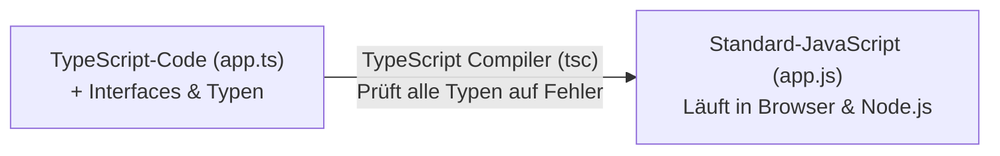
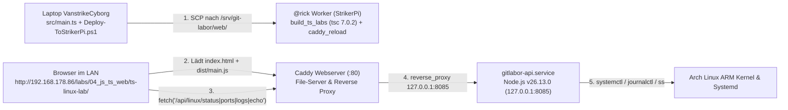

> **Thema:** Modernes JavaScript (ES6+) & TypeScript – Statische Typsicherheit, Async/Await und Node.js
> **Autor:** Michael Stürmer
> **Datum:** 07.11.2026

<!-- DOKU-SUBNAV-START -->
<details>
<summary><b>🧭 Rubrik-Navigation &amp; Modul-Übersicht (04 JS/TS Web)</b></summary>

**Zentrale:** [📚 Doku-Index](../README.md) · [📂 Rubrik 04 JS/TS Web](./README.md) · **Vorheriges:** [⬅️ 01 • HTML5, CSS3 & DOM-Manipulation Grundlagen](./01_html-css-und-dom-grundlagen.md) · **Nächstes:** [03 • Google GenAI SDK (@google/genai) für Web-Apps ➡️](./03_gemini-sdk-typescript-und-web-apps.md)

**Alle Module in `04_JS_TS_Web/`:**
- [01 • HTML5, CSS3 & DOM-Manipulation Grundlagen](./01_html-css-und-dom-grundlagen.md) · `rechner.html`
- 👉 **[02 • Modernes JavaScript (ES6+) & TypeScript](./02_modernes-javascript-und-typescript.md)** *(aktuell)*
- [03 • Google GenAI SDK (@google/genai) für Web-Apps](./03_gemini-sdk-typescript-und-web-apps.md)

**Weitere Rubriken:** [🐧 01 Linux & Bash](../01_Linux_Bash/README.md) · [🧩 02 VS Code & MCP](../02_VSCode_Env/README.md) · [🐍 03 Python](../03_Python_Coding/README.md) · [🤖 05 Agents](../05_Agents/README.md)

</details>
<!-- DOKU-SUBNAV-END -->

<details>
<summary><b>Lernziele</b></summary>

* Den Unterschied zwischen **Browser-JavaScript** und **Node.js (Server-/CLI-Laufzeit)** sowie moderne Sprachfunktionen (`const`/`let`, Arrow Functions, `async/await`, ES-Module) sicher beherrschen.
* Verstehen, warum **TypeScript (`.ts`)** als statisch typisierter Aufsatz über JavaScript entwickelt wurde und wie `interface`, `type` und `tsconfig.json` Laufzeitfehler verhindern.
* Ein sauberes TypeScript-Projekt mit `package.json`, `tsc` und strikter Typprüfung aufsetzen, gegen ein echtes Node.js-Linux-Backend testen und via `Deploy-ToStrikerPi.ps1` auf den StrikerPi deployen.

</details>

<details>
<summary><b>Kernkonzepte</b></summary>

<details>
<summary>1.1 Wo läuft JavaScript? Browser vs. Node.js</summary>

Ursprünglich lief JavaScript ausschließlich im Webbrowser. Durch **Node.js** (basierend auf Googles V8-Engine) kann JavaScript und TypeScript heute genauso wie Python direkt auf dem PC oder Server ausgeführt werden:

| Laufzeitumgebung | Zugriff auf HTML/DOM (`document`, `window`)? | Zugriff auf Dateisystem (`fs`), Netzwerk-Sockets & Prozesse? | Typischer Einsatz |
| :--- | :---: | :---: | :--- |
| **Webbrowser** (Chrome, Edge, Firefox) | **Ja** | Nein (Sandbox-Schutz) | Interaktive Webseiten, Dashboards, React/Vite-Frontends. |
| **Node.js / Deno / Bun** | Nein | **Ja** (`node:fs`, `node:path`, `process.env`) | MCP-Server, CLI-Tools, Web-Backends, Build-Skripte, VS Code Extensions. |

</details>

<details>
<summary>1.2 Warum TypeScript statt reinem JavaScript?</summary>

In reinem JavaScript haben Variablen keinen festen Datentyp – Tippfehler bei Eigenschaftsnamen fallen oft erst auf, wenn das Programm bereits läuft und abstürzt. **TypeScript** ergänzt JavaScript um ein **statisches Typsystem** zur Entwicklungszeit:



```typescript
// Definition einer festen Datenstruktur (ähnlich wie ein UDT / Struct in der SPS oder C#)
interface MaschinenStatus {
   readonly anlagenId: string;
  drehzahlRpm: number;
  status: "BEREIT" | "LAEUFT" | "STOERUNG";
  fehlerText?: string; // Optionales Feld (?)
}

function formatiereStatus(maschine: MaschinenStatus): string {
  if (maschine.status === "STOERUNG") {
    return `[ALARM] Anlage ${maschine.anlagenId}: ${maschine.fehlerText ?? "Unbekannter Fehler"}`;
  }
  return `[OK] Anlage ${maschine.anlagenId} läuft mit ${maschine.drehzahlRpm} U/min.`;
}
```

**Vorteil in VS Code:** Da VS Code selbst komplett in TypeScript geschrieben wurde, zeigt dir der Editor sofort beim Tippen alle erlaubten Felder (`anlagenId`, `drehzahlRpm`, `status`) und unterstreicht ungültige Werte wie `status: "PAUSE"` sofort rot.

</details>

<details>
<summary>1.3 Asynchrone Programmierung mit <code>async</code> / <code>await</code></summary>

Netzwerkabfragen (z. B. an eine REST-API oder ein KI-Modell) dauern oft einige hundert Millisekunden. Damit die Oberfläche oder der Server in dieser Zeit nicht blockiert, arbeitet JS/TS mit **Promises** und `async / await`:

```typescript
interface ModellAntwort {
  id: string;
  status: string;
}

async function pruefeLokalenProxy(port: number = 8317): Promise<boolean> {
  try {
    const response = await fetch(`http://127.0.0.1:${port}/v1/models`);
    if (!response.ok) {
      console.error(`Server antwortete mit HTTP ${response.status}`);
      return false;
    }
    const daten = (await response.json()) as { data: ModellAntwort[] };
    console.log(`Gefundene Modelle: ${daten.data.length}`);
    return true;
  } catch (fehler) {
    console.error("Proxy nicht erreichbar:", fehler);
    return false;
  }
}
```

</details>

<details>
<summary>1.4 Empfohlene <code>tsconfig.json</code> für moderne TypeScript-Projekte</summary>

Eine saubere `tsconfig.json` aktiviert den **`strict`-Modus**, damit `null`/`undefined`-Fehler und implizite `any`-Typen konsequent abgefangen werden:

```json
{
  "compilerOptions": {
    "target": "ES2022",
    "module": "NodeNext",
    "moduleResolution": "NodeNext",
    "strict": true,
    "noUncheckedIndexedAccess": true,
    "esModuleInterop": true,
    "skipLibCheck": true,
    "outDir": "./dist",
    "rootDir": "./src"
  },
  "include": ["src/**/*"]
}
```

</details>

<details>
<summary>1.5 Praxisprojekt: TypeScript Live-Dashboard gegen Linux-Serverdienste (<code>ts-linux-lab</code>)</summary>

Unter [`labs/04_js_ts_web/ts-linux-lab/`](../../labs/04_js_ts_web/ts-linux-lab/) liegt ein vollständiges Praxisprojekt, das **Browser-TypeScript** direkt mit dem **Node.js-Backend** auf StrikerPi (`gitlabor-api.service`) verbindet:



#### 1. Projektstruktur & Compiler-Konfiguration
| Datei | Aufgabe |
| :--- | :--- |
| [`package.json`](../../labs/04_js_ts_web/ts-linux-lab/package.json) | Definiert `"build": "tsc -p ."` für die Remote- oder Lokal-Kompilierung. |
| [`tsconfig.json`](../../labs/04_js_ts_web/ts-linux-lab/tsconfig.json) | Kompiliert `src/**/*.ts` als `ES2022`-ES-Module nach `dist/` (`"strict": true`, `"noEmitOnError": true`, `"sourceMap": true`). |
| [`src/main.ts`](../../labs/04_js_ts_web/ts-linux-lab/src/main.ts) | Typisierte API-Aufrufe (`fetchJson<T>`), DOM-Helfer (`byId<T>`), Auto-Refresh alle 5 s und `POST /api/linux/echo`-Test. |
| [`index.html`](../../labs/04_js_ts_web/ts-linux-lab/index.html) & [`styles.css`](../../labs/04_js_ts_web/ts-linux-lab/styles.css) | Lädt `<script type="module" src="./dist/main.js"></script>` und rendert Services, Sockets, Journald- & Caddy-Logs. |
| [`Deploy-ToStrikerPi.ps1`](../../labs/04_js_ts_web/Deploy-ToStrikerPi.ps1) | Überträgt Portal + Lab per `scp` auf StrikerPi und triggert über `@rick` automatisch `build_ts_labs` (`tsc`) und `caddy_reload`. |

#### 2. Generisches Fetch-Pattern in TypeScript (`src/main.ts`)
Statt unsicherer `any`-Objekte erzwingt eine generische Hilfsfunktion feste Antwort-Interfaces (`LinuxStatusResponse`, `LogsResponse`, `PortsResponse`, `EchoResponse`):

```typescript
async function fetchJson<T>(url: string, init?: RequestInit): Promise<T> {
  const res = await fetch(url, init);
  if (!res.ok) {
    throw new Error(`HTTP ${res.status} bei ${url}`);
  }
  return (await res.json()) as T;
}

const data = await fetchJson<LinuxStatusResponse>("/api/linux/status");
```

**Deployment & Live-Test vom Laptop (`PowerShell`):**
```powershell
.\labs\04_js_ts_web\Deploy-ToStrikerPi.ps1
```
Danach erreichbar unter `http://192.168.178.86/` (Portal) bzw. `http://192.168.178.86/labs/04_js_ts_web/ts-linux-lab/`.

</details>

</details>

<details>
<summary><b>Übungsaufgaben</b></summary>

1. **Union Types verstehen:** Im obigen `interface MaschinenStatus` ist `status: "BEREIT" | "LAEUFT" | "STOERUNG"` definiert. Was passiert in VS Code, wenn du versuchst, `status: "WARTUNG"` zuzuweisen, und warum ist das sicherer als ein beliebiger `string`?
2. **`const` vs. `let`:** Warum verwendet man in modernem JavaScript/TypeScript standardmäßig `const` für Variablen und greift nur dann zu `let`, wenn sich der zugewiesene Wert später wirklich ändert (und niemals zum veralteten `var`)?
3. **Asynchronität:** Was gibt eine `async function` immer als Rückgabetyp zurück, selbst wenn im Code `return true;` steht?
4. **Live-Deployment:** Ergänze in [`ts-linux-lab/src/main.ts`](../../labs/04_js_ts_web/ts-linux-lab/src/main.ts) ein zusätzliches Feld aus `/api/linux/status` und deploye den Stand via [`Deploy-ToStrikerPi.ps1`](../../labs/04_js_ts_web/Deploy-ToStrikerPi.ps1) auf StrikerPi. Prüfe, ob `noEmitOnError: true` bei einem absichtlichen Typfehler das Überschreiben von `dist/main.js` verhindert.

</details>

<details>
<summary><b>Weiterführende Links & Quellen</b></summary>

* [Offizielles TypeScript Handbuch](https://www.typescriptlang.org/docs/handbook/intro.html)
* [MDN Web Docs – Modernes JavaScript (`async/await`)](https://developer.mozilla.org/de/docs/Learn/JavaScript/Asynchronous/Promises)
* [Node.js Offizielle Dokumentation](https://nodejs.org/en/docs)
* [Praxis-Lab: TypeScript & Linux Serverdienste (`ts-linux-lab`)](../../labs/04_js_ts_web/ts-linux-lab/index.html)
* [Node.js Live-API Backend (`gitlabor-api.mjs`)](../01_Linux_Bash/03_arch-linux-omarchy-und-remote-ssh.md)

</details>

<details>
<summary><b>Chips & Kernaussagen</b></summary>

* **TypeScript = JavaScript mit Sicherheitsnetz:** `interface`, Union Types (`"A" | "B"`) und `"strict": true` in der `tsconfig.json` fangen Fehler bereits vor dem Programmstart ab (`noEmitOnError: true`).
* **Browser $\neq$ Node.js:** Im Browser steuerst du das `document` (DOM); in Node.js steuerst du Dateien, Ports, CLI-Skripte, HTTP-Backends (`gitlabor-api.mjs`) und MCP-Server.
* **Immer `const` bevorzugen:** Macht Code berechenbar und verhindert versehentliches Überschreiben von Referenzen.
* **`async/await` + `try/catch`:** Das Standardmuster für alle API-, Datei- und KI-Aufrufe in JS/TS (`fetchJson<T>`).
* **End-to-End im LAN:** Browser-TypeScript (`ts-linux-lab`) + Caddy Reverse Proxy (`:80`) + Node.js-Systemd-API (`127.0.0.1:8085`) lassen sich per [`Deploy-ToStrikerPi.ps1`](../../labs/04_js_ts_web/Deploy-ToStrikerPi.ps1) und `@rick` direkt auf StrikerPi bauen und live testen.

</details>

---
*Hinweis zur Organisation:* Die erstellte Dokumentation ist am Drehlaufwerk abgelegt und mit einer kurzen Zusammenfassung von den Chips auch in den Notebooks verlinkt.

<!-- DOKU-MINIMAP-START -->
<style>
.doku-arch-flow { font-family: var(--vscode-editor-font-family, Consolas, monospace); background: linear-gradient(160deg, rgba(15, 23, 42, 0.96), rgba(17, 24, 39, 0.94)); border: 1px solid rgba(96, 165, 250, 0.35); border-radius: 12px; padding: 14px 16px; margin: 8px 0 0 0; color: #e2e8f0; }
.doku-arch-root { display: flex; flex-wrap: wrap; align-items: center; justify-content: center; gap: 10px; font-weight: 700; font-size: 0.98em; padding: 9px 14px; margin-bottom: 12px; background: linear-gradient(135deg, rgba(37, 99, 235, 0.28), rgba(30, 41, 59, 0.92)); border: 1px solid rgba(96, 165, 250, 0.48); border-radius: 10px; }
.doku-arch-root a { color: #93c5fd !important; text-decoration: none !important; }
.doku-arch-root a:hover { color: #dbeafe !important; text-decoration: underline !important; }
.doku-arch-grid { display: grid; grid-template-columns: repeat(auto-fit, minmax(268px, 1fr)); gap: 11px; }
.doku-arch-card { background: rgba(30, 41, 59, 0.72); border: 1px solid rgba(148, 163, 184, 0.24); border-top: 3px solid #3b82f6; border-left: 4px solid #3b82f6; border-radius: 10px; padding: 10px 12px; transition: transform 0.14s ease, border-color 0.14s ease, box-shadow 0.14s ease; }
.doku-arch-card:hover { border-color: #93c5fd; transform: translateY(-2px); box-shadow: 0 6px 18px rgba(0, 0, 0, 0.35); }
.doku-arch-card.r1 { border-left-color: #22c55e; border-top-color: #22c55e; }
.doku-arch-card.r2 { border-left-color: #3b82f6; border-top-color: #3b82f6; }
.doku-arch-card.r3 { border-left-color: #eab308; border-top-color: #eab308; }
.doku-arch-card.r4 { border-left-color: #ec4899; border-top-color: #ec4899; }
.doku-arch-card.r5 { border-left-color: #a855f7; border-top-color: #a855f7; }
.doku-arch-card-title { font-weight: 700; font-size: 0.93em; margin-bottom: 7px; padding-bottom: 5px; border-bottom: 1px dashed rgba(148, 163, 184, 0.26); }
.doku-arch-card-title a { color: #f8fafc !important; text-decoration: none !important; display: block; }
.doku-arch-card-title a:hover { color: #93c5fd !important; }
.doku-arch-lines { list-style: none; margin: 0; padding: 0; font-size: 0.84em; line-height: 1.5; }
.doku-arch-lines li { margin: 3px 0; padding: 2px 6px; border-radius: 5px; white-space: normal; }
.doku-arch-lines li:hover { background: rgba(59, 130, 246, 0.16); }
.doku-arch-lines a { color: #cbd5e1 !important; text-decoration: none !important; display: inline; }
.doku-arch-lines a:hover { color: #93c5fd !important; text-decoration: underline !important; }
.doku-arch-badge { display: inline-block; font-size: 0.74em; padding: 0 6px; margin-left: 5px; border-radius: 999px; background: rgba(59, 130, 246, 0.22); color: #bfdbfe !important; border: 1px solid rgba(96, 165, 250, 0.4); }
details.doku-minimap { position: fixed; bottom: 18px; right: 18px; z-index: 9999; width: 292px; max-height: 76px; overflow: hidden; background: rgba(15, 23, 42, 0.93); border: 1px solid rgba(96, 165, 250, 0.62); border-radius: 14px; box-shadow: 0 10px 30px rgba(0, 0, 0, 0.65); backdrop-filter: blur(10px); transition: width 0.18s ease, max-height 0.18s ease, border-color 0.18s ease; font-family: var(--vscode-font-family, sans-serif); }
details.doku-minimap:hover { border-color: #93c5fd; }
details.doku-minimap[open] { width: min(920px, 94vw); max-height: 84vh; overflow-y: auto; padding-bottom: 10px; border-radius: 14px; }
details.doku-minimap > summary { cursor: pointer; list-style: none; padding: 8px 13px; font-weight: 700; font-size: 0.84em; color: #f8fafc; background: linear-gradient(90deg, rgba(37, 99, 235, 0.45), rgba(30, 41, 59, 0.92)); border-bottom: 1px solid rgba(148, 163, 184, 0.24); display: flex; align-items: center; justify-content: space-between; user-select: none; }
details.doku-minimap > summary::-webkit-details-marker { display: none; }
details.doku-minimap > summary .minimap-toggle::after { content: "+"; font-size: 1.05em; opacity: 0.85; padding: 0 4px; }
details.doku-minimap[open] > summary .minimap-toggle::after { content: "−"; }
details.doku-minimap .minimap-preview-strip { display: flex; gap: 5px; padding: 6px 10px 8px 10px; font-size: 0.71em; color: #cbd5e1; justify-content: space-between; }
details.doku-minimap[open] .minimap-preview-strip { display: none; }
details.doku-minimap .minimap-preview-strip span { display: inline-flex; align-items: center; gap: 4px; background: rgba(30, 41, 59, 0.92); padding: 2px 7px; border-radius: 999px; border: 1px solid rgba(148, 163, 184, 0.26); }
details.doku-minimap .dot { width: 6px; height: 6px; border-radius: 50%; display: inline-block; }
details.doku-minimap .dot.r1 { background: #22c55e; }
details.doku-minimap .dot.r2 { background: #3b82f6; }
details.doku-minimap .dot.r3 { background: #eab308; }
details.doku-minimap .dot.r4 { background: #ec4899; }
details.doku-minimap .dot.r5 { background: #a855f7; }
details.doku-minimap .minimap-body { padding: 4px 12px 6px 12px; }
</style>
<details class="doku-minimap">
<summary><span>🗺️ Doku-Minimap (5 Rubriken &amp; Labs)</span><span class="minimap-toggle" title="Klicken zum Vergrößern / Einklappen"></span></summary>
<div class="minimap-preview-strip"><span><i class="dot r1"></i>Linux</span><span><i class="dot r2"></i>VSCode</span><span><i class="dot r3"></i>Python</span><span><i class="dot r4"></i>JS/TS</span><span><i class="dot r5"></i>Agents</span></div>
<div class="minimap-body">
<div class="doku-arch-flow">
<div class="doku-arch-root"><span>🏛️ <a href="../README.md">VanstrikeCyborg — git-labor Doku-Index</a></span> · <a href="../../README.md">Repo-README</a> · <a href="../../AGENTS.md">AGENTS.md</a> · <a href="../../notebook-agent-environments/README.md">Notebooks</a> · <a href="../05_Agents/SYSTEM_ARCHITEKTUR_AENDERUNGEN_2026-11-25.md">Letztstand 25.11. (v5)</a></div>
<div class="doku-arch-grid">
<div class="doku-arch-card r1">
<div class="doku-arch-card-title">🐧 <a href="../01_Linux_Bash/README.md">01_Linux_Bash (Linux, Shell & Container)</a></div>
<ul class="doku-arch-lines">
<li>├─ <a href="../01_Linux_Bash/01_bash-grundlagen-und-skripting.md">01 • Bash CLI, Text-Tools, Streams & Expansions</a> <a class="doku-arch-badge" href="../../labs/01_linux_bash/check-env.sh">check-env.sh</a></li>
<li>├─ <a href="../01_Linux_Bash/02_linux-systemadministration-und-interna.md">02 • Inodes, LVM, Prozesse, Boot-Prozess & systemd</a></li>
<li>├─ <a href="../01_Linux_Bash/03_arch-linux-omarchy-und-remote-ssh.md">03 • Arch Linux, Omarchy, Remote-SSH & Nginx</a></li>
<li>├─ <a href="../01_Linux_Bash/04_fortgeschrittenes-bash-skripting-und-automatisierung.md">04 • Advanced Bash: Arrays, getopts & Backups</a></li>
<li>└─ <a href="../01_Linux_Bash/05_docker-und-sbx-micro-vms.md">05 • Docker Grundlagen & Sandbox Micro-VMs (sbx)</a></li>
</ul>
</div>
<div class="doku-arch-card r2">
<div class="doku-arch-card-title">🧩 <a href="../02_VSCode_Env/README.md">02_VSCode_Env (IDE, Git, MCP & Gemini)</a></div>
<ul class="doku-arch-lines">
<li>├─ <a href="../02_VSCode_Env/01_vscode-architektur-lsp-und-remote.md">01 • VS Code Architektur, Sprachserver (LSP) & Remote</a></li>
<li>├─ <a href="../02_VSCode_Env/02_git-github-und-multi-root-workspaces.md">02 • Git, GitHub Workflow & Multi-Root Workspaces</a> <a class="doku-arch-badge" href="../../git-labor.code-workspace">Workspace</a></li>
<li>├─ <a href="../02_VSCode_Env/03_mcp-server-localhost-proxy-und-ports.md">03 • MCP-Server, Ollama (:11434) & Ports (Archiv: Proxy)</a> <a class="doku-arch-badge" href="../../.vscode/mcp.json">mcp.json</a></li>
<li>├─ <a href="../02_VSCode_Env/04_gemini-oekosystem-ai-studio-und-api-keys.md">04 • Gemini Ökosystem, Google AI Studio & API-Keys</a></li>
<li>└─ <a href="../02_VSCode_Env/05_multi-workspace-netzwerk-mcp-und-agenten-verbund.md">05 • 5-Knoten-Verbund, Parity & Parallel-Limits</a></li>
</ul>
</div>
<div class="doku-arch-card r3">
<div class="doku-arch-card-title">🐍 <a href="../03_Python_Coding/README.md">03_Python_Coding (Python, uv & GenAI SDK)</a></div>
<ul class="doku-arch-lines">
<li>├─ <a href="../03_Python_Coding/01_python-setup-uv-venv-und-notebooks.md">01 • Python Setup: uv, .venv, Pylance & Notebooks</a> <a class="doku-arch-badge" href="../../notebook-agent-environments/agent_demo.ipynb">.ipynb</a></li>
<li>├─ <a href="../03_Python_Coding/02_gemini-api-python-sdk-und-interactions.md">02 • Google GenAI SDK (google-genai) & Interactions API</a></li>
<li>└─ <a href="../03_Python_Coding/03_python-automatisierung-datenanalyse-und-tests.md">03 • Automatisierung, Datenanalyse & pytest</a> <a class="doku-arch-badge" href="../../labs/03_python/sensor_demo.py">sensor_demo.py</a></li>
</ul>
</div>
<div class="doku-arch-card r4">
<div class="doku-arch-card-title">🌐 <a href="../04_JS_TS_Web/README.md">04_JS_TS_Web (HTML/CSS, JS/TS & Web-SDK)</a></div>
<ul class="doku-arch-lines">
<li>├─ <a href="../04_JS_TS_Web/01_html-css-und-dom-grundlagen.md">01 • HTML5, CSS3 & DOM-Manipulation Grundlagen</a> <a class="doku-arch-badge" href="../../labs/04_js_ts_web/rechner.html">rechner.html</a></li>
<li>├─ <a href="../04_JS_TS_Web/02_modernes-javascript-und-typescript.md">02 • Modernes JavaScript (ES6+) & TypeScript</a></li>
<li>└─ <a href="../04_JS_TS_Web/03_gemini-sdk-typescript-und-web-apps.md">03 • Google GenAI SDK (@google/genai) für Web-Apps</a></li>
</ul>
</div>
<div class="doku-arch-card r5">
<div class="doku-arch-card-title">🤖 <a href="../05_Agents/README.md">05_Agents (KI-Agenten, Skills & Orchestrierung)</a></div>
<ul class="doku-arch-lines">
<li>├─ <a href="../05_Agents/01_agent-stilfibel-und-didaktik-ruler.md">01 • Agent-Stilfibel, Didaktik-Ruler & 7-Stufen-Aufbau</a></li>
<li>├─ <a href="../05_Agents/02_agenten-erstellen-instructions-rules-und-prompts.md">02 • Agenten erstellen: Instructions, Rules & Prompts</a> <a class="doku-arch-badge" href="../../.github/instructions/gemini-api.instructions.md">gemini.instructions</a></li>
<li>├─ <a href="../05_Agents/03_agenten-ausruesten-skills-und-mcp-tools.md">03 • Agenten ausrüsten: Skills & MCP-Tools</a> <a class="doku-arch-badge" href="../../.agents/skills/live-transfer-status-monitor/SKILL.md">SKILL.md</a></li>
<li>├─ <a href="../05_Agents/04_agenten-trainieren-primen-und-orchestrieren.md">04 • Priming, Memory & Multi-Agent-Orchestrierung</a> <a class="doku-arch-badge" href="../../.github/agents/light.agent.md">@light</a></li>
<li>├─ <a href="../05_Agents/05_workspace-schnittstelle-simracer-und-agenten-terminals.md">05 • Schnittstelle, Terminals & XOR-Mutex</a> <a class="doku-arch-badge" href="../../labs/03_python/sim_agent_bridge.py">Bridge</a></li>
<li>├─ <a href="../05_Agents/05_multi-workspace-netzwerk-mcp-und-agenten-verbund.md">06 • Multi-Workspace Netzwerk & 6-Rollen-Verbund</a></li>
<li>├─ <a href="../05_Agents/SYSTEM_ARCHITEKTUR_AENDERUNGEN_2026-11-25.md">Letztstand 25.11. (Architektur v5, Toolbox & Pitwall v2.1)</a></li>
<li>├─ <a href="../05_Agents/HISENSE_TV_DISPLAY_OPTIMIERUNG_2026-11-25.md">Praxis-Referenz 25.11. (Hisense 4K-TV & ClearType)</a></li>
<li>├─ <a href="../05_Agents/SYSTEM_ARCHITEKTUR_AENDERUNGEN_2026-11-24.md">Stand 24.11. (Parity, Qwen 3.5 & Nacharbeiten)</a></li>
<li>├─ <a href="../05_Agents/SYSTEM_ARCHITEKTUR_AENDERUNGEN_2026-11-23.md">Stand 23.11. (ToS-Bereinigung, Ollama & Pitwall v1.5)</a></li>
<li>├─ <a href="../05_Agents/SYSTEM_ARCHITEKTUR_AENDERUNGEN_2026-11-11.md">Änderungsprotokoll 11.11. (MQTT, Gatekeeper & Caddy)</a></li>
<li>├─ <a href="../05_Agents/PITWALL_STEUERUNG_UND_FUNKTIONSREFERENZ_NOTEBOOKLM.md">Pitwall & Systemreferenz (NotebookLM-Quelle)</a></li>
<li>└─ <a href="../05_Agents/PITWALL_BOXENCREW_TEAMCHEF_KONZEPT_NOTEBOOKLM.md">Boxencrew & Teamchef Konzept (NotebookLM)</a></li>
</ul>
</div>
</div>
</div>
</div>
</details>
<!-- DOKU-MINIMAP-END -->
