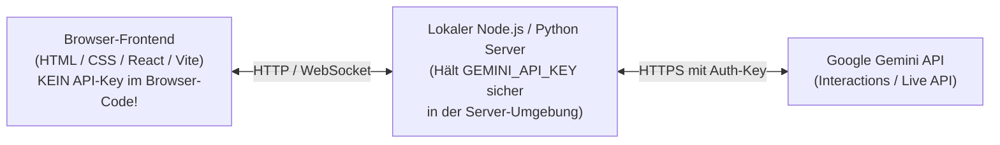

> **Thema:** Gemini API in TypeScript & Node.js – Das offizielle `@google/genai` SDK & die Interactions API
> **Autor:** Michael Stürmer
> **Datum:** 07.11.2026

<details>
<summary><b>Lernziele</b></summary>

* Das aktuelle TypeScript/JavaScript-Paket **`@google/genai`** sicher vom abgekündigten Legacy-Paket (`@google/generative-ai`) unterscheiden.
* Die **Interactions API (`ai.interactions.create`)** in TypeScript für Textgenerierung, strukturierte JSON-Antworten und Streaming einsetzen.
* Wissen, warum API-Schlüssel in Web-Anwendungen immer ins **Node.js-Backend** (oder über Ephemeral Tokens für die Live-API) gehören und niemals ungeschützt ins Browser-Frontend.

</details>

<details>
<summary><b>Kernkonzepte</b></summary>

<details>
<summary>1.1 Aktuelles TypeScript SDK vs. Veraltetes Legacy-Paket</summary>

Genau wie in Python gilt auch für JavaScript und TypeScript die strikte Regel aus `.github/instructions/gemini-api.instructions.md`:

| Kriterium | ❌ VERALTET (Niemals verwenden!) | ✅ AKTUELL (Immer verwenden!) |
| :--- | :--- | :--- |
| **NPM-Paketname** | `npm install @google/generative-ai` | **`npm install @google/genai`** |
| **Import im Code** | `import { GoogleGenerativeAI } from "@google/generative-ai"` | **`import { GoogleGenAI } from "@google/genai"`** |
| **Initialisierung** | `new GoogleGenerativeAI(apiKey)` | **`const ai = new GoogleGenAI();`** (nutzt automatisch `GEMINI_API_KEY`) |
| **Primäre Methode** | `model.generateContent(...)` | **`await ai.interactions.create({ ... })`** |

</details>

<details>
<summary>1.2 TypeScript-Schnellstart mit <code>ai.interactions.create</code></summary>

```typescript
import { GoogleGenAI } from "@google/genai";

// Liest process.env.GEMINI_API_KEY automatisch aus der Umgebung
const ai = new GoogleGenAI();

async function main(): Promise<void> {
  const interaction = await ai.interactions.create({
    model: "gemini-2.5-flash",
    input: "Erstelle eine kompakte Checkliste mit 3 Punkten für sauberen TypeScript-Code.",
  });

  console.log(interaction.output_text);
}

await main();
```

</details>

<details>
<summary>1.3 Strukturierte JSON-Antworten mit TypeScript-Schemata</summary>

Für Dashboards, Web-Apps und Daten-Pipelines lässt sich das Ausgabeformat direkt über `Type` aus `@google/genai` festlegen:

```typescript
import { GoogleGenAI, Type } from "@google/genai";

const ai = new GoogleGenAI();

async function analysiereTask(beschreibung: string): Promise<void> {
  const response = await ai.models.generateContent({
    model: "gemini-2.5-flash",
    contents: beschreibung,
    config: {
      responseMimeType: "application/json",
      temperature: 0.0,
      responseSchema: {
        type: Type.OBJECT,
        properties: {
          titel: { type: Type.STRING },
          aufwandStunden: { type: Type.NUMBER },
          kategorie: {
            type: Type.STRING,
            enum: ["LINUX", "VSCODE", "PYTHON", "TS_WEB", "AGENTS"],
          },
        },
        required: ["titel", "aufwandStunden", "kategorie"],
      },
    },
  });

  console.log(JSON.parse(response.text ?? "{}"));
}

await analysiereTask("Baue ein neues TypeScript-Dashboard für unsere MCP-Server-Ports.");
```

</details>

<details>
<summary>1.4 Sicherheitsarchitektur für Web-Apps (Frontend vs. Backend)</summary>

Wenn du eine Web-Oberfläche (z. B. mit HTML/JS, React oder Vite) baust, gilt ein eiserner Sicherheitsgrundsatz:



* **Warum?** Jeder Code, der direkt im Browser ausgeführt wird, kann über die Browser-Entwicklerwerkzeuge (*F12 $\rightarrow$ Sources / Network*) von jedem Nutzer im Klartext eingesehen werden.
* **Ausnahme Echtzeit-Audio/Video (Gemini Live API):** Wenn der Browser für minimale Latenz direkt per WebSocket streamen soll, erzeugt dein Backend vorher ein kurzlebiges **Ephemeral Client Token**, statt den echten Haupt-API-Key herauszugeben.

</details>

</details>

<details>
<summary><b>Übungsaufgaben</b></summary>

1. **SDK-Check:** Woran erkennst du in einer `package.json` sofort, ob ein TypeScript-Projekt das aktuelle oder das veraltete Google-Gemini-SDK nutzt?
2. **Sicherheitsfrage:** Warum darfst du `new GoogleGenAI({ apiKey: "AIza..." })` niemals direkt in eine Datei schreiben, die ungefiltert an einen öffentlichen Webbrowser ausgeliefert wird?
3. **Schema-Vorteil:** Welchen Vorteil bietet die `enum`-Einschränkung `["LINUX", "VSCODE", "PYTHON", "TS_WEB", "AGENTS"]` im `responseSchema`, wenn dein Frontend die Antwort anschließend mit farbigen Badges darstellen möchte?

</details>

<details>
<summary><b>Weiterführende Links & Quellen</b></summary>

* [Google GenAI JS/TS SDK auf GitHub (`googleapis/js-genai`)](https://github.com/googleapis/js-genai)
* [Gemini Interactions API Dokumentation](https://aistudio.google.com/docs/interactions-overview)
* [Gemini Live API (Echtzeit-WebSockets & Ephemeral Tokens)](https://aistudio.google.com/docs/live-api)

</details>

<details>
<summary><b>Chips & Kernaussagen</b></summary>

* **Immer `@google/genai` installieren:** Niemals das abgekündigte `@google/generative-ai` verwenden.
* **`new GoogleGenAI()` ohne Parameter:** Liest `GEMINI_API_KEY` in Node.js automatisch und sicher aus `process.env`.
* **`Type.OBJECT` + `enum` für garantierte JSON-Struktur:** Erspart fehleranfälliges Regex-Parsing von KI-Antworten im Frontend.
* **API-Keys bleiben auf dem Server:** Das Browser-Frontend spricht entweder über dein lokales Backend oder nutzt kurzlebige Ephemeral Tokens.

</details>

---
*Hinweis zur Organisation:* Die erstellte Dokumentation ist am Drehlaufwerk abgelegt und mit einer kurzen Zusammenfassung von den Chips auch in den Notebooks verlinkt.

<!-- DOKU-MINIMAP-START -->
<style>
.doku-arch-flow { font-family: var(--vscode-editor-font-family, Consolas, monospace); background: rgba(20, 24, 33, 0.92); border: 1px solid rgba(100, 140, 220, 0.35); border-radius: 10px; padding: 14px 16px; margin: 10px 0; color: #e2e8f0; }
.doku-arch-root { text-align: center; font-weight: 700; font-size: 1.04em; padding: 8px 12px; margin-bottom: 12px; background: linear-gradient(135deg, rgba(37, 99, 235, 0.28), rgba(15, 23, 42, 0.9)); border: 1px solid rgba(96, 165, 250, 0.5); border-radius: 8px; }
.doku-arch-root a { color: #93c5fd !important; text-decoration: none !important; }
.doku-arch-root a:hover { text-decoration: underline !important; }
.doku-arch-grid { display: grid; grid-template-columns: repeat(auto-fit, minmax(275px, 1fr)); gap: 10px; }
.doku-arch-card { background: rgba(30, 41, 59, 0.78); border: 1px solid rgba(148, 163, 184, 0.28); border-left: 4px solid #3b82f6; border-radius: 8px; padding: 9px 11px; transition: transform 0.12s ease, border-color 0.12s ease; }
.doku-arch-card:hover { border-color: #60a5fa; transform: translateY(-1px); }
.doku-arch-card.r1 { border-left-color: #22c55e; }
.doku-arch-card.r2 { border-left-color: #3b82f6; }
.doku-arch-card.r3 { border-left-color: #eab308; }
.doku-arch-card.r4 { border-left-color: #ec4899; }
.doku-arch-card.r5 { border-left-color: #a855f7; }
.doku-arch-card-title { font-weight: 700; font-size: 0.95em; margin-bottom: 6px; padding-bottom: 4px; border-bottom: 1px dashed rgba(148, 163, 184, 0.25); }
.doku-arch-card-title a { color: #f8fafc !important; text-decoration: none !important; display: block; }
.doku-arch-card-title a:hover { color: #60a5fa !important; }
.doku-arch-lines { list-style: none; margin: 0; padding: 0; font-size: 0.85em; line-height: 1.5; }
.doku-arch-lines li { margin: 3px 0; padding: 2px 5px; border-radius: 4px; white-space: normal; }
.doku-arch-lines li:hover { background: rgba(59, 130, 246, 0.18); }
.doku-arch-lines a { color: #cbd5e1 !important; text-decoration: none !important; display: inline; }
.doku-arch-lines a:hover { color: #93c5fd !important; text-decoration: underline !important; }
.doku-arch-badge { display: inline-block; font-size: 0.75em; padding: 0 5px; margin-left: 4px; border-radius: 4px; background: rgba(59, 130, 246, 0.22); color: #93c5fd !important; border: 1px solid rgba(96, 165, 250, 0.35); }
details.doku-minimap { position: fixed; bottom: 18px; right: 18px; z-index: 9999; width: 250px; max-height: 76px; overflow: hidden; background: rgba(15, 23, 42, 0.94); border: 1px solid rgba(96, 165, 250, 0.65); border-radius: 10px; box-shadow: 0 8px 26px rgba(0, 0, 0, 0.65); backdrop-filter: blur(8px); transition: width 0.18s ease, max-height 0.18s ease; font-family: var(--vscode-font-family, sans-serif); }
details.doku-minimap:hover { border-color: #60a5fa; }
details.doku-minimap[open] { width: min(860px, 94vw); max-height: 84vh; overflow-y: auto; padding-bottom: 10px; }
details.doku-minimap > summary { cursor: pointer; list-style: none; padding: 8px 12px; font-weight: 700; font-size: 0.84em; color: #f8fafc; background: linear-gradient(90deg, rgba(37, 99, 235, 0.45), rgba(30, 41, 59, 0.9)); border-bottom: 1px solid rgba(148, 163, 184, 0.25); display: flex; align-items: center; justify-content: space-between; user-select: none; }
details.doku-minimap > summary::-webkit-details-marker { display: none; }
details.doku-minimap .minimap-preview-strip { display: flex; gap: 4px; padding: 5px 10px 7px 10px; font-size: 0.72em; color: #94a3b8; justify-content: space-between; }
details.doku-minimap[open] .minimap-preview-strip { display: none; }
details.doku-minimap .minimap-preview-strip span { background: rgba(30, 41, 59, 0.9); padding: 2px 6px; border-radius: 4px; border: 1px solid rgba(148, 163, 184, 0.25); }
details.doku-minimap .minimap-body { padding: 8px 12px 4px 12px; }
</style>
<details class="doku-minimap">
<summary><span>🗺️ Doku-Minimap (5 Rubriken &amp; Labs)</span><span title="Klicken zum Vergrößern / Einklappen">⛶</span></summary>
<div class="minimap-preview-strip"><span>01 Linux</span><span>02 VSCode</span><span>03 Python</span><span>04 JS/TS</span><span>05 Agents</span></div>
<div class="minimap-body">
<div class="doku-arch-flow">
<div class="doku-arch-root">🏛️ <a href="../README.md">VanstrikeCyborg — git-labor Lern- &amp; Test-Architektur (Doku-Index)</a>  |  <a href="../../README.md">Repo-README</a>  |  <a href="../../AGENTS.md">AGENTS.md</a>  |  <a href="../../notebook-agent-environments/README.md">Notebooks</a></div>
<div class="doku-arch-grid">
<div class="doku-arch-card r1">
<div class="doku-arch-card-title">🐧 <a href="../01_Linux_Bash/README.md">01_Linux_Bash (Linux, Shell &amp; Container)</a></div>
<ul class="doku-arch-lines">
<li>├─ <a href="../01_Linux_Bash/01_bash-grundlagen-und-skripting.md">01 • Bash-Grundlagen, Skripting, Pipes &amp; Exit-Codes</a> <a class="doku-arch-badge" href="../../labs/01_linux_bash/check-env.sh">check-env.sh</a></li>
<li>├─ <a href="../01_Linux_Bash/02_arch-linux-omarchy-und-remote-ssh.md">02 • Arch Linux, Omarchy, systemd &amp; Remote-SSH</a></li>
<li>└─ <a href="../01_Linux_Bash/03_docker-und-sbx-micro-vms.md">03 • Docker Grundlagen &amp; Sandbox Micro-VMs (sbx)</a></li>
</ul>
</div>
<div class="doku-arch-card r2">
<div class="doku-arch-card-title">🧩 <a href="../02_VSCode_Env/README.md">02_VSCode_Env (IDE, Git, MCP &amp; Gemini)</a></div>
<ul class="doku-arch-lines">
<li>├─ <a href="../02_VSCode_Env/01_vscode-architektur-lsp-und-remote.md">01 • VS Code Architektur, Sprachserver (LSP) &amp; Remote</a></li>
<li>├─ <a href="../02_VSCode_Env/02_git-github-und-multi-root-workspaces.md">02 • Git, GitHub Workflow &amp; Multi-Root Workspaces</a> <a class="doku-arch-badge" href="../../git-labor.code-workspace">Workspace</a></li>
<li>├─ <a href="../02_VSCode_Env/03_mcp-server-localhost-proxy-und-ports.md">03 • MCP-Server, Localhost-Proxy &amp; Port-Diagnose (8317)</a></li>
<li>└─ <a href="../02_VSCode_Env/04_gemini-oekosystem-ai-studio-und-api-keys.md">04 • Gemini Ökosystem, Google AI Studio &amp; API-Keys</a></li>
</ul>
</div>
<div class="doku-arch-card r3">
<div class="doku-arch-card-title">🐍 <a href="../03_Python_Coding/README.md">03_Python_Coding (Python, uv &amp; GenAI SDK)</a></div>
<ul class="doku-arch-lines">
<li>├─ <a href="../03_Python_Coding/01_python-setup-uv-venv-und-notebooks.md">01 • Python Setup: uv, .venv, Pylance &amp; Notebooks</a></li>
<li>├─ <a href="../03_Python_Coding/02_gemini-api-python-sdk-und-interactions.md">02 • Google GenAI SDK (google-genai) &amp; Interactions API</a></li>
<li>└─ <a href="../03_Python_Coding/03_python-automatisierung-datenanalyse-und-tests.md">03 • Automatisierung, Datenanalyse &amp; pytest</a> <a class="doku-arch-badge" href="../../labs/03_python/sensor_demo.py">sensor_demo.py</a></li>
</ul>
</div>
<div class="doku-arch-card r4">
<div class="doku-arch-card-title">🌐 <a href="README.md">04_JS_TS_Web (HTML/CSS, JS/TS &amp; Web-SDK)</a></div>
<ul class="doku-arch-lines">
<li>├─ <a href="01_html-css-und-dom-grundlagen.md">01 • HTML5, CSS3 &amp; DOM-Manipulation Grundlagen</a> <a class="doku-arch-badge" href="../../labs/04_js_ts_web/rechner.html">rechner.html</a></li>
<li>├─ <a href="02_modernes-javascript-und-typescript.md">02 • Modernes JavaScript (ES6+) &amp; TypeScript</a></li>
<li>└─ <a href="03_gemini-sdk-typescript-und-web-apps.md">03 • Google GenAI SDK (@google/genai) für Web-Apps</a></li>
</ul>
</div>
<div class="doku-arch-card r5">
<div class="doku-arch-card-title">🤖 <a href="../05_Agents/README.md">05_Agents (KI-Agenten, Skills &amp; Orchestrierung)</a></div>
<ul class="doku-arch-lines">
<li>├─ <a href="../05_Agents/01_agent-stilfibel-und-didaktik-ruler.md">01 • Agent-Stilfibel, Didaktik-Ruler &amp; 7-Stufen-Aufbau</a></li>
<li>├─ <a href="../05_Agents/02_agenten-erstellen-instructions-rules-und-prompts.md">02 • Agenten erstellen: Instructions, Rules &amp; Prompts</a> <a class="doku-arch-badge" href="../../.github/instructions/gemini-api.instructions.md">gemini.instructions</a></li>
<li>├─ <a href="../05_Agents/03_agenten-ausruesten-skills-und-mcp-tools.md">03 • Agenten ausrüsten: Skills (SKILL.md) &amp; MCP-Tools</a> <a class="doku-arch-badge" href="../../.agents/skills/live-transfer-status-monitor/SKILL.md">SKILL.md</a></li>
<li>└─ <a href="../05_Agents/04_agenten-trainieren-primen-und-orchestrieren.md">04 • Agenten trainieren, primen &amp; Multi-Agent-Orchestrierung</a> <a class="doku-arch-badge" href="../../.github/agents/light.agent.md">@light</a> <a class="doku-arch-badge" href="../../.github/agents/rig.agent.md">@rig</a></li>
</ul>
</div>
</div>
</div>
</div>
</details>
<!-- DOKU-MINIMAP-END -->
