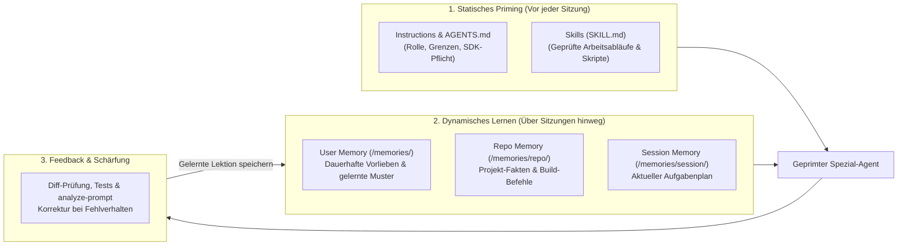
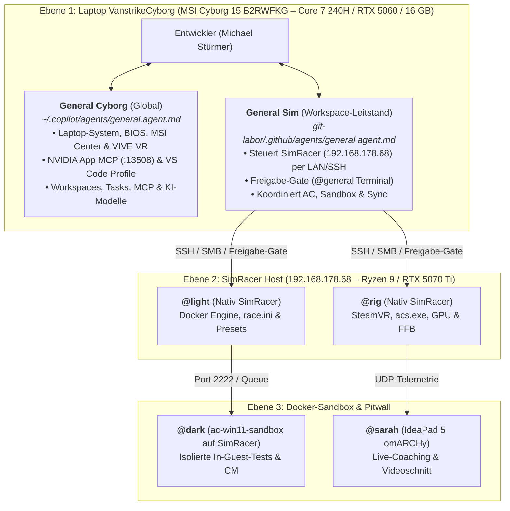
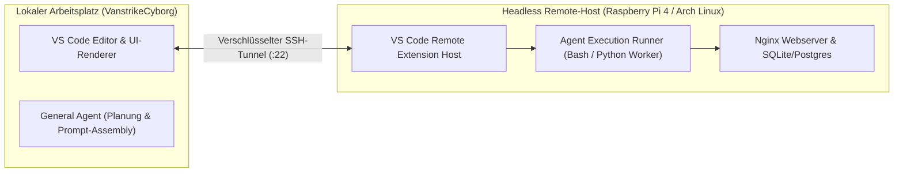

> **Thema:** KI-Agenten trainieren (Primen), evaluieren & in mehrstufigen Hierarchien orchestrieren
> **Autor:** Michael Stürmer
> **Datum:** 07.11.2026

<b>Lernziele</b>

* Verstehen, was **„Training & Priming“** bei KI-Agenten in der Praxis bedeutet: Gezielte Kontext-Konditionierung über **Instructions**, **3-Stufen-Memory (`/memories/`)** und **Few-Shot-Beispiele** statt teurem Modell-Nachtraining.
* Die **hierarchische Multi-Agenten-Architektur** mit dem **General Agent** als oberster Instanz auf dem Laptop (`VanstrikeCyborg`) und spezialisierten Subagenten beherrschen.
* Eigene Agent-Customizations systematisch in der **Sandbox (`sbx`)** testen und mit den VS Code **Evaluations-Skills (`analyze-prompt`, `troubleshoot`)** überprüfen.

<b>Kernkonzepte</b>

1.1 Was bedeutet „Agenten trainieren & primen“ im Engineering-Alltag?

Ein lokaler oder Cloud-KI-Agent wird im Projektalltag nicht durch das Ändern seiner neuronalen Gewichte (*Fine-Tuning*) trainiert, sondern durch **strukturiertes Priming und persistentes Gedächtnis** konditioniert:

### Die 4 Stufen des Agenten-Trainings:
1. **Rollen-Priming (System-Identität):** Dem Agenten in seiner `*.agent.md` oder `*.instructions.md` exakt sagen, **wer** er ist, **wo** er läuft und **was er nicht tun darf** (z. B. *„Vorschau-Pflicht vor Änderungen an `settings.json` oder `.code-workspace`“*).
2. **Few-Shot-Konditionierung (Gute Beispiele zeigen):** Ein konkretes Positiv- und Negativbeispiel (z. B. ein fertiger `
`-Block oder ein korrekter `google-genai`-Aufruf) wirkt zehnmal stärker als lange Textverbote.
3. **Erfahrungsspeicher (Memory-System `/memories/`):** Wenn ein Problem gelöst wurde (z. B. ein Port-Konflikt oder ein Pflicht-Dashboard bei Dateiübertragungen), wird die Erkenntnis in `/memories/preferences.md` oder `/memories/repo/` verankert.
4. **Iterative Schärfung (Evaluation):** Wenn ein Agent eine Regel übersieht, wird die Formulierung in der Instruction/Skill geschärft und mit dem Skill `analyze-prompt` auf Eindeutigkeit geprüft.

1.2 Die Agenten-Hierarchie: <code>General Cyborg</code> &amp; <code>General Sim</code> auf <code>VanstrikeCyborg</code> vs. SimRacer-Agenten

Nach dem Prinzip einer modernen Anlagensteuerung (Leitstand $\rightarrow$ Bereichs-Controller $\rightarrow$ Feld-Aktor) ist der Haupt-Agent bewusst in zwei klar getrennte Rollen aufgeteilt: **`General Cyborg`** (global für Laptop & VS Code) und **`General Sim`** (Workspace-Leitstand für den SimRacer).

### Hardware-Zuordnung &amp; klare Differenzierung:
* **`General Cyborg`** (`C:\Users\strik\.copilot\agents\general.agent.md`, global): Läuft auf **`VanstrikeCyborg`**, nutzt dessen Ressourcen und besitzt das hinterlegte Systemwissen aus `C:\local_Cyborg\Gemini\VanstrikeCyborg\` (Core 7 240H, 16 GB DDR5-5600 / max. 96 GB, RTX 5060 Laptop 8 GB @ 55 W ohne MUX-Switch, 3-Monitor-Setup, `MSI Center`, `F3`-Recovery, `NVIDIA App` MCP `http://127.0.0.1:13508/mcp` und `VIVE Hub` / Fehlercode `337`).
* **`General Sim`** (`git-labor\.github\agents\general.agent.md`, Workspace): Läuft physisch **ebenfalls auf `VanstrikeCyborg`** (VS Code & `@general`-PowerShell-Terminal), steuert aber über LAN/SSH/SMB die **SimRacer-Workstation (`192.168.178.68`)** und bildet das Freigabe-Gate (`ok`/`nein`/`reply`) für `@rig` und `@light`.
* **SimRacer-Agenten (`@rig`, `@light`, `@dark`):** Laufen **nicht** auf dem Laptop, sondern direkt auf der **Hardware des `SimRacer` (`192.168.178.68`)** (`@rig` & `@light` nativ auf dem Host; `@dark` gekapselt in der Docker-VM `ac-win11-sandbox`).
* **Pitwall (`@sarah`):** Läuft dediziert auf dem **IdeaPad 5 (`omARCHy` / `192.168.178.98`)**, um die SimRacer-CPU beim Videoschnitt zu entlasten.
* **Verbindliche Rückversicherung &amp; Freigabe-Gate:** Die SimRacer-Agenten ([`rig.agent.md`](../../.github/agents/rig.agent.md) und [`light.agent.md`](../../.github/agents/light.agent.md)) sichern sich vor jeder System-, Container- oder Weiterleitungs-Aktion beim `@general`-Leitstand (`General Sim`) ab (`ApprovalRequest` in `agents/general/inbox/`), sofern kein direkter General-Auftrag (`approved_by: GeneralAgent_Laptop`) vorliegt. Details siehe [Modul 5.5](./05_workspace-schnittstelle-simracer-und-agenten-terminals.md).

1.3 Der 6-Schritte-Trainingszyklus für neue Aufgaben mit einem Agenten

Wenn du im `git-labor` ein neues Feature baust oder einen Agenten anlernst, gehe immer nach diesem geprüften Muster vor:

1. **Ziel & Kontext stecken:** Nenne die betroffenen Dateien oder die Rubrik (z. B. *„Arbeite nur im Ordner `labs/python/`“*).
2. **Erst planen lassen (Plan Mode / Rückfragen):** Lass den Agenten bei komplexen Aufgaben erst einen kurzen Plan oder ein Diff zeigen, bevor er Dateien ändert.
3. **Isoliert ausführen (bei Risiko in `sbx`):** Wenn der Agent im Full-Autonomy-Modus neue Pakete oder Systembefehle ausprobieren soll, starte ihn in der Sandbox (`sbx run --name agent-training gemini . "./Doku:ro"`).
4. **Automatisierte Verifikation verlangen:** Der Agent muss nach jeder Änderung selbstständig Linter/Pylance (`get_errors`) oder Tests (`pytest` / `tsc --noEmit`) ausführen.
5. **Diff kontrollieren (`Strg + Shift + G`):** Prüfe in der VS Code Source Control rot/grün, was der Agent tatsächlich verändert hat.
6. **Lerneffekt sichern:** Hat ein Workflow perfekt funktioniert, speichere ihn als wiederverwendbaren **Skill (`SKILL.md`)** oder **Prompt (`.prompt.md`)**.

1.4 Diagnose & Qualitätsprüfung für Agenten-Dateien

In deinem VS Code sind spezielle Diagnose-Werkzeuge für das Agenten-Training vorinstalliert:
* **Skill `agent-customization`:** Hilft beim Erstellen, Prüfen und Reparieren von `.instructions.md`, `.prompt.md`, `.agent.md`, `SKILL.md` und `AGENTS.md`.
* **Skill `analyze-prompt` & `fix-customization-evaluation-diagnostics`:** Prüft deine geöffneten Agenten- und Prompt-Dateien auf unklare Anweisungen, fehlende YAML-Felder oder Konflikte im *Problems*-Panel.
* **Skill `troubleshoot`:** Analysiert die JSONL-Debug-Logs einer Chat-Sitzung, falls du wissen möchtest, warum ein bestimmtes Tool, eine Instruction oder ein Subagent in einem Durchlauf genutzt oder übersprungen wurde.

1.5 Remote-Entwicklung & Headless-Agenten (Raspberry Pi 4 &amp; Arch Linux)

In professionellen Entwicklungsumgebungen läuft die Ausführung rechenintensiver Skripte oder von Webservern oft nicht auf dem lokalen Arbeitsplatz-Laptop, sondern auf dedizierten Remote-Hosts (z. B. Raspberry Pi 4 oder Omarchy Linux-Server):

* **Entkopplung von Benutzeroberfläche und Ausführung:** Durch den *Remote Extension Host* bleibt die Benutzeroberfläche von VS Code auf `VanstrikeCyborg` butterweich bedienbar, während Compiler, Tests und Hintergrundprozesse auf dem Linux-Host laufen.
* **Agenten im Headless-Modus:** Ein Agent kann remote Befehle ausführen (`systemctl restart nginx`, Datenbankmigrationen starten), ohne dass lokale Pfadübersetzungen (Windows `C:\` vs. Linux `/`) nötig sind.

1.6 Privacy-First Agent Observability: KI-Traffic-Analyse &amp; Matomo

Wenn Agenten autonom mit Webdiensten, internen APIs und Dokumentationen interagieren, entsteht ein völlig neues Anforderungsprofil an das **Monitoring & Analytics**:

| Eigenschaft | Matomo On-Premise (Privacy-First) | Herkömmliche Cloud-Analytics |
| :--- | :--- | :--- |
| **Dateninhaberschaft** | **100 % eigene Kontrolle** auf eigenem Linux-/Pi-Server | Daten liegen auf externen US-Konzern-Servern |
| **Datenschutz / DSGVO** | Vollständig konform, optional komplett ohne Cookies | Oft komplexe Consent-Banner & Opt-In-Pflicht |
| **Datenpräzision** | **Ungefilterte Rohdaten (No Sampling)** | Verzerrte Hochrechnungen durch Data Sampling |
| **KI- & Bot-Traffic-Analyse** | **Gezielte Differenzierung von KI- vs. Human-Traffic** | Vermischt Menschen mit Bots oder blockiert KI blind |

### Warum KI-Traffic-Tracking unverzichtbar ist:
1. **Trennung von Mensch und Maschine:**
   Traditionelle Webanalyse zählt Seitenaufrufe unabhängig davon, ob ein Mensch im Browser liest oder ein autonomer Agent (`Copilot`, `ClaudeCode`, `GeminiAgent`, `curl`, `python-requests`) die Dokumentation parst. Matomo ermöglicht über User-Agent-Erkennung und Sitzungsanalyse eine saubere Trennung.
2. **Observability für Multi-Agenten-Systeme:**
   * Wie oft greift der Agent auf interne Wissensdatenbanken oder MCP-Endpunkte zu?
   * Welche Fehlercodes (`404`, `500`) treten bei automatisierten API-Aufrufen auf?
   * Wie entwickelt sich die Latenz und der synthetische Datenverkehr bei komplexen Aufgabenketten?
3. **Schutz vor Daten-Leakage:**
   Da das gesamte Tracking On-Premise auf dem eigenen Server betrieben wird, fließen sensible Unternehmens- und Projektdaten (wie Dateipfade oder Abfrage-Parameter) niemals an externe Analyse-Dienstleister ab.

<b>Übungsaufgaben</b>

1. **Priming vs. Fine-Tuning:** Erkläre in eigenen Worten, warum wir für unsere täglichen Workflows **Instructions (`*.instructions.md`), Skills (`SKILL.md`) und Memory (`/memories/`)** nutzen, statt ein Sprachmodell jedes Mal neu zu trainieren.
2. **Rolle des General Agenten:** Welche Aufgaben übernimmt der **General Agent** auf dem Laptop `VanstrikeCyborg` und warum gilt für ihn bei Änderungen an der globalen `settings.json` oder `.code-workspace` immer die **Vorschau-Pflicht**?
3. **Remote-Agenten-Architektur:** Welchen Vorteil hat der VS Code *Remote Extension Host*, wenn ein Agent auf einem Raspberry Pi 4 einen Nginx-Server konfiguriert und testet?
4. **Privacy-First Observability:** Warum ist ungesampeltes Tracking mit Matomo On-Premise für die Überwachung von KI-Agenten-Traffic herkömmlichen Cloud-Analytics-Systemen überlegen?
5. **Fehleranalyse bei Agenten:** Eine neu angelegte `.instructions.md`-Datei wird vom Agenten im Chat scheinbar ignoriert. Welche drei Punkte (Speicherort, YAML-Frontmatter `applyTo`, VS Code Reload/Diagnostics) prüfst du zuerst?

<b>Weiterführende Links & Quellen</b>

* [Modul 5.1: Verbindliche Stilfibel & Didaktik-Ruler](./01_agent-stilfibel-und-didaktik-ruler.md)
* [Modul 5.2: Agenten erstellen (Instructions, Rules & Custom Agents)](./02_agenten-erstellen-instructions-rules-und-prompts.md)
* [Modul 5.3: Agenten ausrüsten (Skills & MCP-Tools)](./03_agenten-ausruesten-skills-und-mcp-tools.md)
* [Modul 5.5: Workspace-Schnittstelle, Freigabe-Gate & Agenten-Terminals](./05_workspace-schnittstelle-simracer-und-agenten-terminals.md)
* **Agent-Definitionen &amp; Regeln:** [`AGENTS.md`](../../AGENTS.md) · [`vscode-experte.instructions.md`](../../../.copilot/instructions/vscode-experte.instructions.md) · [`general.agent.md`](../../.github/agents/general.agent.md) · [`rig.agent.md`](../../.github/agents/rig.agent.md) · [`light.agent.md`](../../.github/agents/light.agent.md) · [`dark.agent.md`](../../.github/agents/dark.agent.md) · [`sarah.agent.md`](../../.github/agents/sarah.agent.md)
* **Skills &amp; Historie:** [`live-transfer-status-monitor` (`SKILL.md`)](../../.agents/skills/live-transfer-status-monitor/SKILL.md) · [`AGENT_KOMMUNIKATION_HISTORIE.md`](../../../assetto-corsa-content/ac-sandbox/shared/agents/general/logs/AGENT_KOMMUNIKATION_HISTORIE.md)
* [Matomo Web Analytics – On-Premise & Privacy-First](https://matomo.org/)
* [VS Code Remote Development Architektur](https://code.visualstudio.com/docs/remote/remote-overview)

<b>Chips & Kernaussagen</b>

* **Gutes Priming = Präzises Training:** Klare Rollen-Grenzen, Positiv-Beispiele und das 3-Stufen-Memory (`/memories/`) formen einen verlässlichen Experten-Agenten.
* **Klare Trennung `General Cyborg` vs. `General Sim`:** Beide laufen auf dem Laptop `VanstrikeCyborg` — `General Cyborg` betreut global das MSI-Laptop-System, VIVE VR, MCP & VS Code; `General Sim` steuert den `SimRacer` (`192.168.178.68`) & das Freigabe-Gate.
* **Hardware-Treue der Subagenten:** `@rig` und `@light` laufen nativ auf dem `SimRacer`, `@dark` gekapselt im Docker-Container auf dem `SimRacer`, `@sarah` auf dem `IdeaPad 5`.
* **Vorschau-Pflicht schützt Konfigurationen:** Vor Eingriffen in `.code-workspace` oder globale `settings.json` wird immer erst ein Diff gezeigt.
* **Sicher trainieren mit `sbx` + `:ro`:** Autonome Agenten-Tests laufen isoliert in der Micro-VM, während Referenz-Ordner wie `./Doku:ro` schreibgeschützt bleiben.
* **Remote Extension Host entkoppelt UI:** Komplexe Skripte und Server laufen auf dem Headless-Host (Raspberry Pi / Arch Linux), während der Entwickler auf dem Laptop verzögerungsfrei weiterarbeitet.
* **Privacy-First Observability:** On-Premise-Tracking mit Matomo liefert ungesampelte Rohdaten und unterscheidet zuverlässig zwischen menschlichen Nutzern und KI-Agenten-Traffic.

---
*Hinweis zur Organisation:* Die erstellte Dokumentation ist am Drehlaufwerk abgelegt und mit einer kurzen Zusammenfassung von den Chips auch in den Notebooks verlinkt.

<!-- DOKU-MINIMAP-START -->

🗺️ Doku-Minimap (5 Rubriken &amp; Labs)⛶

01 Linux02 VSCode03 Python04 JS/TS05 Agents

🏛️ <a href="../README.md">VanstrikeCyborg — git-labor Lern- &amp; Test-Architektur (Doku-Index)</a>  |  <a href="../../README.md">Repo-README</a>  |  <a href="../../AGENTS.md">AGENTS.md</a>  |  <a href="../../notebook-agent-environments/README.md">Notebooks</a>

🐧 <a href="../01_Linux_Bash/README.md">01_Linux_Bash (Linux, Shell &amp; Container)</a>

<ul class="doku-arch-lines">
<li>├─ <a href="../01_Linux_Bash/01_bash-grundlagen-und-skripting.md">01 • Bash CLI, Text-Tools, Streams &amp; Expansions</a> <a class="doku-arch-badge" href="../../labs/01_linux_bash/check-env.sh">check-env.sh</a></li>
<li>├─ <a href="../01_Linux_Bash/02_linux-systemadministration-und-interna.md">02 • Inodes, LVM, Prozesse, Boot-Prozess &amp; systemd</a></li>
<li>├─ <a href="../01_Linux_Bash/03_arch-linux-omarchy-und-remote-ssh.md">03 • Arch Linux, Omarchy, Remote-SSH &amp; Nginx</a></li>
<li>├─ <a href="../01_Linux_Bash/04_fortgeschrittenes-bash-skripting-und-automatisierung.md">04 • Advanced Bash: Arrays, getopts &amp; Backups</a></li>
<li>└─ <a href="../01_Linux_Bash/05_docker-und-sbx-micro-vms.md">05 • Docker Grundlagen &amp; Sandbox Micro-VMs (sbx)</a></li>
</ul>

🧩 <a href="../02_VSCode_Env/README.md">02_VSCode_Env (IDE, Git, MCP &amp; Gemini)</a>

<ul class="doku-arch-lines">
<li>├─ <a href="../02_VSCode_Env/01_vscode-architektur-lsp-und-remote.md">01 • VS Code Architektur, Sprachserver (LSP) &amp; Remote</a></li>
<li>├─ <a href="../02_VSCode_Env/02_git-github-und-multi-root-workspaces.md">02 • Git, GitHub Workflow &amp; Multi-Root Workspaces</a> <a class="doku-arch-badge" href="../../git-labor.code-workspace">Workspace</a></li>
<li>├─ <a href="../02_VSCode_Env/03_mcp-server-localhost-proxy-und-ports.md">03 • MCP-Server, Localhost-Proxy &amp; Port-Diagnose (8317)</a></li>
<li>└─ <a href="../02_VSCode_Env/04_gemini-oekosystem-ai-studio-und-api-keys.md">04 • Gemini Ökosystem, Google AI Studio &amp; API-Keys</a></li>
</ul>

🐍 <a href="../03_Python_Coding/README.md">03_Python_Coding (Python, uv &amp; GenAI SDK)</a>

<ul class="doku-arch-lines">
<li>├─ <a href="../03_Python_Coding/01_python-setup-uv-venv-und-notebooks.md">01 • Python Setup: uv, .venv, Pylance &amp; Notebooks</a></li>
<li>├─ <a href="../03_Python_Coding/02_gemini-api-python-sdk-und-interactions.md">02 • Google GenAI SDK (google-genai) &amp; Interactions API</a></li>
<li>└─ <a href="../03_Python_Coding/03_python-automatisierung-datenanalyse-und-tests.md">03 • Automatisierung, Datenanalyse &amp; pytest</a> <a class="doku-arch-badge" href="../../labs/03_python/sensor_demo.py">sensor_demo.py</a></li>
</ul>

🌐 <a href="../04_JS_TS_Web/README.md">04_JS_TS_Web (HTML/CSS, JS/TS &amp; Web-SDK)</a>

<ul class="doku-arch-lines">
<li>├─ <a href="../04_JS_TS_Web/01_html-css-und-dom-grundlagen.md">01 • HTML5, CSS3 &amp; DOM-Manipulation Grundlagen</a> <a class="doku-arch-badge" href="../../labs/04_js_ts_web/rechner.html">rechner.html</a></li>
<li>├─ <a href="../04_JS_TS_Web/02_modernes-javascript-und-typescript.md">02 • Modernes JavaScript (ES6+) &amp; TypeScript</a></li>
<li>└─ <a href="../04_JS_TS_Web/03_gemini-sdk-typescript-und-web-apps.md">03 • Google GenAI SDK (@google/genai) für Web-Apps</a></li>
</ul>

🤖 <a href="README.md">05_Agents (KI-Agenten, Skills &amp; Orchestrierung)</a>

<ul class="doku-arch-lines">
<li>├─ <a href="01_agent-stilfibel-und-didaktik-ruler.md">01 • Agent-Stilfibel, Didaktik-Ruler &amp; 7-Stufen-Aufbau</a></li>
<li>├─ <a href="02_agenten-erstellen-instructions-rules-und-prompts.md">02 • Agenten erstellen: Instructions, Rules &amp; Prompts</a> <a class="doku-arch-badge" href="../../.github/instructions/gemini-api.instructions.md">gemini.instructions</a></li>
<li>├─ <a href="03_agenten-ausruesten-skills-und-mcp-tools.md">03 • Agenten ausrüsten: Skills (SKILL.md) &amp; MCP-Tools</a> <a class="doku-arch-badge" href="../../.agents/skills/live-transfer-status-monitor/SKILL.md">SKILL.md</a></li>
<li>└─ <a href="04_agenten-trainieren-primen-und-orchestrieren.md">04 • Agenten trainieren, primen &amp; Multi-Agent-Orchestrierung</a> <a class="doku-arch-badge" href="../../.github/agents/light.agent.md">@light</a> <a class="doku-arch-badge" href="../../.github/agents/rig.agent.md">@rig</a></li>
</ul>

<!-- DOKU-MINIMAP-END -->
