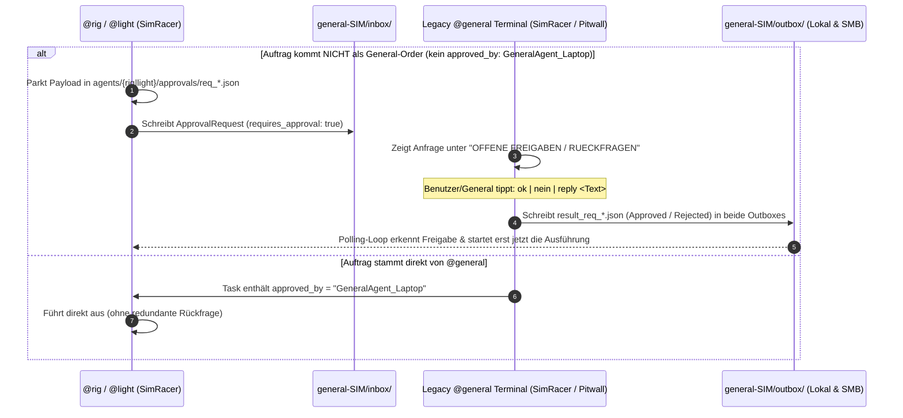

> **Thema:** Workspace-Schnittstelle: SimRacer-Verbund, Task-Queue & Agenten-Terminals
> **Autor:** Michael Stürmer
> **Datum:** 26.11.2026 *(Workspace-Isolation, XOR-Mutex &amp; 7-Rollen-Registry LIVE auf StrikerPi)*

<!-- DOKU-SUBNAV-START -->
<details>
<summary><b>🧭 Rubrik-Navigation &amp; Modul-Übersicht (05 Agents)</b></summary>

**Zentrale:** [📚 Doku-Index](../README.md) · [📂 Rubrik 05 Agents](./README.md) · **Vorheriges:** [⬅️ 04 • Priming, Memory & Multi-Agent-Orchestrierung](./04_agenten-trainieren-primen-und-orchestrieren.md) · **Nächstes:** [06 • Multi-Workspace Netzwerk & 7-Rollen-Verbund ➡️](./05_multi-workspace-netzwerk-mcp-und-agenten-verbund.md)

**Alle Module in `05_Agents/`:**
- [01 • Agent-Stilfibel, Didaktik-Ruler & 7-Stufen-Aufbau](./01_agent-stilfibel-und-didaktik-ruler.md)
- [02 • Agenten erstellen: Instructions, Rules & Prompts](./02_agenten-erstellen-instructions-rules-und-prompts.md) · `gemini.instructions`
- [03 • Agenten ausrüsten: Skills & MCP-Tools](./03_agenten-ausruesten-skills-und-mcp-tools.md) · `SKILL.md`
- [04 • Priming, Memory & Multi-Agent-Orchestrierung](./04_agenten-trainieren-primen-und-orchestrieren.md) · `@light`
- 👉 **[05 • Schnittstelle, Terminals & XOR-Mutex](./05_workspace-schnittstelle-simracer-und-agenten-terminals.md)** *(aktuell)* · `Bridge`
- [06 • Multi-Workspace Netzwerk & 7-Rollen-Verbund](./05_multi-workspace-netzwerk-mcp-und-agenten-verbund.md)
- [Letztstand 26.11. (Dual-GPU Ollama &amp; Pitwall GPU-Modelle)](./SYSTEM_ARCHITEKTUR_AENDERUNGEN_2026-11-26.md)
- [Stand 25.11. (Architektur v5, Toolbox & Pitwall v2.1)](./SYSTEM_ARCHITEKTUR_AENDERUNGEN_2026-11-25.md)
- [Praxis-Referenz 25.11. (Hisense 4K-TV & ClearType)](./HISENSE_TV_DISPLAY_OPTIMIERUNG_2026-11-25.md)
- [Stand 24.11. (Parity, Qwen 3.5 & Nacharbeiten)](./SYSTEM_ARCHITEKTUR_AENDERUNGEN_2026-11-24.md)
- [Stand 23.11. (ToS-Bereinigung, Ollama & Pitwall v1.5)](./SYSTEM_ARCHITEKTUR_AENDERUNGEN_2026-11-23.md)
- [Änderungsprotokoll 11.11. (MQTT, Gatekeeper & Caddy)](./SYSTEM_ARCHITEKTUR_AENDERUNGEN_2026-11-11.md)
- [Pitwall & Systemreferenz (NotebookLM-Quelle)](./PITWALL_STEUERUNG_UND_FUNKTIONSREFERENZ_NOTEBOOKLM.md)
- [Boxencrew & Teamchef Konzept (NotebookLM)](./PITWALL_BOXENCREW_TEAMCHEF_KONZEPT_NOTEBOOKLM.md)

**Weitere Rubriken:** [🐧 01 Linux & Bash](../01_Linux_Bash/README.md) · [🧩 02 VS Code & MCP](../02_VSCode_Env/README.md) · [🐍 03 Python](../03_Python_Coding/README.md) · [🌐 04 JS/TS Web](../04_JS_TS_Web/README.md) · [🏎️ 06 AC KN5 Modding](../06_AC_KN5_Modding/README.md) · [🥽 07 VR Engineering](../07_VR_Engineering/README.md)

</details>
<!-- DOKU-SUBNAV-END -->

<details>
<summary><b>0.1 Kanonische Rollen- und Terminalmatrix (aktueller Umsetzungsstand)</b></summary>

| Terminal-ID | Rolle | System | Start / Status |
| :--- | :--- | :--- | :--- |
| `cyborg` | General Cyborg | VanstrikeCyborg | Lokaler Copilot-CLI-Agent (`copilot --agent "General Cyborg"`); nicht über die Pitwall ausführbar |
| `general-sim` | General Sim | StrikerPi `.86` | Getrenntes SSH-Terminal und JSON-Dispatch; **LIVE** unter `/opt/general-sim/` (`READY`) |
| `light`, `rig` | SimRacer Light, Rig Agent | SimRacer `.68` | Bestehende SSH-Terminals (`@light` als Host-Orchestrator &amp; 2-Stufen-QA laut Architektur v5) |
| `dark` | Dark Agent | Sandbox auf SimRacer | Bestehendes Sandbox-SSH-Terminal (`:2222`) |
| `sarah` | Sarah Coach | Archibald `.98` | Bestehendes SSH-Terminal |
| `rick` | Rick Agent | StrikerPi `.86` | Bestehendes SSH-Terminal |

Die zentrale Registry liegt in [`agent_registry.json`](../../../strikerpi-hub/telemetry-relay/agent_registry.json). [`labs/Agent-Terminals.ps1`](../../labs/Agent-Terminals.ps1) lädt die IDs und Host-Zuordnungen aus dieser Datei. In diesem Launcher ist `general` ein Kompatibilitätsalias für `general-sim`; falls das Pi-Terminal fehlt, startet der Launcher keinen lokalen Ersatz.

**Übergangsgrenze:** Die Pitwall (`telemetry_relay.py` live auf StrikerPi, SHA256 `5e290c4b…`) kennzeichnet `@general (Legacy)` für die bisherige SimRacer-Queue und den alten Approval-Pfad. `/ws/terminal/general` und Voice-Dispatch `target=general` bleiben während der Übergangsphase aktiv auf SimRacer. Neue General-Sim-Aufträge nutzen `/ws/terminal/general-sim` bzw. `/opt/general-sim/`; die Altstrecke wird erst nach abgeschlossenem E2E-Cutover stillgelegt.

Prompt-Transport erfolgt als UTF-8-JSON-Daten über `/api/voice/dispatch`. PowerShell-Freitext wird nicht dynamisch als Befehl ausgeführt. Outbox-Resultate und Logdateien bleiben die Evidenzquelle; eine Pi-SQLite-Datenbank ist nicht Bestandteil dieser Ausbaustufe. Neue Tool-Downloads sind in der Registry deaktiviert (`download_enabled: false`) und erfordern vor einer späteren Installation die Zustimmung von General Cyborg und Nutzer.

Details zu Implementierung, Abnahme und offenen Deploy-Schritten stehen in [Rollen-, Terminal- und Pitwall-Umsetzung](../../../assetto-corsa-content/docs/03_agenten_system/rollen-terminals-pitwall-umsetzung.md).

</details>

<details>
<summary><b>Lernziele</b></summary>

* Verstehen der **Multi-Workspace-Architektur** zwischen dem Labor-Workspace (`git-labor` auf Laptop `VanstrikeCyborg`), dem Simulations-Workspace (`assetto-corsa-content` / SimRacer `192.168.178.68`) und dem 24/7-Edge-Hub (`strikerpi-hub` / StrikerPi `192.168.178.86`).
* Beherrschen der **dateibasierten Task-Queue (`inbox/` $\rightarrow$ Worker $\rightarrow$ `outbox/` & `logs/`)** sowie der **SSH-Queue für `@rick`** (`/opt/rick-agent/inbox/`).
* Sichere Trennung zwischen **lokalen Host-Terminals** (auf SimRacer, Sandbox, Archibald, StrikerPi) und den zentral über **`labs/Agent-Terminals.ps1`** gestarteten **SSH-Client-Terminals** vom `VanstrikeCyborg` (`-ClientMode`).
* Nachvollziehen des **Prompt-Lebenszyklus** und der Integration in Python (`labs/03_python/sim_agent_bridge.py`) und PowerShell (`labs/Send-SimAgentTask.ps1`).

</details>

<details>
<summary><b>Kernkonzepte</b></summary>

<details>
<summary>1.1 Die Multi-Workspace-Hierarchie im Überblick</summary>

Das Entwickler-Ökosystem ist strikt in zwei Rollenbereiche unterteilt:

```mermaid
flowchart TB
    subgraph GITLABOR["Workspace: git-labor (Laptop VanstrikeCyborg)"]
        DEV["Entwickler / General Cyborg (Global)"]
        LAUNCHER["Agent-Terminals.ps1 (SSH-Launcher)"]
        BRIDGE_PY["sim_agent_bridge.py"]
        CLI_PS["Send-SimAgentTask.ps1 / @general-sim Terminal"]
    end

    subgraph NETWORK["Netzwerk-Schnittstelle (SMB / SSH)"]
        SMB["\\192.168.178.68\ac-sandbox\shared\agents\"]
        SSH["SSH :22 (SimRacer/Archibald/StrikerPi) / :2222 (Sandbox)"]
    end

    subgraph SIMRACER["Workspace: assetto-corsa-content (SimRacer &amp; Sandbox)"]
        subgraph TUI_HOST["Host Terminals (Nativ auf SimRacer 192.168.178.68)"]
            T_LIGHT["@light Terminal (Docker-Engine)"]
            T_RIG["@rig Terminal (RTX 5070 Ti, VR, acs.exe)"]
        end
        subgraph TUI_GUEST["Sandbox Gast (ac-win11-sandbox auf SimRacer :8006)"]
            T_DARK["@dark Terminal (CSP, Setup-Validator)"]
        end
        subgraph PITWALL["Pitwall (IdeaPad 5 omARCHy 192.168.178.98)"]
            T_SARAH["@sarah Terminal (Telemetrie, Video)"]
        end
        subgraph EDGE["24/7 Edge Hub (StrikerPi 192.168.178.86)"]
            T_GS["@general-sim Leitstand (StrikerPi LIVE)"]
            T_RICK["@rick (Relay :8080, MQTT :1883, Bare-Git)"]
        end
    end

    DEV --> LAUNCHER &amp; BRIDGE_PY &amp; CLI_PS
    LAUNCHER -->|SSH -ClientMode / Bash| SSH
    BRIDGE_PY &amp; CLI_PS -->|Schreibt Task-JSON in inbox| SMB
    BRIDGE_PY &amp; CLI_PS -->|SCP/SSH fuer @rick| T_RICK
    T_GS -->|JSON-Dispatch / Status / Logs| T_LIGHT &amp; T_RIG &amp; T_DARK &amp; T_SARAH
    SMB --> T_LIGHT &amp; T_RIG &amp; T_DARK &amp; T_SARAH
    T_LIGHT &amp; T_RIG &amp; T_DARK &amp; T_SARAH -->|Schreibt Result-JSON in outbox| SMB
    SMB -->|Liest Status &amp; Output| BRIDGE_PY &amp; CLI_PS
```

* **`General Cyborg`** läuft lokal auf **`VanstrikeCyborg`** und verantwortet Laptop, VS Code, Workspace, Modelle und NVIDIA/VIVE. **`General Sim`** ist als separate Leitstandsrolle auf **StrikerPi (`192.168.178.86`)** registriert und seit **26.11.2026 live unter `/opt/general-sim/`** deployed (`READY`). Der alte `@general`-Queue-/Approval-Pfad bleibt bis zum E2E-Cutover Legacy.
* **`git-labor`:** Experimentelles Skripting, Datenanalyse, Erstellung und Test von MCP-Servern, KI-Modell-Workflows und Orchestrierung.
* **`assetto-corsa-content`:** Produktionsumgebung für Assetto Corsa, Content Manager (CM), Custom Shaders Patch (CSP), Setup-Validierung, VR-Frametimes (120 Hz) und Container-Lifecycle.

</details>

<details>
<summary>1.2 Der Prompt-Lebenszyklus: Wo sieht man die Bearbeitung?</summary>

Wenn ein Prompt in einem Agenten-Terminal oder über ein externes Skript abgeschickt wird, durchläuft er vier sichtbare Phasen:

```
[Phase 1: Absenden] --> [Phase 2: Queue & TUI] --> [Phase 3: Worker-Ausführung] --> [Phase 4: Rückmeldung]
```

1. **Visuelle Bestätigung beim Absender:**
   * In der Quell-Konsole erscheint:
     ```text
     [00:15:32] Task task_20261107_001532_471 für Agent 'dark' erstellt.
     ```
2. **Reaktion im Ziel-Terminal:**
   * Der obere Status-Header des Ziel-Terminals aktualisiert sich alle 2 Sekunden:
     ```text
     Queue: [1]  |  Status: [BUSY]  |  Aktiv: task_20261107_001532_471
     ```
   * Im Live-Logfenster des Ziel-Terminals erscheint:
     ```text
     [00:15:34] [WORKER] Starte Bearbeitung von Task 'task_20261107_001532_471'...
     [00:15:34] [COMMAND] Action=ValidateSetups Car=rss_formula_hybrid_x_2026
     ```
3. **Status-Matrix für das Gesamtsystem:**
   * Die folgende Matrix ist ein illustratives Beispiel aus dem Terminal-Verbund (aktuelle Live-Prüfung über `.\labs\Agent-Terminals.ps1 -StatusOnly`, dort ist `@general-sim` auf StrikerPi als `READY` verifiziert):
     ```text
     [General Sim: READY]  [Light: IDLE]  [Rig: IDLE]  [Dark: RUNNING]  [Sarah: IDLE]
     ```

</details>

<details>
<summary>1.3 Wo und wie erhält man die Rückmeldung?</summary>

Es gibt vier Wege, wie Ergebnisse und Rückmeldungen bereitgestellt und konsumiert werden:

| Rückmelde-Kanal | Speicherort / Mechanismus | Format | Verwendung |
| :--- | :--- | :--- | :--- |
| **1. Dateibasierte Outbox** | `\\192.168.178.68\ac-sandbox\shared\agents\<agent>\outbox\result_<id>.json` | Strukturiertes JSON | Automatisierte Skripte (`git-labor`, Python, CI/CD) |
| **2. Dauerhafte Logdatei** | `\\192.168.178.68\ac-sandbox\shared\agents\<agent>\logs\task_<id>.log` | Roher Text (Stdout/Stderr) | Fehleranalyse, lange Stacktraces, Setup-Details |
| **3. Synchroner Handshake (CLI)** | Konsole blockiert, wartet auf Ergebnis, gibt es formatiert aus und räumt auf | Farbiger Konsolentext & ExitCode | Direkte interaktive PowerShell-Ausführung |
| **4. Terminal TUI-Dashboard** | Unterer Fensterbereich des Ziel- und Quell-Terminals | Historie der letzten 5 Tasks mit [SUCCESS]/[FAILED] | Live-Monitoring am Bildschirm / Web-VNC |

#### Struktur der Rückmelde-Datei (`result_<taskId>.json`):
```json
{
  "task_id": "task_20261107_001532_471",
  "agent": "dark",
  "status": "Success",
  "exit_code": 0,
  "completed_at": "2026-11-07T00:15:42Z",
  "duration_seconds": 9.84,
  "output": "Validierung abgeschlossen: 201 Setups geprüft, 0 Syntaxfehler, CSP Physics V2 konform.",
  "artifacts": [
    "C:\\AssettoCorsa\\setups\\rss_formula_hybrid_x_2026\\validation_report.json"
  ]
}
```

</details>

<details>
<summary>1.4 Netzwerk- und Pfad-Mapping zwischen den Systemen</summary>

Da Entwickler-Laptop (`VanstrikeCyborg`), SimRacer-Host (`192.168.178.68`) und die Docker-Windows-11-Sandbox unterschiedliche Pfade sehen, sorgt das folgende standardisierte Mapping für Transparenz:

| Rechner / Kontext | Basis-Pfad zur Agenten-Queue |
| :--- | :--- |
| **Laptop VanstrikeCyborg (`git-labor`):** | `\\192.168.178.68\ac-sandbox\shared\agents\<agent>\` |
| **SimRacer Host (Nativ Windows 11):** | `C:\ac-sandbox\shared\agents\<agent>\` |
| **Sandbox Gast (`ac-win11-sandbox`):** | `\\host.lan\Data\agents\<agent>\` (oder `C:\ac-sandbox\shared\agents\<agent>\`) |

</details>

<details>
<summary>1.5 Python-Integration in Git-Labor (`sim_agent_bridge.py`)</summary>

Im Ordner `labs/03_python/sim_agent_bridge.py` stellt die Klasse `SimAgentBridge` Methoden bereit, um Tasks direkt aus Python abzusenden und Ergebnisse synchron abzuwarten:

```python
from sim_agent_bridge import SimAgentBridge

bridge = SimAgentBridge()

# 1. Status prüfen
status = bridge.get_agent_status("dark")
print(f"Dark Agent Queue: {status['queue_count']} Tasks")

# 2. Task senden und synchron auf Rückmeldung warten (Timeout 60s)
result = bridge.send_agent_task(
    target_agent="dark",
    action="ValidateSetups",
    params={"car": "rss_formula_hybrid_x_2026"},
    wait_for_result=True,
    timeout_seconds=60
)

if result.get("status") == "Success":
    print("Erfolg! Rückmeldung:")
    print(result.get("output"))
else:
    print(f"Fehler oder Timeout: {result.get('error')}")
```

</details>

<details>
<summary>1.6 PowerShell-Integration in Git-Labor (`Send-SimAgentTask.ps1`)</summary>

Für Kommandozeilen-Nutzung in `git-labor` steht das Skript `labs/Send-SimAgentTask.ps1` zur Verfügung:

```powershell
# Setup-Validierung in der Sandbox anstoßen und Rückmeldung abwarten
.\labs\Send-SimAgentTask.ps1 -TargetAgent dark -Action ValidateSetups -Wait

# Freitext-Prompt robust als reine Textdaten übergeben (ohne PowerShell-Parserfehler bei Sonderzeichen/Klammern)
.\labs\Send-SimAgentTask.ps1 -TargetAgent dark -Prompt "Develop your skills in creating (cutting + editing + voicing) and providing Sarah Coach with videos for her debriefings." -Wait

# Profil auf VR Focus Vision umschalten
.\labs\Send-SimAgentTask.ps1 -TargetAgent light -Action ApplyPreset -Params @{ preset = "vr_focusvision" } -Wait

# Live-Status aller Agenten-Queues abfragen
.\labs\Send-SimAgentTask.ps1 -QueryStatus
```

</details>

</details>

<details>
<summary>1.7 Intelligente Intent-Erkennung & Bidirektionaler Handshake (Light ↔ Dark)</summary>

Mit der Optimierung des Prompt-Routing-Systems können Prompts im **Light Agent Terminal** (auf SimRacer Host `192.168.178.68`) nun in natürlicher Sprache formuliert werden, ohne dass zwingend ein `@dark`-Präfix getippt werden muss:

#### 1. Funktionsweise der Intent-Erkennung:
Das Light-Terminal analysiert den eingegebenen Freitext auf Zielphrasen und Kontextmuster:
* **Präfix-Muster:** `sag dem dark agent ...`, `an dark: ...`, `fuer dark: ...`, `informiere dark ...`
* **Kontext-Schlagworte:** `in der sandbox`, `im container`, `gast-uhrzeit`, `sandbox-systemzeit`, `uhrzeit korrigieren`
* **Automatisches Routing:** Sobald ein solcher Intent erkannt wird, trennt Light den Steuerbefehl ab und leitet den reinen Prompt als strukturierte Textaufgabe an die Inbox von `@dark` weiter.

#### 2. Synchroner Handshake-Waiter:
Light wartet bei Handshake-Aufgaben aktiv bis zu 15 Sekunden auf das Erscheinen der Ergebnisdatei `result_<taskId>.json` in Darks Outbox:
```text
[06:40:20] Delegiere Prompt an Dark Agent mit Handshake...
[06:40:22] [HANDSHAKE ERFOLGREICH: Light -> Dark]
    Status   : Success
    Exit Code: 0
--- Rückmeldung von Dark Agent ---
[Dark Agent @ Sandbox In-Container]
Zeitzone erfolgreich geprueft/angepasst: W. Europe Standard Time (UTC+1, Wien/Berlin Winterzeit).
Systemzeit mit Host synchronisiert: \\host.lan
```

#### 3. Automatische Zeitzonen- und Uhrzeitkorrektur in der Sandbox:
Erkennt der Dark Agent in der Sandbox einen Auftrag zur Zeitzonen-/Uhrzeitkorrektur, führt `runner.ps1` automatisch folgende Schritte im Windows 11 Gast aus:
1. `Set-TimeZone -Id 'W. Europe Standard Time'` (Wien / Berlin MEZ/CET Winterzeit UTC+1).
2. Start des Windows-Zeitdienstes (`Start-Service w32time`).
3. Zeitsynchronisation gegen den Host via `net time \\host.lan /set /y` (mit Fallback auf `w32tm /resync /force`).
4. Rückmeldung der neuen Systemzeit und des Zeitzonennamens über die Outbox an Light.

</details>

<details>
<summary>1.8 Legacy-Freigabe-Gate (<code>@rig</code> / <code>@light</code> ↔ bisherige <code>@general</code>-Queue)</summary>

Dieser Abschnitt dokumentiert die vorhandene Übergangsroute über die SimRacer-Queue (`pitwall_control_policy.json` &amp; `approval_policy.json`). Sie bleibt während der Übergangsphase parallel zur kanonischen General-Sim-Rolle auf StrikerPi aktiv und wird erst nach vollständigem E2E-Cutover abgelöst. Bis dahin gilt die bestehende Rückversicherungs- und Freigabepflicht gegenüber dem Legacy-General-Terminal:



#### 1. Befehle für Rückfragen & Freigaben in den Terminals:
| Terminal | Befehl / Eingabe | Wirkung |
| :--- | :--- | :--- |
| **`@rig` / `@light`** | `@general <Frage>`, `frag general <Text>`, `freigabe <Vorhaben>` | Sendet direkt ein `ApprovalRequest` an `agents/general-SIM/inbox/` und wartet auf Rückmeldung. |
| **`@rig` / `@light`** | Jeder andere Task (außer `status`/`help` und direkten General-Orders) | Wird automatisch in `agents/{rig\|light}/approvals/` geparkt (`Gen-Wait: N`) und wartet auf `Approved`. |
| **`@general` (Legacy)** | `ok [Nr/ID] [Hinweis]` / `ja` / `approve` / `freigeben` | Erteilt die Freigabe (`status: "Approved"`, `approved: true`) und schreibt in die lokale und Remote-Outbox (`\\192.168.178.68\ac-sandbox\shared\agents\general-SIM\outbox`). |
| **`@general` (Legacy)** | `nein [Nr/ID] [Grund]` / `reject` / `ablehnen` | Lehnt die Anfrage ab (`status: "Rejected"`, `approved: false`). |
| **`@general` (Legacy)** | `reply [Nr/ID] <Antwort>` / `antwort <Text>` | Sendet eine freie Text-Antwort inklusive Freigabe zurück. |

</details>

<details>
<summary>1.9 Zentrale Kommunikations-Historie, Logfiles, OSC-8 Terminal-Links &amp; VS Code Tasks</summary>

Alle vier aktiven PowerShell-Agenten-Terminals protokollieren ihre Kommunikation vollständig auf Disk und verlinken die Dateien direkt in der Terminal-Ansicht:

1. **Zentrale Markdown- &amp; JSONL-Historie (Legacy-General-Terminal):**
   * **[AGENT_KOMMUNIKATION_HISTORIE.md](../../../assetto-corsa-content/ac-sandbox/shared/agents/general-SIM/logs/AGENT_KOMMUNIKATION_HISTORIE.md):** Vollständige, ungekürzte Übergaben, Antworten und Rückfragen in eingeklappten `<details>`-Blöcken mit Zeitstempel, Quelle (`source_file`) und Direktlinks zu den Tages-Logfiles.
   * **`agent_comm_history.jsonl` &amp; `agent_comm_YYYYMMDD.log`:** Maschinenlesbare Historie sowie rohes Gesamt-Kommunikationslog unter `ac-sandbox/shared/agents/general-SIM/logs/`.
2. **Vollständige Agenten-Einzellogs (`[COMM]`):**
   * Jedes Terminal (`general`, `rig`, `light`, `dark`) schreibt eigene Tages-Logs (`<agent>_YYYYMMDD.log`) inklusive `[COMM][ANTWORT]`- und `[COMM][RUECKFRAGE]`-Einträgen.
3. **Klickbare OSC-8 Terminal-Hyperlinks &amp; Kurzbefehle:**
   * Im Terminal-Header jedes Agenten wird per ANSI-OSC-8 (`file:///...` bzw. `file://192.168.178.68/...`) ein direkt in VS Code anklickbarer Link auf das jeweilige Logfile und im General Terminal zusätzlich auf `AGENT_KOMMUNIKATION_HISTORIE.md` gerendert.
   * Kurzbefehle im Legacy-General-Prompt: **`md` / `open-md` / `historie`** öffnet `AGENT_KOMMUNIKATION_HISTORIE.md` direkt im VS-Code-Editor (`code.cmd`); **`log` / `open-log` / `comm-log`** öffnet das aktuelle Kommunikationslog.
4. **Bereinigter Task-Start in VS Code ([`git-labor.code-workspace`](../../git-labor.code-workspace) &amp; [`tasks.json`](../../../assetto-corsa-content/.vscode/tasks.json)):**
   * Seit dem `28.11.2026` bündelt `git-labor.code-workspace` alle **`10` Agenten-Tasks** (mit direktem `-ClientMode`-Aufruf für `@light`/`@rig`/`@dark` ohne Doppel-SSH-Schleife, `Terminal: @cyborg` und `Terminal: @general-sim`), während `assetto-corsa-content/.vscode/tasks.json` sauber auf die **`10` Infrastruktur-Tasks** (Sandbox-Lifecycle, Wake/Sleep, Leitstand-Verifikation) beschränkt ist (`"type": "process"`, `"-NoProfile"`, `"dependsOrder": "parallel"`).

</details>

<details>
<summary>1.10 Lokale Host-Terminals vs. SSH-Client-Mode &amp; zentraler Git-Labor Launcher</summary>

Damit sich **lokale Host-Terminals** (z. B. direkt am SimRacer-Desktop oder in der Sandbox) und **SSH-Sitzungen vom Laptop `VanstrikeCyborg`** nicht gegenseitig abschießen oder Tasks doppelt aus der Inbox ziehen, gilt eine strikte Modustrennung:

| Agent | Host-Lokal (auf dem Zielgerät) | SSH-Aufruf von `VanstrikeCyborg` | Schutzmechanismus |
| :--- | :--- | :--- | :--- |
| **`@cyborg`** | `copilot --agent "General Cyborg"` (lokal auf `VanstrikeCyborg`) | `labs/Agent-Terminals.ps1 -Agent cyborg` | Lokaler Copilot-CLI-Agent; nicht der Simulations-Leitstand |
| **`@general-sim`** | `/opt/general-sim/start_general_sim_terminal.sh` (StrikerPi, **LIVE / `READY`**) | `labs/Agent-Terminals.ps1 -Agent general-sim` | Prüft `/opt/general-sim/start_general_sim_terminal.sh` auf StrikerPi; kein lokaler Ersatz |
| **`@general` (Legacy)** | `start_general_terminal.ps1` / bisheriger SimRacer-Queue-Pfad | `labs/Agent-Terminals.ps1 -Agent general` löst auf `general-sim` auf | Alte Approval-/Queue-Route bleibt bis zum E2E-Rollout sichtbar |
| **`@rig`** | `launch_simracer_host_terminals.ps1` (Scheduled Task `AtLogOn`, `ExecutionTimeLimit = 0`) | `connect_rig_terminal.ps1` $\rightarrow$ `-ClientMode` | `Test-HostRigWorkerActive`: Client-Mode killt keinen Host-Worker und verarbeitet nur bei Bedarf |
| **`@light`** | `launch_simracer_host_terminals.ps1` (Scheduled Task `AtLogOn`, `ExecutionTimeLimit = 0`) | `connect_light_terminal.ps1` $\rightarrow$ `-ClientMode` | `Test-HostLightWorkerActive`: Client-Mode arbeitet als sicherer Monitor + Prompt-Sender |
| **`@dark`** | `launch_guest_terminals.ps1` in `ac-win11-sandbox` (`AtLogOn`, `ExecutionTimeLimit = 0`) | `connect_dark_terminal.ps1` $\rightarrow$ `-ClientMode` | `Test-GuestDarkWorkerActive`: kein Kill laufender In-Guest-Konsolen |
| **`@sarah`** | `sarah-pitwall-telemetry.service` (`systemd`) + lokales Terminal | `connect_sarah_terminal.ps1` (`SSH-CLIENT`-Modus) | `telemetry` prüft aktiven UDP-9996-Dienst, kein Doppel-Bind |
| **`@rick`** | `rick-agent.service` + `telemetry-relay.service` (`systemd`) | `connect_rick_terminal.ps1` (`SSH-CLIENT`-Modus) | `start_rick_terminal.sh` greift niemals den `systemd`-Worker an |

#### Zentraler Terminal-Launcher im Git-Labor (`labs/Agent-Terminals.ps1`)
Im Workspace `git-labor` steht eine zentrale Übersicht inkl. Live-Port-Check zur Verfügung (auch als VS-Code-Task **`🧭 Agent-Terminals Menü (SSH-Launcher)`**):
```powershell
# Interaktives Auswahlmenü mit Registry- und Deploy-Status der 7 Rollen
.\labs\Agent-Terminals.ps1

# Nur Status-Matrix anzeigen
.\labs\Agent-Terminals.ps1 -StatusOnly

# Laptop-General und Pi-Leitstand getrennt starten
.\labs\Agent-Terminals.ps1 -Agent cyborg
.\labs\Agent-Terminals.ps1 -Agent general-sim

# Direkt per SSH im aktuellen Fenster zu @rick oder @rig verbinden
.\labs\Agent-Terminals.ps1 -Agent rick -InCurrentWindow
.\labs\Agent-Terminals.ps1 -Agent rig -InCurrentWindow

# Alle verfuegbaren Terminals parallel starten
.\labs\Agent-Terminals.ps1 -Agent all
```

</details>

<details>
<summary>1.11 Agent <code>@rick</code> auf StrikerPi &amp; Git-Repo Integration (<code>simrig.git</code>)</summary>

Der 6. Agent **`@rick`** (`.github/agents/rick.agent.md`) betreut den **Raspberry Pi 4 (`StrikerPi` @ `192.168.178.86`)**:

1. **Komponenten auf StrikerPi (`/opt/rick-agent/` &amp; `/opt/telemetry-relay/`):**
   - `rick-agent.service` (`rick_worker.py`): Aktualisiert alle 15 s `/opt/rick-agent/status.json` (Services, LAN-Ports, `/srv/git/simrig.git`, Relay-Snapshot) und verarbeitet Aufgaben aus `/opt/rick-agent/inbox/` nach `outbox/`.
   - `start_rick_terminal.sh`: Interaktive Konsole mit Befehlen `status`, `relay`, `restart-relay`, `mqtt <MODE>`, `git`, `logs`, `inbox <TEXT>`, `help`, `exit`.
   - `telemetry-relay.service` (`telemetry_relay.py` v1.3.0) &amp; `mosquitto.service`: 50 Hz-UDP (`50005` $\rightarrow$ `Archibald:9996`), Pitwall-Dashboard (`:8080`), MJPEG-Lobby-Stream (`/api/stream/mjpeg`) und MQTT (`:1883`/`:9001`).
2. **Aufgaben aus `git-labor` an `@rick` senden:**
   ```powershell
   # Status inkl. StrikerPi abfragen
   .\labs\Send-SimAgentTask.ps1 -QueryStatus

   # Task direkt per SCP/SSH an @rick senden und Antwort abwarten
   .\labs\Send-SimAgentTask.ps1 -TargetAgent rick -Action status -Wait
   ```
   Auch im `@general`-Terminal funktioniert `@rick status` oder `@rick restart_relay` direkt.
3. **Git-Repository &amp; Multi-Root-Einbindung (`5_StrikerPi-Hub`):**
   - Das Bare-Repository auf dem Pi liegt unter **`git@192.168.178.86:/srv/git/simrig.git`** (Key-Auth über `git-shell`).
   - Der lokale Arbeitsklon **`c:\Users\strik\strikerpi-hub`** ist als 5. Ordner **`5_StrikerPi-Hub (strikerpi/simrig.git)`** in `git-labor.code-workspace` eingebunden und erzwingt über `.gitattributes` saubere LF-Zeilenenden für Linux-Skripte (`.sh`, `.service`, `.conf`, `.py`).

</details>

<details>
<summary>1.12 Freigabe-Policy (`pitwall_control_policy.json` &amp; `approval_policy.json`), Light-Mandat &amp; MQTT-Anbindung (Stand 23.11.2026)</summary>

#### 1. Feingliedrige Freigabe-Policy (`pitwall_control_policy.json`) &amp; Pitwall-Steuerungskonsole
Seit dem **23.11.2026** ergänzt die Live-Steuerdatei `\\192.168.178.68\ac-sandbox\shared\agents\general-SIM\pitwall_control_policy.json` (mit Abwärtskompatibilität zu `approval_policy.json` als unverändert geschütztem Change-Freeze-Fallback) das General-Sim-Gate um:
- **Globalen Modus (`MANUAL` | `DELEGATED` | `AUTO`)** inkl. optionalem Zeit-Mandat (`mandate_expires_at`),
- **Globaler Pause-Schalter (`agents_paused`)** und **GPU-/Hintergrund-Schranke (`gpu_background_allowed`)** für die RTX 5070 Ti (`LIVE_RACE`-Schutz),
- **5 delegierbare Kategorien für `@light`** (`LIGHT_AUTO` | `ASK_USER` | `LOCKED`): `session_presets`, `sandbox_dark_tasks`, `sandbox_lifecycle`, `content_sync`, `rig_actions` (Change-Freeze auf `*.agent.md`, `AGENTS.md`, `settings.json`, `mcp.json`, `approval_policy.json` bleibt immer fest gesperrt).
- **Web-Steuerung auf StrikerPi (`http://192.168.178.86:8080/`):** Seitenumschaltung **`🛡️ Agenten & Light`** + Not-Aus-Button + Topbar-Button **`🎙️ Antigravity Sprachchat`**.

| Modus | Wirkung |
| :--- | :--- |
| `MANUAL` | Rückfragen von `@rig`/`@light` warten in der Pitwall-Konsole / im `@general`-Terminal auf `ok` / `nein` / `reply` (Fallback, wenn Datei fehlt) |
| `DELEGATED` | Empfohlener Verbund-Betrieb: `@light` darf die freigegebenen Kategorien (`LIGHT_AUTO`) eigenständig ausführen (`approved_by: "LightAgent_Delegated"`), kritische Kategorien (`ASK_USER`) fragen weiterhin über die Pitwall / `@general` an |
| `AUTO` | Dauerfreigabe für autonome Testketten |

> [!WARNING]
> `AUTO` und dauerhafte `LIGHT_AUTO`-Freigaben sollten vor Wartungs-/Löschaktionen oder aktiven VR-Rennen in der Pitwall-Konsole auf `MANUAL` bzw. Pause geschaltet werden (ein Klick auf **Not-Aus** entzieht sofort alle Light-Vollmachten und pausiert den Verbund).

#### 2. Legacy-/Bridge-Steuerung (`approval_policy.json` Fallback)
`Send-SimAgentTask.ps1 -SetApprovalMode AUTO|MANUAL` und `SimAgentBridge` nutzen weiterhin `approval_policy.json` als Basiskompatibilität, während `start_light_terminal.ps1` und `start_general_terminal.ps1` vorrangig `pitwall_control_policy.json` auswerten.

```powershell
# Aktuellen Queue-Status aller Agenten anzeigen
.\labs\Send-SimAgentTask.ps1 -QueryStatus
```

#### 3. MQTT-Anbindung (StrikerPi `192.168.178.86:1883`)
- **Broker:** `mosquitto.service` (`:1883` TCP, `:9001` WebSockets), 24/7 aktiv.
- **Task-Events aus Python:** `SimAgentBridge.publish_mqtt_task(agent, payload)` ruft per SSH `mosquitto_pub` auf StrikerPi auf. Topic-Schema: `agents/<agent>/inbox`. Eine zusätzliche Python-Abhängigkeit wie `paho-mqtt` ist dafür nicht nötig.
- **Relay-Topics:** `simrig/mode` (Betriebsmodus), `simrig/agent_control` (Pitwall-Policy/Pause-Events) und `simrig/telemetry` (max. 10 Hz).
- **Weiterhin gültig:** Die Dateischnittstelle (`inbox/` → `outbox/`) bleibt der Standardweg. MQTT ergänzt sie.

#### 4. Statusprüfung aller Agenten
```powershell
.\labs\Agent-Terminals.ps1 -StatusOnly   # schneller TCP-Port-Check der Agenten-Endpunkte, ohne Terminal zu öffnen
```

</details>

<details>
<summary>1.13 Workspace-Agenten-Isolation, Hierarchie-Gate &amp; atomarer XOR-Mutex (Stand: 24.11.2026)</summary>

Damit im Multi-Root-Betrieb keine doppelten Agenten im Chat-Dropdown erscheinen und sich `git-labor` (SSH) und `assetto-corsa-content` (Host) bei Aufträgen an den SimRacer nicht ins Gehege kommen, greifen seit dem **24.11.2026** drei Mechanismen:

1. **Workspace-Sichtbarkeit (`chat.agentFilesLocations` &amp; `user-invocable: false`):**
   - `git-labor.code-workspace` schließt fremde `.github/agents`-Ordner über relative Pfade (`".github/agents": false`, `"../git-labor/.github/agents": true`) aus.
   - Die `5` SSH-Worker (`dark`, `light`, `rig`, `sarah`, `rick`) unter `git-labor\.github\agents\` tragen `user-invocable: false`. So bleiben im `git-labor`-Dropdown nur `General Cyborg` und `Simwerkstatt: General Sim (SSH)` wählbar; im Workspace `assetto-corsa-content` bleiben alle `6` Agenten direkt aktiv.
2. **Hierarchie- &amp; Pitwall-Gate (`Send-SimAgentTask.ps1` &amp; `sim_agent_bridge.py`):**
   - Jeder Dispatch prüft vor dem Schreiben in die Queue sowohl die Delegations-Hierarchie (`General_Cyborg`/`General_Sim` &rarr; `Light` &rarr; Worker, gesteuert über `-WorkspaceContext` / `-IssuedBy`) als auch `pitwall_control_policy.json` (`agents_paused`, `agent_states`, `mode`).
3. **Atomarer XOR-Mutex (`execution_mutex.lock` + `.json`):**
   - Vor jeder Ausführung sperrt der Dispatcher unter `\\192.168.178.68\ac-sandbox\shared\agents\general-SIM\execution_mutex.lock` (plus Metadaten `.json`) mit `120 s` TTL-Recovery und prüft laufende Inbox-Tasks des jeweils anderen Workspace-Kontexts (keine gleichzeitige Host-/SSH-Parallel-Mutation).

</details>

<details>
<summary><b>Übungsaufgaben</b></summary>

1. **Queue-Pfad-Verständnis:** Unter welchem Netzwerk-Pfad muss das Skript aus `git-labor` eine JSON-Datei ablegen, wenn es dem `@rig`-Agenten am SimRacer einen Auftrag erteilen will?
2. **Status-Erkennung:** Woran erkennen Sie in der Live-Konsole des `@dark`-Agenten im Web-VNC (`:8006`), dass Ihr aus `git-labor` gesendeter Task eingetroffen ist und gerade ausgeführt wird?
3. **Rückmelde-Auswertung:** Welche Datei müssen Sie aus `git-labor` per Python oder PowerShell auslesen, wenn Sie den genauen ExitCode und die textuelle Zusammenfassung des Task-Ergebnisses benötigen?
4. **Freigabe-Gate:** Was passiert, wenn ein lokaler Befehl im `@rig`-Terminal nicht von `@general` stammt, und mit welchem Befehl erteilen Sie am `@general`-Terminal die Freigabe?

</details>

<details>
<summary><b>Weiterführende Links & Quellen</b></summary>

### Handbücher & Bridge-Skripte
* [Letztstand 26.11.2026: Dual-GPU Ollama, KI-Schaltweiche &amp; 7-Rollen-Registry (`SYSTEM_ARCHITEKTUR_AENDERUNGEN_2026-11-26.md`)](./SYSTEM_ARCHITEKTUR_AENDERUNGEN_2026-11-26.md)
* [Stand 25.11.2026: Architektur v5 &amp; Pitwall v2.1 (`SYSTEM_ARCHITEKTUR_AENDERUNGEN_2026-11-25.md`)](./SYSTEM_ARCHITEKTUR_AENDERUNGEN_2026-11-25.md)
* [Rollen-, Terminal- und Pitwall-Umsetzung (7-Rollen-Status LIVE auf StrikerPi)](../../../assetto-corsa-content/docs/03_agenten_system/rollen-terminals-pitwall-umsetzung.md)
* [Stand 24.11.2026 &amp; Nacharbeiten-Register (`SYSTEM_ARCHITEKTUR_AENDERUNGEN_2026-11-24.md`)](./SYSTEM_ARCHITEKTUR_AENDERUNGEN_2026-11-24.md)
* [Detailliertes Handbuch im SimRacer-Workspace](../../../assetto-corsa-content/docs/03_agenten_system/agenten-terminals-prompt-verarbeitung-und-rueckmeldungs-handbuch.md)
* [E2E-Testbericht: Agenten-Kommunikation, Sandbox & Log-Links (10.11.2026)](../../../assetto-corsa-content/docs/03_agenten_system/agenten-kommunikation-und-sandbox-testbericht.md)
* [Modul 5.4: Agenten trainieren, primen und orchestrieren](./04_agenten-trainieren-primen-und-orchestrieren.md)
* [Python Bridge Script im Git-Labor (`sim_agent_bridge.py`)](../../labs/03_python/sim_agent_bridge.py)
* [PowerShell Handshake Dispatcher (`Send-SimAgentTask.ps1`)](../../labs/Send-SimAgentTask.ps1)

### Agent-Definitionen, Skills &amp; Regeln (Direktlinks)
* **Custom Agents:** [`General Cyborg` (Global)](../../../.copilot/agents/general.agent.md) · [`General Sim` (AC-Workspace)](../../../assetto-corsa-content/.github/agents/general.agent.md) · [`rig.agent.md`](../../.github/agents/rig.agent.md) · [`light.agent.md`](../../.github/agents/light.agent.md) · [`dark.agent.md`](../../.github/agents/dark.agent.md) · [`sarah.agent.md`](../../.github/agents/sarah.agent.md) · [`rick.agent.md`](../../.github/agents/rick.agent.md)
* **Regeln &amp; Instructions:** [`AGENTS.md`](../../AGENTS.md) · [`gemini-api.instructions.md`](../../.github/instructions/gemini-api.instructions.md) · [`vscode-experte.instructions.md`](../../../.copilot/instructions/vscode-experte.instructions.md) · [`01_agent-stilfibel-und-didaktik-ruler.md`](./01_agent-stilfibel-und-didaktik-ruler.md)
* **Skills (`SKILL.md`):** [`live-transfer-status-monitor` (Workspace)](../../.agents/skills/live-transfer-status-monitor/SKILL.md) · [`live-transfer-status-monitor` (Gemini)](../../.gemini/skills/live-transfer-status-monitor/SKILL.md) · [`managing-python-dependencies`](../../../.copilot/skills/managing-python-dependencies/SKILL.md)

### Terminal-Skripte, VS Code Tasks &amp; Kommunikations-Historie
* **SSH-Terminal-Launcher &amp; StrikerPi Hub:** [`Agent-Terminals.ps1`](../../labs/Agent-Terminals.ps1) · [`connect_rick_terminal.ps1`](../../../assetto-corsa-content/ac-sandbox/shared/scripts/connect_rick_terminal.ps1) · [`strikerpi-hub/README.md`](../../../strikerpi-hub/README.md)
* **Kommunikations-Historie (Markdown):** [`AGENT_KOMMUNIKATION_HISTORIE.md`](../../../assetto-corsa-content/ac-sandbox/shared/agents/general-SIM/logs/AGENT_KOMMUNIKATION_HISTORIE.md)
* **Terminal-Starter:** [`start_general_terminal.ps1`](../../../assetto-corsa-content/ac-sandbox/shared/agents/general-SIM/start_general_terminal.ps1) · [`start_rig_terminal.ps1`](../../../assetto-corsa-content/ac-sandbox/shared/agents/rig/start_rig_terminal.ps1) · [`start_light_terminal.ps1`](../../../assetto-corsa-content/ac-sandbox/shared/agents/light/start_light_terminal.ps1) · [`start_dark_terminal.ps1`](../../../assetto-corsa-content/ac-sandbox/shared/agents/dark/start_dark_terminal.ps1)
* **VS Code Tasks:** [`assetto-corsa-content/.vscode/tasks.json`](../../../assetto-corsa-content/.vscode/tasks.json)

</details>

<details>
<summary><b>Chips & Kernaussagen</b></summary>

* **Entkoppelte Dateischnittstelle:** Aufträge laufen über `inbox/`, Ergebnisse über `outbox/` und Logs über `logs/` auf dem Shared SMB-Storage `\\192.168.178.68\ac-sandbox\shared\agents\` (für `@rick` per SCP/SSH unter `strikerpi:/opt/rick-agent/`).
* **Host-Lokal vs. SSH-Client-Mode:** Host-Terminals laufen persistent lokal (`ExecutionTimeLimit = 0` / `systemd`); `VanstrikeCyborg` greift über `labs/Agent-Terminals.ps1` im `-ClientMode` zu, ohne laufende Host-Worker zu beenden.
* **Sichtbarer Bearbeitungsstatus:** Der TUI-Header springt auf `BUSY`, der Queue-Zähler zählt hoch und die Status-Matrix wechselt für den Ziel-Agenten auf `RUNNING`.
* **Rückmeldung nach Maß:** Strukturierte Rückmeldungen liegen in `result_<taskId>.json`, lange Ausgaben in `logs/task_<taskId>.log` und CLI-Aufrufe (`Send-SimAgentTask.ps1`) geben das Ergebnis direkt farbig in die Konsole zurück.
* **Saubere Trennung:** `git-labor` entwickelt, testet und steuert – `assetto-corsa-content` und `strikerpi-hub` liefern die Produktions- und 24/7-Edge-Infrastruktur.

</details>

---
*Hinweis zur Organisation:* Die erstellte Dokumentation ist am Drehlaufwerk abgelegt und mit einer kurzen Zusammenfassung von den Chips auch in den Notebooks verlinkt.

<!-- DOKU-MINIMAP-START -->
<style>
.doku-arch-flow { font-family: var(--vscode-editor-font-family, Consolas, monospace); background: linear-gradient(160deg, rgba(15, 23, 42, 0.96), rgba(17, 24, 39, 0.94)); border: 1px solid rgba(96, 165, 250, 0.35); border-radius: 12px; padding: 14px 16px; margin: 8px 0 0 0; color: #e2e8f0; }
.doku-arch-root { display: flex; flex-wrap: wrap; align-items: center; justify-content: center; gap: 10px; font-weight: 700; font-size: 0.98em; padding: 9px 14px; margin-bottom: 12px; background: linear-gradient(135deg, rgba(37, 99, 235, 0.28), rgba(30, 41, 59, 0.92)); border: 1px solid rgba(96, 165, 250, 0.48); border-radius: 10px; }
.doku-arch-root a { color: #93c5fd !important; text-decoration: none !important; }
.doku-arch-root a:hover { color: #dbeafe !important; text-decoration: underline !important; }
.doku-arch-grid { display: grid; grid-template-columns: repeat(auto-fit, minmax(268px, 1fr)); gap: 11px; }
.doku-arch-card { background: rgba(30, 41, 59, 0.72); border: 1px solid rgba(148, 163, 184, 0.24); border-top: 3px solid #3b82f6; border-left: 4px solid #3b82f6; border-radius: 10px; padding: 10px 12px; transition: transform 0.14s ease, border-color 0.14s ease, box-shadow 0.14s ease; }
.doku-arch-card:hover { border-color: #93c5fd; transform: translateY(-2px); box-shadow: 0 6px 18px rgba(0, 0, 0, 0.35); }
.doku-arch-card.r1 { border-left-color: #22c55e; border-top-color: #22c55e; }
.doku-arch-card.r2 { border-left-color: #3b82f6; border-top-color: #3b82f6; }
.doku-arch-card.r3 { border-left-color: #eab308; border-top-color: #eab308; }
.doku-arch-card.r4 { border-left-color: #ec4899; border-top-color: #ec4899; }
.doku-arch-card.r5 { border-left-color: #a855f7; border-top-color: #a855f7; }
.doku-arch-card.r6 { border-left-color: #f97316; border-top-color: #f97316; }
.doku-arch-card.r7 { border-left-color: #06b6d4; border-top-color: #06b6d4; }
.doku-arch-card-title { font-weight: 700; font-size: 0.93em; margin-bottom: 7px; padding-bottom: 5px; border-bottom: 1px dashed rgba(148, 163, 184, 0.26); }
.doku-arch-card-title a { color: #f8fafc !important; text-decoration: none !important; display: block; }
.doku-arch-card-title a:hover { color: #93c5fd !important; }
.doku-arch-lines { list-style: none; margin: 0; padding: 0; font-size: 0.84em; line-height: 1.5; }
.doku-arch-lines li { margin: 3px 0; padding: 2px 6px; border-radius: 5px; white-space: normal; }
.doku-arch-lines li:hover { background: rgba(59, 130, 246, 0.16); }
.doku-arch-lines a { color: #cbd5e1 !important; text-decoration: none !important; display: inline; }
.doku-arch-lines a:hover { color: #93c5fd !important; text-decoration: underline !important; }
.doku-arch-badge { display: inline-block; font-size: 0.74em; padding: 0 6px; margin-left: 5px; border-radius: 999px; background: rgba(59, 130, 246, 0.22); color: #bfdbfe !important; border: 1px solid rgba(96, 165, 250, 0.4); }
details.doku-minimap { position: fixed; bottom: 18px; right: 18px; z-index: 9999; width: 292px; max-height: 76px; overflow: hidden; background: rgba(15, 23, 42, 0.93); border: 1px solid rgba(96, 165, 250, 0.62); border-radius: 14px; box-shadow: 0 10px 30px rgba(0, 0, 0, 0.65); backdrop-filter: blur(10px); transition: width 0.18s ease, max-height 0.18s ease, border-color 0.18s ease; font-family: var(--vscode-font-family, sans-serif); }
details.doku-minimap:hover { border-color: #93c5fd; }
details.doku-minimap[open] { width: min(920px, 94vw); max-height: 84vh; overflow-y: auto; padding-bottom: 10px; border-radius: 14px; }
details.doku-minimap > summary { cursor: pointer; list-style: none; padding: 8px 13px; font-weight: 700; font-size: 0.84em; color: #f8fafc; background: linear-gradient(90deg, rgba(37, 99, 235, 0.45), rgba(30, 41, 59, 0.92)); border-bottom: 1px solid rgba(148, 163, 184, 0.24); display: flex; align-items: center; justify-content: space-between; user-select: none; }
details.doku-minimap > summary::-webkit-details-marker { display: none; }
details.doku-minimap > summary .minimap-toggle::after { content: "+"; font-size: 1.05em; opacity: 0.85; padding: 0 4px; }
details.doku-minimap[open] > summary .minimap-toggle::after { content: "−"; }
details.doku-minimap .minimap-preview-strip { display: flex; gap: 5px; padding: 6px 10px 8px 10px; font-size: 0.71em; color: #cbd5e1; justify-content: space-between; }
details.doku-minimap[open] .minimap-preview-strip { display: none; }
details.doku-minimap .minimap-preview-strip span { display: inline-flex; align-items: center; gap: 4px; background: rgba(30, 41, 59, 0.92); padding: 2px 7px; border-radius: 999px; border: 1px solid rgba(148, 163, 184, 0.26); }
details.doku-minimap .dot { width: 6px; height: 6px; border-radius: 50%; display: inline-block; }
details.doku-minimap .dot.r1 { background: #22c55e; }
details.doku-minimap .dot.r2 { background: #3b82f6; }
details.doku-minimap .dot.r3 { background: #eab308; }
details.doku-minimap .dot.r4 { background: #ec4899; }
details.doku-minimap .dot.r5 { background: #a855f7; }
details.doku-minimap .dot.r6 { background: #f97316; }
details.doku-minimap .dot.r7 { background: #06b6d4; }
details.doku-minimap .minimap-body { padding: 4px 12px 6px 12px; }
</style>
<details class="doku-minimap">
<summary><span>🗺️ Doku-Minimap (7 Rubriken &amp; Labs)</span><span class="minimap-toggle" title="Klicken zum Vergrößern / Einklappen"></span></summary>
<div class="minimap-preview-strip"><span><i class="dot r1"></i>Linux</span><span><i class="dot r2"></i>VSCode</span><span><i class="dot r3"></i>Python</span><span><i class="dot r4"></i>JS/TS</span><span><i class="dot r5"></i>Agents</span><span><i class="dot r6"></i>KN5</span><span><i class="dot r7"></i>VR</span></div>
<div class="minimap-body">
<div class="doku-arch-flow">
<div class="doku-arch-root"><span>🏛️ <a href="../README.md">VanstrikeCyborg — git-labor Doku-Index</a></span> · <a href="../../README.md">Repo-README</a> · <a href="../../AGENTS.md">AGENTS.md</a> · <a href="../../notebook-agent-environments/README.md">Notebooks</a> · <a href="../05_Agents/SYSTEM_ARCHITEKTUR_AENDERUNGEN_2026-11-28.md">Letztstand 28.11.</a></div>
<div class="doku-arch-grid">
<div class="doku-arch-card r1">
<div class="doku-arch-card-title">🐧 <a href="../01_Linux_Bash/README.md">01_Linux_Bash (Linux, Shell &amp; Container)</a></div>
<ul class="doku-arch-lines">
<li>├─ <a href="../01_Linux_Bash/01_bash-grundlagen-und-skripting.md">01 • Bash CLI, Text-Tools, Streams &amp; Expansions</a> <a class="doku-arch-badge" href="../../labs/01_linux_bash/check-env.sh">check-env.sh</a></li>
<li>├─ <a href="../01_Linux_Bash/02_linux-systemadministration-und-interna.md">02 • Inodes, LVM, Prozesse, Boot-Prozess &amp; systemd</a></li>
<li>├─ <a href="../01_Linux_Bash/03_arch-linux-omarchy-und-remote-ssh.md">03 • Arch Linux, Omarchy, Remote-SSH &amp; Nginx</a></li>
<li>├─ <a href="../01_Linux_Bash/04_fortgeschrittenes-bash-skripting-und-automatisierung.md">04 • Advanced Bash: Arrays, getopts &amp; Backups</a></li>
<li>└─ <a href="../01_Linux_Bash/05_docker-und-sbx-micro-vms.md">05 • Docker Grundlagen &amp; Sandbox Micro-VMs (sbx)</a></li>
</ul>
</div>
<div class="doku-arch-card r2">
<div class="doku-arch-card-title">🧩 <a href="../02_VSCode_Env/README.md">02_VSCode_Env (IDE, Git, MCP &amp; Gemini)</a></div>
<ul class="doku-arch-lines">
<li>├─ <a href="../02_VSCode_Env/01_vscode-architektur-lsp-und-remote.md">01 • VS Code Architektur, Sprachserver (LSP) &amp; Remote</a></li>
<li>├─ <a href="../02_VSCode_Env/02_git-github-und-multi-root-workspaces.md">02 • Git, GitHub Workflow &amp; Multi-Root Workspaces</a> <a class="doku-arch-badge" href="../../git-labor.code-workspace">Workspace</a></li>
<li>├─ <a href="../02_VSCode_Env/03_mcp-server-localhost-proxy-und-ports.md">03 • MCP-Server, Ollama (:11434) &amp; Ports (Archiv: Proxy)</a> <a class="doku-arch-badge" href="../../.vscode/mcp.json">mcp.json</a></li>
<li>├─ <a href="../02_VSCode_Env/04_gemini-oekosystem-ai-studio-und-api-keys.md">04 • Gemini Ökosystem, Google AI Studio &amp; API-Keys</a></li>
<li>└─ <a href="../02_VSCode_Env/05_multi-workspace-netzwerk-mcp-und-agenten-verbund.md">05 • 5-Knoten-Verbund, Parity &amp; Parallel-Limits</a></li>
</ul>
</div>
<div class="doku-arch-card r3">
<div class="doku-arch-card-title">🐍 <a href="../03_Python_Coding/README.md">03_Python_Coding (Python, uv &amp; GenAI SDK)</a></div>
<ul class="doku-arch-lines">
<li>├─ <a href="../03_Python_Coding/01_python-setup-uv-venv-und-notebooks.md">01 • Python Setup: uv, .venv, Pylance &amp; Notebooks</a> <a class="doku-arch-badge" href="../../notebook-agent-environments/agent_demo.ipynb">.ipynb</a></li>
<li>├─ <a href="../03_Python_Coding/02_gemini-api-python-sdk-und-interactions.md">02 • Google GenAI SDK (google-genai) &amp; Interactions API</a></li>
<li>└─ <a href="../03_Python_Coding/03_python-automatisierung-datenanalyse-und-tests.md">03 • Automatisierung, Datenanalyse &amp; pytest</a> <a class="doku-arch-badge" href="../../labs/03_python/sensor_demo.py">sensor_demo.py</a></li>
</ul>
</div>
<div class="doku-arch-card r4">
<div class="doku-arch-card-title">🌐 <a href="../04_JS_TS_Web/README.md">04_JS_TS_Web (HTML/CSS, JS/TS &amp; Web-SDK)</a></div>
<ul class="doku-arch-lines">
<li>├─ <a href="../04_JS_TS_Web/01_html-css-und-dom-grundlagen.md">01 • HTML5, CSS3 &amp; DOM-Manipulation Grundlagen</a> <a class="doku-arch-badge" href="../../labs/04_js_ts_web/rechner.html">rechner.html</a></li>
<li>├─ <a href="../04_JS_TS_Web/02_modernes-javascript-und-typescript.md">02 • Modernes JavaScript (ES6+) &amp; TypeScript</a></li>
<li>└─ <a href="../04_JS_TS_Web/03_gemini-sdk-typescript-und-web-apps.md">03 • Google GenAI SDK (@google/genai) für Web-Apps</a></li>
</ul>
</div>
<div class="doku-arch-card r5">
<div class="doku-arch-card-title">🤖 <a href="../05_Agents/README.md">05_Agents (KI-Agenten, Skills &amp; Orchestrierung)</a></div>
<ul class="doku-arch-lines">
<li>├─ <a href="../05_Agents/01_agent-stilfibel-und-didaktik-ruler.md">01 • Agent-Stilfibel, Didaktik-Ruler &amp; 7-Stufen-Aufbau</a></li>
<li>├─ <a href="../05_Agents/02_agenten-erstellen-instructions-rules-und-prompts.md">02 • Agenten erstellen: Instructions, Rules &amp; Prompts</a> <a class="doku-arch-badge" href="../../.github/instructions/gemini-api.instructions.md">gemini.instructions</a></li>
<li>├─ <a href="../05_Agents/03_agenten-ausruesten-skills-und-mcp-tools.md">03 • Agenten ausrüsten: Skills &amp; MCP-Tools</a> <a class="doku-arch-badge" href="../../.agents/skills/live-transfer-status-monitor/SKILL.md">SKILL.md</a></li>
<li>├─ <a href="../05_Agents/04_agenten-trainieren-primen-und-orchestrieren.md">04 • Priming, Memory &amp; Multi-Agent-Orchestrierung</a> <a class="doku-arch-badge" href="../../.github/agents/light.agent.md">@light</a></li>
<li>├─ <a href="../05_Agents/05_workspace-schnittstelle-simracer-und-agenten-terminals.md">05 • Schnittstelle, Terminals &amp; XOR-Mutex</a> <a class="doku-arch-badge" href="../../labs/03_python/sim_agent_bridge.py">Bridge</a></li>
<li>├─ <a href="../05_Agents/05_multi-workspace-netzwerk-mcp-und-agenten-verbund.md">06 • Multi-Workspace Netzwerk &amp; 7-Rollen-Verbund</a></li>
<li>└─ <a href="../05_Agents/SYSTEM_ARCHITEKTUR_AENDERUNGEN_2026-11-28.md">Letztstand 28.11. (Labs 06/07, Cleanup &amp; KN5-Fix)</a></li>
</ul>
</div>
<div class="doku-arch-card r6">
<div class="doku-arch-card-title">🏎️ <a href="../06_AC_KN5_Modding/README.md">06_AC_KN5_Modding (.kn5 &amp; Toolchain)</a></div>
<ul class="doku-arch-lines">
<li>└─ <a href="../06_AC_KN5_Modding/01_kn5-format-entwicklungsumgebung-und-setup.md">01 • .kn5-Format, ext_config &amp; Sandbox-Gate</a> <a class="doku-arch-badge" href="../../labs/06_ac_kn5_modding/inspect_kn5.py">inspect_kn5.py</a></li>
</ul>
</div>
<div class="doku-arch-card r7">
<div class="doku-arch-card-title">🥽 <a href="../07_VR_Engineering/README.md">07_VR_Engineering (90 Hz VR &amp; @rig)</a></div>
<ul class="doku-arch-lines">
<li>├─ <a href="../07_VR_Engineering/01_vr-architektur-frametimes-und-diagnose.md">01 • VR-Architektur, Frametimes &amp; Compositor</a> <a class="doku-arch-badge" href="../../labs/07_vr_engineering/analyze_vr_compositor.py">analyze_vr_compositor.py</a></li>
<li>└─ <a href="../../labs/07_vr_engineering/README.md">Lab 07 • VR-Invarianten &amp; Read-Only Check</a> <a class="doku-arch-badge" href="../../labs/07_vr_engineering/Check-VrInvariants.ps1">Check-VrInvariants.ps1</a></li>
</ul>
</div>
</div>
</div>
</div>
</details>
<!-- DOKU-MINIMAP-END -->
