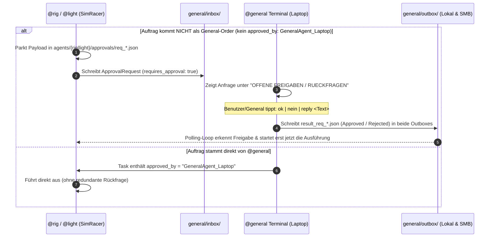

> **Thema:** Workspace-Schnittstelle: SimRacer-Verbund, Task-Queue & Agenten-Terminals
> **Autor:** Michael Stürmer
> **Datum:** 11.11.2026

<details>
<summary><b>Lernziele</b></summary>

* Verstehen der **Multi-Workspace-Architektur** zwischen dem Labor-Workspace (`git-labor` auf Laptop `VanstrikeCyborg`), dem Simulations-Workspace (`assetto-corsa-content` / SimRacer `192.168.178.68`) und dem 24/7-Edge-Hub (`strikerpi-hub` / StrikerPi `192.168.178.86`).
* Beherrschen der **dateibasierten Task-Queue (`inbox/` $\rightarrow$ Worker $\rightarrow$ `outbox/` & `logs/`)** sowie der **SSH-Queue für `@rick`** (`/opt/rick-agent/inbox/`).
* Sichere Trennung zwischen **lokalen Host-Terminals** (auf SimRacer, Sandbox, Archibald, StrikerPi) und den zentral über **`labs/Agent-Terminals.ps1`** gestarteten **SSH-Client-Terminals** vom `VanstrikeCyborg` (`-ClientMode`).
* Nachvollziehen des **Prompt-Lebenszyklus** und der Integration in Python (`labs/03_python/sim_agent_bridge.py`) und PowerShell (`labs/Send-SimAgentTask.ps1`).

</details>

<details>
<summary><b>Kernkonzepte</b></summary>

<details>
<summary>1.1 Die Multi-Workspace-Hierarchie im Überblick</summary>

Das Entwickler-Ökosystem ist strikt in zwei Rollenbereiche unterteilt:

```mermaid
flowchart TB
    subgraph GITLABOR["Workspace: git-labor (Laptop VanstrikeCyborg)"]
        DEV["Entwickler / General Cyborg (Global) &amp; General Sim (Leitstand)"]
        LAUNCHER["Agent-Terminals.ps1 (SSH-Launcher)"]
        BRIDGE_PY["sim_agent_bridge.py"]
        CLI_PS["Send-SimAgentTask.ps1 / @general Terminal"]
    end

    subgraph NETWORK["Netzwerk-Schnittstelle (SMB / SSH)"]
        SMB["\\192.168.178.68\ac-sandbox\shared\agents\"]
        SSH["SSH :22 (SimRacer/Archibald/StrikerPi) / :2222 (Sandbox)"]
    end

    subgraph SIMRACER["Workspace: assetto-corsa-content (SimRacer &amp; Sandbox)"]
        subgraph TUI_HOST["Host Terminals (Nativ auf SimRacer 192.168.178.68)"]
            T_LIGHT["@light Terminal (Docker-Engine)"]
            T_RIG["@rig Terminal (RTX 5070 Ti, VR, acs.exe)"]
        end
        subgraph TUI_GUEST["Sandbox Gast (ac-win11-sandbox auf SimRacer :8006)"]
            T_DARK["@dark Terminal (CSP, Setup-Validator)"]
        end
        subgraph PITWALL["Pitwall (IdeaPad 5 omARCHy 192.168.178.98)"]
            T_SARAH["@sarah Terminal (Telemetrie, Video)"]
        end
        subgraph EDGE["24/7 Edge Hub (StrikerPi 192.168.178.86)"]
            T_RICK["@rick (Relay :8080, MQTT :1883, Bare-Git)"]
        end
    end

    DEV --> LAUNCHER &amp; BRIDGE_PY &amp; CLI_PS
    LAUNCHER -->|SSH -ClientMode / Bash| SSH
    BRIDGE_PY &amp; CLI_PS -->|Schreibt Task-JSON in inbox| SMB
    BRIDGE_PY &amp; CLI_PS -->|SCP/SSH fuer @rick| T_RICK
    SMB --> T_LIGHT &amp; T_RIG &amp; T_DARK &amp; T_SARAH
    T_LIGHT &amp; T_RIG &amp; T_DARK &amp; T_SARAH -->|Schreibt Result-JSON in outbox| SMB
    SMB -->|Liest Status &amp; Output| BRIDGE_PY &amp; CLI_PS
```

* **`General Cyborg` (Global) &amp; `General Sim` (Leitstand):** Beide laufen physisch auf **`VanstrikeCyborg`**. `General Cyborg` betreut die Laptop-Hardware/MSI/VIVE/VS Code, während `General Sim` die Brücke zum `SimRacer` (`192.168.178.68`) und das `@general`-Freigabe-Gate steuert.
* **`git-labor`:** Experimentelles Skripting, Datenanalyse, Erstellung und Test von MCP-Servern, KI-Modell-Workflows und Orchestrierung.
* **`assetto-corsa-content`:** Produktionsumgebung für Assetto Corsa, Content Manager (CM), Custom Shaders Patch (CSP), Setup-Validierung, VR-Frametimes (120 Hz) und Container-Lifecycle.

</details>

<details>
<summary>1.2 Der Prompt-Lebenszyklus: Wo sieht man die Bearbeitung?</summary>

Wenn ein Prompt in einem Agenten-Terminal oder über ein externes Skript abgeschickt wird, durchläuft er vier sichtbare Phasen:

```
[Phase 1: Absenden] --> [Phase 2: Queue & TUI] --> [Phase 3: Worker-Ausführung] --> [Phase 4: Rückmeldung]
```

1. **Visuelle Bestätigung beim Absender:**
   * In der Quell-Konsole erscheint:
     ```text
     [00:15:32] Task task_20261107_001532_471 für Agent 'dark' erstellt.
     ```
2. **Reaktion im Ziel-Terminal:**
   * Der obere Status-Header des Ziel-Terminals aktualisiert sich alle 2 Sekunden:
     ```text
     Queue: [1]  |  Status: [BUSY]  |  Aktiv: task_20261107_001532_471
     ```
   * Im Live-Logfenster des Ziel-Terminals erscheint:
     ```text
     [00:15:34] [WORKER] Starte Bearbeitung von Task 'task_20261107_001532_471'...
     [00:15:34] [COMMAND] Action=ValidateSetups Car=rss_formula_hybrid_x_2026
     ```
3. **Status-Matrix für das Gesamtsystem:**
   * In jedem Terminal zeigt die mittlere Matrix den aktuellen Zustand aller 5 Agenten an:
     ```text
     [General: IDLE]  [Light: IDLE]  [Rig: IDLE]  [Dark: RUNNING]  [Sarah: IDLE]
     ```

</details>

<details>
<summary>1.3 Wo und wie erhält man die Rückmeldung?</summary>

Es gibt vier Wege, wie Ergebnisse und Rückmeldungen bereitgestellt und konsumiert werden:

| Rückmelde-Kanal | Speicherort / Mechanismus | Format | Verwendung |
| :--- | :--- | :--- | :--- |
| **1. Dateibasierte Outbox** | `\\192.168.178.68\ac-sandbox\shared\agents\<agent>\outbox\result_<id>.json` | Strukturiertes JSON | Automatisierte Skripte (`git-labor`, Python, CI/CD) |
| **2. Dauerhafte Logdatei** | `\\192.168.178.68\ac-sandbox\shared\agents\<agent>\logs\task_<id>.log` | Roher Text (Stdout/Stderr) | Fehleranalyse, lange Stacktraces, Setup-Details |
| **3. Synchroner Handshake (CLI)** | Konsole blockiert, wartet auf Ergebnis, gibt es formatiert aus und räumt auf | Farbiger Konsolentext & ExitCode | Direkte interaktive PowerShell-Ausführung |
| **4. Terminal TUI-Dashboard** | Unterer Fensterbereich des Ziel- und Quell-Terminals | Historie der letzten 5 Tasks mit [SUCCESS]/[FAILED] | Live-Monitoring am Bildschirm / Web-VNC |

#### Struktur der Rückmelde-Datei (`result_<taskId>.json`):
```json
{
  "task_id": "task_20261107_001532_471",
  "agent": "dark",
  "status": "Success",
  "exit_code": 0,
  "completed_at": "2026-11-07T00:15:42Z",
  "duration_seconds": 9.84,
  "output": "Validierung abgeschlossen: 201 Setups geprüft, 0 Syntaxfehler, CSP Physics V2 konform.",
  "artifacts": [
    "C:\\AssettoCorsa\\setups\\rss_formula_hybrid_x_2026\\validation_report.json"
  ]
}
```

</details>

<details>
<summary>1.4 Netzwerk- und Pfad-Mapping zwischen den Systemen</summary>

Da Entwickler-Laptop (`VanstrikeCyborg`), SimRacer-Host (`192.168.178.68`) und die Docker-Windows-11-Sandbox unterschiedliche Pfade sehen, sorgt das folgende standardisierte Mapping für Transparenz:

| Rechner / Kontext | Basis-Pfad zur Agenten-Queue |
| :--- | :--- |
| **Laptop VanstrikeCyborg (`git-labor`):** | `\\192.168.178.68\ac-sandbox\shared\agents\<agent>\` |
| **SimRacer Host (Nativ Windows 11):** | `C:\ac-sandbox\shared\agents\<agent>\` |
| **Sandbox Gast (`ac-win11-sandbox`):** | `\\host.lan\Data\agents\<agent>\` (oder `C:\ac-sandbox\shared\agents\<agent>\`) |

</details>

<details>
<summary>1.5 Python-Integration in Git-Labor (`sim_agent_bridge.py`)</summary>

Im Ordner `labs/03_python/sim_agent_bridge.py` stellt die Klasse `SimAgentBridge` Methoden bereit, um Tasks direkt aus Python abzusenden und Ergebnisse synchron abzuwarten:

```python
from sim_agent_bridge import SimAgentBridge

bridge = SimAgentBridge()

# 1. Status prüfen
status = bridge.get_agent_status("dark")
print(f"Dark Agent Queue: {status['queue_count']} Tasks")

# 2. Task senden und synchron auf Rückmeldung warten (Timeout 60s)
result = bridge.send_agent_task(
    target_agent="dark",
    action="ValidateSetups",
    params={"car": "rss_formula_hybrid_x_2026"},
    wait_for_result=True,
    timeout_seconds=60
)

if result.get("status") == "Success":
    print("Erfolg! Rückmeldung:")
    print(result.get("output"))
else:
    print(f"Fehler oder Timeout: {result.get('error')}")
```

</details>

<details>
<summary>1.6 PowerShell-Integration in Git-Labor (`Send-SimAgentTask.ps1`)</summary>

Für Kommandozeilen-Nutzung in `git-labor` steht das Skript `labs/Send-SimAgentTask.ps1` zur Verfügung:

```powershell
# Setup-Validierung in der Sandbox anstoßen und Rückmeldung abwarten
.\labs\Send-SimAgentTask.ps1 -TargetAgent dark -Action ValidateSetups -Wait

# Freitext-Prompt robust als reine Textdaten übergeben (ohne PowerShell-Parserfehler bei Sonderzeichen/Klammern)
.\labs\Send-SimAgentTask.ps1 -TargetAgent dark -Prompt "Develop your skills in creating (cutting + editing + voicing) and providing Sarah Coach with videos for her debriefings." -Wait

# Profil auf VR Focus Vision umschalten
.\labs\Send-SimAgentTask.ps1 -TargetAgent light -Action ApplyPreset -Params @{ preset = "vr_focusvision" } -Wait

# Live-Status aller Agenten-Queues abfragen
.\labs\Send-SimAgentTask.ps1 -QueryStatus
```

</details>

</details>

<details>
<summary>1.7 Intelligente Intent-Erkennung & Bidirektionaler Handshake (Light ↔ Dark)</summary>

Mit der Optimierung des Prompt-Routing-Systems können Prompts im **Light Agent Terminal** (auf SimRacer Host `192.168.178.68`) nun in natürlicher Sprache formuliert werden, ohne dass zwingend ein `@dark`-Präfix getippt werden muss:

#### 1. Funktionsweise der Intent-Erkennung:
Das Light-Terminal analysiert den eingegebenen Freitext auf Zielphrasen und Kontextmuster:
* **Präfix-Muster:** `sag dem dark agent ...`, `an dark: ...`, `fuer dark: ...`, `informiere dark ...`
* **Kontext-Schlagworte:** `in der sandbox`, `im container`, `gast-uhrzeit`, `sandbox-systemzeit`, `uhrzeit korrigieren`
* **Automatisches Routing:** Sobald ein solcher Intent erkannt wird, trennt Light den Steuerbefehl ab und leitet den reinen Prompt als strukturierte Textaufgabe an die Inbox von `@dark` weiter.

#### 2. Synchroner Handshake-Waiter:
Light wartet bei Handshake-Aufgaben aktiv bis zu 15 Sekunden auf das Erscheinen der Ergebnisdatei `result_<taskId>.json` in Darks Outbox:
```text
[06:40:20] Delegiere Prompt an Dark Agent mit Handshake...
[06:40:22] [HANDSHAKE ERFOLGREICH: Light -> Dark]
    Status   : Success
    Exit Code: 0
--- Rückmeldung von Dark Agent ---
[Dark Agent @ Sandbox In-Container]
Zeitzone erfolgreich geprueft/angepasst: W. Europe Standard Time (UTC+1, Wien/Berlin Winterzeit).
Systemzeit mit Host synchronisiert: \\host.lan
```

#### 3. Automatische Zeitzonen- und Uhrzeitkorrektur in der Sandbox:
Erkennt der Dark Agent in der Sandbox einen Auftrag zur Zeitzonen-/Uhrzeitkorrektur, führt `runner.ps1` automatisch folgende Schritte im Windows 11 Gast aus:
1. `Set-TimeZone -Id 'W. Europe Standard Time'` (Wien / Berlin MEZ/CET Winterzeit UTC+1).
2. Start des Windows-Zeitdienstes (`Start-Service w32time`).
3. Zeitsynchronisation gegen den Host via `net time \\host.lan /set /y` (mit Fallback auf `w32tm /resync /force`).
4. Rückmeldung der neuen Systemzeit und des Zeitzonennamens über die Outbox an Light.

</details>

<details>
<summary>1.8 Verbindliches Rückversicherungs- &amp; Freigabe-Gate (<code>@rig</code> / <code>@light</code> ↔ <code>@general</code>)</summary>

Um sicherzustellen, dass die SimRacer-Agenten (`@rig` und `@light` auf `192.168.178.68`) keine System-, Container-, Content- oder Weiterleitungs-Aktionen ohne Wissen des Leitstands ausführen, gilt eine **verbindliche Rückversicherungs- und Freigabepflicht** gegenüber dem **General Agent (`@general`)**:



#### 1. Befehle für Rückfragen & Freigaben in den Terminals:
| Terminal | Befehl / Eingabe | Wirkung |
| :--- | :--- | :--- |
| **`@rig` / `@light`** | `@general <Frage>`, `frag general <Text>`, `freigabe <Vorhaben>` | Sendet direkt ein `ApprovalRequest` an `agents/general/inbox/` und wartet auf Rückmeldung. |
| **`@rig` / `@light`** | Jeder andere Task (außer `status`/`help` und direkten General-Orders) | Wird automatisch in `agents/{rig\|light}/approvals/` geparkt (`Gen-Wait: N`) und wartet auf `Approved`. |
| **`@general`** | `ok [Nr/ID] [Hinweis]` / `ja` / `approve` / `freigeben` | Erteilt die Freigabe (`status: "Approved"`, `approved: true`) und schreibt in die lokale und Remote-Outbox (`\\192.168.178.68\ac-sandbox\shared\agents\general\outbox`). |
| **`@general`** | `nein [Nr/ID] [Grund]` / `reject` / `ablehnen` | Lehnt die Anfrage ab (`status: "Rejected"`, `approved: false`). |
| **`@general`** | `reply [Nr/ID] <Antwort>` / `antwort <Text>` | Sendet eine freie Text-Antwort inklusive Freigabe zurück. |

</details>

<details>
<summary>1.9 Zentrale Kommunikations-Historie, Logfiles, OSC-8 Terminal-Links &amp; VS Code Tasks</summary>

Alle vier aktiven PowerShell-Agenten-Terminals protokollieren ihre Kommunikation vollständig auf Disk und verlinken die Dateien direkt in der Terminal-Ansicht:

1. **Zentrale Markdown- &amp; JSONL-Historie (General Terminal):**
   * **[AGENT_KOMMUNIKATION_HISTORIE.md](../../../assetto-corsa-content/ac-sandbox/shared/agents/general/logs/AGENT_KOMMUNIKATION_HISTORIE.md):** Vollständige, ungekürzte Übergaben, Antworten und Rückfragen in eingeklappten `<details>`-Blöcken mit Zeitstempel, Quelle (`source_file`) und Direktlinks zu den Tages-Logfiles.
   * **`agent_comm_history.jsonl` &amp; `agent_comm_YYYYMMDD.log`:** Maschinenlesbare Historie sowie rohes Gesamt-Kommunikationslog unter `ac-sandbox/shared/agents/general/logs/`.
2. **Vollständige Agenten-Einzellogs (`[COMM]`):**
   * Jedes Terminal (`general`, `rig`, `light`, `dark`) schreibt eigene Tages-Logs (`<agent>_YYYYMMDD.log`) inklusive `[COMM][ANTWORT]`- und `[COMM][RUECKFRAGE]`-Einträgen.
3. **Klickbare OSC-8 Terminal-Hyperlinks &amp; Kurzbefehle:**
   * Im Terminal-Header jedes Agenten wird per ANSI-OSC-8 (`file:///...` bzw. `file://192.168.178.68/...`) ein direkt in VS Code anklickbarer Link auf das jeweilige Logfile und im General Terminal zusätzlich auf `AGENT_KOMMUNIKATION_HISTORIE.md` gerendert.
   * Kurzbefehle im General-Prompt: **`md` / `open-md` / `historie`** öffnet `AGENT_KOMMUNIKATION_HISTORIE.md` direkt im VS-Code-Editor (`code.cmd`); **`log` / `open-log` / `comm-log`** öffnet das aktuelle Kommunikationslog.
4. **Schneller Task-Start in VS Code ([`tasks.json`](../../../assetto-corsa-content/.vscode/tasks.json)):**
   * Alle Agent-Konsolen-Tasks nutzen `"type": "process"` mit `"-NoProfile"`, explizitem `cwd`, `"clear": true` und `"dependsOrder": "parallel"`, sodass alle Terminals ohne Profil-Verzögerung und ohne Doppelstarts hochfahren.

</details>

<details>
<summary>1.10 Lokale Host-Terminals vs. SSH-Client-Mode &amp; zentraler Git-Labor Launcher</summary>

Damit sich **lokale Host-Terminals** (z. B. direkt am SimRacer-Desktop oder in der Sandbox) und **SSH-Sitzungen vom Laptop `VanstrikeCyborg`** nicht gegenseitig abschießen oder Tasks doppelt aus der Inbox ziehen, gilt eine strikte Modustrennung:

| Agent | Host-Lokal (auf dem Zielgerät) | SSH-Aufruf von `VanstrikeCyborg` | Schutzmechanismus |
| :--- | :--- | :--- | :--- |
| **`@general`** | `start_general_terminal.ps1` (lokal auf `VanstrikeCyborg`) | *(Master – läuft direkt lokal)* | Singleton beendet nur doppelte lokale Instanzen |
| **`@rig`** | `launch_simracer_host_terminals.ps1` (Scheduled Task `AtLogOn`, `ExecutionTimeLimit = 0`) | `connect_rig_terminal.ps1` $\rightarrow$ `-ClientMode` | `Test-HostRigWorkerActive`: Client-Mode killt keinen Host-Worker und verarbeitet nur bei Bedarf |
| **`@light`** | `launch_simracer_host_terminals.ps1` (Scheduled Task `AtLogOn`, `ExecutionTimeLimit = 0`) | `connect_light_terminal.ps1` $\rightarrow$ `-ClientMode` | `Test-HostLightWorkerActive`: Client-Mode arbeitet als sicherer Monitor + Prompt-Sender |
| **`@dark`** | `launch_guest_terminals.ps1` in `ac-win11-sandbox` (`AtLogOn`, `ExecutionTimeLimit = 0`) | `connect_dark_terminal.ps1` $\rightarrow$ `-ClientMode` | `Test-GuestDarkWorkerActive`: kein Kill laufender In-Guest-Konsolen |
| **`@sarah`** | `sarah-pitwall-telemetry.service` (`systemd`) + lokales Terminal | `connect_sarah_terminal.ps1` (`SSH-CLIENT`-Modus) | `telemetry` prüft aktiven UDP-9996-Dienst, kein Doppel-Bind |
| **`@rick`** | `rick-agent.service` + `telemetry-relay.service` (`systemd`) | `connect_rick_terminal.ps1` (`SSH-CLIENT`-Modus) | `start_rick_terminal.sh` greift niemals den `systemd`-Worker an |

#### Zentraler Terminal-Launcher im Git-Labor (`labs/Agent-Terminals.ps1`)
Im Workspace `git-labor` steht eine zentrale Übersicht inkl. Live-Port-Check zur Verfügung (auch als VS-Code-Task **`🧭 Agent-Terminals Menü (SSH-Launcher)`**):
```powershell
# Interaktives Auswahlmenü mit Live-Online-Matrix aller 6 Agenten
.\labs\Agent-Terminals.ps1

# Nur Status-Matrix anzeigen
.\labs\Agent-Terminals.ps1 -StatusOnly

# Direkt per SSH im aktuellen Fenster zu @rick oder @rig verbinden
.\labs\Agent-Terminals.ps1 -Agent rick -InCurrentWindow
.\labs\Agent-Terminals.ps1 -Agent rig -InCurrentWindow

# Alle 6 Agenten-Terminals parallel in eigenen Fenstern starten
.\labs\Agent-Terminals.ps1 -Agent all
```

</details>

<details>
<summary>1.11 Agent <code>@rick</code> auf StrikerPi &amp; Git-Repo Integration (<code>simrig.git</code>)</summary>

Der 6. Agent **`@rick`** (`.github/agents/rick.agent.md`) betreut den **Raspberry Pi 4 (`StrikerPi` @ `192.168.178.86`)**:

1. **Komponenten auf StrikerPi (`/opt/rick-agent/` &amp; `/opt/telemetry-relay/`):**
   - `rick-agent.service` (`rick_worker.py`): Aktualisiert alle 15 s `/opt/rick-agent/status.json` (Services, LAN-Ports, `/srv/git/simrig.git`, Relay-Snapshot) und verarbeitet Aufgaben aus `/opt/rick-agent/inbox/` nach `outbox/`.
   - `start_rick_terminal.sh`: Interaktive Konsole mit Befehlen `status`, `relay`, `restart-relay`, `mqtt <MODE>`, `git`, `logs`, `inbox <TEXT>`, `help`, `exit`.
   - `telemetry-relay.service` (`telemetry_relay.py` v1.3.0) &amp; `mosquitto.service`: 50 Hz-UDP (`50005` $\rightarrow$ `Archibald:9996`), Pitwall-Dashboard (`:8080`), MJPEG-Lobby-Stream (`/api/stream/mjpeg`) und MQTT (`:1883`/`:9001`).
2. **Aufgaben aus `git-labor` an `@rick` senden:**
   ```powershell
   # Status inkl. StrikerPi abfragen
   .\labs\Send-SimAgentTask.ps1 -QueryStatus

   # Task direkt per SCP/SSH an @rick senden und Antwort abwarten
   .\labs\Send-SimAgentTask.ps1 -TargetAgent rick -Action status -Wait
   ```
   Auch im `@general`-Terminal funktioniert `@rick status` oder `@rick restart_relay` direkt.
3. **Git-Repository &amp; Multi-Root-Einbindung (`5_StrikerPi-Hub`):**
   - Das Bare-Repository auf dem Pi liegt unter **`git@192.168.178.86:/srv/git/simrig.git`** (Key-Auth über `git-shell`).
   - Der lokale Arbeitsklon **`c:\Users\strik\strikerpi-hub`** ist als 5. Ordner **`5_StrikerPi-Hub (strikerpi/simrig.git)`** in `git-labor.code-workspace` eingebunden und erzwingt über `.gitattributes` saubere LF-Zeilenenden für Linux-Skripte (`.sh`, `.service`, `.conf`, `.py`).

</details>

<details>
<summary><b>Übungsaufgaben</b></summary>

1. **Queue-Pfad-Verständnis:** Unter welchem Netzwerk-Pfad muss das Skript aus `git-labor` eine JSON-Datei ablegen, wenn es dem `@rig`-Agenten am SimRacer einen Auftrag erteilen will?
2. **Status-Erkennung:** Woran erkennen Sie in der Live-Konsole des `@dark`-Agenten im Web-VNC (`:8006`), dass Ihr aus `git-labor` gesendeter Task eingetroffen ist und gerade ausgeführt wird?
3. **Rückmelde-Auswertung:** Welche Datei müssen Sie aus `git-labor` per Python oder PowerShell auslesen, wenn Sie den genauen ExitCode und die textuelle Zusammenfassung des Task-Ergebnisses benötigen?
4. **Freigabe-Gate:** Was passiert, wenn ein lokaler Befehl im `@rig`-Terminal nicht von `@general` stammt, und mit welchem Befehl erteilen Sie am `@general`-Terminal die Freigabe?

</details>

<details>
<summary><b>Weiterführende Links & Quellen</b></summary>

### Handbücher & Bridge-Skripte
* [Detailliertes Handbuch im SimRacer-Workspace](../../../assetto-corsa-content/docs/03_agenten_system/agenten-terminals-prompt-verarbeitung-und-rueckmeldungs-handbuch.md)
* [E2E-Testbericht: Agenten-Kommunikation, Sandbox & Log-Links (10.11.2026)](../../../assetto-corsa-content/docs/03_agenten_system/agenten-kommunikation-und-sandbox-testbericht.md)
* [Modul 5.4: Agenten trainieren, primen und orchestrieren](./04_agenten-trainieren-primen-und-orchestrieren.md)
* [Python Bridge Script im Git-Labor (`sim_agent_bridge.py`)](../../labs/03_python/sim_agent_bridge.py)
* [PowerShell Handshake Dispatcher (`Send-SimAgentTask.ps1`)](../../labs/Send-SimAgentTask.ps1)

### Agent-Definitionen, Skills &amp; Regeln (Direktlinks)
* **Custom Agents (`.github/agents/`):** [`general.agent.md`](../../.github/agents/general.agent.md) · [`rig.agent.md`](../../.github/agents/rig.agent.md) · [`light.agent.md`](../../.github/agents/light.agent.md) · [`dark.agent.md`](../../.github/agents/dark.agent.md) · [`sarah.agent.md`](../../.github/agents/sarah.agent.md) · [`rick.agent.md`](../../.github/agents/rick.agent.md)
* **Regeln &amp; Instructions:** [`AGENTS.md`](../../AGENTS.md) · [`gemini-api.instructions.md`](../../.github/instructions/gemini-api.instructions.md) · [`vscode-experte.instructions.md`](../../../.copilot/instructions/vscode-experte.instructions.md) · [`01_agent-stilfibel-und-didaktik-ruler.md`](./01_agent-stilfibel-und-didaktik-ruler.md)
* **Skills (`SKILL.md`):** [`live-transfer-status-monitor` (Workspace)](../../.agents/skills/live-transfer-status-monitor/SKILL.md) · [`live-transfer-status-monitor` (Gemini)](../../.gemini/skills/live-transfer-status-monitor/SKILL.md) · [`managing-python-dependencies`](../../../.copilot/skills/managing-python-dependencies/SKILL.md)

### Terminal-Skripte, VS Code Tasks &amp; Kommunikations-Historie
* **SSH-Terminal-Launcher &amp; StrikerPi Hub:** [`Agent-Terminals.ps1`](../../labs/Agent-Terminals.ps1) · [`connect_rick_terminal.ps1`](../../../assetto-corsa-content/ac-sandbox/shared/scripts/connect_rick_terminal.ps1) · [`strikerpi-hub/README.md`](../../../strikerpi-hub/README.md)
* **Kommunikations-Historie (Markdown):** [`AGENT_KOMMUNIKATION_HISTORIE.md`](../../../assetto-corsa-content/ac-sandbox/shared/agents/general/logs/AGENT_KOMMUNIKATION_HISTORIE.md)
* **Terminal-Starter:** [`start_general_terminal.ps1`](../../../assetto-corsa-content/ac-sandbox/shared/agents/general/start_general_terminal.ps1) · [`start_rig_terminal.ps1`](../../../assetto-corsa-content/ac-sandbox/shared/agents/rig/start_rig_terminal.ps1) · [`start_light_terminal.ps1`](../../../assetto-corsa-content/ac-sandbox/shared/agents/light/start_light_terminal.ps1) · [`start_dark_terminal.ps1`](../../../assetto-corsa-content/ac-sandbox/shared/agents/dark/start_dark_terminal.ps1)
* **VS Code Tasks:** [`assetto-corsa-content/.vscode/tasks.json`](../../../assetto-corsa-content/.vscode/tasks.json)

</details>

<details>
<summary><b>Chips & Kernaussagen</b></summary>

* **Entkoppelte Dateischnittstelle:** Aufträge laufen über `inbox/`, Ergebnisse über `outbox/` und Logs über `logs/` auf dem Shared SMB-Storage `\\192.168.178.68\ac-sandbox\shared\agents\` (für `@rick` per SCP/SSH unter `strikerpi:/opt/rick-agent/`).
* **Host-Lokal vs. SSH-Client-Mode:** Host-Terminals laufen persistent lokal (`ExecutionTimeLimit = 0` / `systemd`); `VanstrikeCyborg` greift über `labs/Agent-Terminals.ps1` im `-ClientMode` zu, ohne laufende Host-Worker zu beenden.
* **Sichtbarer Bearbeitungsstatus:** Der TUI-Header springt auf `BUSY`, der Queue-Zähler zählt hoch und die Status-Matrix wechselt für den Ziel-Agenten auf `RUNNING`.
* **Rückmeldung nach Maß:** Strukturierte Rückmeldungen liegen in `result_<taskId>.json`, lange Ausgaben in `logs/task_<taskId>.log` und CLI-Aufrufe (`Send-SimAgentTask.ps1`) geben das Ergebnis direkt farbig in die Konsole zurück.
* **Saubere Trennung:** `git-labor` entwickelt, testet und steuert – `assetto-corsa-content` und `strikerpi-hub` liefern die Produktions- und 24/7-Edge-Infrastruktur.

</details>

---
*Hinweis zur Organisation:* Die erstellte Dokumentation ist am Drehlaufwerk abgelegt und mit einer kurzen Zusammenfassung von den Chips auch in den Notebooks verlinkt.

<!-- DOKU-MINIMAP-START -->
<style>
.doku-arch-flow { font-family: var(--vscode-editor-font-family, Consolas, monospace); background: rgba(20, 24, 33, 0.92); border: 1px solid rgba(100, 140, 220, 0.35); border-radius: 10px; padding: 14px 16px; margin: 10px 0; color: #e2e8f0; }
.doku-arch-root { text-align: center; font-weight: 700; font-size: 1.04em; padding: 8px 12px; margin-bottom: 12px; background: linear-gradient(135deg, rgba(37, 99, 235, 0.28), rgba(15, 23, 42, 0.9)); border: 1px solid rgba(96, 165, 250, 0.5); border-radius: 8px; }
.doku-arch-root a { color: #93c5fd !important; text-decoration: none !important; }
.doku-arch-root a:hover { text-decoration: underline !important; }
.doku-arch-grid { display: grid; grid-template-columns: repeat(auto-fit, minmax(275px, 1fr)); gap: 10px; }
.doku-arch-card { background: rgba(30, 41, 59, 0.78); border: 1px solid rgba(148, 163, 184, 0.28); border-left: 4px solid #3b82f6; border-radius: 8px; padding: 9px 11px; transition: transform 0.12s ease, border-color 0.12s ease; }
.doku-arch-card:hover { border-color: #60a5fa; transform: translateY(-1px); }
.doku-arch-card.r1 { border-left-color: #22c55e; }
.doku-arch-card.r2 { border-left-color: #3b82f6; }
.doku-arch-card.r3 { border-left-color: #eab308; }
.doku-arch-card.r4 { border-left-color: #ec4899; }
.doku-arch-card.r5 { border-left-color: #a855f7; }
.doku-arch-card-title { font-weight: 700; font-size: 0.95em; margin-bottom: 6px; padding-bottom: 4px; border-bottom: 1px dashed rgba(148, 163, 184, 0.25); }
.doku-arch-card-title a { color: #f8fafc !important; text-decoration: none !important; display: block; }
.doku-arch-card-title a:hover { color: #60a5fa !important; }
.doku-arch-lines { list-style: none; margin: 0; padding: 0; font-size: 0.85em; line-height: 1.5; }
.doku-arch-lines li { margin: 3px 0; padding: 2px 5px; border-radius: 4px; white-space: normal; }
.doku-arch-lines li:hover { background: rgba(59, 130, 246, 0.18); }
.doku-arch-lines a { color: #cbd5e1 !important; text-decoration: none !important; display: inline; }
.doku-arch-lines a:hover { color: #93c5fd !important; text-decoration: underline !important; }
.doku-arch-badge { display: inline-block; font-size: 0.75em; padding: 0 5px; margin-left: 4px; border-radius: 4px; background: rgba(59, 130, 246, 0.22); color: #93c5fd !important; border: 1px solid rgba(96, 165, 250, 0.35); }
details.doku-minimap { position: fixed; bottom: 18px; right: 18px; z-index: 9999; width: 250px; max-height: 76px; overflow: hidden; background: rgba(15, 23, 42, 0.94); border: 1px solid rgba(96, 165, 250, 0.65); border-radius: 10px; box-shadow: 0 8px 26px rgba(0, 0, 0, 0.65); backdrop-filter: blur(8px); transition: width 0.18s ease, max-height 0.18s ease; font-family: var(--vscode-font-family, sans-serif); }
details.doku-minimap:hover { border-color: #60a5fa; }
details.doku-minimap[open] { width: min(860px, 94vw); max-height: 84vh; overflow-y: auto; padding-bottom: 10px; }
details.doku-minimap > summary { cursor: pointer; list-style: none; padding: 8px 12px; font-weight: 700; font-size: 0.84em; color: #f8fafc; background: linear-gradient(90deg, rgba(37, 99, 235, 0.45), rgba(30, 41, 59, 0.9)); border-bottom: 1px solid rgba(148, 163, 184, 0.25); display: flex; align-items: center; justify-content: space-between; user-select: none; }
</style>

<details class="doku-minimap">
<summary><span>Doku-Minimap (Rubrik 05: KI-Agenten)</span></summary>
<div class="doku-arch-flow">
  <div class="doku-arch-root"><a href="README.md">Rubrik 05 – KI-Agenten Übersicht</a></div>
  <div class="doku-arch-grid">
    <div class="doku-arch-card r1">
      <div class="doku-arch-card-title"><a href="01_agent-stilfibel-und-didaktik-ruler.md">5.1 Stilfibel & Ruler</a></div>
      <ul class="doku-arch-lines">
        <li>Tonalität, keine Floskeln, Praxis-Bezug</li>
        <li>Pflicht: Eingeklappte &lt;details&gt;-Blöcke</li>
        <li>7 feste Bausteine pro Lernskript</li>
      </ul>
    </div>
    <div class="doku-arch-card r2">
      <div class="doku-arch-card-title"><a href="02_agenten-erstellen-instructions-rules-und-prompts.md">5.2 Agenten erstellen</a></div>
      <ul class="doku-arch-lines">
        <li>Custom Agents (*.agent.md)</li>
        <li>Instructions & Rules</li>
        <li>Model Harnesses & Reasoning-Tiers</li>
      </ul>
    </div>
    <div class="doku-arch-card r3">
      <div class="doku-arch-card-title"><a href="03_agenten-ausruesten-skills-und-mcp-tools.md">5.3 Skills & MCP</a></div>
      <ul class="doku-arch-lines">
        <li>Eigene SKILL.md Pakete</li>
        <li>Gemini Skills (skills.sh)</li>
        <li>MCP Tools & Setup</li>
      </ul>
    </div>
    <div class="doku-arch-card r4">
      <div class="doku-arch-card-title"><a href="04_agenten-trainieren-primen-und-orchestrieren.md">5.4 Training & Priming</a></div>
      <ul class="doku-arch-lines">
        <li>General Agent auf VanstrikeCyborg</li>
        <li>Headless-Agenten (Arch/Pi 4)</li>
        <li>Memory-System & Observability</li>
      </ul>
    </div>
    <div class="doku-arch-card r5">
      <div class="doku-arch-card-title"><a href="05_workspace-schnittstelle-simracer-und-agenten-terminals.md">5.5 Workspace-Schnittstelle SimRacer</a></div>
      <ul class="doku-arch-lines">
        <li>Multi-Workspace Verbund (git-labor &lt;=&gt; sim)</li>
        <li>Prompt-Lebenszyklus: TUI-Monitoring</li>
        <li>Rückmeldungen: outbox/, logs/ & CLI</li>
      </ul>
    </div>
  </div>
</div>
</details>
<!-- DOKU-MINIMAP-END -->
