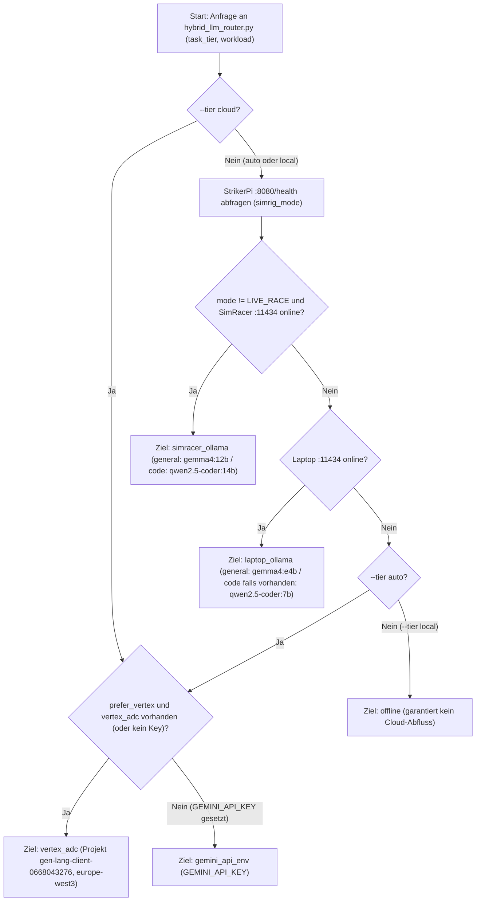

> **Thema:** System-Letztstand 23.11.2026 – ToS-konformer Umbau, Agenten-Change-Freeze, Host-vor-SSH-Priorität, 2-Knoten-Ollama-GPU-Integration, Leitstand-Persistenz & Live-Kommunikationsaudit
> **Autor:** Michael Stürmer
> **Datum:** 23.11.2026

# 5.7 System-Letztstand (23.11.2026): ToS-Bereinigung, Ollama-Hybrid-Architektur & Leitstand-Persistenz

Dieses Dokument hält den verbindlichen Architektur- und Konfigurationsstand vom **23.11.2026** fest: den vollständigen Rückbau inoffizieller OAuth-/Gateway-Proxys, die wiederhergestellte Agenten-Trennung mit verbindlichem Selbstschutz (`Change-Freeze`), die Host-vor-SSH-Priorisierung, das 2-Knoten-Ollama-GPU-Setup samt VR-Schutz sowie die am 23.11.2026 live gemessene Netz-, SMB-, Mosquitto- und Pitwall-Kommunikation zwischen `VanstrikeCyborg`, `SimRacer`, `StrikerPi` und `Archibald`.

<details>
<summary><b>Lernziele</b></summary>

Nach dem Durcharbeiten dieses Protokolls kannst du:
1. begründen, warum inoffizielle OAuth-/LLM-Gateways (`:8317`, `llm-gateway`, fremde GCP-Projekt-IDs) entfernt wurden und wie `hybrid_llm_router.py` lokal über Ollama (`:11434`) sowie offiziell über Vertex AI ADC (`gen-lang-client-0668043276` / `europe-west3`) routet,
2. den verbindlichen **Change-Freeze** für Agenten-, Policy- und Workspace-Dateien anwenden, ohne regulären Sim-, Setup- und Code-Betrieb zu blockieren,
3. die Prioritätssteuerung (`priority: 1` Host/Leitstand vor `priority: 2` SSH-Cyborg), das einheitliche `General Sim`-Leitstand-Routing (`hop_count < 2`) und die ScheduledTask-Persistenz beim Workspace-Wechsel nachvollziehen,
4. das 2-Knoten-Ollama-GPU-Verhalten auf RTX 5070 Ti (`16 GB VRAM`) und RTX 5060 Laptop (`8 GB VRAM` / `16 GB RAM`) inkl. `LIVE_RACE`-VRAM-Freigabe steuern,
5. reale Transportwege (UDP `:50005`, Mosquitto `:1883`/`9001`, WebSocket `:8080`, SMB `:445`, SSH `:22`) sowie offene Restpunkte vor einer Testfahrt prüfen.

</details>

<details>
<summary><b>Kernkonzepte</b></summary>

<details>
<summary><b>1. ToS-Compliance &amp; Proxy-Rückbau (Kein `:8317`, kein Gateway, saubere Projekte)</b></summary>

Zur dauerhaften Einhaltung der Google Terms of Service wurde das System konsequent auf offizielle Pfade zurückgebaut:
- **Workspaces &amp; Repo-Konfigurationen bereinigt:** In [`git-labor.code-workspace`](../../git-labor.code-workspace), [`assetto-corsa-content.code-workspace`](../../../assetto-corsa-content/assetto-corsa-content.code-workspace), [`git-labor/.vscode/settings.json`](../../.vscode/settings.json) und [`git-labor/.vscode/extensions.json`](../../.vscode/extensions.json) wurden sämtliche Proxy-/Gateway-Keys (`antigravityCopilot.*`, `github.copilot.llm-gateway.*`, `acpHub.*`), `mcp.servers`-Dubletten und Proxy-Extension-Empfehlungen (`neometric.google-acp-for-copilot`, `andrewbutson.github-copilot-llm-gateway`) entfernt (`antigravity.serverPort: 8317` für `agy.exe` bleibt).
- **Globale VS Code User-Settings &amp; Provider bereinigt (`23.11.2026, 14:25 Uhr`):** In `AppData\Roaming\Code\User\settings.json` (`80` Keys, Backup `.bak_20261123_1423`) wurden alle reaktivierten Sync-Reste (`copilot-llm-gateway/*`, `github.copilot.llm-gateway.*`, `antigravityCopilot.*`, `acpHub.*`, `geminiAggregator.*`, `geminiCode.useDirectAPI`) entfernt, `geminicodeassist.project` auf `gen-lang-client-0668043276` gesetzt, `task.allowAutomaticTasks` auf `"off"` gestellt sowie `"ollama.endpoint": "http://127.0.0.1:11434"` und `"ollama.inferenceTimeoutMinutes": 10` eingetragen. In `chatLanguageModels.json` (`7` Einträge) wurde der ungültige Eintrag `"Google 2"` entfernt und der lokale Eintrag auf `"Ollama"` vereinheitlicht (behebt den *„provider group Ollama ... not found“*-Fehler).
- **MCP-Konsolidierung abgeschlossen (`93 → 6` eindeutige Server, `23.11.2026, 15:00 Uhr`):** Alle `4` aktiv genutzten globalen Basis-Server (`geminiDocs`, `microsoft-learn`, `chrome-devtools`, `markitdown`) liegen zentral in `User/mcp.json`; alle `12` überwiegend deaktivierten `datacloud_*_remote`-Einträge sowie doppeltes `github` (Copilot-GitHub-MCP läuft integriert) und `nvidia-app` (`0` Tools) wurden entfernt. [`git-labor/.vscode/mcp.json`](../../.vscode/mcp.json) hält ausschließlich die `2` Workspace-spezifischen Server (`local-workspace-filesystem` und `io.github.shariqriazz/google-ai-search-mcp` mit `gen-lang-client-0668043276` / `europe-west3`); [`git-labor/.mcp.json`](../../.mcp.json), [`assetto-corsa-content/.vscode/mcp.json`](../../../assetto-corsa-content/.vscode/mcp.json) sowie beide `*.code-workspace`-Dateien sind frei von Dubletten und veralteten `node ...\mcp_proxy.js`-Wrappern (`.gitignore` ergänzt; `Agent-Terminals.ps1` und `start_general_terminal.ps1` auf Ollama `:11434` umgestellt; Backups unter `_mcp_backups_20261123_1441` bzw. `_mcp_backups_20261123_1458`).
- **Offizieller Cloud-Zugriff:** Ausschließlich über Google Cloud SDK (`gcloud auth application-default login` / Vertex ADC im Projekt `gen-lang-client-0668043276`, Region `europe-west3`), offizielle SDKs (`google-genai`, `@google/genai`, `google-antigravity`) oder Umgebungsvariable `GEMINI_API_KEY`.
- **Verifizierter Stand &amp; verbleibende Nebenpunkte (Stand 23.11.2026, 15:00 Uhr):**
  - **16 unnötige Proxy-/Gateway-/Wrapper-Extensions entfernt &amp; gegen Auto-Reinstall gesperrt (`0` verblieben):** Alle `7` kritischen Proxy-/Gateway-Extensions plus die `9` redundanten Drittanbieter-KI-Extensions (`aaronduino.gemini`, `galacticgit.gemini-chat`, `tcchan.gemini-code`, `floopy-potato.gemini-commit-message`, `printfn.gemini-improved`, `denizhandaklr.copilot-vscode-deepseek`, `hidenobunagai.nvidia-nim-provider`, `pedrogoulartbranco.vscode-ai-code-reviewer`, `hypermystic.optimise-code`) sind deinstalliert und in `settingsSync.ignoredExtensions` eingetragen (`74` aktive Extensions gesamt).
  - Port `127.0.0.1:8317` wird legitim von `agy.exe` (`PID 16364`, `antigravity.serverPort`) genutzt.
  - Verbleibende optionale Nebenpunkte: Klartext-GitHub-PAT in `~/.gemini/config/mcp_config.json` (Zeile 35) rotieren; inaktive `:8317`-Altlasten in Archibalds `pitwall.code-workspace` (`[ARCHIVIERT]`, `cli_proxy_api` ist dort `inactive`) bei Reaktivierung von `Archibald` bereinigen; alte gelöschte `GEMINI_API_KEY`-User-Variable bei Bedarf mit neuem AI-Studio-Key überschreiben oder löschen und `gcloud auth login` / `gcloud auth application-default login` erneuern.

</details>

<details>
<summary><b>2. Verbindlicher Selbstschutz (Change-Freeze für Agenten-Konfigurationen)</b></summary>

Um unkontrollierte Selbständerungen durch KI-Agenten auszuschließen, gilt in beiden Workspaces (`AGENTS.md`, globales `General Cyborg`, alle 6 Agenten in `git-labor/.github/agents/` und die wiederhergestellten 6 Agenten in `assetto-corsa-content/.github/agents/`):
- **Normalbetrieb uneingeschränkt:** Reguläre Projektdateien (Code, Python/PowerShell/Bash-Skripte, Setup-Pitfiles `.ini`, Doku, Logs) dürfen jederzeit bearbeitet werden.
- **Change-Freeze-Sperre:** Eigenmächtige Änderungen, Überschreibungen oder Löschungen an `*.agent.md`, `AGENTS.md`, `*.instructions.md`, `SKILL.md`, `approval_policy.json`, `*.code-workspace`, `settings.json`, `mcp.json` und `tasks.json` sind strikt untersagt. Änderungen erfordern immer vorherige Diff-Vorschau + explizite Nutzer-Freigabe.

</details>

<details>
<summary><b>3. Host-vor-SSH-Priorität (`priority: 1` vs. `2`) &amp; Leitstand-Routing (`General Sim`)</b></summary>

Die Multi-PC-Orchestrierung folgt einer deterministischen Vorrangschaltung wie in einer SPS-Ablaufkette:
- **Prioritätsregel:** Host-lokale und Leitstand-Aufträge (`priority: 1`, `origin: "host"`) werden stets vor eingehenden SSH-Aufträgen aus `git-labor` / `General Cyborg` (`priority: 2`, `origin: "ssh_cyborg"`) abgearbeitet (`Get-SortedInboxTasks`).
- **Einheitliches Weiterleitungsprotokoll:** Jeder Agent prüft bei jedem Prompt/Task die Zuständigkeit: (1) Eigenes Ressort → lokal in Queue einreihen; (2) Kollegen-Auftrag (`@general`, `@light`, `@rig`, `@dark`, `@sarah`, `@rick`) → geordnet an `General Sim` (`general-SIM/inbox`, `action: "RouteToAgent"`, `hop_count < 2`) übergeben und in `AGENT_KOMMUNIKATION_HISTORIE.md` / `ssh_audit_*.jsonl` protokollieren.
- **Queue-Default in Tooling:** [`Invoke-SimAgentSsh.ps1`](../../labs/Invoke-SimAgentSsh.ps1) und [`Send-SimAgentTask.ps1`](../../labs/Send-SimAgentTask.ps1) markieren Aufträge standardmäßig mit `priority: 2`, `origin: "ssh_cyborg"` (optionales `-DirectBypass` für Notfall-Direktzugriffe auf `@rig`/`@dark`).

</details>

<details>
<summary><b>4. Leitstand-Persistenz beim Workspace-Wechsel (`General Sim`)</b></summary>

Ob `General Sim` beim Verlassen des Workspace `assetto-corsa-content` weiterläuft, hängt vom Startmodus ab:
- **Persistenter Hintergrundbetrieb (Standard über `launch_general_host_terminal.ps1`):** Der Windows-ScheduledTask `AgentTerminal_General` startet `start_general_terminal.ps1` als eigenständigen minimierten Host-Worker (`AtLogOn`, `DontStopIfGoingOnBatteries`, `RestartCount 3`). Dieser läuft **nahtlos im Hintergrund weiter**, wenn du in VS Code zu `git-labor` wechselst oder VS Code schließt (am 23.11.2026 live verifiziert: `State = Running`).
- **VS-Code-Terminal (`connect_general_terminal.ps1`):** Öffnet die Konsole im **`-ClientMode`** (`Test-HostGeneralWorkerActive`). Das Schließen des VS-Code-Fensters beendet dann nur den Client-Viewer, nicht den Leitstand-Worker.
- **Remote-Worker-Persistenz:** Auf StrikerPi laufen `telemetry-relay.service`, `mosquitto.service`, `rick-agent.service`, `caddy.service` und `gitlabor-api.service` via systemd 24/7. Auf Archibald laufen `sarah-pitwall-telemetry.service` und `sarah-agent.service` im User-Systemd (`omARCHy`). Auf SimRacer läuft **`AgentTerminal_Light`** (`State = Running`, `PID = 80864`) mit erweitertem Session-1-App-Start (Steam, Content Manager, SteamVR), Fahrzeug-/Streckenwahl und Session-Ende-Docker-Handoff (`HandoffToSandbox`); `AgentTerminal_Rig` steht im Status `Ready` (SSH-Einzelbefehle funktionieren sofort).

</details>

<details>
<summary><b>5. 2-Knoten-Ollama-GPU-Architektur, VR-VRAM-Schutz &amp; `hybrid_llm_router.py`</b></summary>

Ollama nutzt lokale NVIDIA-GPUs direkt per CUDA-VRAM-Allokation über [`setup-ollama-node.ps1`](../../../assetto-corsa-content/ac-sandbox/shared/scripts/setup-ollama-node.ps1) und wird vom VR-Watchdog sowie dem Hybrid-Router gesteuert:

| Knoten | GPU / RAM | Bind &amp; Limits | Verifizierte Modelle &amp; Ablage | Rolle &amp; VR-Schutz |
| :--- | :--- | :--- | :--- | :--- |
| **`SimRacer` (`.68`)** | **RTX 5070 Ti (16 GB GDDR7 VRAM)**, 32 GB RAM | `0.0.0.0:11434`, LAN-Firewall `192.168.178.0/24` (`-Program ollama.exe`), `MAX_LOADED=1`, `FLASH_ATTN=1`, `KEEP_ALIVE=5m` | `gemma4:12b` (`7,47 GiB`), `qwen2.5-coder:14b` (`8,37 GiB`) unter `D:\OllamaModels` (`15,84 GB`, 22 Dateien; `C:` `56,61 GB` frei) | Primärer LAN-LLM-Server (`Ollama 0.40.16`, Task `Ollama-Server-SimRacer = Running`) außerhalb des Rennbetriebs. Bei Start von AC (`acs`, `acs_x86`), **Content Manager** oder **aktiven VR-Sessions** (`vrserver`, `vrmonitor`, `vrcompositor`, `vrdashboard`) entlädt [`rig-hub.ps1`](../../../assetto-corsa-content/ac-sandbox/shared/scripts/rig-hub.ps1) geladene Modelle sofort per `keep_alive: 0` aus dem VRAM und pausiert Docker (`docker pause`). |
| **`VanstrikeCyborg`** | **RTX 5060 Laptop (8 GB GDDR7 VRAM)**, 16 GB DDR5 | `127.0.0.1:11434` (localhost), `MAX_LOADED=1`, `FLASH_ATTN=1`, `KEEP_ALIVE=2m` | `gemma4:e4b` (`6,13 GiB`, 7.5B `Q4_K_M`, 131k Kontext) | Mobiler Fallback &amp; `LIVE_RACE`-Ersatz (`Ollama 0.40.16`, Task `Ollama-Server-Laptop = Running`). `e4b` bleibt komplett innerhalb der 8 GB GPU-VRAM, sodass die 16 GB System-RAM nicht durch CPU-Offloading blockiert werden. |
| **`Archibald` (`.98`) &amp; `StrikerPi` (`.86`)** | Keine dedizierte NVIDIA-GPU | Client-Abfrage über LAN | nutzt SimRacer `:11434` | Reine LAN-Clients (nur wenn `mode != LIVE_RACE`). |

- **Verifizierter Live-Rollout &amp; [`hybrid_llm_router.py`](../../labs/03_python/hybrid_llm_router.py) (23.11.2026):**
  - Auf beiden Knoten läuft **Ollama `0.40.16`** persistent über eigene Windows-ScheduledTasks (`Ollama-Server-Laptop` und `Ollama-Server-SimRacer`, jeweils mit expliziten Umgebungsvariablen und vollem `powershell.exe`-Pfad).
  - Auf SimRacer wurden zwei von Windows Defender Firewall automatisch angelegte eingehende `Block`-Regeln für `ollama.exe` entfernt, die Allow-Regel `Ollama LAN (SimRig 192.168.178.0/24)` per `-Program` fest an `ollama.exe` gebunden und diese Logik in [`setup-ollama-node.ps1`](../../../assetto-corsa-content/ac-sandbox/shared/scripts/setup-ollama-node.ps1) verankert.
  - **Live-Diagnose mit `hybrid_llm_router.py --check` (`PITBOX_SETUP`):** `strikerpi_relay.online = true`, `simracer_ollama.online = true` (`gemma4:12b`, `qwen2.5-coder:14b`), `laptop_ollama.online = true` (`gemma4:e4b`); im `general`-Modus routet der Router automatisch auf `simracer_ollama` (`gemma4:12b`), mit `--workload code` auf `simracer_ollama` (`qwen2.5-coder:14b`).
- **Stand Remote-Sync &amp; Watchdog:** [`rig-hub.ps1`](../../../assetto-corsa-content/ac-sandbox/shared/scripts/rig-hub.ps1) wurde am 23.11.2026 mit den erweiterten AC-/CM-/SteamVR-Triggern und `Invoke-OllamaVramUnload` **live auf SimRacer synchronisiert** (`SimRacer-Focus-Watchdog = Running`, 0 Parser-Fehler); auf StrikerPi (`rick_worker.py`) und Archibald (`sarah_worker.py`) stehen ggf. noch Skript-Abgleiche aus.

</details>

<details>
<summary><b>6. Zusammenarbeit: Lokales Ollama ↔ Cloud-Modelle (Entweder-Oder vs. Hybrid-Verbund)</b></summary>

In der Praxis stellt sich oft die Frage, ob lokales Ollama und Cloud-KIs (Google Gemini / Vertex AI / GitHub Copilot) **nur abwechselnd** nutzbar sind oder **echt zusammenarbeiten**. Die klare Trennung entspricht einer industriellen SPS-/Edge-Steuerung mit übergeordnetem Leitrechner:

- **Pro Einzelaufruf (Single Inference): striktes Entweder-Oder.** Genau *ein* Sprachmodell berechnet den jeweiligen Antwort-Stream — entweder ein lokales GGUF-Modell über Ollama (`192.168.178.68:11434` bzw. `127.0.0.1:11434`) oder ein Cloud-Modell (`vertex_adc` / `GEMINI_API_KEY` / VS-Code-Provider). Zwei Modelle teilen sich niemals denselben Token-Stream.
- **Auf System-, Agenten- und Workflow-Ebene: echte Zusammenarbeit im Hybrid-Verbund.** Verschiedene Knoten, Aufgaben oder Nachrichtenschritte greifen ineinander, sodass lokale GPUs Routine-, Log- und Datenschutzlast abfangen, während die Cloud tiefe Architektur-, Planungs- oder Multimodal-Schritte übernimmt.

#### Entscheidungslogik in [`hybrid_llm_router.py`](../../labs/03_python/hybrid_llm_router.py) (`select_route()`)



#### Die 4 konkreten Kooperationsmuster im Setup

| Muster | Wie lokal &amp; Cloud zusammenspielen | Nutzen für das SimRig / Git-Labor |
| :--- | :--- | :--- |
| **1. Automatische Kaskade &amp; Failover (`--tier auto`)** | Router wählt im Engineering-Betrieb `simracer_ollama`, weicht bei `LIVE_RACE` auf `laptop_ollama` aus und eskaliert ohne aktives Ollama automatisch auf `vertex_adc`. | Unterbrechungsfreier Betrieb auch unterwegs, ohne VR-VRAM auf dem SimRacer anzutasten. |
| **2. Arbeitsteilige Pipeline (Edge-Vorfilter → Cloud-Synthese)** | Ein Skript oder lokaler Worker (`--tier local`) extrahiert/klassifiziert große Telemetrie-, `.ini`- oder Log-Mengen kostenfrei; nur das kompakte Ergebnis geht per `--tier cloud` an Gemini. Umgekehrt erstellt die Cloud den Plan, den lokale Skripte abarbeiten. | Minimiert Cloud-Tokenverbrauch, schont Quotas und hält Rohlogs lokal. |
| **3. Fließender Wechsel im VS-Code-Chat** | In `chatLanguageModels.json` stehen offizielle Cloud-Provider (`vendor: "gemini"`) neben lokalen Knoten (`vendor: "ollama-models"` über `ollama.ollama`). Pro Chat-Nachricht umschaltbar bei identischem Gesprächskontext. | Kurze Rückfragen kostenfrei mit Ollama, komplexe Diffs oder Architekturfragen direkt danach mit Gemini. |
| **4. Paralleler 5-Knoten-Betrieb** | Während am Laptop komplexer Code mit Antigravity / Vertex AI entsteht, nutzen `@sarah` (Archibald) oder `@rick` (StrikerPi) im `!= LIVE_RACE`-Betrieb parallel den SimRacer-Ollama-Endpunkt über LAN. | Saubere Lastverteilung auf zwei GPUs plus Cloud ohne gegenseitige Blockade. |

#### Praxis-Aufrufe von [`hybrid_llm_router.py`](../../labs/03_python/hybrid_llm_router.py)

```powershell
# Reiner Diagnose- und Routen-Check (keine bezahlte API-Anfrage)
C:\Users\strik\.local\python-env\Scripts\python.exe labs\03_python\hybrid_llm_router.py --check

# Standard-Automatik für Code-Aufgaben (SimRacer qwen2.5-coder:14b -> Laptop -> Vertex ADC)
C:\Users\strik\.local\python-env\Scripts\python.exe labs\03_python\hybrid_llm_router.py --tier auto --workload code --prompt "Analysiere race.ini"

# Strikt lokal (bricht bei Offline mit status 'offline' ab, sendet niemals an Cloud)
C:\Users\strik\.local\python-env\Scripts\python.exe labs\03_python\hybrid_llm_router.py --tier local --prompt "Fasse die Session-Logs zusammen"

# Direkt in die Cloud über Vertex AI ADC oder alternativ über GEMINI_API_KEY
C:\Users\strik\.local\python-env\Scripts\python.exe labs\03_python\hybrid_llm_router.py --tier cloud --cloud-model gemini-2.5-pro --prompt "Erstelle einen Refactoring-Plan"
C:\Users\strik\.local\python-env\Scripts\python.exe labs\03_python\hybrid_llm_router.py --tier cloud --no-vertex --prompt "Kurzcheck via GEMINI_API_KEY"
```

#### Verbrauch, Quotas &amp; Reset-Zyklen (Überblick nach Provider)

| Anbieter / System | Verbrauchs- &amp; Quota-Übersicht | Reset-Zyklus &amp; Besonderheit |
| :--- | :--- | :--- |
| **Google Antigravity (`agy` CLI / IDE)** | Befehl `/usage` bzw. `/quota` öffnet das *Models &amp; Quota*-Panel für Gemini-, Claude- und GPT-Kontingente. | **Pro/Ultra:** Rolling-Refresh alle **5 Stunden** plus Wochenlimit · **Free:** wöchentlich. |
| **GitHub Copilot (VS Code)** | Klick auf das **Copilot-Status-Icon** in der Statusleiste oder `github.com/settings/billing` (*Metered usage → Copilot*). | Monatlicher Reset jeweils am **1. des Monats um 00:00 UTC**. |
| **Vertex AI ADC / Gemini API Key** | **Google Cloud Console** (Quotas &amp; Billing für `gen-lang-client-0668043276`) bzw. **Google AI Studio**. | Kein 5h-Reset; nutzungsbasierte Abrechnung mit RPM-/TPM-Ratenlimits. |
| **Lokales Ollama (`:11434`)** | `ollama ps` (aktuell im VRAM geladene Modelle) bzw. `hybrid_llm_router.py --check`. | **Unbegrenzt / kein Token-Limit / kein Reset** — nur lokal begrenzt durch GPU-VRAM. |

- **Grenze:** Der Router teilt eine *einzelne* Frage nicht selbstständig 50/50 auf lokal und Cloud auf, und im VS-Code-Chat wählst du das Modell bewusst pro Nachricht im Dropdown.

</details>

<details>
<summary><b>7. Verifizierter Live-Kommunikationscheck &amp; Netzwerk (23.11.2026)</b></summary>

1. **Telemetrie-Kette (`SimRacer` → `StrikerPi` → `Archibald`):**
   - `SimRacer-Telemetry-Sender` (`ac_telemetry_sender.py`) und `SimRacer-Lobby-Stream` (`:8090`) laufen, `SimRacer-Focus-Watchdog` läuft, Docker Desktop ist aus (ideal für 120 Hz VR).
   - `StrikerPi` (`192.168.178.86`): `mosquitto` (`:1883` MQTT, `:9001` WS, `persistence true`, `allow_anonymous true`), `telemetry-relay` (`:8080/health`, 50 Hz UDP-Eingang auf `:50005` mit verifiziertem Paketzähler +150 Pakete in 3 s), `caddy` (`:80`), `gitlabor-api` (`:8085`) und `rick-agent` alle `active`.
   - `Archibald` (`192.168.178.98`): Nach WoL durch SimRacer erwacht, `launch_pitwall.sh` hat Chromium Vollbild auf Workspace 1 (`http://192.168.178.86:8080/`, `active_clients: 1`) gestartet; `sarah-pitwall-telemetry` (UDP `:9996`) und `sarah-agent` sind `active`.
2. **StrikerPi LAN vs. WLAN:**
   - **LAN-Update (Live-Check 23.11.2026):** Ethernet-Interface **`end0`** ist nun per LAN verbunden (**`192.168.178.125`**, `metric 1024`) parallel zu `wlan0` (**`192.168.178.86`**, `5 GHz`, `-52 dBm`, `433 MBit/s`, `Power save: on`, `metric 1024`). Dienste (`ac_telemetry_sender.py`, Archibald und Router) adressieren derzeit noch `.86` bis zur Adressumstellung bzw. Route-Priorisierung; für produktiven MJPEG-/noVNC-Verkehr sollte komplett über `.125` (`end0`) geroutet werden.
3. **SMB-Freigaben &amp; Adressierung:**
   - SimRacer-Shares (`ac-sandbox`, `AssettoCorsa`, `C`, `D`) sind über `:445` erreichbar (`\\192.168.178.68\ac-sandbox` funktioniert; einen Share `ac-shared` gibt es nicht).
   - **Update (23.11.2026, Pitwall &amp; Policy-Trennung):** Die unveränderte Change-Freeze-Datei `approval_policy.json` (`AUTO`) bleibt unberührt. Die operative Steuerung auf dem SimRacer liegt jetzt zusätzlich in `C:\ac-sandbox\shared\agents\general-SIM\pitwall_control_policy.json` (`DELEGATED`, `agents_paused`, `gpu_background_allowed`, 5 `@light`-Kategorien), gebunden an `start_light_terminal.ps1`, `start_general_terminal.ps1` und die StrikerPi-Pitwall (`:8080`).
   - **DHCP-Drift auf Cyborg:** Cyborg hat aktuell `192.168.178.145` (alt in Skript-Checks: `.172`). Eine feste DHCP-Lease in der FRITZ!Box verhindert künftige SSH-Rückkanal-Timeouts.
   - **Geplanter Ausbaupunkt (auf später verschoben):** FRITZ!Box-Netzwerktrennung (aktuelles WLAN als isoliertes Gastnetz `192.168.179.0/24`, sicheres neues Heimnetz-WLAN + LAN für SimRig-Knoten unter Beibehaltung von `192.168.178.0/24`).

</details>

<details>
<summary><b>8. Verifizierte Testfahrt (`testdrive_20261123_070115`), VR-Fix &amp; `Antigravity`-Presets</b></summary>

Die erste Testfahrt wurde im 2-Ebenen-Verbund ([`record-simracer-testdrive.ps1`](../../../assetto-corsa-content/ac-sandbox/shared/scripts/record-simracer-testdrive.ps1) auf SimRacer: `1.135` Ticks, `112` Events; [`monitor_testdrive_cyborg.py`](../../labs/03_python/monitor_testdrive_cyborg.py) auf VanstrikeCyborg: `411` Ticks) vollständig aufgezeichnet und in [`AUSWERTUNG_testdrive_20261123_070115.md`](../../Systemtests/Testdrive_testdrive_20261123_070115/AUSWERTUNG_testdrive_20261123_070115.md) ausgewertet:

- **Vorher-Befund (07:07–07:16 Uhr) &amp; VR-Ursache:** 7 `acs.exe`-Abstürze (`0xc0000374` Heap Corruption in `ntdll.dll`) unter älterem CSP `v0.2.11` (vor Update auf `v0.3.1/4302` um `07:17:56`), dazu ein schwarzes linkes Auge und &gt;356 `vrcompositor` `AcquireSync WAIT_TIMEOUT`-Timeouts durch Single Pass Stereo, VRS, Masking Stencil, FSR, Extra FX, `BACKGROUND_PAUSE=1` und `VSYNC=1`.
- **Angewendeter VR-Fix &amp; Backups auf SimRacer:**
  - Backup der 5 Original-INIs unter `C:\Users\Mike\Documents\Assetto Corsa\cfg\_backup_vrfix_20261123\`.
  - Korrigiert: `extension\vr_tweaks.ini` (`SINGLE_PASS_STEREO_REAL/ENABLED=0`, `USE_VRS=0`, `MASKING_STENCIL/ENABLED=0`, `VR_HUD/BASE_OFFSET=0, 0, 0`), `extension\dxgi_tweaks.ini` (`TRIPLE_BUFFERING=0`, `TRUE_BORDERLESS=0`, `BACKGROUND_PAUSE=0`), `extension\extra_fx.ini` (`BASIC/HBAO/SSLR=0`), `extension\graphics_adjustments.ini` (`FSR/ACTIVE=0`, `FFXCAS_PASS=0`, `EXTRAFX_INTEGRATION=0`), `video.ini` (`DOF=0`, `FXAA=0`, `TRIPLE_BUFFER/ENABLED=0`, `VSYNC=0`, `FULLSCREEN=0`, `1920x1080`).
- **Gesicherte Content-Manager-Presets `Antigravity`:**
  - `C:\Users\Mike\AppData\Local\AcTools Content Manager\Presets\Custom Shaders Patch Presets\Antigravity.ini`
  - `C:\Users\Mike\AppData\Local\AcTools Content Manager\Presets\Video Settings\Antigravity.cmpreset`
  - Archiv-Kopien in `C:\ac-sandbox\shared\presets_managed\antigravity\` (`Antigravity_CSP.ini`, `Antigravity_Video.cmpreset`).
- **Post-Fix-Testrunde (`PID 108064`, 07:31:03–07:34:46, `222,9 s`, `rss_formula_hybrid_x_2026` @ `lasvegas23`):**
  - `0` Abstürze; SteamVR `vrcompositor` lieferte **`15.169` Presents, `0` dropped frames, `0` reprojected frames** bei `90 Hz`-Ziel (`AvgApplicationCPUTimeMS: 7,93 ms`, `AvgApplicationGPUTimeMS: 9,68 ms`, Compositor CPU `0,58 ms` / GPU `0,08 ms`).
  - SimRacer-Ressourcen (`n=145` Samples): CPU Ø `51,2 %` (P95 `72,5 %`, Max `100 %`), RAM max. `21,78 GB` (`66 %`), RTX 5070 Ti GPU Ø `56,9 %` (P95 `92 %`, Max `97 %`), VRAM max. `13.325 / 16.303 MB`, Temp max. `73,98 °C`, Power max. `284,4 W`.
- **Nächste Tuning-Hebel aus den Logs:**
  1. **VIVE Hub DP `Driver FPS: 45` &amp; `HAGS: On`:** Reduzierte Render-FPS (`CpuRenderTime 8,6–10,3 ms`) und rund 70 `AcquireSync WAIT_TIMEOUT`-Warnungen → Windows **HAGS** deaktivieren.
  2. **Windows Defender (`MsMpEng`):** `526,64` CPU-Sekunden und max. `462,5 MB` RAM (aktuell nur 1 `ExclusionPath`) → Ausschlüsse für Steam/`assettocorsa`, `Documents\Assetto Corsa` und `VIVE Hub` ergänzen.
  3. **Bildschärfe-Reserve:** `ANISOTROPIC=8` oder `16` (`video.ini`) und Standalone-CAS (`FFXCAS_PASS=1` mit `FSR/ACTIVE=0`) testen.
  4. **StrikerPi `LIVE_RACE` (`Local\acpmf_static`):** `ac_telemetry_sender.py` hielt `acpmf_static` offen und störte das CSP-Mapping (`0` `LIVE_RACE`-Ticks trotz Ø `48,45 Hz` UDP-Versand).
  5. **Replay-Handoff (`replay\temp\`):** AC speicherte `AC_231126-073444_O_rss_formula_hybrid_x_2026_lasvegas23_.acreplay` (`5,43 MB`, `14.041` Frames) in `replay\temp\` (`manage-simracer-session.ps1` künftig auf `replay\temp\` erweitern).

</details>

<details>
<summary><b>9. SimRacer 1-zu-1 VS-Code-Sync, Pitwall-Steuerungskonsole (<code>:8080</code>), Light-Mandat &amp; Altlasten-Archiv</b></summary>

- **SimRacer VS-Code-Bereinigung &amp; Parity-Sync (kein SMB-SQLite-Sharing):**
  - Auf `SimRacer` (`Mike`) wurden `19` Proxy-/Gateway-/Wrapper-Extensions deinstalliert und `6` offizielle Extensions (`google.geminicodeassist`, `google.google-antigravity`, `google.gemini-cli-vscode-ide-companion`, `openai.chatgpt`, `openai.codex-audio`, `eamodio.gitlens`, `vscode-icons-team.vscode-icons`, plus bestehendes `ollama.ollama`) auf exakt **`27`** identische Extensions verifiziert.
  - Backups in `C:\Users\Mike\AppData\Roaming\Code\User\_mcp_backups_20261123` (`SimRacer`) und `C:\Users\strik\AppData\Roaming\Code\User\_mcp_backups_20261123_sync` (`VanstrikeCyborg`).
  - Identische Sync-Sperrlisten auf beiden PCs: `26` IDs in `settingsSync.ignoredExtensions` und `17` Keys in `settingsSync.ignoredSettings` (`python.defaultInterpreterPath` auf Laptop von `-python.defaultInterpreterPath` korrigiert); `simracer.code-workspace`, `chatLanguageModels.json` (`"Ollama"` @ `127.0.0.1:11434`), `User/mcp.json` (`geminiDocs`, `microsoft-learn`, `chrome-devtools`, `nvidia-app`), `C:\ac-sandbox\.vscode\mcp.json` (`local-workspace-filesystem`), `C:\local_Simracer\.vscode\settings.json` (`{}`) und `git-labor.code-workspace` (`"ollama.ollama"`) bereinigt.
- **Pitwall-Steuerungskonsole (`http://192.168.178.86:8080/`, `telemetry_relay.py v1.4.0`):**
  - Neue Navigationsleiste (`🏁 Telemetrie` $\leftrightarrow$ `🛡️ Agenten & Light`), **`🎙️ Antigravity Sprachchat`**-Button (`https://antigravity.google`), globale Schalter für **Alle Agenten pausieren** (`agents_paused`), **GPU &amp; Hintergrundarbeit** (`gpu_background_allowed` mit Live-RTX-5070-Ti-`nvidia-smi` &amp; Ollama-Status), **Not-Aus** sowie 5 `@light`-Delegationskategorien, Freigabe-Warteschlange (`/api/approvals/*`) und Audit-Log.
- **Agenten-Terminals an Live-Policy gekoppelt:**
  - `start_light_terminal.ps1` (`Get-PitwallControlPolicy`, `Get-LightTaskCategory`, `Test-LightDelegatedApproval`, `Pitwall-Gate`) und `start_general_terminal.ps1` (`pitwall_control_policy.json`, `delegated`, automatische Synchronisation entschiedener Pitwall-Anfragen) auf `VanstrikeCyborg` und `\\192.168.178.68\ac-sandbox\shared\agents\...` ausgerollt (`SHA256` identisch; `approval_policy.json` per Change-Freeze unangetastet).
- **`[ENTFERNT / ARCHIVIERT – 23.11.2026]`:** Alle `CLIProxyAPI` (`:8317`), `llm-gateway` (`:8420`), `antigravityCopilot`, `acpHub`, `mcp_proxy.js`, `"Google 2"` sowie `19` Wrapper-Extensions sind entfernt und in den Modulen als Archiv markiert.

</details>

</details>

<details>
<summary><b>Übungsaufgaben</b></summary>

1. **Testfahrt-Checkliste &amp; Freigabe prüfen:** Führe die komplette 6-Schritte-Checkliste (VS Code → Agenten-Terminals → Sandbox → native Testfahrt mit Auto-Watchdog) in [system-letztstand-ollama-leitstand-2026-11-23.md](../../../assetto-corsa-content/docs/03_agenten_system/system-letztstand-ollama-leitstand-2026-11-23.md) durch und prüfe nach dem nächsten Tuning-Lauf in [`AUSWERTUNG_testdrive_20261123_070115.md`](../../Systemtests/Testdrive_testdrive_20261123_070115/AUSWERTUNG_testdrive_20261123_070115.md) die Effekte von HAGS-Off und Defender-Exclusions.
2. **VS-Code-Reload, Settings Sync &amp; Hybrid-Routing prüfen:** Führe in VS Code `Developer: Reload Window` (bzw. `Ollama: Refresh Models`) und einmal `Settings Sync: Sync Now` aus; verifiziere anschließend beide lokalen Modi mit `C:\Users\strik\.local\python-env\Scripts\python.exe labs\03_python\hybrid_llm_router.py --tier auto --workload code --check`.
3. **Router im `LIVE_RACE`-Failover prüfen:** Vergleiche die `hybrid_llm_router.py --check`-Routenwahl im Zustand `PITBOX_SETUP` (`simracer_ollama`) vs. `LIVE_RACE` (`laptop_ollama`).
4. **StrikerPi `.125` &amp; Remote-Sync angleichen:** Stelle Dienste bei Bedarf schrittweise von StrikerPi WLAN (`.86`) auf LAN `end0` (`.125`) um, synchronisiere `rick_worker.py`/`sarah_worker.py` und pulle auf `SimRacer` `D:\git-labor` nach dem Push vom Laptop.

</details>

<details>
<summary><b>Weiterführende Links &amp; Quellen</b></summary>

- **Testfahrt-Auswertung (`testdrive_20261123_070115`):** [`AUSWERTUNG_testdrive_20261123_070115.md`](../../Systemtests/Testdrive_testdrive_20261123_070115/AUSWERTUNG_testdrive_20261123_070115.md)
- **Testfahrt-Recorder &amp; Observer:** [`record-simracer-testdrive.ps1`](../../../assetto-corsa-content/ac-sandbox/shared/scripts/record-simracer-testdrive.ps1) · [`monitor_testdrive_cyborg.py`](../../labs/03_python/monitor_testdrive_cyborg.py)
- **AC-Workspace-Letztstand &amp; Testfahrt-Checkliste (Abschnitt 6):** [`system-letztstand-ollama-leitstand-2026-11-23.md`](../../../assetto-corsa-content/docs/03_agenten_system/system-letztstand-ollama-leitstand-2026-11-23.md)
- **Vorgänger-Protokoll (11./12./14.11.2026):** [`SYSTEM_ARCHITEKTUR_AENDERUNGEN_2026-11-11.md`](./SYSTEM_ARCHITEKTUR_AENDERUNGEN_2026-11-11.md)
- **Hybrid-LLM-Router:** [`hybrid_llm_router.py`](../../labs/03_python/hybrid_llm_router.py)
- **SSH- &amp; Queue-Dispatch:** [`Invoke-SimAgentSsh.ps1`](../../labs/Invoke-SimAgentSsh.ps1) · [`Send-SimAgentTask.ps1`](../../labs/Send-SimAgentTask.ps1) · [`sim_agent_bridge.py`](../../labs/03_python/sim_agent_bridge.py)
- **Ollama-Setup &amp; Watchdog:** [`setup-ollama-node.ps1`](../../../assetto-corsa-content/ac-sandbox/shared/scripts/setup-ollama-node.ps1) · [`rig-hub.ps1`](../../../assetto-corsa-content/ac-sandbox/shared/scripts/rig-hub.ps1)
- **Leitstand-Persistenz:** [`launch_general_host_terminal.ps1`](../../../assetto-corsa-content/ac-sandbox/shared/scripts/launch_general_host_terminal.ps1) · [`connect_general_terminal.ps1`](../../../assetto-corsa-content/ac-sandbox/shared/scripts/connect_general_terminal.ps1)

</details>

<details>
<summary><b>Chips &amp; Kernaussagen</b></summary>

- **ToS-Bereinigung &amp; MCP-Konsolidierung:** Keine inoffiziellen OAuth-/LLM-Proxys (`:8317`, `llm-gateway`, `aicode-consumers`), sondern Ollama lokal + offizielles Google SDK mit Vertex ADC (`gen-lang-client-0668043276`); `26` Proxy-/Gateway-/Wrapper-Extensions sind auf beiden PCs über `settingsSync.ignoredExtensions` gesperrt (`19` auf SimRacer deinstalliert), `27` offizielle Extensions vereinheitlicht, `settings.json`, `simracer.code-workspace` &amp; `chatLanguageModels.json` bereinigt und MCP auf **`6`** Server auf dem Laptop bzw. sauber bereinigte Server auf SimRacer verschlankt (`127.0.0.1:8317` gehört legitim zu `agy.exe`).
- **Live-Ollama-Verbund (`v0.40.16`):** Beide Endpunkte laufen persistent als ScheduledTask (`Ollama-Server-Laptop` mit `gemma4:e4b`; `Ollama-Server-SimRacer` auf `D:\OllamaModels` mit `gemma4:12b` + `qwen2.5-coder:14b` &amp; `-Program`-Firewall-Freigabe ohne Auto-Block); `hybrid_llm_router.py --check` routet live grün.
- **Testfahrt `testdrive_20261123_070115` &amp; VR-Fix:** Nach Korrektur von 5 AC-/CSP-INIs (`_backup_vrfix_20261123`) lief `PID 108064` (`222,9 s`) mit `0` Abstürzen und `15.169` Presents / `0` dropped frames; Einstellungen als CM-Presets **`Antigravity`** (`.ini` + `.cmpreset`) gesichert.
- **Change-Freeze &amp; Persistenz:** Geschützte Agenten-/Policy-/Workspace-/VS-Code-Dateien niemals ohne Diff-Vorschau + Nutzer-Freigabe ändern; `AgentTerminal_General`, `Ollama-Server-Laptop` und `Ollama-Server-SimRacer` laufen über ScheduledTasks eigenständig weiter.
- **Live-Netz &amp; Optimierungspunkte:** StrikerPi hat zusätzlich LAN **`end0` (`192.168.178.125`)** aktiv; für noch ruhigere VR-Frametimes stehen HAGS-Off, Defender-Exclusions (`MsMpEng` 526 s), `ANISOTROPIC`/CAS, `Local\acpmf_static`-Handling und `replay\temp\` an.

</details>

---
*Hinweis zur Organisation:* Die erstellte Dokumentation ist am Drehlaufwerk abgelegt und mit einer kurzen Zusammenfassung von den Chips auch in den Notebooks verlinkt.

<!-- DOKU-MINIMAP-START -->
<style>
.doku-arch-flow { font-family: var(--vscode-editor-font-family, Consolas, monospace); background: rgba(20, 24, 33, 0.92); border: 1px solid rgba(100, 140, 220, 0.35); border-radius: 10px; padding: 14px 16px; margin: 10px 0; color: #e2e8f0; }
.doku-arch-root { text-align: center; font-weight: 700; font-size: 1.04em; padding: 8px 12px; margin-bottom: 12px; background: linear-gradient(135deg, rgba(37, 99, 235, 0.28), rgba(15, 23, 42, 0.9)); border: 1px solid rgba(96, 165, 250, 0.5); border-radius: 8px; }
.doku-arch-root a { color: #93c5fd !important; text-decoration: none !important; }
.doku-arch-root a:hover { text-decoration: underline !important; }
.doku-arch-grid { display: grid; grid-template-columns: repeat(auto-fit, minmax(275px, 1fr)); gap: 10px; }
.doku-arch-card { background: rgba(30, 41, 59, 0.78); border: 1px solid rgba(148, 163, 184, 0.28); border-left: 4px solid #3b82f6; border-radius: 8px; padding: 9px 11px; transition: transform 0.12s ease, border-color 0.12s ease; }
.doku-arch-card:hover { border-color: #60a5fa; transform: translateY(-1px); }
.doku-arch-card.r1 { border-left-color: #22c55e; }
.doku-arch-card.r2 { border-left-color: #3b82f6; }
.doku-arch-card.r3 { border-left-color: #eab308; }
.doku-arch-card.r4 { border-left-color: #ec4899; }
.doku-arch-card.r5 { border-left-color: #a855f7; }
.doku-arch-card-title { font-weight: 700; font-size: 0.95em; margin-bottom: 6px; padding-bottom: 4px; border-bottom: 1px dashed rgba(148, 163, 184, 0.25); }
.doku-arch-card-title a { color: #f8fafc !important; text-decoration: none !important; display: block; }
.doku-arch-card-title a:hover { color: #60a5fa !important; }
.doku-arch-lines { list-style: none; margin: 0; padding: 0; font-size: 0.85em; line-height: 1.5; }
.doku-arch-lines li { margin: 3px 0; padding: 2px 5px; border-radius: 4px; white-space: normal; }
.doku-arch-lines li:hover { background: rgba(59, 130, 246, 0.18); }
.doku-arch-lines a { color: #cbd5e1 !important; text-decoration: none !important; display: inline; }
.doku-arch-lines a:hover { color: #93c5fd !important; text-decoration: underline !important; }
.doku-arch-badge { display: inline-block; font-size: 0.75em; padding: 0 5px; margin-left: 4px; border-radius: 4px; background: rgba(59, 130, 246, 0.22); color: #93c5fd !important; border: 1px solid rgba(96, 165, 250, 0.35); }
details.doku-minimap { position: fixed; bottom: 18px; right: 18px; z-index: 9999; width: 250px; max-height: 76px; overflow: hidden; background: rgba(15, 23, 42, 0.94); border: 1px solid rgba(96, 165, 250, 0.65); border-radius: 10px; box-shadow: 0 8px 26px rgba(0, 0, 0, 0.65); backdrop-filter: blur(8px); transition: width 0.18s ease, max-height 0.18s ease; font-family: var(--vscode-font-family, sans-serif); }
details.doku-minimap:hover { border-color: #60a5fa; }
details.doku-minimap[open] { width: min(860px, 94vw); max-height: 84vh; overflow-y: auto; padding-bottom: 10px; }
details.doku-minimap > summary { cursor: pointer; list-style: none; padding: 8px 12px; font-weight: 700; font-size: 0.84em; color: #f8fafc; background: linear-gradient(90deg, rgba(37, 99, 235, 0.45), rgba(30, 41, 59, 0.9)); border-bottom: 1px solid rgba(148, 163, 184, 0.25); display: flex; align-items: center; justify-content: space-between; user-select: none; }
details.doku-minimap > summary::-webkit-details-marker { display: none; }
details.doku-minimap .minimap-preview-strip { display: flex; gap: 4px; padding: 5px 10px 7px 10px; font-size: 0.72em; color: #94a3b8; justify-content: space-between; }
details.doku-minimap[open] .minimap-preview-strip { display: none; }
details.doku-minimap .minimap-preview-strip span { background: rgba(30, 41, 59, 0.9); padding: 2px 6px; border-radius: 4px; border: 1px solid rgba(148, 163, 184, 0.25); }
details.doku-minimap .minimap-body { padding: 8px 12px 4px 12px; }
</style>
<details class="doku-minimap">
<summary><span>🗺️ Doku-Minimap (5 Rubriken &amp; Labs)</span><span title="Klicken zum Vergrößern / Einklappen">⛶</span></summary>
<div class="minimap-preview-strip"><span>01 Linux</span><span>02 VSCode</span><span>03 Python</span><span>04 JS/TS</span><span>05 Agents</span></div>
<div class="minimap-body">
<div class="doku-arch-flow">
<div class="doku-arch-root">🏛️ <a href="../README.md">VanstrikeCyborg — git-labor Lern- &amp; Test-Architektur (Doku-Index)</a>  |  <a href="../../README.md">Repo-README</a>  |  <a href="../../AGENTS.md">AGENTS.md</a>  |  <a href="../../notebook-agent-environments/README.md">Notebooks</a></div>
<div class="doku-arch-grid">
<div class="doku-arch-card r1">
<div class="doku-arch-card-title">🐧 <a href="../01_Linux_Bash/README.md">01_Linux_Bash (Linux, Shell &amp; Container)</a></div>
<ul class="doku-arch-lines">
<li>├─ <a href="../01_Linux_Bash/01_bash-grundlagen-und-skripting.md">01 • Bash CLI, Text-Tools, Streams &amp; Expansions</a> <a class="doku-arch-badge" href="../../labs/01_linux_bash/check-env.sh">check-env.sh</a></li>
<li>├─ <a href="../01_Linux_Bash/02_linux-systemadministration-und-interna.md">02 • Inodes, LVM, Prozesse, Boot-Prozess &amp; systemd</a></li>
<li>├─ <a href="../01_Linux_Bash/03_arch-linux-omarchy-und-remote-ssh.md">03 • Arch Linux, Omarchy, Remote-SSH &amp; Nginx</a></li>
<li>├─ <a href="../01_Linux_Bash/04_fortgeschrittenes-bash-skripting-und-automatisierung.md">04 • Advanced Bash: Arrays, getopts &amp; Backups</a></li>
<li>└─ <a href="../01_Linux_Bash/05_docker-und-sbx-micro-vms.md">05 • Docker Grundlagen &amp; Sandbox Micro-VMs (sbx)</a></li>
</ul>
</div>
<div class="doku-arch-card r2">
<div class="doku-arch-card-title">🧩 <a href="../02_VSCode_Env/README.md">02_VSCode_Env (IDE, Git, MCP &amp; Gemini)</a></div>
<ul class="doku-arch-lines">
<li>├─ <a href="../02_VSCode_Env/01_vscode-architektur-lsp-und-remote.md">01 • VS Code Architektur, Sprachserver (LSP) &amp; Remote</a></li>
<li>├─ <a href="../02_VSCode_Env/02_git-github-und-multi-root-workspaces.md">02 • Git, GitHub Workflow &amp; Multi-Root Workspaces</a> <a class="doku-arch-badge" href="../../git-labor.code-workspace">Workspace</a></li>
<li>├─ <a href="../02_VSCode_Env/03_mcp-server-localhost-proxy-und-ports.md">03 &bull; MCP-Server, Ollama (:11434) &amp; Ports (Archiv: Proxy)</a></li>
<li>└─ <a href="../02_VSCode_Env/04_gemini-oekosystem-ai-studio-und-api-keys.md">04 • Gemini Ökosystem, Google AI Studio &amp; API-Keys</a></li>
</ul>
</div>
<div class="doku-arch-card r3">
<div class="doku-arch-card-title">🐍 <a href="../03_Python_Coding/README.md">03_Python_Coding (Python, uv &amp; GenAI SDK)</a></div>
<ul class="doku-arch-lines">
<li>├─ <a href="../03_Python_Coding/01_python-setup-uv-venv-und-notebooks.md">01 • Python Setup: uv, .venv, Pylance &amp; Notebooks</a></li>
<li>├─ <a href="../03_Python_Coding/02_gemini-api-python-sdk-und-interactions.md">02 • Google GenAI SDK (google-genai) &amp; Interactions API</a></li>
<li>└─ <a href="../03_Python_Coding/03_python-automatisierung-datenanalyse-und-tests.md">03 • Automatisierung, Datenanalyse &amp; pytest</a> <a class="doku-arch-badge" href="../../labs/03_python/sensor_demo.py">sensor_demo.py</a></li>
</ul>
</div>
<div class="doku-arch-card r4">
<div class="doku-arch-card-title">🌐 <a href="../04_JS_TS_Web/README.md">04_JS_TS_Web (HTML/CSS, JS/TS &amp; Web-SDK)</a></div>
<ul class="doku-arch-lines">
<li>├─ <a href="../04_JS_TS_Web/01_html-css-und-dom-grundlagen.md">01 • HTML5, CSS3 &amp; DOM-Manipulation Grundlagen</a> <a class="doku-arch-badge" href="../../labs/04_js_ts_web/rechner.html">rechner.html</a></li>
<li>├─ <a href="../04_JS_TS_Web/02_modernes-javascript-und-typescript.md">02 • Modernes JavaScript (ES6+) &amp; TypeScript</a></li>
<li>└─ <a href="../04_JS_TS_Web/03_gemini-sdk-typescript-und-web-apps.md">03 • Google GenAI SDK (@google/genai) für Web-Apps</a></li>
</ul>
</div>
<div class="doku-arch-card r5">
<div class="doku-arch-card-title">🤖 <a href="README.md">05_Agents (KI-Agenten, Skills &amp; Orchestrierung)</a></div>
<ul class="doku-arch-lines">
<li>├─ <a href="01_agent-stilfibel-und-didaktik-ruler.md">01 • Agent-Stilfibel, Didaktik-Ruler &amp; 7-Stufen-Aufbau</a></li>
<li>├─ <a href="02_agenten-erstellen-instructions-rules-und-prompts.md">02 • Agenten erstellen: Instructions, Rules &amp; Prompts</a> <a class="doku-arch-badge" href="../../.github/instructions/gemini-api.instructions.md">gemini.instructions</a></li>
<li>├─ <a href="03_agenten-ausruesten-skills-und-mcp-tools.md">03 • Agenten ausrüsten: Skills (SKILL.md) &amp; MCP-Tools</a> <a class="doku-arch-badge" href="../../.agents/skills/live-transfer-status-monitor/SKILL.md">SKILL.md</a></li>
<li>├─ <a href="04_agenten-trainieren-primen-und-orchestrieren.md">04 • Agenten trainieren, primen &amp; Multi-Agent-Orchestrierung</a> <a class="doku-arch-badge" href="../../.github/agents/light.agent.md">@light</a> <a class="doku-arch-badge" href="../../.github/agents/rig.agent.md">@rig</a></li>
<li>└─ <a href="05_workspace-schnittstelle-simracer-und-agenten-terminals.md">05 • Workspace-Schnittstelle: SimRacer &amp; Agenten-Terminals</a> <a class="doku-arch-badge" href="../../labs/03_python/sim_agent_bridge.py">Bridge</a></li>
</ul>
</div>
</div>
</div>
</div>
</details>
<!-- DOKU-MINIMAP-END -->
