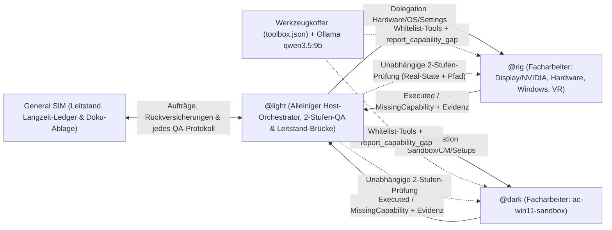

> **Thema:** System-Letztstand 25.11.2026 – Agenten-Neuarchitektur v5 (`@light` als Host-Orchestrator & 2-Stufen-QA, Werkzeugkoffer, Ollama-Tool-Runtime, Leitstand-Protokoll & Pitwall v2.1 Drill-Down)
> **Autor:** Michael Stürmer
> **Datum:** 25.11.2026

# 5.9 System-Letztstand (25.11.2026): Agenten-Neuarchitektur v5, Werkzeugkoffer & Pitwall v2.1

<!-- DOKU-SUBNAV-START -->

<b>🧭 Rubrik-Navigation &amp; Modul-Übersicht (05 Agents)</b>

**Zentrale:** [📚 Doku-Index](../README.md) · [📂 Rubrik 05 Agents](./README.md) · **Vorheriges:** [⬅️ 06 • Multi-Workspace Netzwerk & 6-Rollen-Verbund](./05_multi-workspace-netzwerk-mcp-und-agenten-verbund.md) · **Nächstes:** [Praxis-Referenz 25.11. (Hisense 4K-TV & ClearType) ➡️](./HISENSE_TV_DISPLAY_OPTIMIERUNG_2026-11-25.md)

**Alle Module in `05_Agents/`:**
- [01 • Agent-Stilfibel, Didaktik-Ruler & 7-Stufen-Aufbau](./01_agent-stilfibel-und-didaktik-ruler.md)
- [02 • Agenten erstellen: Instructions, Rules & Prompts](./02_agenten-erstellen-instructions-rules-und-prompts.md) · `gemini.instructions`
- [03 • Agenten ausrüsten: Skills & MCP-Tools](./03_agenten-ausruesten-skills-und-mcp-tools.md) · `SKILL.md`
- [04 • Priming, Memory & Multi-Agent-Orchestrierung](./04_agenten-trainieren-primen-und-orchestrieren.md) · `@light`
- [05 • Schnittstelle, Terminals & XOR-Mutex](./05_workspace-schnittstelle-simracer-und-agenten-terminals.md) · `Bridge`
- [06 • Multi-Workspace Netzwerk & 6-Rollen-Verbund](./05_multi-workspace-netzwerk-mcp-und-agenten-verbund.md)
- 👉 **[Letztstand 25.11. (Architektur v5, Toolbox & Pitwall v2.1)](./SYSTEM_ARCHITEKTUR_AENDERUNGEN_2026-11-25.md)** *(aktuell)*
- [Praxis-Referenz 25.11. (Hisense 4K-TV & ClearType)](./HISENSE_TV_DISPLAY_OPTIMIERUNG_2026-11-25.md)
- [Stand 24.11. (Parity, Qwen 3.5 & Nacharbeiten)](./SYSTEM_ARCHITEKTUR_AENDERUNGEN_2026-11-24.md)
- [Stand 23.11. (ToS-Bereinigung, Ollama & Pitwall v1.5)](./SYSTEM_ARCHITEKTUR_AENDERUNGEN_2026-11-23.md)
- [Änderungsprotokoll 11.11. (MQTT, Gatekeeper & Caddy)](./SYSTEM_ARCHITEKTUR_AENDERUNGEN_2026-11-11.md)
- [Pitwall & Systemreferenz (NotebookLM-Quelle)](./PITWALL_STEUERUNG_UND_FUNKTIONSREFERENZ_NOTEBOOKLM.md)
- [Boxencrew & Teamchef Konzept (NotebookLM)](./PITWALL_BOXENCREW_TEAMCHEF_KONZEPT_NOTEBOOKLM.md)

**Weitere Rubriken:** [🐧 01 Linux & Bash](../01_Linux_Bash/README.md) · [🧩 02 VS Code & MCP](../02_VSCode_Env/README.md) · [🐍 03 Python](../03_Python_Coding/README.md) · [🌐 04 JS/TS Web](../04_JS_TS_Web/README.md) · [🏎️ 06 AC KN5 Modding](../06_AC_KN5_Modding/README.md) · [🥽 07 VR Engineering](../07_VR_Engineering/README.md)

<!-- DOKU-SUBNAV-END -->

Dieses Protokoll dokumentiert die am **25.11.2026** umgesetzte und live verifizierte Neuausrichtung des Multi-Agenten-Verbunds — ausgelöst durch die Ursachenanalyse eines fehlgeschlagenen Direct Prompts auf `@rig` (`prompt_20261125_020111`: Hisense-TV Windows-/NVIDIA-Optimierung) sowie den Umbau auf eine ehrliche, werkzeug- und prüfungsgeführte Orchestrierung.

<b>Lernziele</b>

Nach dem Durcharbeiten dieses Protokolls kannst du:
1. erklären, warum der Direct Prompt `prompt_20261125_020111` zuvor fälschlich `Success` meldete und wie der Umbau Schein-Erfolge technisch ausschließt,
2. die neue **SimRacer-Befehlskette** (`General SIM` &harr; `@light` als alleiniger Host-Orchestrator & QA-Prüfer &rarr; Facharbeiter `@rig` / `@dark`) benennen,
3. den Aufbau der **Agenten-Werkzeugkoffer** (`toolbox.json` + `TOOLBOX.md` + `AGENT_TOOLBOX_OVERVIEW.md`) inklusive des Pflicht-Tools `report_capability_gap` für lokales **Ollama (`qwen3.5:9b`, RTX 5070 Ti)** anwenden,
4. das **zweistufige QA-Verfahren** (`light_verifier.py`: Stufe A Real-State-Test vs. Stufe B sauberer Werkzeug-Pfad) sowie den **Leitstand-Meldevertrag** (`leitstand_protocol.py` + `capability_gaps_summary.json` + `doc_handoffs/`) nachvollziehen,
5. über den neuen Pitwall-Sub-Tab **`📋 Leitstand-Protokoll`** (v2.1 auf `StrikerPi :8080`) per Drill-Down-Unterfenster bis zum Ollama-Ausbauvorschlag und Task-Log navigieren.

<b>Kernkonzepte</b>

<b>1. Root-Cause-Analyse des Ausgangsproblems (<code>prompt_20261125_020111</code>)</b>

Um `02:01:11` wurde im Rig-Terminal ein Direct Prompt zur Windows-/NVIDIA-Optimierung des Hisense-TVs (für scharfe Darstellung von VS Code, Docker Desktop, WhatsApp) eingegeben und um `02:02:08` korrekt im Pitwall genehmigt (`req_rig_20261125_020111_557`). Dennoch erfolgte keine echte Ausführung:

1. **Nur starre Regex-Zweige:** `start_rig_terminal.ps1` besaß ausschließlich Handler für `ApplyVRStufe3Fixes`, `EvaluateVRTelemetry`, AC/CSP-VR-Presets und `rig-hub.ps1` — kein Werkzeug für Windows-Display-/ClearType-/NVIDIA-Inspektion.
2. **Schein-Erfolg-Default:** Weil kein Regex-Zweig griff, blieb `$execStatus = "Success"` mit dem Platzhaltertext `Auftrag mit General-Freigabe ausgefuehrt: <Prompt>` stehen.
3. **Verschluckter Handshake:** Wegen des Schlüsselworts `Light` reichte `@rig` den Rohtext an `@light` weiter; `@light` meldete nach `0,05 s` korrekt `Ignored`, aber `@rig` verwarf das Ergebnis via `[void]` und meldete trotzdem `Success` an die Outbox.

<b>2. Neue Hierarchie &amp; Rollenvertrag am SimRacer (<code>192.168.178.68</code>)</b>

- **`@light` (`start_light_terminal.ps1`):** Alleiniger Host-Orchestrator und einzige Berichtsstelle an `General SIM`. Routet Hardware-, Display-, TV-, NVIDIA-, Windows-, Fanatec- und VR-Prompts an `@rig`, Sandbox-Prompts an `@dark`, erzwingt nach jedem Lauf `light_verifier.py` und dokumentiert **jeden** Ausgang (`VerifiedSuccess` ebenso wie Fehler/Lücken).
- **`@rig` (`start_rig_terminal.ps1`) &amp; `@dark` (`worker.ps1` / `runner.ps1`):** Ehrlich berichtende Facharbeiter ohne `Success`-Fallback. Nutzen bei freien Direct Prompts die lokale Ollama-Tool-Runtime (`agent_ollama_tool_runtime.py`).

<b>3. Agenten-Werkzeugkoffer (<code>toolbox.json</code> + <code>TOOLBOX.md</code>) &amp; lokale Ollama-Tool-Runtime</b>

Über [`toolbox_manager.py`](file:///192.168.178.68/ac-sandbox/shared/scripts/toolbox_manager.py) wurde für alle `6` Agenten unter `shared/memories/` jeweils ein dualer Werkzeugkoffer erzeugt (inkl. Gesamtübersicht `AGENT_TOOLBOX_OVERVIEW.md`):

- **`toolbox.json`:** Maschinenlesbare Fähigkeiten-Regeln (`operating_instructions`), aktive Werkzeuge mit Risikoklasse (`read_only` vs. `mutating`), Light-Prüf-Spezifikation und Ollama-JSON-Schema für `qwen3.5:9b`.
- **`TOOLBOX.md`:** Menschenlesbare Übersicht für Administration und Priming-Kontrolle.
- **Pflicht-Werkzeug `report_capability_gap`:** Findet das Modell in [`agent_ollama_tool_runtime.py`](file:///192.168.178.68/ac-sandbox/shared/scripts/agent_ollama_tool_runtime.py) kein passendes aktives Werkzeug oder fehlen Rechte/SDKs, meldet es sauber `MissingCapability` oder `Unsupported` inkl. `error_code`, geprüfter Werkzeuge und strukturiertem `ollama_extension_proposal` statt Schein-`Success`.
- **Harte Schutzschranken:** `0 %` Ollama-Last bei aktivem `acs.exe`/`vrserver.exe` (`LIVE_RACE`) oder Pitwall-GPU-Sperre sowie strikter Change-Freeze.

<b>4. Unabhängige 2-Stufen-QA (<code>light_verifier.py</code>) &amp; Leitstand-Protokoll (<code>leitstand_protocol.py</code>)</b>

1. **Stufe A — Real-State- &amp; Wirkungsprüfung:** [`light_verifier.py`](file:///192.168.178.68/ac-sandbox/shared/scripts/light_verifier.py) liest eigenständig Systemzustand (z. B. `HKCU:\Control Panel\Desktop` ClearType, `nvidia-smi`, `race.ini`, `vr_tweaks.ini`-Invariante, `dark-status.json`) nach und vergleicht gegen die Worker-Angaben.
2. **Stufe B — Sauberer Pfad &amp; Anti-Workaround:** Verwirft Dummy-Echos (`"Auftrag mit General-Freigabe ausgefuehrt:"`), verlangt registrierte Handler aus `toolbox.json` sowie `before`/`after`/`changes` bei `mutating`-Tools.
3. **Kanonische Status &amp; Fehlercodes:**
   - Status: `Executed`, `VerifiedSuccess`, `VerificationFailed`, `MissingCapability`, `Unsupported`, `Blocked`, `Rejected`, `Failed`.
   - Fehlercodes: `NONE`, `PROMPT_UNIDENTIFIED`, `TOOL_MISSING`, `COMPETENCY_MISSING`, `VERIFICATION_FAILED`, `EXECUTION_ERROR`.
4. **Leitstand-Persistenz (`General SIM`):** [`leitstand_protocol.py`](file:///192.168.178.68/ac-sandbox/shared/scripts/leitstand_protocol.py) pflegt `leitstand_protocol.jsonl`, `LEITSTAND_PROTOKOLL.md`, `capability_gaps.jsonl`, `capability_gaps_summary.json`, `MISSING_TOOLS_REPORT.md` sowie `doc_handoffs/handoff_<task_id>.json|.md` (damit `General SIM` ohne Schreibrecht-Konflikt auf dem SimRacer nach `Doku/` übernehmen kann).

<b>5. Pitwall v2.1: Sub-Tab <code>📋 Leitstand-Protokoll</code> &amp; 3-Ebenen-Drill-Down</b>

In `/opt/telemetry-relay/telemetry_relay.py` auf `StrikerPi` (gespiegelt in [`telemetry_relay.py`](file:///c:/Users/strik/strikerpi-hub/telemetry-relay/telemetry_relay.py)) wurde unter **`🛡️ Agenten`** der 4. Sub-Tab **`📋 Leitstand-Protokoll`** integriert (siehe [`PITWALL_STEUERUNG_UND_FUNKTIONSREFERENZ_NOTEBOOKLM.md`](./PITWALL_STEUERUNG_UND_FUNKTIONSREFERENZ_NOTEBOOKLM.md)):

- **Ebene 0:** Klickbare KPI-Pills, Filter (`Agent`, `Status`, `Fehlercode`, Suche) und Umschalter zwischen **`📋 Protokoll`** und **`🧰 Werkzeugkoffer`**.
- **Ebene 1 (Unterfenster):** Auftragskette, Hardware-Node, Light-QA Stufe A &amp; B und Vorher/Nachher-Vergleichstabelle.
- **Ebene 2 (Detail-Unterfenster mit Breadcrumb &amp; `ESC`-Navigation):** `🔧 Ollama-Ausbauvorschlag`, `🧰 Agenten-Werkzeugkoffer` und `📜 Roh-Evidenz & Log` inkl. Direkt-Terminalsprung.
- **Backend-Routen:** `GET /api/leitstand/protocol`, `GET /api/leitstand/protocol/{task_id}`, `GET /api/leitstand/toolboxes`.

<b>6. Verifizierte Live-End-to-End-Testergebnisse &amp; Hisense-TV-Ist-Befund (25.11.2026)</b>

#### A) Hisense-TV &amp; Windows-/NVIDIA-Ist-Messung (aus E2E-Lauf via `rig_display_tuner.py` auf SimRacer)

| Parameter | Gemessener Ist-Wert | Bewertung / Empfehlung für scharfe App-Darstellung |
| :--- | :--- | :--- |
| **Monitor-EDID** | `DISPLAY\HECB340\...` · Hersteller `HEC` · Name **`HISENSE`** · Serial `1735156332` | Eindeutig als Hisense-TV erkannt |
| **GPU &amp; Modus** | **NVIDIA GeForce RTX 5070 Ti** (Treiber `621.40`) · **`3840 x 2160 @ 60 Hz`** (`32 bpp`) | Native 4K-Auflösung aktiv |
| **Windows ClearType** | `FontSmoothing="2"`, `FontSmoothingType=2`, `Orientation=1` (RGB) | Grundsätzlich aktiv; `FontSmoothingGamma=0` &amp; `avalon_cleartype_level=null` optional per `apply_display_sharpness_profile` auf `1200` / `100` nachschärfbar |
| **DPI &amp; App-Layers** | `win8_dpi_scaling=0`, per-Monitor-Keys in `PerMonitorSettings` · `HIGHDPIAWARE` auf AC/SteamVR | Für VS Code / Docker Desktop / WhatsApp am 4K-TV 150–200 % Skalierung + NVCP **`RGB / Dynamischer Bereich Voll (0-255)`** + TV-Bildmodus **`PC / Spiel`** (Schärfe `0`, HDMI Erweitert) |

#### B) 4 Live-Abnahmetests (`qwen3.5:9b` warm + Light-QA + Pitwall API)

| Testfall | Task-ID / Endpunkt | Ergebnis | Verifikation |
| :--- | :--- | :--- | :--- |
| **1. Positivfall (`qwen3.5:9b` Tool-Call)** | `e2e_hisense_inspect_20261125` | `Executed` (`inspect_display_and_nvidia`) &rarr; **`VerifiedSuccess`** (`NONE`) | Stufe A (ClearType + `nvidia-smi`) &amp; Stufe B PASS (`181,11 s` inkl. USB-HDD-Kaltstart) |
| **2. Fehlendes Werkzeug (`report_capability_gap`)** | `e2e_missing_tool_20261125` | **`MissingCapability`** (`COMPETENCY_MISSING`) in `15,52 s` (warm) | Meldet fehlendes Fanatec SDK/Firmware-Flasher + fertiges `ollama_extension_proposal` (`fanatec_loadcell_calibrator`) in `capability_gaps.jsonl` |
| **3. Anti-Workaround (Fake-`Success`-Block)** | `e2e_fake_success_reject_20261125` | Worker `Success` &rarr; **`VerificationFailed`** (`VERIFICATION_FAILED`, `0,14 s`) | Stufe B erkennt fehlenden Handler / Platzhalter-Echo und lehnt hart ab |
| **4. Pitwall v2.1 API &amp; Bridge** | `http://192.168.178.86:8080/api/leitstand/*` &amp; `Send-SimAgentTask.ps1 -QueryLeitstand` | HTTP `200`, `telemetry-relay.service` `active` | KPIs, Detail-Endpunkt (inkl. `agent_toolbox`) und alle `6` Werkzeugkoffer live geliefert |

<b>7. Ollama-Kontextfenster 4K &rarr; 64K für General Cyborg (VS Code &harr; SimRacer, 25.11.2026 ~07:20)</b>

#### A) Symptom &amp; Root Cause

- **Symptom:** VS Code Chat auf `VanstrikeCyborg` (Ollama-Erweiterung `ollama.ollama-0.0.14`, Vendor `ollama-models`) arbeitete mit dem SimRacer-Modell nur mit einem 4K-Kontext.
- **Beleg (Output-Kanal „Ollama“):**
  - `Ollama allocated a 4K context window for qwen3.5:9b; at least 64K is recommended.`
  - `Prompt (51328 tokens) exceeded Ollama context (4096). Retrying qwen3.5:9b with num_ctx=56320...`
  - `Prompt (62709 tokens) exceeded Ollama context (56320). Retrying qwen3.5:9b with num_ctx=67584...`
- **Ursache (Server-Seite):** [`start-ollama-simracer.ps1`](file:///192.168.178.68/ac-sandbox/shared/scripts/start-ollama-simracer.ps1) (Scheduled Task `Ollama-Server-SimRacer`, User `Mike`, RunLevel `Highest`) setzte weder `OLLAMA_CONTEXT_LENGTH` noch `OLLAMA_KV_CACHE_TYPE`. Auch die User-/Machine-Umgebung des SimRacer enthielt beide Variablen nicht. Ollama fiel deshalb auf `4096` Tokens zurück. Die Erweiterung lud das Modell bei jedem großen Agent-Prompt mit größerem `num_ctx` neu.
- **VS-Code-Seite:** Die Erweiterung setzt selbst kein festes Limit. Sie meldet ab `< 64K` (`minimumMachineContextLength = 64 * 1024`) eine Warnung und erhöht `num_ctx` nur per Retry.
- **Nebenbefund:** `settings.json` verwies alle Chat-Modelle auf `gemma4:e4b` am lokalen Ollama (`127.0.0.1:11434`). Der lokale Ollama-Dienst startet aber nicht (`Failed to start: Unable to init instance: Unspecified error`). Der Copilot-Chat-Log meldete deshalb dauerhaft `No model matched chat.utilityModel override 'ollama-models/gemma4:e4b'; falling back to default.`

#### B) Umgesetzte Änderungen

| Ort | Änderung | Backup |
| :--- | :--- | :--- |
| SimRacer `C:\ac-sandbox\shared\scripts\start-ollama-simracer.ps1` | `+ $env:OLLAMA_KV_CACHE_TYPE = "q8_0"` · `+ $env:OLLAMA_CONTEXT_LENGTH = "65536"` (SHA256 `2860C879…D71D5B`) | `start-ollama-simracer.ps1.bak_20261125` |
| SimRacer Umgebungsvariablen (User + Machine) | `OLLAMA_CONTEXT_LENGTH=65536`, `OLLAMA_KV_CACHE_TYPE=q8_0` | – |
| SimRacer Task `Ollama-Server-SimRacer` | neu gestartet, online mit Ollama `0.40.16` | – |
| `VanstrikeCyborg` `%APPDATA%\Code\User\settings.json` (Freigabe nach Diff-Vorschau) | `chat.defaultModel`, `inlineChat.defaultModel`, `chat.utilityModel`, `chat.utilitySmallModel`, `chat.exploreAgent.defaultModel`, `chat.planAgent.defaultModel` &rarr; `ollama-models/Ollama (SimRacer RTX 5070 Ti)/qwen3.5:9b` | `settings.json.bak_20261125` |
| `VanstrikeCyborg` `~\.copilot\agents\general.agent.md` (Freigabe nach Diff-Vorschau) | Frontmatter `model: ollama-models/Ollama (SimRacer RTX 5070 Ti)/qwen3.5:9b` | `general.agent.md.bak_20261125` (versteckt) |

#### C) Live-Messung nach Neustart (Anfrage ohne `num_ctx`, Grafikkarte RTX 5070 Ti, 16303 MiB)

| Modell | Kontext (`/api/ps`) | Größe / davon VRAM | GPU gesamt belegt | Kaltstart bis erste Antwort |
| :--- | :--- | :--- | :--- | :--- |
| `qwen2.5-coder:14b` | `32768` (natives Maximum des Modells) | 11,35 GB / 11,35 GB | 14323 MiB | 174,8 s |
| `qwen3.5:9b` | `65536` | 6,43 GB / 6,43 GB | 10206 MiB | 144,9 s |

- **Vergleich `qwen3.5:9b`:** Vor der Änderung belegte das Modell bei `67584` Tokens (per Retry, ohne `q8_0`) `7,75 GB`. Jetzt sind es bei `65536` Tokens `6,43 GB`.
- **Modellwahl für General Cyborg:** Gemessene Agent-Prompts liegen bei 51.000–63.000 Tokens. `qwen2.5-coder:14b` endet bei 32K und ist dafür zu klein. Geeignet sind `qwen3.5:9b` (gewählt) oder `gemma4:12b`.

#### D) Hinweise für den Betrieb

- **Anzeige „262K“ im VS-Code-Modellwähler:** Die Erweiterung liest `qwen35.context_length = 262144` aus `/api/show`. Das ist die maximale Kapazität des Modells, nicht der zugeteilte Kontext. Tatsächlich zugeteilt sind serverseitig `65536`. Überschreitet ein Prompt 64K, versucht die Erweiterung per Retry ein größeres `num_ctx` bis zu dieser Grenze. Das kostet zusätzlichen Grafikspeicher.
- **Ladezustand prüfen:** `(Invoke-RestMethod http://192.168.178.68:11434/api/ps).models` bzw. auf dem SimRacer `ollama ps`. Fertig geladen heißt: `context_length = 65536` und `size_vram = size` (`100% GPU`).
- **Vor VR-Sessions Grafikspeicher freigeben:** Das Modell entlädt sich wegen `OLLAMA_KEEP_ALIVE=30m` erst nach 30 Minuten ohne Anfrage. Sofort entladen: `ollama stop qwen3.5:9b` auf dem SimRacer.
- **Nach Konfigurationsänderungen:** in VS Code `> Developer: Reload Window` ausführen.

<b>Übungsaufgaben</b>

1. **Laufendes Light-Terminal auf SimRacer aktualisieren:** Da beim Rollout `start_light_terminal.ps1` bereits mit `PID 11244` lief, einmal das Light-Terminal am SimRacer neu starten (die integrierte Singleton-Sicherung beendet den alten Prozess sauber), damit der neue Host-Orchestrator-Code aktiv greift.
2. **Pitwall Drill-Down live testen:** Unter `http://192.168.178.86:8080/` auf `🛡️ Agenten` &rarr; `📋 Leitstand-Protokoll` wechseln, den Eintrag `e2e_missing_tool_20261125` antippen und über Ebene 1 &rarr; Ebene 2 (`🔧 Ollama-Ausbauvorschlag`) wieder per `←` bzw. `ESC` zurücknavigieren.
3. **Bridge-Abfrage testen:** Im `git-labor` Terminal `.\labs\Send-SimAgentTask.ps1 -QueryLeitstand` ausführen und prüfen, ob alle Einträge inkl. Missing-Tools-Digest erscheinen.
4. **Optional — Hisense ClearType-Feintuning anwenden:** Falls nach Prüfung der NVCP-Werte (`RGB` / `Voll 0-255`) erwünscht, über `@light` &rarr; `@rig` `apply_display_sharpness_profile` ausführen lassen.

<b>Weiterführende Links &amp; Quellen</b>

- **Vorgänger-Protokoll (24.11.2026):** [`SYSTEM_ARCHITEKTUR_AENDERUNGEN_2026-11-24.md`](./SYSTEM_ARCHITEKTUR_AENDERUNGEN_2026-11-24.md)
- **Pitwall v2.1 Referenz:** [`PITWALL_STEUERUNG_UND_FUNKTIONSREFERENZ_NOTEBOOKLM.md`](./PITWALL_STEUERUNG_UND_FUNKTIONSREFERENZ_NOTEBOOKLM.md)
- **Leitstand-Ledger &amp; Missing-Tools-Report:** [`LEITSTAND_PROTOKOLL.md`](file:///192.168.178.68/ac-sandbox/shared/agents/general-SIM/logs/LEITSTAND_PROTOKOLL.md) · [`MISSING_TOOLS_REPORT.md`](file:///192.168.178.68/ac-sandbox/shared/agents/general-SIM/logs/MISSING_TOOLS_REPORT.md) · [`AGENT_TOOLBOX_OVERVIEW.md`](file:///192.168.178.68/ac-sandbox/shared/memories/AGENT_TOOLBOX_OVERVIEW.md)
- **SimRacer Core-Skripte:** [`leitstand_protocol.py`](file:///192.168.178.68/ac-sandbox/shared/scripts/leitstand_protocol.py) · [`toolbox_manager.py`](file:///192.168.178.68/ac-sandbox/shared/scripts/toolbox_manager.py) · [`rig_display_tuner.py`](file:///192.168.178.68/ac-sandbox/shared/scripts/rig_display_tuner.py) · [`agent_ollama_tool_runtime.py`](file:///192.168.178.68/ac-sandbox/shared/scripts/agent_ollama_tool_runtime.py) · [`light_verifier.py`](file:///192.168.178.68/ac-sandbox/shared/scripts/light_verifier.py)
- **Bridge &amp; Pitwall:** [`Send-SimAgentTask.ps1`](../../labs/Send-SimAgentTask.ps1) · [`sim_agent_bridge.py`](../../labs/03_python/sim_agent_bridge.py) · [`telemetry_relay.py`](file:///c:/Users/strik/strikerpi-hub/telemetry-relay/telemetry_relay.py)

<b>Chips &amp; Kernaussagen</b>

- **Kein Schein-`Success` mehr:** Jeder Fake-Erfolg ohne registriertes Werkzeug aus `toolbox.json` oder reale Systemwirkung scheitert in `light_verifier.py` Stufe A/B hart mit **`VerificationFailed`**.
- **Klare Host-Kette:** `@light` führt als alleiniger Host-Orchestrator auf dem SimRacer, delegiert Hardware/Settings an `@rig` und Sandbox-Tests an `@dark`, prüft unabhängig und meldet jeden Lauf an `General SIM`.
- **Werkzeugkoffer + Ollama (`qwen3.5:9b`):** Jeder der `6` Agenten kennt über `toolbox.json` + `TOOLBOX.md` seine Fähigkeiten und Grenzen und meldet fehlende Tools/SDKs über `report_capability_gap` inklusive Ollama-Ausbauvorschlag.
- **Pitwall v2.1 Drill-Down:** Unter `🛡️ Agenten` &rarr; `📋 Leitstand-Protokoll` stehen Systemübersicht, Werkzeugkoffer-Katalog, 2-Stufen-QA und Unterfenster-Diagnose im scroll-freien `100dvh`-Kiosk bereit.
- **Ollama-Kontext 4K &rarr; 64K:** Ohne `OLLAMA_CONTEXT_LENGTH` nutzt Ollama `4096` Tokens. Auf dem SimRacer jetzt `65536` + `q8_0`. General Cyborg nutzt `qwen3.5:9b` vom SimRacer (6,43 GB, 100 % GPU). Die „262K“ im Modellwähler sind die maximale Kapazität des Modells, nicht der zugeteilte Kontext.

---
*Hinweis zur Organisation:* Die erstellte Dokumentation ist am Drehlaufwerk abgelegt und mit einer kurzen Zusammenfassung von den Chips auch in den Notebooks verlinkt.

<!-- DOKU-MINIMAP-START -->

🗺️ Doku-Minimap (7 Rubriken &amp; Labs)

<i class="dot r1"></i>Linux<i class="dot r2"></i>VSCode<i class="dot r3"></i>Python<i class="dot r4"></i>JS/TS<i class="dot r5"></i>Agents<i class="dot r6"></i>KN5<i class="dot r7"></i>VR

🏛️ <a href="../README.md">VanstrikeCyborg — git-labor Doku-Index</a> · <a href="../../README.md">Repo-README</a> · <a href="../../AGENTS.md">AGENTS.md</a> · <a href="../../notebook-agent-environments/README.md">Notebooks</a> · <a href="../05_Agents/SYSTEM_ARCHITEKTUR_AENDERUNGEN_2026-11-28.md">Letztstand 28.11.</a>

🐧 <a href="../01_Linux_Bash/README.md">01_Linux_Bash (Linux, Shell &amp; Container)</a>

<ul class="doku-arch-lines">
<li>├─ <a href="../01_Linux_Bash/01_bash-grundlagen-und-skripting.md">01 • Bash CLI, Text-Tools, Streams &amp; Expansions</a> <a class="doku-arch-badge" href="../../labs/01_linux_bash/check-env.sh">check-env.sh</a></li>
<li>├─ <a href="../01_Linux_Bash/02_linux-systemadministration-und-interna.md">02 • Inodes, LVM, Prozesse, Boot-Prozess &amp; systemd</a></li>
<li>├─ <a href="../01_Linux_Bash/03_arch-linux-omarchy-und-remote-ssh.md">03 • Arch Linux, Omarchy, Remote-SSH &amp; Nginx</a></li>
<li>├─ <a href="../01_Linux_Bash/04_fortgeschrittenes-bash-skripting-und-automatisierung.md">04 • Advanced Bash: Arrays, getopts &amp; Backups</a></li>
<li>└─ <a href="../01_Linux_Bash/05_docker-und-sbx-micro-vms.md">05 • Docker Grundlagen &amp; Sandbox Micro-VMs (sbx)</a></li>
</ul>

🧩 <a href="../02_VSCode_Env/README.md">02_VSCode_Env (IDE, Git, MCP &amp; Gemini)</a>

<ul class="doku-arch-lines">
<li>├─ <a href="../02_VSCode_Env/01_vscode-architektur-lsp-und-remote.md">01 • VS Code Architektur, Sprachserver (LSP) &amp; Remote</a></li>
<li>├─ <a href="../02_VSCode_Env/02_git-github-und-multi-root-workspaces.md">02 • Git, GitHub Workflow &amp; Multi-Root Workspaces</a> <a class="doku-arch-badge" href="../../git-labor.code-workspace">Workspace</a></li>
<li>├─ <a href="../02_VSCode_Env/03_mcp-server-localhost-proxy-und-ports.md">03 • MCP-Server, Ollama (:11434) &amp; Ports (Archiv: Proxy)</a> <a class="doku-arch-badge" href="../../.vscode/mcp.json">mcp.json</a></li>
<li>├─ <a href="../02_VSCode_Env/04_gemini-oekosystem-ai-studio-und-api-keys.md">04 • Gemini Ökosystem, Google AI Studio &amp; API-Keys</a></li>
<li>└─ <a href="../02_VSCode_Env/05_multi-workspace-netzwerk-mcp-und-agenten-verbund.md">05 • 5-Knoten-Verbund, Parity &amp; Parallel-Limits</a></li>
</ul>

🐍 <a href="../03_Python_Coding/README.md">03_Python_Coding (Python, uv &amp; GenAI SDK)</a>

<ul class="doku-arch-lines">
<li>├─ <a href="../03_Python_Coding/01_python-setup-uv-venv-und-notebooks.md">01 • Python Setup: uv, .venv, Pylance &amp; Notebooks</a> <a class="doku-arch-badge" href="../../notebook-agent-environments/agent_demo.ipynb">.ipynb</a></li>
<li>├─ <a href="../03_Python_Coding/02_gemini-api-python-sdk-und-interactions.md">02 • Google GenAI SDK (google-genai) &amp; Interactions API</a></li>
<li>└─ <a href="../03_Python_Coding/03_python-automatisierung-datenanalyse-und-tests.md">03 • Automatisierung, Datenanalyse &amp; pytest</a> <a class="doku-arch-badge" href="../../labs/03_python/sensor_demo.py">sensor_demo.py</a></li>
</ul>

🌐 <a href="../04_JS_TS_Web/README.md">04_JS_TS_Web (HTML/CSS, JS/TS &amp; Web-SDK)</a>

<ul class="doku-arch-lines">
<li>├─ <a href="../04_JS_TS_Web/01_html-css-und-dom-grundlagen.md">01 • HTML5, CSS3 &amp; DOM-Manipulation Grundlagen</a> <a class="doku-arch-badge" href="../../labs/04_js_ts_web/rechner.html">rechner.html</a></li>
<li>├─ <a href="../04_JS_TS_Web/02_modernes-javascript-und-typescript.md">02 • Modernes JavaScript (ES6+) &amp; TypeScript</a></li>
<li>└─ <a href="../04_JS_TS_Web/03_gemini-sdk-typescript-und-web-apps.md">03 • Google GenAI SDK (@google/genai) für Web-Apps</a></li>
</ul>

🤖 <a href="../05_Agents/README.md">05_Agents (KI-Agenten, Skills &amp; Orchestrierung)</a>

<ul class="doku-arch-lines">
<li>├─ <a href="../05_Agents/01_agent-stilfibel-und-didaktik-ruler.md">01 • Agent-Stilfibel, Didaktik-Ruler &amp; 7-Stufen-Aufbau</a></li>
<li>├─ <a href="../05_Agents/02_agenten-erstellen-instructions-rules-und-prompts.md">02 • Agenten erstellen: Instructions, Rules &amp; Prompts</a> <a class="doku-arch-badge" href="../../.github/instructions/gemini-api.instructions.md">gemini.instructions</a></li>
<li>├─ <a href="../05_Agents/03_agenten-ausruesten-skills-und-mcp-tools.md">03 • Agenten ausrüsten: Skills &amp; MCP-Tools</a> <a class="doku-arch-badge" href="../../.agents/skills/live-transfer-status-monitor/SKILL.md">SKILL.md</a></li>
<li>├─ <a href="../05_Agents/04_agenten-trainieren-primen-und-orchestrieren.md">04 • Priming, Memory &amp; Multi-Agent-Orchestrierung</a> <a class="doku-arch-badge" href="../../.github/agents/light.agent.md">@light</a></li>
<li>├─ <a href="../05_Agents/05_workspace-schnittstelle-simracer-und-agenten-terminals.md">05 • Schnittstelle, Terminals &amp; XOR-Mutex</a> <a class="doku-arch-badge" href="../../labs/03_python/sim_agent_bridge.py">Bridge</a></li>
<li>├─ <a href="../05_Agents/05_multi-workspace-netzwerk-mcp-und-agenten-verbund.md">06 • Multi-Workspace Netzwerk &amp; 7-Rollen-Verbund</a></li>
<li>└─ <a href="../05_Agents/SYSTEM_ARCHITEKTUR_AENDERUNGEN_2026-11-28.md">Letztstand 28.11. (Labs 06/07, Cleanup &amp; KN5-Fix)</a></li>
</ul>

🏎️ <a href="../06_AC_KN5_Modding/README.md">06_AC_KN5_Modding (.kn5 &amp; Toolchain)</a>

<ul class="doku-arch-lines">
<li>└─ <a href="../06_AC_KN5_Modding/01_kn5-format-entwicklungsumgebung-und-setup.md">01 • .kn5-Format, ext_config &amp; Sandbox-Gate</a> <a class="doku-arch-badge" href="../../labs/06_ac_kn5_modding/inspect_kn5.py">inspect_kn5.py</a></li>
</ul>

🥽 <a href="../07_VR_Engineering/README.md">07_VR_Engineering (90 Hz VR &amp; @rig)</a>

<ul class="doku-arch-lines">
<li>├─ <a href="../07_VR_Engineering/01_vr-architektur-frametimes-und-diagnose.md">01 • VR-Architektur, Frametimes &amp; Compositor</a> <a class="doku-arch-badge" href="../../labs/07_vr_engineering/analyze_vr_compositor.py">analyze_vr_compositor.py</a></li>
<li>└─ <a href="../../labs/07_vr_engineering/README.md">Lab 07 • VR-Invarianten &amp; Read-Only Check</a> <a class="doku-arch-badge" href="../../labs/07_vr_engineering/Check-VrInvariants.ps1">Check-VrInvariants.ps1</a></li>
</ul>

<!-- DOKU-MINIMAP-END -->
