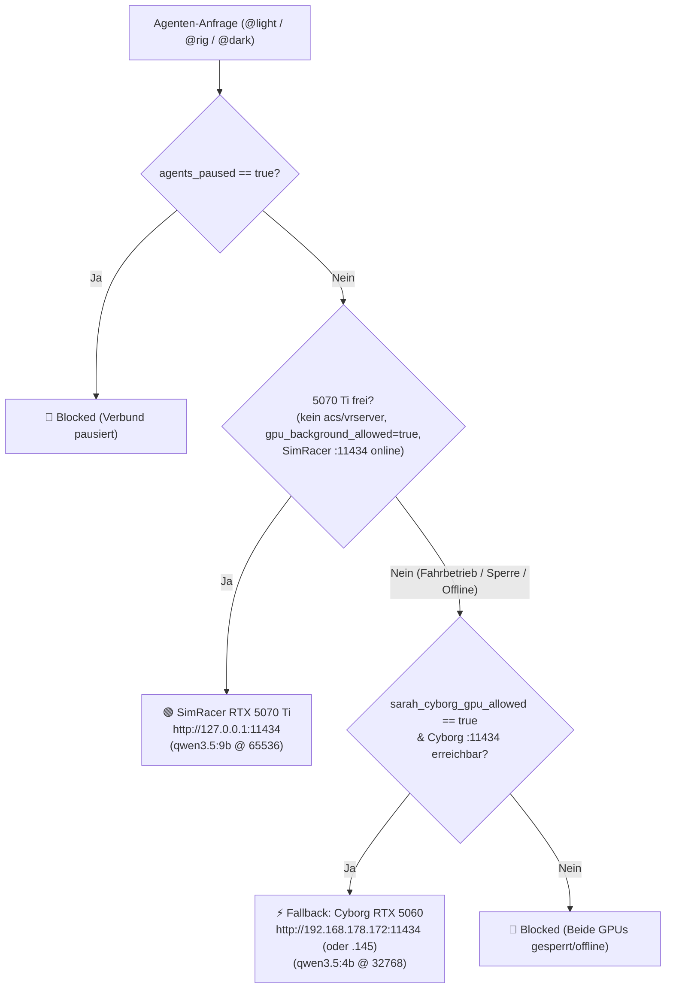
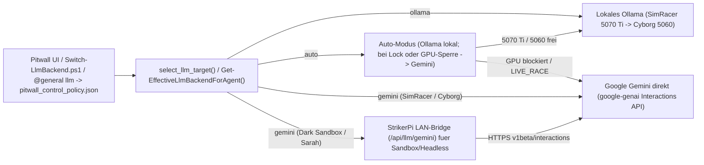

> **Thema:** System-Letztstand 26.11.2026 – Dual-GPU Ollama (SimRacer RTX 5070 Ti + Cyborg RTX 5060), Pro-GPU Kontext-Profile, Agenten-Fallback bei 5070-Ti-Sperre & Pitwall GPU-Modellverwaltung (`Entladen` / `Tauschen` / `Deinstallieren`)
> **Autor:** Michael Stürmer
> **Datum:** 26.11.2026

# 5.10 System-Letztstand (26.11.2026): Dual-GPU Ollama, Fallback-Routing & Pitwall GPU-Modelle

<!-- DOKU-SUBNAV-START -->

<b>🧭 Rubrik-Navigation &amp; Modul-Übersicht (05 Agents)</b>

**Zentrale:** [📚 Doku-Index](../README.md) · [📂 Rubrik 05 Agents](./README.md) · **Vorheriges:** [⬅️ Letztstand 25.11. (Architektur v5, Toolbox & Pitwall v2.1)](./SYSTEM_ARCHITEKTUR_AENDERUNGEN_2026-11-25.md)

**Alle Module in `05_Agents/`:**
- [01 • Agent-Stilfibel, Didaktik-Ruler & 7-Stufen-Aufbau](./01_agent-stilfibel-und-didaktik-ruler.md)
- [02 • Agenten erstellen: Instructions, Rules & Prompts](./02_agenten-erstellen-instructions-rules-und-prompts.md) · `gemini.instructions`
- [03 • Agenten ausrüsten: Skills & MCP-Tools](./03_agenten-ausruesten-skills-und-mcp-tools.md) · `SKILL.md`
- [04 • Priming, Memory & Multi-Agent-Orchestrierung](./04_agenten-trainieren-primen-und-orchestrieren.md) · `@light`
- [05 • Schnittstelle, Terminals & XOR-Mutex](./05_workspace-schnittstelle-simracer-und-agenten-terminals.md) · `Bridge`
- [06 • Multi-Workspace Netzwerk & 6-Rollen-Verbund](./05_multi-workspace-netzwerk-mcp-und-agenten-verbund.md)
- 👉 **[Letztstand 26.11. (Dual-GPU Ollama, Fallback & Pitwall GPU-Modelle)](./SYSTEM_ARCHITEKTUR_AENDERUNGEN_2026-11-26.md)** *(aktuell)*
- [Stand 25.11. (Architektur v5, Toolbox & Pitwall v2.1)](./SYSTEM_ARCHITEKTUR_AENDERUNGEN_2026-11-25.md)
- [Praxis-Referenz 25.11. (Hisense 4K-TV & ClearType)](./HISENSE_TV_DISPLAY_OPTIMIERUNG_2026-11-25.md)
- [Stand 24.11. (Parity, Qwen 3.5 & Nacharbeiten)](./SYSTEM_ARCHITEKTUR_AENDERUNGEN_2026-11-24.md)
- [Stand 23.11. (ToS-Bereinigung, Ollama & Pitwall v1.5)](./SYSTEM_ARCHITEKTUR_AENDERUNGEN_2026-11-23.md)
- [Änderungsprotokoll 11.11. (MQTT, Gatekeeper & Caddy)](./SYSTEM_ARCHITEKTUR_AENDERUNGEN_2026-11-11.md)
- [Pitwall & Systemreferenz (NotebookLM-Quelle)](./PITWALL_STEUERUNG_UND_FUNKTIONSREFERENZ_NOTEBOOKLM.md)
- [Boxencrew & Teamchef Konzept (NotebookLM)](./PITWALL_BOXENCREW_TEAMCHEF_KONZEPT_NOTEBOOKLM.md)

**Weitere Rubriken:** [🐧 01 Linux & Bash](../01_Linux_Bash/README.md) · [🧩 02 VS Code & MCP](../02_VSCode_Env/README.md) · [🐍 03 Python](../03_Python_Coding/README.md) · [🌐 04 JS/TS Web](../04_JS_TS_Web/README.md)

<!-- DOKU-SUBNAV-END -->

Dieses Protokoll dokumentiert die am **26.11.2026** umgesetzte Dual-GPU-Ollama-Architektur über **SimRacer (RTX 5070 Ti, 16 GB VRAM)** und **VanstrikeCyborg (RTX 5060 Laptop, 8 GB VRAM)**, die pro GPU gemessenen Kontext- und VRAM-Profile (`ollama_gpu_profiles.json`), den automatischen **Agenten-Fallback bei 5070-Ti-Sperre** (`ollama_router.py`) sowie den neuen Pitwall-Sub-Tab **`🧠 GPU-Modelle`** auf dem StrikerPi (`192.168.178.86:8080`).

<b>Lernziele</b>

Nach dem Durcharbeiten dieses Protokolls kannst du:
1. die Ursache des defekten Ollama-Starts auf `VanstrikeCyborg` (`upgrade.log` Rollback nach `DeleteFile code 5` &rarr; fehlendes `lib\ollama\*`) benennen und die Reparatur via `winget` (`0.40.18`) + Task `Ollama-Server-Cyborg` nachvollziehen,
2. für alle **5 installierten Modelle** auf RTX 5070 Ti (`16303 MiB`) und RTX 5060 Laptop (`8151 MiB`) die gemessenen `num_ctx`- und VRAM-Grenzen angeben,
3. die **5-stufige Routing-Entscheidung** von `ollama_router.py` zwischen `simracer`, `cyborg` (Fallback bei `LIVE_RACE` oder `gpu_background_allowed=false`) und `Blocked` (`agents_paused=true` / `sarah_cyborg_gpu_allowed=false`) erklären,
4. über die Pitwall-Oberfläche (`🛡️ Agenten` &rarr; `🧠 GPU-Modelle`) Modelle auf beiden GPUs **laden/tauschen**, **entladen** und sicher **deinstallieren** sowie die Live-Fahrbetrieb-Sperre (`HTTP 409`) einordnen.

<b>Kernkonzepte</b>

<b>1. Cyborg Ollama-Reparatur (<code>0.40.18</code>) &amp; Autostart ohne Admin</b>

- **Root Cause auf `VanstrikeCyborg`:** Ein abgebrochenes Auto-Update am `24.11.2026 05:47` (`%LOCALAPPDATA%\Ollama\upgrade.log`: `DeleteFile failed; code 5` auf `ollama.exe`) führte zu einem Inno-Setup-Rollback, der den kompletten Unterordner `C:\Users\strik\AppData\Local\Programs\Ollama\lib\ollama\` (inkl. `llama-server.exe` und CUDA-Bibliotheken) entfernte. Dadurch brach `ollama app.exe` mit `Failed to start: Unable to init instance` ab und `ollama.exe serve` meldete `total_vram="0 B"`.
- **Behebung:** Nach Stoppen aller Ollama-Prozesse per `winget upgrade --id Ollama.Ollama --silent --accept-package-agreements --accept-source-agreements` sauber auf **`0.40.18`** aktualisiert (`cuda_v12`, `cuda_v13`, `llama-server` wiederhergestellt; bestehende Modelle unter `C:\Users\strik\.ollama\models` blieben vollständig erhalten).
- **Startskript &amp; Autostart:** [`start-ollama-laptop.ps1`](file:///C:/Users/strik/AppData/Local/Programs/Ollama/start-ollama-laptop.ps1) (Backup: `start-ollama-laptop.ps1.bak_20261126`) setzt:
  - `OLLAMA_HOST = "0.0.0.0:11434"` (LAN-Erreichbarkeit über Private-Firewall-Regel auf Ethernet `192.168.178.172` &amp; WLAN `192.168.178.145`)
  - `OLLAMA_KEEP_ALIVE = "10m"`, `OLLAMA_MAX_LOADED_MODELS = "1"`, `OLLAMA_NUM_PARALLEL = "1"`
  - `OLLAMA_FLASH_ATTENTION = "1"`, `OLLAMA_KV_CACHE_TYPE = "q8_0"`, `OLLAMA_CONTEXT_LENGTH = "32768"`
  - Gestartet über den User-Level-Task **`Ollama-Server-Cyborg`** (`RunLevel Limited`, ohne Admin-Rechte).

<b>2. Live gemessene VRAM- &amp; Kontext-Profile (<code>ollama_gpu_profiles.json</code>)</b>

Alle installierten Modelle wurden am `26.11.2026` live über `/api/generate` + `/api/ps` + `nvidia-smi` auf beiden GPUs vermessen. Jedes Profil passt bei `q8_0` + Flash Attention **zu 100 % in den VRAM** (`size_vram == size`):

| Host &amp; GPU | Modell | Natives Max | Empfohlenes `num_ctx` | `/api/ps` Größe / VRAM | `nvidia-smi` belegt / frei | Ladezeit |
| :--- | :--- | ---: | ---: | :--- | :--- | ---: |
| **SimRacer** (`RTX 5070 Ti`, 16303 MiB) | `qwen3.5:9b` | `262144` | **`65536`** | `6,43 GB / 6,43 GB` (`100 %`) | `10206 / 16303 MiB` | `144,9 s` |
| **SimRacer** (`RTX 5070 Ti`, 16303 MiB) | `gemma4:12b` | `262144` | **`65536`** | `1,18 GB / 1,18 GB` (`100 %`)\* | `13055 MiB` / `2941 MiB` frei | `201,5 s` |
| **SimRacer** (`RTX 5070 Ti`, 16303 MiB) | `qwen2.5-coder:14b` | `32768` | **`32768`** | `11,35 GB / 11,35 GB` (`100 %`) | `14323 MiB` / `1673 MiB` frei | `174,8 s` |
| **Cyborg** (`RTX 5060 Laptop`, 8151 MiB) | `qwen3.5:4b` | `262144` | **`32768`** | `3,47 GB / 3,47 GB` (`100 %`) | `4855 MiB` / `3045 MiB` frei | `42,5 s` |
| **Cyborg** (`RTX 5060 Laptop`, 8151 MiB) | `gemma4:e4b` | `131072` | **`32768`** | `0,49 GB / 0,49 GB` (`100 %`)\* | `5551 MiB` / `2349 MiB` frei | `68,3 s` |

_\*Hinweis zu `gemma4`-Modellen in Ollama `0.40.x` (`llamacpp`-Runner): `/api/ps` weist dort nur einen Teilbetrag (`1,18 GB` bzw. `0,49 GB`) aus; der reale VRAM-Verbrauch laut `nvidia-smi` liegt bei `13055 MiB` (`12b` auf 5070 Ti, `2941 MiB` frei) bzw. `5551 MiB` (`e4b` bei `32K` auf 5060, `2349 MiB` frei) — beide vollständig auf der GPU._

**Zentrale Profil-Datei:** [`ollama_gpu_profiles.json`](file:///192.168.178.68/ac-sandbox/shared/scripts/ollama_gpu_profiles.json) (Spiegel auf StrikerPi: [`ollama_gpu_profiles.json`](file:///c:/Users/strik/strikerpi-hub/telemetry-relay/ollama_gpu_profiles.json)).

<b>3. Dual-GPU-Fallback-Routing für Agenten (<code>5070 Ti</code> &rarr; <code>Cyborg 5060</code>)</b>

Das neue Python-Modul [`ollama_router.py`](file:///192.168.178.68/ac-sandbox/shared/scripts/ollama_router.py) steuert die Zielwahl für [`agent_ollama_tool_runtime.py`](file:///192.168.178.68/ac-sandbox/shared/scripts/agent_ollama_tool_runtime.py) und [`rig_ollama_vr_analyzer.py`](file:///192.168.178.68/ac-sandbox/shared/scripts/rig_ollama_vr_analyzer.py); ergänzend wurden [`start_light_terminal.ps1`](file:///192.168.178.68/ac-sandbox/shared/agents/light/start_light_terminal.ps1) und [`runner.ps1`](file:///192.168.178.68/ac-sandbox/shared/agents/dark/runner.ps1) angepasst:

- **Kein unbeabsichtigtes Modell-Neuladen:** `agent_ollama_tool_runtime.py` und `rig_ollama_vr_analyzer.py` übergeben nun exakt das im Profil hinterlegte `num_ctx` (`65536` auf SimRacer, `32768` auf Cyborg) statt fest `8192`.
- **`@light` &amp; `@dark` Durchlass:** Bei `gpu_background_allowed=false` blockiert `start_light_terminal.ps1` nur noch reine 5070-Ti-Render-/Benchmark-Jobs oder wenn Cyborg nicht erreichbar bzw. gesperrt ist; `runner.ps1` wählt für Analyse-Tasks automatisch Cyborg (`qwen3.5:4b` @ `32768`), sobald `gpu_background_allowed=false`.

<b>4. Pitwall <code>🧠 GPU-Modelle</code> (<code>telemetry_relay.py</code> auf StrikerPi)</b>

Unter `http://192.168.178.86:8080/` &rarr; `🛡️ Agenten` wurde der Sub-Tab **`🧠 GPU-Modelle`** samt Backend-Endpunkten in [`telemetry_relay.py`](file:///c:/Users/strik/strikerpi-hub/telemetry-relay/telemetry_relay.py) ergänzt:

| Komponente | Funktion &amp; Sicherheitsregeln |
| :--- | :--- |
| **`GET /api/ollama/gpus`** | Fragt parallel beide Ollama-Hosts (`/api/tags`, `/api/ps`), per Base64-SSH `nvidia-smi` auf SimRacer &amp; Cyborg sowie die aktive Routing-Policy ab (`?refresh=1` umgeht den 6-s-Cache). |
| **`POST /api/ollama/action`** | Führt `load`, `swap` (entlädt andere Modelle zuerst), `unload` (`keep_alive=0`) oder `delete` (`DELETE /api/delete`) mit `num_ctx`-Auswahl aus. **Harter Schutz:** Bei laufendem AC/VR liefert `load`/`swap` auf `simracer` **HTTP `409`**. |
| **UI-Steuerung (`subTab-models`)** | Zweispaltige Kartenansicht (`SimRacer RTX 5070 Ti` &amp; `Cyborg RTX 5060`) im scroll-freien Kiosk-Layout, Kontext-Dropdown pro Modell (empfohlenes `num_ctx` mit `★`), `⏹️ Entladen`, `🔄 Laden / Tauschen` und **2-Klick-Schutz** (`🗑️ Deinstallieren` &rarr; `⚠️ Bestätigen?` für 5 s). |

<b>5. Live-Abnahmetests &amp; Verifikationsprotokoll (26.11.2026)</b>

| Prüfung | Ergebnis | Beobachtete Evidenz |
| :--- | :---: | :--- |
| **Syntax &amp; Deployment** | ✅ | `py_compile` (`Exit 0`), JS `node --check` (`Exit 0`), PS-AST-Parser (`0` Fehler), `telemetry-relay.service` `active`, SHA256 `3a87ad35...` (Lokal = StrikerPi). |
| **5-Zustände-Routing-Matrix (`ollama_router.py`)** | ✅ | `FREE_DEFAULT` &rarr; `simracer` (`65536`), `SIMULATED_RACE_LOCK` &rarr; `cyborg` (`qwen3.5:4b @ 32768`), `POLICY_5070_LOCK` &rarr; `cyborg`, `CYBORG_ALSO_LOCKED` &rarr; `Blocked`, `AGENTS_PAUSED` &rarr; `Blocked`. |
| **Pitwall API Load / Swap / Unload** | ✅ | Cyborg `swap qwen3.5:4b` (`32768`, `3,47 GB`, `100 % GPU`) &rarr; `swap gemma4:e4b` (`32768`, `100 % GPU`) &rarr; `unload` (`0` aktiv); SimRacer-VRAM nach Test leer (`0` Modelle). |
| **Pitwall HTML &amp; `/api/delete`-Sonde** | ✅ | `GET /` enthält `subBtn-models` &amp; `subTab-models`; `DELETE /api/delete` auf nicht existentes `__nonexistent_probe__:latest` liefert korrekt `HTTP 404` (`model not found`). |
| **Live-Fallback `@rig` (`--simulate-5070-lock`)** | ✅ | Testlauf `e2e_fallback_cyborg_20261126` (mit entpausierter In-Memory-Policy): `status=Executed`, `tool_used=manage_rig_hub` (`rig-hub.ps1`), `ollama_node=cyborg`, `model=qwen3.5:4b`, `num_ctx=32768`, `fallback_active=true`, SimRacer `/api/ps = 0`; danach auf Cyborg per `/api/ollama/action unload` entladen. |
| **Live-Policy-Hinweis (Change-Freeze)** | ℹ️ | Im produktiven [`pitwall_control_policy.json`](file:///192.168.178.68/ac-sandbox/shared/agents/general-SIM/pitwall_control_policy.json) ist seit dem Not-Aus vom 25.11. weiterhin `agents_paused=true` aktiv (per Change-Freeze unverändert belassen). |

<b>6. Zentrale KI-Schaltweiche (Lokales Ollama &harr; Google Gemini)</b>

Um alle Agenten und LLM-Router zwischen lokalem **Ollama** (`SimRacer RTX 5070 Ti` &rarr; `Cyborg RTX 5060`) und **Google Gemini Cloud** (Google Gen AI SDK / Interactions API, `0 %` lokale GPU-Last) umschaltbar zu machen, wurde die Architektur um eine zentrale **3-Modi-Schaltweiche** mit optionalen **Pro-Agenten-Overrides** erweitert.

<b>6.1 Zentrale Steuerung &amp; Sicherheitsinvarianten</b>

- **Single Source of Truth:** [`pitwall_control_policy.json`](file:///192.168.178.68/ac-sandbox/shared/agents/general-SIM/pitwall_control_policy.json) führt die Felder `llm_backend` (`"ollama" | "auto" | "gemini"`), `llm_gemini_model` (erlaubt: `gemini-3.8-flash`, `gemini-3.5-flash-lite`, `gemini-2.5-flash`, `gemini-2.5-pro`, `gemini-4-argon`, `gemini-4-neon`) sowie `agent_llm_backends` (`general`, `light`, `rig`, `dark`, `sarah`, `rick` mit `"inherit" | "ollama" | "auto" | "gemini"`).
- **Key-Isolation:** `GEMINI_API_KEY` liegt **niemals** in Git, unter `shared/` oder in Logs, sondern ausschließlich geschützt in der User-Umgebung auf **Cyborg** &amp; **SimRacer** sowie auf **StrikerPi** in `/etc/telemetry-relay.env` (`-rw------- 1 root root`, eingebunden per `systemd` `EnvironmentFile=-/etc/telemetry-relay.env`).
- **Not-Aus &amp; Pause-Schutz:** Ein Pitwall-`EMERGENCY_REVOKE` setzt `llm_backend` automatisch auf `"ollama"` zurück; bei aktiver Verbund-Pause (`agents_paused=true`) blockiert auch die LAN-Bridge `/api/llm/gemini`.

<b>6.2 Angepasste Komponenten &amp; Schnittstellen</b>

| Komponente | Datei | Rolle in der Schaltweiche |
| :--- | :--- | :--- |
| **Pitwall Hub &amp; LAN-Bridge** | [`telemetry_relay.py`](file:///c:/Users/strik/strikerpi-hub/telemetry-relay/telemetry_relay.py) (`StrikerPi :8080`) | UI-Leiste `#llmSwitchBar` unter `🛡️ Agenten`, Schnellwahl unter `🧠 GPU-Modelle`, Pro-Agenten-Dropdowns; `GET /api/llm/status` sowie LAN-geschützte `POST /api/llm/gemini` Proxy-Bridge über `v1beta/interactions`. |
| **Zentral-Router** | [`ollama_router.py`](file:///192.168.178.68/ac-sandbox/shared/scripts/ollama_router.py) | `select_llm_target()`, `resolve_effective_backend()`, `convert_ollama_tools_to_gemini()`, `call_gemini_interaction()` (`google-genai` Interactions API inkl. REST- &amp; StrikerPi-Bridge-Fallback). |
| **Tool- &amp; VR-Laufzeiten (`@rig`)** | [`agent_ollama_tool_runtime.py`](file:///192.168.178.68/ac-sandbox/shared/scripts/agent_ollama_tool_runtime.py), [`rig_ollama_vr_analyzer.py`](file:///192.168.178.68/ac-sandbox/shared/scripts/rig_ollama_vr_analyzer.py) | `--backend {policy,ollama,auto,gemini}` &amp; `--gemini-model`; nahtloses Tool-Calling und VR-Telemetrieauswertung über Ollama oder Gemini. |
| **Container-Agent (`@dark`)** | [`runner.ps1`](file:///192.168.178.68/ac-sandbox/shared/agents/dark/runner.ps1) | `Get-DarkLlmSwitchConfig` lädt primär live `/api/approvals/state` bzw. `/api/llm/status?refresh=1` (Umgehung des Win11/Docker-SMB-Caches unter `\\host.lan\Data`); `Invoke-DarkGeminiViaPitwall` nutzt `POST /api/llm/gemini`. |
| **Host- &amp; Terminal-Agenten** | [`start_light_terminal.ps1`](file:///192.168.178.68/ac-sandbox/shared/agents/light/start_light_terminal.ps1), [`start_general_terminal.ps1`](file:///192.168.178.68/ac-sandbox/shared/agents/general-SIM/start_general_terminal.ps1) | `@light` erlaubt Analyse-Prompts im `gemini`-/`auto`-Modus auch bei gesperrter `5070 Ti` (blockiert weiter `benchmark\|render`); `@general` bietet `llm` (`llm`, `llm ollama\|auto\|gemini [modell]`, `llm @<agent> <modus>`). |
| **Telemetrie-Analyst (`@sarah`)** | [`sarah_worker.py`](file:///192.168.178.68/ac-sandbox/shared/telemetry/sarah_worker.py) | `fetch_strikerpi_llm_status()` &amp; `call_sarah_gemini_bridge()` im SimRacer-Share aktualisiert *(Hinweis: `archibald` `192.168.178.98` war während des Rollouts per SSH `:22` nicht erreichbar und zieht das Update beim nächsten Boot nach)*. |
| **Cyborg Hybrid-Router &amp; CLI** | [`hybrid_llm_router.py`](file:///c:/Users/strik/git-labor/labs/03_python/hybrid_llm_router.py), [`Switch-LlmBackend.ps1`](file:///c:/Users/strik/git-labor/labs/Switch-LlmBackend.ps1) | `hybrid_llm_router.py` nutzt standardmäßig `--tier policy` (`google-genai` Interactions API); `Switch-LlmBackend.ps1` zeigt die Schaltmatrix und schaltet global oder pro Agent um. |

<b>6.3 Verifikation der Schaltweiche (26.11.2026)</b>

| Prüfung | Ergebnis | Beobachtete Evidenz |
| :--- | :---: | :--- |
| **Pitwall API &amp; Gemini-Bridge** | ✅ | `GET /api/llm/status?refresh=1` &rarr; `gemini_key_present=true`, `gemini_ready=true`; `POST /api/llm/gemini` &rarr; `ok=true` (`"BRIDGE_OK"`); `GET /` enthält UI-Elemente; `telemetry-relay.service` `active` (SHA256-identisch lokal/StrikerPi). |
| **`ollama_router.py` 3-Modi-Matrix** | ✅ | `--backend ollama` &rarr; `simracer/qwen3.5:9b`; `--backend auto --simulate-5070-lock` &rarr; `cyborg/qwen3.5:4b`; `--backend gemini` &rarr; `google_gemini/gemini-3.8-flash` (`google_genai_sdk`). |
| **`@rig` Tool-Runtime &amp; VR-Analyzer** | ✅ | `agent_ollama_tool_runtime.py --backend ollama` &amp; `--backend gemini` jeweils `manage_rig_hub` ausgeführt; `rig_ollama_vr_analyzer.py --backend gemini` lieferte Live-Auswertung in `8.24 s` (`143` Output-Tokens, `0 %` lokale GPU-Last). |
| **`@dark` Sandbox via StrikerPi-Bridge** | ✅ | Temporär `@dark=gemini`: `runner.ps1 -Action Status` (`llm_backend: gemini`, `llm_gemini_model: gemini-3.8-flash`) und `ProcessPrompt` über `/api/llm/gemini` (`[Dark Agent @ Sandbox // Google Gemini (gemini-3.8-flash)]`), danach zurück auf `inherit`. |
| **`@sarah`, Cyborg Router &amp; CLI** | ✅ | `sarah_worker.py` Unit-Check (`cyborg_rtx5060` vs. gemockter Gemini-Fallback bei `LIVE_RACE`) bestanden; `hybrid_llm_router.py --tier gemini` &rarr; `"OK"` &amp; `--tier ollama --check` &rarr; `simracer_ollama`; `Switch-LlmBackend.ps1` Round-Trip &rarr; Standardzustand `ollama` / `inherit`. |

<b>Übungsaufgaben</b>

1. **Verbund nach Not-Aus im Pitwall wieder scharfschalten:** Öffne `http://192.168.178.86:8080/` &rarr; `🛡️ Agenten` und klicke auf `▶️ Verbund fortsetzen` (sowie nach Bedarf `✅ 5070 Ti erlauben` / `💻 Cyborg GPU: ERLAUBT`), damit `@light`, `@rig` und `@dark` aus der globalen Pause gehen.
2. **Dual-GPU-Verwaltung testen:** Wechsle auf den Sub-Tab `🧠 GPU-Modelle`, lade `qwen3.5:4b` (`32K`) auf **Cyborg RTX 5060**, prüfe die VRAM-Anzeige (`~4775 / 8151 MiB`) und entlade es wieder per `⏹️ Entladen`.
3. **5070-Ti-Sperrfall simulieren:** Sperre auf `🤖 Agenten &amp; Status` die `5070 Ti`, prüfe im Tab `🧠 GPU-Modelle`, dass der Routing-Banner auf **`⚡ Fallback aktiv (Pitwall 5070-Ti-Sperre)`** umspringt, und starte eine Analyse über `@rig` oder `@dark`.
4. **KI-Schaltweiche umschalten (CLI &amp; Pitwall):** Prüfe die aktuelle Matrix mit [`Switch-LlmBackend.ps1`](file:///c:/Users/strik/git-labor/labs/Switch-LlmBackend.ps1), schalte z. B. gezielt `@dark` temporär auf `gemini` (`-Agent dark -Backend gemini`), teste eine Read-Only-Analyse und stelle per `-Agent dark -Backend inherit` wieder auf Standard-Ollama zurück.

<b>Weiterführende Links &amp; Quellen</b>

- **Vorgänger-Protokoll (25.11.2026):** [`SYSTEM_ARCHITEKTUR_AENDERUNGEN_2026-11-25.md`](./SYSTEM_ARCHITEKTUR_AENDERUNGEN_2026-11-25.md)
- **Cyborg Ollama-Startskript:** [`start-ollama-laptop.ps1`](file:///C:/Users/strik/AppData/Local/Programs/Ollama/start-ollama-laptop.ps1) · **SimRacer:** [`start-ollama-simracer.ps1`](file:///192.168.178.68/ac-sandbox/shared/scripts/start-ollama-simracer.ps1)
- **Routing, Schaltweiche &amp; Profile:** [`ollama_router.py`](file:///192.168.178.68/ac-sandbox/shared/scripts/ollama_router.py) · [`hybrid_llm_router.py`](file:///c:/Users/strik/git-labor/labs/03_python/hybrid_llm_router.py) · [`Switch-LlmBackend.ps1`](file:///c:/Users/strik/git-labor/labs/Switch-LlmBackend.ps1) · [`ollama_gpu_profiles.json`](file:///192.168.178.68/ac-sandbox/shared/scripts/ollama_gpu_profiles.json)
- **Angepasste Agenten-Skripte:** [`agent_ollama_tool_runtime.py`](file:///192.168.178.68/ac-sandbox/shared/scripts/agent_ollama_tool_runtime.py) · [`rig_ollama_vr_analyzer.py`](file:///192.168.178.68/ac-sandbox/shared/scripts/rig_ollama_vr_analyzer.py) · [`start_light_terminal.ps1`](file:///192.168.178.68/ac-sandbox/shared/agents/light/start_light_terminal.ps1) · [`runner.ps1`](file:///192.168.178.68/ac-sandbox/shared/agents/dark/runner.ps1) · [`sarah_worker.py`](file:///192.168.178.68/ac-sandbox/shared/telemetry/sarah_worker.py) · [`start_general_terminal.ps1`](file:///192.168.178.68/ac-sandbox/shared/agents/general-SIM/start_general_terminal.ps1)
- **Pitwall Hub (StrikerPi):** [`telemetry_relay.py`](file:///c:/Users/strik/strikerpi-hub/telemetry-relay/telemetry_relay.py) (`http://192.168.178.86:8080`)

<b>Chips &amp; Kernaussagen</b>

- **Cyborg Ollama `0.40.18` repariert:** Nach Rollback-Schaden wieder mit CUDA `v12`/`v13` aktiv auf Port `11434` (`OLLAMA_CONTEXT_LENGTH=32768`, `q8_0`, Flash Attention) via Task `Ollama-Server-Cyborg`.
- **100 % GPU-Offload auf beiden GPUs:** `qwen3.5:9b` (`64K`), `gemma4:12b` (`64K`), `qwen2.5-coder:14b` (`32K`) auf RTX 5070 Ti; `qwen3.5:4b` (`32K`, `64K` möglich) &amp; `gemma4:e4b` (`32K`) auf RTX 5060 Laptop.
- **Automatischer 5070-Ti-Fallback:** Bei `LIVE_RACE` (`acs.exe`/`vrserver.exe`) oder Pitwall-Sperre routet `ollama_router.py` SimRacer-Agenten nahtlos auf Cyborgs RTX 5060 (`qwen3.5:4b @ 32768`) bei `0 %` 5070-Ti-Last.
- **Pitwall `🧠 GPU-Modelle`:** Live-Übersicht beider GPUs inkl. Kontext-Wahl, `Entladen`, `Laden/Tauschen` (mit Fahrbetrieb-HTTP-409-Schutz) und 2-Klick-`Deinstallieren`.
- **Zentrale KI-Schaltweiche (`ollama` / `auto` / `gemini`):** Alle Agenten sind global oder individuell per Pitwall UI, `@general llm` oder [`Switch-LlmBackend.ps1`](file:///c:/Users/strik/git-labor/labs/Switch-LlmBackend.ps1) zwischen lokalem Ollama und Google Gemini Cloud (`google-genai` Interactions API bzw. StrikerPi LAN-Bridge `/api/llm/gemini`) umschaltbar.

---
*Hinweis zur Organisation:* Die erstellte Dokumentation ist am Drehlaufwerk abgelegt und mit einer kurzen Zusammenfassung von den Chips auch in den Notebooks verlinkt.

<!-- DOKU-MINIMAP-START -->

🗺️ Doku-Minimap (5 Rubriken &amp; Labs)

<i class="dot r1"></i>Linux<i class="dot r2"></i>VSCode<i class="dot r3"></i>Python<i class="dot r4"></i>JS/TS<i class="dot r5"></i>Agents

🏛️ <a href="../README.md">VanstrikeCyborg — git-labor Doku-Index</a> · <a href="../../README.md">Repo-README</a> · <a href="../../AGENTS.md">AGENTS.md</a> · <a href="../../notebook-agent-environments/README.md">Notebooks</a> · <a href="../05_Agents/SYSTEM_ARCHITEKTUR_AENDERUNGEN_2026-11-26.md">Letztstand 26.11.</a>

🐧 <a href="../01_Linux_Bash/README.md">01_Linux_Bash (Linux, Shell & Container)</a>

<ul class="doku-arch-lines">
<li>├─ <a href="../01_Linux_Bash/01_bash-grundlagen-und-skripting.md">01 • Bash CLI, Text-Tools, Streams & Expansions</a> <a class="doku-arch-badge" href="../../labs/01_linux_bash/check-env.sh">check-env.sh</a></li>
<li>├─ <a href="../01_Linux_Bash/02_linux-systemadministration-und-interna.md">02 • Inodes, LVM, Prozesse, Boot-Prozess & systemd</a></li>
<li>├─ <a href="../01_Linux_Bash/03_arch-linux-omarchy-und-remote-ssh.md">03 • Arch Linux, Omarchy, Remote-SSH & Nginx</a></li>
<li>├─ <a href="../01_Linux_Bash/04_fortgeschrittenes-bash-skripting-und-automatisierung.md">04 • Advanced Bash: Arrays, getopts & Backups</a></li>
<li>└─ <a href="../01_Linux_Bash/05_docker-und-sbx-micro-vms.md">05 • Docker Grundlagen & Sandbox Micro-VMs (sbx)</a></li>
</ul>

🧩 <a href="../02_VSCode_Env/README.md">02_VSCode_Env (IDE, Git, MCP & Gemini)</a>

<ul class="doku-arch-lines">
<li>├─ <a href="../02_VSCode_Env/01_vscode-architektur-lsp-und-remote.md">01 • VS Code Architektur, Sprachserver (LSP) & Remote</a></li>
<li>├─ <a href="../02_VSCode_Env/02_git-github-und-multi-root-workspaces.md">02 • Git, GitHub Workflow & Multi-Root Workspaces</a> <a class="doku-arch-badge" href="../../git-labor.code-workspace">Workspace</a></li>
<li>├─ <a href="../02_VSCode_Env/03_mcp-server-localhost-proxy-und-ports.md">03 • MCP-Server, Ollama (:11434) & Ports (Archiv: Proxy)</a> <a class="doku-arch-badge" href="../../.vscode/mcp.json">mcp.json</a></li>
<li>├─ <a href="../02_VSCode_Env/04_gemini-oekosystem-ai-studio-und-api-keys.md">04 • Gemini Ökosystem, Google AI Studio & API-Keys</a></li>
<li>└─ <a href="../02_VSCode_Env/05_multi-workspace-netzwerk-mcp-und-agenten-verbund.md">05 • 5-Knoten-Verbund, Parity & Parallel-Limits</a></li>
</ul>

🐍 <a href="../03_Python_Coding/README.md">03_Python_Coding (Python, uv & GenAI SDK)</a>

<ul class="doku-arch-lines">
<li>├─ <a href="../03_Python_Coding/01_python-setup-uv-venv-und-notebooks.md">01 • Python Setup: uv, .venv, Pylance & Notebooks</a> <a class="doku-arch-badge" href="../../notebook-agent-environments/agent_demo.ipynb">.ipynb</a></li>
<li>├─ <a href="../03_Python_Coding/02_gemini-api-python-sdk-und-interactions.md">02 • Google GenAI SDK (google-genai) & Interactions API</a></li>
<li>└─ <a href="../03_Python_Coding/03_python-automatisierung-datenanalyse-und-tests.md">03 • Automatisierung, Datenanalyse & pytest</a> <a class="doku-arch-badge" href="../../labs/03_python/sensor_demo.py">sensor_demo.py</a></li>
</ul>

🌐 <a href="../04_JS_TS_Web/README.md">04_JS_TS_Web (HTML/CSS, JS/TS & Web-SDK)</a>

<ul class="doku-arch-lines">
<li>├─ <a href="../04_JS_TS_Web/01_html-css-und-dom-grundlagen.md">01 • HTML5, CSS3 & DOM-Manipulation Grundlagen</a> <a class="doku-arch-badge" href="../../labs/04_js_ts_web/rechner.html">rechner.html</a></li>
<li>├─ <a href="../04_JS_TS_Web/02_modernes-javascript-und-typescript.md">02 • Modernes JavaScript (ES6+) & TypeScript</a></li>
<li>└─ <a href="../04_JS_TS_Web/03_gemini-sdk-typescript-und-web-apps.md">03 • Google GenAI SDK (@google/genai) für Web-Apps</a></li>
</ul>

🤖 <a href="../05_Agents/README.md">05_Agents (KI-Agenten, Skills & Orchestrierung)</a>

<ul class="doku-arch-lines">
<li>├─ <a href="../05_Agents/01_agent-stilfibel-und-didaktik-ruler.md">01 • Agent-Stilfibel, Didaktik-Ruler & 7-Stufen-Aufbau</a></li>
<li>├─ <a href="../05_Agents/02_agenten-erstellen-instructions-rules-und-prompts.md">02 • Agenten erstellen: Instructions, Rules & Prompts</a> <a class="doku-arch-badge" href="../../.github/instructions/gemini-api.instructions.md">gemini.instructions</a></li>
<li>├─ <a href="../05_Agents/03_agenten-ausruesten-skills-und-mcp-tools.md">03 • Agenten ausrüsten: Skills & MCP-Tools</a> <a class="doku-arch-badge" href="../../.agents/skills/live-transfer-status-monitor/SKILL.md">SKILL.md</a></li>
<li>├─ <a href="../05_Agents/04_agenten-trainieren-primen-und-orchestrieren.md">04 • Priming, Memory & Multi-Agent-Orchestrierung</a> <a class="doku-arch-badge" href="../../.github/agents/light.agent.md">@light</a></li>
<li>├─ <a href="../05_Agents/05_workspace-schnittstelle-simracer-und-agenten-terminals.md">05 • Schnittstelle, Terminals & XOR-Mutex</a> <a class="doku-arch-badge" href="../../labs/03_python/sim_agent_bridge.py">Bridge</a></li>
<li>├─ <a href="../05_Agents/05_multi-workspace-netzwerk-mcp-und-agenten-verbund.md">06 • Multi-Workspace Netzwerk & 6-Rollen-Verbund</a></li>
<li>├─ <a href="../05_Agents/SYSTEM_ARCHITEKTUR_AENDERUNGEN_2026-11-26.md">Letztstand 26.11. (Dual-GPU Ollama &amp; Pitwall GPU-Modelle)</a></li>
<li>├─ <a href="../05_Agents/SYSTEM_ARCHITEKTUR_AENDERUNGEN_2026-11-25.md">Stand 25.11. (Architektur v5, Toolbox & Pitwall v2.1)</a></li>
<li>├─ <a href="../05_Agents/HISENSE_TV_DISPLAY_OPTIMIERUNG_2026-11-25.md">Praxis-Referenz 25.11. (Hisense 4K-TV & ClearType)</a></li>
<li>├─ <a href="../05_Agents/SYSTEM_ARCHITEKTUR_AENDERUNGEN_2026-11-24.md">Stand 24.11. (Parity, Qwen 3.5 & Nacharbeiten)</a></li>
<li>├─ <a href="../05_Agents/SYSTEM_ARCHITEKTUR_AENDERUNGEN_2026-11-23.md">Stand 23.11. (ToS-Bereinigung, Ollama & Pitwall v1.5)</a></li>
<li>├─ <a href="../05_Agents/SYSTEM_ARCHITEKTUR_AENDERUNGEN_2026-11-11.md">Änderungsprotokoll 11.11. (MQTT, Gatekeeper & Caddy)</a></li>
<li>├─ <a href="../05_Agents/PITWALL_STEUERUNG_UND_FUNKTIONSREFERENZ_NOTEBOOKLM.md">Pitwall & Systemreferenz (NotebookLM-Quelle)</a></li>
<li>└─ <a href="../05_Agents/PITWALL_BOXENCREW_TEAMCHEF_KONZEPT_NOTEBOOKLM.md">Boxencrew & Teamchef Konzept (NotebookLM)</a></li>
</ul>

<!-- DOKU-MINIMAP-END -->
