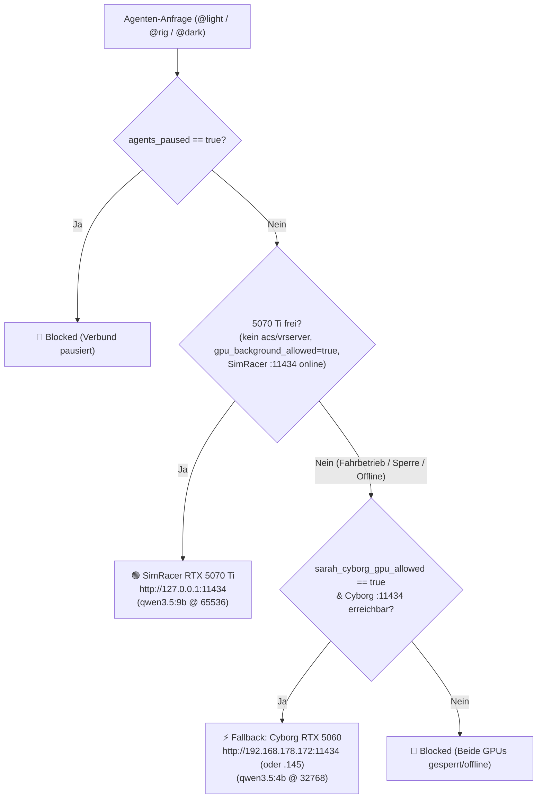
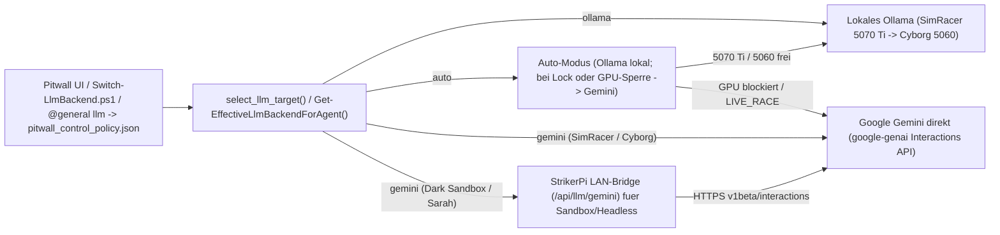

> **Thema:** System-Letztstand 26.11.2026 – Dual-GPU Ollama (SimRacer RTX 5070 Ti + Cyborg RTX 5060), KI-Schaltweiche, NetBird-Mesh, VS Code 1.146 Agents Window (Ollama/MCP-Tool-Budget) & StrikerPi SQLite Leitstand-Datenbank (Werkzeug-Bibliothek)
> **Autor:** Michael Stürmer
> **Datum:** 26.11.2026

# 5.10 System-Letztstand (26.11.2026): Dual-GPU Ollama, Fallback-Routing & Pitwall GPU-Modelle

<!-- DOKU-SUBNAV-START -->
<details>
<summary><b>🧭 Rubrik-Navigation &amp; Modul-Übersicht (05 Agents)</b></summary>

**Zentrale:** [📚 Doku-Index](../README.md) · [📂 Rubrik 05 Agents](./README.md) · **Vorheriges:** [⬅️ Letztstand 25.11. (Architektur v5, Toolbox & Pitwall v2.1)](./SYSTEM_ARCHITEKTUR_AENDERUNGEN_2026-11-25.md)

**Alle Module in `05_Agents/`:**
- [01 • Agent-Stilfibel, Didaktik-Ruler & 7-Stufen-Aufbau](./01_agent-stilfibel-und-didaktik-ruler.md)
- [02 • Agenten erstellen: Instructions, Rules & Prompts](./02_agenten-erstellen-instructions-rules-und-prompts.md) · `gemini.instructions`
- [03 • Agenten ausrüsten: Skills & MCP-Tools](./03_agenten-ausruesten-skills-und-mcp-tools.md) · `SKILL.md`
- [04 • Priming, Memory & Multi-Agent-Orchestrierung](./04_agenten-trainieren-primen-und-orchestrieren.md) · `@light`
- [05 • Schnittstelle, Terminals & XOR-Mutex](./05_workspace-schnittstelle-simracer-und-agenten-terminals.md) · `Bridge`
- [06 • Multi-Workspace Netzwerk & 6-Rollen-Verbund](./05_multi-workspace-netzwerk-mcp-und-agenten-verbund.md)
- 👉 **[Letztstand 26.11. (Dual-GPU Ollama, Fallback & Pitwall GPU-Modelle)](./SYSTEM_ARCHITEKTUR_AENDERUNGEN_2026-11-26.md)** *(aktuell)*
- [Stand 25.11. (Architektur v5, Toolbox & Pitwall v2.1)](./SYSTEM_ARCHITEKTUR_AENDERUNGEN_2026-11-25.md)
- [Praxis-Referenz 25.11. (Hisense 4K-TV & ClearType)](./HISENSE_TV_DISPLAY_OPTIMIERUNG_2026-11-25.md)
- [Stand 24.11. (Parity, Qwen 3.5 & Nacharbeiten)](./SYSTEM_ARCHITEKTUR_AENDERUNGEN_2026-11-24.md)
- [Stand 23.11. (ToS-Bereinigung, Ollama & Pitwall v1.5)](./SYSTEM_ARCHITEKTUR_AENDERUNGEN_2026-11-23.md)
- [Änderungsprotokoll 11.11. (MQTT, Gatekeeper & Caddy)](./SYSTEM_ARCHITEKTUR_AENDERUNGEN_2026-11-11.md)
- [Pitwall & Systemreferenz (NotebookLM-Quelle)](./PITWALL_STEUERUNG_UND_FUNKTIONSREFERENZ_NOTEBOOKLM.md)
- [Boxencrew & Teamchef Konzept (NotebookLM)](./PITWALL_BOXENCREW_TEAMCHEF_KONZEPT_NOTEBOOKLM.md)

**Weitere Rubriken:** [🐧 01 Linux & Bash](../01_Linux_Bash/README.md) · [🧩 02 VS Code & MCP](../02_VSCode_Env/README.md) · [🐍 03 Python](../03_Python_Coding/README.md) · [🌐 04 JS/TS Web](../04_JS_TS_Web/README.md) · [🏎️ 06 AC KN5 Modding](../06_AC_KN5_Modding/README.md) · [🥽 07 VR Engineering](../07_VR_Engineering/README.md)

</details>
<!-- DOKU-SUBNAV-END -->

Dieses Protokoll dokumentiert die am **26.11.2026** umgesetzte Dual-GPU-Ollama-Architektur über **SimRacer (RTX 5070 Ti, 16 GB VRAM)** und **VanstrikeCyborg (RTX 5060 Laptop, 8 GB VRAM)**, die pro GPU gemessenen Kontext- und VRAM-Profile (`ollama_gpu_profiles.json`), den automatischen **Agenten-Fallback bei 5070-Ti-Sperre** (`ollama_router.py`), den Pitwall-Sub-Tab **`🧠 GPU-Modelle`** samt **KI-Schaltweiche** auf dem StrikerPi (`192.168.178.86:8080`), den **live auf StrikerPi deployten Ausbau für die kanonische 7-Rollen-Registry &amp; `@general-sim`**, das **NetBird-Mesh-VPN** (externer Zugriff ohne FRITZ!Box), das **Google-ToS-Audit**, den **Archibald-Lüfter-Entwurf**, die **StrikerPi-Lüfter-/UART-Evaluierung**, die **VS Code 1.146 Agents-Window-Freischaltung (`ollama.ollama`), `.copilot`-ACL-Reparatur &amp; MCP-Tool-Budget-Bereinigung** sowie die **live auf StrikerPi in Betrieb genommene SQLite-Leitstand-Datenbank &amp; Werkzeug-Bibliothek** (`/opt/general-sim/data/leitstand.db`, WAL + FTS5, 5 Organisationsregeln).

<details>
<summary><b>Lernziele</b></summary>

Nach dem Durcharbeiten dieses Protokolls kannst du:
1. die Ursache des defekten Ollama-Starts auf `VanstrikeCyborg` (`upgrade.log` Rollback nach `DeleteFile code 5` &rarr; fehlendes `lib\ollama\*`) benennen und die Reparatur via `winget` (`0.40.18`) + Task `Ollama-Server-Cyborg` nachvollziehen,
2. für alle **5 installierten Modelle** auf RTX 5070 Ti (`16303 MiB`) und RTX 5060 Laptop (`8151 MiB`) die gemessenen `num_ctx`- und VRAM-Grenzen angeben,
3. die **5-stufige Routing-Entscheidung** von `ollama_router.py` zwischen `simracer`, `cyborg` (Fallback bei `LIVE_RACE` oder `gpu_background_allowed=false`) und `Blocked` (`agents_paused=true` / `sarah_cyborg_gpu_allowed=false`) erklären,
4. über die Pitwall-Oberfläche (`🛡️ Agenten` &rarr; `🧠 GPU-Modelle`) Modelle auf beiden GPUs **laden/tauschen**, **entladen** und sicher **deinstallieren** sowie die Live-Fahrbetrieb-Sperre (`HTTP 409`) einordnen,
5. die **kanonische 7-Rollen-Registry** (`cyborg` vs. `general-sim`, **LIVE auf StrikerPi**) vom weiterhin aktiven Legacy-`@general`-Pfad sauber abgrenzen,
6. das **NetBird-Mesh-Routing (`100.64.0.0/10` / `192.168.178.0/24`) über WLAN vs. LAN**, den **Google-ToS-Status** und die **StrikerPi GPIO-14/UART-Lüfterdiagnose** technisch beurteilen,
7. die Ursachen und Behebung der VS-Code-1.146-Probleme im Agents Window (`extensions.supportAgentsWindow` für `ollama.ollama`, NTFS-`0600`-ACL/`transaction root`-Reparatur unter `.copilot`, `ByokLmProxyService`-128-Tool-Limit, `66.281`-Token-Überlauf auf `qwen3.5:4b`, `applyToAllProfiles` &amp; `ollama.thinkingLevels`) nachvollziehen,
8. Architektur, Betriebsmodell (rekonstruierbarer Index über Rohdaten-Master), `db`-Befehle (StrikerPi-Terminal &amp; Remote-SSH) sowie die **5 verbindlichen Bibliotheks-Organisationsregeln** der StrikerPi-SQLite-Datenbank `/opt/general-sim/data/leitstand.db` (`leitstand_db.py`) anwenden.

</details>

<details>
<summary><b>Kernkonzepte</b></summary>

<details>
<summary><b>1. Cyborg Ollama-Reparatur (<code>0.40.18</code>) &amp; Autostart ohne Admin</b></summary>

- **Root Cause auf `VanstrikeCyborg`:** Ein abgebrochenes Auto-Update am `24.11.2026 05:47` (`%LOCALAPPDATA%\Ollama\upgrade.log`: `DeleteFile failed; code 5` auf `ollama.exe`) führte zu einem Inno-Setup-Rollback, der den kompletten Unterordner `C:\Users\strik\AppData\Local\Programs\Ollama\lib\ollama\` (inkl. `llama-server.exe` und CUDA-Bibliotheken) entfernte. Dadurch brach `ollama app.exe` mit `Failed to start: Unable to init instance` ab und `ollama.exe serve` meldete `total_vram="0 B"`.
- **Behebung:** Nach Stoppen aller Ollama-Prozesse per `winget upgrade --id Ollama.Ollama --silent --accept-package-agreements --accept-source-agreements` sauber auf **`0.40.18`** aktualisiert (`cuda_v12`, `cuda_v13`, `llama-server` wiederhergestellt; bestehende Modelle unter `C:\Users\strik\.ollama\models` blieben vollständig erhalten).
- **Startskript &amp; Autostart:** [`start-ollama-laptop.ps1`](file:///C:/Users/strik/AppData/Local/Programs/Ollama/start-ollama-laptop.ps1) (Backup: `start-ollama-laptop.ps1.bak_20261126`) setzt:
  - `OLLAMA_HOST = "0.0.0.0:11434"` (LAN-Erreichbarkeit über Private-Firewall-Regel auf Ethernet `192.168.178.172` &amp; WLAN `192.168.178.145`)
  - `OLLAMA_KEEP_ALIVE = "10m"`, `OLLAMA_MAX_LOADED_MODELS = "1"`, `OLLAMA_NUM_PARALLEL = "1"`
  - `OLLAMA_FLASH_ATTENTION = "1"`, `OLLAMA_KV_CACHE_TYPE = "q8_0"`, `OLLAMA_CONTEXT_LENGTH = "32768"`
  - Gestartet über den User-Level-Task **`Ollama-Server-Cyborg`** (`RunLevel Limited`, ohne Admin-Rechte).

</details>

<details>
<summary><b>2. Live gemessene VRAM- &amp; Kontext-Profile (<code>ollama_gpu_profiles.json</code>)</b></summary>

Alle installierten Modelle wurden am `26.11.2026` live über `/api/generate` + `/api/ps` + `nvidia-smi` auf beiden GPUs vermessen. Jedes Profil passt bei `q8_0` + Flash Attention **zu 100 % in den VRAM** (`size_vram == size`):

| Host &amp; GPU | Modell | Natives Max | Empfohlenes `num_ctx` | `/api/ps` Größe / VRAM | `nvidia-smi` belegt / frei | Ladezeit |
| :--- | :--- | ---: | ---: | :--- | :--- | ---: |
| **SimRacer** (`RTX 5070 Ti`, 16303 MiB) | `qwen3.5:9b` | `262144` | **`65536`** | `6,43 GB / 6,43 GB` (`100 %`) | `10206 / 16303 MiB` | `144,9 s` |
| **SimRacer** (`RTX 5070 Ti`, 16303 MiB) | `gemma4:12b` | `262144` | **`65536`** | `1,18 GB / 1,18 GB` (`100 %`)\* | `13055 MiB` / `2941 MiB` frei | `201,5 s` |
| **SimRacer** (`RTX 5070 Ti`, 16303 MiB) | `qwen2.5-coder:14b` | `32768` | **`32768`** | `11,35 GB / 11,35 GB` (`100 %`) | `14323 MiB` / `1673 MiB` frei | `174,8 s` |
| **Cyborg** (`RTX 5060 Laptop`, 8151 MiB) | `qwen3.5:4b` | `262144` | **`32768`** | `3,47 GB / 3,47 GB` (`100 %`) | `4855 MiB` / `3045 MiB` frei | `42,5 s` |
| **Cyborg** (`RTX 5060 Laptop`, 8151 MiB) | `gemma4:e4b` | `131072` | **`32768`** | `0,49 GB / 0,49 GB` (`100 %`)\* | `5551 MiB` / `2349 MiB` frei | `68,3 s` |

_\*Hinweis zu `gemma4`-Modellen in Ollama `0.40.x` (`llamacpp`-Runner): `/api/ps` weist dort nur einen Teilbetrag (`1,18 GB` bzw. `0,49 GB`) aus; der reale VRAM-Verbrauch laut `nvidia-smi` liegt bei `13055 MiB` (`12b` auf 5070 Ti, `2941 MiB` frei) bzw. `5551 MiB` (`e4b` bei `32K` auf 5060, `2349 MiB` frei) — beide vollständig auf der GPU._

**Zentrale Profil-Datei:** [`ollama_gpu_profiles.json`](file:///192.168.178.68/ac-sandbox/shared/scripts/ollama_gpu_profiles.json) (Spiegel auf StrikerPi: [`ollama_gpu_profiles.json`](file:///c:/Users/strik/strikerpi-hub/telemetry-relay/ollama_gpu_profiles.json)).

</details>

<details>
<summary><b>3. Dual-GPU-Fallback-Routing für Agenten (<code>5070 Ti</code> &rarr; <code>Cyborg 5060</code>)</b></summary>

Das neue Python-Modul [`ollama_router.py`](file:///192.168.178.68/ac-sandbox/shared/scripts/ollama_router.py) steuert die Zielwahl für [`agent_ollama_tool_runtime.py`](file:///192.168.178.68/ac-sandbox/shared/scripts/agent_ollama_tool_runtime.py) und [`rig_ollama_vr_analyzer.py`](file:///192.168.178.68/ac-sandbox/shared/scripts/rig_ollama_vr_analyzer.py); ergänzend wurden [`start_light_terminal.ps1`](file:///192.168.178.68/ac-sandbox/shared/agents/light/start_light_terminal.ps1) und [`runner.ps1`](file:///192.168.178.68/ac-sandbox/shared/agents/dark/runner.ps1) angepasst:



- **Kein unbeabsichtigtes Modell-Neuladen:** `agent_ollama_tool_runtime.py` und `rig_ollama_vr_analyzer.py` übergeben nun exakt das im Profil hinterlegte `num_ctx` (`65536` auf SimRacer, `32768` auf Cyborg) statt fest `8192`.
- **`@light` &amp; `@dark` Durchlass:** Bei `gpu_background_allowed=false` blockiert `start_light_terminal.ps1` nur noch reine 5070-Ti-Render-/Benchmark-Jobs oder wenn Cyborg nicht erreichbar bzw. gesperrt ist; `runner.ps1` wählt für Analyse-Tasks automatisch Cyborg (`qwen3.5:4b` @ `32768`), sobald `gpu_background_allowed=false`.

</details>

<details>
<summary><b>4. Pitwall <code>🧠 GPU-Modelle</code> (<code>telemetry_relay.py</code> auf StrikerPi)</b></summary>

Unter `http://192.168.178.86:8080/` &rarr; `🛡️ Agenten` wurde der Sub-Tab **`🧠 GPU-Modelle`** samt Backend-Endpunkten in [`telemetry_relay.py`](file:///c:/Users/strik/strikerpi-hub/telemetry-relay/telemetry_relay.py) ergänzt:

| Komponente | Funktion &amp; Sicherheitsregeln |
| :--- | :--- |
| **`GET /api/ollama/gpus`** | Fragt parallel beide Ollama-Hosts (`/api/tags`, `/api/ps`), per Base64-SSH `nvidia-smi` auf SimRacer &amp; Cyborg sowie die aktive Routing-Policy ab (`?refresh=1` umgeht den 6-s-Cache). |
| **`POST /api/ollama/action`** | Führt `load`, `swap` (entlädt andere Modelle zuerst), `unload` (`keep_alive=0`) oder `delete` (`DELETE /api/delete`) mit `num_ctx`-Auswahl aus. **Harter Schutz:** Bei laufendem AC/VR liefert `load`/`swap` auf `simracer` **HTTP `409`**. |
| **UI-Steuerung (`subTab-models`)** | Zweispaltige Kartenansicht (`SimRacer RTX 5070 Ti` &amp; `Cyborg RTX 5060`) im scroll-freien Kiosk-Layout, Kontext-Dropdown pro Modell (empfohlenes `num_ctx` mit `★`), `⏹️ Entladen`, `🔄 Laden / Tauschen` und **2-Klick-Schutz** (`🗑️ Deinstallieren` &rarr; `⚠️ Bestätigen?` für 5 s). |

</details>

<details>
<summary><b>5. Live-Abnahmetests &amp; Verifikationsprotokoll (26.11.2026)</b></summary>

| Prüfung | Ergebnis | Beobachtete Evidenz |
| :--- | :---: | :--- |
| **Syntax &amp; Deployment** | ✅ | `py_compile` (`Exit 0`), JS `node --check` (`Exit 0`), PS-AST-Parser (`0` Fehler), `telemetry-relay.service` `active`, SHA256 `3a87ad35...` (Lokal = StrikerPi). |
| **5-Zustände-Routing-Matrix (`ollama_router.py`)** | ✅ | `FREE_DEFAULT` &rarr; `simracer` (`65536`), `SIMULATED_RACE_LOCK` &rarr; `cyborg` (`qwen3.5:4b @ 32768`), `POLICY_5070_LOCK` &rarr; `cyborg`, `CYBORG_ALSO_LOCKED` &rarr; `Blocked`, `AGENTS_PAUSED` &rarr; `Blocked`. |
| **Pitwall API Load / Swap / Unload** | ✅ | Cyborg `swap qwen3.5:4b` (`32768`, `3,47 GB`, `100 % GPU`) &rarr; `swap gemma4:e4b` (`32768`, `100 % GPU`) &rarr; `unload` (`0` aktiv); SimRacer-VRAM nach Test leer (`0` Modelle). |
| **Pitwall HTML &amp; `/api/delete`-Sonde** | ✅ | `GET /` enthält `subBtn-models` &amp; `subTab-models`; `DELETE /api/delete` auf nicht existentes `__nonexistent_probe__:latest` liefert korrekt `HTTP 404` (`model not found`). |
| **Live-Fallback `@rig` (`--simulate-5070-lock`)** | ✅ | Testlauf `e2e_fallback_cyborg_20261126` (mit entpausierter In-Memory-Policy): `status=Executed`, `tool_used=manage_rig_hub` (`rig-hub.ps1`), `ollama_node=cyborg`, `model=qwen3.5:4b`, `num_ctx=32768`, `fallback_active=true`, SimRacer `/api/ps = 0`; danach auf Cyborg per `/api/ollama/action unload` entladen. |
| **Live-Policy-Hinweis (Change-Freeze)** | ℹ️ | Im produktiven [`pitwall_control_policy.json`](file:///192.168.178.68/ac-sandbox/shared/agents/general-SIM/pitwall_control_policy.json) ist seit dem Not-Aus vom 25.11. weiterhin `agents_paused=true` aktiv (per Change-Freeze unverändert belassen). |

</details>

<details>
<summary><b>6. Zentrale KI-Schaltweiche (Lokales Ollama &harr; Google Gemini)</b></summary>

Um alle Agenten und LLM-Router zwischen lokalem **Ollama** (`SimRacer RTX 5070 Ti` &rarr; `Cyborg RTX 5060`) und **Google Gemini Cloud** (Google Gen AI SDK / Interactions API, `0 %` lokale GPU-Last) umschaltbar zu machen, wurde die Architektur um eine zentrale **3-Modi-Schaltweiche** mit optionalen **Pro-Agenten-Overrides** erweitert.



<details>
<summary><b>6.1 Zentrale Steuerung &amp; Sicherheitsinvarianten</b></summary>

- **Single Source of Truth:** [`pitwall_control_policy.json`](file:///192.168.178.68/ac-sandbox/shared/agents/general-SIM/pitwall_control_policy.json) führt die Felder `llm_backend` (`"ollama" | "auto" | "gemini"`), `llm_gemini_model` (erlaubt: `gemini-3.8-flash`, `gemini-3.5-flash-lite`, `gemini-2.5-flash`, `gemini-2.5-pro`, `gemini-4-argon`, `gemini-4-neon`) sowie `agent_llm_backends` (`general`, `light`, `rig`, `dark`, `sarah`, `rick` mit `"inherit" | "ollama" | "auto" | "gemini"`).
- **Key-Isolation:** `GEMINI_API_KEY` liegt **niemals** in Git, unter `shared/` oder in Logs, sondern ausschließlich geschützt in der User-Umgebung auf **Cyborg** &amp; **SimRacer** sowie auf **StrikerPi** in `/etc/telemetry-relay.env` (`-rw------- 1 root root`, eingebunden per `systemd` `EnvironmentFile=-/etc/telemetry-relay.env`).
- **Not-Aus &amp; Pause-Schutz:** Ein Pitwall-`EMERGENCY_REVOKE` setzt `llm_backend` automatisch auf `"ollama"` zurück; bei aktiver Verbund-Pause (`agents_paused=true`) blockiert auch die LAN-Bridge `/api/llm/gemini`.

</details>

<details>
<summary><b>6.2 Angepasste Komponenten &amp; Schnittstellen</b></summary>

| Komponente | Datei | Rolle in der Schaltweiche |
| :--- | :--- | :--- |
| **Pitwall Hub &amp; LAN-Bridge** | [`telemetry_relay.py`](file:///c:/Users/strik/strikerpi-hub/telemetry-relay/telemetry_relay.py) (`StrikerPi :8080`) | UI-Leiste `#llmSwitchBar` unter `🛡️ Agenten`, Schnellwahl unter `🧠 GPU-Modelle`, Pro-Agenten-Dropdowns; `GET /api/llm/status` sowie LAN-geschützte `POST /api/llm/gemini` Proxy-Bridge über `v1beta/interactions`. |
| **Zentral-Router** | [`ollama_router.py`](file:///192.168.178.68/ac-sandbox/shared/scripts/ollama_router.py) | `select_llm_target()`, `resolve_effective_backend()`, `convert_ollama_tools_to_gemini()`, `call_gemini_interaction()` (`google-genai` Interactions API inkl. REST- &amp; StrikerPi-Bridge-Fallback). |
| **Tool- &amp; VR-Laufzeiten (`@rig`)** | [`agent_ollama_tool_runtime.py`](file:///192.168.178.68/ac-sandbox/shared/scripts/agent_ollama_tool_runtime.py), [`rig_ollama_vr_analyzer.py`](file:///192.168.178.68/ac-sandbox/shared/scripts/rig_ollama_vr_analyzer.py) | `--backend {policy,ollama,auto,gemini}` &amp; `--gemini-model`; nahtloses Tool-Calling und VR-Telemetrieauswertung über Ollama oder Gemini. |
| **Container-Agent (`@dark`)** | [`runner.ps1`](file:///192.168.178.68/ac-sandbox/shared/agents/dark/runner.ps1) | `Get-DarkLlmSwitchConfig` lädt primär live `/api/approvals/state` bzw. `/api/llm/status?refresh=1` (Umgehung des Win11/Docker-SMB-Caches unter `\\host.lan\Data`); `Invoke-DarkGeminiViaPitwall` nutzt `POST /api/llm/gemini`. |
| **Host- &amp; Terminal-Agenten** | [`start_light_terminal.ps1`](file:///192.168.178.68/ac-sandbox/shared/agents/light/start_light_terminal.ps1), [`start_general_terminal.ps1`](file:///192.168.178.68/ac-sandbox/shared/agents/general-SIM/start_general_terminal.ps1) | `@light` erlaubt Analyse-Prompts im `gemini`-/`auto`-Modus auch bei gesperrter `5070 Ti` (blockiert weiter `benchmark\|render`); `@general` bietet `llm` (`llm`, `llm ollama\|auto\|gemini [modell]`, `llm @<agent> <modus>`). |
| **Telemetrie-Analyst (`@sarah`)** | [`sarah_worker.py`](file:///192.168.178.68/ac-sandbox/shared/telemetry/sarah_worker.py) | `fetch_strikerpi_llm_status()` &amp; `call_sarah_gemini_bridge()` im SimRacer-Share aktualisiert *(Hinweis: `archibald` `192.168.178.98` war während des Rollouts per SSH `:22` nicht erreichbar und zieht das Update beim nächsten Boot nach)*. |
| **Cyborg Hybrid-Router &amp; CLI** | [`hybrid_llm_router.py`](file:///c:/Users/strik/git-labor/labs/03_python/hybrid_llm_router.py), [`Switch-LlmBackend.ps1`](file:///c:/Users/strik/git-labor/labs/Switch-LlmBackend.ps1) | `hybrid_llm_router.py` nutzt standardmäßig `--tier policy` (`google-genai` Interactions API); `Switch-LlmBackend.ps1` zeigt die Schaltmatrix und schaltet global oder pro Agent um. |

</details>

<details>
<summary><b>6.3 Verifikation der Schaltweiche (26.11.2026)</b></summary>

| Prüfung | Ergebnis | Beobachtete Evidenz |
| :--- | :---: | :--- |
| **Pitwall API &amp; Gemini-Bridge** | ✅ | `GET /api/llm/status?refresh=1` &rarr; `gemini_key_present=true`, `gemini_ready=true`; `POST /api/llm/gemini` &rarr; `ok=true` (`"BRIDGE_OK"`); `GET /` enthält UI-Elemente; `telemetry-relay.service` `active` (SHA256-identisch lokal/StrikerPi). |
| **`ollama_router.py` 3-Modi-Matrix** | ✅ | `--backend ollama` &rarr; `simracer/qwen3.5:9b`; `--backend auto --simulate-5070-lock` &rarr; `cyborg/qwen3.5:4b`; `--backend gemini` &rarr; `google_gemini/gemini-3.8-flash` (`google_genai_sdk`). |
| **`@rig` Tool-Runtime &amp; VR-Analyzer** | ✅ | `agent_ollama_tool_runtime.py --backend ollama` &amp; `--backend gemini` jeweils `manage_rig_hub` ausgeführt; `rig_ollama_vr_analyzer.py --backend gemini` lieferte Live-Auswertung in `8.24 s` (`143` Output-Tokens, `0 %` lokale GPU-Last). |
| **`@dark` Sandbox via StrikerPi-Bridge** | ✅ | Temporär `@dark=gemini`: `runner.ps1 -Action Status` (`llm_backend: gemini`, `llm_gemini_model: gemini-3.8-flash`) und `ProcessPrompt` über `/api/llm/gemini` (`[Dark Agent @ Sandbox // Google Gemini (gemini-3.8-flash)]`), danach zurück auf `inherit`. |
| **`@sarah`, Cyborg Router &amp; CLI** | ✅ | `sarah_worker.py` Unit-Check (`cyborg_rtx5060` vs. gemockter Gemini-Fallback bei `LIVE_RACE`) bestanden; `hybrid_llm_router.py --tier gemini` &rarr; `"OK"` &amp; `--tier ollama --check` &rarr; `simracer_ollama`; `Switch-LlmBackend.ps1` Round-Trip &rarr; Standardzustand `ollama` / `inherit`. |

</details>

</details>

<details>
<summary><b>7. Kanonische 7-Rollen-Registry, General-Sim-CLI &amp; Pitwall-Erweiterung (<code>LIVE</code> auf StrikerPi)</b></summary>

Zur sauberen Entkopplung zwischen dem Laptop-Agenten (**`General Cyborg` / `@cyborg`**) und dem Simulations-Leitstand (**`General Sim` / `@general-sim`** auf `StrikerPi`) wurden am **26.11.2026** die neuen Registry-, Terminal- und API-Bausteine erstellt, repariert und **live auf StrikerPi (`192.168.178.86`) deployed**:

| Komponente / Datei | Funktion &amp; Sicherheitsregeln | Live-Status (`StrikerPi .86`) |
| :--- | :--- | :--- |
| **[`agent_registry.json`](file:///c:/Users/strik/strikerpi-hub/telemetry-relay/agent_registry.json)** &amp; **[`agent_registry.py`](file:///c:/Users/strik/strikerpi-hub/telemetry-relay/agent_registry.py)** | Definiert 7 kanonische Rollen (`cyborg`, `general-sim`, `light`, `rig`, `dark`, `sarah`, `rick`), den Alias `general` &rarr; `general-sim` sowie `tool_governance` (`download_enabled: false`, manuelle Zuweisung, Dual-Approval durch `cyborg` + `user`). | **LIVE** (`/opt/telemetry-relay/agent_registry.*`, `GET /api/agents/registry` &rarr; `available`) |
| **[`general_sim_terminal.py`](file:///c:/Users/strik/strikerpi-hub/general-sim/general_sim_terminal.py)** &amp; **[`start_general_sim_terminal.sh`](file:///c:/Users/strik/strikerpi-hub/general-sim/start_general_sim_terminal.sh)** | Eigenständiges StrikerPi-Leitstand-CLI (Status-, Log-, Tool-Governance-Abfragen und sicherer UTF-8-JSON-Dispatch an Worker mit mehrzeiligem `:send`/`:cancel`-Modus). | **LIVE** (`/opt/general-sim/`, CLI `status` + `Agent-Terminals.ps1` = `READY`) |
| **[`telemetry_relay.py`](file:///c:/Users/strik/strikerpi-hub/telemetry-relay/telemetry_relay.py)** *(Live-SHA256 `5e290c4b…`)* | Ergänzt `GET /api/agents/registry`, `_collect_local_general_sim_logs()`, explizite `source_errors` in `/api/logs/history`, UTF-8-Erhalt + `409`-Sperre im Voice-Dispatch sowie Legacy-Trennung (`/ws/terminal/general` vs. `general-sim`). | **LIVE** (`telemetry-relay.service` `active`, Backup `.bak_20261126_pre_registry`) |
| **[`Agent-Terminals.ps1`](file:///c:/Users/strik/git-labor/labs/Agent-Terminals.ps1)** | Liest Rollen und Aliase dynamisch aus `agent_registry.json`; startet `@cyborg` lokal (`copilot --agent "General Cyborg"`) und `@general-sim` auf StrikerPi (`READY`). | Auf `VanstrikeCyborg` aktiv (`@general-sim`: `READY`) |
| **Unit- &amp; Live-Tests (`14/14` ✅, mit SQLite `20/20`)** | `test_agent_registry.py` (`6/6` OK), `test_general_sim_terminal.py` (`8/8` OK) sowie Live-Checks (`/api/agents/registry`, `/api/logs/history?agent=general-sim` `source_errors: []`, `@cyborg` Dispatch `HTTP 409`); *in Abschnitt 13 um 6 SQLite-Tests auf **`20/20` OK** erweitert*. | Verifiziert per `unittest` &amp; Live-API |

</details>

<details>
<summary><b>8. Archibald-Lüfteroptimierung (Entwurf / Ausstehendes Deployment)</b></summary>

Für leiseren Leerlaufbetrieb auf dem Pitwall-Laptop **Archibald** (`192.168.178.98`, Omarchy Linux) liegen erste Konfigurations- und Testentwürfe im Repository `git-labor` bereit:

- **[`tlp-idle.conf`](file:///c:/Users/strik/git-labor/fanscripts/tlp-idle.conf):** TLP-Entwurf mit Governor `schedutil`, reduzierten Polling-Intervallen (`POLLING_HDD_IDLE=30`, `POLLING_BAT=45`) und angepassten Thermal-Schwellenwerten (`START_THERMAL_LIMIT=75`, `STOP_THERMAL_LIMIT=65`) für `/etc/tlp.conf`.
- **[`fan-watchdog.sh`](file:///c:/Users/strik/git-labor/fanscripts/fan-watchdog.sh):** Bash-Watchdog zur Überwachung von Inaktivität (`300 s`), `hwmon`-Lüfterdrehzahl (`fan*_input`) und CPU-Thermal-Zonen.
- **[`fan-quiet-test.md`](file:///c:/Users/strik/git-labor/Systemtests/fan-quiet-test.md):** Testprotokoll; Deployment und Messung stehen noch aus (Archibald war beim Abgleich am 26.11. per SSH `archibald@192.168.178.98` nicht erreichbar).

</details>

<details>
<summary><b>9. NetBird Mesh-VPN (Externer Zugriff ohne FRITZ!Box, WLAN-Routing &amp; <code>/api/llm/gemini</code>)</b></summary>

Da die Pitwall-Weboberfläche (`:8080`) ohne Login arbeitet, darf Port `8080` bzw. `80` **niemals** ungeschützt per Router-Portfreigabe ins Internet gestellt werden. Stattdessen verbindet seit **26.11.2026** ein kostenloses **NetBird-Mesh (`v0.83.2`, WireGuard)** den mobilen **VanstrikeCyborg** direkt und verschlüsselt mit dem **StrikerPi** — ohne Änderung am FRITZ!Box-Router (funktioniert auch hinter DS-Lite/CGNAT):

| Komponente / Peer | Konfiguration &amp; IP | Verifizierter Stand (`26.11.2026`) |
| :--- | :--- | :--- |
| **`StrikerPi` (`routing-peer.netbird.cloud`)** | `100.95.181.226/16` (`wt0`, Kernel-WireGuard `wireguard.ko`), Installation via `pkgs.netbird.io/install.sh` (`arm64`), dauerhaft per **Setup-Key** registriert (kein 24h-Ablauf), `net.ipv4.ip_forward = 1` (`/etc/sysctl.d/99-netbird-forward.conf`), `rp_filter = 2` (`wlan0`/`end0`) | `netbird.service` `enabled`/`active`, Route `192.168.178.0/24` aktiv |
| **`VanstrikeCyborg` (`vanstrikecyborg.netbird.cloud`)** | `100.95.101.63/16`, `Netbird.Netbird 0.83.2` (`winget`), Dienst `NetBird` (`Running` / `Automatic`), SSO-Anmeldung | `1/1 Connected` P2P (`~3,4–5,5 ms`), Relay `streamline-de-fra1-7.relay.netbird.io:443`; im Windows-Client empfohlen: *Eingehend blockieren* = **AN** (Client-Betrieb), *LAN-Zugriff blockieren* = **AUS**, *Quantenresistenz* = **AUS** |
| **Pitwall-Bridge &amp; SSH-Alias (`strikerpi-ext`)** | [`telemetry_relay.py`](file:///c:/Users/strik/strikerpi-hub/telemetry-relay/telemetry_relay.py#L5054-L5068) (Commit `d5cde7f`) erweitert `_is_lan_client_ip()` explizit um `100.64.0.0/10` (RFC 6598 ist unter Python `3.14` bei `is_private` `False`); [`C:/Users/strik/.ssh/config`](file:///c:/Users/strik/.ssh/config) ergänzt `Host strikerpi-ext` | Alle Mesh-Ports erreichbar: `:22` (`NETBIRD_SSH_OK`), `:80` (`HTTP 200`), `:8080` (`HTTP 200`, `/health` &amp; `/api/agents/registry` = `7` Agenten), `:1883`, `:9001`; `POST /api/llm/gemini` über NetBird erlaubt (`HTTP 422` auf `{}` statt `403`) |

- **WLAN vs. LAN-Kabel &amp; Qwen-Bewertung:** Beim Test ohne LAN-Kabel (`end0` `DOWN`) liefen alle NetBird-Forwarding- (`NETBIRD-RT-FWD-IN`) und NAT-Regeln (`oifname != "lo" MASQUERADE`) interface-unabhängig sauber über **`wlan0` (`192.168.178.86`)** bis ins Heimnetz (`SimRacer`). Für direkten Pitwall-Zugriff (`:8080`) genügt WLAN völlig; ein LAN-Kabel lohnt nur für MJPEG-/noVNC-Videostreams oder große Datentransfers. Auch für `qwen3.5:9b` im VRAM der SimRacer RTX 5070 Ti macht LAN vs. WLAN am StrikerPi praktisch keinen Unterschied, da nur kurze Text-Prompts und Antwort-Tokens über das Netz laufen.

</details>

<details>
<summary><b>10. Google Terms-of-Service-Audit (26.11.2026 — Gesamtsystem)</b></summary>

**Ergebnis: ✅ KONFORM** (keine aktiven ToS-Verstöße auf `VanstrikeCyborg`, `SimRacer`, `StrikerPi` oder in den drei Repositories; `Archibald` war offline und nicht prüfbar):

- **Keine inoffiziellen OAuth-/Gateway-Proxys:** Auf Ports `:8317` und `:8420` laufen weder `CLIProxyAPI`, `llm-gateway` noch `antigravityCopilot` (`ss`/TCP-Check sauber; der Windows-Task `Proxy` ist der Microsoft-Systemtask `\Microsoft\Windows\Autochk\Proxy` mit `acproxy.dll`).
- **Offizielle Extensions &amp; Sperrliste:** Auf `VanstrikeCyborg` und `SimRacer` laufen nur offizielle Google-Extensions (`google.gemini-cli-vscode-ide-companion`, `google.geminicodeassist`, `google.google-antigravity`), Themes und `ollama.ollama`; alle `26` früheren Proxy-/Wrapper-IDs sind über `settingsSync.ignoredExtensions` in [`settings.json`](file:///c:/Users/strik/AppData/Roaming/Code/User/settings.json#L225-L252) gesperrt.
- **Offizielle API, aktuelles SDK &amp; Key-Hygiene:** `0` Funde veralteter SDKs (`google-generativeai` / `@google/generative-ai`), `0` echte geleakte Google-API-Keys (`antigravity_safety_policies.py` Zeile `195` enthält nur einen Unit-Test-Dummy). [`telemetry_relay.py`](file:///c:/Users/strik/strikerpi-hub/telemetry-relay/telemetry_relay.py#L5121-L5201) nutzt einen einzelnen eigenen `GEMINI_API_KEY` aus `/etc/telemetry-relay.env` (`chmod 600 root:root`) direkt gegen `https://generativelanguage.googleapis.com/v1beta/interactions`; [`hybrid_llm_router.py`](file:///c:/Users/strik/git-labor/labs/03_python/hybrid_llm_router.py) und `ollama_router.py` verwenden nur Ollama, Vertex ADC (`gen-lang-client-0668043276`) oder `GEMINI_API_KEY`.
- **4 Hygiene-Hinweise (keine ToS-Verletzung):**
  1. **`Archibald` (`192.168.178.98`):** Bei nächster Aktivierung kurz verifizieren, dass `cli-proxy-api.service` weiterhin `inactive` ist.
  2. **[`.mcp.json`](file:///c:/Users/strik/git-labor/.mcp.json) (Commit `7ccb919`):** Nutzt offiziellen Google-LLC-Code ([`mcp_proxy.js`](file:///c:/Users/strik/.vscode/google_data_cloud_tools/mcp_proxy.js), Apache-2.0, ToS-konform), duplizierte aber `12` bereits am 23.11. bereinigte `datacloud_*_remote`-Einträge *(in Abschnitt 12 bereinigt: Dubletten entfernt, `datacloud_*_remote` auf `"tools": []` deaktiviert)*.
  3. **GitHub-PAT in [`mcp_config.json`](file:///c:/Users/strik/.gemini/config/mcp_config.json#L35):** Unabhängig von Google-ToS liegt dort weiterhin ein Klartext-GitHub-PAT (Rotation empfohlen).
  4. **NetBird Access Control:** Im Dashboard sicherstellen, dass nur eigene Geräte auf den StrikerPi (`/api/llm/gemini`) zugreifen dürfen.

</details>

<details>
<summary><b>11. StrikerPi Lüfter- &amp; Thermik-Evaluierung (Raspberry Pi 4 / GPIO-14-UART-Konflikt)</b></summary>

Die Live-Diagnose des sporadisch anlaufenden/geräuschvollen Lüfters auf dem **StrikerPi** (`Raspberry Pi 4 Model B Rev 1.4`) ergab:

- **Messwerte:** CPU-Temperatur **`37,0 – 37,5 °C`** bei `load 0.00` (Thermal-Throttling erst ab `80 °C`, kritisch `90 °C`). Softwareseitig existiert **keine** Lüftersteuerung (`0` Cooling-Devices, kein `hwmon`-Lüfter/PWM, kein `argononed`/Skript, keine `/boot/overlays/*fan*` im Arch-ARM-Mainline-Kernel `7.3.3`).
- **Ursache bei 3-Pin-Lüftern (`enable_uart=1` Konflikt):** In `/boot/config.txt` stehen `enable_uart=1` und `arm_64bit=1`, zudem läuft `serial-getty@ttyS1.service` aktiv. Damit liegt die serielle UART-TXD-Leitung (`3,3 V` High + Signalimpulse) direkt auf **Pin 8 (GPIO 14)** — genau dem Steuer-Pin des offiziellen 3-Pin-Pi-4-Lüfters, der dadurch trotz `37 °C` grundlos angesteuert wird.
- **Maßnahmen nach verbautem Lüftertyp:**
  1. **3-Pin-Lüfter an Pin 8 (GPIO 14):** `enable_uart=1` + `serial-getty@ttyS1` deaktivieren und kleines `systemd`-Hysterese-Skript über `/dev/gpiochip0` einrichten (z. B. `60 °C` EIN / `50 °C` AUS &rarr; im Leerlauf lautlos).
  2. **2-Pin-Lüfter (nur 5 V + GND):** Keine Software-Steuerung möglich (Lager-/Brummgeräusch &rarr; auf `3,3 V` Pin 1/6 umstecken oder bei `37 °C` passiv betreiben).
  3. **Argon-Gehäuse:** I²C aktivieren (`/dev/i2c*`) und `argononed` einrichten.

</details>

<details>
<summary><b>12. VS Code 1.146 Agents Window: Ollama-Freischaltung, <code>.copilot</code>-ACL-Reparatur &amp; MCP-Tool-Budget</b></summary>

<details>
<summary><b>12.1 Agents-Window-Freischaltung für <code>Ollama.ollama</code> (<code>vendor: "ollama-models"</code>)</b></summary>

- **Ursache:** In VS Code `1.146` ist der eingebaute Provider `vendor: "ollama"` als deprecated markiert, während die Extension `ollama.ollama` (`0.0.14`) im Manifest kein `capabilities.agentsWindow.supported: true` deklariert. Dadurch blockierte das **Agents Window** (`sessions.desktop.main.js`) die Extension und bot kein aktuelles Cyborg-Ollama-Modell an.
- **Konfigurationslösung:**
  - In [`settings.json`](file:///c:/Users/strik/AppData/Roaming/Code/User/settings.json#L359-L361) `"extensions.supportAgentsWindow": { "ollama.ollama": true }` gesetzt.
  - In [`chatLanguageModels.json`](file:///c:/Users/strik/AppData/Roaming/Code/User/chatLanguageModels.json#L59-L63) den Endpunkt **`Ollama (VanstrikeCyborg RTX 5060)`** (`"vendor": "ollama-models"`, `"url": "http://127.0.0.1:11434"`) ergänzt.
  - Scheduled Task **`Ollama-Server-Cyborg`** auf `VanstrikeCyborg` reaktiviert; Pitwall `/api/ollama/gpus?refresh=1` bestätigte anschließend `cyborg` `online: True` auf `http://192.168.178.172:11434` (`qwen3.5:4b` &amp; `gemma4:e4b`, je `32768` Kontext).

</details>

<details>
<summary><b>12.2 <code>.copilot</code> NTFS-ACL- &amp; Transaction-Root-Reparatur (<code>os_error=5</code>)</b></summary>

- **Auslöser:** Ein vorheriger Start von VS Code mit erhöhten Rechten setzte `Administratoren` als Dateibesitzer unter `C:\Users\strik\.copilot\`. Die Copilot-/Agent-Host-Runtime prüft strikte `0600`-Privat-ACLs (`OWNER RIGHTS`, `SYSTEM`, `Administratoren`, ohne geerbte Benutzerrechte) und brach sonst mit `(modelSelectionFailed)` / `os_error=5` ab.
- **Folgeproblem (`The protected transaction root changed`):** Nach Admin-`takeown` + `icacls /setowner "VANSTRIKECYBORG\strik"` entzog ein rekursiver `icacls ... /T`-Aufruf mit Vererbungsflags `(OI)(CI)` auf den Verzeichnissen `mcp-remote-installation-transactions` und `credential-proxy-ca` die `*S-1-3-4`-Berechtigung auf 7 Einzeldateien.
- **Endgültiger Fix:** Re-Apply der SID-Rechte per Einzeldatei **ohne** `(OI)(CI)` (`icacls <file> /inheritance:r /grant:r "*S-1-3-4:(F)" "*S-1-5-18:(F)" "*S-1-5-32-544:(F)"`). Damit blieben Besitzer, Lesbarkeit und NTFS-`file_index` konsistent (`mcp-config.json` in-place editiert, `com.figma.mcp/mcp` wegen des `mcp-installations.json`-Fingerprints unberührt gelassen).

</details>

<details>
<summary><b>12.3 128-Tool-Limit, 66.281-Token-Prompt-Überlauf &amp; MCP-Tool-Bereinigung</b></summary>

- **Diagnose:** Der `ByokLmProxyService` erzwingt ein hartes Limit von **`128` Tools**. Im Ausgangszustand waren `237` Tools geladen (`109` verworfen). Zudem greift `chat.agentHost.experimental.mcpToolRouting` bei lokalen Ollama-BYOK-Modellen mangels Cloud-Tool-Suche nicht: Der aufgeblähte System-Prompt wuchs für `qwen3.5:4b` auf **`66.281` Tokens** (`exceeded Ollama context 32768`, automatischer Retry mit `num_ctx=70656`), wodurch die `55 W`-RTX-5060 bei `~90 %` Last / `47 W` / `70 °C` stark verzögert antwortete.
- **Umgesetzte Maßnahmen** (Backups unter `C:\Users\strik\AppData\Roaming\Code\User\_mcp_backups_20261126_1532\` mit `copilot_mcp-config.json` &amp; `git-labor_.mcp.json`):
  1. **[`settings.json`](file:///c:/Users/strik/AppData/Roaming/Code/User/settings.json#L31-L361):** `chat.mcp.discovery.enabled` (`claude-desktop`, `copilot`, `cursor-workspace` auf `false`), `chat.agentHost.githubMcpServer.enabled: false`, `chat.agentHost.computerUse.enabled: false`, `"ollama.thinkingLevels": { "qwen3.5:4b": false }` (verhindert zähe Denkschleifen auf 4B) sowie Übernahme von `chat.agentHost.githubMcpServer.enabled`, `chat.agentHost.computerUse.enabled` und `ollama.thinkingLevels` in `workbench.settings.applyToAllProfiles` (notwendig, da das Agents Window das interne Profil `profiles/builtin/agents` nutzt).
  2. **[`settings.json` (`.copilot`)](file:///c:/Users/strik/.copilot/settings.json):** `"enabledPlugins": { "computer-use": false }`.
  3. **[`mcp-config.json`](file:///c:/Users/strik/.copilot/mcp-config.json) &amp; [`.mcp.json`](file:///c:/Users/strik/git-labor/.mcp.json):** Fehlerhaften Eintrag `io.github.github/github-mcp-server.acc` (HTTP `422`) und Dubletten (`chrome-devtools`, `microsoft-learn`) entfernt; ressourcenintensive Server (`nvidia-app`, `github` / `io.github.github/github-mcp-server`, `chrome-devtools-mcp`, `microsoftdocs/mcp`, `markitdown`, `local-workspace-filesystem` sowie alle `12` `datacloud_*_remote`-Server) auf `"tools": []` deaktiviert; `io.github.shariqriazz/google-ai-search-mcp` mit `["*"]` (sowie `com.figma.mcp/mcp` wegen Installations-Fingerprint in `.copilot`) beibehalten.
  4. **Validierung &amp; Übergabe:** Alle bearbeiteten JSON-Dateien per `ConvertFrom-Json` validiert und im Leitstand als Handoff [`cyborg_tool_budget_20261126_1326`](file:///192.168.178.68/ac-sandbox/shared/agents/general-SIM/doc_handoffs/handoff_cyborg_tool_budget_20261126_1326.md) (`VerifiedSuccess`) dokumentiert.

</details>

</details>

<details>
<summary><b>13. StrikerPi SQLite Leitstand-Datenbank &amp; Werkzeug-Bibliothek (<code>/opt/general-sim/data/leitstand.db</code> — LIVE)</b></summary>

<details>
<summary><b>13.1 Architektur &amp; Betriebsmodell (Rekonstruierbarer Index über Rohdaten-Master)</b></summary>

- **Technologiewahl auf `StrikerPi` (`192.168.178.86`):** Python **`3.14.9`** + SQLite **`3.54.1`** (`4` CPU-Kerne, `3,7 GiB` RAM, SSD), implementiert in [`leitstand_db.py`](file:///c:/Users/strik/strikerpi-hub/general-sim/leitstand_db.py) ausschließlich mit der Python-Standardbibliothek (keine externen Pakete).
- **Schema &amp; Nebenläufigkeit:** Datenbankdatei `/opt/general-sim/data/leitstand.db` im **WAL-Modus** (`PRAGMA journal_mode=WAL`, `PRAGMA busy_timeout=5000`), **Single-Writer** (`General Sim`), `schema_migrations` (`v1`) und **6 Kernstrukturen**: `tools_catalog`, `agent_tool_assignments`, `log_entries`, `log_entries_fts` (`FTS5`, Tokenizer `unicode61`), `capability_gaps` und `sync_runs`.
- **Rohdaten bleiben Master (`Source of Truth`):** `toolbox.json` (unter `shared/memories/`), `leitstand_protocol.jsonl` und Worker-Outbox-JSONs bleiben die führende Evidenzquelle; `leitstand.db` arbeitet als schneller Index, der jederzeit per `db sync` nachgezogen oder per `db rebuild` komplett aus den Rohdaten neu aufgebaut werden kann.
- **Atomare Online-Backups &amp; Ressourcenhygiene:** `backup_db()` sichert über `sqlite3.backup()` atomar in `/opt/general-sim/data/backups/leitstand_<YYYYMMDD_HHMMSS>.db`, erzwingt anschließend `PRAGMA integrity_check` (`"ok"`) und hält automatisch die letzten **`14` Backups** vor (`keep=14`). Der Context-Manager `open_db()` (plus `contextlib.closing()` beim Backup) schließt SQLite-Verbindungen deterministisch am Blockende (verhindert `[WinError 32]` unter Windows).

</details>

<details>
<summary><b>13.2 Befehle: StrikerPi-Terminal (<code>general-sim&gt;</code>) vs. Remote-SSH</b></summary>

In [`general_sim_terminal.py`](file:///c:/Users/strik/strikerpi-hub/general-sim/general_sim_terminal.py) (`handle_db_command`, Backup auf Pi: `/opt/general-sim/general_sim_terminal.py.bak_20261126_pre_sqlite`) stehen **7 `db`-Befehle** bereit:

| Befehl im `general-sim&gt;`-Terminal | Funktion |
| :--- | :--- |
| `db init` | Legt Schema (WAL, Tabellen, `FTS5`-Index, `schema_migrations`) idempotent an |
| `db stats` | Zeigt Tabellenstände, Dateigröße, `budget_status` je Agent &amp; letzten `sync_runs`-Eintrag |
| `db sync` | Synchronisiert Live-Daten von `/api/leitstand/toolboxes`, `/api/leitstand/protocol` &amp; `/api/logs/history` |
| `db rebuild` | Leert Index-Tabellen transaktional und baut sie verlustfrei aus den Rohdaten neu auf |
| `db tools [agent]` | Listet Werkzeuge aus `tools_catalog` inkl. Rolle, `risk_class` &amp; Freigabe-Status |
| `db search <Suchbegriff>` | `FTS5`-Volltextsuche (`unicode61`) über Protokolle, Prompts, Summaries &amp; Outputs |
| `db backup` | Atomares Online-Backup per `sqlite3.backup()` inkl. `PRAGMA integrity_check` &amp; Rotation (`14`) |

- **Aufruf-Geltungsbereich:** Die interaktive `db ...`-Kurzform funktioniert direkt im **`general-sim&gt;`-Terminal auf dem StrikerPi** (`/opt/general-sim/start_general_sim_terminal.sh`). Aus jedem anderen Terminal (PowerShell, VS Code, SimRacer) wird derselbe Python-Unterbau direkt per SSH-Einzeiler angesteuert:

```bash
ssh strikerpi "/opt/telemetry-relay/.venv/bin/python /opt/general-sim/leitstand_db.py stats"
ssh strikerpi "/opt/telemetry-relay/.venv/bin/python /opt/general-sim/leitstand_db.py sync"
ssh strikerpi "/opt/telemetry-relay/.venv/bin/python /opt/general-sim/leitstand_db.py tools rig"
ssh strikerpi "/opt/telemetry-relay/.venv/bin/python /opt/general-sim/leitstand_db.py search \"qwen3.5:4b\""
ssh strikerpi "/opt/telemetry-relay/.venv/bin/python /opt/general-sim/leitstand_db.py backup"
```

</details>

<details>
<summary><b>13.3 Fünf verbindliche Bibliotheks-Organisationsregeln (<code>BIBLIOTHEKS_ORGANISATION_LEITFADEN.md</code>)</b></summary>

General Sim wurde über [`BIBLIOTHEKS_ORGANISATION_LEITFADEN.md`](file:///c:/Users/strik/strikerpi-hub/general-sim/BIBLIOTHEKS_ORGANISATION_LEITFADEN.md) (deployed unter `/opt/general-sim/BIBLIOTHEKS_ORGANISATION_LEITFADEN.md`) auf fünf verbindliche Regeln verpflichtet:

1. **Rollen-Strikt-Prinzip &amp; Ollama-Tool-Budget einhalten:** Max. **`8–12` aktive Tools/Agent** für Cyborg `qwen3.5:4b` (`ok_cyborg_and_simracer`) bzw. max. **`10–20` aktive Tools/Agent** für SimRacer `qwen3.5:9b` (`simracer_only`, bei VS-Code-BYOK-Hardlimit `128`), laufend überwacht per `db stats` (`agent_budgets`).
2. **Kanonische IDs &amp; vollständige Metadaten pflegen:** ID-Konvention `<agent_id>:<snake_case_name>` sowie Pflichtfelder `capability_title`, `risk_class`, `requires_approval`, `handler_type`, `handler_path`, `verification_spec` und schlankes `ollama_schema`; keine funktionalen Dubletten über Rollen/MCP-Server streuen (`db tools`).
3. **Dual-Approval &amp; Governance (`download_enabled: false`):** Neue Werkzeuge dürfen nur aus real erfassten `capability_gaps` abgeleitet und nach Freigabe durch **General Cyborg + Nutzer** (unter Change-Freeze) zugewiesen werden; kein Auto-Download.
4. **Rohdateien bleiben Master (`Source of Truth`):** `toolbox.json` und Log-/Outbox-Dateien bleiben maßgeblich; nach Änderungen `db sync`, bei Inkonsistenzen `db rebuild`.
5. **Backup- &amp; Audit-Routine vor Änderungen:** Vor größeren Umbauten immer `db backup` (`integrity_check: ok`), bei Analysen zuerst `db search` (`FTS5`) ausführen.

</details>

<details>
<summary><b>13.4 Live-Verifikation &amp; Onboarding (26.11.2026)</b></summary>

| Prüfpunkt | Verifizierter Live-Stand (`26.11.2026`) |
| :--- | :--- |
| **SQLite-Datei (`StrikerPi`)** | `/opt/general-sim/data/leitstand.db` (`1.724.416` Bytes, `journal_mode: wal`, `schema_version: 1`, `sync_runs: 2`) |
| **Werkzeug-Katalog (`tools_catalog`)** | **`29` Werkzeuge** &amp; **`29` Zuweisungen** über 6 Rollen: `dark: 6`, `general-sim: 3`, `light: 7`, `rick: 2`, `rig: 8`, `sarah: 3` — alle `ok_cyborg_and_simracer` |
| **Logs &amp; Capability-Gaps** | **`104` Einträge** in `log_entries` &amp; `log_entries_fts` (`FTS5 unicode61`), **`5` `capability_gaps`** |
| **Online-Backup &amp; FTS5-Suche** | `/opt/general-sim/data/backups/leitstand_20261126_144839.db` (`integrity_check: "ok"`); `search "qwen3.5:4b"` (`2` Treffer) &amp; `search "Bibliothek"` (`protocol:general_sim_db_library_briefing_20261126_1555`) |
| **Automatisierte Unit-Tests** | **`20/20` Tests OK** (`6/6` in [`test_leitstand_db.py`](file:///c:/Users/strik/strikerpi-hub/general-sim/test_leitstand_db.py), `8/8` in `test_general_sim_terminal.py`, `6/6` in `test_agent_registry.py`); `telemetry-relay.service` `active` |
| **Onboarding &amp; Ausblick** | Leitfaden `/opt/general-sim/BIBLIOTHEKS_ORGANISATION_LEITFADEN.md` (`5,4K`, `chmod 644`) + DocHandoff [`general_sim_db_library_briefing_20261126_1555`](file:///192.168.178.68/ac-sandbox/shared/agents/general-SIM/doc_handoffs/handoff_general_sim_db_library_briefing_20261126_1555.md) (`VerifiedSuccess`); nächster Schritt: automatischer `systemd`-Timer für periodisches `sync`/`backup` + Pitwall-UI-Integration |

</details>

</details>

</details>

<details>
<summary><b>Übungsaufgaben</b></summary>

1. **Verbund nach Not-Aus im Pitwall wieder scharfschalten:** Öffne `http://192.168.178.86:8080/` &rarr; `🛡️ Agenten` und klicke auf `▶️ Verbund fortsetzen` (sowie nach Bedarf `✅ 5070 Ti erlauben` / `💻 Cyborg GPU: ERLAUBT`), damit `@light`, `@rig` und `@dark` aus der globalen Pause gehen.
2. **Dual-GPU-Verwaltung testen:** Wechsle auf den Sub-Tab `🧠 GPU-Modelle`, lade `qwen3.5:4b` (`32K`) auf **Cyborg RTX 5060**, prüfe die VRAM-Anzeige (`~4775 / 8151 MiB`) und entlade es wieder per `⏹️ Entladen`.
3. **5070-Ti-Sperrfall simulieren:** Sperre auf `🤖 Agenten &amp; Status` die `5070 Ti`, prüfe im Tab `🧠 GPU-Modelle`, dass der Routing-Banner auf **`⚡ Fallback aktiv (Pitwall 5070-Ti-Sperre)`** umspringt, und starte eine Analyse über `@rig` oder `@dark`.
4. **KI-Schaltweiche umschalten (CLI &amp; Pitwall):** Prüfe die aktuelle Matrix mit [`Switch-LlmBackend.ps1`](file:///c:/Users/strik/git-labor/labs/Switch-LlmBackend.ps1), schalte z. B. gezielt `@dark` temporär auf `gemini` (`-Agent dark -Backend gemini`), teste eine Read-Only-Analyse und stelle per `-Agent dark -Backend inherit` wieder auf Standard-Ollama zurück.
5. **SQLite-Leitstand-DB &amp; FTS5 testen:** Rufe per `ssh strikerpi "/opt/telemetry-relay/.venv/bin/python /opt/general-sim/leitstand_db.py stats"` die aktuellen Rollen-Budgets ab, prüfe mit `search "Bibliothek"` den `FTS5`-Index und erstelle per `backup` ein Online-Backup inkl. `integrity_check`.
6. **VS Code Agents Window mit `qwen3.5:4b` verifizieren:** Öffne nach `Developer: Reload Window` einen neuen Chat mit `General Cyborg` und `qwen3.5:4b` und prüfe, dass keine `128-Tools`-Warnung erscheint und das Modell dank deaktiviertem Thinking ohne Schleife direkt antwortet.

</details>

<details>
<summary><b>Weiterführende Links &amp; Quellen</b></summary>

- **Vorgänger-Protokoll (25.11.2026):** [`SYSTEM_ARCHITEKTUR_AENDERUNGEN_2026-11-25.md`](./SYSTEM_ARCHITEKTUR_AENDERUNGEN_2026-11-25.md)
- **Cyborg Ollama-Startskript:** [`start-ollama-laptop.ps1`](file:///C:/Users/strik/AppData/Local/Programs/Ollama/start-ollama-laptop.ps1) · **SimRacer:** [`start-ollama-simracer.ps1`](file:///192.168.178.68/ac-sandbox/shared/scripts/start-ollama-simracer.ps1)
- **Routing, Schaltweiche &amp; Profile:** [`ollama_router.py`](file:///192.168.178.68/ac-sandbox/shared/scripts/ollama_router.py) · [`hybrid_llm_router.py`](file:///c:/Users/strik/git-labor/labs/03_python/hybrid_llm_router.py) · [`Switch-LlmBackend.ps1`](file:///c:/Users/strik/git-labor/labs/Switch-LlmBackend.ps1) · [`ollama_gpu_profiles.json`](file:///192.168.178.68/ac-sandbox/shared/scripts/ollama_gpu_profiles.json)
- **Angepasste Agenten-Skripte:** [`agent_ollama_tool_runtime.py`](file:///192.168.178.68/ac-sandbox/shared/scripts/agent_ollama_tool_runtime.py) · [`rig_ollama_vr_analyzer.py`](file:///192.168.178.68/ac-sandbox/shared/scripts/rig_ollama_vr_analyzer.py) · [`start_light_terminal.ps1`](file:///192.168.178.68/ac-sandbox/shared/agents/light/start_light_terminal.ps1) · [`runner.ps1`](file:///192.168.178.68/ac-sandbox/shared/agents/dark/runner.ps1) · [`sarah_worker.py`](file:///192.168.178.68/ac-sandbox/shared/telemetry/sarah_worker.py) · [`start_general_terminal.ps1`](file:///192.168.178.68/ac-sandbox/shared/agents/general-SIM/start_general_terminal.ps1)
- **Pitwall Hub &amp; StrikerPi SQLite-DB:** [`telemetry_relay.py`](file:///c:/Users/strik/strikerpi-hub/telemetry-relay/telemetry_relay.py) (`http://192.168.178.86:8080`) · [`agent_registry.json`](file:///c:/Users/strik/strikerpi-hub/telemetry-relay/agent_registry.json) · [`general_sim_terminal.py`](file:///c:/Users/strik/strikerpi-hub/general-sim/general_sim_terminal.py) · [`leitstand_db.py`](file:///c:/Users/strik/strikerpi-hub/general-sim/leitstand_db.py) · [`test_leitstand_db.py`](file:///c:/Users/strik/strikerpi-hub/general-sim/test_leitstand_db.py) · [`BIBLIOTHEKS_ORGANISATION_LEITFADEN.md`](file:///c:/Users/strik/strikerpi-hub/general-sim/BIBLIOTHEKS_ORGANISATION_LEITFADEN.md)
- **Leitstand-Handoffs (26.11.2026):** [`handoff_cyborg_tool_budget_20261126_1326.md`](file:///192.168.178.68/ac-sandbox/shared/agents/general-SIM/doc_handoffs/handoff_cyborg_tool_budget_20261126_1326.md) · [`handoff_general_sim_db_library_briefing_20261126_1555.md`](file:///192.168.178.68/ac-sandbox/shared/agents/general-SIM/doc_handoffs/handoff_general_sim_db_library_briefing_20261126_1555.md)
- **Rollen-Umsetzung &amp; Launcher:** [`rollen-terminals-pitwall-umsetzung.md`](../../../assetto-corsa-content/docs/03_agenten_system/rollen-terminals-pitwall-umsetzung.md) · [`Agent-Terminals.ps1`](file:///c:/Users/strik/git-labor/labs/Agent-Terminals.ps1)
- **Archibald-Lüfterentwurf (`NOT DEPLOYED`):** [`tlp-idle.conf`](file:///c:/Users/strik/git-labor/fanscripts/tlp-idle.conf) · [`fan-watchdog.sh`](file:///c:/Users/strik/git-labor/fanscripts/fan-watchdog.sh) · [`fan-quiet-test.md`](file:///c:/Users/strik/git-labor/Systemtests/fan-quiet-test.md)

</details>

<details>
<summary><b>Chips &amp; Kernaussagen</b></summary>

- **Cyborg Ollama `0.40.18` repariert:** Nach Rollback-Schaden wieder mit CUDA `v12`/`v13` aktiv auf Port `11434` (`OLLAMA_CONTEXT_LENGTH=32768`, `q8_0`, Flash Attention) via Task `Ollama-Server-Cyborg`.
- **100 % GPU-Offload auf beiden GPUs:** `qwen3.5:9b` (`64K`), `gemma4:12b` (`64K`), `qwen2.5-coder:14b` (`32K`) auf RTX 5070 Ti; `qwen3.5:4b` (`32K`, `64K` möglich) &amp; `gemma4:e4b` (`32K`) auf RTX 5060 Laptop.
- **Automatischer 5070-Ti-Fallback:** Bei `LIVE_RACE` (`acs.exe`/`vrserver.exe`) oder Pitwall-Sperre routet `ollama_router.py` SimRacer-Agenten nahtlos auf Cyborgs RTX 5060 (`qwen3.5:4b @ 32768`) bei `0 %` 5070-Ti-Last.
- **Pitwall `🧠 GPU-Modelle`:** Live-Übersicht beider GPUs inkl. Kontext-Wahl, `Entladen`, `Laden/Tauschen` (mit Fahrbetrieb-HTTP-409-Schutz) und 2-Klick-`Deinstallieren`.
- **Zentrale KI-Schaltweiche (`ollama` / `auto` / `gemini`):** Alle Agenten sind global oder individuell per Pitwall UI, `@general llm` oder [`Switch-LlmBackend.ps1`](file:///c:/Users/strik/git-labor/labs/Switch-LlmBackend.ps1) zwischen lokalem Ollama und Google Gemini Cloud (`google-genai` Interactions API bzw. StrikerPi LAN-Bridge `/api/llm/gemini`) umschaltbar.
- **Kanonische 7-Rollen-Registry (`LIVE` auf StrikerPi):** [`agent_registry.json`](file:///c:/Users/strik/strikerpi-hub/telemetry-relay/agent_registry.json), [`general_sim_terminal.py`](file:///c:/Users/strik/strikerpi-hub/general-sim/general_sim_terminal.py) &amp; [`telemetry_relay.py`](file:///c:/Users/strik/strikerpi-hub/telemetry-relay/telemetry_relay.py) (SHA256 `5e290c4b…`, Backup `.bak_20261126_pre_registry`) trennen `cyborg` (Laptop) und `general-sim` (`/opt/general-sim/` auf StrikerPi = `available` / `READY`); `20/20` Unit-Tests (mit SQLite) und Live-API-Checks bestanden.
- **NetBird-Mesh (`100.95.181.226` ↔ `.101.63`) ohne FRITZ!Box:** P2P-WireGuard zwischen `routing-peer.netbird.cloud` (Setup-Key, `ip_forward=1`, Route `192.168.178.0/24` über WLAN &amp; LAN) und `vanstrikecyborg.netbird.cloud`; Pitwall-Bridge `/api/llm/gemini` lässt `100.64.0.0/10` zu (`d5cde7f`), SSH über `strikerpi-ext`.
- **Google-ToS-Audit &amp; Pi-Thermik:** Gesamtsystem **ToS-konform** (`0` Proxy-Ports/`:8317`-Altlasten, `0` alte SDKs, `0` Key-Leaks; Archibald offline); StrikerPi läuft kühl bei `37,0–37,5 °C` ohne Lüfterdienst, wobei `enable_uart=1` / `serial-getty@ttyS1` GPIO 14 (Pin 8) belegt.
- **VS Code 1.146 Agents Window &amp; MCP-Tool-Budget:** `extensions.supportAgentsWindow` schaltet `ollama.ollama` frei; `.copilot`-ACLs (`0600` per SID ohne `(OI)(CI)` auf Einzeldateien) repariert; MCP-Tool-Last bereinigt (`datacloud_*_remote`/Schwergewichte auf `"tools": []`), `applyToAllProfiles` + `ollama.thinkingLevels: {"qwen3.5:4b": false}` beseitigen `128`-Tool-Warnung &amp; `66K`-Token-Prompt-Überlauf.
- **StrikerPi SQLite Leitstand-DB (`LIVE`):** `/opt/general-sim/data/leitstand.db` (`leitstand_db.py`, SQLite `3.54.1`, WAL + FTS5 `unicode61`) indexiert **`29` Werkzeuge** (6 Rollen, alle `ok_cyborg_and_simracer`), **`104` Logs** und **`5` Capability-Gaps** über Rohdaten-Master (`db sync`/`rebuild`/`backup`/`search` im Terminal &amp; per SSH), flankiert von 5 Bibliotheks-Organisationsregeln ([`BIBLIOTHEKS_ORGANISATION_LEITFADEN.md`](file:///c:/Users/strik/strikerpi-hub/general-sim/BIBLIOTHEKS_ORGANISATION_LEITFADEN.md)) und **`20/20` Unit-Tests**.

</details>

---
*Hinweis zur Organisation:* Die erstellte Dokumentation ist am Drehlaufwerk abgelegt und mit einer kurzen Zusammenfassung von den Chips auch in den Notebooks verlinkt.

<!-- DOKU-MINIMAP-START -->
<style>
.doku-arch-flow { font-family: var(--vscode-editor-font-family, Consolas, monospace); background: linear-gradient(160deg, rgba(15, 23, 42, 0.96), rgba(17, 24, 39, 0.94)); border: 1px solid rgba(96, 165, 250, 0.35); border-radius: 12px; padding: 14px 16px; margin: 8px 0 0 0; color: #e2e8f0; }
.doku-arch-root { display: flex; flex-wrap: wrap; align-items: center; justify-content: center; gap: 10px; font-weight: 700; font-size: 0.98em; padding: 9px 14px; margin-bottom: 12px; background: linear-gradient(135deg, rgba(37, 99, 235, 0.28), rgba(30, 41, 59, 0.92)); border: 1px solid rgba(96, 165, 250, 0.48); border-radius: 10px; }
.doku-arch-root a { color: #93c5fd !important; text-decoration: none !important; }
.doku-arch-root a:hover { color: #dbeafe !important; text-decoration: underline !important; }
.doku-arch-grid { display: grid; grid-template-columns: repeat(auto-fit, minmax(268px, 1fr)); gap: 11px; }
.doku-arch-card { background: rgba(30, 41, 59, 0.72); border: 1px solid rgba(148, 163, 184, 0.24); border-top: 3px solid #3b82f6; border-left: 4px solid #3b82f6; border-radius: 10px; padding: 10px 12px; transition: transform 0.14s ease, border-color 0.14s ease, box-shadow 0.14s ease; }
.doku-arch-card:hover { border-color: #93c5fd; transform: translateY(-2px); box-shadow: 0 6px 18px rgba(0, 0, 0, 0.35); }
.doku-arch-card.r1 { border-left-color: #22c55e; border-top-color: #22c55e; }
.doku-arch-card.r2 { border-left-color: #3b82f6; border-top-color: #3b82f6; }
.doku-arch-card.r3 { border-left-color: #eab308; border-top-color: #eab308; }
.doku-arch-card.r4 { border-left-color: #ec4899; border-top-color: #ec4899; }
.doku-arch-card.r5 { border-left-color: #a855f7; border-top-color: #a855f7; }
.doku-arch-card.r6 { border-left-color: #f97316; border-top-color: #f97316; }
.doku-arch-card.r7 { border-left-color: #06b6d4; border-top-color: #06b6d4; }
.doku-arch-card-title { font-weight: 700; font-size: 0.93em; margin-bottom: 7px; padding-bottom: 5px; border-bottom: 1px dashed rgba(148, 163, 184, 0.26); }
.doku-arch-card-title a { color: #f8fafc !important; text-decoration: none !important; display: block; }
.doku-arch-card-title a:hover { color: #93c5fd !important; }
.doku-arch-lines { list-style: none; margin: 0; padding: 0; font-size: 0.84em; line-height: 1.5; }
.doku-arch-lines li { margin: 3px 0; padding: 2px 6px; border-radius: 5px; white-space: normal; }
.doku-arch-lines li:hover { background: rgba(59, 130, 246, 0.16); }
.doku-arch-lines a { color: #cbd5e1 !important; text-decoration: none !important; display: inline; }
.doku-arch-lines a:hover { color: #93c5fd !important; text-decoration: underline !important; }
.doku-arch-badge { display: inline-block; font-size: 0.74em; padding: 0 6px; margin-left: 5px; border-radius: 999px; background: rgba(59, 130, 246, 0.22); color: #bfdbfe !important; border: 1px solid rgba(96, 165, 250, 0.4); }
details.doku-minimap { position: fixed; bottom: 18px; right: 18px; z-index: 9999; width: 292px; max-height: 76px; overflow: hidden; background: rgba(15, 23, 42, 0.93); border: 1px solid rgba(96, 165, 250, 0.62); border-radius: 14px; box-shadow: 0 10px 30px rgba(0, 0, 0, 0.65); backdrop-filter: blur(10px); transition: width 0.18s ease, max-height 0.18s ease, border-color 0.18s ease; font-family: var(--vscode-font-family, sans-serif); }
details.doku-minimap:hover { border-color: #93c5fd; }
details.doku-minimap[open] { width: min(920px, 94vw); max-height: 84vh; overflow-y: auto; padding-bottom: 10px; border-radius: 14px; }
details.doku-minimap > summary { cursor: pointer; list-style: none; padding: 8px 13px; font-weight: 700; font-size: 0.84em; color: #f8fafc; background: linear-gradient(90deg, rgba(37, 99, 235, 0.45), rgba(30, 41, 59, 0.92)); border-bottom: 1px solid rgba(148, 163, 184, 0.24); display: flex; align-items: center; justify-content: space-between; user-select: none; }
details.doku-minimap > summary::-webkit-details-marker { display: none; }
details.doku-minimap > summary .minimap-toggle::after { content: "+"; font-size: 1.05em; opacity: 0.85; padding: 0 4px; }
details.doku-minimap[open] > summary .minimap-toggle::after { content: "−"; }
details.doku-minimap .minimap-preview-strip { display: flex; gap: 5px; padding: 6px 10px 8px 10px; font-size: 0.71em; color: #cbd5e1; justify-content: space-between; }
details.doku-minimap[open] .minimap-preview-strip { display: none; }
details.doku-minimap .minimap-preview-strip span { display: inline-flex; align-items: center; gap: 4px; background: rgba(30, 41, 59, 0.92); padding: 2px 7px; border-radius: 999px; border: 1px solid rgba(148, 163, 184, 0.26); }
details.doku-minimap .dot { width: 6px; height: 6px; border-radius: 50%; display: inline-block; }
details.doku-minimap .dot.r1 { background: #22c55e; }
details.doku-minimap .dot.r2 { background: #3b82f6; }
details.doku-minimap .dot.r3 { background: #eab308; }
details.doku-minimap .dot.r4 { background: #ec4899; }
details.doku-minimap .dot.r5 { background: #a855f7; }
details.doku-minimap .dot.r6 { background: #f97316; }
details.doku-minimap .dot.r7 { background: #06b6d4; }
details.doku-minimap .minimap-body { padding: 4px 12px 6px 12px; }
</style>
<details class="doku-minimap">
<summary><span>🗺️ Doku-Minimap (7 Rubriken &amp; Labs)</span><span class="minimap-toggle" title="Klicken zum Vergrößern / Einklappen"></span></summary>
<div class="minimap-preview-strip"><span><i class="dot r1"></i>Linux</span><span><i class="dot r2"></i>VSCode</span><span><i class="dot r3"></i>Python</span><span><i class="dot r4"></i>JS/TS</span><span><i class="dot r5"></i>Agents</span><span><i class="dot r6"></i>KN5</span><span><i class="dot r7"></i>VR</span></div>
<div class="minimap-body">
<div class="doku-arch-flow">
<div class="doku-arch-root"><span>🏛️ <a href="../README.md">VanstrikeCyborg — git-labor Doku-Index</a></span> · <a href="../../README.md">Repo-README</a> · <a href="../../AGENTS.md">AGENTS.md</a> · <a href="../../notebook-agent-environments/README.md">Notebooks</a> · <a href="../05_Agents/SYSTEM_ARCHITEKTUR_AENDERUNGEN_2026-11-28.md">Letztstand 28.11.</a></div>
<div class="doku-arch-grid">
<div class="doku-arch-card r1">
<div class="doku-arch-card-title">🐧 <a href="../01_Linux_Bash/README.md">01_Linux_Bash (Linux, Shell &amp; Container)</a></div>
<ul class="doku-arch-lines">
<li>├─ <a href="../01_Linux_Bash/01_bash-grundlagen-und-skripting.md">01 • Bash CLI, Text-Tools, Streams &amp; Expansions</a> <a class="doku-arch-badge" href="../../labs/01_linux_bash/check-env.sh">check-env.sh</a></li>
<li>├─ <a href="../01_Linux_Bash/02_linux-systemadministration-und-interna.md">02 • Inodes, LVM, Prozesse, Boot-Prozess &amp; systemd</a></li>
<li>├─ <a href="../01_Linux_Bash/03_arch-linux-omarchy-und-remote-ssh.md">03 • Arch Linux, Omarchy, Remote-SSH &amp; Nginx</a></li>
<li>├─ <a href="../01_Linux_Bash/04_fortgeschrittenes-bash-skripting-und-automatisierung.md">04 • Advanced Bash: Arrays, getopts &amp; Backups</a></li>
<li>└─ <a href="../01_Linux_Bash/05_docker-und-sbx-micro-vms.md">05 • Docker Grundlagen &amp; Sandbox Micro-VMs (sbx)</a></li>
</ul>
</div>
<div class="doku-arch-card r2">
<div class="doku-arch-card-title">🧩 <a href="../02_VSCode_Env/README.md">02_VSCode_Env (IDE, Git, MCP &amp; Gemini)</a></div>
<ul class="doku-arch-lines">
<li>├─ <a href="../02_VSCode_Env/01_vscode-architektur-lsp-und-remote.md">01 • VS Code Architektur, Sprachserver (LSP) &amp; Remote</a></li>
<li>├─ <a href="../02_VSCode_Env/02_git-github-und-multi-root-workspaces.md">02 • Git, GitHub Workflow &amp; Multi-Root Workspaces</a> <a class="doku-arch-badge" href="../../git-labor.code-workspace">Workspace</a></li>
<li>├─ <a href="../02_VSCode_Env/03_mcp-server-localhost-proxy-und-ports.md">03 • MCP-Server, Ollama (:11434) &amp; Ports (Archiv: Proxy)</a> <a class="doku-arch-badge" href="../../.vscode/mcp.json">mcp.json</a></li>
<li>├─ <a href="../02_VSCode_Env/04_gemini-oekosystem-ai-studio-und-api-keys.md">04 • Gemini Ökosystem, Google AI Studio &amp; API-Keys</a></li>
<li>└─ <a href="../02_VSCode_Env/05_multi-workspace-netzwerk-mcp-und-agenten-verbund.md">05 • 5-Knoten-Verbund, Parity &amp; Parallel-Limits</a></li>
</ul>
</div>
<div class="doku-arch-card r3">
<div class="doku-arch-card-title">🐍 <a href="../03_Python_Coding/README.md">03_Python_Coding (Python, uv &amp; GenAI SDK)</a></div>
<ul class="doku-arch-lines">
<li>├─ <a href="../03_Python_Coding/01_python-setup-uv-venv-und-notebooks.md">01 • Python Setup: uv, .venv, Pylance &amp; Notebooks</a> <a class="doku-arch-badge" href="../../notebook-agent-environments/agent_demo.ipynb">.ipynb</a></li>
<li>├─ <a href="../03_Python_Coding/02_gemini-api-python-sdk-und-interactions.md">02 • Google GenAI SDK (google-genai) &amp; Interactions API</a></li>
<li>└─ <a href="../03_Python_Coding/03_python-automatisierung-datenanalyse-und-tests.md">03 • Automatisierung, Datenanalyse &amp; pytest</a> <a class="doku-arch-badge" href="../../labs/03_python/sensor_demo.py">sensor_demo.py</a></li>
</ul>
</div>
<div class="doku-arch-card r4">
<div class="doku-arch-card-title">🌐 <a href="../04_JS_TS_Web/README.md">04_JS_TS_Web (HTML/CSS, JS/TS &amp; Web-SDK)</a></div>
<ul class="doku-arch-lines">
<li>├─ <a href="../04_JS_TS_Web/01_html-css-und-dom-grundlagen.md">01 • HTML5, CSS3 &amp; DOM-Manipulation Grundlagen</a> <a class="doku-arch-badge" href="../../labs/04_js_ts_web/rechner.html">rechner.html</a></li>
<li>├─ <a href="../04_JS_TS_Web/02_modernes-javascript-und-typescript.md">02 • Modernes JavaScript (ES6+) &amp; TypeScript</a></li>
<li>└─ <a href="../04_JS_TS_Web/03_gemini-sdk-typescript-und-web-apps.md">03 • Google GenAI SDK (@google/genai) für Web-Apps</a></li>
</ul>
</div>
<div class="doku-arch-card r5">
<div class="doku-arch-card-title">🤖 <a href="../05_Agents/README.md">05_Agents (KI-Agenten, Skills &amp; Orchestrierung)</a></div>
<ul class="doku-arch-lines">
<li>├─ <a href="../05_Agents/01_agent-stilfibel-und-didaktik-ruler.md">01 • Agent-Stilfibel, Didaktik-Ruler &amp; 7-Stufen-Aufbau</a></li>
<li>├─ <a href="../05_Agents/02_agenten-erstellen-instructions-rules-und-prompts.md">02 • Agenten erstellen: Instructions, Rules &amp; Prompts</a> <a class="doku-arch-badge" href="../../.github/instructions/gemini-api.instructions.md">gemini.instructions</a></li>
<li>├─ <a href="../05_Agents/03_agenten-ausruesten-skills-und-mcp-tools.md">03 • Agenten ausrüsten: Skills &amp; MCP-Tools</a> <a class="doku-arch-badge" href="../../.agents/skills/live-transfer-status-monitor/SKILL.md">SKILL.md</a></li>
<li>├─ <a href="../05_Agents/04_agenten-trainieren-primen-und-orchestrieren.md">04 • Priming, Memory &amp; Multi-Agent-Orchestrierung</a> <a class="doku-arch-badge" href="../../.github/agents/light.agent.md">@light</a></li>
<li>├─ <a href="../05_Agents/05_workspace-schnittstelle-simracer-und-agenten-terminals.md">05 • Schnittstelle, Terminals &amp; XOR-Mutex</a> <a class="doku-arch-badge" href="../../labs/03_python/sim_agent_bridge.py">Bridge</a></li>
<li>├─ <a href="../05_Agents/05_multi-workspace-netzwerk-mcp-und-agenten-verbund.md">06 • Multi-Workspace Netzwerk &amp; 7-Rollen-Verbund</a></li>
<li>└─ <a href="../05_Agents/SYSTEM_ARCHITEKTUR_AENDERUNGEN_2026-11-28.md">Letztstand 28.11. (Labs 06/07, Cleanup &amp; KN5-Fix)</a></li>
</ul>
</div>
<div class="doku-arch-card r6">
<div class="doku-arch-card-title">🏎️ <a href="../06_AC_KN5_Modding/README.md">06_AC_KN5_Modding (.kn5 &amp; Toolchain)</a></div>
<ul class="doku-arch-lines">
<li>└─ <a href="../06_AC_KN5_Modding/01_kn5-format-entwicklungsumgebung-und-setup.md">01 • .kn5-Format, ext_config &amp; Sandbox-Gate</a> <a class="doku-arch-badge" href="../../labs/06_ac_kn5_modding/inspect_kn5.py">inspect_kn5.py</a></li>
</ul>
</div>
<div class="doku-arch-card r7">
<div class="doku-arch-card-title">🥽 <a href="../07_VR_Engineering/README.md">07_VR_Engineering (90 Hz VR &amp; @rig)</a></div>
<ul class="doku-arch-lines">
<li>├─ <a href="../07_VR_Engineering/01_vr-architektur-frametimes-und-diagnose.md">01 • VR-Architektur, Frametimes &amp; Compositor</a> <a class="doku-arch-badge" href="../../labs/07_vr_engineering/analyze_vr_compositor.py">analyze_vr_compositor.py</a></li>
<li>└─ <a href="../../labs/07_vr_engineering/README.md">Lab 07 • VR-Invarianten &amp; Read-Only Check</a> <a class="doku-arch-badge" href="../../labs/07_vr_engineering/Check-VrInvariants.ps1">Check-VrInvariants.ps1</a></li>
</ul>
</div>
</div>
</div>
</div>
</details>
<!-- DOKU-MINIMAP-END -->
