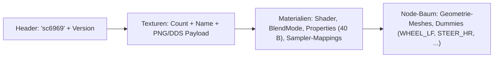
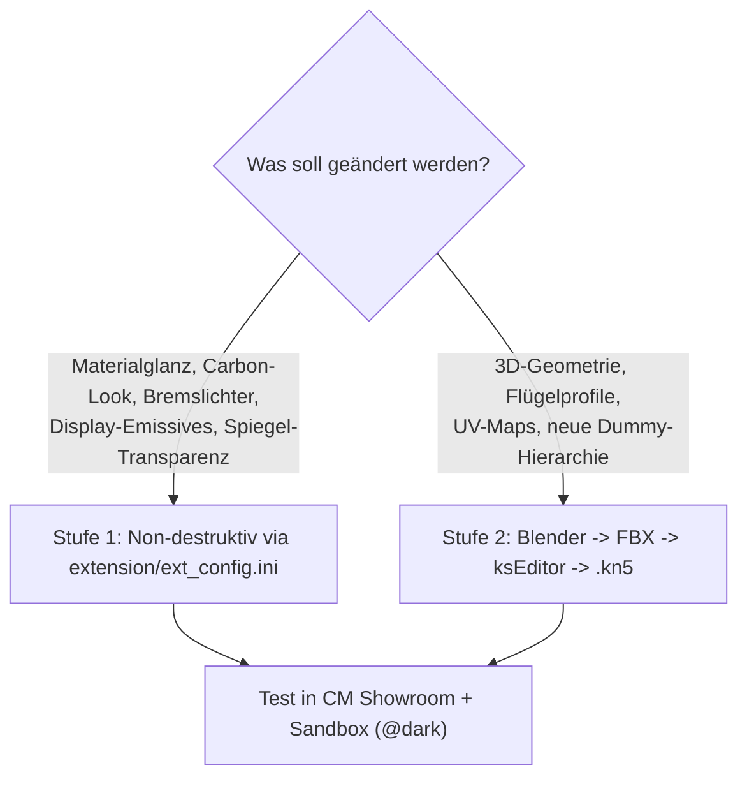

> **Thema:** Assetto Corsa `.kn5`-Binärformat, Entwicklungsumgebung, non-destruktives Modding via `ext_config.ini` & Sandbox-Validierung (`@dark`)
> **Autor:** Michael Stürmer
> **Datum:** 28.11.2026

<!-- DOKU-SUBNAV-START -->
<details>
<summary><b>🧭 Rubrik-Navigation &amp; Modul-Übersicht (06 AC KN5 Modding)</b></summary>

**Zentrale:** [📚 Doku-Index](../README.md) · [📂 Rubrik 06 KN5](./README.md) · [🛠️ Praxis-Lab 06](../../labs/06_ac_kn5_modding/README.md)

**Module in `06_AC_KN5_Modding/`:**
- 👉 **[01 • `.kn5`-Binärformat, Entwicklungsumgebung & non-destruktives Modding](./01_kn5-format-entwicklungsumgebung-und-setup.md)** *(aktuell)* · [`inspect_kn5.py`](../../labs/06_ac_kn5_modding/inspect_kn5.py) · [`ext_config_template.ini`](../../labs/06_ac_kn5_modding/templates/ext_config_template.ini)

**Weitere Rubriken:** [🐧 01 Linux & Bash](../01_Linux_Bash/README.md) · [🧩 02 VS Code & MCP](../02_VSCode_Env/README.md) · [🐍 03 Python](../03_Python_Coding/README.md) · [🌐 04 JS/TS Web](../04_JS_TS_Web/README.md) · [🤖 05 Agents](../05_Agents/README.md) · [🥽 07 VR Engineering](../07_VR_Engineering/README.md)

</details>
<!-- DOKU-SUBNAV-END -->

<details>
<summary><b>Lernziele</b></summary>

* Den binären Container-Aufbau einer Assetto-Corsa-`.kn5`-Datei (`sc6969`, Header, Texturen, Materialien, Shader-Properties, Hierarchie-Nodes) verstehen und mit [`inspect_kn5.py`](../../labs/06_ac_kn5_modding/inspect_kn5.py) auslesen können.
* Den Unterschied zwischen **non-destruktivem Modding** (`extension/ext_config.ini` über Custom Shaders Patch) und einem **vollständigen 3D-Rebuild** (**Blender 4.x** + **FBX** + Kunos **`ksEditor`**) sicher beherrschen.
* Die Pflichtdateien eines gesunden Fahrzeugordners (`<car>.kn5`, LODs, `collider.kn5`, `ui/ui_car.json`) kennen und Mods vor dem Einsatz am Live-SimRacer risikofrei in der **Docker-Sandbox (`@dark`)** verifizieren.

</details>

<details>
<summary><b>Kernkonzepte</b></summary>

<details>
<summary>1.1 Anatomie einer <code>.kn5</code>-Datei &amp; Ordner-Invarianten (SPS-Analogie: kompilierter Baustein vs. Parametrier-DB)</summary>

In der Automatisierungstechnik trennt man strikt zwischen dem **kompilierten SPS-Funktionsbaustein** (Binär-/Download-Artfakt) und der **Online-Parametrierung** (Datenbaustein, ohne Baustein-Neukompilierung änderbar). Exakt genauso ist Assetto Corsa aufgebaut:

- Eine **`.kn5`**-Datei ist der von `ksEditor` gepackte Binärcontainer mit Geometrie, Texturen und Kunos-Materialien.
- **`extension/ext_config.ini`** (CSP) ist der darübergelegte Parametrier-Datenbaustein, der Materialwerte, Shader, Emissives und Decals zur Laufzeit überschreibt, ohne die `.kn5` neu zu exportieren.



Ein vollständiger Fahrzeugordner (Beispiel aus der Sim-Werkstatt: `gp_2025_rb21`) besitzt zwingend:

| Datei | Beispielgröße (`gp_2025_rb21`) | Aufgabe & Fehlerbild bei Verlust |
| :--- | :--- | :--- |
| `<car_id>.kn5` | `105,8 MB` (`110.923.583 B`) | Hauptmodell (LOD A); fehlt es oder ist es `0 B`, stürzt `acs.exe` beim Laden ab |
| `*_lod_b.kn5` / `*_lod_c.kn5` | `1,39 MB` / `0,76 MB` | Detailreduzierte Stufen für Distanz & Spiegel/Multi-Car-Grids |
| `collider.kn5` | `7.382 B` | Vereinfachte Kollisionshülle für die Physik-Engine (`ODE`) |
| `ui/ui_car.json` | `7.300 B` | Launcher-/CM-Metadaten (`name`, Spezifikationen) |

**Praxislehre aus dem Vorfall vom 28.11.2026:** Ein bloßer Verzeichnis-Check (`Test-Path cars/<car_id>`) reicht **nicht**, da leere oder unvollständige Ordner ohne `.kn5`-Dateien (`gp_2025_rb21`, `gp_2025_sf25`, `gp_2025_vcarb02`) den Sync überspringen und anschließend einen stillen Absturz auslösen. Deshalb prüft `runner.ps1` (wie [`inspect_kn5.py --check-car-dir`](../../labs/06_ac_kn5_modding/inspect_kn5.py)) explizit auf `*.kn5`, `collider.kn5`, `ui_car.json` und gültige Magic-Bytes `sc6969`.

</details>

<details>
<summary>1.2 Benötigte Entwicklungsumgebung (Toolchain für Lernen &amp; Produktivbetrieb)</summary>

| Werkzeug | Rolle im Workflow | Bezug im Workspace |
| :--- | :--- | :--- |
| **Content Manager (Custom Showroom)** | Material-/Mesh-Namen live inspizieren, `lods.ini`-Entfernungen prüfen, Wireframe/UV-Check | Auf SimRacer (`192.168.178.68`) installiert |
| **VS Code + `inspect_kn5.py`** | Binäre `.kn5`-Analyse (Texturengrößen, Shader-Inventory) + Editieren von `ext_config.ini` & `data/` | [`labs/06_ac_kn5_modding/`](../../labs/06_ac_kn5_modding/README.md) |
| **Blender 4.x** | 3D-Bearbeitung (UVs, Triangulierung, Origin-Ausrichtung `Z-up -> Y-up` beim FBX-Export) | Für 3D-Mesh-Änderungen erforderlich |
| **Kunos `ksEditor`** *(AC SDK)* | Import von `.fbx` + `textures/`, Zuweisung von AC-Shadern (`ksPerPixelMultiMap`, `ksWindscreenFX`) & `.kn5`-Export | Bestandteil des *Assetto Corsa SDK* unter `steamapps\common\assettocorsa\sdk\editor` |
| **Docker Sandbox (`@dark`)** | Isolierte Start- & Log-Verifikation (`1280×720 Fullscreen`, `ReadLogs`, `Test-SandboxAcsPostStart`) vor Host-Deploy | [`Systemtests/`](../../Systemtests/) |

</details>

<details>
<summary>1.3 Zwei Modding-Stufen: Wann <code>ext_config.ini</code> vs. Blender + <code>ksEditor</code>?</summary>



**Grundregel:** Beginne **immer** mit Stufe 1 (`ext_config.ini`). Damit bleiben originale `.kn5`-Dateien bit-identisch, Updates von Mod-Autoren gehen nicht verloren, und Fehler lassen sich sofort per Auskommentieren rückgängig machen. Erst wenn neue Dreiecke, veränderte UV-Koordinaten oder neue Mesh-Dummies gebraucht werden, lohnt der Roundtrip über **Blender → FBX → `ksEditor`**.

</details>

<details>
<summary>1.4 Konkrete Praxis-Beispiele &amp; Workflow vom Host in die Sandbox</summary>

1. **Beispiel A – Texturbudget & Shader-Inventar per CLI prüfen:**
   Mit [`inspect_kn5.py`](../../labs/06_ac_kn5_modding/inspect_kn5.py) liest du jede `.kn5`-Datei schreibgeschützt ein, um VRAM-Fresser (z. B. übergroße `4096×4096`-DDS-Texturen) und exakte Materialnamen für `ext_config.ini` herauszufinden.
2. **Beispiel B – Non-destruktive Material-Optimierung mit [`ext_config_template.ini`](../../labs/06_ac_kn5_modding/templates/ext_config_template.ini):**
   - Spekularglanz auf Carbon (`ksSpecularEXP`, `ksSpecular`) an VR-Sichtbedingungen anpassen.
   - Cockpit-Scheibe entspiegeln (`Windscreen`: `ksSpecular = 0.12`, `fresnelMaxLevel = 0.35`).
   - Brems-/ERS-Rücklicht (`[EMISSIVE_BRAKE_0]`) mit realistischem Nachglühen (`LAG = 0.85`).
3. **Beispiel C – Sicheres Testing in der Sandbox (`@dark`):**
   - Niemals ungetestete Daten direkt auf den Live-Host kopieren.
   - Geänderten Fahrzeugordner in den Sandbox-Mount übergeben, mit `inspect_kn5.py --check-car-dir` abnehmen und über `@dark` (`LaunchSession` + `ReadLogs`) gegen `ERROR_FOUND=False` prüfen.

</details>

</details>

<details>
<summary><b>Übungsaufgaben</b></summary>

1. **Übung 1 – Binär-Inspektion & VRAM-Fresser finden:**
   Führe im Terminal (`labs/06_ac_kn5_modding/`) folgende Befehle gegen den SimRacer-Host (Read-Only) aus und notiere die drei größten Texturen sowie die zwei häufigsten Shader des RB21:
   ```powershell
   $py = "C:\Users\strik\AppData\Roaming\uv\python\cpython-3.12-windows-x86_64-none\python.exe"
   $rb21 = "\\192.168.178.68\C$\Program Files (x86)\Steam\steamapps\common\assettocorsa\content\cars\gp_2025_rb21"
   & $py .\inspect_kn5.py --check-car-dir $rb21
   & $py .\inspect_kn5.py --file "$rb21\gp_2025_rb21.kn5" --top 10
   ```
2. **Übung 2 – JSON-Integritätscheck für alle GP-2025-Fahrzeuge:**
   Schreibe in PowerShell eine kleine `foreach`-Schleife über `gp_2025_*`, die `inspect_kn5.py --check-car-dir <dir> --json` ausführt und alle Fahrzeuge mit `healthy -ne $true` herausfiltert.
3. **Übung 3 – Trockenübung `ext_config.ini`:**
   Identifiziere in der Ausgabe aus Übung 1 die exakten Glas-/Windscreen- und Carbon-Materialnamen eines Testautos und trage sie anhand [`ext_config_template.ini`](../../labs/06_ac_kn5_modding/templates/ext_config_template.ini) in einer lokalen Kopie ein (ohne Produktivordner zu überschreiben).

</details>

<details>
<summary><b>Weiterführende Links &amp; Quellen</b></summary>

* Praxis-Lab im Repository: [`labs/06_ac_kn5_modding/README.md`](../../labs/06_ac_kn5_modding/README.md) · [`inspect_kn5.py`](../../labs/06_ac_kn5_modding/inspect_kn5.py) · [`ext_config_template.ini`](../../labs/06_ac_kn5_modding/templates/ext_config_template.ini)
* Sandbox- & Incident-Kontext: [`Systemtests/Auswertung_VR_Startlogs_20261128_0736.md`](../../Systemtests/Auswertung_VR_Startlogs_20261128_0736.md)
* Custom Shaders Patch Wiki (Car Configs & Material Adjustments): [github.com/ac-custom-shaders-patch/acc-extension-config/wiki](https://github.com/ac-custom-shaders-patch/acc-extension-config/wiki)

</details>

<details>
<summary><b>Chips &amp; Kernaussagen</b></summary>

`sc6969 Magic-Header` · `Materialien & Shader` · `collider.kn5 Pflicht` · `LOD-Kaskade` · `ext_config.ini non-destruktiv` · `Blender -> FBX -> ksEditor` · `CM Custom Showroom` · `@dark Sandbox-Gate`

- **Merksatz 1:** Prüfe bei Sync/Deployment **niemals nur den Ordnernamen**, sondern `*.kn5`, `collider.kn5` (`sc6969`) und `ui/ui_car.json`.
- **Merksatz 2:** Shader-, Carbon- und Licht-Upgrades löst du zuerst non-destruktiv in `extension/ext_config.ini`, nicht durch Neupacken der `.kn5`.
- **Merksatz 3:** Jedes neue oder reparierte Fahrzeug läuft zuerst in der Sandbox (`@dark`) durch `ReadLogs` (`ERROR_FOUND=False`), bevor es auf das Produktiv-Rig geht.

</details>

---
*Hinweis zur Organisation:* Die erstellte Dokumentation ist am Drehlaufwerk abgelegt und mit einer kurzen Zusammenfassung von den Chips auch in den Notebooks verlinkt.

<!-- DOKU-MINIMAP-START -->
<style>
.doku-arch-flow { font-family: var(--vscode-editor-font-family, Consolas, monospace); background: linear-gradient(160deg, rgba(15, 23, 42, 0.96), rgba(17, 24, 39, 0.94)); border: 1px solid rgba(96, 165, 250, 0.35); border-radius: 12px; padding: 14px 16px; margin: 8px 0 0 0; color: #e2e8f0; }
.doku-arch-root { display: flex; flex-wrap: wrap; align-items: center; justify-content: center; gap: 10px; font-weight: 700; font-size: 0.98em; padding: 9px 14px; margin-bottom: 12px; background: linear-gradient(135deg, rgba(37, 99, 235, 0.28), rgba(30, 41, 59, 0.92)); border: 1px solid rgba(96, 165, 250, 0.48); border-radius: 10px; }
.doku-arch-root a { color: #93c5fd !important; text-decoration: none !important; }
.doku-arch-root a:hover { color: #dbeafe !important; text-decoration: underline !important; }
.doku-arch-grid { display: grid; grid-template-columns: repeat(auto-fit, minmax(268px, 1fr)); gap: 11px; }
.doku-arch-card { background: rgba(30, 41, 59, 0.72); border: 1px solid rgba(148, 163, 184, 0.24); border-top: 3px solid #3b82f6; border-left: 4px solid #3b82f6; border-radius: 10px; padding: 10px 12px; transition: transform 0.14s ease, border-color 0.14s ease, box-shadow 0.14s ease; }
.doku-arch-card:hover { border-color: #93c5fd; transform: translateY(-2px); box-shadow: 0 6px 18px rgba(0, 0, 0, 0.35); }
.doku-arch-card.r1 { border-left-color: #22c55e; border-top-color: #22c55e; }
.doku-arch-card.r2 { border-left-color: #3b82f6; border-top-color: #3b82f6; }
.doku-arch-card.r3 { border-left-color: #eab308; border-top-color: #eab308; }
.doku-arch-card.r4 { border-left-color: #ec4899; border-top-color: #ec4899; }
.doku-arch-card.r5 { border-left-color: #a855f7; border-top-color: #a855f7; }
.doku-arch-card.r6 { border-left-color: #f97316; border-top-color: #f97316; }
.doku-arch-card.r7 { border-left-color: #06b6d4; border-top-color: #06b6d4; }
.doku-arch-card-title { font-weight: 700; font-size: 0.93em; margin-bottom: 7px; padding-bottom: 5px; border-bottom: 1px dashed rgba(148, 163, 184, 0.26); }
.doku-arch-card-title a { color: #f8fafc !important; text-decoration: none !important; display: block; }
.doku-arch-card-title a:hover { color: #93c5fd !important; }
.doku-arch-lines { list-style: none; margin: 0; padding: 0; font-size: 0.84em; line-height: 1.5; }
.doku-arch-lines li { margin: 3px 0; padding: 2px 6px; border-radius: 5px; white-space: normal; }
.doku-arch-lines li:hover { background: rgba(59, 130, 246, 0.16); }
.doku-arch-lines a { color: #cbd5e1 !important; text-decoration: none !important; display: inline; }
.doku-arch-lines a:hover { color: #93c5fd !important; text-decoration: underline !important; }
.doku-arch-badge { display: inline-block; font-size: 0.74em; padding: 0 6px; margin-left: 5px; border-radius: 999px; background: rgba(59, 130, 246, 0.22); color: #bfdbfe !important; border: 1px solid rgba(96, 165, 250, 0.4); }
details.doku-minimap { position: fixed; bottom: 18px; right: 18px; z-index: 9999; width: 292px; max-height: 76px; overflow: hidden; background: rgba(15, 23, 42, 0.93); border: 1px solid rgba(96, 165, 250, 0.62); border-radius: 14px; box-shadow: 0 10px 30px rgba(0, 0, 0, 0.65); backdrop-filter: blur(10px); transition: width 0.18s ease, max-height 0.18s ease, border-color 0.18s ease; font-family: var(--vscode-font-family, sans-serif); }
details.doku-minimap:hover { border-color: #93c5fd; }
details.doku-minimap[open] { width: min(920px, 94vw); max-height: 84vh; overflow-y: auto; padding-bottom: 10px; border-radius: 14px; }
details.doku-minimap > summary { cursor: pointer; list-style: none; padding: 8px 13px; font-weight: 700; font-size: 0.84em; color: #f8fafc; background: linear-gradient(90deg, rgba(37, 99, 235, 0.45), rgba(30, 41, 59, 0.92)); border-bottom: 1px solid rgba(148, 163, 184, 0.24); display: flex; align-items: center; justify-content: space-between; user-select: none; }
details.doku-minimap > summary::-webkit-details-marker { display: none; }
details.doku-minimap > summary .minimap-toggle::after { content: "+"; font-size: 1.05em; opacity: 0.85; padding: 0 4px; }
details.doku-minimap[open] > summary .minimap-toggle::after { content: "−"; }
details.doku-minimap .minimap-preview-strip { display: flex; gap: 5px; padding: 6px 10px 8px 10px; font-size: 0.71em; color: #cbd5e1; justify-content: space-between; }
details.doku-minimap[open] .minimap-preview-strip { display: none; }
details.doku-minimap .minimap-preview-strip span { display: inline-flex; align-items: center; gap: 4px; background: rgba(30, 41, 59, 0.92); padding: 2px 7px; border-radius: 999px; border: 1px solid rgba(148, 163, 184, 0.26); }
details.doku-minimap .dot { width: 6px; height: 6px; border-radius: 50%; display: inline-block; }
details.doku-minimap .dot.r1 { background: #22c55e; }
details.doku-minimap .dot.r2 { background: #3b82f6; }
details.doku-minimap .dot.r3 { background: #eab308; }
details.doku-minimap .dot.r4 { background: #ec4899; }
details.doku-minimap .dot.r5 { background: #a855f7; }
details.doku-minimap .dot.r6 { background: #f97316; }
details.doku-minimap .dot.r7 { background: #06b6d4; }
details.doku-minimap .minimap-body { padding: 4px 12px 6px 12px; }
</style>
<details class="doku-minimap">
<summary><span>🗺️ Doku-Minimap (7 Rubriken &amp; Labs)</span><span class="minimap-toggle" title="Klicken zum Vergrößern / Einklappen"></span></summary>
<div class="minimap-preview-strip"><span><i class="dot r1"></i>Linux</span><span><i class="dot r2"></i>VSCode</span><span><i class="dot r3"></i>Python</span><span><i class="dot r4"></i>JS/TS</span><span><i class="dot r5"></i>Agents</span><span><i class="dot r6"></i>KN5</span><span><i class="dot r7"></i>VR</span></div>
<div class="minimap-body">
<div class="doku-arch-flow">
<div class="doku-arch-root"><span>🏛️ <a href="../README.md">VanstrikeCyborg — git-labor Doku-Index</a></span> · <a href="../../README.md">Repo-README</a> · <a href="../../AGENTS.md">AGENTS.md</a> · <a href="../../notebook-agent-environments/README.md">Notebooks</a> · <a href="../05_Agents/SYSTEM_ARCHITEKTUR_AENDERUNGEN_2026-11-28.md">Letztstand 28.11.</a></div>
<div class="doku-arch-grid">
<div class="doku-arch-card r1">
<div class="doku-arch-card-title">🐧 <a href="../01_Linux_Bash/README.md">01_Linux_Bash (Linux, Shell &amp; Container)</a></div>
<ul class="doku-arch-lines">
<li>├─ <a href="../01_Linux_Bash/01_bash-grundlagen-und-skripting.md">01 • Bash CLI, Text-Tools, Streams &amp; Expansions</a> <a class="doku-arch-badge" href="../../labs/01_linux_bash/check-env.sh">check-env.sh</a></li>
<li>├─ <a href="../01_Linux_Bash/02_linux-systemadministration-und-interna.md">02 • Inodes, LVM, Prozesse, Boot-Prozess &amp; systemd</a></li>
<li>├─ <a href="../01_Linux_Bash/03_arch-linux-omarchy-und-remote-ssh.md">03 • Arch Linux, Omarchy, Remote-SSH &amp; Nginx</a></li>
<li>├─ <a href="../01_Linux_Bash/04_fortgeschrittenes-bash-skripting-und-automatisierung.md">04 • Advanced Bash: Arrays, getopts &amp; Backups</a></li>
<li>└─ <a href="../01_Linux_Bash/05_docker-und-sbx-micro-vms.md">05 • Docker Grundlagen &amp; Sandbox Micro-VMs (sbx)</a></li>
</ul>
</div>
<div class="doku-arch-card r2">
<div class="doku-arch-card-title">🧩 <a href="../02_VSCode_Env/README.md">02_VSCode_Env (IDE, Git, MCP &amp; Gemini)</a></div>
<ul class="doku-arch-lines">
<li>├─ <a href="../02_VSCode_Env/01_vscode-architektur-lsp-und-remote.md">01 • VS Code Architektur, Sprachserver (LSP) &amp; Remote</a></li>
<li>├─ <a href="../02_VSCode_Env/02_git-github-und-multi-root-workspaces.md">02 • Git, GitHub Workflow &amp; Multi-Root Workspaces</a> <a class="doku-arch-badge" href="../../git-labor.code-workspace">Workspace</a></li>
<li>├─ <a href="../02_VSCode_Env/03_mcp-server-localhost-proxy-und-ports.md">03 • MCP-Server, Ollama (:11434) &amp; Ports (Archiv: Proxy)</a> <a class="doku-arch-badge" href="../../.vscode/mcp.json">mcp.json</a></li>
<li>├─ <a href="../02_VSCode_Env/04_gemini-oekosystem-ai-studio-und-api-keys.md">04 • Gemini Ökosystem, Google AI Studio &amp; API-Keys</a></li>
<li>└─ <a href="../02_VSCode_Env/05_multi-workspace-netzwerk-mcp-und-agenten-verbund.md">05 • 5-Knoten-Verbund, Parity &amp; Parallel-Limits</a></li>
</ul>
</div>
<div class="doku-arch-card r3">
<div class="doku-arch-card-title">🐍 <a href="../03_Python_Coding/README.md">03_Python_Coding (Python, uv &amp; GenAI SDK)</a></div>
<ul class="doku-arch-lines">
<li>├─ <a href="../03_Python_Coding/01_python-setup-uv-venv-und-notebooks.md">01 • Python Setup: uv, .venv, Pylance &amp; Notebooks</a> <a class="doku-arch-badge" href="../../notebook-agent-environments/agent_demo.ipynb">.ipynb</a></li>
<li>├─ <a href="../03_Python_Coding/02_gemini-api-python-sdk-und-interactions.md">02 • Google GenAI SDK (google-genai) &amp; Interactions API</a></li>
<li>└─ <a href="../03_Python_Coding/03_python-automatisierung-datenanalyse-und-tests.md">03 • Automatisierung, Datenanalyse &amp; pytest</a> <a class="doku-arch-badge" href="../../labs/03_python/sensor_demo.py">sensor_demo.py</a></li>
</ul>
</div>
<div class="doku-arch-card r4">
<div class="doku-arch-card-title">🌐 <a href="../04_JS_TS_Web/README.md">04_JS_TS_Web (HTML/CSS, JS/TS &amp; Web-SDK)</a></div>
<ul class="doku-arch-lines">
<li>├─ <a href="../04_JS_TS_Web/01_html-css-und-dom-grundlagen.md">01 • HTML5, CSS3 &amp; DOM-Manipulation Grundlagen</a> <a class="doku-arch-badge" href="../../labs/04_js_ts_web/rechner.html">rechner.html</a></li>
<li>├─ <a href="../04_JS_TS_Web/02_modernes-javascript-und-typescript.md">02 • Modernes JavaScript (ES6+) &amp; TypeScript</a></li>
<li>└─ <a href="../04_JS_TS_Web/03_gemini-sdk-typescript-und-web-apps.md">03 • Google GenAI SDK (@google/genai) für Web-Apps</a></li>
</ul>
</div>
<div class="doku-arch-card r5">
<div class="doku-arch-card-title">🤖 <a href="../05_Agents/README.md">05_Agents (KI-Agenten, Skills &amp; Orchestrierung)</a></div>
<ul class="doku-arch-lines">
<li>├─ <a href="../05_Agents/01_agent-stilfibel-und-didaktik-ruler.md">01 • Agent-Stilfibel, Didaktik-Ruler &amp; 7-Stufen-Aufbau</a></li>
<li>├─ <a href="../05_Agents/02_agenten-erstellen-instructions-rules-und-prompts.md">02 • Agenten erstellen: Instructions, Rules &amp; Prompts</a> <a class="doku-arch-badge" href="../../.github/instructions/gemini-api.instructions.md">gemini.instructions</a></li>
<li>├─ <a href="../05_Agents/03_agenten-ausruesten-skills-und-mcp-tools.md">03 • Agenten ausrüsten: Skills &amp; MCP-Tools</a> <a class="doku-arch-badge" href="../../.agents/skills/live-transfer-status-monitor/SKILL.md">SKILL.md</a></li>
<li>├─ <a href="../05_Agents/04_agenten-trainieren-primen-und-orchestrieren.md">04 • Priming, Memory &amp; Multi-Agent-Orchestrierung</a> <a class="doku-arch-badge" href="../../.github/agents/light.agent.md">@light</a></li>
<li>├─ <a href="../05_Agents/05_workspace-schnittstelle-simracer-und-agenten-terminals.md">05 • Schnittstelle, Terminals &amp; XOR-Mutex</a> <a class="doku-arch-badge" href="../../labs/03_python/sim_agent_bridge.py">Bridge</a></li>
<li>├─ <a href="../05_Agents/05_multi-workspace-netzwerk-mcp-und-agenten-verbund.md">06 • Multi-Workspace Netzwerk &amp; 7-Rollen-Verbund</a></li>
<li>└─ <a href="../05_Agents/SYSTEM_ARCHITEKTUR_AENDERUNGEN_2026-11-28.md">Letztstand 28.11. (Labs 06/07, Cleanup &amp; KN5-Fix)</a></li>
</ul>
</div>
<div class="doku-arch-card r6">
<div class="doku-arch-card-title">🏎️ <a href="../06_AC_KN5_Modding/README.md">06_AC_KN5_Modding (.kn5 &amp; Toolchain)</a></div>
<ul class="doku-arch-lines">
<li>└─ <a href="../06_AC_KN5_Modding/01_kn5-format-entwicklungsumgebung-und-setup.md">01 • .kn5-Format, ext_config &amp; Sandbox-Gate</a> <a class="doku-arch-badge" href="../../labs/06_ac_kn5_modding/inspect_kn5.py">inspect_kn5.py</a></li>
</ul>
</div>
<div class="doku-arch-card r7">
<div class="doku-arch-card-title">🥽 <a href="../07_VR_Engineering/README.md">07_VR_Engineering (90 Hz VR &amp; @rig)</a></div>
<ul class="doku-arch-lines">
<li>├─ <a href="../07_VR_Engineering/01_vr-architektur-frametimes-und-diagnose.md">01 • VR-Architektur, Frametimes &amp; Compositor</a> <a class="doku-arch-badge" href="../../labs/07_vr_engineering/analyze_vr_compositor.py">analyze_vr_compositor.py</a></li>
<li>└─ <a href="../../labs/07_vr_engineering/README.md">Lab 07 • VR-Invarianten &amp; Read-Only Check</a> <a class="doku-arch-badge" href="../../labs/07_vr_engineering/Check-VrInvariants.ps1">Check-VrInvariants.ps1</a></li>
</ul>
</div>
</div>
</div>
</div>
</details>
<!-- DOKU-MINIMAP-END -->
