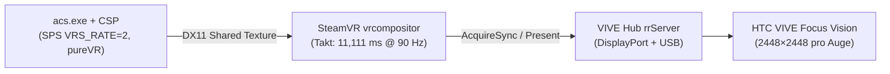
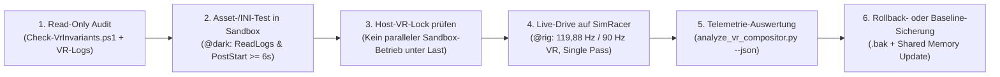

> **Thema:** VR-Signalweg, 90-Hz-Frametimebudget, Compositor-Fehlerdiagnose (`AcquireSync` / `0xc0000374`) & geschützter `@dark -> @rig` Testworkflow
> **Autor:** Michael Stürmer
> **Datum:** 28.11.2026

<!-- DOKU-SUBNAV-START -->
<details>
<summary><b>🧭 Rubrik-Navigation &amp; Modul-Übersicht (07 VR Engineering)</b></summary>

**Zentrale:** [📚 Doku-Index](../README.md) · [📂 Rubrik 07 VR](./README.md) · [🛠️ Praxis-Lab 07](../../labs/07_vr_engineering/README.md)

**Module in `07_VR_Engineering/`:**
- 👉 **[01 • VR-Architektur, 90-Hz-Frametimes, Compositor-Diagnose & Test-Workflow](./01_vr-architektur-frametimes-und-diagnose.md)** *(aktuell)* · [`analyze_vr_compositor.py`](../../labs/07_vr_engineering/analyze_vr_compositor.py) · [`Check-VrInvariants.ps1`](../../labs/07_vr_engineering/Check-VrInvariants.ps1)

**Weitere Rubriken:** [🐧 01 Linux & Bash](../01_Linux_Bash/README.md) · [🧩 02 VS Code & MCP](../02_VSCode_Env/README.md) · [🐍 03 Python](../03_Python_Coding/README.md) · [🌐 04 JS/TS Web](../04_JS_TS_Web/README.md) · [🤖 05 Agents](../05_Agents/README.md) · [🏎️ 06 AC KN5 Modding](../06_AC_KN5_Modding/README.md)

</details>
<!-- DOKU-SUBNAV-END -->

<details>
<summary><b>Lernziele</b></summary>

* Die VR-Echtzeitkette auf dem SimRacer (`acs.exe` → CSP `Single Pass Stereo` → SteamVR `vrcompositor.exe` → VIVE Hub `rrServer` → HTC VIVE Focus Vision) und die harte **11,11-ms-Zykluszeit** (`90 Hz`) verstehen.
* Typische Engpässe aus realen Telemetrie- und Log-Daten (CPU vs. GPU, `AcquireSync FAILED with WAIT_TIMEOUT`, `0xc0000374` Heap Corruption, 32-Bit CEF-OOM) mithilfe von [`analyze_vr_compositor.py`](../../labs/07_vr_engineering/analyze_vr_compositor.py) isolieren.
* Verstehen, welche VR- & Grafik-Invarianten (`VRS_RATE`, `pureVR`, `VISIBLE_CARS`, `SHADOW_MAP_SIZE`, `GRASS_FX`) über [`Check-VrInvariants.ps1`](../../labs/07_vr_engineering/Check-VrInvariants.ps1) überwacht werden und wie Änderungen risikofrei den 6-Stufen-Workflow `@dark -> @rig` durchlaufen.

</details>

<details>
<summary><b>Kernkonzepte</b></summary>

<details>
<summary>1.1 Zykluszeit &amp; Hardware-Baseline am SimRacer (SPS-Analogie: harter 11,11-ms-OB35-Weckalarm)</summary>

Ein 90-Hz-VR-Headset arbeitet wie ein **synchroner Taktgeber (`OB35`, Zykluszeit `11,111 ms`)**: Liegt das neue Stereobild innerhalb von `11,111 ms` im Compositor-Buffer, bleibt die Bildausgabe flüssig. Überschreiten CPU oder GPU diesen Takt, greifen Reprojection, Sync-Timeouts oder Mikroruckler.



**Vermessene Hardware- & Sandbox-Grenzen auf `192.168.178.68`:**

| System | CPU / RAM | GPU / Display | Kritische Praxis-Werte |
| :--- | :--- | :--- | :--- |
| **SimRacer Host** (`Bare-Metal`) | AMD Ryzen 9 3900X (`bcdedit numproc=12`, `6c/12t` unter Windows sichtbar) · `31,92 GB` RAM | RTX 5070 Ti (`16.303 MiB` VRAM) · VIVE Focus Vision (`2448×2448` × 2 @ `90 Hz`) | `testdrive_20261123_070115`: VRAM bis `13.346 MB` (`97 %`), RAM `22,4 GB`, Defender `MsMpEng` `526,64 s` CPU |
| **Docker Sandbox** (`ac-win11-sandbox`) | `CPU_CORES=4` (`cpus=4.5`) · `RAM_SIZE=10G` (`mem_limit=12g`) | Virtual/Display `:8006` noVNC (`1280×720 Fullscreen=1`, `FPS_CAP_MS=50`) | Läuft bei VR-Sperre **nicht parallel** zu aktivem SteamVR/CM am Host! |

</details>

<details>
<summary>1.2 Diagnose anhand realer Log-Signaturen (`28.11.2026`)</summary>

In der Log-Auswertung vom `28.11.2026` (`Auswertung_VR_Startlogs_20261128_0736.md`) traten vier praxisrelevante Fehlerbilder gleichzeitig sichtbar auf:

1. **`vrcompositor.txt` Sync-Druck trotz `0 dropped`:**
   `48.410 presents, 0 dropped, 0 reprojected`, aber **5.966× `AcquireSync FAILED with WAIT_TIMEOUT`** (`136` Zeilen + `5.830` suppressed) und **71× `WaitForAcquire timed out`** bei `ApplicationTime CPU: 11,374 ms / GPU: 10,711 ms`.
   *Bedeutung:* Bei `11,374 ms` CPU-Zeit liegt die Simulation um `+0,263 ms` knapp am/über dem `11,111 ms`-Budget – der Compositor wartet kurzzeitig vergebens auf das DX11-Sync-Objekt.
2. **Original-Launcher 32-Bit-OOM (`AssettoCorsa.exe` / `libcef.DLL` `0x4000001f`):**
   Beim Einlesen von `337` Fahrzeugen sprengt der 32-Bit-CEF-Prozess das Speicherlimit → Lösung: Ausschließlich Content Manager mit `AppIdStarter` verwenden.
3. **Sporadische `acs.exe` Heap Corruption (`0xc0000374` in `ntdll.dll` nach ~4 s):**
   Tritt direkt nach Prozessstart auf; daher muss jedes automatisierte Startskript mindestens 6 Sekunden lang auf einen lebenden Prozess + sauberes Log prüfen.
4. **TCP Ephemeral Port Exhaustion (`Tcpip Event 4231`):**
   Zeigt an, dass häufige HTTP/RPC-Polls ohne Connection-Pooling lokale Ports erschöpfen.

</details>

<details>
<summary>1.3 Verbindliche VR- &amp; Grafik-Invarianten (prüfbar mit <code>Check-VrInvariants.ps1</code>)</summary>

| Konfigurationsdatei | Schlüssel-Invariante | Zielwert (SimRacer) | Wirkung auf Frametime / Komfort |
| :--- | :--- | :--- | :--- |
| `cfg\video.ini` | `[CAMERA] MODE` | `OPENVR` | Erzwingt Ausgabe über SteamVR |
| `cfg\video.ini` | `[POST_PROCESS] FILTER` / `DOF` | `pureVR` / `0` | VR-kalibrierte Luminanz ohne teures DoF |
| `cfg\video.ini` | `[EFFECTS] MOTION_BLUR` / `RENDER_SMOKE_IN_MIRROR` | `0` / `0` | Eliminiert Übelkeit & doppelte Partikelkosten |
| `cfg\video.ini` | `[MIRROR] HQ` / `[VIDEO] SHADOW_MAP_SIZE` | `0` / `512` (`<= 1024`) | Begrenzt Spiegel- und Schatten-Overhead |
| `cfg\extension\vr_tweaks.ini` | `[SINGLE_PASS_STEREO] VRS_RATE` | `2` (`>= 1`, nicht `ENABLED=0`) | Rendert linkes/rechtes Auge in einem Geometry-Pass + VRS |
| `cfg\extension\graphics_adjustments.ini` | `[VISIBLE_CARS] MIRROR` & `[ANTIALIASING] FFXCAS_PASS` | gesetzt (`1,3,7,12`) & `1` | Begrenzt Spiegel-KI und schärft VR-Display-Ausgabe |
| `cfg\extension\grass_fx.ini` | `[BASIC] QUALITY` | `4` (`<= 4`) | Verhindert Ultra-Gras-Einbrüche bei `13+ GB` VRAM |

</details>

<details>
<summary>1.4 Der 6-Stufen-Workflow <code>@dark -> @rig</code> für sichere VR-Tests</summary>



**Sicherheitsregel:** Während auf dem SimRacer-Host eine echte VR-Fahrt läuft, bleibt `ac-win11-sandbox` gestoppt (CPU/RAM/VRAM-Schutz und klare Trennung der `AppIdStarter`/Port-Ressourcen).

</details>

</details>

<details>
<summary><b>Übungsaufgaben</b></summary>

1. **Übung 1 – SteamVR Compositor-Audit durchführen:**
   Analysiere das aktuelle `vrcompositor.txt` auf dem SimRacer für das Tagesdatum und prüfe, ob `App CPU` oder `App GPU` über `11,111 ms` liegt:
   ```powershell
   $py = "C:\Users\strik\AppData\Roaming\uv\python\cpython-3.12-windows-x86_64-none\python.exe"
   & $py .\analyze_vr_compositor.py --date "Nov 28 2026"
   ```
2. **Übung 2 – Invarianten-Check gegen Live-Konfiguration:**
   Führe in [`labs/07_vr_engineering/`](../../labs/07_vr_engineering/README.md) das Skript [`Check-VrInvariants.ps1`](../../labs/07_vr_engineering/Check-VrInvariants.ps1) aus (`-Json` und Tabellenansicht) und erkläre anhand des Outputs, welche 3 Einstellungen direkt `App GPU` vs. `App CPU` beeinflussen.
3. **Übung 3 – Engpass-Szenario durchspielen:**
   Nimm an, in `analyze_vr_compositor.py` steigen `App CPU` auf `12,8 ms` und `AcquireSync WAIT_TIMEOUT` auf `> 8.000`, während `App GPU` bei `8,9 ms` bleibt. Welche drei Maßnahmen (OS/CPU/KI-Anzahl/`VISIBLE_CARS`) greifen hier, statt blind den GPU-Render-Scale zu senken?

</details>

<details>
<summary><b>Weiterführende Links &amp; Quellen</b></summary>

* Praxis-Lab im Repository: [`labs/07_vr_engineering/README.md`](../../labs/07_vr_engineering/README.md) · [`analyze_vr_compositor.py`](../../labs/07_vr_engineering/analyze_vr_compositor.py) · [`Check-VrInvariants.ps1`](../../labs/07_vr_engineering/Check-VrInvariants.ps1)
* Aktueller Incident- & Benchmark-Bezug: [`Systemtests/Auswertung_VR_Startlogs_20261128_0736.md`](../../Systemtests/Auswertung_VR_Startlogs_20261128_0736.md)
* Valve SteamVR Frame Timing Documentation: [developer.valvesoftware.com/wiki/SteamVR/Frame_Timing](https://developer.valvesoftware.com/wiki/SteamVR/Frame_Timing)

</details>

<details>
<summary><b>Chips &amp; Kernaussagen</b></summary>

`11,111 ms @ 90 Hz` · `App CPU vs. App GPU` · `AcquireSync WAIT_TIMEOUT` · `Single Pass Stereo + VRS_RATE=2` · `pureVR` · `0xc0000374 > 6s Check` · `AppIdStarter statt AssettoCorsa.exe` · `@dark -> @rig`

- **Merksatz 1:** VR ist harte Echtzeit (`11,111 ms` bei `90 Hz`) — ein Durchschnitt knapp über `11,1 ms` löst bereits `AcquireSync WAIT_TIMEOUT`-Spitzen aus, auch bevor `dropped frames > 0` steigen.
- **Merksatz 2:** CPU-Engpässe (z. B. AI-Physik, `Tcpip 4231`, `MsMpEng`, zu viele sichtbare Spiegel-Autos) lassen sich nicht über VR-Auflösungskürzungen auf der GPU lösen — zuerst CPU/GPU per `analyze_vr_compositor.py` trennen!
- **Merksatz 3:** Vor jedem VR-Lauf prüfen `Check-VrInvariants.ps1` und der Sandbox-Gate-Workflow (`@dark`) die Einhaltung von `MODE=OPENVR`, `pureVR` und `Single Pass Stereo`.

</details>

---
*Hinweis zur Organisation:* Die erstellte Dokumentation ist am Drehlaufwerk abgelegt und mit einer kurzen Zusammenfassung von den Chips auch in den Notebooks verlinkt.

<!-- DOKU-MINIMAP-START -->
<style>
.doku-arch-flow { font-family: var(--vscode-editor-font-family, Consolas, monospace); background: linear-gradient(160deg, rgba(15, 23, 42, 0.96), rgba(17, 24, 39, 0.94)); border: 1px solid rgba(96, 165, 250, 0.35); border-radius: 12px; padding: 14px 16px; margin: 8px 0 0 0; color: #e2e8f0; }
.doku-arch-root { display: flex; flex-wrap: wrap; align-items: center; justify-content: center; gap: 10px; font-weight: 700; font-size: 0.98em; padding: 9px 14px; margin-bottom: 12px; background: linear-gradient(135deg, rgba(37, 99, 235, 0.28), rgba(30, 41, 59, 0.92)); border: 1px solid rgba(96, 165, 250, 0.48); border-radius: 10px; }
.doku-arch-root a { color: #93c5fd !important; text-decoration: none !important; }
.doku-arch-root a:hover { color: #dbeafe !important; text-decoration: underline !important; }
.doku-arch-grid { display: grid; grid-template-columns: repeat(auto-fit, minmax(268px, 1fr)); gap: 11px; }
.doku-arch-card { background: rgba(30, 41, 59, 0.72); border: 1px solid rgba(148, 163, 184, 0.24); border-top: 3px solid #3b82f6; border-left: 4px solid #3b82f6; border-radius: 10px; padding: 10px 12px; transition: transform 0.14s ease, border-color 0.14s ease, box-shadow 0.14s ease; }
.doku-arch-card:hover { border-color: #93c5fd; transform: translateY(-2px); box-shadow: 0 6px 18px rgba(0, 0, 0, 0.35); }
.doku-arch-card.r1 { border-left-color: #22c55e; border-top-color: #22c55e; }
.doku-arch-card.r2 { border-left-color: #3b82f6; border-top-color: #3b82f6; }
.doku-arch-card.r3 { border-left-color: #eab308; border-top-color: #eab308; }
.doku-arch-card.r4 { border-left-color: #ec4899; border-top-color: #ec4899; }
.doku-arch-card.r5 { border-left-color: #a855f7; border-top-color: #a855f7; }
.doku-arch-card.r6 { border-left-color: #f97316; border-top-color: #f97316; }
.doku-arch-card.r7 { border-left-color: #06b6d4; border-top-color: #06b6d4; }
.doku-arch-card-title { font-weight: 700; font-size: 0.93em; margin-bottom: 7px; padding-bottom: 5px; border-bottom: 1px dashed rgba(148, 163, 184, 0.26); }
.doku-arch-card-title a { color: #f8fafc !important; text-decoration: none !important; display: block; }
.doku-arch-card-title a:hover { color: #93c5fd !important; }
.doku-arch-lines { list-style: none; margin: 0; padding: 0; font-size: 0.84em; line-height: 1.5; }
.doku-arch-lines li { margin: 3px 0; padding: 2px 6px; border-radius: 5px; white-space: normal; }
.doku-arch-lines li:hover { background: rgba(59, 130, 246, 0.16); }
.doku-arch-lines a { color: #cbd5e1 !important; text-decoration: none !important; display: inline; }
.doku-arch-lines a:hover { color: #93c5fd !important; text-decoration: underline !important; }
.doku-arch-badge { display: inline-block; font-size: 0.74em; padding: 0 6px; margin-left: 5px; border-radius: 999px; background: rgba(59, 130, 246, 0.22); color: #bfdbfe !important; border: 1px solid rgba(96, 165, 250, 0.4); }
details.doku-minimap { position: fixed; bottom: 18px; right: 18px; z-index: 9999; width: 292px; max-height: 76px; overflow: hidden; background: rgba(15, 23, 42, 0.93); border: 1px solid rgba(96, 165, 250, 0.62); border-radius: 14px; box-shadow: 0 10px 30px rgba(0, 0, 0, 0.65); backdrop-filter: blur(10px); transition: width 0.18s ease, max-height 0.18s ease, border-color 0.18s ease; font-family: var(--vscode-font-family, sans-serif); }
details.doku-minimap:hover { border-color: #93c5fd; }
details.doku-minimap[open] { width: min(920px, 94vw); max-height: 84vh; overflow-y: auto; padding-bottom: 10px; border-radius: 14px; }
details.doku-minimap > summary { cursor: pointer; list-style: none; padding: 8px 13px; font-weight: 700; font-size: 0.84em; color: #f8fafc; background: linear-gradient(90deg, rgba(37, 99, 235, 0.45), rgba(30, 41, 59, 0.92)); border-bottom: 1px solid rgba(148, 163, 184, 0.24); display: flex; align-items: center; justify-content: space-between; user-select: none; }
details.doku-minimap > summary::-webkit-details-marker { display: none; }
details.doku-minimap > summary .minimap-toggle::after { content: "+"; font-size: 1.05em; opacity: 0.85; padding: 0 4px; }
details.doku-minimap[open] > summary .minimap-toggle::after { content: "−"; }
details.doku-minimap .minimap-preview-strip { display: flex; gap: 5px; padding: 6px 10px 8px 10px; font-size: 0.71em; color: #cbd5e1; justify-content: space-between; }
details.doku-minimap[open] .minimap-preview-strip { display: none; }
details.doku-minimap .minimap-preview-strip span { display: inline-flex; align-items: center; gap: 4px; background: rgba(30, 41, 59, 0.92); padding: 2px 7px; border-radius: 999px; border: 1px solid rgba(148, 163, 184, 0.26); }
details.doku-minimap .dot { width: 6px; height: 6px; border-radius: 50%; display: inline-block; }
details.doku-minimap .dot.r1 { background: #22c55e; }
details.doku-minimap .dot.r2 { background: #3b82f6; }
details.doku-minimap .dot.r3 { background: #eab308; }
details.doku-minimap .dot.r4 { background: #ec4899; }
details.doku-minimap .dot.r5 { background: #a855f7; }
details.doku-minimap .dot.r6 { background: #f97316; }
details.doku-minimap .dot.r7 { background: #06b6d4; }
details.doku-minimap .minimap-body { padding: 4px 12px 6px 12px; }
</style>
<details class="doku-minimap">
<summary><span>🗺️ Doku-Minimap (7 Rubriken &amp; Labs)</span><span class="minimap-toggle" title="Klicken zum Vergrößern / Einklappen"></span></summary>
<div class="minimap-preview-strip"><span><i class="dot r1"></i>Linux</span><span><i class="dot r2"></i>VSCode</span><span><i class="dot r3"></i>Python</span><span><i class="dot r4"></i>JS/TS</span><span><i class="dot r5"></i>Agents</span><span><i class="dot r6"></i>KN5</span><span><i class="dot r7"></i>VR</span></div>
<div class="minimap-body">
<div class="doku-arch-flow">
<div class="doku-arch-root"><span>🏛️ <a href="../README.md">VanstrikeCyborg — git-labor Doku-Index</a></span> · <a href="../../README.md">Repo-README</a> · <a href="../../AGENTS.md">AGENTS.md</a> · <a href="../../notebook-agent-environments/README.md">Notebooks</a> · <a href="../05_Agents/SYSTEM_ARCHITEKTUR_AENDERUNGEN_2026-11-28.md">Letztstand 28.11.</a></div>
<div class="doku-arch-grid">
<div class="doku-arch-card r1">
<div class="doku-arch-card-title">🐧 <a href="../01_Linux_Bash/README.md">01_Linux_Bash (Linux, Shell &amp; Container)</a></div>
<ul class="doku-arch-lines">
<li>├─ <a href="../01_Linux_Bash/01_bash-grundlagen-und-skripting.md">01 • Bash CLI, Text-Tools, Streams &amp; Expansions</a> <a class="doku-arch-badge" href="../../labs/01_linux_bash/check-env.sh">check-env.sh</a></li>
<li>├─ <a href="../01_Linux_Bash/02_linux-systemadministration-und-interna.md">02 • Inodes, LVM, Prozesse, Boot-Prozess &amp; systemd</a></li>
<li>├─ <a href="../01_Linux_Bash/03_arch-linux-omarchy-und-remote-ssh.md">03 • Arch Linux, Omarchy, Remote-SSH &amp; Nginx</a></li>
<li>├─ <a href="../01_Linux_Bash/04_fortgeschrittenes-bash-skripting-und-automatisierung.md">04 • Advanced Bash: Arrays, getopts &amp; Backups</a></li>
<li>└─ <a href="../01_Linux_Bash/05_docker-und-sbx-micro-vms.md">05 • Docker Grundlagen &amp; Sandbox Micro-VMs (sbx)</a></li>
</ul>
</div>
<div class="doku-arch-card r2">
<div class="doku-arch-card-title">🧩 <a href="../02_VSCode_Env/README.md">02_VSCode_Env (IDE, Git, MCP &amp; Gemini)</a></div>
<ul class="doku-arch-lines">
<li>├─ <a href="../02_VSCode_Env/01_vscode-architektur-lsp-und-remote.md">01 • VS Code Architektur, Sprachserver (LSP) &amp; Remote</a></li>
<li>├─ <a href="../02_VSCode_Env/02_git-github-und-multi-root-workspaces.md">02 • Git, GitHub Workflow &amp; Multi-Root Workspaces</a> <a class="doku-arch-badge" href="../../git-labor.code-workspace">Workspace</a></li>
<li>├─ <a href="../02_VSCode_Env/03_mcp-server-localhost-proxy-und-ports.md">03 • MCP-Server, Ollama (:11434) &amp; Ports (Archiv: Proxy)</a> <a class="doku-arch-badge" href="../../.vscode/mcp.json">mcp.json</a></li>
<li>├─ <a href="../02_VSCode_Env/04_gemini-oekosystem-ai-studio-und-api-keys.md">04 • Gemini Ökosystem, Google AI Studio &amp; API-Keys</a></li>
<li>└─ <a href="../02_VSCode_Env/05_multi-workspace-netzwerk-mcp-und-agenten-verbund.md">05 • 5-Knoten-Verbund, Parity &amp; Parallel-Limits</a></li>
</ul>
</div>
<div class="doku-arch-card r3">
<div class="doku-arch-card-title">🐍 <a href="../03_Python_Coding/README.md">03_Python_Coding (Python, uv &amp; GenAI SDK)</a></div>
<ul class="doku-arch-lines">
<li>├─ <a href="../03_Python_Coding/01_python-setup-uv-venv-und-notebooks.md">01 • Python Setup: uv, .venv, Pylance &amp; Notebooks</a> <a class="doku-arch-badge" href="../../notebook-agent-environments/agent_demo.ipynb">.ipynb</a></li>
<li>├─ <a href="../03_Python_Coding/02_gemini-api-python-sdk-und-interactions.md">02 • Google GenAI SDK (google-genai) &amp; Interactions API</a></li>
<li>└─ <a href="../03_Python_Coding/03_python-automatisierung-datenanalyse-und-tests.md">03 • Automatisierung, Datenanalyse &amp; pytest</a> <a class="doku-arch-badge" href="../../labs/03_python/sensor_demo.py">sensor_demo.py</a></li>
</ul>
</div>
<div class="doku-arch-card r4">
<div class="doku-arch-card-title">🌐 <a href="../04_JS_TS_Web/README.md">04_JS_TS_Web (HTML/CSS, JS/TS &amp; Web-SDK)</a></div>
<ul class="doku-arch-lines">
<li>├─ <a href="../04_JS_TS_Web/01_html-css-und-dom-grundlagen.md">01 • HTML5, CSS3 &amp; DOM-Manipulation Grundlagen</a> <a class="doku-arch-badge" href="../../labs/04_js_ts_web/rechner.html">rechner.html</a></li>
<li>├─ <a href="../04_JS_TS_Web/02_modernes-javascript-und-typescript.md">02 • Modernes JavaScript (ES6+) &amp; TypeScript</a></li>
<li>└─ <a href="../04_JS_TS_Web/03_gemini-sdk-typescript-und-web-apps.md">03 • Google GenAI SDK (@google/genai) für Web-Apps</a></li>
</ul>
</div>
<div class="doku-arch-card r5">
<div class="doku-arch-card-title">🤖 <a href="../05_Agents/README.md">05_Agents (KI-Agenten, Skills &amp; Orchestrierung)</a></div>
<ul class="doku-arch-lines">
<li>├─ <a href="../05_Agents/01_agent-stilfibel-und-didaktik-ruler.md">01 • Agent-Stilfibel, Didaktik-Ruler &amp; 7-Stufen-Aufbau</a></li>
<li>├─ <a href="../05_Agents/02_agenten-erstellen-instructions-rules-und-prompts.md">02 • Agenten erstellen: Instructions, Rules &amp; Prompts</a> <a class="doku-arch-badge" href="../../.github/instructions/gemini-api.instructions.md">gemini.instructions</a></li>
<li>├─ <a href="../05_Agents/03_agenten-ausruesten-skills-und-mcp-tools.md">03 • Agenten ausrüsten: Skills &amp; MCP-Tools</a> <a class="doku-arch-badge" href="../../.agents/skills/live-transfer-status-monitor/SKILL.md">SKILL.md</a></li>
<li>├─ <a href="../05_Agents/04_agenten-trainieren-primen-und-orchestrieren.md">04 • Priming, Memory &amp; Multi-Agent-Orchestrierung</a> <a class="doku-arch-badge" href="../../.github/agents/light.agent.md">@light</a></li>
<li>├─ <a href="../05_Agents/05_workspace-schnittstelle-simracer-und-agenten-terminals.md">05 • Schnittstelle, Terminals &amp; XOR-Mutex</a> <a class="doku-arch-badge" href="../../labs/03_python/sim_agent_bridge.py">Bridge</a></li>
<li>├─ <a href="../05_Agents/05_multi-workspace-netzwerk-mcp-und-agenten-verbund.md">06 • Multi-Workspace Netzwerk &amp; 7-Rollen-Verbund</a></li>
<li>└─ <a href="../05_Agents/SYSTEM_ARCHITEKTUR_AENDERUNGEN_2026-11-28.md">Letztstand 28.11. (Labs 06/07, Cleanup &amp; KN5-Fix)</a></li>
</ul>
</div>
<div class="doku-arch-card r6">
<div class="doku-arch-card-title">🏎️ <a href="../06_AC_KN5_Modding/README.md">06_AC_KN5_Modding (.kn5 &amp; Toolchain)</a></div>
<ul class="doku-arch-lines">
<li>└─ <a href="../06_AC_KN5_Modding/01_kn5-format-entwicklungsumgebung-und-setup.md">01 • .kn5-Format, ext_config &amp; Sandbox-Gate</a> <a class="doku-arch-badge" href="../../labs/06_ac_kn5_modding/inspect_kn5.py">inspect_kn5.py</a></li>
</ul>
</div>
<div class="doku-arch-card r7">
<div class="doku-arch-card-title">🥽 <a href="../07_VR_Engineering/README.md">07_VR_Engineering (90 Hz VR &amp; @rig)</a></div>
<ul class="doku-arch-lines">
<li>├─ <a href="../07_VR_Engineering/01_vr-architektur-frametimes-und-diagnose.md">01 • VR-Architektur, Frametimes &amp; Compositor</a> <a class="doku-arch-badge" href="../../labs/07_vr_engineering/analyze_vr_compositor.py">analyze_vr_compositor.py</a></li>
<li>└─ <a href="../../labs/07_vr_engineering/README.md">Lab 07 • VR-Invarianten &amp; Read-Only Check</a> <a class="doku-arch-badge" href="../../labs/07_vr_engineering/Check-VrInvariants.ps1">Check-VrInvariants.ps1</a></li>
</ul>
</div>
</div>
</div>
</div>
</details>
<!-- DOKU-MINIMAP-END -->
