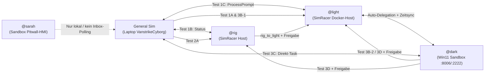

# Agenten-Kommunikation, Sandbox-Verbund & Log-Links — Testbericht

> **Testdatum:** 10.11.2026  
> **Geprüfte Systeme:** Laptop `VanstrikeCyborg` (`General Sim` / `start_general_terminal.ps1`), SimRacer `192.168.178.68` (`@light`, `@rig`), Sandbox `ac-win11-sandbox` (`@dark`, `@sarah`)  
> **Zweck:** End-to-End-Verifikation der Kommunikation zwischen `General Sim` und den SimRacer-Agenten, der Inter-Agent-Weiterleitungen inkl. zentraler Protokollierung, der Sandbox-Ausführung sowie der Log-Hyperlinks in den Terminal-Agent-Prompts.

---

## 1. Testarchitektur & Ablauf

---

## 2. Durchgeführte Einzeltests & Ergebnisse

| Test-ID | Kette / Task-ID | Ablauf & Beobachtung | Ergebnis | Nachweis (Logs) |
| :--- | :--- | :--- | :--- | :--- |
| **Test 1B** | `General Sim` → `@rig` `test_gen_rig_20261110_221913` | `Status`-Abfrage an `@rig`. Sofortige Ausführung auf `192.168.178.68` und Rückmeldung an `GeneralAgent_Laptop`. | **Bestanden** | `rig_20261110.log`, `general_20261110.log`, `agent_comm_20261110.log` |
| **Test 1C** | `General Sim` → `@light` `test_gen_light_direct_20261110_222528` | Direkter `ProcessPrompt` an `@light` ohne Sandbox-Schlüsselwort. Verarbeitung in `0.04s`. | **Bestanden** | `light_20261110.log`, `general_20261110.log`, `agent_comm_20261110.log` |
| **Test 1A** | `General Sim` → `@light` → `@dark` (gepuffert) `test_gen_light_20261110_221913` → `delegated_20261110_221914` | `@light` erkennt Keyword `"Sandbox"` und stellt `delegated_20261110_221914.json` in `dark\inbox\`. Nach Boot der Sandbox arbeitet `@dark` den Task um `21:25:11` (vor Zeitsync) ab. | **Bestanden** | `light_20261110.log`, `dark_20261110.log`, `general_20261110.log`, `agent_comm_20261110.log` |
| **Test 2A** | `General Sim` → `@rig` → `@light` → `@general` Freigabe → `@light` → `@rig` `test_rig_handoff_20261110_222239` / `rig_to_light_*` / `req_light_20261110_222241_083` | `@rig` leitet an `@light` weiter. Da `@rig` kein `approved_by` mitgibt, fordert `@light` eine Freigabe bei `@general` an (`AwaitingApproval`). Nach Freigabe führt `@light` aus und antwortet an `RigAgent`. | **Bestanden** | `rig_20261110.log`, `light_20261110.log`, `general_20261110.log`, `agent_comm_20261110.log`, `AGENT_KOMMUNIKATION_HISTORIE.md` |
| **Test 3A** | Sandbox-Start + `Send-DarkAgentTask.ps1 -Action Status` `task_20261110_222533_198` | Alter Container `fe5357388b4f` hing beim EFI-Boot (`462 MiB` RAM). Nach sauberem `docker compose down`, `kvm_amd`-Init und `up -d` (Container `ec2da27cd776`) Boot in ~30 s. `launch_guest_terminals.ps1` gestartet (`@dark`, `@sarah`). `Status` liefert `Success` (`ExitCode 0`, `host_lan_data_ok = True`). | **Bestanden (mit Logging-Lücke)** | CLI-Output `Success`; *nicht* in `agent_comm_*.log` (siehe Abschnitt 3.1) |
| **Test 3B-1** | `General Sim` → `@light` → `@dark` (Live-Handshake) `test_light_dark_live_20261110_222545` → `delegated_20261110_222547` | `@light` delegiert Zeitsync-Auftrag synchron an `@dark` (`11.24s`). `@dark` stellt Gast-Uhrzeit/Zeitzone auf `(UTC+01:00) ... Wien` (`22:25:57`) um und meldet per Handshake an `@light` und `GeneralAgent_Laptop` zurück. | **Bestanden** | `light_20261110.log`, `dark_20261110.log`, `general_20261110.log`, `agent_comm_20261110.log` |
| **Test 3B-2** | `@dark` (im Gast) → `@light` → `@general` Freigabe → `@dark` `test_dark_to_light_20261110_222545` / `req_light_20261110_222600_664` | `@dark` sendet Task über `\\host.lan\Data\agents\light\inbox\`. `@light` fragt `@general` um Freigabe; nach `Approved` triggert das Wort `"Sandbox"` im Prompt eine Rückdelegation `delegated_20261110_222710` an `@dark`. | **Bestanden** | `light_20261110.log`, `dark_20261110.log`, `general_20261110.log`, `agent_comm_20261110.log` |
| **Test 3C** | `General Sim` → `@dark` direkt `test_gen_dark_direct_20261110_222741` | Direkter Auftrag an `@dark` ohne Umweg über `@light`. Abarbeitung im Gast in ~3 s (`22:27:41` → `22:27:44`). | **Bestanden** | `dark_20261110.log`, `general_20261110.log`, `agent_comm_20261110.log` |
| **Test 3D** | `@dark` (im Gast) → `@rig` → `@general` Freigabe → `@dark` `test_dark_to_rig_20261110_222741` / `req_rig_20261110_222744_391` | `@dark` sendet Auftrag aus dem Container an `@rig`. `@rig` holt `@general`-Freigabe ein (`22:27:56`) und liefert Antwort (`22:27:58`) an `DarkAgentConsole`. | **Bestanden** | `rig_20261110.log`, `general_20261110.log`, `agent_comm_20261110.log` |
| **Test 4** | `@sarah` in der Sandbox (`start_sarah_terminal.ps1`) | Läuft im Gast, zeigt Pitwall-HMI (`sarah_coaching_report.json`), pollt aber **keine** `telemetry\inbox\`. | **Teilweise / Abweichung** | `telemetry\inbox\` (2 ältere Tasks vom `08.11.2026` offen) |

---

## 3. Abgleich mit den Vorgaben & festgestellte Lücken

### 3.1 Inter-Agent-Protokollierung & `General Sim`

- **Erfüllt:** Alle Aufgaben zwischen `General Sim`, `@rig`, `@light` und `@dark` inklusive Weiterleitungen (`@rig → @light`, `@light → @dark`, `@dark → @rig`, `@dark → @light`) und Freigabe-Schleifen (`ApprovalRequest` / `Approved`) werden durch `Update-AgentCommHistory` in `start_general_terminal.ps1` automatisch erkannt und in `general_YYYYMMDD.log`, `agent_comm_YYYYMMDD.log`, `agent_comm_history.jsonl` sowie `AGENT_KOMMUNIKATION_HISTORIE.md` protokolliert.
- **Lücke 1 (`Send-DarkAgentTask.ps1` / `worker.ps1`):** `worker.ps1` löscht die Task-Datei aus `dark\inbox\` sofort bei Abholung, schreibt kein `requester`/`reply_to` in das Result-JSON und `Send-DarkAgentTask.ps1` entfernt `result_<task_id>.json` direkt nach dem Auslesen. Läuft der Task schneller als das 2-Sekunden-Polling von `General Sim`, taucht er nicht in `agent_comm_*.log` auf (im Test bei `task_20261110_222533_198` beobachtet).
- **Lücke 2 (`@rig` → `@light` Handoff):** `start_rig_terminal.ps1` setzt bei Weiterleitungen (`rig_to_light_*`) kein `approved_by = "GeneralAgent_Laptop"`, sodass `@light` eine zusätzliche manuelle Freigabe bei `@general` anfordert und `@rig` nach 15 s auf `Pending` läuft.
- **Lücke 3 (`@sarah`):** `start_sarah_terminal.ps1` hat kein Inbox-Polling, schreibt kein eigenes `.log`-File und besitzt keinen Log-Link im Terminal-Header.
- **Nebenbefunde:**
  - In `start_dark_terminal.ps1` (Zeile 397) fehlt die Initialisierung von `$stopwatch`, sodass die Task-Dauer im Dark-Log stets `0s` beträgt.
  - In `runner.ps1` (Zeile 78) kam es bei `Action Status` zu einem kurzen Dateizugriffskonflikt beim Schreiben von `dark-status.json` (`worker.ps1` / `start_dark_terminal.ps1` parallel), Status wurde dennoch erfolgreich ausgegeben.
  - `start_general_terminal.ps1` muss aktiv laufen; eine im minimierten Fenster blockierte Instanz (`PID 59052`) pausierte das Polling, bis sie neu gestartet wurde (`PID 56704`, holte alle Einträge automatisch nach).

---

## 4. Prüfung der Log-Links in den Terminal-Agent-Prompts

Alle Terminals (außer `@sarah`) rendern klickbare ANSI-OSC-8-Hyperlinks (`\e]8;;<URI>\a`) über `Out-LinkHeaderLine` bzw. `Out-DualLinkHeaderLine`:

| Terminal-Skript | Generierter Linktext & Ziel-URI | Zieldatei vorhanden | Zeilenlänge vs. 80er-Breite | Status |
| :--- | :--- | :--- | :--- | :--- |
| `start_general_terminal.ps1` | `AGENT_KOMMUNIKATION_HISTORIE.md` `file:///c:/Users/strik/assetto-corsa-content/ac-sandbox/shared/agents/general/logs/AGENT_KOMMUNIKATION_HISTORIE.md` | Ja (`34.053 B`) | `75` / `78` | **OK** |
| `start_general_terminal.ps1` | `general_20261110.log` \| `agent_comm_20261110.log` `file:///c:/Users/strik/assetto-corsa-content/ac-sandbox/shared/agents/general/logs/...` | Ja (`6.574 B` / `16.240 B`) | `84` → auto-gekürzt auf `52` (Links intakt) | **OK** |
| `start_light_terminal.ps1` | `light_20261110.log` `file://192.168.178.68/ac-sandbox/shared/agents/light/logs/light_20261110.log` | Ja (`3.678 B`) | `48` / `78` | **OK** |
| `start_rig_terminal.ps1` | `rig_20261110.log` `file://192.168.178.68/ac-sandbox/shared/agents/rig/logs/rig_20261110.log` | Ja (`2.065 B`) | `46` / `78` | **OK** |
| `start_dark_terminal.ps1` | `dark_20261110.log` `file://192.168.178.68/ac-sandbox/shared/agents/dark/logs/dark_20261110.log` | Ja (`3.542 B`) | `47` / `78` | **OK** |
| `start_sarah_terminal.ps1` | *(kein Log-Link implementiert)* | — (nur `sarah_coaching_report.json`) | — | **Fehlt** |

> **Hinweis zur Klickbarkeit:** OSC-8-Hyperlinks funktionieren in **VS Code Integrated Terminal** (`Ctrl+Klick`) und **Windows Terminal**, jedoch nicht im klassischen Windows-Konsolenfenster (`conhost.exe`). Im `General Sim`-Terminal lassen sich die Dateien zudem jederzeit direkt per Prompt **`md`** (`AGENT_KOMMUNIKATION_HISTORIE.md`) oder **`log`** (`general_*.log` + `agent_comm_*.log`) in VS Code öffnen.

---

## 5. Ablageorte der Logs in VS Code

### Zentral im Workspace `4_Assetto-Corsa-Content` (Laptop lokal)

- **Kommunikations-Historie (Markdown mit eingeklappten Volltexten & Quellen):**  
  `ac-sandbox/shared/agents/general/logs/AGENT_KOMMUNIKATION_HISTORIE.md`
- **Gesamt-Kommunikationslog (Volltext):**  
  `ac-sandbox/shared/agents/general/logs/agent_comm_YYYYMMDD.log`
- **Maschinenlesbare Historie (JSONL):**  
  `ac-sandbox/shared/agents/general/logs/agent_comm_history.jsonl`
- **General-Sim-Ereignislog:**  
  `ac-sandbox/shared/agents/general/logs/general_YYYYMMDD.log`

### Agenten-Einzellogs auf dem SimRacer-SMB-Share (`192.168.178.68`)

- **`@light`:** `\\192.168.178.68\ac-sandbox\shared\agents\light\logs\light_YYYYMMDD.log`
- **`@rig`:** `\\192.168.178.68\ac-sandbox\shared\agents\rig\logs\rig_YYYYMMDD.log`
- **`@dark` (Sandbox):** `\\192.168.178.68\ac-sandbox\shared\agents\dark\logs\dark_YYYYMMDD.log`
- **`@general` (SimRacer-Spiegel):** `\\192.168.178.68\ac-sandbox\shared\agents\general\logs\AGENT_KOMMUNIKATION_HISTORIE.md`
