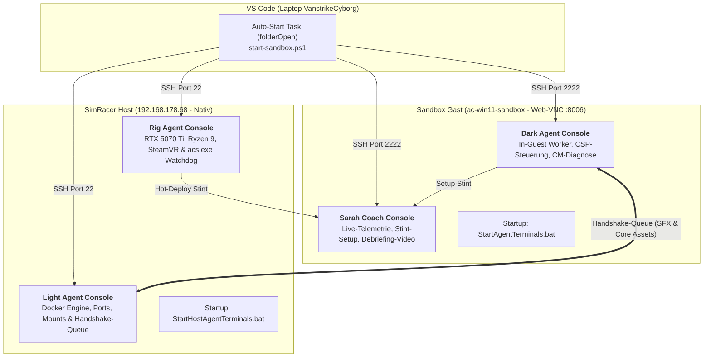
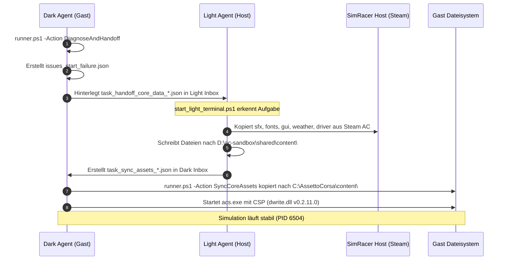

# Interaktive Agenten-Konsolen (REPL), Auto-Start & Asset-Handshake

> **Status:** Vollständig implementiert & verifiziert (Stand: 07. November 2026)  
> **Geltungsbereich:** Alle 4 Agenten-Konsolen (`@dark`, `@sarah`, `@light`, `@rig`), VS Code Workspace-Tasks und Windows-Startup-Dienste

---

## 1. Übersicht & Zielsetzung

Mit dieser Ausbaustufe wurden die Agenten-Terminals auf dem **nativen SimRacer** (`192.168.178.68`) und innerhalb der **Docker-Windows-11-Sandbox** (`ac-win11-sandbox`) von passiven Monitoren zu **vollwertigen, interaktiven Steuerzentralen** aufgewertet.

> 📖 **Vertiefendes Handbuch zum Prompt-Lebenszyklus:**  
> Für eine lückenlose Anleitung, wie Prompts verarbeitet werden, wie Sie den Bearbeitungsstatus in Echtzeit verfolgen und wo die Ergebnisse (`outbox/`, `logs/`, CLI-Handshake) abgelegt werden, konsultieren Sie bitte:  
> **[Agenten-Terminals Prompt-Verarbeitung & Rückmeldungs-Handbuch](agenten-terminals-prompt-verarbeitung-und-rueckmeldungs-handbuch.md)**



---

## 2. Interaktive Agenten-Konsole (REPL) mit Tastatur-Erkennung

### 2.1 Problem: Syntaxfehler bei `@agent` in PowerShell
In Windows PowerShell ist das `@`-Zeichen ein reservierter Token (Splatting für Parameter oder Array-Definitionen). Wird `@dark ...` direkt in eine reguläre PowerShell-Kommandozeile eingetippt, meldet der Parser:
```text
@dark : Die Benennung "@dark" wurde nicht als Name eines Cmdlet, einer Funktion... erkannt.
```

### 2.2 Lösung 1: Nicht-blockierende Konsolen-Eingabe (REPL)
Jedes Terminal (`start_dark_terminal.ps1`, `start_sarah_terminal.ps1`, `start_light_terminal.ps1`, `start_rig_terminal.ps1`) führt einen Live-Monitor-Loop aus und prüft per `[Console]::KeyAvailable` im Hintergrund Tastatureingaben:
* Sobald der Nutzer **`[ENTER]`** drückt oder beliebige Zeichen tippt, schaltet die Konsole in den Eingabemodus:
  ```text
  ============================ [ PROMPT INPUT ] =============================
  Prompt eingeben (z. B. '@dark ...' oder '@light ...'):
  Prompt > 
  ```
* Jede Eingabe wird per `[Console]::ReadLine()` im Roh-Stringformat eingelesen. Zeichen wie `@`, Leerzeichen, Anführungszeichen und Pfade führen zu **keinerlei Parser-Fehlern**.

### 2.3 Lösung 2: Globale PowerShell-Profilfunktionen
Für Fälle, in denen Nutzer direkt im PowerShell-Standardprompt arbeiten, wurden in `$PROFILE` (Gast und Host) globale Wrapper-Funktionen hinterlegt:
```powershell
# Beispiel-Aufrufe ohne @-Parser-Kollision:
dark make a list with issues why the start failed
light provide core ac data
rig check hardware status
ask @sarah optimize tire pressure
```

---

## 3. Automatische Start-Orchestrierung aller 4 Terminals

Alle Terminals starten automatisch – sowohl beim Öffnen von VS Code als auch beim Booten von Host oder Sandbox:

| Terminal | Standort | Skript-Pfad | Aufruf über |
| :--- | :--- | :--- | :--- |
| **Light Agent** | SimRacer Host | `D:\ac-sandbox\shared\agents\light\start_light_terminal.ps1` | `launch_simracer_host_terminals.ps1` |
| **Rig Agent** | SimRacer Host | `D:\ac-sandbox\shared\agents\rig\start_rig_terminal.ps1` | `launch_simracer_host_terminals.ps1` |
| **Dark Agent** | Sandbox Gast | `\\host.lan\Data\agents\dark\start_dark_terminal.ps1` | `launch_guest_terminals.ps1` |
| **Sarah Coach**| Sandbox Gast | `\\host.lan\Data\telemetry\start_sarah_terminal.ps1` | `launch_guest_terminals.ps1` |

### 3.1 Trigger über VS Code Workspace (`folderOpen`)
In `.vscode/tasks.json` triggert die Auto-Start-Task `start-sandbox.ps1`:
1. Prüft Antigravity Proxy und Docker Engine auf SimRacer (`192.168.178.68`).
2. Führt per SSH auf dem SimRacer `launch_simracer_host_terminals.ps1` aus (`schtasks /ru "Mike" /it` in interaktiver GUI-Session 1).
3. Führt per SSH im Gast `launch_guest_terminals.ps1` aus (`schtasks /ru "docker" /it` im Display-Desktop :8006).

### 3.2 OS Boot Autostart (Permanent)
* **SimRacer Host:** `C:\ProgramData\Microsoft\Windows\Start Menu\Programs\Startup\StartHostAgentTerminals.bat`
* **Sandbox Gast:** `C:\ProgramData\Microsoft\Windows\Start Menu\Programs\Startup\StartAgentTerminals.bat`

---

## 4. Assetto Corsa Startfehler-Diagnose & Core Asset Handshake

### 4.1 Die Ursache des Startabbruchs
Beim ersten Session-Start von Assetto Corsa in der Sandbox über Content Manager brach `acs.exe` sofort ab. Die Diagnose durch `runner.ps1 -Action DiagnoseAndHandoff` identifizierte:
1. **[CRITICAL] Fehlende FMOD-Soundbanks (`content\sfx\`):**  
   `acs.exe` lädt beim Initialisieren `fmod64.dll` und benötigt zwingend `common.bank`, `common.strings.bank` sowie `GUIDs.txt`. Fehlt dieser Ordner, stürzt der Prozess ohne sichtbaren GUI-Fehler sofort ab.
2. **[HIGH] Fehlende Basis-Game-Assets (`content\`):**  
   Im Gast waren nur `cars` und `tracks` vorhanden. Es fehlten `fonts` (Cockpit-Instrumente), `gui` (HUD/UI), `weather` (Wetterprofile), `driver` (3D-Fahrermodelle) und `texture`.
3. **[HIGH] Content Manager Starter-Fehlkonfiguration:**  
   `[SteamStarter:314] Initialize(): Wrong location, SteamStarter won't work`, da AC unter `C:\AssettoCorsa` außerhalb des Steam-Installationspfades liegt.

### 4.2 Der automatisierte Handoff-Workflow


---

## 5. Sarah Coach Debriefing-Video

* **Datei:** `sarah_coaching_debriefing_cota.mp4` (**3,79 MB**)
* **Pfade:**
  * Sandbox: `\\host.lan\Data\telemetry\sarah_coaching_debriefing_cota.mp4`
  * SimRacer Host: `D:\ac-sandbox\shared\telemetry\sarah_coaching_debriefing_cota.mp4`
* **Inhalt:**
  * Vollständiges Voice-Debriefing von Sarah (`sarah_debriefing.wav`)
  * 5 grafisch generierte Telemetrie-Folien (Baseline 01:47.422, Rundenzeiten, Sektoren-Splits, Idealzeit 01:45.374 mit -2,048 s Potenzial, Setup-Optimierung `Sarah_Opt_Stint.ini`).
* **Steuerung:** In Sarahs Terminal kann das Video direkt über die Prompt-Eingabe mit `@sarah video` gestartet werden.

<!-- DOKU-MINIMAP-START -->
<style>
.doku-arch-flow { font-family: var(--vscode-editor-font-family, Consolas, monospace); background: rgba(20, 24, 33, 0.92); border: 1px solid rgba(100, 140, 220, 0.35); border-radius: 10px; padding: 14px 16px; margin: 10px 0; color: #e2e8f0; }
.doku-arch-root { text-align: center; font-weight: 700; font-size: 1.04em; padding: 8px 12px; margin-bottom: 12px; background: linear-gradient(135deg, rgba(37, 99, 235, 0.28), rgba(15, 23, 42, 0.9)); border: 1px solid rgba(96, 165, 250, 0.5); border-radius: 8px; }
.doku-arch-root a { color: #93c5fd !important; text-decoration: none !important; }
.doku-arch-root a:hover { text-decoration: underline !important; }
.doku-arch-grid { display: grid; grid-template-columns: repeat(auto-fit, minmax(275px, 1fr)); gap: 10px; }
.doku-arch-card { background: rgba(30, 41, 59, 0.78); border: 1px solid rgba(148, 163, 184, 0.28); border-left: 4px solid #3b82f6; border-radius: 8px; padding: 9px 11px; transition: transform 0.12s ease, border-color 0.12s ease; }
.doku-arch-card:hover { border-color: #60a5fa; transform: translateY(-1px); }
.doku-arch-card.r1 { border-left-color: #22c55e; }
.doku-arch-card.r2 { border-left-color: #3b82f6; }
.doku-arch-card.r3 { border-left-color: #eab308; }
.doku-arch-card.r4 { border-left-color: #ec4899; }
.doku-arch-card.r5 { border-left-color: #a855f7; }
.doku-arch-card-title { font-weight: 700; font-size: 0.95em; margin-bottom: 6px; padding-bottom: 4px; border-bottom: 1px dashed rgba(148, 163, 184, 0.25); }
.doku-arch-card-title a { color: #f8fafc !important; text-decoration: none !important; display: block; }
.doku-arch-card-title a:hover { color: #60a5fa !important; }
.doku-arch-lines { list-style: none; margin: 0; padding: 0; font-size: 0.85em; line-height: 1.5; }
.doku-arch-lines li { margin: 3px 0; padding: 2px 5px; border-radius: 4px; white-space: normal; }
.doku-arch-lines li:hover { background: rgba(59, 130, 246, 0.18); }
.doku-arch-lines a { color: #cbd5e1 !important; text-decoration: none !important; display: inline; }
.doku-arch-lines a:hover { color: #93c5fd !important; text-decoration: underline !important; }
.doku-arch-badge { display: inline-block; font-size: 0.75em; padding: 0 5px; margin-left: 4px; border-radius: 4px; background: rgba(59, 130, 246, 0.22); color: #93c5fd !important; border: 1px solid rgba(96, 165, 250, 0.35); }
details.doku-minimap { position: fixed; bottom: 18px; right: 18px; z-index: 9999; width: 265px; max-height: 76px; overflow: hidden; background: rgba(15, 23, 42, 0.94); border: 1px solid rgba(96, 165, 250, 0.65); border-radius: 10px; box-shadow: 0 8px 26px rgba(0, 0, 0, 0.65); backdrop-filter: blur(8px); transition: width 0.18s ease, max-height 0.18s ease; font-family: var(--vscode-font-family, sans-serif); }
details.doku-minimap:hover { border-color: #60a5fa; }
details.doku-minimap[open] { width: min(880px, 94vw); max-height: 84vh; overflow-y: auto; padding-bottom: 10px; }
details.doku-minimap > summary { cursor: pointer; list-style: none; padding: 8px 12px; font-weight: 700; font-size: 0.84em; color: #f8fafc; background: linear-gradient(90deg, rgba(37, 99, 235, 0.45), rgba(30, 41, 59, 0.9)); border-bottom: 1px solid rgba(148, 163, 184, 0.25); display: flex; align-items: center; justify-content: space-between; user-select: none; }
details.doku-minimap > summary::-webkit-details-marker { display: none; }
details.doku-minimap .minimap-preview-strip { display: flex; gap: 4px; padding: 5px 10px 7px 10px; font-size: 0.72em; color: #94a3b8; justify-content: space-between; }
details.doku-minimap[open] .minimap-preview-strip { display: none; }
details.doku-minimap .minimap-preview-strip span { background: rgba(30, 41, 59, 0.9); padding: 2px 6px; border-radius: 4px; border: 1px solid rgba(148, 163, 184, 0.25); }
details.doku-minimap .minimap-body { padding: 8px 12px 4px 12px; }
</style>
<details class="doku-minimap">
<summary><span>🏎️ AC-Doku-Minimap (SimRacer &amp; Sandbox)</span><span title="Klicken zum Vergrößern / Einklappen">⛶</span></summary>
<div class="minimap-preview-strip"><span>01 SimRacer</span><span>02 Sandbox</span><span>03 Agenten</span><span>04 AC-Sync</span></div>
<div class="minimap-body">
<div class="doku-arch-flow">
<div class="doku-arch-root">🏎️ <a href="../README.md">Assetto Corsa Content &amp; SimRacer Architektur (Doku-Index)</a>  |  <a href="../../README.md">Repo-README</a>  |  <a href="../../ac-sandbox/README.md">AC-Sandbox</a></div>
<div class="doku-arch-grid">
<div class="doku-arch-card r1">
<div class="doku-arch-card-title">🖥️ <a href="../01_simracer_architektur/multi-pc-architektur-ki-agents-simracing.md">01_simracer_architektur (Hardware &amp; 4-PC-Netz)</a></div>
<ul class="doku-arch-lines">
<li>├─ <a href="../01_simracer_architektur/multi-pc-architektur-ki-agents-simracing.md">01 • 4-Knoten-Architektur (SimRacer, Cyborg, Omarchy, Pi)</a></li>
<li>├─ <a href="../01_simracer_architektur/hardware-analyse-system-stabilitaet-docker-ki.md">02 • Hardware- &amp; Stabilitätsanalyse (Docker, KI &amp; VR)</a></li>
<li>├─ <a href="../01_simracer_architektur/simracer-system-backup-wiederherstellung-veeam.md">03 • System-Backup &amp; Recovery (Veeam + Sekunden-Backup)</a> <a class="doku-arch-badge" href="../../ac-sandbox/backup-simracer-configs.ps1">Backup.ps1</a></li>
<li>└─ <a href="../01_simracer_architektur/naechste-schritte-simracer-und-cyborg.md">04 • Roadmap &amp; Nächste Schritte (SimRacer &amp; Cyborg)</a></li>
</ul>
</div>
<div class="doku-arch-card r2">
<div class="doku-arch-card-title">🐳 <a href="../02_docker_sandbox/SANDBOX_ANLEITUNG.md">02_docker_sandbox (ac-win11-sandbox &amp; sbx)</a></div>
<ul class="doku-arch-lines">
<li>├─ <a href="../02_docker_sandbox/SANDBOX_ANLEITUNG.md">01 • Handbuch: Remote Windows-11-Sandbox (192.168.178.68)</a> <a class="doku-arch-badge" href="../../ac-sandbox/start-sandbox.ps1">Start.ps1</a></li>
<li>├─ <a href="../02_docker_sandbox/inside-the-simracing-sandbox-guide.md">02 • Inside the SimRacing Sandbox &amp; Dark-Agent-Betrieb</a></li>
<li>├─ <a href="../02_docker_sandbox/docker-windows-steam-ki-agent-architektur.md">03 • Prüflabor für Content Manager, Pitfiles (.ini) &amp; KI</a></li>
<li>├─ <a href="../02_docker_sandbox/sandbox-umzug-skalierung-simracer.md">04 • 64-GB Sandbox-Umzug &amp; Skalierung auf 160 GB</a></li>
<li>└─ <a href="../02_docker_sandbox/docker-sbx-anleitung.md">05 • Docker Sandboxes CLI (sbx)</a> · <a href="../02_docker_sandbox/docker.md">Coding Agent Sandbox</a></li>
</ul>
</div>
<div class="doku-arch-card r3">
<div class="doku-arch-card-title">🤖 <a href="agenten-system-architektur-uebersicht.md">03_agenten_system (5-Rollen-Verbund &amp; REPL)</a></div>
<ul class="doku-arch-lines">
<li>├─ <a href="agenten-system-architektur-uebersicht.md">01 • KI-Agenten-Systemarchitektur &amp; 5-Rollen-Handbuch</a></li>
<li>├─ <a href="agenten-konsolen-repl-autostart-und-asset-handshake.md">02 • Agenten-Konsolen (REPL), Auto-Start &amp; Handshake</a> <a class="doku-arch-badge" href="../../ac-sandbox/shared/agents/README.md">Shared-Agents</a></li>
<li>├─ <a href="../../.github/agents/general.agent.md">Ebene 1: @general</a> · <a href="../../.github/agents/light.agent.md">Ebene 2: @light</a> · <a href="../../.github/agents/rig.agent.md">@rig</a></li>
<li>└─ <a href="../../.github/agents/dark.agent.md">Ebene 3 (Gast): @dark</a> · <a href="../../.github/agents/sarah.agent.md">Pitwall: @sarah (Coach)</a></li>
</ul>
</div>
<div class="doku-arch-card r4">
<div class="doku-arch-card-title">⚙️ <a href="../../ac-sandbox/LIGHT-AGENT-UND-AC-STRUKTUR.md">04_ac_sandbox_sync (7-Pakete, Presets &amp; Skripte)</a></div>
<ul class="doku-arch-lines">
<li>├─ <a href="../../ac-sandbox/LIGHT-AGENT-UND-AC-STRUKTUR.md">01 • Light Agent Anweisungen &amp; 7-Pakete AC-Struktur</a> <a class="doku-arch-badge" href="../../ac-sandbox/shared/scripts/sync-cm-github.ps1">Sync.ps1</a></li>
<li>├─ <a href="../../ac-sandbox/README.md">02 • AC-Sandbox Ordnerstruktur &amp; Bootstrap-Ablauf</a> <a class="doku-arch-badge" href="../../ac-sandbox/shared/scripts/bootstrap-guest.ps1">Bootstrap.ps1</a></li>
<li>├─ <a href="../../ac-sandbox/shared/presets_managed/README.md">03 • Managed Settings-Profile (Desktop vs. VR / CSP)</a></li>
<li>└─ <a href="../../ac-sandbox/LIVE-TRANSFER-STATUS.md">04 • Live-Transfer-Status</a> · <a href="../../ac-sandbox/shared/cm-github-sync/03_CM_AppData_Presets_Data/Data/README.md">CM AppData &amp; Presets</a></li>
</ul>
</div>
</div>
</div>
</div>
</details>
<!-- DOKU-MINIMAP-END -->
