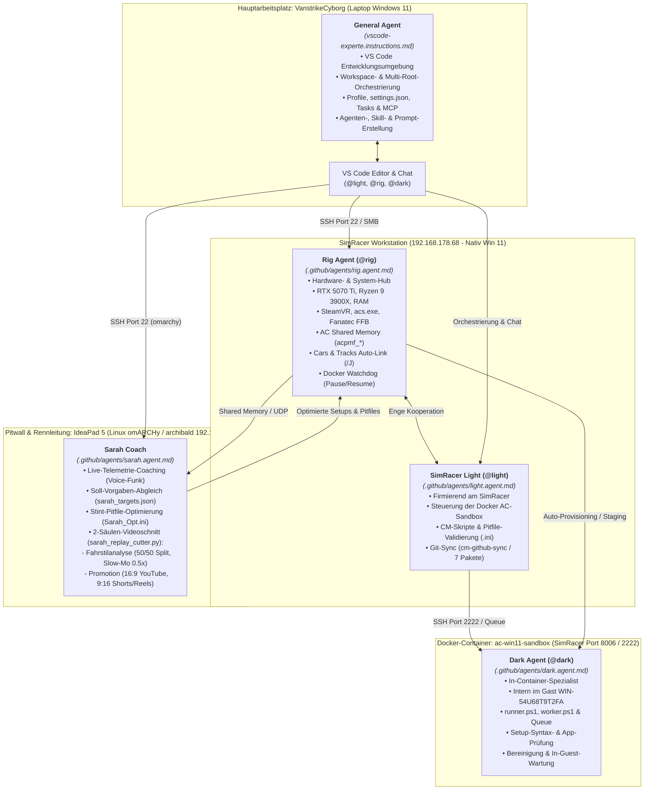
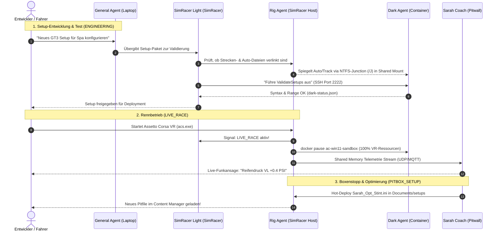
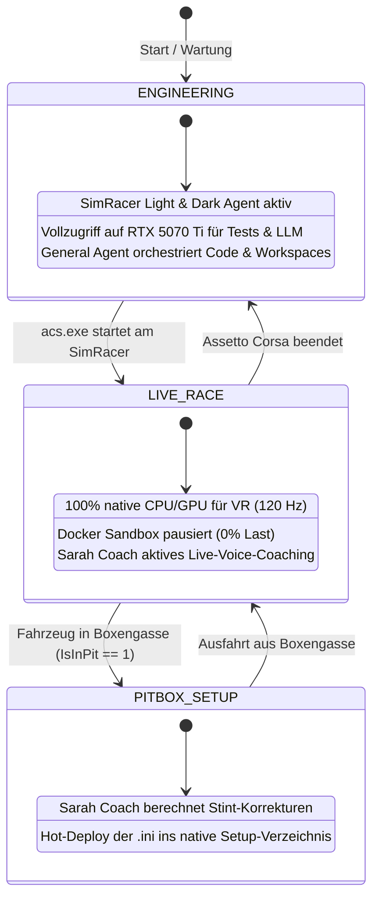
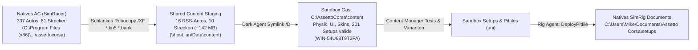
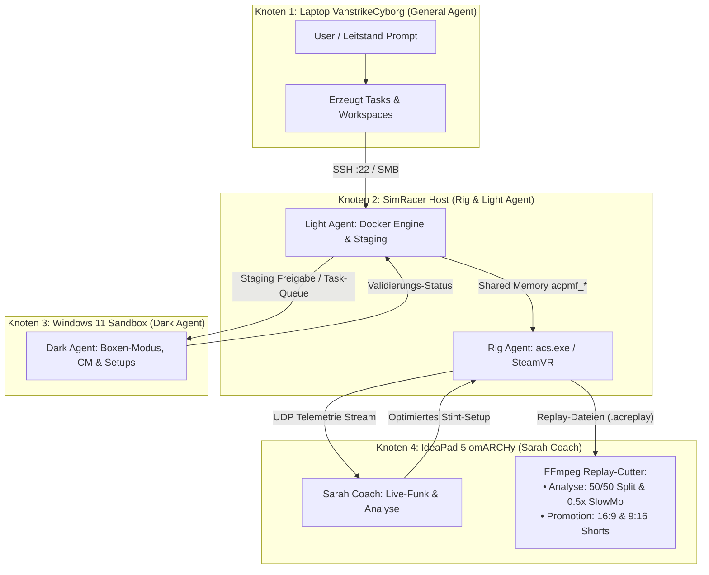

# KI-Agenten-Systemarchitektur & Rollen-Handbuch

> **Status:** Aktiv & Geprimt (Stand: November 2026)  
> **Hauptarbeitsplatz:** MSI Cyborg 15 (`VanstrikeCyborg`) & SimRacer Workstation (`192.168.178.68`)  
> **Architektur-Modell:** 5-Rollen-Agentenverbund (General Agent, SimRacer Light, Rig Agent, Dark Agent, Sarah Coach)

---

## 1. Grafische Übersicht: Topologie & Standorte

Das folgende Architektur-Diagramm veranschaulicht, auf welchen physikalischen und virtuellen Systemen die einzelnen Agenten angesiedelt sind und wie sie zusammenarbeiten:



> **Vertiefende Handbücher:**  
> - **[Agenten-Terminals Prompt-Verarbeitung & Rückmeldungs-Handbuch](agenten-terminals-prompt-verarbeitung-und-rueckmeldungs-handbuch.md):** Wie Prompts in den Terminals verarbeitet werden, wo man die Ausführung live sieht und wo die Rückmeldungen/Ergebnisse abgelegt werden.  
> - **[Interaktive Agenten-Konsolen (REPL), Auto-Start & Asset-Handshake](agenten-konsolen-repl-autostart-und-asset-handshake.md):** Details zu den interaktiven Eingabe-Prompts (`REPL`), zur Auto-Start-Kette und zum Core-Asset-Sync.

---

## 2. Die Hierarchie-Ebenen & Agenten im Detail

### Ebene 1: Führung & Strategie (Hauptarbeitsplatz Laptop `VanstrikeCyborg`)

- **Nutzer & zwei spezialisierte General-Agenten auf Laptop-Ressourcen (`VanstrikeCyborg`):**
  - **`General Cyborg`** (`C:\Users\strik\.copilot\agents\general.agent.md`, global): Höchste Instanz für den lokalen Entwicklungs-Laptop (`MSI Cyborg 15 B2RWFKG`, Core 7 240H, RTX 5060 Laptop 8 GB, 16 GB DDR5-5600), MSI Center/BIOS/Recovery, NVIDIA App MCP (`127.0.0.1:13508`), VIVE VR sowie alle VS Code Workspaces, Profile und KI-Modelle.
  - **`General Sim`** (`git-labor/.github/agents/general.agent.md`, Workspace-Leitstand & `@general`-Terminal): Läuft hardwaretechnisch ebenfalls auf `VanstrikeCyborg`, steuert aber per LAN/SSH/SMB die SimRacer-Ebene, pflegt die Verbund-Doku und bildet das Freigabe-Gate (`approved_by: GeneralAgent_Laptop`) für `@rig` und `@light`.

### Ebene 2: SimRacer Host-Ebene (`192.168.178.68` - Nativ Windows 11)

- **SimRacer Light (`@light` - `.github/agents/light.agent.md`):**
  - Kümmert sich ausschließlich um die **Docker Desktop / Docker Engine Seite für alle Container** (Lifecycle, Compose, Netzwerke, Ressourcen, Shared Mounts).
  - Gibt Aufgaben per Handshake (`Send-DarkAgentTask.ps1`, SSH Port 2222, Inbox/Outbox) an die Sandbox-Agenten weiter.
- **Rig Agent (`@rig` - `.github/agents/rig.agent.md`):**
  - Host- & Hardware-Hub am nativen SimRacer für SteamVR, `acs.exe`, RTX 5070 Ti, Ryzen 9, Fanatec FFB und Telemetrie.
  - Content-Staging (Junctions `/J` für Autos & Strecken aus Steam in die Container-Shared-Mounts).
  - Watchdog-Funktion zum Schutz der VR-Frametimes bei `LIVE_RACE`.

### Ebene 3: Sandbox In-Container-Ebene (`ac-win11-sandbox` & künftige Container)

- **Sandbox Dark (`@dark` - `.github/agents/dark.agent.md`):**
  - Reiner In-Guest-Spezialist innerhalb des Windows-11-Gasts (`ac-win11-sandbox`).
  - Führt In-Container-Aufgaben aus (Setup-Validierung, CM-Starts, Desktop/VR-Profilumschaltung, Temp-Bereinigung) und meldet die Ergebnisse per Handshake an `@light` zurück.
- **Künftige Sandbox-Agents:**
  - Zusätzliche In-Container-Agenten (z. B. Telemetrie-Recorder, Mod-Installations-Agent), die ebenfalls über `@light` gesteuert werden.

### Ebene 4: Pitwall, Telemetrie & Video-Rendering (IdeaPad 5 - Linux `omARCHy` / `archibald` 192.168.178.98)

- **Sarah Coach (`sarah.agent.md` & `start_sarah_terminal.ps1`):**
  - **Standort:** Nativ beheimatet auf dem IdeaPad 5 (`omARCHy` / Arch Linux, User: `archy` / `archibald`, Host: `192.168.178.98:22`).
  - **Live-Telemetrie-Coaching:** Empfängt Telemetrie-Streams (UDP/Shared Memory Relais) direkt vom SimRacer, vergleicht Sektorzeiten mit `sarah_targets.json` und gibt Voice-Funkansagen aus.
  - **Stint-Pitfile-Kalkulation:** Berechnet dynamisch optimierte Reifen- und Setup-Werte (`Sarah_Opt_Stint.ini`) und reicht sie an `@rig` weiter.
  - **2-Säulen-Videoschnitt-Engine (`sarah_replay_cutter.py`):**
    - *Säule 1 (Fahrstilanalyse & Fahrkunst):* Replay-Deep-Dive, Apex-Slow-Motion (0.5x), Side-by-Side 50/50 Delta-Vergleich und Kurven-Telemetrie (`telemetry/clips/analysis/`).
    - *Säule 2 (Promotion & Social Media):* 16:9 Widescreen (YouTube) & 9:16 Vertical Crop (Shorts/TikTok/Reels) mit dynamischen CTA-Bannern (`telemetry/clips/promotion/`).
    - *CPU-Entlastung:* Durch das Auslagern des Replay-Renderings (FFmpeg) auf das IdeaPad 5 bleibt die SimRacer-CPU (Ryzen 9 3900X) und GPU (RTX 5070 Ti) zu 100 % für die 120-Hz-VR-Simulation frei!

---

## 3. Datenflüsse & Schnittstellen-Matrix



---

## 4. Die drei Betriebsmodi im Überblick



---

## 5. Leitfaden: Wie werden die Agents „geprimt“ und aufgerufen?

### 5.1 General Agent (Laptop `VanstrikeCyborg`)

- **Wie er aktiv ist:** Automatisch bei jeder Anfrage im VS Code Chat auf dem Laptop geladen über `vscode-experte.instructions.md`.
- **Typische Aufgaben:**
  - *"Prüfe meine Workspace-Dateien auf fehlerhafte Pfade."*
  - *"Passe die globale settings.json mit Vorschau an."*
  - *"Erstelle oder aktualisiere einen Subagenten oder Skill."*
  - *"Beauftrage den Light Agent oder Rig Agent mit einem Handshake-Auftrag."*

### 5.2 SimRacer Light (`@light`)

- **Aufruf im Chat:** Tippe `@light` gefolgt von der Aufgabe.
- **Kernaufgabe:** Verwaltet rein die **Docker Desktop / Engine Seite für alle Container** auf dem SimRacer und reicht Aufträge per Handshake an In-Container-Agents weiter.
- **Typische Aufgaben:**
  - `@light Status von ac-win11-sandbox und allen Containern prüfen`
  - `@light Validiere alle Setups in der Sandbox mit dem Dark Agent`
  - `@light Schalte das Profil auf vr_focusvision um`
  - `@light Synchronisiere die 7 AC-Pakete mit dem cm-github-sync`

### 5.3 Rig Agent (`@rig`)

- **Aufruf im Chat:** Tippe `@rig` gefolgt von der Aufgabe (oder Skript `Invoke-RigAgent.ps1`).
- **Kernaufgabe:** Host- & Hardware-Hub am nativen SimRacer für SteamVR, `acs.exe`, RTX 5070 Ti, Fanatec FFB, Content-Junctions `/J` und Watchdog.
- **Typische Aufgaben:**
  - `@rig Prüfe GPU-Temperatur, VRAM und SteamVR-Prozesse`
  - `@rig Verlinke Porsche 911 GT3 R oder GP 2025 Autos in das Sandbox-Content-Verzeichnis`
  - `@rig Kopiere das optimierte Setup Sarah_Opt.ini nach Documents\Assetto Corsa\setups`
  - `@rig Führe den Watchdog-Check aus (Schutz der 120 FPS bei acs.exe)`

### 5.4 Dark Agent (`@dark`)

- **Aufruf im Chat:** Tippe `@dark` (oder via Handshake-Dispatcher `Send-DarkAgentTask.ps1` / `Invoke-DarkAgent.ps1`).
- **Kernaufgabe:** Isolierter In-Guest-Spezialist in `ac-win11-sandbox` (Windows 11 Pro, permanent HWID-aktiviert).
- **Typische Aufgaben:**
  - `@dark Führe ValidateSetups aus (prüft 201 .ini-Setups)`
  - `@dark Wende Preset desktop_4k oder vr_focusvision an`
  - `@dark Starte Content Manager im sichtbaren Desktop (Session 1)`
  - `@dark Teste Python-App im Gast-System C:\AssettoCorsa\apps\python`
  - `@dark Bereinige Shader-Caches und temporäre Dumps im Gast`

---

## 5.5 Handshake-Dispatcher & Task-Queue (`Send-DarkAgentTask.ps1`)

Das System setzt auf **asynchrone Task-Abwicklung mit synchroner Handshake-Garantie**:

1. Der anfordernde Agent (General Agent oder SimRacer Light) erzeugt einen Task `task_<GUID>.json` im Verzeichnis `\\192.168.178.68\ac-sandbox\shared\agents\dark\inbox\`.
2. Im Windows-11-Gast liest `worker.ps1` (oder getriggert via SSH) den Task ein, delegiert an `runner.ps1` und schreibt das Ergebnis `result_<GUID>.json` nach `outbox/`.
3. `Send-DarkAgentTask.ps1` liest das Resultat ein, prüft den ExitCode (`0` = Erfolg) und liefert strukturierte Daten zurück.

```powershell
# Beispiel: Handshake-Validierung ausführen
.\ac-sandbox\Send-DarkAgentTask.ps1 -Action ValidateSetups
.\ac-sandbox\Send-DarkAgentTask.ps1 -Action ApplyPreset -Preset vr_focusvision
```

---

## 5.6 GUI-Interaktion & Session-Isolation (Session 0 vs. Session 1)

- **Das Phänomen:** Windows isoliert SSH- und Dienstprozesse in **Session 0** (nicht-interaktiver Hintergrund). Ein einfacher `Start-Process "Content Manager.exe"` über SSH war daher auf dem VNC-Desktop (`:8006` / Session 1) unsichtbar.
- **Die Lösung:** Das Tool `open_cm.py` interagiert über den Unix-Domain-Socket von QEMU (`/run/shm/monitor.sock`) im Docker-Container. Tastatur-Events werden direkt in die simulierte Hardware injiziert, sodass Content Manager zuverlässig im interaktiven Benutzer-Desktop (Session 1) erscheint.

---

## 5.7 Managed Presets (Desktop 4K vs. VR Focus Vision)

In `ac-sandbox\shared\presets_managed\` werden standardisierte Konfigurationen gepflegt:

- **`desktop_4k`:** Bildschirm-Training, Benchmark-Modus, maximale Details (`MODE=DEFAULT` in `video.ini`, 3840x2160).
- **`vr_focusvision`:** VIVE Focus Vision VR-Modus via DisplayPort (`MODE=OPENVR` in `video.ini`, 120-Hz-Frametime-optimiert).

---

## 6. Verifizierte Content-Staging- & Hot-Deploy-Pipeline



### 6.1 Samba-NTFS-Junction Fix

- **Herausforderung:** Ursprüngliche Windows-Junctions (`mklink /J`) verweisen auf absolute Windows-Pfade, die Linux-Samba (`dockurr/windows`) nicht auflösen kann (`Test-Path` = `False`).
- **Lösung:** Staging via Robocopy mit Ausschluss riesiger 3D-Geometrien (`*.kn5`) und Soundbänke (`*.bank`). Dadurch werden nur Physik-, Setup-, UI- und Skin-Dateien übertragen (nur ~142 MB für 16 RSS-Fahrzeuge und 10 Strecken).
- **Ergebnis:** Dark Agent und Content Manager in der Sandbox haben 100 % Lese- und Schreibzugriff auf alle Fahrzeugdaten, Setup-Menüs und Skins bei minimalem Speicherverbrauch.

### 6.2 Getesteter Setup-Transfer (Hot-Deploy)

```powershell
# Vollständiger Setup-Sync vom Staging-Verzeichnis auf das native SimRig:
.\ac-sandbox\Invoke-RigAgent.ps1 -Action DeployPitfile

# Gezieltes Deployen einer einzelnen Setup-Datei:
.\ac-sandbox\Invoke-RigAgent.ps1 -Action DeployPitfile -PitfileSource "C:\ac-sandbox\shared\cm-github-sync\01_Documents_AC_Setups\rss_formula_hybrid_x_2026\acu_cota_2021\Quali_Opt.ini" -PitfileTarget "C:\Users\Mike\Documents\Assetto Corsa\setups\rss_formula_hybrid_x_2026\acu_cota_2021\Quali_Opt.ini"
```

---

## 7. Multi-CPU- & Workflow-Orchestrierung (4 Rechenknoten)

Um maximale Frameraten im SimRacing (120 Hz in SteamVR) bei gleichzeitiger KI-Automatisierung und Telemetrie-Coaching zu garantieren, sind die Workflows streng nach Hardware-Stärken und CPU-Kernen aufgeteilt:

| Rechenknoten | Hardware & OS | Rolle & Agenten | Aufgaben & Entlastungsprinzip |
| :--- | :--- | :--- | :--- |
| **Knoten 1: Laptop** | MSI Cyborg 15 B2RWFKG (`VanstrikeCyborg`, `MS-15Q3`), Intel Core 7 240H, RTX 5060 Laptop (8 GB GDDR7), 16 GB DDR5-5600 | **`General Cyborg`** *(Global)* & **`General Sim`** *(Leitstand / `@general`)* | • **`General Cyborg`:** Laptop-System, VIVE VR, NVIDIA MCP (`:13508`), VS Code Workspaces & Profile<br/>• **`General Sim`:** SimRacer-Task-Verteilung, Freigabe-Gate & Git-Versionierung<br/>• 0 % Last für den SimRacer während der Code-Arbeit |
| **Knoten 2: SimRacer Host** | AMD Ryzen 9 3900X (12C/24T), RTX 5070 Ti, 64 GB RAM (`192.168.178.68:22`) | **Rig Agent (`@rig`) & Light Agent (`@light`)** | • 100 % CPU/GPU-Fokus auf `acs.exe` und SteamVR<br/>• Watchdog pausiert Container bei Rennstart (`LIVE_RACE`)<br/>• Docker-Host-Management, SMB-Bereitstellung |
| **Knoten 3: Win11 Sandbox** | Virtuelle QEMU/KVM-Maschine im Docker-Container (`ac-win11-sandbox`, Port 8006/2222) | **Dark Agent (`@dark`)** | • Isolierte Boxengasse & Testlabor<br/>• Assetto Corsa Headless / Virtual Display (Port 8006)<br/>• Syntaxprüfung von Setups (`ValidateSetups`), CSP & CM-Starts<br/>• Keinerlei Risiko für das Produktivsystem |
| **Knoten 4: IdeaPad 5 Pitwall** | IdeaPad 5 (`omARCHy` / `archibald` auf `192.168.178.98:22`, Arch Linux) | **Sarah Coach (`@sarah`)** | • Dedizierte Telemetrie-Auswertung (UDP-Stream)<br/>• Live-Voice-Coaching & Stint-Pitfile-Berechnung<br/>• **2-Säulen-Videoschnitt (FFmpeg)** für Fahrstilanalyse & Promotion<br/>• **CPU-Schonung:** Render-Workflows laufen komplett auf dem IdeaPad, nicht auf dem SimRacer! |

### 7.1 Workflow-Ablaufdiagramm zwischen den 4 CPUs



---

## 8. Changelog & System-Status der letzten Stunden (Seit Neustart)

1. **Dateisystem-Reparatur & Sandbox Boot-Fix:**
   - NTFS-Partition (Partition 3) und FAT32-EFI-Systempartition (Partition 1) des Disk-Images `data.img` repariert (`ntfsfix`, `fsck.vfat`).
   - Bereinigung von Boot-Trace-Dateien und Zurücksetzen von `BOOTSTAT.DAT` in `EFI/Microsoft/Boot/`.
   - Windows 11 Gast bootet wieder sauber und stabil durch; Desktop, Port 8006 (noVNC) und Port 2222 (SSH) sind permanent online.

2. **Docker Desktop Auto-Start & Watchdog:**
   - `start-sandbox.ps1` erweitert: Prüft vor dem Container-Start selbsttätig, ob Docker Desktop auf dem SimRacer läuft, und startet den Dienst bei Bedarf per PowerShell/SSH autonom.

3. **Remote VS Code Workspace auf SimRacer:**
   - VS Code auf dem SimRacer verifiziert (`Code.exe`).
   - Workspace `\\192.168.178.68\ac-sandbox\simracer.code-workspace` für VS Code Remote-SSH bereitgestellt.

4. **Multi-Terminal-Suite (5 Agenten-Konsolen):**
   - [.vscode/tasks.json](/.vscode/tasks.json) und Skripte (`start_general_terminal.ps1`, `launch_all_terminals.ps1`, `connect_*_terminal.ps1`) integriert:
     - General Agent (Laptop, lokal mit Live-Infrastruktur-Status)
     - Rig Agent (SimRacer Host :22)
     - Light Agent (SimRacer Docker :22)
     - Sarah Coach (Pitwall omARCHy / IdeaPad 5 :22)
     - Dark Agent (Sandbox Gast :2222)

5. **Sarah Coach: 2-Säulen-Videokonzept:**
   - Werkzeug `sarah_replay_cutter.py` implementiert:
     - *Säule 1: Fahrstilanalyse* (50/50 Side-by-Side Delta-Vergleich, 0.5x SlowMo am Kurvenscheitelpunkt).
     - *Säule 2: Promotion & Social Media* (16:9 YouTube Widescreen & 9:16 Vertical Crop für Shorts/TikTok/Reels).
   - Auslagerung der Render-Pipeline auf das IdeaPad 5 zur Schonung der SimRacer-CPU.

6. **Staging- & Freigabe-Architektur (`manage-sandbox-staging.ps1`):**
   - Strikte Entkopplung von Live-System und Sandbox: Keine direkten Schreibzugriffe.
   - Cfg-, Presets- und Skript-Dateien synchronisieren via SMB.
   - Autos und Strecken landen im Staging-Bereich (`shared/staging/cars/`, `shared/staging/tracks/`) und werden erst nach manueller Freigabe (`-Action Approve`) in die Sandbox übernommen.

7. **Assetto Corsa Boxen-Modus & Lokale Lobby in der Sandbox:**
   - Content Manager und CSP erfolgreich im virtuellen Desktop gestartet (`cm_running: True`).
   - `video.ini` auf Fenstermodus (`FULLSCREEN=0`, `MODE=DEFAULT`, 1920x1080) konfiguriert, um VR-Blockaden im Container zu verhindern.
   - **Lokale Box-Lobby (`acServer` Dedicated):** Mit [manage-ac-server.ps1](/ac-sandbox/manage-ac-server.ps1) vollautomatisiert. Startet einen LAN-Dedicated-Server auf Port 9600 (UDP/TCP) und 8081 (HTTP) mit COTA und RSS Formula Hybrid 2026 für isolierte In-Sandbox-Tests ohne SimRacer-Belastung.

8. **IdeaPad 5 (Archibald / omARCHy) permanente Einbindung & Pitwall-Betrieb (Stand: 11.11.2026):**
   - **SSH-Verbund:** Passwortlose `ed25519`-SSH-Verbindung sowohl vom Laptop (`VanstrikeCyborg`) als auch vom `SimRacer` (`Mike@192.168.178.68`) nach `archibald@192.168.178.98` eingerichtet.
   - **Basisbetrieb & Screensaver (kein Auto-Suspend):** `logind.conf.d/disable-sleep.conf` (`HandleLidSwitch=ignore`, `IdleAction=ignore`) und `~/.config/omarchy/shell.json` (`screensaver: 150`, `lock: 300`) halten das Notebook im laufenden Pitwall-Betrieb bei aktivem Bildschirmschoner wach.
   - **Remote-Sleep & Wake-on-WLAN (WoWLAN):** `sleep.target`/`suspend.target` entmaskiert (`s2idle`), passwortloses `sudo -n /usr/bin/systemctl suspend` über `/etc/sudoers.d/archibald-suspend` freigegeben. Steuerung über [`sleep_archibald.ps1`](/ac-sandbox/sleep_archibald.ps1) (Laptop & `SimRacer:C:\ac-sandbox\`) sowie [`wake_archibald.ps1`](/ac-sandbox/wake_archibald.ps1) (Dual-Broadcast `255.255.255.255` & `192.168.178.255`, UDP `9`/`7`, MAC `14:18:c3:b4:3e:85`, Intel AX201 `wlp0s20f3` mit `nmcli wake-on-wlan=8` & `udev`-Regel `50-wowlan.rules`).
   - **UFW-Firewall:** LAN-Regeln für `192.168.178.0/24` auf `22/tcp` (vor `omarchy-sshd LIMIT IN`) und `9996/udp` (`allow-ac-telemetry` für Live-Telemetrie vom SimRacer).
   - **OAuth & `CLIProxyAPI` (`:8317`):** `cli-proxy-api.service` läuft auf `127.0.0.1:8317` mit synchronisiertem Antigravity-OAuth (`m.e.stuermer@gmail.com`, 21 Modelle inkl. `gemini-3.8-flash`-Aliases); `~/.config/Code/User/settings.json` und `~/ac-pitwall/pitwall.code-workspace` sind auf `http://localhost:8317` abgeglichen.
   - **Pitwall-Toolkit (`~/ac-pitwall/`):** `start_sarah_terminal.sh` (`.venv`, Befehle `telemetry`, `pitfile`, `voice`, `analysis`, `promotion`, `replays`, `status`), [`sarah_telemetry_listener.py`](/ac-sandbox/shared/telemetry/sarah_telemetry_listener.py) (UDP `9996`), [`sarah_pitfile_optimizer.py`](/ac-sandbox/shared/telemetry/sarah_pitfile_optimizer.py), [`sarah_targets.json`](/ac-sandbox/shared/telemetry/sarah_targets.json), `sarah_voice.py` und [`sarah_replay_cutter.py`](/ac-sandbox/shared/telemetry/sarah_replay_cutter.py).

9. **Docker & Sandbox Shutdown/Restart-Steuerung:**
   - [stop-sandbox.ps1](/ac-sandbox/stop-sandbox.ps1): Fährt den Windows 11 Gast sauber herunter und stoppt den Docker-Container `ac-win11-sandbox`.
   - [stop-docker.ps1](/ac-sandbox/stop-docker.ps1): Stoppt die Sandbox, beendet alle Docker Desktop Prozesse und führt `wsl --shutdown` aus (100% Host-Ressourcen für SimRacing frei).
   - [restart-sandbox.ps1](/ac-sandbox/restart-sandbox.ps1): Automatisierter Warmstart.

10. **Windows Explorer & Pure Weather In-Sandbox-Bereitstellung:**
    - Dark Agent öffnet den AC Steam-Ordner im Windows Explorer des sichtbaren Sandbox-Desktops via Scheduled-Task-Batch-Helper (`C:\open_folder.bat`).
    - [sync-pure-to-sandbox.ps1](/ac-sandbox/sync-pure-to-sandbox.ps1): Überträgt das Peter Boese Pure Wetter- & Shader-System (~820 MB Skripte, Shader, Soundeffekte & PP-Filter) vom SimRacer in die Sandbox.

11. **Verbindliches Rückversicherungs- & Freigabe-Gate (`@rig` / `@light` ↔ `@general`):**
    - `@rig` ([`start_rig_terminal.ps1`](../../ac-sandbox/shared/agents/rig/start_rig_terminal.ps1)) und `@light` ([`start_light_terminal.ps1`](../../ac-sandbox/shared/agents/light/start_light_terminal.ps1)) sichern sich vor System-, Container- oder Weiterleitungs-Aktionen automatisch beim `@general` ab (`ApprovalRequest` in `agents/general/inbox/`, Parken in `agents/{rig|light}/approvals/`).
    - Am `@general` Terminal ([`start_general_terminal.ps1`](../../ac-sandbox/shared/agents/general/start_general_terminal.ps1)) erscheinen Anfragen unter `OFFENE FREIGABEN / RUECKFRAGEN` und werden per `ok`/`approve`, `nein`/`reject` oder `reply <Text>` (Dual-Outbox lokal + SMB) freigegeben oder abgelehnt; direkte General-Orders tragen `approved_by: GeneralAgent_Laptop`.

12. **Zentrale Kommunikations-Historie, vollständige Logs & OSC-8 Terminal-Links:**
    - Vollständige Kommunikation im Markdown-Protokoll [`AGENT_KOMMUNIKATION_HISTORIE.md`](../../ac-sandbox/shared/agents/general/logs/AGENT_KOMMUNIKATION_HISTORIE.md) (eingeklappte `<details>`-Blöcke ohne Textkürzung), `agent_comm_history.jsonl` und Tageslogs in allen 4 Terminals.
    - Klickbare OSC-8 Terminal-Hyperlinks im Header jeder Konsole sowie Kurzbefehle `md` / `log` am General Terminal und stabilisierte Task-Starts (`"type": "process"`, `-NoProfile`) in [`tasks.json`](../../.vscode/tasks.json).

13. **Verknüpfte Agent-Dateien, Skills & Regeln (`git-labor`):**
    - **Custom Agents:** [`general.agent.md`](../../../git-labor/.github/agents/general.agent.md) · [`rig.agent.md`](../../../git-labor/.github/agents/rig.agent.md) · [`light.agent.md`](../../../git-labor/.github/agents/light.agent.md) · [`dark.agent.md`](../../../git-labor/.github/agents/dark.agent.md) · [`sarah.agent.md`](../../../git-labor/.github/agents/sarah.agent.md)
    - **Regeln & Instructions:** [`AGENTS.md`](../../../git-labor/AGENTS.md) · [`gemini-api.instructions.md`](../../../git-labor/.github/instructions/gemini-api.instructions.md) · [`vscode-experte.instructions.md`](../../../.copilot/instructions/vscode-experte.instructions.md)
    - **Skills (`SKILL.md`):** [`live-transfer-status-monitor` (Workspace)](../../../git-labor/.agents/skills/live-transfer-status-monitor/SKILL.md) · [`live-transfer-status-monitor` (Gemini)](../../../git-labor/.gemini/skills/live-transfer-status-monitor/SKILL.md)

---

<!-- DOKU-MINIMAP-START -->
<style>
.doku-arch-flow { font-family: var(--vscode-editor-font-family, Consolas, monospace); background: rgba(20, 24, 33, 0.92); border: 1px solid rgba(100, 140, 220, 0.35); border-radius: 10px; padding: 14px 16px; margin: 10px 0; color: #e2e8f0; }
.doku-arch-root { text-align: center; font-weight: 700; font-size: 1.04em; padding: 8px 12px; margin-bottom: 12px; background: linear-gradient(135deg, rgba(37, 99, 235, 0.28), rgba(15, 23, 42, 0.9)); border: 1px solid rgba(96, 165, 250, 0.5); border-radius: 8px; }
.doku-arch-root a { color: #93c5fd !important; text-decoration: none !important; }
.doku-arch-root a:hover { text-decoration: underline !important; }
.doku-arch-grid { display: grid; grid-template-columns: repeat(auto-fit, minmax(275px, 1fr)); gap: 10px; }
.doku-arch-card { background: rgba(30, 41, 59, 0.78); border: 1px solid rgba(148, 163, 184, 0.28); border-left: 4px solid #3b82f6; border-radius: 8px; padding: 9px 11px; transition: transform 0.12s ease, border-color 0.12s ease; }
.doku-arch-card:hover { border-color: #60a5fa; transform: translateY(-1px); }
.doku-arch-card.r1 { border-left-color: #22c55e; }
.doku-arch-card.r2 { border-left-color: #3b82f6; }
.doku-arch-card.r3 { border-left-color: #eab308; }
.doku-arch-card.r4 { border-left-color: #ec4899; }
.doku-arch-card.r5 { border-left-color: #a855f7; }
.doku-arch-card-title { font-weight: 700; font-size: 0.95em; margin-bottom: 6px; padding-bottom: 4px; border-bottom: 1px dashed rgba(148, 163, 184, 0.25); }
.doku-arch-card-title a { color: #f8fafc !important; text-decoration: none !important; display: block; }
.doku-arch-card-title a:hover { color: #60a5fa !important; }
.doku-arch-lines { list-style: none; margin: 0; padding: 0; font-size: 0.85em; line-height: 1.5; }
.doku-arch-lines li { margin: 3px 0; padding: 2px 5px; border-radius: 4px; white-space: normal; }
.doku-arch-lines li:hover { background: rgba(59, 130, 246, 0.18); }
.doku-arch-lines a { color: #cbd5e1 !important; text-decoration: none !important; display: inline; }
.doku-arch-lines a:hover { color: #93c5fd !important; text-decoration: underline !important; }
.doku-arch-badge { display: inline-block; font-size: 0.75em; padding: 0 5px; margin-left: 4px; border-radius: 4px; background: rgba(59, 130, 246, 0.22); color: #93c5fd !important; border: 1px solid rgba(96, 165, 250, 0.35); }
details.doku-minimap { position: fixed; bottom: 18px; right: 18px; z-index: 9999; width: 265px; max-height: 76px; overflow: hidden; background: rgba(15, 23, 42, 0.94); border: 1px solid rgba(96, 165, 250, 0.65); border-radius: 10px; box-shadow: 0 8px 26px rgba(0, 0, 0, 0.65); backdrop-filter: blur(8px); transition: width 0.18s ease, max-height 0.18s ease; font-family: var(--vscode-font-family, sans-serif); }
details.doku-minimap:hover { border-color: #60a5fa; }
details.doku-minimap[open] { width: min(880px, 94vw); max-height: 84vh; overflow-y: auto; padding-bottom: 10px; }
details.doku-minimap > summary { cursor: pointer; list-style: none; padding: 8px 12px; font-weight: 700; font-size: 0.84em; color: #f8fafc; background: linear-gradient(90deg, rgba(37, 99, 235, 0.45), rgba(30, 41, 59, 0.9)); border-bottom: 1px solid rgba(148, 163, 184, 0.25); display: flex; align-items: center; justify-content: space-between; user-select: none; }
details.doku-minimap > summary::-webkit-details-marker { display: none; }
details.doku-minimap .minimap-preview-strip { display: flex; gap: 4px; padding: 5px 10px 7px 10px; font-size: 0.72em; color: #94a3b8; justify-content: space-between; }
details.doku-minimap[open] .minimap-preview-strip { display: none; }
details.doku-minimap .minimap-preview-strip span { background: rgba(30, 41, 59, 0.9); padding: 2px 6px; border-radius: 4px; border: 1px solid rgba(148, 163, 184, 0.25); }
details.doku-minimap .minimap-body { padding: 8px 12px 4px 12px; }
</style>
<details class="doku-minimap">
<summary><span>🏎️ AC-Doku-Minimap (SimRacer &amp; Sandbox)</span><span title="Klicken zum Vergrößern / Einklappen">⛶</span></summary>
<div class="minimap-preview-strip"><span>01 SimRacer</span><span>02 Sandbox</span><span>03 Agenten</span><span>04 AC-Sync</span></div>
<div class="minimap-body">
<div class="doku-arch-flow">
<div class="doku-arch-root">🏎️ <a href="../README.md">Assetto Corsa Content &amp; SimRacer Architektur (Doku-Index)</a>  |  <a href="../../README.md">Repo-README</a>  |  <a href="../../ac-sandbox/README.md">AC-Sandbox</a></div>
<div class="doku-arch-grid">
<div class="doku-arch-card r1">
<div class="doku-arch-card-title">🖥️ <a href="../01_simracer_architektur/multi-pc-architektur-ki-agents-simracing.md">01_simracer_architektur (Hardware &amp; 4-PC-Netz)</a></div>
<ul class="doku-arch-lines">
<li>├─ <a href="../01_simracer_architektur/multi-pc-architektur-ki-agents-simracing.md">01 • 4-Knoten-Architektur (SimRacer, Cyborg, Omarchy, Pi)</a></li>
<li>├─ <a href="../01_simracer_architektur/hardware-analyse-system-stabilitaet-docker-ki.md">02 • Hardware- &amp; Stabilitätsanalyse (Docker, KI &amp; VR)</a></li>
<li>├─ <a href="../01_simracer_architektur/simracer-system-backup-wiederherstellung-veeam.md">03 • System-Backup &amp; Recovery (Veeam + Sekunden-Backup)</a> <a class="doku-arch-badge" href="../../ac-sandbox/backup-simracer-configs.ps1">Backup.ps1</a></li>
<li>└─ <a href="../01_simracer_architektur/naechste-schritte-simracer-und-cyborg.md">04 • Roadmap &amp; Nächste Schritte (SimRacer &amp; Cyborg)</a></li>
</ul>
</div>
<div class="doku-arch-card r2">
<div class="doku-arch-card-title">🐳 <a href="../02_docker_sandbox/SANDBOX_ANLEITUNG.md">02_docker_sandbox (ac-win11-sandbox &amp; sbx)</a></div>
<ul class="doku-arch-lines">
<li>├─ <a href="../02_docker_sandbox/SANDBOX_ANLEITUNG.md">01 • Handbuch: Remote Windows-11-Sandbox (192.168.178.68)</a> <a class="doku-arch-badge" href="../../ac-sandbox/start-sandbox.ps1">Start.ps1</a></li>
<li>├─ <a href="../02_docker_sandbox/inside-the-simracing-sandbox-guide.md">02 • Inside the SimRacing Sandbox &amp; Dark-Agent-Betrieb</a></li>
<li>├─ <a href="../02_docker_sandbox/docker-windows-steam-ki-agent-architektur.md">03 • Prüflabor für Content Manager, Pitfiles (.ini) &amp; KI</a></li>
<li>├─ <a href="../02_docker_sandbox/sandbox-umzug-skalierung-simracer.md">04 • 64-GB Sandbox-Umzug &amp; Skalierung auf 160 GB</a></li>
<li>└─ <a href="../02_docker_sandbox/docker-sbx-anleitung.md">05 • Docker Sandboxes CLI (sbx)</a> · <a href="../02_docker_sandbox/docker.md">Coding Agent Sandbox</a></li>
</ul>
</div>
<div class="doku-arch-card r3">
<div class="doku-arch-card-title">🤖 <a href="agenten-system-architektur-uebersicht.md">03_agenten_system (5-Rollen-Verbund &amp; REPL)</a></div>
<ul class="doku-arch-lines">
<li>├─ <a href="agenten-system-architektur-uebersicht.md">01 • KI-Agenten-Systemarchitektur &amp; 5-Rollen-Handbuch</a></li>
<li>├─ <a href="agenten-konsolen-repl-autostart-und-asset-handshake.md">02 • Agenten-Konsolen (REPL), Auto-Start &amp; Handshake</a> <a class="doku-arch-badge" href="../../ac-sandbox/shared/agents/README.md">Shared-Agents</a></li>
<li>├─ <a href="../../.github/agents/general.agent.md">Ebene 1: @general</a> · <a href="../../.github/agents/light.agent.md">Ebene 2: @light</a> · <a href="../../.github/agents/rig.agent.md">@rig</a></li>
<li>└─ <a href="../../.github/agents/dark.agent.md">Ebene 3 (Gast): @dark</a> · <a href="../../.github/agents/sarah.agent.md">Pitwall: @sarah (Coach)</a></li>
</ul>
</div>
<div class="doku-arch-card r4">
<div class="doku-arch-card-title">⚙️ <a href="../../ac-sandbox/LIGHT-AGENT-UND-AC-STRUKTUR.md">04_ac_sandbox_sync (7-Pakete, Presets &amp; Skripte)</a></div>
<ul class="doku-arch-lines">
<li>├─ <a href="../../ac-sandbox/LIGHT-AGENT-UND-AC-STRUKTUR.md">01 • Light Agent Anweisungen &amp; 7-Pakete AC-Struktur</a> <a class="doku-arch-badge" href="../../ac-sandbox/shared/scripts/sync-cm-github.ps1">Sync.ps1</a></li>
<li>├─ <a href="../../ac-sandbox/README.md">02 • AC-Sandbox Ordnerstruktur &amp; Bootstrap-Ablauf</a> <a class="doku-arch-badge" href="../../ac-sandbox/shared/scripts/bootstrap-guest.ps1">Bootstrap.ps1</a></li>
<li>├─ <a href="../../ac-sandbox/shared/presets_managed/README.md">03 • Managed Settings-Profile (Desktop vs. VR / CSP)</a></li>
<li>└─ <a href="../../ac-sandbox/LIVE-TRANSFER-STATUS.md">04 • Live-Transfer-Status</a> · <a href="../../ac-sandbox/shared/cm-github-sync/03_CM_AppData_Presets_Data/Data/README.md">CM AppData &amp; Presets</a></li>
</ul>
</div>
</div>
</div>
</div>
</details>
<!-- DOKU-MINIMAP-END -->
