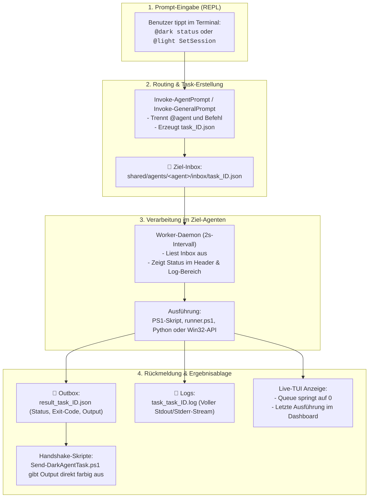

# Agenten-Terminals: Prompt-Verarbeitung, Status-Überwachung & Rückmeldungs-Handbuch

> **Status:** Vollständig implementiert & dokumentiert (Stand: November 2026)  
> **Geltungsbereich:** Alle 5 Agenten-Konsolen (`@general` = `General Sim`, `@light`, `@rig`, `@dark`, `@sarah`), VS Code Workspace-Integration (`General Cyborg` global) & Cross-Workspace Schnittstellen  
> **Zugehörige Systeme:** Laptop `VanstrikeCyborg` (`General Cyborg` & `General Sim`), SimRacer Host `192.168.178.68` (`@rig` & `@light`), Sandbox-Gast `ac-win11-sandbox` (`@dark`), Pitwall `192.168.178.98` (`@sarah`)

---

## 1. Übersicht & Architektur des Konsolen-Systems

Die 5 PowerShell-Agenten-Terminals arbeiten als **autonome Hintergrund-Worker und Live-Monitoring-Dashboards**. Sie kommunizieren über ein entkoppeltes, robustes **dateibasiertes Queue-Muster (Inbox / Outbox / Logs)**, das zuverlässig über Prozess- und Netzwerkgrenzen hinweg (Host $\leftrightarrow$ Gast $\leftrightarrow$ Laptop) funktioniert:



---

## 2. Phase 1: Wie wird ein Prompt eingegeben?

Jedes Terminal (`start_general_terminal.ps1`, `start_light_terminal.ps1`, `start_dark_terminal.ps1`, `start_rig_terminal.ps1`, `start_sarah_terminal.ps1`) besitzt eine interaktive **REPL-Schleife (Read-Eval-Print-Loop)**:

1. **Nicht-blockierende Tastaturüberwachung:**  
   Die Konsole aktualisiert alle 2 Sekunden ihr Dashboard. Mit `[Console]::KeyAvailable` prüft sie, ob eine Taste gedrückt wurde.
2. **Aktivierung des Eingabemodus:**  
   Sobald der Anwender **`[ENTER]`** oder eine beliebige Zeichentaste drückt, stoppt der Bildschirm-Refresh und es öffnet sich der Eingabebereich:
   ```text
   ======================== [ PROMPT EINGABE ] ========================
   Prompt eingeben (z. B. '@dark status', '@rig status', 'stop-sandbox'):
   Prompt > @dark Get-Process acs
   ```
3. **Keine `@`-Syntaxkollision:**  
   Da die Eingabe mit `[Console]::ReadLine()` als roher String eingelesen wird, stört das in PowerShell reservierte Zeichen `@` nicht.
4. **Automatisches Routing:**  
   - Beginnt der Prompt mit `@dark`, wandert der Auftrag in die Inbox des Dark Agents.
   - Beginnt er mit `@light`, wandert er an den Light Agent.
   - Ohne `@`-Präfix verarbeitet das aktuelle Terminal den Befehl lokal oder reicht ihn an den General Agent weiter.

---

## 3. Phase 2: Wo sehe ich, DASS der Agent arbeitet?

Sobald der Prompt abgeschickt wurde, ist der Fortschritt an mehreren konkreten Stellen sichtbar:

### A. Im Absender-Terminal (z. B. General Agent auf dem Laptop)
1. **Log-Zeile mit Zeitstempel (unterer Konsolenbereich):**
   ```text
   [04:45:12] Routing Prompt -> @dark: 'status'
   [04:45:12] Auftrag task_20261109_044512 -> Inbox von @dark abgelegt!
   ```
2. **Status-Matrix im Header:**  
   Die Statuszeile des Ziel-Agenten wechselt von `Bereit / Standby` zu:
   ```text
   @dark:    [Sandbox] Fuehrt Code/Task aus: task_20261109_044512.json (1 in Queue)
   ```

### B. Im Ziel-Terminal (z. B. Dark Agent in der QEMU-Sandbox / Light Agent am SimRacer)
1. **Queue-Zähler in der Statuszeile:**  
   Die Zeile springt sofort um:
   ```text
   Queue:        1 Auftrag/Auftraege in Inbox | 4 erledigt in Outbox
   ```
2. **Worker-Daemon Log (unterer Bereich):**  
   Im nächsten 2-Sekunden-Tick greift der Worker die Datei und protokolliert:
   ```text
   [04:45:14] Verarbeite: task_20261109_044512.json...
   ```
3. **Abschlussmeldung:**  
   Sobald die Ausführung beendet ist:
   ```text
   [04:45:16] Auftrag task_20261109_044512 fertiggestellt (Success).
   ```
   Der Queue-Zähler fällt automatisch wieder auf `0`.

### C. Im Dateisystem
Im Ordner `inbox/` des Agenten liegt die temporäre JSON-Datei:
* Solange der Agent rechnet, ist die Datei `task_<id>.json` in `inbox/` vorhanden.
* Nach erfolgreicher Übernahme und Abarbeitung wird die Datei aus `inbox/` gelöscht.

---

## 4. Phase 3: Wo und wie erhalte ich die RÜCKMELDUNG / das ERGEBNIS?

Je nach Arbeitsweise stehen fünf bequeme Wege zur Verfügung:

### Weg 1: Live im Terminal-Dashboard (Zusammenfassung)
Die Funktion `Get-AgentLastActivity` liest das jüngste Logfile des Agenten aus und zeigt die Rückmeldung direkt in der Agenten-Matrix des General Terminals an:
```text
@dark:    [Sandbox] Letzte Ausfuehrung: race.ini im Gast erfolgreich auf ... aktualisiert.
```

### Weg 2: Strukturierte JSON-Ergebnisdatei (`outbox/result_*.json`)
Für jeden abgeschlossenen Auftrag hinterlegt der Worker eine strukturierte Ergebnisdatei in der Outbox des Agenten:
* **Pfad:** `ac-sandbox\shared\agents\<agent>\outbox\result_<taskId>.json`
* **Format:**
  ```json
  {
    "task_id": "task_20261109_044512",
    "timestamp": "2026-11-09T04:45:16.120+01:00",
    "status": "Success",
    "exit_code": 0,
    "output": "Content Manager Prozess läuft mit PID 3840 (Status: Ready)."
  }
  ```
* **Status-Werte:** `"Success"` (erfolgreich) oder `"Failed"` (Fehler aufgetreten).

### Weg 3: Ausführliche Konsolen-Logs (`logs/task_*.log`)
Reicht die Zusammenfassung nicht aus oder gibt es einen detaillierten Stacktrace:
* **Pfad:** `ac-sandbox\shared\agents\<agent>\logs\task_<taskId>.log`
* Enthält den **gesamten unformatierten Text** aus Standard-Output (`Stdout`) und Standard-Error (`Stderr`).

### Weg 4: Synchrone Rückmeldung direkt im Konsolenfenster (Handshake-Skript)
Wenn du einen Befehl schicken und **die Antwort sofort im selben Konsolenfenster lesen willst**, nutze das Handshake-Skript:

```powershell
# Status abfragen und Antwort direkt in der Konsole sehen:
.\ac-sandbox\Send-DarkAgentTask.ps1 -Action Status

# Beliebigen Befehl im Gast ausführen:
.\ac-sandbox\Send-DarkAgentTask.ps1 -Command "Get-Process acs"
```

**Wie das Skript arbeitet:**
1. Es erstellt die Task-Datei in der `inbox/`.
2. Es blockiert kurz und wartet aktiv auf das Auftauchen von `result_<taskId>.json` in der `outbox/`.
3. Es druckt Status, Exit-Code und die Ausgabe farbig in deine aktuelle Konsole:
   ```text
   >>> [Handshake ERFOLGREICH] Rückmeldung von Dark Agent erhalten!
       Status   : Success
       Exit Code: 0
   --- Ausgabe aus dem Gast-System ---
   Handles  NPM(K)    PM(K)      WS(K)     CPU(s)     Id ProcessName
   -------  ------    -----      -----     ------     -- -----------
       512      34    89400     112400       4.12   4120 acs
   ```
4. Es löscht die Ergebnisdatei anschließend automatisch auf, um die Queue sauber zu halten.

### Weg 5: Intelligente Intent-Erkennung & Bidirektionaler Handshake (Light $\leftrightarrow$ Dark)
Wenn im **Light Agent Terminal** natürliche Sprache eingegeben wird (z. B. `sag dem dark agent das er die uhrzeit in der sandbox korrigieren soll (vienna time winter)` oder `an dark: ...` oder Prompts mit `in der sandbox`), greift die neue **Intent-Erkennungs- und Handshake-Engine**:
1. **Automatisches Routing:** Light erkennt den Intent und leitet den Prompt automatisch an `@dark` weiter (ohne dass zwingend `@dark` vorangestellt werden muss).
2. **Synchroner Handshake-Waiter:** Light wartet aktiv auf das Auftauchen von Darks `result_<taskId>.json` in der Outbox (bis zu 15 Sekunden), spiegelt das Ergebnis im Dashboard von Light und markiert den Status als `[HANDSHAKE ERFOLGREICH: Light -> Dark]`.
3. **Automatische Zeitzonen-Korrektur in Dark:** Dark erkennt Zeitzonen-/Uhrzeit-Prompts, setzt im Windows 11 Gast `W. Europe Standard Time` (CET/MEZ Winterzeit UTC+1) und gleicht die Systemzeit mit `\\host.lan` ab.

### Weg 6: VS Code Copilot Chat (General Agent & Subagenten)
Wenn du im VS Code Chat Fragen stellst oder Anweisungen gibst (z. B. `@dark prüfe acs.exe` oder `@light starte Sandbox`), prüfen wir als KI-Agenten die Queue-Dateien, Logs und Dienste im Hintergrund und liefern dir das aufbereitete Ergebnis direkt im Chat.

---

## 5. Pfad- und Netzwerk-Mapping

Damit Aufträge zwischen den Systemen reibungslos fließen, sind die Pfade netzwerkweit synchronisiert:

| System / Standort | Sicht auf `shared/` | Pfad zur Dark-Inbox | Pfad zur Light-Inbox |
| :--- | :--- | :--- | :--- |
| **Laptop (`VanstrikeCyborg`)** | `\\192.168.178.68\ac-sandbox\shared` | `\\192.168.178.68\ac-sandbox\shared\agents\dark\inbox` | `\\192.168.178.68\ac-sandbox\shared\agents\light\inbox` |
| **SimRacer Host (Nativ)** | `D:\ac-sandbox\shared` (bzw. `C:`) | `D:\ac-sandbox\shared\agents\dark\inbox` | `D:\ac-sandbox\shared\agents\light\inbox` |
| **Sandbox Gast (`ac-win11`)** | `\\host.lan\Data` | `\\host.lan\Data\agents\dark\inbox` | `\\host.lan\Data\agents\light\inbox` |
| **Lokales Git-Repo (Laptop)** | `.\ac-sandbox\shared` | `.\ac-sandbox\shared\agents\dark\inbox` | `.\ac-sandbox\shared\agents\light\inbox` |

---

## 6. Daten-Schemas für Entwickler

### Input-Payload (`task_<taskId>.json` in `inbox/`)
```json
{
  "task_id": "task_20261109_120000",
  "sender": "GeneralAgent_Laptop",
  "target": "dark",
  "action": "ProcessPrompt",
  "prompt": "Develop your skills in creating (cutting + editing + voicing) and providing Sarah Coach with videos for her debriefings.",
  "timestamp": "2026-11-09T12:00:00.000Z"
}
```

> **Wichtige Sicherheitsregel (Task `fix-agent-prompt-input`):**  
> Prompts werden **immer als reine Textdaten** im Feld `"prompt"` (mit `action: "ProcessPrompt"`) übergeben.  
> Sie werden im Worker **niemals dynamisch per `Invoke-Expression` evaluiert**. Sonderzeichen (Klammern `()`, Anführungszeichen `""`/`''`, Dollarzeichen `$`, Backticks, Ampersands `&`, Pipes `|`, Umlaute `äöüß` und Zeilenumbrüche) lösen dadurch keinerlei PowerShell-Parserfehler mehr aus.

### Output-Payload (`result_<taskId>.json` in `outbox/`)
```json
{
  "task_id": "task_20261109_120000",
  "agent": "dark",
  "file": "task_20261109_120000.json",
  "timestamp": "2026-11-09T12:00:02.150Z",
  "status": "Success",
  "failed_stage": null,
  "exit_code": 0,
  "output": "[Dark Agent @ Sandbox In-Container]\nPrompt erfolgreich als reine Textdaten empfangen und verarbeitet.\nLaenge: 122 Zeichen | Zeilen: 1\n..."
}
```

* **Strukturierte Fehler-Diagnose (`failed_stage`):**  
  Tritt ein Fehler auf, wird in `failed_stage` präzise dokumentiert, an welcher Stelle die Pipeline gescheitert ist:
  - `Input`: Fehler bei der Erfassung oder Eingabe im Terminal.
  - `Routing`: Fehler bei der Zielermittlung (`@dark`, `@light`, `@rig`, etc.) oder Inbox-Ablage.
  - `JsonRead`: JSON-Datei beschädigt oder UTF-8 Dekodierungsfehler beim Einlesen.
  - `WorkerExecution`: Fehler bei der eigentlichen Auftragsausführung im Runner oder Gastsystem.

---

## 7. Diagnose & Troubleshooting bei hängenden Prompts

| Symptom | Ursache | Lösung |
| :--- | :--- | :--- |
| **Queue-Zähler bleibt auf 1, keine Verarbeitung** | Der Worker-Loop im Ziel-Terminal läuft nicht. | Im Ziel-Terminal prüfen, ob der Loop aktiv ist. Bei Dark Agent kann der Worker per SSH mit `worker.ps1 -RunOnce` getriggert werden. |
| **Outbox bleibt leer** | Fehler bei der Skript-Ausführung im Gast. | Logdatei unter `logs/task_<taskId>.log` öffnen. Syntaxfehler im PowerShell-Befehl prüfen. |
| **Pfad nicht gefunden (`\\host.lan\Data`)** | QEMU SMB-Freigabe im Gast nicht gemountet. | Im Gast prüfen: `net use` oder `Test-Path \\host.lan\Data`. Bei Bedarf `setup_shares.ps1` ausführen. |
| **Netzwerk-Timeout von Laptop zu SimRacer** | SimRacer-Firewall oder Host nicht erreichbar. | Ping auf `192.168.178.68` und SSH-Port 22/2222 testen. |

---

## 8. Fazit

Mit dem **Inbox/Outbox-Handshake** existiert ein vollkommen transparentes, crash-sicheres System:
1. **Transparenz:** Du siehst im Absender- und Empfänger-Terminal sofort, welcher Task in Bearbeitung ist.
2. **Archivierung:** Alle Ausgaben und Resultate werden als JSON und Log dauerhaft gesichert.
3. **Flexibilität:** Die Abfrage kann interaktiv in der Konsole, synchron über PowerShell-Skripte oder direkt im VS Code KI-Chat erfolgen.

---

## 9. Rückversicherungs- & Freigabe-Gate (`@rig` / `@light` ↔ `@general`)

Seit dem aktuellen Ausbau gilt auf dem SimRacer (`192.168.178.68`) eine **verbindliche Rückversicherungs- und Freigabepflicht** gegenüber dem General Agent (`@general`):

1. **Automatische Freigabepflicht:**
   - Jede neue Eingabe oder Inbox-Aufgabe an `@rig` oder `@light`, die **nicht** direkt vom General Agent stammt (`approved_by: "GeneralAgent_Laptop"` / `sender: GeneralAgent*`, ausgenommen reine `status`/`help`-Abfragen), erzeugt automatisch ein `ApprovalRequest` (`req_rig_*.json` / `req_light_*.json`) in `agents/general/inbox/`.
   - Der Auftrag wird in `agents/{rig|light}/approvals/` geparkt (`Gen-Wait: N`), bis im General Terminal die Freigabe erteilt wird.
2. **Direkte Rückfrage an `@general`:**
   - In `@rig` und `@light` können Fragen oder Freigabewünsche direkt mit `@general <Frage>`, `frag general <Text>` oder `freigabe <Vorhaben>` abgesetzt werden.
3. **Freigabe & Antwort am `@general` Terminal:**
   - Offene Anfragen erscheinen im Bereich **`OFFENE FREIGABEN / RUECKFRAGEN`** (`[1]`, `[2]`, …).
   - **Freigabe erteilen:** `ok [Nr/ID] [Hinweis]`, `ja`, `approve` oder `freigeben` (schreibt `status: "Approved"` lokal und in die SMB-Outbox `\\192.168.178.68\ac-sandbox\shared\agents\general\outbox`).
   - **Ablehnen:** `nein [Nr/ID] [Grund]`, `reject` oder `ablehnen` (`status: "Rejected"`).
   - **Antwort senden:** `reply [Nr/ID] <Antwort>` bzw. `antwort <Text>`.

---

## 10. Zentrale Kommunikations-Historie, OSC-8 Logfile-Links & Referenzen

1. **Zentrale Historie & Gesamtlogs:**
   - **[`AGENT_KOMMUNIKATION_HISTORIE.md`](../../ac-sandbox/shared/agents/general/logs/AGENT_KOMMUNIKATION_HISTORIE.md):** Vollständige, ungekürzte Kommunikations-Historie in eingeklappten `<details>`-Blöcken inkl. Quell-Verlinkung.
   - **Tages-Logfiles & JSONL:** `agent_comm_YYYYMMDD.log`, `agent_comm_history.jsonl` sowie pro-Agent-Logs (`general_YYYYMMDD.log`, `rig_YYYYMMDD.log`, `light_YYYYMMDD.log`, `dark_YYYYMMDD.log`) mit `[COMM]`-Einträgen.
2. **Klickbare OSC-8 Terminal-Links & Kurzbefehle:**
   - Alle 4 Konsolen zeigen im Header anklickbare OSC-8 Hyperlinks (`file:///...` bzw. `file://192.168.178.68/...`) direkt auf ihr Tages-Logfile (und im General Terminal zusätzlich auf `AGENT_KOMMUNIKATION_HISTORIE.md`).
   - Im General-Prompt öffnen **`md` / `open-md` / `historie`** die Markdown-Historie und **`log` / `open-log` / `comm-log`** das Kommunikationslog direkt in VS Code.
3. **VS Code Tasks (`type: process`):**
   - [`tasks.json`](../../.vscode/tasks.json) startet alle Agenten-Konsolen mit `"type": "process"`, `"-NoProfile"`, explizitem `cwd` und `"clear": true` zuverlässig und ohne Doppelstarts.
4. **Verknüpfte Agent-Dateien, Skills & Regeln (`git-labor`):**
   - **Agents:** [`general.agent.md`](../../../git-labor/.github/agents/general.agent.md) · [`rig.agent.md`](../../../git-labor/.github/agents/rig.agent.md) · [`light.agent.md`](../../../git-labor/.github/agents/light.agent.md) · [`dark.agent.md`](../../../git-labor/.github/agents/dark.agent.md) · [`sarah.agent.md`](../../../git-labor/.github/agents/sarah.agent.md)
   - **Regeln & Instructions:** [`AGENTS.md`](../../../git-labor/AGENTS.md) · [`gemini-api.instructions.md`](../../../git-labor/.github/instructions/gemini-api.instructions.md) · [`vscode-experte.instructions.md`](../../../.copilot/instructions/vscode-experte.instructions.md)
   - **Skills:** [`live-transfer-status-monitor/SKILL.md`](../../../git-labor/.agents/skills/live-transfer-status-monitor/SKILL.md)

<!-- DOKU-MINIMAP-START -->
<style>
.doku-arch-flow { font-family: var(--vscode-editor-font-family, Consolas, monospace); background: rgba(20, 24, 33, 0.92); border: 1px solid rgba(100, 140, 220, 0.35); border-radius: 10px; padding: 14px 16px; margin: 10px 0; color: #e2e8f0; }
.doku-arch-root { text-align: center; font-weight: 700; font-size: 1.04em; padding: 8px 12px; margin-bottom: 12px; background: linear-gradient(135deg, rgba(37, 99, 235, 0.28), rgba(15, 23, 42, 0.9)); border: 1px solid rgba(96, 165, 250, 0.5); border-radius: 8px; }
.doku-arch-root a { color: #93c5fd !important; text-decoration: none !important; }
.doku-arch-root a:hover { text-decoration: underline !important; }
.doku-arch-grid { display: grid; grid-template-columns: repeat(auto-fit, minmax(275px, 1fr)); gap: 10px; }
.doku-arch-card { background: rgba(30, 41, 59, 0.78); border: 1px solid rgba(148, 163, 184, 0.28); border-left: 4px solid #3b82f6; border-radius: 8px; padding: 9px 11px; transition: transform 0.12s ease, border-color 0.12s ease; }
.doku-arch-card:hover { border-color: #60a5fa; transform: translateY(-1px); }
.doku-arch-card.r1 { border-left-color: #22c55e; }
.doku-arch-card.r2 { border-left-color: #3b82f6; }
.doku-arch-card.r3 { border-left-color: #eab308; }
.doku-arch-card.r4 { border-left-color: #ec4899; }
.doku-arch-card.r5 { border-left-color: #a855f7; }
.doku-arch-card-title { font-weight: 700; font-size: 0.95em; margin-bottom: 6px; padding-bottom: 4px; border-bottom: 1px dashed rgba(148, 163, 184, 0.25); }
.doku-arch-card-title a { color: #f8fafc !important; text-decoration: none !important; display: block; }
.doku-arch-card-title a:hover { color: #60a5fa !important; }
.doku-arch-lines { list-style: none; margin: 0; padding: 0; font-size: 0.85em; line-height: 1.5; }
.doku-arch-lines li { margin: 3px 0; padding: 2px 5px; border-radius: 4px; white-space: normal; }
.doku-arch-lines li:hover { background: rgba(59, 130, 246, 0.18); }
.doku-arch-lines a { color: #cbd5e1 !important; text-decoration: none !important; display: inline; }
.doku-arch-lines a:hover { color: #93c5fd !important; text-decoration: underline !important; }
.doku-arch-badge { display: inline-block; font-size: 0.75em; padding: 0 5px; margin-left: 4px; border-radius: 4px; background: rgba(59, 130, 246, 0.22); color: #93c5fd !important; border: 1px solid rgba(96, 165, 250, 0.35); }
details.doku-minimap { position: fixed; bottom: 18px; right: 18px; z-index: 9999; width: 265px; max-height: 76px; overflow: hidden; background: rgba(15, 23, 42, 0.94); border: 1px solid rgba(96, 165, 250, 0.65); border-radius: 10px; box-shadow: 0 8px 26px rgba(0, 0, 0, 0.65); backdrop-filter: blur(8px); transition: width 0.18s ease, max-height 0.18s ease; font-family: var(--vscode-font-family, sans-serif); }
details.doku-minimap:hover { border-color: #60a5fa; }
details.doku-minimap[open] { width: min(880px, 94vw); max-height: 84vh; overflow-y: auto; padding-bottom: 10px; }
details.doku-minimap > summary { cursor: pointer; list-style: none; padding: 8px 12px; font-weight: 700; font-size: 0.84em; color: #f8fafc; background: linear-gradient(90deg, rgba(37, 99, 235, 0.45), rgba(30, 41, 59, 0.9)); border-bottom: 1px solid rgba(148, 163, 184, 0.25); display: flex; align-items: center; justify-content: space-between; user-select: none; }
details.doku-minimap > summary::-webkit-details-marker { display: none; }
details.doku-minimap .minimap-preview-strip { display: flex; gap: 4px; padding: 5px 10px 7px 10px; font-size: 0.72em; color: #94a3b8; justify-content: space-between; }
details.doku-minimap[open] .minimap-preview-strip { display: none; }
details.doku-minimap .minimap-preview-strip span { background: rgba(30, 41, 59, 0.9); padding: 2px 6px; border-radius: 4px; border: 1px solid rgba(148, 163, 184, 0.25); }
details.doku-minimap .minimap-body { padding: 8px 12px 4px 12px; }
</style>
<details class="doku-minimap">
<summary><span>🏎️ AC-Doku-Minimap (SimRacer &amp; Sandbox)</span><span title="Klicken zum Vergrößern / Einklappen">⛶</span></summary>
<div class="minimap-preview-strip"><span>01 SimRacer</span><span>02 Sandbox</span><span>03 Agenten</span><span>04 AC-Sync</span></div>
<div class="minimap-body">
<div class="doku-arch-flow">
<div class="doku-arch-root">🏎️ <a href="../README.md">Assetto Corsa Content &amp; SimRacer Architektur (Doku-Index)</a>  |  <a href="../../README.md">Repo-README</a>  |  <a href="../../ac-sandbox/README.md">AC-Sandbox</a></div>
<div class="doku-arch-grid">
<div class="doku-arch-card r1">
<div class="doku-arch-card-title">🖥️ <a href="../01_simracer_architektur/multi-pc-architektur-ki-agents-simracing.md">01_simracer_architektur (Hardware &amp; 4-PC-Netz)</a></div>
<ul class="doku-arch-lines">
<li>├─ <a href="../01_simracer_architektur/multi-pc-architektur-ki-agents-simracing.md">01 • 4-Knoten-Architektur (SimRacer, Cyborg, Omarchy, Pi)</a></li>
<li>├─ <a href="../01_simracer_architektur/hardware-analyse-system-stabilitaet-docker-ki.md">02 • Hardware- &amp; Stabilitätsanalyse (Docker, KI &amp; VR)</a></li>
<li>├─ <a href="../01_simracer_architektur/simracer-system-backup-wiederherstellung-veeam.md">03 • System-Backup &amp; Recovery (Veeam + Sekunden-Backup)</a> <a class="doku-arch-badge" href="../../ac-sandbox/backup-simracer-configs.ps1">Backup.ps1</a></li>
<li>└─ <a href="../01_simracer_architektur/naechste-schritte-simracer-und-cyborg.md">04 • Roadmap &amp; Nächste Schritte (SimRacer &amp; Cyborg)</a></li>
</ul>
</div>
<div class="doku-arch-card r2">
<div class="doku-arch-card-title">🐳 <a href="../02_docker_sandbox/SANDBOX_ANLEITUNG.md">02_docker_sandbox (ac-win11-sandbox &amp; sbx)</a></div>
<ul class="doku-arch-lines">
<li>├─ <a href="../02_docker_sandbox/SANDBOX_ANLEITUNG.md">01 • Handbuch: Remote Windows-11-Sandbox (192.168.178.68)</a> <a class="doku-arch-badge" href="../../ac-sandbox/start-sandbox.ps1">Start.ps1</a></li>
<li>├─ <a href="../02_docker_sandbox/inside-the-simracing-sandbox-guide.md">02 • Inside the SimRacing Sandbox &amp; Dark-Agent-Betrieb</a></li>
<li>├─ <a href="../02_docker_sandbox/docker-windows-steam-ki-agent-architektur.md">03 • Prüflabor für Content Manager, Pitfiles (.ini) &amp; KI</a></li>
<li>├─ <a href="../02_docker_sandbox/sandbox-umzug-skalierung-simracer.md">04 • 64-GB Sandbox-Umzug &amp; Skalierung auf 160 GB</a></li>
<li>└─ <a href="../02_docker_sandbox/docker-sbx-anleitung.md">05 • Docker Sandboxes CLI (sbx)</a> · <a href="../02_docker_sandbox/docker.md">Coding Agent Sandbox</a></li>
</ul>
</div>
<div class="doku-arch-card r3">
<div class="doku-arch-card-title">🤖 <a href="agenten-system-architektur-uebersicht.md">03_agenten_system (5-Rollen-Verbund &amp; REPL)</a></div>
<ul class="doku-arch-lines">
<li>├─ <a href="agenten-system-architektur-uebersicht.md">01 • KI-Agenten-Systemarchitektur &amp; 5-Rollen-Handbuch</a></li>
<li>├─ <a href="agenten-konsolen-repl-autostart-und-asset-handshake.md">02 • Agenten-Konsolen (REPL), Auto-Start &amp; Handshake</a></li>
<li>├─ <a href="agenten-terminals-prompt-verarbeitung-und-rueckmeldungs-handbuch.md">03 • Prompt-Verarbeitung &amp; Rückmeldungs-Handbuch</a> <a class="doku-arch-badge" href="../../ac-sandbox/Send-DarkAgentTask.ps1">SendTask.ps1</a></li>
<li>├─ <a href="../../.github/agents/general.agent.md">Ebene 1: @general</a> · <a href="../../.github/agents/light.agent.md">Ebene 2: @light</a> · <a href="../../.github/agents/rig.agent.md">@rig</a></li>
<li>└─ <a href="../../.github/agents/dark.agent.md">Ebene 3 (Gast): @dark</a> · <a href="../../.github/agents/sarah.agent.md">Pitwall: @sarah (Coach)</a></li>
</ul>
</div>
<div class="doku-arch-card r4">
<div class="doku-arch-card-title">⚙️ <a href="../../ac-sandbox/LIGHT-AGENT-UND-AC-STRUKTUR.md">04_ac_sandbox_sync (7-Pakete, Presets &amp; Skripte)</a></div>
<ul class="doku-arch-lines">
<li>├─ <a href="../../ac-sandbox/LIGHT-AGENT-UND-AC-STRUKTUR.md">01 • Light Agent Anweisungen &amp; 7-Pakete AC-Struktur</a> <a class="doku-arch-badge" href="../../ac-sandbox/shared/scripts/sync-cm-github.ps1">Sync.ps1</a></li>
<li>├─ <a href="../../ac-sandbox/README.md">02 • AC-Sandbox Ordnerstruktur &amp; Bootstrap-Ablauf</a> <a class="doku-arch-badge" href="../../ac-sandbox/shared/scripts/bootstrap-guest.ps1">Bootstrap.ps1</a></li>
<li>├─ <a href="../../ac-sandbox/shared/presets_managed/README.md">03 • Managed Settings-Profile (Desktop vs. VR / CSP)</a></li>
<li>└─ <a href="../../ac-sandbox/LIVE-TRANSFER-STATUS.md">04 • Live-Transfer-Status</a> · <a href="../../ac-sandbox/shared/cm-github-sync/03_CM_AppData_Presets_Data/Data/README.md">CM AppData &amp; Presets</a></li>
</ul>
</div>
</div>
</div>
</div>
</details>
<!-- DOKU-MINIMAP-END -->
