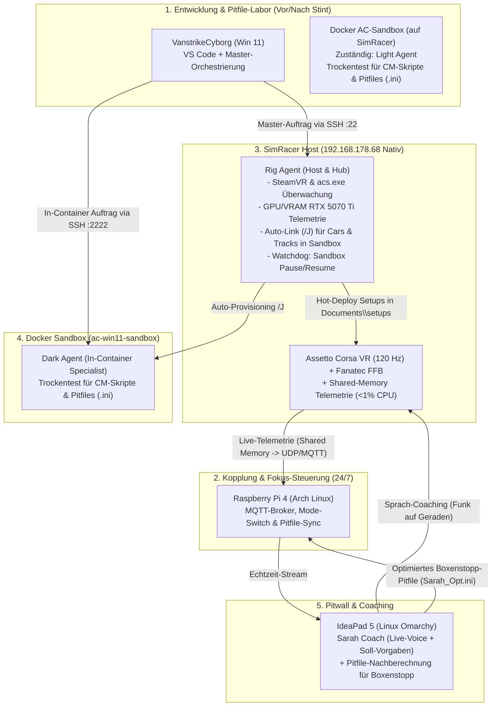

# 4-Knoten-Architektur & Einsatzkonzept: SimRacer (VR), VanstrikeCyborg, IdeaPad 5 (Omarchy) & Raspberry Pi 4 (Arch)

> **Thema:** Verteilte 4-PC-Leitstand-Architektur für natives VR-SimRacing, Pitfile-Optimierung, Content-Manager-Automatisierung und Sarah Coach
> **Autor:** Michael Stürmer
> **Datum:** 04.11.2026

<h2>1. Ausgangslage & Hardware der 4 Systemknoten</h2>

Zur optimalen Verteilung von Echtzeit-Simulationslasten (VR + Force Feedback), KI-Agenten-Entwicklung, Live-Telemetrie/Coaching (**Sarah Coach**) und 24/7-Datensynchronisation wird ein **4-Knoten-Verbund** nach dem Vorbild der industriellen Automatisierungstechnik (**Prozessstation, Programmiergerät, Leitstand/HMI und Feldbus-Koppler**) eingesetzt:

<h3>1.1 Knoten 1: SimRacer (Prozess- & Heavy-Compute-Station / Windows 11)</h3>

* **CPU:** AMD Ryzen 9 3900X (12 Kerne / 24 Threads, 3.80 – 4.20 GHz)
* **RAM:** 32 GB DDR4
* **GPU:** NVIDIA GeForce RTX 5070 Ti (16 GB GDDR7 VRAM, 256-Bit Bus, 8960 CUDA-Kerne)
* **Speicher:** 2.8 TB SSDs (`C:` 1 TB NVMe System & Docker-Sandbox + `D:` 1.8 TB Daten-SSD für Steam & Backups)
* **Sim-Peripherie:** HTC VIVE Focus Vision VR-Headset (DisplayPort-Modus, Dual 2.5K @ 120 Hz), Fanatec ClubSport V2.5 Wheel Base + Formula V2.0 Lenkrad, 4K-Display (Hisense)
* **Doppelrolle (strikte Zeitmultiplex-Trennung):**
  1. **Im Fahrbetrieb (`LIVE_RACE`):** 100 % native Ausführung von Assetto Corsa + Content Manager mit maximalen VR-Frametimes (120 FPS) und direktem Hardware-Zugriff auf Fanatec & Shared Memory.
  2. **Im Setup-/Testbetrieb (`ENGINEERING` / `PITBOX_SETUP`):** Host für die isolierte **Docker-Windows-11-Sandbox (`ac-win11-sandbox`)** zum trockenen Testen von Content-Manager-Skripten und Pitfiles sowie optionaler lokaler LLM-Inferenz-Server (Ollama/vLLM auf 16 GB VRAM).

<h3>1.2 Knoten 2: VanstrikeCyborg (Engineering Station / PG / Windows 11 Home 26H2)</h3>

* **Modell & Firmware:** MSI Cyborg 15 B2RWFKG (`MS-15Q3`), BIOS `E15Q3IMS.110`, EC `15Q3EMS1.108`
* **CPU:** Intel Core 7 240H (2.50 GHz, 16 Threads)
* **RAM:** 16 GB DDR5-5600 Dual-Channel (2× 8 GB Kingston SO-DIMM, erweiterbar bis max. 96 GB)
* **Dual-GPU (Optimus / MSHybrid, kein MUX-Switch):** NVIDIA GeForce RTX 5060 Laptop (8 GB GDDR7, 3328 CUDA, 55 W Max-Q Gen-5, Treiber `617.42`) + Intel Graphics (`32.0.101.5972`)
* **Speicher & I/O:** `1 × M.2 2280 NVMe` (SanDisk SN5000S 1 TB) + ext. `WD My Passport 0741`, Wi-Fi 6E AX211, Realtek GbE, `2× USB-A 10 Gbit/s`, `1× USB-C 10 Gbit/s` (DP Alt Mode + PD-In 45–100 W, optimal 65–100 W), `1× HDMI`
* **Display-Setup & VR-Hinweis:** 3 aktive Displays (Intern 1080p@144 Hz, `Samsung C27F398` DP@72 Hz, `Samsung U28E590` 4K via USB-C-DP) — bei `VIVE Hub` kann ein 3-Monitor-Betrieb Fehler `337` (Max-Monitor-Limit) auslösen.
* **Agenten-Ausführung auf diesem Knoten:**
  * **`General Cyborg`** (global, `~/.copilot/agents/general.agent.md`): Laptop-System, MSI Center (`Extreme Performance`, `Battery Master`), NVIDIA App MCP (`http://127.0.0.1:13508/mcp`), VIVE VR, VS Code Profile & Workspaces.
  * **`General Sim`** (Workspace-Leitstand, `git-labor/.github/agents/general.agent.md`): Master-Leitstand & Freigabe-Gate (`@general`-Terminal) für den SimRacer (`192.168.178.68`), `cli-proxy-api.exe` (`:8317`) und Git-Orchestrierung. Kein lokaler Docker-Zwang mehr – die 16 GB RAM bleiben frei für flüssiges Engineering.

<h3>1.3 Knoten 3: IdeaPad 5 mit Linux Omarchy (Leitstand / Pitwall & Sarah Coach Host)</h3>

* **Betriebssystem:** **Linux Omarchy** (Arch-Linux-Basis mit ultraschlankem Hyprland Tiling Window Manager)
* **Charakteristik:** Minimaler OS-Overhead, sofortiges Tastatur-gesteuertes Fenster-Tiling ohne Desktop-Ballast, native Linux-Container-Unterstützung (ohne WSL2-Virtualisierungsverlust).
* **Hauptrolle am Sim-Rig:**
  1. **Sarah Coach Runtime (Echtzeit-Renningenieurin):** Empfängt während der Fahrt die Live-Telemetrie vom SimRacer, gleicht sie mit den **Soll-Vorgaben (`sarah_targets.json`)** ab und erzeugt das Live-Sprach-Coaching (TTS/Audio-Funk) sowie die korrigierten **Pitfiles (`.ini`)** für den nächsten Boxenstopp.
  2. **Pitwall-Cockpit (HMI):** Zeigt neben dem Rig auf getrennten Hyprland-Workspaces Live-Telemetrie (Grafana), Sektor-Deltas, Reifentemperatur-Fenster und den Status der lokalen KI-Agenten an.

<h3>1.4 Knoten 4: Raspberry Pi 4 mit Arch Linux (24/7 Edge-Broker, Sync & Watchdog)</h3>

* **Betriebssystem:** **Arch Linux ARM** (Headless, minimaler RAM-/Stromverbrauch, 24/7-Dauerläufer)
* **Hauptrolle (SPS-Koppler & Datendrehscheibe):**
  1. **Echtzeit-Telemetrie-Broker (Mosquitto MQTT / UDP-Relay):** Nimmt die Shared-Memory-Pakete vom SimRacer entgegen und verteilt sie verzögerungsfrei an das IdeaPad 5 (Sarah Coach) und den VanstrikeCyborg.
  2. **Globaler Fokus- & Mode-Controller:** Überwacht den Systemstatus (`LIVE_RACE` vs. `PITBOX_SETUP` vs. `ENGINEERING`) und steuert, welcher Agent wann aktiv sein darf.
  3. **Git-Mirror & Pitfile-Synchronizer:** Dient als zentraler lokaler Git-/Syncthing-Knoten, der geprüfte Pitfiles (`.ini`) automatisch in das native Assetto-Corsa-Setup-Verzeichnis auf dem SimRacer spiegelt, sowie für Wake-on-LAN (WoL) des SimRacer.

<h2>2. Architektur-Topologie: Virtuelle Inbetriebnahme vs. Echtes VR-Rennen</h2>

<h3>2.1 Warum wir NICHT in Docker fahren, sondern Docker als Pitfile-Labor nutzen</h3>

Ein zentraler Architektur-Grundsatz dieses Setups lautet:
* **Gefahren wird zu 100 % nativ auf dem SimRacer** mit dem Fanatec-Direct-Drive/ClubSport-Lenkrad und der HTC VIVE Focus Vision VR-Brille. Nur nativ unter Windows 11 stehen die 120 Hz DisplayPort-Anbindung, verzögerungsfreies Force Feedback und das echte **Assetto Corsa Shared Memory (`acpmf_physics`)** zur Verfügung.
* **Die Docker-Umgebung (`ac-win11-sandbox`) ist das geschützte Prüflabor („Virtuelle Inbetriebnahme“):**
  * Lokale KI-Agents testen dort neue Content-Manager-Skripte, Setup-Generatoren, `race.ini`-Vorlagen und Python-Apps zuerst trocken gegen eine isolierte Content-Manager-Instanz.
  * Erst wenn ein **Pitfile (`.ini`-Setup)** oder Skript in der Sandbox fehlerfrei validiert wurde, wird es für das echte Sim-Rig freigegeben („Hot-Deploy“ in `Documents\Assetto Corsa\cfg\setups\`).

<h3>2.2 Das 4-Agenten-Gespann (Light, Rig, Dark, Sarah)</h3>

| Agent | Standort | Rolle & Aufgaben |
| :--- | :--- | :--- |
| **Light Agent** | **VanstrikeCyborg (Laptop VS Code)** | Master-Orchestrator, Entwicklung, Git-Sync, Schnittstellensteuerung |
| **Rig Agent** | **SimRacer Nativ (`192.168.178.68`)** | Host-Hub, SteamVR-/GPU-Überwachung, Auto-Junction (/J) für Cars/Tracks in Sandbox, Docker-Watchdog |
| **Dark Agent** | **Docker Sandbox Gast (`ac-win11-sandbox`)** | In-Container-Executor (`runner.ps1`), Setup-Syntaxchecks, Python-Apps Validierung, CM-Tests |
| **Sarah Coach** | **IdeaPad 5 (Linux Omarchy / Rig-Pitwall)** | Live-Telemetrie-Coaching (Voice) & Stint-Pitfile-Kalkulation im `LIVE_RACE` |

<h3>2.3 Die drei Betriebsmodi (Fokus-Steuerung der lokalen Agents)</h3>

Damit sich die lokalen Agents nicht gegenseitig Ressourcen wegnehmen oder gleichzeitig Setup-Dateien überschreiben, schaltet das System automatisch zwischen drei Modi um:

1. **Modus 1: `ENGINEERING` (Kein Rennen aktiv – Fokus auf Code, CM-Skripte & Sandbox)**
   * **Aktive Knoten:** VanstrikeCyborg + SimRacer (als Docker-Sandbox- & Ollama-Host) + RPi 4.
   * **Was passiert:** Die Agents entwickeln und testen Content-Manager-Automatisierungen in der Docker-Sandbox (`ac-win11-sandbox` mit 12 GB RAM). Die RTX 5070 Ti darf für lokale Sprachmodelle voll ausgelastet werden.
2. **Modus 2: `LIVE_RACE` (`acs.exe` läuft am SimRacer mit VR & Fanatec)**
   * **Aktive Knoten:** SimRacer (100 % nativ) + RPi 4 (Broker) + IdeaPad 5 (Sarah Coach & Pitwall).
   * **Automatischer VR-Schutz:** Sobald `acs.exe` startet, pausiert der Fokus-Wächter die Docker-Sandbox und alle schweren Hintergrund-Agents auf dem SimRacer. Auf dem SimRacer läuft nur noch der winzige Python-Telemetrie-Abgriff (< 1 % CPU-Last).
   * **Aktiver Agent:** Exklusiv **Sarah Coach** auf dem IdeaPad 5 (Linux Omarchy). Sie überwacht deine Fahrt gegen die Soll-Vorgaben und gibt auf definierten Geraden kurzes Audio-Feedback.
3. **Modus 3: `PITBOX_SETUP` (Fahrzeug steht in der Boxengasse `IsInPit == 1` oder zwischen Sessions)**
   * **Aktiver Fokus:** **Sarah Coach (als Setup-Ingenieurin)** + **CM-Pitfile-Synchronizer**.
   * **Was passiert:** Sarah wertet die gefahrenen Runden aus (z. B. Reifendruck-Abweichung vom Zielwert, Überhitzen der Hinterachse, Untersteuern am Eingang), berechnet die exakten Klick-Änderungen (PSI, Flügel, Sturz, Dämpfer, Bremsbalance, Spritmenge) und legt das neue Pitfile direkt als `Sarah_Opt_Stint.ini` im echten Assetto-Corsa-Setup-Ordner ab.

<h3>2.4 Container-Lebenszyklus, Boot-Phasen & Pause-Resilienz</h3>

Für den stabilen Betrieb der Docker-Windows-11-Sandbox (`dockurr/windows`) auf dem SimRacer gelten feste technische Gesetzmäßigkeiten:

1. **Boot-Dauer bei Kaltstart (60 bis 90 Sekunden):**
   * Beim Start (`docker compose up -d` oder Systemneustart) durchläuft die VM unter QEMU/KVM den UEFI-Bootloader (`BdsDxe: loading Boot0005 Windows Boot Manager`), lädt den Windows-Kernel und initialisiert virtuelle Geräte.
   * Während dieser Phase lastet QEMU die zugewiesenen 8 Kerne temporär voll aus. Weder SSH (Port 2222) noch Netzwerkbefehle antworten, bis Windows 11 eine DHCP-Lease von `dnsmasq` (`172.30.0.2`) empfängt.
   * **Goldene Regel:** Kein verfrühtes Eingreifen oder Neustarten in den ersten 90 Sekunden! Der Boot läuft selbstständig durch.
2. **`docker pause` vs. `docker stop` im Rennbetrieb:**
   * **Modus `LIVE_RACE`:** Sobald `acs.exe` startet, pausiert der Rig Agent die Sandbox mit `docker pause ac-win11-sandbox`. Dadurch friert QEMU die CPU-Zyklen komplett ein (0 % Host-CPU-Last, 0 % GPU-Last), behält aber den RAM-Zustand (12 GB) im Arbeitsspeicher.
   * **Modus `ENGINEERING`:** Nach Beendigung von Assetto Corsa führt `docker unpause ac-win11-sandbox` die Sandbox innerhalb von Millisekunden nahtlos fort – ohne erneuten 90-Sekunden-Windows-Boot.
3. **Diagnose ohne VNC:**
   * **Screendump:** Über `python3 /shared/take_screen.py` im Container wird sekundenschnell ein Screenshot aus dem QEMU-Monitor (`/run/shm/monitor.sock`) als PNG (`screen_now.png`) erzeugt.
   * **DHCP-Kontrolle:** `docker exec ac-win11-sandbox tail -n 10 /var/log/dnsmasq.log` zeigt, ob der Gast bereits eine IP hat.
4. **Gast-Laufzeitumgebung:**
   * Python 3.11.9 ist fest unter `C:\Program Files\Python311` verankert und über `C:\Windows\python.exe` / `pip.exe` global registriert, sodass Dark Agent Skripte ohne Microsoft-Store-Umleitung direkt ausführen kann.

<h2>3. Konkrete Aufgabenverteilung: Welches Gerät macht was?</h2>

| Komponente / Aufgabe | Ziel-Knoten | Technische Begründung |
| :--- | :---: | :--- |
| **Assetto Corsa VR (120 Hz) + Fanatec FFB** | **1. SimRacer (Nativ)** | Benötigt direkten USB-/DisplayPort-Hardwarezugriff und 100 % der RTX 5070 Ti ohne Virtualisierungslatenz. |
| **AC Shared-Memory Telemetrie-Sender** | **1. SimRacer (Nativ)** | Liest `acpmf_physics`, `acpmf_graphics` & `acpmf_static` direkt aus dem Windows-RAM und schickt Pakete ans LAN. |
| **Docker-Sandbox (`ac-win11-sandbox` – Light Agent)** | **1. SimRacer (Nur im Setup-Modus)** | **Light Agent** testet mit 12 GB RAM und 8 Kernen Content-Manager-Skripte und Pitfiles mühelos, solange kein VR-Rennen läuft. |
| **VS Code Haupt-IDE & Agent-Entwicklung** | **2. VanstrikeCyborg** | Mobiles Programmiergerät; entwickelt Python-Tools, CM-Skripte und pflegt die Dokumentation. |
| **Sarah Coach (Regel-Engine & Voice-Funk)** | **3. IdeaPad 5 (Omarchy)** | Läuft komplett entkoppelt vom Gaming-PC unter Linux; null Einfluss auf VR-Frametimes am SimRacer. |
| **Live-Pitwall Dashboard (Grafana + TimescaleDB)** | **3. IdeaPad 5 (Omarchy)** | Hyprland Tiling WM zeigt Telemetriekurven, Reifenfenster und Sektorzeiten im Vollbild direkt neben dem Rig. |
| **MQTT-Broker, Mode-Switch & Pitfile-Sync** | **4. Raspberry Pi 4 (Arch)** | Läuft 24/7 lautlos durch; hält das Netzwerk, die Git-Repos und die `.ini`-Setups zwischen allen PCs synchron. |

<h2>4. Zusammenspiel: Sarah Coach, Soll-Vorgaben & Pitfile-Optimierung</h2>

<h3>4.1 Zweiteilung: Fahrer-Coaching vs. Fahrzeug-Pitfile</h3>

Sarah Coach unterscheidet anhand der Telemetrie strikt zwischen **Fahrer-Korrektur** und **Fahrzeug-Setup (Pitfile)**:
1. **Fahrer-Korrektur (Live über Sprachfunk):**
   * *Auslöser:* Bremspunkt in Kurve 1 streut um > 5 Meter, zu frühes Gasgeben mit Traktionsverlust (`WheelSlip`) oder zu starkes Einlenken (Scrubbing).
   * *Aktion:* Kurze, direkte Ansage auf der darauffolgenden Geraden anhand der hinterlegten Soll-Vorgaben.
2. **Fahrzeug-Korrektur (Automatische Pitfile-Generierung `.ini`):**
   * *Auslöser:* Heißdruck nach 4 Runden bei `27.6 PSI` statt Soll `26.5 PSI`; Innenschulter zu heiß; Höchstgeschwindigkeit auf der Kemmel-Geraden zu niedrig.
   * *Aktion:* Sarah passt die Parameter (`PRESSURE_LF/RF/LR/RR`, `WING`, `CAMBER`, `DAMPERS`, `FRONT_BIAS`, `FUEL`) direkt in einer neuen `.ini`-Datei an, die sofort in deinen nativen Content-Manager-/AC-Setup-Ordner synchronisiert wird.

<h3>4.2 Inbetriebnahme-Checkliste für den 4-PC-Verbund (Status: 11.11.2026)</h3>

1. **SimRacer (Windows 11 – `192.168.178.68`):**
   * [x] OpenSSH-Server (`sshd`) aktiviert, passwortlosen SSH-Key-Login eingerichtet und `DefaultShell` permanent auf `powershell.exe` umgestellt (behebt alle Cmdlet- und Pipeline-Fehler).
   * [x] 160-GB-Sandbox auf `C:\ac-sandbox` NVMe migriert, Docker Desktop installiert, KVM (`kvm_amd`) aktiviert und Container `ac-win11-sandbox` (8 Kerne, 12 GB RAM, Web `:8006` in 1920x1080 Full HD, RDP `:3390`, SSH `:2222`) dauerhaft stabil im Betrieb.
   * [x] `D:`-Festplatte verknüpft: Host-Junction `D:\ac-sandbox` $\rightarrow$ `C:\ac-sandbox` sowie Container-Mounts für `D:\Backups`, `D:\SteamLibrary` und `Documents\Assetto Corsa\cfg`.
   * [x] Pitfile- & Config-Backup als tägliche Aufgabe (`SimRacer-Pitfile-Backup`, 23:00 Uhr) registriert und Testlauf nach `D:\Backups\SimRacer_Configs\` durchgeführt.
   * [x] Fokus-Wächter (`SimRacer-Focus-Watchdog`) als Hintergrund-Aufgabe registriert (pausiert Container bei Start von `acs.exe` für 100 % VR 90 FPS).
   * [x] AC Shared-Memory Telemetrie-Sender (`ac_telemetry_sender.py`) mit Python 3.11 auf dem Host bereitgestellt (50 Hz UDP nach Port `9996`).
   * [x] Veeam Agent v13 installiert, `D:\Backups\Veeam_Exclusions.txt` hinterlegt und bootfähigen Rettungsstick auf Laufwerk `E:` (Generic Flash Disk) initiiert.
   * [x] Node.js LTS `v26.13.0` & `npm 11.20.0` auf dem SimRacer-Host installiert.
   * [x] `ed25519`-SSH-Key (`Mike@SimRacer`) auf `Archibald` autorisiert sowie `wake_archibald.ps1` und `sleep_archibald.ps1` unter `C:\ac-sandbox\` bereitgestellt.
   * [x] On-Demand Lobby-Stream (`SimRacer-Lobby-Stream` auf Port `8090`, `sim_stream_server.py`) für aktive Fahr-/VR-Perspektiven mit `0 %` Idle-Last eingerichtet und per LAN-Firewall (`192.168.178.0/24`) freigeschaltet.
2. **VanstrikeCyborg (Windows 11):**
   * [x] Über VS Code, `~/.ssh/config` (`simracer`, `ac-sandbox`, `archibald`, `strikerpi`) und `start-sandbox.ps1 -RemoteHost 192.168.178.68` mit dem SimRacer sowie via `wake_archibald.ps1` / `sleep_archibald.ps1` (Tasks in `.vscode/tasks.json`) mit Archibald gekoppelt.
   * [x] Lokale 68,7-GB-Altkopie (`storage\data.img`) auf dem Laptop gelöscht; freier NVMe-Speicher auf `C:` auf ~171 GB erhöht.
3. **Raspberry Pi 4 (`StrikerPi` / Arch Linux ARM – `192.168.178.86`):**
   * [x] Mosquitto MQTT-Broker (`1883` + WebSockets `9001`, Topics `simrig/mode`, `simrig/telemetry`), `uv`, `telemetry-relay.service` (UDP `50005`/`9996` $\rightarrow$ `192.168.178.98:9996`, HTTP/WS `8080` inkl. **Lobby-Streams** MJPEG-Proxy `/api/streams`, `/api/stream/simracer.mjpeg` sowie **Sandbox- & Docker-Steuerung** `/api/sandbox/*` über passwortloses SSH nach `SimRacer` `:22` & Gast `:2222`) und zentrales Bare-Git-Repository (`/srv/git/simrig.git`, `git`/`alarm`/`root` SSH-Keys) aktiviert.
4. **IdeaPad 5 (`Archibald` / Linux Omarchy – `192.168.178.98`):**
   * [x] Pitwall-Basisbetrieb (`disable-sleep.conf` + `shell.json` `idle.lock: 0` / `idle.screensaver: 0`, `omarchy-sleep-lock.service` masked, `stay-awake`), Hyprland-Fullscreen-Regeln (`o.window(..., { workspace = "1", fullscreen = true })` + `--start-fullscreen`), persistentes WoWLAN (`wlp0s20f3`, `50-wowlan.rules`, `nmcli wake-on-wlan=8`) und passwortloses Remote-Suspend (`sudoers.d/archibald-suspend`) eingerichtet und getestet.
   * [x] UFW-LAN-Freigaben (`192.168.178.0/24` für `22/tcp` ohne Rate-Limit und `9996/udp` für AC-Live-Telemetrie) aktiviert.
   * [x] `CLIProxyAPI` (`127.0.0.1:8317`) mit Antigravity-OAuth (`m.e.stuermer@gmail.com`, 21 Modelle), `settings.json` und `pitwall.code-workspace` abgeglichen.
   * [x] Sarah-Coach-Pitwall-Toolkit (`sarah_telemetry_listener.py`, `sarah_targets.json`, `sarah_pitfile_optimizer.py`, `sarah_voice.py`, `sarah_replay_cutter.py`, `start_sarah_terminal.sh`) unter `~/ac-pitwall/` sowie User-Service `sarah-pitwall-telemetry.service` bereitgestellt und End-to-End-Empfang über StrikerPi (`50005` $\rightarrow$ `9996`) verifiziert.
   * [x] Live-Pitwall-Web-Dashboard (`http://192.168.178.86:8080/`) im Fullscreen inkl. **🐳 Sandbox starten / 🛑 Docker & Sandbox stoppen** (mit Live-Session-Sperre bei aktivem Host-Fahrbetrieb), **🧪 AC / CM / CSP** (Simulationen, Tests, Setup-Checks, `@dark`-Diagnose, eingebettetes noVNC `:8006`), **📺 Lobby-Streams** und MQTT-Kopplung (`simrig/mode`, `simrig/telemetry`) über `StrikerPi` aktiviert.

*(Die detaillierte Schritt-für-Schritt-Aufgabenliste befindet sich in [naechste-schritte-simracer-und-cyborg.md](./naechste-schritte-simracer-und-cyborg.md).)*

<h2>5. Weiterführende Dokumente & Verknüpfungen</h2>

* [Architektur & VS Code Multi-PC-Anleitung (Localhost, Remote-SSH & Workspaces)](./uebersicht-vscode-agent-localhost-gemini-antigravity.md)
* [Praxisanleitung: System-Image (Veeam) & Pitfile-Schnellbackup für SimRacer](./simracer-system-backup-wiederherstellung-veeam.md)
* [Sarah Coach, Agent-Fokus & Pitfile-Automatisierung (Detailkonzept)](./planing.md)
* [Docker Windows-11 Sandbox: Prüflabor für Content Manager & KI-Agenten](./docker-windows-steam-ki-agent-architektur.md)
* [Technische Hardware- und Stabilitätsanalyse (MSI Cyborg 15 & Docker)](./hardware-analyse-system-stabilitaet-docker-ki.md)

---
*Hinweis zur Organisation:* Die erstellte Dokumentation ist am Drehlaufwerk abgelegt und mit einer kurzen Zusammenfassung von den Chips auch in den Notebooks verlinkt.

<!-- DOKU-MINIMAP-START -->

🏎️ AC-Doku-Minimap (SimRacer &amp; Sandbox)⛶

01 SimRacer02 Sandbox03 Agenten04 AC-Sync

🏎️ <a href="../README.md">Assetto Corsa Content &amp; SimRacer Architektur (Doku-Index)</a>  |  <a href="../../README.md">Repo-README</a>  |  <a href="../../ac-sandbox/README.md">AC-Sandbox</a>

🖥️ <a href="multi-pc-architektur-ki-agents-simracing.md">01_simracer_architektur (Hardware &amp; 4-PC-Netz)</a>

<ul class="doku-arch-lines">
<li>├─ <a href="multi-pc-architektur-ki-agents-simracing.md">01 • 4-Knoten-Architektur (SimRacer, Cyborg, Omarchy, Pi)</a></li>
<li>├─ <a href="hardware-analyse-system-stabilitaet-docker-ki.md">02 • Hardware- &amp; Stabilitätsanalyse (Docker, KI &amp; VR)</a></li>
<li>├─ <a href="simracer-system-backup-wiederherstellung-veeam.md">03 • System-Backup &amp; Recovery (Veeam + Sekunden-Backup)</a> <a class="doku-arch-badge" href="../../ac-sandbox/backup-simracer-configs.ps1">Backup.ps1</a></li>
<li>└─ <a href="naechste-schritte-simracer-und-cyborg.md">04 • Roadmap &amp; Nächste Schritte (SimRacer &amp; Cyborg)</a></li>
</ul>

🐳 <a href="../02_docker_sandbox/SANDBOX_ANLEITUNG.md">02_docker_sandbox (ac-win11-sandbox &amp; sbx)</a>

<ul class="doku-arch-lines">
<li>├─ <a href="../02_docker_sandbox/SANDBOX_ANLEITUNG.md">01 • Handbuch: Remote Windows-11-Sandbox (192.168.178.68)</a> <a class="doku-arch-badge" href="../../ac-sandbox/start-sandbox.ps1">Start.ps1</a></li>
<li>├─ <a href="../02_docker_sandbox/inside-the-simracing-sandbox-guide.md">02 • Inside the SimRacing Sandbox &amp; Dark-Agent-Betrieb</a></li>
<li>├─ <a href="../02_docker_sandbox/docker-windows-steam-ki-agent-architektur.md">03 • Prüflabor für Content Manager, Pitfiles (.ini) &amp; KI</a></li>
<li>├─ <a href="../02_docker_sandbox/sandbox-umzug-skalierung-simracer.md">04 • 64-GB Sandbox-Umzug &amp; Skalierung auf 160 GB</a></li>
<li>└─ <a href="../02_docker_sandbox/docker-sbx-anleitung.md">05 • Docker Sandboxes CLI (sbx)</a> · <a href="../02_docker_sandbox/docker.md">Coding Agent Sandbox</a></li>
</ul>

🤖 <a href="../03_agenten_system/agenten-system-architektur-uebersicht.md">03_agenten_system (5-Rollen-Verbund &amp; REPL)</a>

<ul class="doku-arch-lines">
<li>├─ <a href="../03_agenten_system/agenten-system-architektur-uebersicht.md">01 • KI-Agenten-Systemarchitektur &amp; 5-Rollen-Handbuch</a></li>
<li>├─ <a href="../03_agenten_system/agenten-konsolen-repl-autostart-und-asset-handshake.md">02 • Agenten-Konsolen (REPL), Auto-Start &amp; Handshake</a> <a class="doku-arch-badge" href="../../ac-sandbox/shared/agents/README.md">Shared-Agents</a></li>
<li>├─ <a href="../../.github/agents/general.agent.md">Ebene 1: @general</a> · <a href="../../.github/agents/light.agent.md">Ebene 2: @light</a> · <a href="../../.github/agents/rig.agent.md">@rig</a></li>
<li>└─ <a href="../../.github/agents/dark.agent.md">Ebene 3 (Gast): @dark</a> · <a href="../../.github/agents/sarah.agent.md">Pitwall: @sarah (Coach)</a></li>
</ul>

⚙️ <a href="../../ac-sandbox/LIGHT-AGENT-UND-AC-STRUKTUR.md">04_ac_sandbox_sync (7-Pakete, Presets &amp; Skripte)</a>

<ul class="doku-arch-lines">
<li>├─ <a href="../../ac-sandbox/LIGHT-AGENT-UND-AC-STRUKTUR.md">01 • Light Agent Anweisungen &amp; 7-Pakete AC-Struktur</a> <a class="doku-arch-badge" href="../../ac-sandbox/shared/scripts/sync-cm-github.ps1">Sync.ps1</a></li>
<li>├─ <a href="../../ac-sandbox/README.md">02 • AC-Sandbox Ordnerstruktur &amp; Bootstrap-Ablauf</a> <a class="doku-arch-badge" href="../../ac-sandbox/shared/scripts/bootstrap-guest.ps1">Bootstrap.ps1</a></li>
<li>├─ <a href="../../ac-sandbox/shared/presets_managed/README.md">03 • Managed Settings-Profile (Desktop vs. VR / CSP)</a></li>
<li>└─ <a href="../../ac-sandbox/LIVE-TRANSFER-STATUS.md">04 • Live-Transfer-Status</a> · <a href="../../ac-sandbox/shared/cm-github-sync/03_CM_AppData_Presets_Data/Data/README.md">CM AppData &amp; Presets</a></li>
</ul>

<!-- DOKU-MINIMAP-END -->
