# Handbuch: Light Agent Anweisungen & Assetto Corsa Ordner-Struktur (`ac-win11-sandbox`)

Dieses Dokument beschreibt:
1. **Wie du dem `Light Agent` Anweisungen gibst** (über VS Code Chat, das Status-/Bootstrap-Skript, SSH oder den Shared-Folder).
2. **Wie die Assetto Corsa & Content Manager Ordner-Struktur aufgebaut ist** (Nativ auf dem SimRacer, im GitHub-Sync-Spiegel und innerhalb der Windows-11-Docker-Sandbox).

---

## 1. Wie du mit dem `Light Agent` kommunizierst & ihm Aufträge gibst

Der **Light Agent** (`.github/agents/light.agent.md`) ist der zuständige Spezial-Agent für die isolierte **Docker-Windows-11-Sandbox (`ac-win11-sandbox` auf SimRacer `192.168.178.68`)** im Betriebsmodus `ENGINEERING`.

Du hast **3 direkte Wege**, um dem Light Agent Aufträge für die Docker-Containerumgebung zu erteilen:

### Weg A: Direkt im VS Code Chat (Empfohlen)
Du kannst den Light Agent im Chat entweder direkt über `@light` (bzw. Agent-Auswahl **light**) ansprechen oder mir sagen: *"Beauftrage den Light Agent mit..."*.

**Typische Beispiel-Befehle im Chat:**
* **Status & Gesundheit prüfen:**
  > *"Light Agent: Prüfe den Gast-Status in der Docker-Sandbox (`guest-status.json`), die Festplattengröße von `C:` und ob alle AC-Ordner synchron sind."*
* **Pitfile / Fahrzeug-Setup (`.ini`) prüfen oder anpassen:**
  > *"Light Agent: Öffne in der Sandbox das Setup für `ks_ferrari_488_gt3` auf `spa`, senke den Reifendruck vorne links (`PRESSURE_LF`) um 1 PSI und validiere die `.ini`-Struktur."*
* **Content Manager & `race.ini` Trockentest:**
  > *"Light Agent: Bereite in der Sandbox eine `race.ini` für ein 15-Runden-Stint-Training in Monza mit 22 °C Asphalt-Temperatur vor und prüfe sie vor dem Rollout auf den SimRacer."*
* **Visuelle Kontrolle im Container (Web-VNC / Screenshot):**
  > *"Light Agent: Mache einen Screenshot vom Windows-11-Desktop der Sandbox (`http://192.168.178.68:8006`) oder starte `Content Manager.exe` im Gast."*

---

### Weg B: Über das Status- & Bootstrap-Skript (`bootstrap-guest.ps1`)
Innerhalb der Sandbox läuft beim Start automatisch `\\host.lan\Data\bootstrap.bat`, welches das PowerShell-Skript `ac-sandbox/shared/scripts/bootstrap-guest.ps1` ausführt.

Was dieses Skript in der Containerumgebung erledigt:
1. **Partition `C:` erweitern:** Vergrößert das Gast-Laufwerk `C:` automatisch auf die vollen `160 GB`.
2. **OpenSSH-Server (`sshd`) & SSH-Key aktivieren:** Stellt sicher, dass Port `22` (von außen Port `2222`) offen ist.
3. **Assetto Corsa & Content Manager Struktur abgleichen:** Synchronisiert alle 7 AC/CM-Pakete aus `\\host.lan\Data\cm-github-sync` direkt in die Windows-11-Sandbox.
4. **Live-Statusbericht schreiben:** Schreibt nach jedem Durchlauf den kompletten Systembericht nach:
   * **Am SimRacer:** `C:\ac-sandbox\shared\guest-status.json`
   * **Vom Laptop (VanstrikeCyborg):** `\\192.168.178.68\ac-sandbox\shared\guest-status.json`

---

### Weg C: Direkte Befehlsausführung von außen (SSH-Bridge Port `2222`)
Wenn der Light Agent (oder du über das Terminal) ein Skript direkt im Gast-Windows der Docker-Sandbox ausführen soll, nutzt er die SSH-Bridge auf Port `2222`:

```powershell
# 1. Status- & Bootstrap-Skript im Gast-Windows der Sandbox anstoßen:
ssh -p 2222 Docker@192.168.178.68 "powershell -NoProfile -ExecutionPolicy Bypass -File \\host.lan\Data\scripts\bootstrap-guest.ps1"

# 2. Aktuellen Statusbericht der Sandbox vom SimRacer auslesen:
Get-Content "\\192.168.178.68\ac-sandbox\shared\guest-status.json"
```

---

## 2. Komplette Ordner-Struktur von Assetto Corsa & Content Manager

Assetto Corsa verteilt seine Dateien unter Windows auf **drei verschiedene Hauptorte** (1. *Benutzer-Dokumente*, 2. *AppData Local*, 3. *Steam-Hauptverzeichnis*). Damit der Light Agent in der Sandbox gefahrlos testen kann, ohne große 3D-Modelle (`.kn5`) oder Sounddateien (`.bank`) zu duplizieren, wird eine **7-Pakete-Struktur (`cm-github-sync`)** genutzt:

```mermaid
flowchart LR
    subgraph SimRacer["1. SimRacer Nativ (Echtes VR-Rig)"]
        SR_Doc["C:\\Users\\Mike\\Documents\\Assetto Corsa"]
        SR_App["C:\\Users\\Mike\\AppData\\Local\\AcTools Content Manager"]
        SR_Steam["C:\\Program Files (x86)\\Steam\\steamapps\\common\\assettocorsa"]
    end

    subgraph Sync["2. Shared-Brücke & GitHub-Sync (cm-github-sync)"]
        P1["01_Documents_AC_Setups"]
        P2["02_Documents_AC_Cfg"]
        P3["03_CM_AppData_Presets_Data"]
        P4["04_Steam_AC_Cfg"]
        P5["05_Steam_AC_Apps_Python"]
        P6["06_Steam_AC_Extension_Lua_Config"]
        P7["07_Content_Manager_Binary"]
    end

    subgraph Sandbox["3. Docker Win11 Sandbox (Light Agent)"]
        G_Doc["C:\\Users\\Docker\\Documents\\Assetto Corsa"]
        G_App["C:\\Users\\Docker\\AppData\\Local\\AcTools Content Manager"]
        G_Root["C:\\AssettoCorsa"]
    end

    SimRacer <-->|"sync-cm-github.ps1"| Sync
    Sync <-->|"bootstrap-guest.ps1 (\\\\host.lan\\Data)"| Sandbox
```



---

### 2.1 Die 7 Ordner-Pakete im Detail (Wo liegt was?)

| Paket-Ordner (`cm-github-sync`) | Original-Pfad (SimRacer Nativ) | Pfad in der Docker-Sandbox (Win11 Gast) | Inhalt & Aufgabe für den Light Agent |
| :--- | :--- | :--- | :--- |
| **`01_Documents_AC_Setups`** | `C:\Users\Mike\Documents\Assetto Corsa\setups\<car>\<track>\*.ini` | `C:\Users\Docker\Documents\Assetto Corsa\setups\<car>\<track>\*.ini` | **Fahrzeug-Setups & Pitfiles (`.ini`)**: Reifendruck (`PRESSURE_LF/RF/LR/RR`), Flügel (`WING`), Sturz (`CAMBER`), Übersetzung, Bremsbalance (`FRONT_BIAS`), Sprit (`FUEL`). |
| **`02_Documents_AC_Cfg`** | `C:\Users\Mike\Documents\Assetto Corsa\cfg\` | `C:\Users\Docker\Documents\Assetto Corsa\cfg\` | **Benutzer- & Session-Konfiguration**: `race.ini` (Strecke, Auto, Wetter, Gegner), `controls.ini` (Fanatec-Achsen/Buttons), `video.ini`, `assists.ini`, `extension/` (CSP User-Configs). |
| **`03_CM_AppData_Presets_Data`** | `C:\Users\Mike\AppData\Local\AcTools Content Manager\` | `C:\Users\Docker\AppData\Local\AcTools Content Manager\` | **Content Manager Profile**: `Presets/` (Grafik-, CSP-, FFB- und Steuerungs-Presets), `Online Servers/`, `*.data`-Datenbanken. |
| **`04_Steam_AC_Cfg`** | `...\assettocorsa\cfg\`, `system\cfg\`, `server\cfg\` | `C:\AssettoCorsa\cfg\`, `system\cfg\`, `server\cfg\` | **Engine-Systemkonfiguration**: Standard-Physik-, Kamera-, FFB- (`ff_post_process.ini`) und Dedicated-Server-Vorlagen. |
| **`05_Steam_AC_Apps_Python`** | `...\assettocorsa\apps\python\` | `C:\AssettoCorsa\apps\python\` | **In-Game Python-Apps & Telemetrie**: Eigene HUD-Apps, Shared-Memory-Ausleseskripte (`acpmf_physics`, `acpmf_graphics`, `acpmf_static`). |
| **`06_Steam_AC_Extension_Lua_Config`** | `...\assettocorsa\extension\lua\` & `config\` | `C:\AssettoCorsa\extension\` | **Custom Shaders Patch (CSP)**: Lua-Skripte, Physik-Erweiterungen und Shader-Configs (ohne große `.kn5`/`.dds`-Dateien). |
| **`07_Content_Manager_Binary`** | `...\assettocorsa\Content Manager.exe` | `C:\AssettoCorsa\Content Manager.exe` (+ Desktop-Verknüpfung) | **Content Manager Programmdatei** für UI- und Preset-Tests in der Sandbox. |

---

### 2.2 Zusätzlich direkt gemountete SimRacer-Laufwerke in der Sandbox

Über die `docker-compose.simracer.yml` sind folgende Verzeichnisse des SimRacers **live** in das Netzlaufwerk `\\host.lan\Data` (`C:\Users\Docker\Desktop\Shared`) der Sandbox eingebunden:

| Pfad auf dem SimRacer (Host) | Pfad im Container (Linux) | Pfad im Windows-11-Gast (Sandbox) | Zweck |
| :--- | :--- | :--- | :--- |
| `C:\ac-sandbox\shared` | `/shared` | `\\host.lan\Data\` | Haupt-Austauschordner für Skripte, `guest-status.json` & `cm-github-sync` |
| `C:\Users\Mike\Documents\Assetto Corsa\cfg` | `/shared/Native_AC_cfg` | `\\host.lan\Data\Native_AC_cfg` | Direkter Zugriff auf die nativen AC-Configs & Setups des SimRacers |
| `D:\SteamLibrary` | `/shared/D_SteamLibrary` | `\\host.lan\Data\D_SteamLibrary` | Zugriff auf die Steam-Bibliothek auf Laufwerk `D:` |
| `D:\Backups` | `/shared/D_Backups` | `\\host.lan\Data\D_Backups` | Zugriff auf die Cold-Backups & Setup-Sicherungen |

---

### 2.3 Aufbau eines Assetto Corsa Setup-/Pitfiles (`.ini`)

Jedes Fahrzeug-Setup liegt unter `setups\<fahrzeug_ordner>\<strecken_ordner>\<setup_name>.ini` (z. B. `setups\ks_ferrari_488_gt3\spa\Sarah_Opt_Stint.ini`) und besteht aus standardisierten Sektionen mit `[SEKTION]` und `VALUE=<Wert>`:

```ini
[PRESSURE_LF]
VALUE=20

[PRESSURE_RF]
VALUE=20

[PRESSURE_LR]
VALUE=19

[PRESSURE_RR]
VALUE=19

[FUEL]
VALUE=45

[WING_1]
VALUE=6

[CAMBER_LF]
VALUE=-32

[FRONT_BIAS]
VALUE=64
```

* **Workflow im Modus `ENGINEERING`:** Der **Light Agent** liest, erstellt oder modifiziert diese `.ini`-Dateien in der Sandbox, prüft alle Sektionen und Klick-Grenzwerte und synchronisiert sie erst nach erfolgreicher Prüfung in den nativen SimRacer-Ordner.
* **Workflow im Modus `LIVE_RACE` / `PITBOX_SETUP`:** Während `acs.exe` nativ in VR läuft, pausiert die Docker-Sandbox und **Sarah Coach** übernimmt das Live-Voice-Coaching sowie die Stint-Setup-Berechnung für den nächsten Boxenstopp.
